# Thesis Proposal Sample-Specific Models for Precision Medicine

Benjamin J. Lengerich

Spring 2020

School of Computer Science Carnegie Mellon University Pittsburgh, PA 15213

> Thesis Committee: Eric P. Xing, Chair Zico Kolter Ziv Bar-Joseph Manolis Kellis (MIT) Rich Caruana (MSR)

Submitted in partial fulfillment of the requirements for the degree of Doctor of Philosophy.

Copyright © 2020 Benjamin J. Lengerich

## Abstract

Modern applications of artificial intelligence are often characterized by training large machine learning (ML) models on large datasets. These datasets are composed of overlapping groups of samples, either explicitly (e.g. the large dataset is created by combining multiple datasets) or implicitly (e.g. the samples belong to latent subpopulations). Traditional ML models prefer weakly-predictive global patterns over highly-predictive localized effects, a problem because localized effects are critical to understanding complex processes such as in applications to computational biology (in which samples belong to latent cell types) and precision medicine (in which patients belong to latent disease sub-types).

In this thesis, we propose that: The performance of intelligent computer systems can be improved by treating different samples as different tasks. This is especially helpful in domains such as computational biology and precision medicine, in which we care about understanding the highly-specific context of each sample. We propose to forsake the quixotic desire to estimate a single large model, and instead estimate a collection of many small models. For large collections, each model is responsible for only a small number of samples, enabling simultaneous interpretability and accuracy. As we show in this thesis, this framework can be scaled to estimate different model parameters for every sample.

This thesis proposal begins by studying the challenges of characterizing realworld data with population-level models. Next, we develop the methodology of Personalized Regression. Finally, we apply sample-specific inference to computational biology and precision medicine by: (1) Identifying Discriminative Subtypes of Cancers from Histopathology Images and (2) Cell-Specific Transcriptomic Regulatory Network Inference.

# Contents

|1 | Introduction | 1 |
|----- | --------------------------------------------------- | ---------------------------------- |
|1.1 | Motivation | 1 |
|1.2 | Outline | 2 |
|1.3 | Timeline | 3 |
|2 | From Black-Box Population Models to Intelligible | Heterogeneous Models 4 |
|2.1 | Hidden Dangers in Population Models | 4 |
|2.2 | Equivalence between Interaction Effects | and Heterogeneous Models 7 |
|2.3 | The Extreme: Sample-Specific Models | 8 |
|2.4 | Frameworks of Sample-Specific Model | Parameters 10 |
|3 | Personalized Regression: A Non-parametric | Parameter Generator 14 |
|3.1 | Personalized Regression | 14 |
|3.2 | Distance-Matching Regularization | 15 |
|3.3 | Low-Rank Personalized Regression | 17 |
|3.4 | Applications | 20 |
|3.5 | Sample-Specific Pan-Cancer Analysis | 26 |
|4 | Sample-Specific Models to Identify Discriminative | Subtypes of Cancers 35 |
|4.1 | Discriminative Subtyping of Lung Cancer | with Contextual Deep Learning 35 |
|4.2 | Multi-Cancer Discriminative Subtypes | 46 |
|5 | Cell-Specific Transcriptomic Regulatory | Networks 50 |
| | Bibliography | 52 |

# Chapter 1

# Introduction

# 1.1 Motivation

Modern ML applications often seek to train large models on large datasets. These datasets are composed of overlapping groups of samples, either explicitly (e.g. the large datasets is created by combining multiple datsets) or implicitly (e.g. the samples belong to latent sub-populations). As a result, these datasets contain some globally predictive effects, but also contain many highly predictive localized effects. When faced with such a localized effect, traditional populationlevel ML models can either ignore this effect or encode the localized effect as an interaction of many input variables. This is an important problem because localized effects are critical to understanding heterogeneous samples in which the generating process may vary between samples. Heterogeneity is especially important in applications to computational biology (in which samples belong to latent cell types) and precision medicine (in which patients belong to latent disease sub-types). In these settings, we need models which can simultaneously capture sample variability while retaining the interpretability of small models.

We propose to explore a solution to this conundrum by expanding the toolbox of heterogeneous models. Instead of representing localized effects as high-order interaction effects, we propose to estimate collections of models, in which a different model can be chosen to be applied to each localized region. In this way, we can explicitly reason about the structure of the collection and the effects contained in each model.

To develop rigorous methodology which is useful for any level of localized effects, we go to the extreme and study processes which vary continuously between all samples. We propose to estimate parameters which take on different values for every sample in the dataset. These models are able to accurately fit the data also while providing human intelligibility.

## Towards Precision Medicine

One of the fundamental goals of precision medicine is to understand the patterns of differentiation between patients such that the appropriate care can be provided for each individual. However, traditional cohort-level models estimate the same effect sizes for all patients. Since the patients actually have different histories, environments, and disease sub-types, no cohort-level model can appropriately model the patient journeys.

This perspective of individualized risk profiles align with clinicians' practical thinking of individualized treatments. As Yang et al. found in clinical evaluation of a predictive model:

"Some voiced strong concerns that using [a ML model] was the same as applying 'populational statistics' to individual patient decision making. They felt this was unethical. Others proposed that 'instead of having one model that we apply to the entire population, we would have a group of models. Those models predict for that group of patients." [[149]](#page-68-0)

In this thesis, we seek methods to estimate such groups of models to satisfy the clinicians' desires. If we could instead estimate model parameters which vary smoothly between samples, we could make principled sample-specific inferences (e.g. "is protein i influential for deciding the treatment of patient j?"). Unfortunately, prior ML work on collections of models requires either (1) a small number of sub-groups relative to the number of samples (e.g. mixture models) [[119]](#page-66-0), (2) known patterns of variation [68, 106, [129]](#page-67-0), or (3) significant domain knowledge to constrain the solutions [147, [148]](#page-68-2). These requirements are inappropriate for applications in computational biology and precision medicine, in which each individual has a slightly different version of the disease and the domain is too large to encode patterns of differentiation. Thus, we are motivated to design methods which can automatically extract patient similarity and provide patient-specific risk scores. We will especially focus on precision oncology, for which sample-specific models can provide insight into the molecular subtype of the tumor and suggest therapeutic targets.

## Towards Intelligible Artificial Intelligence

In many domains, the application of AI is limited due to a strict requirement for intelligible decisions which can be audited by humans. Current standards of ML focus on optimizing predictive accuracy by estimating large models, but these large population-level models are often difficult to interpret. To overcome this problem, some works have proposed post-hoc procedures to approximate the large model with locally-interpretable models. In this thesis, we propose to approach the same endpoint more directly: we seek to estimate a collection of simple models from the data without ever optimizing an uninterpretable model. In this way, we provide direct interpretability of models and unlock the potential of intelligible AI to be used in critical scenarios.

# 1.2 Outline

This thesis proposal is divided into several chapters:

- In Chapter 2, we study the challenges of using population-level models to understand complex phenomena. Because population-level models often permit interaction effects of many variables, estimation of these models can have excess variance. We show an equivalence between these high-order interaction effects and heterogeneous models and unify several types of heterogeneous models into a single framework for future analysis.
- In Chapter 3, we push heterogeneous models to the extreme of estimating model parameters which are different for every single observed sample. We propose a new method called

"Personalized Regression" which is appropriate when we do not believe a one-to-one relationship between covariates and regression parameters exists. We apply these methods to identify sample-specific patterns of cancer transcriptomics.

- In Chapter 4, we apply these methods to precision oncology. First, we estimate discriminative subtypes of lung cancers from histopathology images. These discriminative subtypes permit optimal predictions from transcriptomic assays, with transcriptomic model parameters generated according to the inferred discriminative subtype. This procedure allows us to label phenotypic patterns according to transcriptomic variables. We also propose to expand this analysis to multiple cancer types to ask whether discriminative subtypes are shared between tissues or whether tissue is an appropriate descriptor of discriminative subtype.
- Finally, in Chapter 5, we propose to estimate cell-specific transcriptomic regulatory networks. This pushes the field of cell type-specific inference to the next step and allows us to ask how much variance in regulatory networks exists within known cell types.

## 1.3 Timeline

Table 1.1 depicts a proposed timeline for completing this work by Spring 2021.

|Semester | Projects |
|------------- | -------------------------------------------------- |
|Summer 2020 | Multi-Tissue Discriminative Subtypes |
|Fall 2020 | Cell-specific Transcriptomic Regulatory Networks |
|Spring 2021 | Thesis Defense |

Table 1.1: Tentative Timeline for completing the work in this proposal.

# Chapter 2

# From Black-Box Population Models to Intelligible Heterogeneous Models

Portions of this chapter have been previously published as [74, [76]](#page-62-0).

# 2.1 Hidden Dangers in Population Models

Modern ML systems often attempt to train large models on large datasets. To capture the complexity inherent in these large datasets, practitioners often optimize large model classes with large representational capactiy and few contraints. These models, such as fully-connected neural networks, often have too many parameters for each to be intelligible, leading to a black-box nature. There are many methods to peer inside trained black-box models, but can we actually trust what these population-scale models have learned? Below we discuss two common problems which lead us to believe that more targeted models can be preferred over population-scale black-box models.

## Simpson's Paradox

When analyzing datasets with a single population model, it is possible to get very deceiving results. For example, the estimated impact of one variable on an outcome may not look the same at different granularities. An interesting case of this phenomena is Simpson's paradox: the impact of a variable may appear to be one sign when examined at the population, but when examined for any sub-set of the data the variable appears to have an impact of the opposite sign.

This has recently occurred with analysis of the nCov-19 coronavirus. A useful task is to estimate risks of mortality for patients infected with the nCov-19 virus. Here, we use a public dataset of hospitalized patients and outcomes 1 to estimate risk of mortality. As shown in Figure 2.1a, the addition to risk due to asthma is negligible. However, this goes against our intuition of the method of action of a respiratory disease, and we know that asthma is strongly correlated with youth, so we split the dataset into young and old cohorts. In each of these cohorts, asthma

1<https://github.com/beoutbreakprepared/nCoV2019>

is identified as a significant risk factor. This demonstrates that effects can appear much different when estimated from population-level data or from more granular data.

### Estimation Error of Unconstrained High-Order Interactions

To accommodate the complexities in large datasets, modern ML systems often apply large model classes which have representational capacity to encompass many interactions of input variables. Here, we briefly define pure interaction effects to make notation clear, and then show that high-order interactions are statistically unreliable due to the exponential number of spurious interactions. In fact, we show deep neural networks are prone to overfit on spurious interaction effects, and Dropout is a regularizer against this behavior. These insights inspire us to look for ways to more explicitly encode interaction effects, such as in heterogeneous models.

#### Interaction Effects

In the rest of this thesis, we will use the concept of pure interaction effects from [[74]](#page-61-1). According to this definition, a pure interaction effect is variance explained by a group of variables u that cannot be explained by any subset of u. This definition is equivalent to the functional ANOVA decomposition of the overall function F: Given a density w(X) and F u ⊂ L 2 (R u) the family of allowable functions for variable set u, the weighted functional ANOVA [26, 56, [57]](#page-60-1) is:

{fu(Xu)∣u ⊆ [d]} = argmin {gu∈F u}u∈[d] ∫ (∑ u⊆[d] gu(Xu) − F(X))2 w(X)dX,

where [d] indicates the power set of d features, such that

∀ v ⊆ u, ∫ fu(Xu)gv(Xv)w(X)dX = 0 ∀ gv, (2.1a)

i.e., each member fu is orthogonal to the members which operate on a subset of the variables in u. Once this decomposition has been found, we have a set of functions fu which all have zero-mean and can be analyzed independently. We say that an interaction effect fu is of order k if ∣u∣ = k.

This definition of interaction effects demands a data distribution. As Lengerich et al. describe, the correct distribution to use is the data-generating distribution p(x). In studies on real data, estimating p(x) is one of the central challenges of machine learning; here, we use only simulation data for which we know p(x) and can precisely study the effects of Dropout.

While multiplicative terms like X1X2 are often used to encode "interaction effects", they are only pure interaction effects if X1 and X2 are completely uncorrelated and have mean zero. When the two variables are correlated, some portion of the variance in the outcome X1X2 can be explained by main effects of each individual variable (e.g. if X1 and X2 are perfectly correlated, X1X2 = X2 1). Note, however, that in the general case correlation between two input variables does not imply an interaction effect on the outcome, and an interaction effect of two input variables on the outcome does not imply correlation between the variables.

#### Statistical (Un)Reliability of Interaction Effects

One reason why models which ignore high-order interaction effects can perform so well is the tremendous difficulty that higher-order interaction effects present to learning algorithms. When trying to learn high-order interaction effects, we are stuck between a rock and a hard place: the number of possible interaction effects grows exponentially (the number of k-order interaction effects possible from N input features is (N k), while the the variance of an interaction effect grows with the interaction order [[79]](#page-62-1). This quandary is intensified when the effect strength decreases with interaction order, which is reasonable for real data [[39]](#page-58-0). It is like searching for a needle in a haystack, but as we increase k, the haystack gets larger and the needle gets smaller. For large k, we are increasingly likely to select spurious effects rather than the true effect – at some point it is better to stop searching the haystack. Viewed this way, it is less surprising that in the absence of prior knowledge of which interaction effects, simple models are able to outperform large models.

#### Interaction Effects in Neural Networks

The function estimated by a neural network can be decomposed as:

Fˆ(X) = ∑ u∈[d] ˆfu(Xu) (2.2)

by the functional ANOVA. We will use this decomposition to measure the interaction effects implicit in the estimated Fˆ. To approximate this decomposition, we repeatedly apply model distillation [11, [55]](#page-60-2) using the XGBoost software package [[17]](#page-56-1). First, we train boosted stumps (XGBoost with max depth of 1) to approximate the output of the neural network using only main effects of individual variables. We successively increase the maximum depth of trees (corresponding to an increase in the maximum order of interaction effect permitted). By training on the residuals of the previous model, we ensure that the estimated effects are orthogonal. In the remainder of this paper, we will refer to VarX(ˆfu(X)) as the effect size of an estimated effect ˆfu. Dropout Regularizes Against Interaction Effects Dropout operates by probabilistically setting values to zero. For clarity, we call this action "Input Dropout" if the perturbed values are input variables, and "Activation Dropout" if the perturbed values are activations of hidden nodes. Input Dropout, which targets the input variables, is equivalent to augmenting the training dataset with samples drawn from a perturbed distribution:

Theorem 1. Let E[Y ∣X] = ∑u∈[d] fu(Xu) with E[Y ] = 0. Then sampling with Input Dropout at rate p has

E[Y ∣X ⊙ M] = ∑ u∈[d] (1 − p) ∣u∣ fu(X) (2.3)

where M is the Dropout mask and ⊙ is element-wise multiplication. Without changing the outcomes Y, Input Dropout drives the conditional expectation of Y ∣X ⊙ M toward the marginal expectation of Y. Furthermore, it acts by preferentially targeting high-order interactions: the scaling factor grows exponentially with ∣u∣. Because the distribution of training data is actually different for different levels of Input Dropout, we should expect that models will converge to different optima based on the level of Input Dropout (e.g., Input Dropout introduces bias). Finally, we note that Input Dropout acts on the data distribution, not the model, so it has the same effect on the learning process regardless of the downstream architecture:

Theorem 2. Let ∇u be the gradient update for an interaction effect u. The expected concordance between the gradient with Input Dropout and the gradient without Input Dropout is:

E M [ ∇u(Xu, Y) ⋅ ∇u(Xu ⊙ M, Y) ∥∇u(Xu, Y)∥ ] = (1 − p) ∣u∣∇u(Xu, Y). (2.4)

As described above, Dropout does not simply add unbiased noise to the gradient updates; instead, Dropout exerts an unceasing force throughout the optimization process. This means that Dropout changes the steady-state optima of the model. To see this, we examine a set of neural networks trained to convergence with varying levels of Dropout. In this experiment, we use a simulation setting in which there is no signal (so any estimated effects are spurious). This gives us a testbench to easily see the regularization strength of different levels of Dropout. Specially, we generate 1500 samples of 25 input features where Xi ∼ Unif(−1, 1) and Y ∼ N(0, 1). We optimize neural networks with 3 hidden layers and ReLU nonlinearities. In Fig. 2.2, we see the results for neural networks with 32 units in each hidden layer. For this small network, both Activation and Input Dropout have strong regularizing effects on a neural net. Not only do they reduce the overall estimated effect size, both Activation and Input Dropout preferentially target higher-order interactions (e.g., the proportion of variance explained by low-order interactions monotonically increases as the Dropout Rate is increased for Figs. 2.2d,2.2e, and 2.2f).

Thus, Dropout does not simply introduce unbiased noise into learning — training with higher levels of Dropout produces models that are likely to learn weaker interaction effects. This suggests that even large black-box models such as deep neural suffer the pain of estimating interaction effects and benefit from constraints on interaction effects.

# 2.2 Equivalence between Interaction Effects and Heterogeneous Models

While most ML frameworks use large models and estimate high-order interaction effects, there is actually an equivalence between interaction effects and heterogeneous models. As a illustrative example, let us consider the function

Y = ⎧⎪⎪ ⎨ ⎪⎪⎩ aX1 + bX2 X1X2 &lt; 0 cX1 + dX2 X1X2 ≥ 0

which generates outcomes for uncorrelated features X1, X2. This function can be captured in a simple, intelligible heterogeneous model Y = ⟨θ(X1, X2), X1⟩ where θ(X1, X2) = [a + (c − a)sign(X1X2), b + (d − b)sign(X1X2)]. In this form, we can inspect the value of θ for each sample and use the parameter values to readily identify the equivalence of models within each quadrant.

Alternatively, we could use a black-box model capable of modeling high-order interaction effects to fit this data. After fitting this model to the data, we could decompose it into main and interaction effects according to the algorithm in [[74]](#page-61-1). The resulting decomposition is proportional to

F(X1, X2) = f1(X1) + f2(X2) + f12(X1, X2) f1(X1) = aX1 f2(X2) = bX2 f12(X1, X2) = (a − c)X1I(X1X2 ≥ 0) + (b − d)X2I(X1X2 ≥ 0)

These forms represent equivalent functions, but the heterogeneous form is much easier to interpret. In addition, parameters must be intelligible to designers of effective regularization schemes, so the heterogenous model is preferable if we have prior knowledge to encode in the sample-specific. In much of this thesis, we propose to use other data modalities to infer this prior knowledge and make adapative regularization schemes which dynamically tie samples togethr based on learned similarity.

## 2.3 The Extreme: Sample-Specific Models

The scale of modern datasets allows an unprecedented opportunity to infer individual-level effects by borrowing power across large cohorts; however, principled statistical methods for accomplishing this goal are lacking. Standard approaches for adapting to heterogeneity in complex data include random effects models, mixture models, varying coefficients, and hierarchical models. Recent work includes the network lasso [[46]](#page-59-0), the pliable lasso [[135]](#page-67-1), personalized multi-task learning [[147]](#page-68-1), and the localized lasso [[148]](#page-68-2). Despite this long history, these methods either fail to estimate individual-level (i.e. sample-specific) effects, or require prior knowledge regarding the relation between samples (e.g. a network). At the same time, as datasets continue to increase in size and complexity, the possibility of inferring sample-specific phenomena by exploiting patterns in these large datasets has driven interest in important scientific problems such as precision medicine [12, [105]](#page-64-1). The relevance and potential impact of sample-specific inference has also been widely acknowledged in applications including psychology [[35]](#page-58-1), education [[50]](#page-59-1), and finance [[1]](#page-55-1).

Here, we explore a solution to this dilemma through the framework of "personalized" models. Personalized modeling seeks to estimate a large collection of simple models in which each model is tailored—or "personalized"—to a single sample. This is in contrast to models that seek to estimate a single, complex model. To make this more precise, suppose we have n samples (X(i), Y (i)), where Y (i) denotes the response and X(i) ∈ R p are predictors. A traditional ML model would model the relationship between Y (i) and X(i) with a single function f(X(i); θ) parametrized by a complex parameter θ (e.g. a deep neural network). In a personalized model, we model each sample with its own function, allowing θ to be simple while varying with each sample. Thus, the model becomes Y (i) = f(X(i); θ (i)). These models are estimated jointly with a single objective function, enabling statistical power to be shared between sub-populations.

The flexibility of using different parameter values for different samples enables us to use a simple model class (e.g. logistic regression) to produce models which are simultaneously interpretable and predictive for each individual sample. By treating each sample separately, it is also possible to capture heterogeneous effects within similar subgroups. Finally, the parameters learned through our framework accurately capture underlying effect sizes, giving users confidence that sample-specific interpretations correspond to real phenomena (Fig 2.3).

## Motivation

Consider the problem of understanding election outcomes at the local level. For example, given data on a particular candidate's views and policy proposals, we wish to predict the probability that a particular locality (e.g. county, township, district, etc.) will vote for this candidate. In this example we focus on counties for concreteness. More importantly, in addition to making accurate predictions, we are interested in understanding and explaining how different counties react to different platforms. The latter information—in addition to simple predictive measures—is especially important to candidates and political consultants seeking advantages in major elections such as a presidential election. This information is also important to social and political scientists seeking to understand the characteristics of an electorate and how it is evolving. An application of this motivating example using personalized regression can be found in in Section 3.

One approach would be to build individual models for each county, using historical data from previous elections. Immediately we encounter several practical challenges: 1) By building independent models for each county, we fail to share information between related counties, resulting in a loss of statistical power, 2) Since elections are relatively infrequent, the amount of data on each county is limited, resulting in a further loss of power, and 3) To ensure that the models are able to explain the preferences of an electorate, we will be forced to use simple models (e.g. logistic regression or decision trees), which will likely have limited predictive power compared to more complex models. This simultaneous loss of power and predictive accuracy is characteristic of modeling large, heterogeneous datasets arising from aggregating multiple subpopulations. Crucially, in this example the total number of samples may be quite large (e.g. there are more than 3,000 US counties and there have been 58 US presidential elections), but the number of samples per subpopulaton is small. Furthermore, these challenges are in no way unique to this example: similar problems arise for examples in financial, biological, and marketing applications.

One way to alleviate these challenges is to model the ith county using a regression model f(X; θ (i)), where the θ (i) are parameters that vary with each sample and are trained jointly using all of the data. This idea of personalized modeling allows us to train accurate models using only a single sample from each county—this is useful in settings where collecting more data may be expensive (e.g. biology and medicine) or impossible (e.g. elections and marketing). By allowing the parameter θ (i) to be sample-specific, there is no longer any need for f to be complex, and simple linear and logistic regression models will suffice, providing useful and interpretable models for each sample.

Alternative approaches and related work. One natural approach to adapt to heterogeneity is to use mixture models, e.g. a mixture of regression [[113]](#page-65-0) or mixture of experts model [[42]](#page-58-2). While mixture models present an intriguing way to increase power and borrow strength across the entire cohort, they are notoriously difficult to train and are best at capturing coarse-grained heterogeneity in data. Importantly, mixture models do not capture individual, sample-specific effects and thus cannot model heterogeneity within subgroups.

Furthermore, previous approaches to personalized inference [46, 85, 147, [148]](#page-68-2) assume that there is a known network or similarity matrix that encodes how samples in a cohort are related to each other. A crucial distinction between our approach and these approaches is that no such knowledge is assumed. Recent work has also focused on estimating sample-specific parameters for structured models [62, 63, 71, 80, 85, [140]](#page-67-2); in these cases, prior knowledge of the graph structure or causal constraints enables efficient testing of sample-specific deviations.

More classical approaches include varying-coefficient (VC) models [32, 51, [125]](#page-66-1), where the parameter θ (i) = θ(U(i)) is allowed to depend on additional covariates U in some smooth way, and random effects models [[64]](#page-61-3), where θ is modeled as a random variable. More recently, the spirit of the VC model has been adapted to use deep neural networks as encoders for complex covariates like images [2, [3]](#page-55-3) or domain adaptation [110, [120]](#page-66-2). In contrast to our approach, which does not impose any regularity or structural assumptions on the model, these approaches typically require strong smoothness (in the case of VC) or distributional (in the case of random effects) assumptions.

## 2.4 Frameworks of Sample-Specific Model Parameters

Several frameworks have been proposed to estimate such models which use side information u to generate parameters for models which operate on x. In general, we can write the operation of these models with sample-specific parameters as f(x i; θ i) where

θ i = z iQ, (2.5)

z i = g(u i; φ) T. (2.6)

This formulation encompasses several framework of sample-specific models:

- If g is a linear model and Q is an identity matrix, we have the varying-coefficients model [[51]](#page-59-2).
- If g indexes the k-nearest neighbors in Q by a learned distance metric, we have low-rank personalized regression [77, [78]](#page-62-5).
- If g is a deep neural network and ∣∣z i ∣∣ = 1, we have Contextual Explanation Networks (CEN) [[2]](#page-55-2).
- If g is a few steps of gradient-descent applied to the instances in u i beginning at the initialization φ, we have meta-learning.

Note here that we are not specifying the learning algorithm used to optimize the dictionary elements. For instance, CEN and the VC model optimize a loss defined on the sample-specific models constructed, while personalized regression makes employs distance-matching regularization to fill in Q.

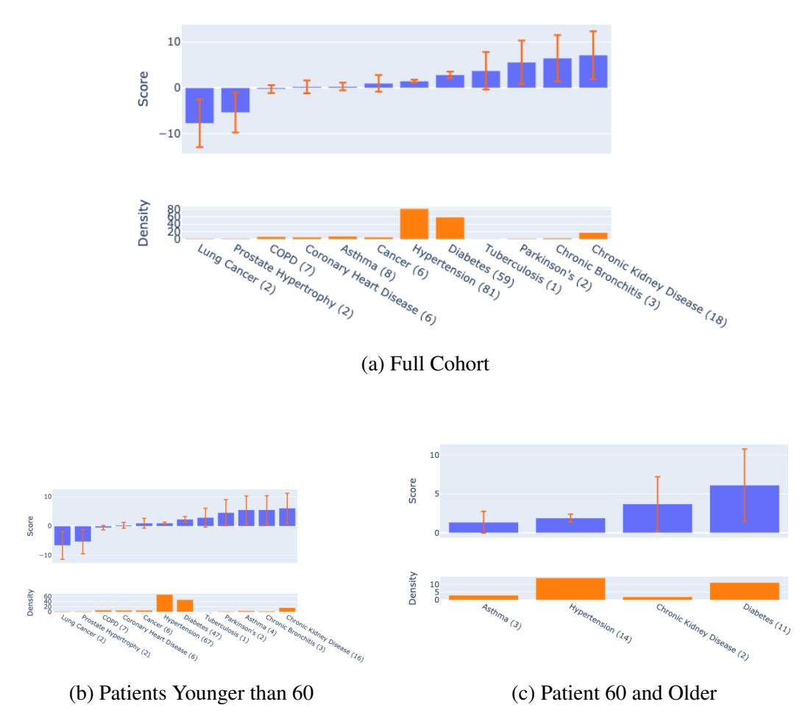

> > Answering the prompt with the exact required format. > > > Hình ảnh gồm ba biểu đồ con được dán nhãn (a), (b), và (c), biểu diễn mối quan hệ giữa điểm số (Score) và mật độ (Density) của các bệnh lý mãn tính khác nhau trong các nhóm đối tượng: > > *(

Figure 2.1: Addition to log odds (score) of mortality according to additive models estimated from (a) the full cohort, (b) the patients younger than 60, and (c) the patients 60 and older. We see that the model estimates asthma having negligible impact on mortality risk in the full dataset, but has significantly positive risks in both subsets.

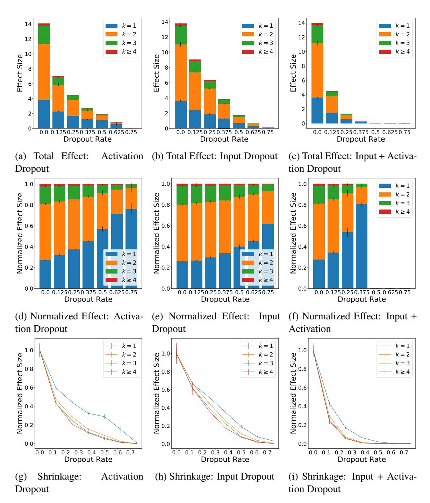

> > Refine and Format**: Ensure LaTeX is used for math symbols like $k=1$, $k \ge 4$. Keep it clean and accurate. > Hình ảnh gồm 9 đồ thị được sắp xếp theo dạng lưới 3x3, chia thành 3 hàng và 3 cột, biểu diễn kết quả phân tích tác động của Dropout Rate

Figure 2.2: Dropout regularizes neural networks by down-weighting higher-order interaction effects. In this experiment, we train fully-connected neural networks on a dataset of pure noise. Displayed values are the (mean ± std. over 10 initializations) of the trained model's variance explained by each order of interaction effect. All neural networks in this figure have 32 units in each hidden layer, and we see that both Activation and Input Dropout significantly reduce the estimated effect sizes of the high-order interactions. The top row of graphs (a–c) shows the absolute variance of the models for different values of Dropout — as Dropout grows, overfitting is reduced and the variance of the predictions converges towards zero. The middle row (d–f) shows the relative effect sizes of interactions of degree 1, 2, 3, and 4 or greater, making it easier to see how the Dropout rate affects each degree of interaction. The bottom row (g–i) shows the effects normalized by their strength in the unregularized model to visualize the shrinkage effect as a function of Dropout for each degree of interaction. 12

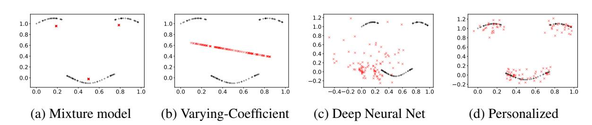

> > Hình ảnh gồm 4 biểu đồ phân tán (scatter plot) được sắp xếp theo hàng ngang, so sánh kết quả dự báo của các mô hình khác nhau trên cùng một tập dữ liệu gốc (màu đen) có hình dạng khuôn mặt cười (gồm 3 đường cong: hai đường cong phía trên đại diện cho mắt/lông mày và một đường cong phía dưới đại diện cho miệng). Các điểm dự báo của mô hình được biểu diễn bằng các dấu "x" màu đỏ. > > Biểu đồ (a) Mixture model: Các điểm dự báo màu đỏ chỉ gồm 3 điểm đơn lẻ nằm ở khu vực trung tâm của 3 đường cong màu đen. Trục X chạy từ 0.0 đến 1.0, trục Y chạy từ 0.0 đến 1.0. > Biểu đồ (b) Varying-Coefficient: Các điểm dự báo màu đỏ tạo thành một đường thẳng dốc xuống cắt ngang qua giữa biểu đồ, không khớp với hình dạng các đường cong màu đen. Trục X chạy từ 0.0 đến 1.0, trục Y chạy từ 0.0 đến 1.0. > Biểu đồ (c) Deep Neural Net: Các điểm dự báo màu đỏ phân tán hỗn loạn và rải rác khắp biểu đồ, tập trung nhiều ở góc dưới bên trái. Trục X chạy từ -0.4 đến 1.0, trục Y chạy từ -0.2 đến 1.2. > Biểu đồ (d) Personalized: Các điểm dự báo màu đỏ bám rất sát theo hình dạng của cả 3 đường cong màu đen, thể hiện độ chính xác cao nhất. Trục X chạy từ 0.0 đến 1.0, trục Y chạy từ -0.2 đến 1.2.

> > (a) Mixture model > (b) Varying-Coefficient > (c) Deep Neural Net > (d) Personalized > > Trục tọa độ biểu đồ (a): > Y: 0.0, 0.2, 0.4, 0.6, 0.8, 1.0 > X: 0.0, 0.2, 0.4, 0.6, 0.8, 1.0 > > Trục tọa độ biểu đồ (b): > Y: 0.0, 0.2, 0.4, 0.6, 0.8, 1.0 > X: 0.0, 0.2, 0.4, 0.6, 0.8, 1.0 > > Trục tọa độ biểu đồ (c): > Y: -0.2, 0.0, 0.2, 0.4, 0.6, 0.8, 1.0, 1.2 > X: -0.4, -0.2, 0.0, 0.2,

Figure 2.3: Illustration of the benefits of personalized models. Each point represents the regression parameters for a sample. Black points indicate true effect sizes, while the red points are estimates. Mixture models (a) estimate a limited number of models. The varying-coefficients model (b) estimates sample-specific models but the non-linear structure of the true parameters violates the model assumptions, leading to a poor fit. The locally-linear models induced by a deep learning model (c) do not accurately recover the underlying effect sizes. In contrast, personalized regression (d) accurately recovers effect sizes.

# Chapter 3

# Personalized Regression: A Non-parametric Parameter Generator

Portions of this chapter have been previously published as [77, [78]](#page-62-5)

## 3.1 Personalized Regression

Here, we propose a framework to estimate sample-specific models by learning patterns of differentiation between samples. Instead of learning a single model for an entire cohort, or learning a generating function for model parameters, our framework learns a distance metric between samples and uses this distance to encourage similarity between the model parameters of similar samples. The key is to leverage the fact that although each sample is expected to have a unique pattern of differentiation, these patterns are not independent of one another, and are expected to share substantial similarities. Leveraging this, we can "borrow strength" from the entire cohort to learn a useful model that is specific to a given sample. To do this, we propose a novel distance matching regularizer which estimates sample similarity and encourages parameter similarity for similar samples.

Instead of assuming a known parametric function that translates covariates into regression parameters, we aim to recover the personalized regression parameters by matching the pairwise distances implied by covariates U to the pairwise distances in regression parameters β. By focusing on matching the two measurements of sample distance rather than learning a function of the covariate values, our framework avoids assumptions of smoothness of the personalization effects. In addition, our framework requires only a set of K feature-wise distance metrics dUk ∶ Ω2 k → R≥0 that each act on a single covariate feature. Note that here we do not require these distance metrics to be differentiable. This allows for a wide variety of distance metrics, such as the discrete metric dUk (U (i) k, U(j) k) = I {U (i) k ≠U (j) k, and allows our framework to handle the realistic situation of categorical covariates without ordering, which previous approaches do not handle. By applying these feature-specific distance metrics, we produce K-dimensional distances between each pair i, j of covariate values dZ(U(i), U(j)) = [dU1 (U (i) 1, U(j) 1),..., dUK (U (i) K, U(j) K)].

Conveniently, the same analytic tools required to understand an individual sample in the context of similar samples will also enable us to look at each sample group in the context of other groups. In this way, our approach can lead to models of controllable granularity.

For clarity, we describe the main idea using a linear model for each personalized model; extension to arbitrary generalized linear models including logistic regression is straightforward. In Section 3, we include experiments using both linear and logistic regression. A traditional linear model would dictate Y (i) = ⟨X(i), θ⟩ + w(i), where the w(i) are noise and the parameter θ ∈ R p is shared across different samples. We relax this model by allowing θ to vary with each sample, i.e.

Y (i) = ⟨X(i), θ(i) ⟩ + w (i). (3.1)

Clearly, without additional constraints, this model is overparametrized— there is a (p − 1) dimensional subspace of solutions to the equation Y (i) = ⟨X(i), θ(i) ⟩ in θ (i) for each i. Thus, the key is to choose a solution θ (i) that simultaneously leads to good generalization and accurate inferences about the ith sample. We propose two strategies for this: (a) a novel regularization scheme and (b) a low-rank latent representation of the parameters θ (i).

### Model

We are interested in learning which features X ∈ R P are relevant for predicting a phenotype Y ∈ R such as disease status. At the same time, we assume we have access to clinical covariates U ∈ Ω1 × ⋯ × ΩK for each individual, which are allowed to be arbitrary—unordered or ordered, categorical or continuous, and even with missing values. Throughout, we let N denote the total number of patients in the cohort and use superscripts to identify samples. Thus, Y (i), X(i), and U(i) denote the data for the ith sample and β (i) denotes the personalized regression coefficients for the ith sample.

## 3.2 Distance-Matching Regularization

To recover personalized model parameters β (i) without a priori knowledge of how samples are related, we assume that there are unknown (pseudo)metrics dβ and dU such that dβ(β (i), β(j)) ≈ dU (U(i), U(j)). That is, similarity in parameters is related to similarity in covariates, however, the nature of this similarity is unobserved, unknown, and may not correspond to usual notions of distance such as Euclidean distance. This is closely related to the notion of distance metric learning introduced by Xing et al. [[146]](#page-68-3). Existing work along these lines in the personalized estimation literature typically assumes that either (a) The metrics are Euclidean, or (b) The pairwise similarities are known [147, [148]](#page-68-2).

To learn these latent distance metrics, we model them as follows:

dβ(x, y) = ζ⟨φβ, [dβ1 (x1, y1),..., dβP (xP, yP)]⟩, (3.2a)

dU (x, y) = ⟨φU, [dU1 (x1, y1),..., dUK (xK, yK)]⟩, (3.2b)

where ⟨⋅, ⋅⟩ denotes the dot product of two vectors and dβp (p = 1,..., P) are user-specified metrics between scalars and dUk (k = 1,..., K) are user-specified metrics between covariates. Note that here we do not require these distance metrics to be differentiable. This allows for a wide variety of distance metrics, such as the discrete metric dUk (x, y) that equals one if x = y and is zero otherwise. This allows our framework to handle the realistic situation of categorical covariates without ordering. The parameters φβ and φU represent unknown linear transformations of these "simple" distances into more useful latent distance metrics given by (3.2a) and (3.2b) with scale ζ > 0.

Define pairwise distance vectors for each i, j by

∆ (i,j) β = [dβ1 (β (i) 1, β(j) 1),..., dβP (β (i) P, β(j) P)] (3.3a)

∆ (i,j) U = [dU1 (U (i) 1, U(j) 1),..., dUK (U (i) K, U(j) K)] (3.3b)

Since the covariate values in U are fixed, ∆ (i,j) U is also fixed, whereas ∆ (i,j) β is not fixed since the values of β (i) and β (j) will change during training. For simplicity, we take dβp (x, y) = ∣x − y∣ (p = 1,..., P) in the remainder, although this could be replaced with any distance metric that is differentiable for all x ≠ y.

Now define the following distance matching regularizer:

% (i) γ (dβ, dU) = γ 2 ∑ j≠i (dβ(β (i), β(j)) − dU (U (i), U(j)))2 = γ 2 ∑ j≠i (ζ⟨φβ, ∆ (i,j) β ⟩ − ⟨φU, ∆ (i,j) U ⟩)2. (3.4)

This regularizer attempts to match the pairwise distances between covariate values to the pairwise distances in the learned regression parameters. Let f be a loss function, e.g. least squares for regression or logistic loss for classification. Define a sample-specific objective by

L (i) (β (i); dβ, dU) ∝f(X(i), Y (i), β(i)) + ρ β λ (β (i)) + % (i) γ (dβ, dU).

where γ trades off sensitivity to prediction of the response variable against sensitivity to sample distances, f(X(i), Y (i), β(i)) is the prediction loss for sample i, and ρ β λ ∶ RP → R≥0 regularizes β (i) with strength set by λ. Summing these, we obtain the complete objective function

L(β, φβ, φU, ζ) ∝ N ∑ i=1 L (i) (β, dβ, dU) + ψ β α (dβ) + ψ U υ (dU)

where ψ β α, and ψU υ regularize the distance functions dβ, dU with strengths set by α, υ, respectively. Intuition

A visualization of this model is to imagine a set of marbles positioned at the top of a hill, with springs connecting each pair of marbles. When the spring constants are set to +∞ and the springs have a resting length of 0, the marbles cannot move (as in a classical population estimator which constrains all estimates to be at the same point). When the spring constant is reduced and the resting lengths of the springs are increased (to create our personalized estimator), the marbles will be allowed to roll down the hill and will each follow their own path toward a minimum. In this visualization, the spring constant κij between marbles i and j is given by κij = γ 2 and the spring has a resting length of ∆ (i,j) U φU. While the resting length of the spring may change over the course of the optimization (as φU is updated), the spring imparts the same force in opposing directions on marbles i and j, so it cannot move the midpoint of marbles i and j. Thus, the pairwise regularization cannot move the bericenter of the personalized solutions.

## 3.3 Low-Rank Personalized Regression

We constrain the matrix of personalized parameters Ω = [θ (1) ∣⋯∣ θ (n) ] ∈ R p×n to be low-rank, i.e. θ (i) = QTZ(i) for some loadings Z(i) ∈ Rq and some dictionary Q ∈ Rq×p. Letting Z ∈ R q×n denote the matrix of loadings, we have a low-rank representation of Ω = QTZ. The choice of q is determined by the user's desired latent dimensionality; for q ≪ p, using only Θ(q(n+p)) instead of the Θ(np) of a full-rank solution can greatly improve computational and statistical efficiency. In addition, the low-rank formulation enables us to use `2 distance in Z in Eq. (3.6) to restrict Euclidean distances between the θ (i): After normalizing the columns of Q, we have

∥θ (i) − θ (j) ∥ ≤ √ p∥Z (i) − Z (j) ∥. (3.5)

This illustrates that closeness in the loadings Z(i) implies closeness in parameters θ (i). This fact will be exploited to regularize θ (i) (Section 3).

This use of a dictionary Q is common in multi-task learning [[96]](#page-64-2) based on the assumption that tasks inherently use shared atomic representations. Here, we make the analogous assumption that samples arise from combinations of shared processes, so sample-specific models based on a shared dictionary efficiently characterize sample heterogeneity. Sparsity in θ can be realized by sparsity in Z, Q; for instance, effect sizes which are consistently zero across all samples can be created by zero vectors in the columns of Q. The low-rank formulation also implicitly constrains the number of personalized sparsity patterns; this can be adjusted by changing the latent dimensionality q.

## Distance-matching of Low-Rank Personalized Models

By Eq. (3.5), in order for ∥θ (i) − θ (j)∥ ≈ ρφ(U(i), U(j)), it suffices to require ∥Z(i) − Z(j)∥ ≈ ρφ(U(i), U(j)). With this in mind, define the following distance-matching regularizer:

D (i) γ (Z, φ) = γ 2 ∑ j∈Br(i) (ρφ(U (i), U(j)) − ∥Z (i) − Z (j) ∥ 2) 2, (3.6)

where Br(i) = {j ∶ ∥Z(i) − Z(j)∥ 2 &lt; r}. This regularizer promotes imitating the structure of covariate values in the regression parameters. By using Z instead of Ω in the regularizer, calculation of distances is much more efficient when q ≪ p.

#### Missing values

When there is a missing value in the covariate data, we set the distance between this value and all others to zero. This underestimates the distance between samples, biasing the solution toward retaining a central population estimator rather than personalizing the models based on missing features.

Full Model Let `(x, y, θ) be a loss function, e.g. least-squares or logistic loss. For each sample i of the training data, define a regularized, sample-specific loss by

L (i) (Z, Q, φ) = `(X(i), Y (i), QTZ (i)) + ψλ(Q TZ (i)) + D (i) γ (Z, φ), (3.7)

where ψλ is a regularizer such as the `1 penalty and D (i) γ is the distance-matching regularizer defined in Eq. (3.6). We learn Ω and φ by minimizing the following composite objective:

L(Z, Q, φ) = n ∑ i=1 L (i) (Z, Q, φ) + υ∥φ − 1∥ 2 2, (3.8)

where the second term regularizes the distance function ρφ with strength set by υ, and we recall that Ω = QTZ. The hyperparameter γ trades off sensitivity to prediction of the response variable against sensitivity to covariate structure.

Optimization We minimize the composite objective L(Z, Q, φ) with subgradient descent combined with a specific initialization and learning rate schedule. An outline of the algorithm can be found in Alg. 1 below. In detail, we initialize Ω by setting θ (i) ∼ N(θ̂pop, I) for a population model θ̂pop such as the Lasso or elastic net and then initialize Z and Q by factorizing Ω with PCA. is a very small value used only to enable factorization by the PCA algorithm. Each personalized estimator is endowed with a personalized learning rate α (i) t = αt/∥θ̂(i) t − θ̂(pop)∥∞, which scales the global learning rate αt according to how far the estimator has traveled. In addition to working well in practice, this scheme guarantees that the center of mass of the personalized regression coefficients does not deviate too far from the intialization θ̂pop, even though the coefficients θ̂(i) remain unconstrained. This property is discussed in more detail in Section 3.

### Algorithm 1 Personalized Estimation

Require: θ̂pop

, λ, γ, υ, α, c

1: θ (1)

,..., θ(n) ← θ̂pop

2: Ω ← [θ

(1)

∣... ∣ θ

(n) ]

3: Z, Q ← PCA(Ω)

4:

5: α ← α0 6: do

7: Z, ̃ Q, ̃ φ̃ ← Z, Q, φ

8: φ ← φ − α

∂

∂φL(Z, ̃ Q, ̃ φ̃; λ, γ, υ)

9: Z(i) ← Z(i) −

α

∥θ

(i)−θ̂pop∥∞

[ ∂ ∂Z(i) ∑

n i=1 D (i) γ (Z, ̃ φ̃)+

Q̃(∂`(X(i)

, Y (i)

, θ(i)) + ∂ψλ(θ

(i)))] ∀ i ∈ [1,..., n]

10: Q ← Q − α[

∂ ∂Q ∑ n i=1 D (i)

γ (Z, ̃ φ̃) + ∑

n

i=1 Z̃(i)(∂`(X(i)

, Y (i)

, θ(i))

T + ∂ψλ(θ

(i)) T)]

11: α ← αc

12: θ

(i) ← QTZ(i) ∀ i ∈ [1,..., n]

13: Ω ← [θ

(1)

∣... ∣θ

(n) ]

14: while not converged 15: return Ω, Z, Q, φ

Prediction Given a test point (X, U), we form a sample-specific model by averaging the model parameters of the kn nearest training points, according to the learned distance metric ρφ:

θ = 1 kn kn ∑ j=1 θ (η(ρφ,U)[j]), η(ρφ, U) = argsort 1≤i≤n ρφ(U, U(i)), (3.9a)

where argsort orders the indices {1,..., n} in descending order of covariate distance. Increasing kn drives the test models toward the population model to control overfitting. In our experiments, we use kn = 3.

We have intentionally avoided using X to select θ so that interpretation of θ is not confounded by X. In some cases, however, the sample predictors can provide additional insight to sample distances (e.g. [[142]](#page-68-4)); we leave it to future work to examine how to augment estimations of sample distances by including distances between predictors.

Scalability Na¨ıvely, the distance-matching regularizer has O(n 2) pairwise distances to calculate, however this calculation can be made efficient as follows. First, the terms involving d(U (i), U(j)) remain unchanged during optimization, so that their computation can be amortized. This allows the use of feature-wise distance metrics which are computationally intensive (e.g. the output of a deep learning model for image covariates). Furthermore, these values are never optimized, so the distance metrics d need not be differentiable. This allows for a wide variety of distance metrics, such as the discrete metric for unordered categorical covariates. Second, we streamline the calculation of nearest neighbors in two ways: 1) Storing Z in a spatial data structure and 2) Shrinking the hyperparameter r used in (3.6). With these performance improvements, we are able to fit models to datasets with over 10,000 samples and 1000s of predictors on a Macbook Pro with 16GB RAM in under an hour.

#### Analysis

Initializing sample-specific models around a population estimate is convenient because the samplespecific estimates do not diverge from the population estimate unless they have strong reason to do so. Here, we analyze linear regression minimized by squared loss (e.g., f(X(i), Y (i), θ(i)) = (Y (i) − X(i)θ (i)) 2), though the properties extend to any predictive loss function with a Lipschitzcontinuous subgradient.

Theorem 3. Let us consider personalized linear regression with ψλ(x) = λ∥x∥1 (i.e. `1 regularization). Let X be normalized such that maxi∥X(i)∥∞ ≤ 1, ∥X(i)∥1 = 1. Define θt ∶= 1 n ∑ n i=1 θ̂(i) t, where θ̂(i) t is the current value of θ̂(i) after t iterations. Let the learning rate follow a multiplicative decay such that αt = α0c t, where α0 is the initial learning rate and c is a constant decay factor. Then at iteration τ,

∥θτ − θ̂pop∥∞ ∈ O(λ). (3.10)

That is, the center of mass of the personalized regression coefficients does not deviate too far from the initialization θ̂pop, even though the coefficients θ̂(i) remain unconstrained. In addition, the distance-matching regularizer does not move the center of mass and the update to the center of mass does not grow with the number of samples. Proofs of these claims are included in [[78]](#page-62-5).

## 3.4 Applications

We compare personalized regression (hereafter, PR) to four baselines: 1) Population linear or logistic regression, 2) A mixture regression (MR) model, 3) Varying coefficients (VC), 4) Deep neural networks (DNN). First, we evaluate each method's ability to recover the true parameters from simulated data. Then we present three real data case studies, each progressively more challenging than the previous: 1) Stock prediction using financial data, 2) Cancer diagnosis from mass spectrometry data, and 3) Electoral prediction using historical election data. The results are summarized in Table 3.3 for easy reference.

We believe the out-of-sample prediction results provide strong evidence that any harmful overfitting of PR is outweighed by the benefit of personalized estimation. This agrees with famous results such as [[128]](#page-66-3), where it is showed that optimal ensembles of linear models consist of overfitted atoms; see especially Eq. 12 and Fig. 2 therein.

Baselines For each experiment, we use several baseline models to benchmark performance:

- Population model. First, we use elastic net regularization [[156]](#page-69-0) as a generalizable population estimator.
- Mixture of regressions. To estimate a small collection of models, we use a standard mixture model optimized by expectation-maximization. Since this model does not share information between mixture components, the number of components must be much smaller than the number of samples.
- Varying coefficient model. To estimate sample-specific models, we use an `1-regularized linear varying-coefficients model [[51]](#page-59-2).
- Deep neural network. Finally, to compare against models with large representational capacity, we include a neural network. This neural network contains 5 hidden layers, with layer sizes and nonlinearities treated as hyperparameters optimized for cross-validation loss by grid search. The final version contains 250 hidden nodes in each layer with sigmoid nonlinearities.

For the tasks with continuous outcomes, these are linear regression models; for classification tasks, these are logistic regression models.

Choice of hyperparameters While the personalized regression approach estimates a large number of parameters, there are relatively few hyperparameters. Hyperparameters to be selected are: λ the strength of the traditional regression regularizer, γ the strength of the distancematching regularizer, r the diameter of the neighborhoods considered by the distance-matching regularizer, υ the strength of regularizer on φ, and q the latent dimensionality. λ should be set equivalent to the λ used in the population estimator. γ requires some tuning and should be set such that the distance-matching regularizer contributes the a same order of magnitude on the total loss as does the predictive loss. r should be set to reflect the user's desired neighborhood of personalization; larger r produces personalized estimates which reflect covariate distances even for very different samples, smaller r improves computation speed but decreases the size of the neighborhoods of personalization. Finally, υ regularizes φ and should be set to reflect the user's prior knowledge about the influence of each covariate on personalization.

For our experiments, we use the following hyperparameter values with PR:

|p Model | ∣∣ Ωˆ − Ω | ∣∣ 2 R 2 | MSE |
|--------- | ----------- | ---------- | ------ |
|Pop. | 9.97 | 0.87 | 0.13 |
|MR | 9.86 | 0.88 | 0.12 |
|VC | 14.55 | 0.76 | 0.22 |
|DNN | 30.42 | 0.75 | 0.24 |
|PR | 7.82 | 0.89 | 0.09 |
|Pop. | 15.19 | 0.79 | 0.73 |
|MR | 14.81 | 0.80 | 0.70 |
|VC | 23.86 | 0.69 | 1.09 |
|DNN | 67.49 | 0.80 | 0.85 |
|PR | 14.52 | 0.82 | 0.65 |
|Pop. | 25.86 | 0.85 | 1.26 |
|MR | 25.75 | 0.86 | 1.20 |
|VC | 38.77 | 0.66 | 3.05 |
|DNN | 103.72 | 0.68 | 2.78 |
|PR | 24.53 | 0.87 | 1.10 |

Table 3.1: Simulations with n = 500.

|n Model | ∣∣ Ωˆ − Ω | ∣∣ 2 R 2 | MSE |
|--------- | ----------- | ---------- | ------ |
|Pop. | 6.36 | 0.90 | 0.23 |
|MR | 6.48 | 0.90 | 0.23 |
|VC | 10.75 | 0.78 | 0.50 |
|DNN | 22.30 | 0.39 | 0.75 |
|PR | 6.03 | 0.91 | 0.21 |
|Pop. | 11.83 | 0.84 | 0.29 |
|MR | 11.78 | 0.84 | 0.30 |
|VC | 19.06 | 0.74 | 0.49 |
|DNN | 47.33 | 0.81 | 0.37 |
|PR | 10.30 | 0.86 | 0.26 |
|Pop. | 33.03 | 0.87 | 0.26 |
|MR | 31.75 | 0.88 | 0.26 |
|VC | 33.71 | 0.87 | 0.27 |
|DNN | 102.88 | 0.88 | 0.29 |
|PR | 26.11 | 0.90 | 0.21 |

Table 3.2: Simulations with p = 5.

- Simulation. λ = 1e−1, γ = 1e5, υ = 1e−2, q = 2
- Finance. λ = 1, γ = 1e8, υ = 1e−2, q = 50
- Cancer. λ = 1, γ = 1e6, υ = 1e−2, q = 50
- Election. λ = 1e−2, γ = 1e3, υ = 1e−2, q = 2

For all experiments, we dynamically set r such that each point has on average 10 neighbors, and use the learning rate schedule of α0 = 1e−4, c = 1 − 1e−4. For each baseline described in Section 3, hyperparameter values were selected by cross-validation.

Simulation Study We first investigate the capacity of personalized regression to recover true effect sizes in simulation studies. For these experiments, we generate data according to X ∼ Unif(−1, 1) p, U ∼ Unif(0, 1) K, a ∼ Unif(0, 1) p, b ∼ Unif(0, 1) p, c ∼ Cat(K) p, θj = I{Ucj &gt;aj} + bj sinUcj, Y (i) = X(i)θ (i) + N(0, 0.01). These experiments all use K = 5 covariates. As shown in Fig. 2.3, this produces regression parameters with a discontinuous distribution.

The algorithms are given both X and U as input during training, and we use LIME [[117]](#page-65-2) to generate local linear approximations to the DNN in order to estimate parameters θ (i) for each sample. In this setting, there exists a discontinuous function which could output exactly the sample-specific regression models from the covariates. In this sense, the neural network is "correctly specified" for this dataset, testing how well locally-linear models approximate the true parameters. To estimate personalized models for the simulated dataset, we initialize the personalized estimations with a varying-coefficient model, and personalize according to the distance metric d1(x, y) = ∣x − y∣.

Results. In Table 3.1, we report results for varying n and in Table 3.2, we report results for varying p. The values reported are: (1) the recovery error of the true regression parameters in the training set, with (mean ± std) values calculated over 20 experiments with different values of X, U, w, (2) correlation coefficient of predictions on the test set, and (3) mean squared error of predictions on the test set.

As expected, the recovery error is much lower for PR, while the DNN shows competitive predictive error. The population estimator successfully recovers the mean effect sizes, but this central model is not accurate for any individual, resulting in poor performance both in recovering Ω and in prediction. Similarly, both MR and VC perform poorly. As expected, the deep learning model excels at predictive error, however, the local linear approximations do not accurately recover the sample-specific linear models. In contrast, PR exhibits both the flexibility and the structure to learn the true regression parameters while retaining predictive performance.

Financial Prediction A common task in financial trading is to predict the price of a security at some point in the future. This is a challenging task made more difficult by nonstationarity—the interpretation of an event changes over time, and different securities may respond to the same event differently.

Data. We built a dataset of security prices over a 30-year time frame by joining stock and ETF trading histories1 to a database of global news headlines from Bloomberg [[29]](#page-57-2) and Reddit2. We transform news headlines into continuous representations by tf-idf weighting averaging [[5]](#page-55-4) of word embeddings under the GLoVE model [[108]](#page-65-3) pre-trained on Wikipedia and Gigaword corpora3. After dimensionality reduction, this news dataset consists of a 50-dimensional vector for each date. The predictors X(i,t) consist of the trading history of the 24 securities over the previous 2 weeks as well as global news headlines from the same time period. The covariates U(i,t) consist of the date and security characteristics (name, region, and industry). The target Y (i,t) is the price of this security 2 weeks after t. We split the dataset into training and test sets at the 80th percentile date, which is approximately the beginning of 2011. To estimate personalized models for the financial dataset, we initialize the personalized estimators with the population model and personalize according to the `1 distance for time and the discrete metric for the other covariates.

Results. PR significantly outperforms baseline methods to predict price movements (Table 3.3). In contrast to standard models which average effects over long time periods and/or securities, PR summarizes gradual shifts in attention. Shown in Fig. 3.1 are visualizations of the model parameters, colored by each of the covariates used for personalization. The strongest clustering behavior is due to time (Fig. 3.1d). For instance, models fit to samples in the era of U.S. "stagflation" (1973-1975) are overlaid on models for samples in the early 1990s U.S. recession. In both of these cases, real equity prices declined against the background of high inflation rates. In contrast, the recessions marked by structural problems such as the Great Financial Crisis of 2008

1 https://www.kaggle.com/borismarjanovic/price-volume-data-for-all-us-stocks-etfs/version/3

2 https://www.kaggle.com/aaron7sun/stocknews

3 https://nlp.stanford.edu/projects/glove

|Model |  | R 2 | Financial MSE |  | AUROC | Cancer | Acc |  | R 2 | Election | MSE |
|------- | ----- | ----- | --------------- | --- | ------- | -------- | ----- | ----- | ----- | ---------- | ----- |
|Pop. | 0 | 01 | 64144 | 0 | 794 | 0 | 962 | 0 | 00 | 0 | 019 |
|MR | 0 | 74 | 16146 | 0 | 876 | 0 | 939 | − 0 | 56 | 0 | 031 |
|VC | 0 | 06 | 60694 | 0 | 430 | 0 | 863 | 0 | 00 | 0 | 019 |
|DNN | − 0 | 02 | 63028 | 0 | 901 | 0 | 955 | 0 | 00 | 0 | 019 |
|PR | 0 | 86 | 4822 | 0 | 923 | 0 | 975 | 0 | 45 | 0 | 011 |

Table 3.3: Predictive performance on test sets of real data experiments. For continuous response variables, we report correlation coefficient (R2) and mean squared error (MSE) of the predictions. For classification tasks, we report area under the receiver operating characteristic curve (AUROC) and the accuracy (ACC).

are separated from the others. Within each time period, we also see that industries (Fig. 3.1a), regions (Fig. 3.1b), and securities (Fig. 3.1c) are strongly clustered.

Cancer Analysis In cancer analysis, the challenges of sample heterogeneity are paramount and well-known. Increasing biomedical evidence suggests that patients do not fall into discrete clusters [12, [91]](#page-63-0), but rather each patient experiences a unique disease that should be approached from an individualized perspective [[31]](#page-57-3). Here, we investigate the capacity of PR to distinguish malignant from benign skin lesions using a dataset of desorption electrospray ionization mass spectrometry imaging (DESI-MSI) of a common skin cancer, basal cell carcinoma (BCC).

Data. This dataset, from [[94]](#page-63-1), contains 17,053 total samples from 17 patients. Each sample consists of 2,734 spectra intensities and is labeled with a binary outcome (0=benign, 1=malignant). Data from 9 patients are used to fit models, while data from 8 patients are held-out for evaluation. In this dataset, the only explicit covariate is the patient label. To produce covariates which are most useful for personalization, we augment the patient labels with 1500 of the predictive features compressed to 2 dimensions by t-SNE dimensionality reduction. These 1500 predictive features are excluded from the set of predictors for PR, while baseline methods use the entire set of features as predictors. We fit the personalized regression according to the distance function d1(x, y) = I{x≠y}, d2(x, y) = ∣x − y∣, d3(x, y) = ∣x − y∣, where the first function checks if the patients are the same and the final two calculate distance in the continuous covariates.

Results. As shown in Table 3.3, PR produces the best predictions of tumor status amongst the methods evaluated. The substantial improvement over competing methods is likely due to the long tail of the distribution of characteristic features. This may point to the "mosaic" view of tumors, under which single tumors are comprised of multiple cell lines [[82]](#page-62-6). This example underscores the benefits of treating sample heterogeneity as fundamental by designing algorithms to estimate sample-specific models.

Presidential Election Analysis Our last experiment illustrates a practical use case for the example of modeling election outcomes discussed in Section 1. The goals are twofold: 1) To

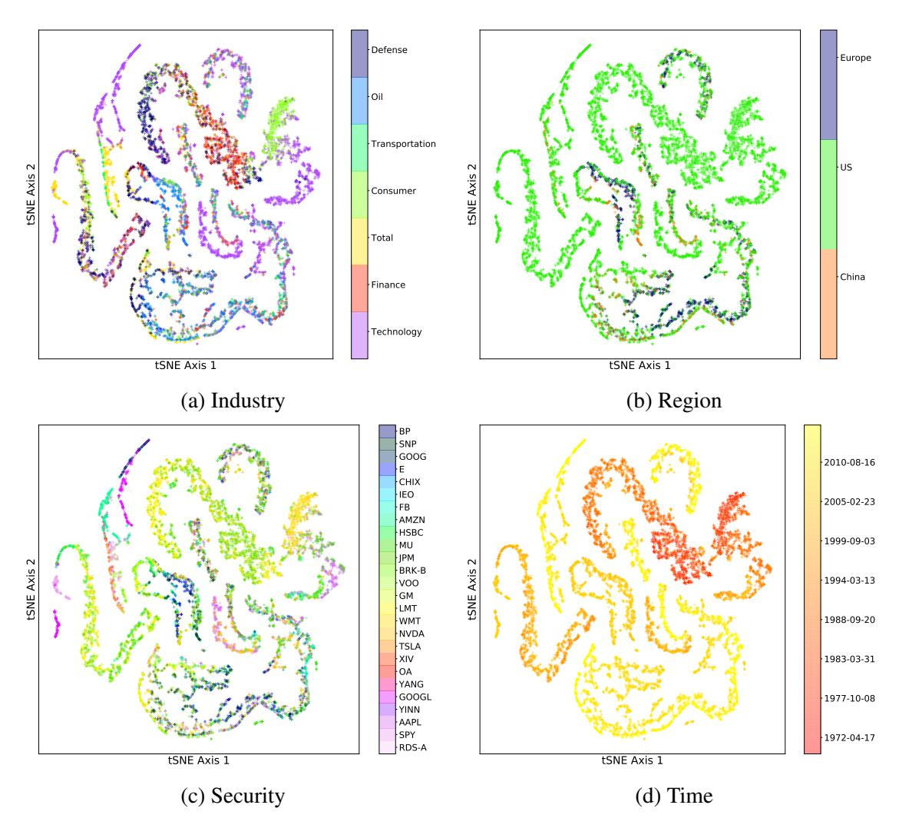

> > Hình ảnh hiển thị bốn biểu đồ phân tán t-SNE (t-distributed Stochastic Neighbor Embedding) được sắp xếp theo dạng lưới 2x2, biểu diễn cùng một tập hợp dữ liệu nhưng được tô màu theo các thuộc tính khác nhau. Cả bốn biểu đồ đều có trục hoành là "tSNE Axis 1" và trục tung là "tSNE Axis 2". > >:
- Biểu đồ (a) Industry (trên cùng bên trái): Các điểm dữ liệu được tô màu dựa trên ngành công nghiệp (Industry). Thanh màu bên phải hiển thị các nhãn màu tương ứng với các ngành: Defense (Phòng thủ), Oil (Dầu khí), Transportation (Vận tải), Consumer (Tiêu dùng), Total (Tổng hợp), Finance (Tài chính), và Technology (Công nghệ). >
- Biểu đồ (b) Region (trên cùng bên phải): Các điểm dữ liệu được tô màu dựa trên khu vực địa lý (Region). Thanh màu bên phải hiển thị ba khu vực: Europe (Châu Âu), US (Mỹ), và China (Trung Quốc). Phần lớn các điểm có màu xanh lá cây đại diện cho khu vực US. >
- Biểu đồ (c) Security (dưới cùng bên trái): Các điểm dữ liệu được tô màu dựa trên mã chứng khoán (Security). Thanh màu bên phải liệt kê danh sách dài các mã chứng khoán như BP, SNP, GOOG, E, CHIX, IEO, FB, AMZN, HSBC, MU, JPM, BRK-B, VOO, GM, LMT, WMT, NVDA, TSLA, XIV, OA, YANG, GOOGL, YINN, AAPL, SPY, RDS-A. >
- Biểu đồ (d) Time (dưới cùng bên phải): Các điểm dữ liệu được tô màu theo thời gian (Time) từ năm 1972 đến năm 2010. Thanh màu bên phải thể hiện dải màu chuyển dần từ đỏ (năm 1972) sang vàng (năm 2010).

> > (a) Industry > Defense > Oil > Transportation > Consumer > Total > Finance > Technology > > (b) Region > Europe > US > China > > (c) Security > BP > SNP > GOOG > E > CHIX > IEO > FB > AMZN > HSBC > MU > JPM > BRK-B > VOO > GM > LMT > WMT > NVDA > TSLA > XIV > OA > YANG > GOOGL > YINN > AAPL > SPY > RDS-A > > (d) Time > 2010-08-16 > 2005-02-23 > 1999-09-03 > 1994-03-13 > 1988-09-20 > 1983-03-31 > 1977-10-08 > 1972-04-17

Figure 3.1: Personalized financial models using t-SNE [[137]](#page-67-3) embedding. Each point represents a regression model for one security at a single date, colored according to covariate value.

predict county-level election results, and 2) To explore the use of distinct regression models as embeddings of samples in order to better understand voting preferences at the county (i.e. sample-specific) level.

Data. The election predictors are taken from the 2012 U.S. presidential election and consists of discrete representations of each candidate based on candidate positions compiled by ProCon.4 Outcomes are the county-level vote proportions in the 2012 U.S. presidential election.5 For the covariates U, we used county demographic information from the 2010 U.S. Census.6 As the outcome varies across samples but the predictors remain constant, the personalized regression models must encode sample heterogeneity by estimating different regression parameters for dif-

4 https://2012election.procon.org/view.source-summary-chart.php

5 https://dataverse.harvard.edu/dataset.xhtml?persistentId=hdl:1902.1/21919

6 https://www.census.gov/data/datasets/2016/demo/popest/counties-detail.html

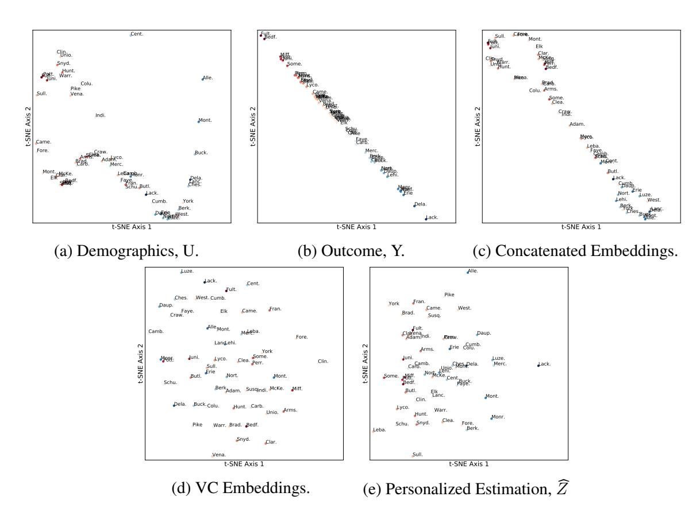

> > Hình ảnh gồm 5 biểu đồ phân tán (scatter plot) biểu diễn kết quả trực quan hóa t-SNE (t-distributed Stochastic Neighbor Embedding) từ tài liệu nghiên cứu. Các biểu đồ được sắp xếp thành hai hàng: hàng trên có 3 biểu đồ (a, b, c) và hàng dưới có 2 biểu

Figure 3.2: Embeddings of Pennsylvania counties. Each point represents the t-SNE embedding of a representation of a county, with color gradient corresponding to the 2012 election result (red for Republican candidate, blue for Democratic candidate). (a) The county demographics (U) lie near a low-dimensional manifold that does not correspond to voter outcome. (b) The observed voting results lie near a one-dimensional manifold. (c) Personalized regression produces sample embeddings (Ẑ) that trade off between demographic and voting information.

ferent samples, thus creating county representations ("embeddings") which combine both voting and demographic data.

Results. The out-of-sample predictive error is significantly reduced by personalization (Table 3.3). Representations of the personalized models for Pennsylvania counties are shown in Fig. 3.2. Generating county embeddings based solely on demographics produce embeddings which do not strongly correspond to voting patterns (Fig. 3.2a), while voting outcomes are near a one-dimensional manifold (Fig. 3.2b). In contrast, the personalized models produce a structure which interpolates between the two types of data (Fig. 3.2e). These trends are not captured by the baseline methods, such as the varying-coefficients model (Fig. 3.2d). In addition, concatenating the demographic and voting outcomes does not recover the same structure (Fig. 3.2c).

An interesting case is that of the Lackawanna and Allegheny counties. While these counties had similar voting results in the 2012 election, their embeddings are far apart due to the difference in demographics between their major metropolitan areas. This indicates that the county populations may be voting for different reasons despite similar demographics, a finding that is not discovered by jointly inspecting the demographic and voting data (Fig. 3.2c). Thus, samplespecific models can be used to understand the complexities of election results.

## 3.5 Sample-Specific Pan-Cancer Analysis

A fundamental goal of personalized medicine is to understand the patterns of differentiation between individuals. With the advent of projects like The Cancer Genome Atlas7 (TCGA) and the International Cancer Genome Consortium (ICGC)8, genomic cancer data are generated at an unprecedented volume. We would like to use these data to understand patient-specific differences for personalized medicine, but many analysis pipelines discard sample heterogeneity in order to boost accuracy. Sample heterogeneity is particularly important for cancer, as cancer is increasingly appreciated as a complex disease in which many distinct underlying mutations may present with similar phenotypes [[36]](#page-58-3); even within a single patient, there is increasing evidence of tumor mosaics composed of distinct cell lines [[95]](#page-63-2). This difficulty with complex diseases like cancer motivates us to find new ways of analyzing data at increasingly small granularities.

Toward this aim, the bioinformatics community has developed increasingly specific assays [[72]](#page-61-4). From targeted microarrays to whole-genome RNA-Seq and single cell RNA-Seq, the granularity of data collected by genomic assays has continued to be refined, to the point that we now possess data points representing the state of an individual cell at a single time point, unlocking the potential to study inter-patient, inter-tissue, and inter-cell variability of complex diseases.

A classic approach to personalization is to assume that we have access to a large volume of multimodal data (e.g. clinical, genomic, proteomic, biometric, etc.) on each individual, which is used to build large predictive models. Given enough data per individual, clinical outcomes and decisions can be personalized [72, [109]](#page-65-4), and recent work along these lines has leveraged a dizzying array of complex models including Gaussian processes [[4]](#page-55-5), neural networks [[87]](#page-63-3), and tree-based models [[100]](#page-64-3), just to name a few. Despite the successes of these methods, they are still limited to this 'one disease–one model' perspective, in which a single predictive model often through model averaging—is built for a single cohort (e.g. corresponding to patients of a particular disease type). Furthermore, these complex models are often difficult to interpret and are not guaranteed to provide correct inference into the underlying biological drivers of disease.

Unfortunately, in many circumstances, we may only have access to a limited amount of measurements per individual (e.g. either for cost or privacy reasons). In this case, it is advantageous to leverage data from distinct but related cohorts in order to build personalized models for each individual. For example, in cancer applications we now have access to large datasets for commonly studied cancers such as breast and lung cancer through repositories such as TCGA. At the same time, less common cancers such as of the eye and lymph node, have much less data (Table 3.4). A true "pan-cancer" study would combine all of this data, exploiting the similarities between different types of cancer to improve the accuracy of models for eye and lymph node cancer. That such similarities exist is well-established in the literature [e.g. [145]](#page-68-5). However, in the traditional 'one disease–one model' paradigm, data from other cancers play no role; while

7<cancergenome.nih.giv>

8<dcc.icgc.org>

|Tissue | n | Tissue | n |
|--------------- | ------- | --------------- | ----- |
|Breast | 1,092 | Ovary | 376 |
|Lung | 1,016 | Liver | 371 |
|Kidney | 885 | Cervix | 304 |
|Brain | 677 | Soft Tissue | 259 |
|Colorectal | 623 | Adrenal Gland | 258 |
|Uterus | 611 | Pancreas | 177 |
|Thyroid | 502 | Esophagus | 164 |
|Head and Neck | 501 | Bone Marrow | 151 |
|Prostate | 495 | Eye | 80 |
|Skin | 468 | Lymph Nodes | 48 |
|Bladder | 408 | Bile Duct | 36 |
|Stomach | 380 |  |  |

Table 3.4: Number of samples by tissue in TCGA.

this makes sense for diseases which have a single root cause, the heterogeneity of complex diseases such as cancer renders these methods inadequate. Leveraging data from multiple cohorts while simultaneously obtaining distinct models for different diseases and different patients is a key challenge in personalized medicine.

Here, we investigate the potential of using personalized regression for personalized cancer analysis. We use gene expression (RNA-Seq) quantification data from The Cancer Genome Atlas (TCGA). This dataset compiles data from 37 projects spanning 36 disease types in 28 primary sites. After pruning for missing values, this dataset contains 9663 profiles for 8944 case and 719 matched control samples; we divide this set into 75% training data and 25% testing. While this full dataset is sizable, previous analyses have been hampered by the small number of samples for each particular cancer sub-type (e.g., there are only 36 cases present in the bile duct cancer dataset). Because our framework of personalized regression allows models to share information across diverse settings, we are able to jointly analyze the cancer subtypes while still recovering subtype-specific characteristics. The number of samples available from each dataset was shown in Table 3.4.

We subsample genes based on annotations in the COSMIC Catalogue of Somatic Mutations in Cancer [[37]](#page-58-4), so that there is exactly one putatively causal gene for each 5 non-annotated genes. This resulting in P = 4123 features when an intercept term is added. We train each logistic regression model to predict the case/control status of each sample with 1 regularization to perform variable selection in order to study which genes are relevant for classification. Our baseline models include: 1-regularized logistic regression model trained on all pan-cancer data ("Population"), 1-regularized logistic regression model trained on each primary tissue type ("Tissue-Population"), 1-regularized mixture model with the number of clusters equal to the number of tissue types in the pan-cancer dataset ("Mixture"), a logistic regression model with parameters that follow a linear varying coefficients model ("VC"), and the mixed model recently proposed by Hayeck et al. 52.

In addition to the RNA-seq data, we used the following 14 covariates: disease type, primary

tumor site, age of the patient at diagnosis, year of birth of the patient, the number of days to sample collection, gender of the patient, race of the patient, percent of neutrophil infiltration, percent monocyte infiltration, percent normal cells, percent tumor nuclei, percent lymphocyte infiltration, percent stromal cells, and percent tumor cells in the sample. These covariates span a range of different types, including both continuous and discrete values; for continuous-valued covariates, we use the `1 distance function, for discrete-valued covariates, we use the discrete distance metric. For the VC model, unordered discrete covariates such as primary tissue must be converted into one-hot vectors. This procedure increases the number of covariate features to 64, underscoring the benefit of our model's ability to directly use the 14 unordered, discrete covariates without modification.

To predict case/control status of each sample, we implemented the personalized logistic regression model with Lasso regularization. We selected λ in the population estimator by 10-fold cross-validation on the training set. This value of λ is held fixed between the population estimator and the personalized estimator. Next, we set γ so that the loss due to the distance matching regularizer is similar in magnitude to the prediction loss. Finally, we set υ and α so that the loss due to distance metric regularization is one order of magnitude smaller than the logistic classification loss. This heuristic represents our uncertainty in the form of personalization for cancer; we prefer to rely on the data than to set a rigid form of personalization. Empricially, we observe robustness in the solutions up to an order of magnitude change in these hyperparasecdepthmeters. By inspecting the variables (mRNA transcripts) selected by this method, we find that personalized regression identifies (1) individualized genetic aberrations, (2) interpretable patterns of differentiation, and (3) patient sub-typing that is more meaningful than clustering based on covariate data.

### Personalization Effects

We also examine the learned distance metrics for contributions to personalization by each covariate. The linear form of the distance msecdepthetric makes interpretation of φU straightforward by inspection of the loadings (Figure 3.3). As expected, the disease and primary tissue site of the sample have the heaviest influence on personalization, confirming our intuition that the variation between cell types is highest in cells of distinct differentiations. Next in importance to φU are demographic and clinical features, which may be interpreted as a coarse-grained view of the patient's SNPs. Important molecular markers of cancer subtype appear to be (a) percent of neutrophil infiltration, (b) percent monocyte infiltration, and (c) percent stromal cells, confirming clinical findings these phenotypic characteristics as indicative of molecular subtypes, especially in breast cancers [28, 61, [86]](#page-62-7).

### Accurate Recovery of Personalized Parameters

Personalized regression selects variables on a sample-specific level. Such fine-grained analytic power, unobscured by cohort averaging, enables more accurate recovery of important features than is possible by population-scale models. As a result, the number of variables selected for each sample-specific model is much lower than the number of variables selected by the population estimator (Figure 3.5, top). In addition, the number of samples for which each variable is selected follow a long-tailed distribution in which a few genes are selected for many samples,

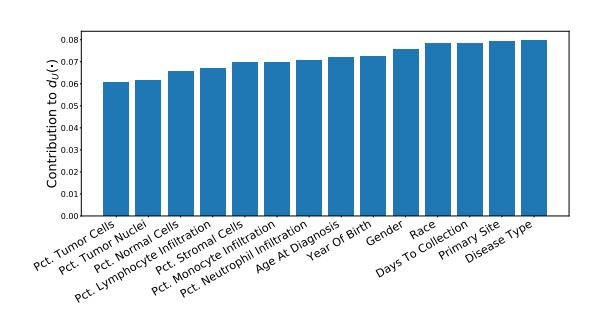

> > Biểu đồ cột đứng (bar chart) biểu diễn giá trị đóng góp của các đặc trưng (features) khác nhau vào chỉ số $d_U(\cdot)$. > > Trục tung (Y-axis): Có nhãn là "Contribution to $d_U(\cdot)$", với các giá trị chạy từ 0.00 đến 0.08, khoảng chia là 0.01. > Trục hoành (X-axis): Biểu thị 14 đặc trưng sinh học và lâm sàng, được sắp xếp theo thứ tự tăng dần của giá trị đóng góp từ trái sang phải: > 1. Pct. Tumor Cells (khoảng 0.061) > 2. Pct. Tumor Nuclei (khoảng 0.062) > 3. Pct. Normal Cells (khoảng 0.066) > 4. Pct. Lymphocyte Infiltration (khoảng 0.067) > 5. Pct. Stromal Cells (khoảng 0.070) > 6. Pct. Monocyte Infiltration (khoảng 0.070) > 7. Pct. Neutrophil Infiltration (khoảng 0.071) > 8. Age At Diagnosis (khoảng 0.072) > 9. Year Of Birth (khoảng 0.073) > 10. Gender (khoảng 0.076) > 11. Race (khoảng 0.078) > 12. Days To Collection (khoảng 0.078) > 13. Primary Site (khoảng 0.079) > 14. Disease Type (khoảng 0.080) > > Các cột hiển thị có màu xanh lam đồng nhất, cho thấy mức độ đóng góp tăng dần từ các đặc trưng liên quan đến tỷ lệ tế bào (Pct.) đến các thông tin nhân khẩu học và cuối cùng cao nhất là loại bệnh (Disease Type).

> > Contribution to $d_U(\cdot)$ > 0.08 > 0.07 > 0.06 > 0.05 > 0.04 > 0.03 > 0.02 > 0.01 > 0.00 > Pct. Tumor Cells > Pct. Tumor Nuclei > Pct. Normal Cells > Pct. Lymphocyte Infiltration > Pct. Stromal Cells > Pct. Monocyte Infiltration > Pct. Neutrophil Infiltration > Age At Diagnosis > Year Of Birth > Gender > Race > Days To Collection > Primary Site > Disease Type

Figure 3.3: Contribution of each covariate to the learned personalization distance in the pancancer dataset. We see that, as expected, this method learns to upweight differences in disease type and primary site, along with other demographic features.

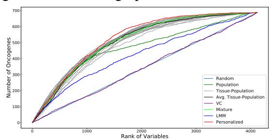

> > Hình ảnh là một đồ thị đường biểu diễn mối quan hệ giữa thứ hạng của các biến số ("Rank of Variables" trên trục hoành, từ 0 đến hơn 4000) và số lượng gen gây ung thư tìm thấy ("Number of Oncogenes" trên trục tung, từ 0 đến 700). > > Đồ thị so sánh hiệu suất của nhiều phương pháp khác nhau thông qua các đường màu sắc: >:
- Random (đường thẳng màu xanh dương nhạt): Chạy tuyến tính từ góc dưới bên trái lên góc trên bên phải, đóng vai trò là đường cơ sở ngẫu nhiên. >
- VC (đường màu tím): Nằm sát và trùng lặp nhiều với đường "Random". >
- LMM (đường màu xanh dương đậm): Nằm phía trên đường "Random" nhưng thấp hơn các phương pháp khác. >
- Population (đường màu xanh lá cây đậm): Nằm ở nhóm giữa. >
- Tissue-Population (các đường đứt nét màu xám): Thể hiện sự phân tán của các mô cụ thể. >
- Avg. Tissue-Population (đường màu đen): Đường trung bình của nhóm Tissue-Population. >
- Mixture (đường màu xanh lá cây sáng): Nằm ở nhóm trên cùng, có hiệu suất cao. >
- Personalized (đường màu đỏ): Nằm trên cùng trong hầu hết các phân đoạn, cho thấy hiệu suất tối ưu nhất trong việc phát hiện Oncogenes ở các thứ hạng đầu.

> > Number of Oncogenes > Rank of Variables > 0 > 1000 > 2000 > 3000 > 4000 > 0 > 100 > 200 > 300 > 400 > 500 > 600 > 700 > Random > Population > Tissue-Population > Avg. Tissue-Population > VC > Mixture > LMM > Personalized

Figure 3.4: Overlap of selected variables with annotated oncogenes (best viewed in color). Results for each tissue-specific model are displayed in dashed gray lines, with the sample-weighted mean displayed in a solid black line. We see that the personalized models select oncogenes at higher ranks than do the baseline methods, especially for the long tail of low rank oncogenes.

but many genes are selected for a few samples (Figure 3.5, bottom). The set of common gene selections represents well-studied oncogenes that are common to many types of cancer while the infrequently selected genes may correspond to less common oncogenes.

To investigate this possibility of many infrequently selected oncogenes, we further examine the oncogene distribution by rank of variable. Ranks are calculated by ordering the sums of the magnitudes of each coefficient along the sample axis (for population models, this is simply the magnitude of the coefficient associated with that variable). In this way, the rank captures both the number of samples for which the variable was selected and the magnitude of the implied effect size. As shown in Figure 3.4, the overlap between selected genetic markers and the annotations in COSMIC [[37]](#page-58-4) is improved by the process of personalization. We see that the highly ranked oncogenes are efficiently selected by nearly all methods, but the performance of the baseline models lags as the rank diminishes. In particular, although the Tissue-Population models that are learned independently using only samples from a given tissue tend to select highly ranked genes that are also annotated in COSMIC, the performance in the long-tail of infrequently selected genes is less competitive compared to the personalized model. This confirms the intuition that personalization is the most useful in this latter regime.

To test whether this increase in oncogene selection is due to novel identification of genetic processes, we perform enrichment analysis of the ranked lists of genes. Reported in Table 3.5 are the most significant Gene Ontology (GO) terms from a ranked enrichment test using Panther

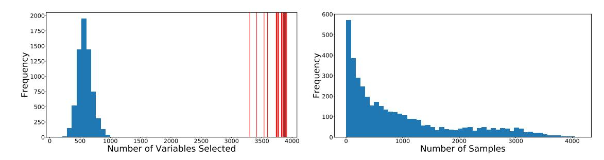

> > Hình ảnh gồm hai biểu đồ tần suất (histogram) nằm ngang hàng nhau: > > 1. Biểu đồ bên trái: >:
- Trục tung (Y-axis): Nhãn "Frequency" (Tần suất), có các vạch chia từ 0 đến 2000 với khoảng chia là 250. >
- Trục hoành (X-axis): Nhãn "Number of Variables Selected" (Số lượng biến được chọn), có các vạch chia từ 0 đến 4000 với khoảng chia là 500. >
- Dữ liệu: Một phân phối dạng hình chuông đối xứng (phân phối chuẩn) tập trung chủ yếu trong khoảng từ 300 đến 1000, đạt đỉnh cao nhất ở khoảng giá trị 500
- 600 với tần suất gần 2000. >
- Chi tiết khác: Ở góc bên phải của biểu đồ, xuất hiện nhiều đường thẳng đứng màu đỏ mảnh nằm trong khoảng từ 3300 đến 4000. > > 2. Biểu đồ bên phải: >
- Trục tung (Y-axis): Nhãn "Frequency" (Tần suất), có các vạch chia từ 0 đến 600 với khoảng chia là 100. >
- Trục hoành (X-axis): Nhãn "Number of Samples" (Số lượng mẫu), có các vạch chia từ 0 đến 4000 với khoảng chia là 1000. >
- Dữ liệu: Một phân phối lệch phải (right-skewed distribution). Tần suất đạt mức cao nhất (gần 600) ở sát vạch số 0, sau đó giảm dần một cách đều đặn khi số lượng mẫu tăng lên và kéo dài đến khoảng giá trị 4000.

> > Biểu đồ bên trái: >:
- Trục tung: > Frequency > 2000 > 1750 > 1500 > 1250 > 1000 > 750 > 500 > 250 > 0 > >
- Trục hoành: > 0 > 500 > 1000 > 1500 > 2000 > 2500 > 3000 > 3500 > 4000 > Number of Variables Selected > > Biểu đồ bên phải: >
- Trục tung: > 600 > 500 > 400 > 300 > 200 > 100 > 0 > >
- Trục hoành: > 0 > 1000 > 2000 > 3000 > 4000 > Number of Samples

Figure 3.5: The sample-specific variable selection of personalized regression results in models with fewer selected variables than those selected by population-level models. (Top) Histogram of the number of variables selected for each patient by personalized regression. Vertical red lines indicate the number of variables selected by the Tissue-Population model trained on a single cancer type. Personalized models achieve similar or improved predictive performance with fewer selected genes. (Bottom) Histogram of the number of samples for which each gene is selected.

13.1 [[98]](#page-64-4) on the Panther GO-SLIM Biological Process dataset [[97]](#page-64-5) with a cutoff of p < 0.05 for the Bonferroni-corrected p-values. The genes selected by personalized models are enriched with similar GO terms compared to the baseline models, which is expected since the gene ontology is largely comprised of well-studied annotations from large cohorts as opposed to harder to detect personalized effects. This validates our hypothesis that the improved performance of variable selection is not due to identification of a single group of genes, but rather is due to the identification of many sample-specific effects.

#### Discovery of Molecular Subtypes

The pattern of selection of genes is of particular interest for clinical application. As seen in Figure 3.6, there are a number of common oncogenes that are repeatedly selected throughout many cancer types, including FOXA1, HOXC13, and FCGR2B. This set combines with a sparse selection of a number of oncogenes specific to each cancer type. These cancer types span surface-level characteristics such as tissue type. Interestingly, we also see a small set of rarely selected oncogenes that are consistently selected for a cluster of about 300 patients (outlined in Figure 3.6). This set of oncogenes is highly over-represented for the GO biological process term "Modulation of Chemical Synaptic Transmission" (Bonferroni corrected p-values of 2.32e-2), which includes genes ATP1A2, SLC6A4, ASIC1, GRM3, and SLC8A3. These genes code for ion-transport processes, which have long been seen in vivo as an important system in thyroid cancer [[34]](#page-58-5) and in vitro from leukemic cells [[101]](#page-64-6), but only recently been appreciated as a functional marker across many different cancer types [[121]](#page-66-4).

Figure 3.7 depicts a tSNE projection of the learned effect vector for each sample, colored by the primary tumor site. While the samples appear to form clusters, and the case samples are separated from the control samples by a large margin, again these clusters do not appear to correspond to any individual covariate. This complexity of personalization underscores the need for learned distant metrics to capture relationships corresponding to molecular characterization of tumors.

|Model | Biological | Process p-value |
|---------------- | --------------- | ----------------- |
|mRNA | Processing | 2.06e-8 |
|DNA | Metabolic | Process 3.18e-6 |
|Organelle | Organization | 3.86e-2 |
|mRNA | Processing | 3.09e-9 |
| | Metabolic | Process 3.26e-5 |
|Transcription, | DNA-Dependent | 9.61e-5 |
|DNA | metabolic | process 5.9e-3 |
|mRNA | processing | 1.45e-8 |
|DNA | Metabolic | process 1.96e-5 |
|transcription, | DNA-dependent | 2.62e-4 |
|organelle | organization | 7.32e-3 |
|VC |  | None NA |
|LMM DNA | metabolic | process 2.02e-2 |
|mRNA | processing | 5.83e-6 |
| | metabolic | process 1.1e-3 |
|DNA | metabolic | process 3.15e-2 |

Table 3.5: Enrichment Analysis of Complete Variable Rankings

To identify molecular subtypes, we cluster the parameter embeddings using the HDBSCAN algorithm and perform an enrichment analysis of each cluster's variable selection. The top 3 over-enriched leaf terms from the GO biological process dataset are shown in Table 3.6. We see that the different clusters of models correspond to different biological processes. For instance, cluster 3 is enriched for several terms associated with extracellular interactions, while cluster 2 emphasizes terms associated with nucleotide modification via splicing and repair. These results suggest that the clusters discovered by personalized regression may correspond to clinically meaningful molecular subtypes.

|Cluster | Biological | Process | p-value |
|----------------------------------------------- | ---------------------------- | -------------- | ---------- |
| | Symbiont | Process | 2.62e-3 |
|Regulation of Cellular | Catabolic | Process | 1.96e-2 |
|Protein | Modification | Process | 3.43e-2 |
| |  | DNA repair | 3.21e-12 |
|RNA splicing, Reactions with Bulged Adenosine | via Transesterification as | Nucleophile | 3.64e-7 |
| | DNA | Replication | 1.00e-6 |
| | Symbiont | Process | 1.4e-3 |
|Antigen Processing and Presentation | of Peptide | Antigen | 1.06e-2 |
|Antigen Processing and Presentation of | Exogenous | Antigen | 1.08e-2 |
|DNA | Metabolic | Process | 3.83e-8 |
| |  | DNA repair | 1.68e-6 |
|Regulation of Cellular Macromolecule | Biosynthetic | Process | 5.06e-6 |
|Plasma Membrane Bounded Cell Projection | Morphogenesis |  | 1.45e-2 |
|Neuron Projection | Development |  | 3.02e-2 |
|mRNA | Catabolic | Process | 8.78e-4 |
| | Gene | Expression | 6.02e-4 |
|Macromolecule | Biosynthetic | Process | 3.32e-2 |
|7 |  | None | N/A |
|Generation of Precursor Metabolites |  | and Energy | 4.75e-5 |
|Oxidation-Reduction |  | Process | 4.52e-5 |
|Citrate | Metabolic | Process | 9.84e-3 |
|DNA | Metabolic | Process | 3.96e-10 |
|Cellular Response to DNA | Damage | Stimulus | 5.57e-9 |
|Protein Complex | Subunit | Organization | 1.41e-4 |
|DNA | Metabolic | Process | 7.15e-8 |
|ncRNA | Metabolic | Process | 1.33e-4 |
|Chromatin |  | Organization | 8.27e-4 |
|11 Negative Regulation | of Phosphorylation |  | 3.74e-2 |
|Hematopoietic or Lymphoid | Organ Development |  | 4.46e-2 |

Table 3.6: Enrichment Analysis of Tumor Clusters

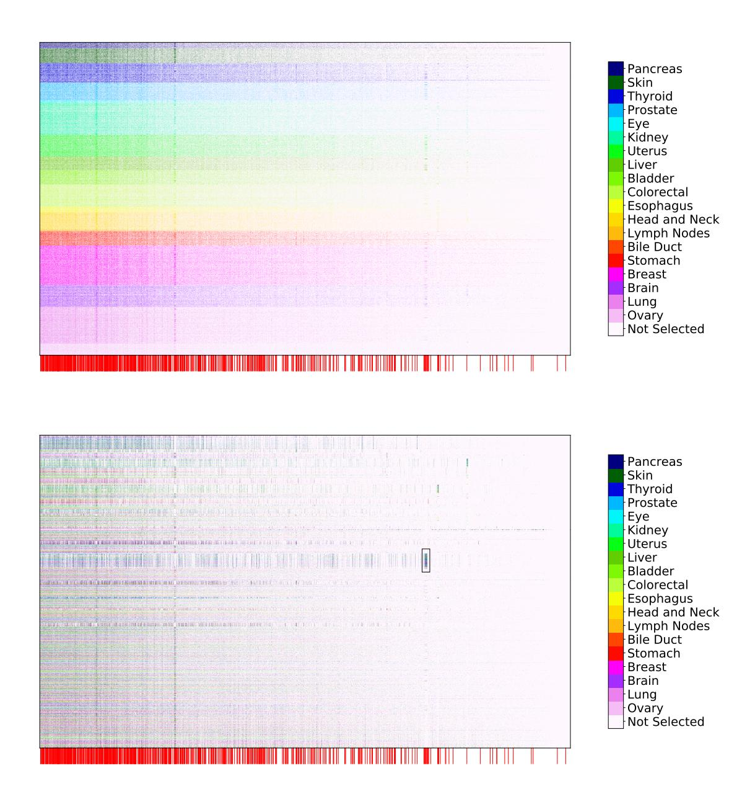

> > Hình ảnh hiển thị hai biểu đồ nhiệt (heatmap) được xếp chồng lên nhau theo chiều dọc, biểu diễn dữ liệu phân tích mô/tế bào (có thể là biểu hiện gen hoặc methylation) từ tài liệu 'PSAI038'. > > 1. Biểu đồ nhiệt phía trên (Top Heatmap): >:
- Các mẫu được sắp xếp và phân nhóm rõ rệt thành các dải màu nằm ngang riêng biệt. >
- Phía dưới biểu đồ này có một thanh ngang chứa các vạch màu đỏ thẳng đứng với mật độ khác nhau. >
- Bên phải là bảng chú giải màu sắc (Legend) tương ứng với các loại mô/cơ quan khác nhau. > > 2. Biểu đồ nhiệt phía dưới (Bottom Heatmap): >
- Các dải màu không còn phân tách rõ ràng như biểu đồ trên mà có sự pha trộn, phân tán xen kẽ nhau. >
- Có một khung chữ nhật nhỏ màu đen được đánh dấu ở vùng giữa bên phải của biểu đồ để làm nổi bật một khu vực cụ thể. >
- Phía dưới biểu đồ này cũng có một thanh ngang chứa các vạch màu đỏ tương tự biểu đồ trên. >
- Bên phải là bảng chú giải màu sắc giống hệt biểu đồ phía trên. > > Bảng chú giải màu sắc (Legend) ở cả hai biểu đồ gồm các nhãn: >
- Pancreas (Tụy) >
- Skin (Da) >
- Thyroid (Tuyến giáp) >
- Prostate (Tuyến tiền liệt) >
- Eye (Mắt) >
- Kidney (Thận) >
- Uterus (Tử cung) >
- Liver (Gan) >
- Bladder (Bàng quang) >
- Colorectal (Đại trực tràng) >
- Esophagus (Thực quản) >
- Head and Neck (Đầu và Cổ) >
- Lymph Nodes (Hạch bạch huyết) >
- Bile Duct (Ống mật) >
- Stomach (Dạ dày) >
- Breast (Vú) >
- Brain (Não) >
- Lung (Phổi) >
- Ovary (Buồng trứng) >
- Not Selected (Không được chọn)

> > Pancreas > Skin > Thyroid > Prostate > Eye > Kidney > Uterus > Liver > Bladder > Esophagus > Bile Duct > Stomach > Breast > Brain > Lung > Ovary > Not Selected > > Pancreas > Skin > Thyroid > Prostate > Eye > Kidney > Uterus > Liver > Bladder > Esophagus > Bile Duct > Stomach > Breast > Brain > Lung > Ovary > Not Selected

Figure 3.6: Selection of genetic markers as predictive of case/control status from a pan-cancer dataset. The horizontal axis denotes genes while the vertical axis indexes samples. Selected variables in each row are colored by the primary tumor site of the sample, with unselected variables colored white. We observe consistent selection of a number of common oncogenes throughout all cancer types along with the sparse selection of a small number of oncogenes specific to each cancer type. Genes annotated as oncogenes in the COSMIC census are marked by a red line along the horizontal axis (zoom in for more detail as these lines may be difficult to differentiate on some screens). (Top) Rows ordered by primary tissue site, (Bottom) Rows clustered according to personalized variable selection. The boxed region is analyzed in Section 3.

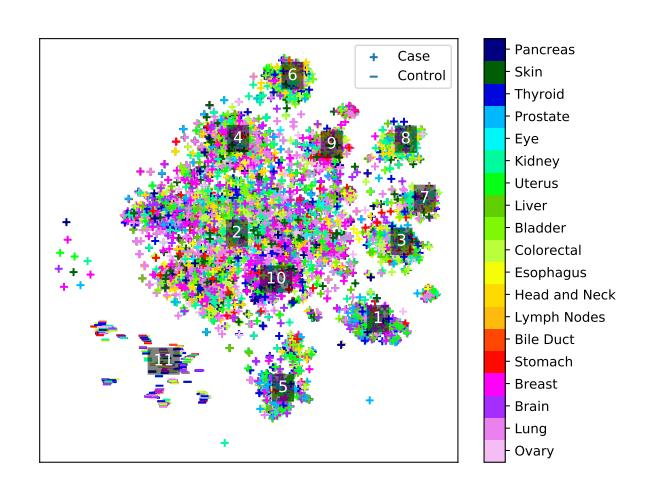

> > Biểu đồ phân tán 2D (dạng t-SNE hoặc UMAP) thể hiện sự phân cụm của các điểm dữ liệu dựa trên các loại mô/cơ quan khác nhau. > > Các thành phần chính trong hình bao gồm: >:
- Các điểm dữ liệu: Được biểu diễn bằng hai ký hiệu: dấu cộng (+) đại diện cho nhóm "Case" và dấu trừ (-) đại diện cho nhóm "Control". Các điểm này có nhiều màu sắc khác nhau tương ứng với các cơ quan nguồn gốc. >
- Chú thích nhóm (Legend phía trên bên phải đồ thị): >
- + Case >
- Control >
- Thanh màu chú thích cơ quan (Colorbar bên phải ngoài đồ thị): Thể hiện dải màu tương ứng với 19 loại cơ quan/mô khác nhau bao gồm: Pancreas, Skin, Thyroid, Prostate, Eye, Kidney, Uterus, Liver, Bladder, Colorectal, Esophagus, Head and Neck, Lymph Nodes, Bile Duct, Stomach, Breast, Brain, Lung, Ovary. >
- Các nhãn số: Có 11 hộp màu xám đậm chứa các số trắng từ 1 đến 11 được đánh dấu đè lên các cụm dữ liệu chính trên biểu đồ để định danh các phân cụm cụ thể (ví dụ: cụm số 11 nằm tách biệt ở góc dưới bên trái, cụm số 6 ở đỉnh trên cùng, cụm số 5 ở dưới cùng, v.v.).

> > + Case > - Control > 1 > 2 > 3 > 4 > 5 > 6 > 7 > 8 > 9 > 10 > 11 > Pancreas > Skin > Thyroid > Prostate > Eye > Kidney > Uterus > Liver > Bladder > Esophagus > Bile Duct > Stomach > Breast > Brain > Lung > Ovary

Figure 3.7: t-SNE projection of personalized regression parameters learned from a pan-cancer dataset. Each point represents a single sample with color indicating primary tumor site and marker type indicating case/control status of the patient. Labelled points indicate the centroids of clusters analyzed in Table 3.6.

# Chapter 4

# Sample-Specific Models to Identify Discriminative Subtypes of Cancers

When designing individualized treatment protocols for cancer patients, it is crucial to synthesize the information from multiple data modalities into a single parsimonious description of the patient's personal disease. However, such a description of a patient is never observed. In this work, we propose to model these patient descriptions as latent discriminative subtypes—sample representations which can be learned from one data modality and used to contextualize predictions based on another data modality. We apply contextual deep learning to learn these sample-specific discriminative subtypes from lung cancer histopathology imagery. Based on these subtypes, we produce sample-specific transcriptomic models which accurately classify samples as adenocarcinoma, squamous cell carcinoma, or healthy tissue (F1 score of 0.97). Combining these data modalities in a single pipeline not only improves the predictive accuracy, but also gives biological interpretations of the discriminative subtypes and ties the phenotypic patterns present in histopathology images to biological processes.

Portions of this chapter are currently in review for publication as [[75]](#page-61-5).

# 4.1 Discriminative Subtyping of Lung Cancer with Contextual Deep Learning

In many biological settings, inter-sample heterogeneity is critical to understanding the complex biological processes under study. For example, in the analysis of cancer gene expression assays, each patient in a cohort may have a different somatic mutation. As these mutations adjust the baseline gene expression levels of each patient, the observed gene expression data must be interpreted with respect to patient-specific "contexts." These contexts can be described as molecular subtypes which are associated with patient outcomes [[118]](#page-66-5) and can inform the decision-making process behind surgery and radiation therapy [[24]](#page-57-5). Our understanding of molecular subtypes is still advancing, and much recent work has focused on identifying fine-grained descriptions which comprise previously-characterized subgroups (e.g. in breast [[130]](#page-67-4) or lung cancers [[66]](#page-61-6)).

If the perfect contexts were annotated (e.g., if molecular subtypes were to correspond exactly to primary tissue sites), we could simply train a different probabilistic model for each context.

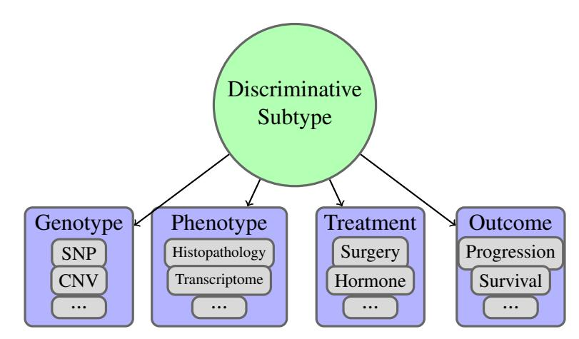

> > Sơ đồ cấu trúc phân cấp thể hiện mối quan hệ giữa khái niệm trung tâm "Discriminative Subtype" và các nhóm đặc trưng liên quan. > > Sơ đồ gồm các thành phần: >:
- Một hình tròn màu xanh lá cây ở phía trên cùng có nhãn "Discriminative Subtype". >
- Bốn mũi tên chỉ từ hình tròn trung tâm xuống bốn hộp hình chữ nhật màu xanh dương bo góc bên dưới, đại diện cho bốn nhóm thuộc tính: > 1. Genotype: Bên trong chứa các hộp nhỏ màu xám ghi "SNP", "CNV" và dấu ba chấm "..." biểu thị còn các yếu tố khác. > 2. Phenotype: Bên trong chứa các hộp nhỏ màu xám ghi "Histopathology", "Transcriptome" và dấu ba chấm "...". > 3. Treatment: Bên trong chứa các hộp nhỏ màu xám ghi "Surgery", "Hormone" và dấu ba chấm "...". > 4. Outcome: Bên trong chứa các hộp nhỏ màu xám ghi "Progression", "Survival" và dấu ba chấm "...".

> > Discriminative Subtype > > Genotype > SNP > CNV >... > > Phenotype > Histopathology > Transcriptome >... > > Treatment > Surgery > Hormone >... > > Outcome > Progression > Survival >...

Figure 4.1: The most concise description of the many variables regarding oncology patients is an unobserved latent variable. In this work, we seek to estimate this latent variable as a discriminative subtype which improves the discriminative ability of downstream predictors.

However, meaningful contexts are often complex and possibly unknown. Simply increasing the capacity of the predictive model to handle multiple contexts is typically not feasible due to limited sample size and an emphasis on fitting interpretable models. Instead, we would like to use a model which captures the complexity of different contexts while retaining the domain knowledge and interpretability of structured probabilistic models.

To do so, we introduce the notion of a discriminative subtype (Figure 4.1). A discriminative subtype is a latent variable which captures the variation in many observable variables, and can be used for a variety of downstream tasks. Discriminative subtypes may correspond, but are not limited, to previously-characterized molecular subtypes.

In this work, we will use a deep neural network to estimate the discriminative subtype for each sample based on contextual data. We will use this subtype information to generate the parameters for an interpretable model for downstream tasks. This two-stage procedure allows us to analyze transcriptomic data in the context of complex context data such as diagnostic images. Specifically, we investigate the capacity of this architecture to predict disease subtypes from the histopathology images and transcriptomic data of patients diagnosed with two types of lung cancer: lung adenocarcinoma (LUAD) and lung squamous cell carcinoma (LUSC).

#### Lung Cancers

Lung cancer is one of the top ten most common cancers for males and females, and is estimated to account for roughly 13% of all new cancer cases[[127]](#page-66-6). For males, it is second only to prostate cancer, and for females it is second only to breast cancer. In terms of mortality, it is estimated to be the most lethal cancer for both sexes, accounting for 23% of cancer deaths in males and 22% of cancer deaths in females for the year 2020 [[127]](#page-66-6). It is estimated that in 2020 in the United States, 228,820 new cases of lung cancer will be diagnosed and 135,720 people will die from lung cancer [[127]](#page-66-6).

The most common category of lung cancer is Non-Small Cell Lung Cancer (NSCLC), accounting for 85% of cases. LUAD and LUSC are subtypes within this NSCLC category, and are the two most common types of lung cancers, accounting for 38.5% and 20% of all lung cancer cases respectively [[25]](#page-57-6). When lung cancer is diagnosed, it is categorized into one of four stages based on the TNM grading system (based on (T) the size of the tumor, (N) the spread of cancer to lymph nodes, and (M) metastasis) where a lower stage number means that there is less cancer in the patient. Early detection is critical in lung cancer: in the U.S., 61% of NSCLC patients diagnosed at the localized stage survived after five years compared to only 6% of those diagnosed at the distant stage.1

While LUAD and LUSC are both major subtypes of lung cancer, they have important distinctions in terms of their clinicopathology, tumor microenvironments, and molecular organization. For example, LUSC is associated with a history of smoking, while LUAD may occur in smokers but is the most common form of lung cancer in non-smokers [[116]](#page-65-5). These differences have implications for the best therapeutic approaches for each subtype. For example, epidermal growth factor receptor (EGFR) and anaplastic lymphoma kinase (ALK) are two commonly mutated genes in LUAD and are targets for current therapies, while they are infrequently mutated in LUSC [[81]](#page-62-8). In addition, LUAD and LUSC tumors each have different immune subtypes (tumor subtypes characterized by differences in infiltrating immune cell types and immunogenic expression), and these differences have been shown to have an effect on the efficacy of immune therapies (immune checkpoint blockade therapy) [[123]](#page-66-7). Given this variety of subtypes at different pathological levels, estimating a discriminative subtype that encapsulates these variations will be essential for machine learning tasks such as cancer type prediction.

## Contributions and Generalizable Insights

As described above, effective machine learning systems for oncology require both the integration of data modalities (e.g. temporal, demographic, radiological, histopathological data) and model interpretability. The generic form of this problem is a significant open problem in machine learning. In this manuscript, we demonstrate that we can apply contextual deep learning to simultaneously achieve accuracy and interpretability for classification of lung cancers. This case study brings to light the following insights that apply in general to the problem of using machine learning techniques on multi-modal patient data:

- In applications with heterogeneous samples, understanding the context in which predictions are made is important to making accurate predictions. In this work, we show that sample-specific contexts can improve downstream predictions even when the contexts are latent and must be inferred from data (Section 4.1). Towards this end, we show that contextual deep learning is a promising tool for estimating these latent variables and linking different data modalities in a single pipeline.
- For transcriptomic analysis of lung cancer samples, we show that meaningful contexts can be inferred from histopathology samples. These meaningful contexts form discriminative subtypes (Section 4.1), which are not themselves correlated with the cancer type, provide meaningful context in which simple models can accurately label sample types.
- Finally, the learned transcriptomic models for different discriminative subtypes tend to give high attention to different biological processes (Section 4.1). This suggests that the sample-specific transcriptomic models learned from our discriminative subtypes are cap-

1<cancer.org>

turing the heterogenity of the biological processes underlying lung cancer. This highlights the promise of approaches which use contextual deep learning to learn biologically explainable/meaningful models for heterogenous data.

## Related Work

Molecular profiling has increased understanding of the pathology of cancer [8, 20, 114, [136]](#page-67-5). This understanding allows pathologists to use phenotypic molecular and morphological data to identify increasingly specific cancer subtypes [41, 60, [122]](#page-66-8). Improved cancer subtype identification enables clinicians to devise more effective individualized treatment plans for patients with cancer. The machine learning community is increasingly working to assist pathologists further improve cancer subtype identification to better inform treatment based off molecular and morphological data [14, 40, 58, 69, 99, 103, 131, 138, 143, [144]](#page-68-7). This common goal of better informing treatment has also led the machine learning community to work towards creating patient specific interpretable and explainable predictive models to provide actionable insights to clinicians about the prognosis of their patient's disease [73, 99, [155]](#page-69-1).

### Cancer Subtype Identification

Identifying cancer subtypes is crucial to devising individualized treatment protocols for patients with cancer, but subtype identification has been hindered by the lack of knowledge of the biological processes underlying tumor growth [27, 48, 53, [126]](#page-66-9). In previous work, this was circumvented by using observed phenotypic and/or genotypic data to define cancer subtypes [14, 40, 58, 69, 99, 103, 131, 143, [144]](#page-68-7). These papers defined specific cancer subtypes based off phenotypic and/or genotypic features which were meaningful for specific downstream tasks such as predicting healthy versus cancer. Recently, a new definition of subtype was introduced in which is based off mutations predicted from histopathology images within a clinically accepted cancer type [[22]](#page-57-8). This approach is promising, as it could assist pathologists detect gene mutations to inform treatment. While all of these definitions of a cancer subtype are useful, the features they identify only capture a subset of the aspects of the biological processes underlying tumor growth related to a specific task or data type. Our work is the first to our knowledge to associate discriminative models with cancer subtypes, which we call discriminative subtypes and infer from morphological data. This definition enables us to learn accurate patient-specific models for downstream prediction tasks.

### Downstream Prediction

The key challenge to downstream prediction tasks is to use multimodal data to generate predictions that are interpretable and explainable to clinicians. In previous work, interpretable predictive models have been based off only one type of data, such as histologic patterns which are interpretable to pathologists [22, 40, 88, 89, 143, 144, [152]](#page-69-2). Multimodal models have leveraged different types of data to increase predictive capabilities, but their interpretability has been hindered by the complexity of the models [18, 49, 99, 111, [155]](#page-69-1). The only way some of these complex models have been interpreted is with a retrospective analysis of the features selected in their neural networks, and it is unclear how to use this type of interpretation to inform clinical decisions [49, [99]](#page-64-7). Our approach allows us to generate predictive models linking histopathology images and molecular data which are accurate, interpretable, and explainable to clinicians.

#### Sample-Specific Model Parameters

In this work, we identify discriminative subtypes by estimating a basis set of models which can be utilized to generate model parameters specific to each sample. Interest in such samplespecific model parameters has grown in recent years, as increasing evidence has pointed to finegrained subtypes which do not form discrete clusters [12, [90]](#page-63-6). Discovering these individualized molecular profiles could lead to substantial advances in the diagnosis and treatment of disease, in addition to refining our biological understanding of the mechanisms behind different diseases. Despite the recent surge of interest in personalized modeling [4, 70, 84, 87, 100, [139]](#page-67-8), basic statistical challenges remain unanswered and deserve further study. Patient-specific analysis of cancer patients has mainly focused on two areas: detection of personalized biomarkers [10, 77, 78, [102]](#page-64-9), and inference of personalized regulatory networks [13, [63]](#page-60-4). In this work, we contextualize such personalized models with imaging data. We hope that this idea of contextualization can spur further development of such patient-specific modeling efforts that appear promising.

#### Methods

To combine multi-modal data in an interpretable pipeline, we use Contextual Explanation Networks (CENs) [[2]](#page-55-2), illustrated in Figure 4.2. CEN architecture assumes that the data is represented by: (i) context variables, denoted C, (ii) semantically meaningful variables, denoted X, and (iii) target variables, denoted Y. Here, we will use histopathology images as contextual data and gene expression assays as semantically meaningful predictors of the cancer type. The model will represent conditional probability of the cancer type given the histopathology and transcriptomic inputs, P(Y ∣ X, C), in the following form:

P(Y ∣ X, C) = ∫ P(Y ∣ X, θ)δ(θ = φw(C))dθ = P(Y ∣ X, φw(C)), (4.1)

where P(Y ∣ X, θ) is a linear logistic model that predicts cancer types from gene expression information. Note that parameters (or weights) θ of the logistic model are a function of the contextual information, i.e., θ = φw(C). In other words, CEN architecture produces a samplespecific parameterization of a linear probabilistic model that operates on transcriptomic data based on the sample's contextual data (i.e., based on histopathology).

Generation of parameters for sample-specific linear models is accomplished via a context encoder represented by a convolutional neural network (Figure 4.2). To reduce model complexity, parameters θ are further confined to be a linear combination of a small constant number (K) of "archetypes," denoted {θ1,..., θK} or θ1∶K. Specifically for a sample i with context ci, weights θi are computed as follows:

θi = K ∑ k=1 α k w(ci)θk, where α k w(ci) ≥ 0, k = 1,..., K and K ∑ k=1 α k w(ci) = 1, (4.2)

where (α1,..., αK) is a vector output of the context encoder, which we call discriminative subtype. This dictionary of parameter sets, θ1∶K, is learned jointly with the context encoder, and the entire architecture is trained end-to-end via backpropagation. To summarize, the context encoder

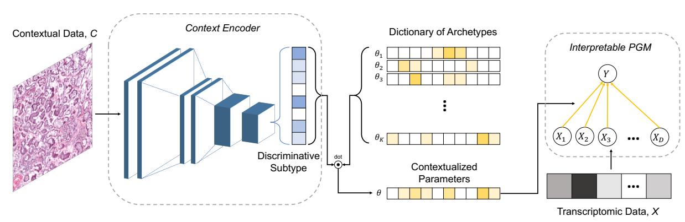

> > Sơ đồ minh họa một quy trình (pipeline) học máy kết hợp dữ liệu ngữ cảnh và dữ liệu phiên mã thông qua một mô hình đồ thị xác suất có thể giải thích được (Interpretable PGM). Quy trình gồm các bước và thành phần chính sau: > > 1. Dữ liệu ngữ cảnh (Contextual Data, C): Được biểu diễn bằng một hình ảnh mô bệnh học (slide nhuộm màu hồng/tím). Dữ liệu này được đưa vào bộ mã hóa ngữ cảnh. > 2. Bộ mã hóa ngữ cảnh (Context Encoder): Nằm trong khung nét đứt đầu tiên, sử dụng một mạng thần kinh tích chập (CNN) để xử lý hình ảnh đầu vào và trích xuất ra một vectơ đặc trưng dạng cột gọi là "Discriminative Subtype" (Phân nhóm phân biệt). > 3. Từ điển các nguyên mẫu (Dictionary of Archetypes): Gồm các vectơ tham số ký hiệu là $\theta_1, \theta_2, \theta_3, \dots, \theta_K$. > 4. Tích vô hướng (dot product): Vectơ "Discriminative Subtype" được thực hiện phép toán tích vô hướng (ký hiệu bằng vòng tròn có dấu chấm và chữ "dot") với các vectơ trong "Dictionary of Archetypes" để tạo ra vectơ tham số ngữ cảnh hóa $\theta$ ("Contextualized Parameters"). > 5. Mô hình đồ thị xác suất giải thích được (Interpretable PGM): Nằm trong khung nét đứt thứ hai ở bên phải. >:
- Mô hình nhận các tham số ngữ cảnh hóa $\theta$ làm trọng số kết nối. >
- Đầu vào của mô hình là dữ liệu phiên mã "Transcriptomic Data, X" (biểu diễn bằng các ô màu xám), tương ứng với các nút biến số $X_1, X_2, X_3, \dots, X_D$. >
- Các nút biến số này liên kết trực tiếp đến nút mục tiêu $Y$ ở phía trên thông qua các mũi tên màu vàng.

> > Contextual Data, C > Context Encoder > Discriminative Subtype > dot > Dictionary of Archetypes > $\theta_1$ > $\theta_2$ > $\theta_3$ > $\theta_K$ > $\theta$ > Contextualized Parameters > Interpretable PGM > $Y$ > $X_1$ > $X_2$ > $X_3$ > $X_D$ > Transcriptomic Data, X

Figure 4.2: A CEN architecture combines "contextual" histopathology data (C) with gene expression data (X) through intermediate, sample-specific interpretable linear probabilistic models. We call the output of the context encoder the discriminitative subtype, as it is used to form sample-specific parameters θ by weighting the archetypal models stored in a dictionary. Finally, the formed sample-specific linear models operate on the transcriptomic data (X) to estimate the final target Y (in our experiments, cancer type).

is a deep neural network that processes contextual data (histopathology imagery) and outputs a probability vector of length K that softly selects weights for a linear probabilistic model from a dictionary of archtetypes.

### Architectural Components

To encode histopathology imagery, following Coudray et al. [[22]](#page-57-8), we used InceptionV3 [[133]](#page-67-9) architecture as our context encoder. Since this architecture naturally operated on images of size 299x299, to utilize it on the large histopathology images, we sliced the images into nonoverlapping patches of size 299x299, filtering out patches that had more than 25% of background.

Further, for the interpretable probabilistic part of CEN, we used logistic regression (LR) that predicted cancer type from gene expression data. Predictions were computed both on the level of patches (in which case patches from the same slide were assigned the same slide-level labels and gene expression data) and on the level of slides (using majority vote over the corresponding patches).

## Cohort

For this investigation, we use lung cancer data available in the NCI Genomic Data Commons [[44]](#page-59-7), which includes both TCGA and TCIA resources to provide multi-modal descriptions of a large number of cancer patients. As of April 2, 2020, this depository includes 585 LUAD cases and 504 LUSC cases, along with a variety of cases with cancer of other tissues. From this set, we selected all samples which have both eosin-stained histopathology whole-slide images and transcriptomic RNA-seq profiling. This reduces the dataset to a total of 992 patients. We selected these datatypes because inference of discriminative subtype is most clinically-useful if it can be done from phenotypic data. In addition, we look forward to the availability of transcriptomic data from multiple time points to make dynamic predictions which track tumor progression.

We split this dataset into training, validation, and testing partitions. The size and composition

of each partition is shown in Table 4.1.

|Partition | patches | Healthy slides | patches | LUAD slides | patches | LUSC slides | patches | Total slides |
|------------ | --------- | ---------------- | --------- | ------------- | --------- | ------------- | ----------- | -------------- |
|Training | 59,530 | 89 | 658,498 | 562 | 722,396 | 518 | 1,440,424 | 1,169 |
|Validation | 10,478 | 17 | 132,101 | 120 | 156,698 | 116 | 299,277 | 253 |
|Test | 11,899 | 18 | 118,521 | 124 | 183,946 | 113 | 314,366 | 255 |

Table 4.1: Dataset sizes by counts of slides and patches. The slides are divided into patches.

#### Feature Choices

Image Subsampling. For the image analysis, we use the 20x magnification whole-slide images. To make these large images suitable for the pretrained Inception architecture, we split each whole-slide image into non-overlapping 299x299 image patches. The patches were controlled for quality by discarding any patches with more than 25% white pixels, following the procedure of Coudray et al. [[22]](#page-57-8). We treat each patch as a separate sample, with transcriptomic data duplicated over each patch.

Transcriptomic Profiles. The transcriptomic profiling in TCGA captures the expression of over 60,000 distinct transcripts in each sample. To reduce this dimensionality, we select the 1000 transcripts with the highest variance in the non-lung cancer cases in TCGA. In addition, we augment this set with 695 transcripts corresponding to genes in the Catalogue of Somatic Mutations in Cancer (COSMIC, [[9]](#page-55-8)). This leaves us with a final set of 1695 transcriptomic features.

### Results

#### Evaluation Approach

The goal of our study is not only to evaluate the predictive ability of the proposed multi-modal approach, but also to study the biological meaning and clinical utility of the inferred clusters. Towards that end, first, we measure predictive accuracy compare performance of our model against unimodal approaches: InceptionV3 trained to predict cancer type from histopathology only [[22]](#page-57-8) and logistic regression that predicts cancer type from transcriptomic data only. Then, we seek to assign biological meaning to the learned model archetypes, find descriptive histopathology images for each archetype, and analyze the discovered discriminative subtypes.

#### Contextualization Improves Prediction

First, we measure the ability of the model to discriminate between LUAD, LUSC, and healthy samples. As shown in Table 4.2, the multi-modal CEN achieves the best classification results, outperforming both the convolutional neural network (which operates solely on histopathology images, had InceptionV3 architecture) and the regularized logistic regression (which operates

Table 4.2: Predictive performance of models on the Normal/LUAD/LUSC classification task. Transcriptomic data was not available for all samples with histopathological data, and thus CEN and Logistic Regression models were trained on fewer data points than the InceptionV3 baseline, although achieving higher predictive performance.

|Level Model | (Data) | Accuracy (%) | Macro F1 |
|------------- | --------------------------------- | -------------- | ---------- |
|CEN | (Histopathology+Transcriptomic) | 96.18 | 96.97 |
|Logistic | Regression (Transcriptomic) | 94.05 | 91.40 |
|InceptionV3 | (Histopathology) | 69.14 | 65.85 |
|CEN | (Histopathology+Transcriptomic) | 94.51 | 95.29 |
|Logistic | Regression (Transcriptomic) | 92.16 | 89.67 |
|InceptionV3 | (Histopathology) | 80.00 | 76.76 |

Table 4.3: Slide-level confusion matrix for baselines and CEN. Rows correspond to ground truth labels and columns to predictions made by the corresponding models.

| | Norm | InceptionV3 LUAD | LUSC | Logistic Norm | Regression LUAD | LUSC | Norm | CEN LUAD | LUSC |
|------ | ------ | ------------------ | ------ | --------------- | ----------------- | ------ | ------ | ---------- | ------ |
|Norm | 12 | 5 | 1 | 15 | 1 | 2 | 18 | 0 | 0 |
|LUAD | 4 | 102 | 18 | 3 | 115 | 6 | 1 | 117 | 6 |
|LUSC | 1 | 22 | 90 | 0 | 8 | 105 | 0 | 7 | 106 |

solely on transcriptomic data). Our results for the InceptionV3 model come very close to the performance reported by [[22]](#page-57-8). Based on these accuracy and macro F1 metrics, we can see that most of the signal to distinguish the cancer types is held in the transcriptomic data, but a single linear transcriptomic model is not flexible enough to achieve the best accuracy over the diverse cohort.

#### Archetypal Models Correspond to Biologically Meaningful Processes

Next, we turn to interpret the learned models. A natural question is to what degree the different model archetypes are redundant or look at different biological processes. Surprisingly, the model archetypes coefficient vectors are nearly all orthogonal (Fig. 4.3), indicating that the archetype emphasize distinct biological processes.

To identify these biological meanings, we turn to enrichment analysis. For each archetype, we have 3 vectors of coefficients defining the 3-way logistic regression model. For each vector, we sort the genes by the magnitude of the associated coefficient and we search the top 100 genes in this order for enriched biological terms against the background of the remaining 1595 genes using gProfiler[[115]](#page-65-8). We set a minimum intersection size of 3 genes (the number of genes selected from each term must be at least 3) and a maximum Bonferroni-corrected p-value of 0.05. Terms enriched in the archetypal models for prediction of the "normal" label (which corresponds to case/control prediction) are shown in Table 4.4. Here we see that a large number a of the 32 archetypal models are significantly enriched for a diverse set of processes which are markers for cancer.

Table 4.4: Terms enriched in case/control archetypal models (p &lt; 0.05).

|Archetype | Term ID |  | Term | Name | P-Val |
|----------- | -------------------- | --- | ------------------------ | ----------------------------------------------- | --------------------- |
| | KEGG:04071 |  | Sphingolipid | signaling pathway | 0.037 |
| | KEGG:04310 |  | Wnt | signaling pathway | 0.049 |
|6 | REAC:R-HSA-6802952 |  | Signaling | by BRAF and RAF | fusions 0.039 |
|8 | TF:M06732 |  | Factor: | ZNF304 | 0.023 |
|12 | REAC:R-HSA-8939236 |  | RUNX1 involved | regulates transcription in differentiation of | of genes 0.022 HSCs |
| | GO:0010629 |  | negative | regulation of gene | expression 0.039 |
|13 | TF:M09657 | 1 | Factor: | Smad4 | 0.004 |
|15 | GO:0071385 |  | cellular | response to glucocorticoid | stimulus 0.013 |
|17 | REAC:R-HSA-400206 |  | Regulation | of lipid metabolism | by PPAR α 0.018 |
|18 | TF:M04726 | 1 | Factor: | REST | 0.001 |
|19 | TF:M05327 | 1 | Factor: | WT1 | 0.025 |
|21 | TF:M01224 | 1 | Factor: | P50:RELA-P65 | 0.034 |
|25 | TF:M09611 | 0 | Factor: | ER81 | 0.003 |
|26 | KEGG:04215 |  | Apoptosis | multiple species | 0.006 |
|28 | GO:0051240 |  | positive multicellular | regulation of organismal process | 0.006 |
|30 | REAC:R-HSA-4791275 |  | Signaling | by WNT in cancer | 0.045 |

As a vignette, below we discuss the significance terms in Table 4.4 which have a p-value of less than 0.01:

- 13: Factor: Smad4. Intersection: CRNKL1, MYH11, ZRSR2. SMAD family member 4 (SMAD4) is a necessary component of the transforming growth factor beta (TGFβ) pathway and in this capacity regulates proliferation [150, 153, [154]](#page-69-4). SMAD4 has been established as a tumor suppressor in pancreatic, colon and lung cancer [45, 92, [153]](#page-69-3). Decreased expression of SMAD4 has been identified in NSCLC, and has been shown to be correlated with poor prognosis in LUAD [19, 45, 59, [92]](#page-63-7).
- 18: Factor: REST. Intersection: FGFR1, NCOA1, CRTC1, CBLB, DGCR8, PRDM16, BAP1, OTOS, FOXL2, ETV5. RE1-silencing transcription factor (REST) is most widely known to repress neuronal genes in non-neuronal genes, but has also been found to be an oncogene or tumor suppressor gene in certain cancers as well [[104]](#page-64-10). In breast cancer, it has been shown to act as a tumor suppressor, and loss of this gene is associated with aggressive breast cancer [[141]](#page-68-9). In lung cancers, an isoform of REST has been indicated as a specific clinical marker for early

detection of small cell lung cancers [23, [124]](#page-66-10).

- 26: Apoptosis multiple species. Intersection: BIRC3, BIRC6, CASP3. A hallmark of cancer cells is their ability to limit or avoid cell death induced by apoptosis [[48]](#page-59-4). In NSCLC multiple genes in the KEGG apoptosis pathway have been found to be correlated with tumorigenesis, chemoresistance, and poor prognosis [30, 33, 43, 65, 65, 83, 112, 134, [151]](#page-68-10). As an example, altered expression and/or localization of caspases which are involved in the crucial last steps of the apoptosis pathway have been shown to make cells resistant to apoptosis enabling cancer to progress and making cells resistant to chemotherapy [33, 65, 107, 134, [151]](#page-68-10). Both cancer progression and resistance to chemotherapy increase the likelihood of a poor prognosis.
- 28: Positive Regulation of Multicellular Organismal Process. Intersection: PTPRC, CRTC1, CPEB3, COL1A1, IL6ST, PIM1, LEF1, BCL10, RUNX1, ATP1A1, STAT3, MYD88, SETD2, BCL9L, SRC, MIR126. This Gene Ontology term is broadly defined as those processes which up-regulate or activate the progress of organismal processes [7, [21]](#page-56-8). In cancer, oncogenes activate tumor growth and proliferation processes by up-regulating other development processes, including angiogenesis, cell migration, and metastasis. As an example, aggressive cancers achieve metastasis by up regulating the genes involved in inflammation and migration of cells, which include genes that produce cell-to-cell or cell-to-extra-cellular-membrane adhesion molecules [47, [48]](#page-59-4).

### Morphologic Patterns of Archetypal Models

One of the advantages of contextual deep learning is that it enables us to tie the morphology patterns recognized in histopathology images into the biological processes used to describe the transcriptomic models. Towards this end, we visualize representative patches which maximize the influence of archetypal models 12, 13, and 30 in Figure 4.4. We can see that the morphology is more similar within the clusters corresponding to archetypes than between the clusters, indicating that the transcriptomic patterns used for accurate downstream predictions have a correspondence with morphological changes on a larger scale.

### Analysis of the Discriminative Subtyping Hypothesis

Our discussion started with a hypothesis that gene expression data must be interpreted with respect to patient-specific contexts that may correspond to different subtypes. The contextual learning approach we proposed to use in this work allowed us to discover latent subtypes, which we termed discriminative since each of the subtypes corresponded to an interpretable linear model that could accurately discriminate between different classes (cancer types in our case) based on transcriptomic information.

However, if samples of the same type always mapped to the same linear model, while samples of different types mapped to different models, this would have been troublesome—the biological interpretation of the archetypal coefficients (Section 4.1) would have been confounded by the assignment of different models to different classes. As shown in Figure 4.5, this is not the case: the distribution over the weights assigned to archetypes by the context encoder conditional on the target label are nearly identical across all classes. Thus, indeed linear models that correspond to each of the subtypes are ultimately discriminating between the classes.

## Discussion

In this work, we have used contextual deep learning to estimate discriminative subtypes of lung cancers. These discriminative subtypes improve prediction of cancer type from transcriptomic data by allowing the sample-specific models to pay attention to different biological processes for different samples.

For machine learning practitioners, this has several implications. Firstly, multi-modal data analysis is critically important in healthcare applications (often because the technical noise in each measurement can only be reduced by having multiple views of each sample), but multimodal pipelines are difficult to meld with interpretability. Contextual learning is a promising framework which can be used to design these interpretable multi-modal approaches. By allowing one data modality to select the model to be used on another modality, we can achieve both accuracy and interpretability. This is extremely important for practitioners who want their machine learning models to be used in areas such as healthcare and public policy.

In addition, this work has clinical implications. Firstly, because the discriminative subtypes correspond to biologically-meaningful processes, we can surmise that these are distinctive signatures of cancers that may be used to improve personalized medicine beyond known histologic or molecular subtypes. Furthermore, in this study, a deep learning model trained on images was able to assign meaningful contexts for transcriptomic models, indicating that some patterns of transcriptomic aberrations are contained in histopathology data with only basic hematoxylin and eosin (H&E) staining. This concords with several recent works to predict genetic variants from H&E stained histopathology data [6, 38, [111]](#page-65-7), and we are excited to see future works improve on the connection between these datatypes to discover and analyze morphological patterns of cellular modifications. Future work in this area will enable the machine learning community to assist pathologists. Lastly, this approach of patient-specific modeling by contextualization has clinical relevance because it suggests that the inter-sample heterogeneity which hampers clinical predictive power may be overcome by more flexible modeling. Future work in this area may lead to machine learning practitioners being able to assist clinicians by providing patient-specific actionable insights about the prognosis of their patient's disease.

Limitations. While our work advances our understanding of machine learning and healthcare, we note some important limitations. First, we only considered transcriptomic and histopathology data in our model. It would be beneficial to add known clinical confounders for lung cancer to our model such as smoking, age, and environment to add more relevant prognostic information to our model and enable prediction of more clinically-relevant outcomes such as treatment responses. Second, the labels for our histopathology data relied on the whole slide level labels provided by TCGA. While other works [[22]](#page-57-8) have also used this labeling scheme, it adds noise to the labels because not every patch within a cancerous slide depicts cancerous tissue. Third, the distribution of healthy, LUAD, LUSC samples were imbalanced because we only used samples with both transcriptomic and histopathologic data and TCGA collected less transcriptomic data from healthy subjects. Future work should consider validating these results with an external balanced dataset. Lastly, we have focused on only one prediction task of classification. While this highlights the promise of contextual deep learning, we are excited for future work to use our approach to predict stage, survival, and optimal treatments.

Despite these limitations, our results suggest that with contextual deep models we can learn a context called a discriminative subtype from histopathological data and this discriminative subtype can produce sample-specific transcriptomic models which accurately classify LUAD, LUSC, and healthy tissue. Our work takes another step towards creating patient-specific interpretable predictive models of disease. We look forward to future work to expand on the use of contextual deep models to learn from multi-modal patient data.

## 4.2 Multi-Cancer Discriminative Subtypes

In addition to estimating discriminative subtypes of lung cancers, we are interested in estimating discriminative subtypes which may be shared be between cancer types. As in Section 3, applying machine learning techniques to estimate models shared among cancer types can increase statistical power and identify previously-unknown clusters of cancers which appear in multiple tissue types.

To perform this analysis, we will apply the procedures from Section 4.1 to the pan-cancer data in TCGA and TCIA. These methods naturally produce sample-specific embeddings which we can analyze (using the methods in Section 3) to understand whether discriminative subtypes are shared between or unique to tissue types. Either result would have clinical implications; current clinical practice is to understand tumor through a top-down approach that first breaks tumors into groups by tissue, but from a molecular biology perspective it is not clear that this is the correct approach. Our analysis will provide an indication of whether the most informative transcriptomic markers are shared between or unique to tissue types, giving insight on which direction the medical should explore for more clinically-relevant tumor clusters.

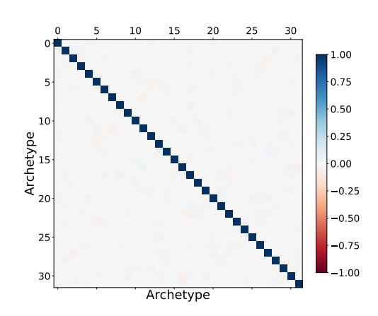

> > Hình ảnh hiển thị một biểu đồ nhiệt (heatmap) biểu diễn ma trận tương quan giữa các "Archetype". > >:
- Trục tung (y-axis): Được dán nhãn là "Archetype" với các vạch chia số từ 0 đến 30 (đánh dấu tại các vị trí 0, 5, 10, 15, 20, 25, 30). >
- Trục hoành (x-axis): Có các vạch chia số tương tự từ 0 đến 30 ở phía trên và nhãn "Archetype" nằm ở phía dưới cùng. >
- Nội dung ma trận: Đường chéo chính của ma trận có màu xanh lam đậm nổi bật, kéo dài từ góc trên bên trái xuống góc dưới bên phải, thể hiện giá trị tương quan bằng 1.00 (tự tương quan). Các ô còn lại ngoài đường chéo chính có màu trắng hoặc màu sắc rất nhạt (gần với mức 0.00), cho thấy hầu như không có sự tương quan giữa các archetype khác nhau. >
- Thanh màu (Colorbar): Nằm ở phía bên phải để chú thích giá trị màu sắc, trải dài từ -1.00 (màu đỏ đậm) qua 0.00 (màu trắng) đến 1.00 (màu xanh lam đậm).

> > 0 > 5 > 10 > 15 > 20 > 25 > 30 > Archetype > 0 > 5 > 10 > 15 > 20 > 25 > 30 > Archetype > 1.00 > 0.75 > 0.50 > 0.25 > 0.00 > -0.25 > -0.50 > -0.75 > -1.00

Figure 4.3: Kendall Tau similarity of ranks of transcripts selected by each entry in the dictionary. Nearly all off-diagonal comparisons have similarity less than 0.1, indicating that the models are orthogonal.

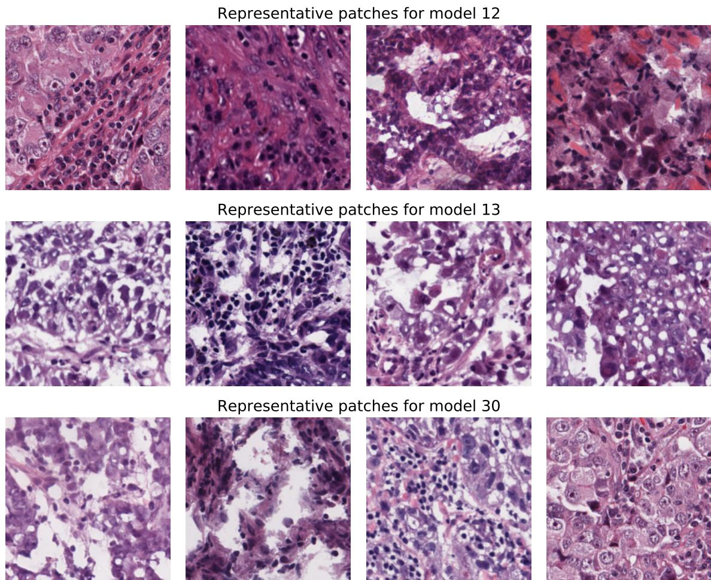

> > Hình ảnh hiển thị một lưới gồm 12 mảnh ảnh mô bệnh học (histopathology patches) được nhuộm màu H&E (Hematoxylin và Eosin), đặc trưng bởi các tông màu hồng, tím và xanh đậm của nhân tế bào và bào tương. Các mảnh ảnh được sắp xếp thành 3 hàng, mỗi hàng gồm 4 ảnh vuông nằm ngang và có một tiêu đề văn bản tương ứng ở phía trên: > > Hàng thứ nhất: Tiêu đề "Representative patches for model 12", phía dưới là 4 mảnh ảnh hiển thị các cấu trúc tế bào mật độ cao, tế bào u và sự xâm nhập của các tế bào viêm (lympho). > Hàng thứ hai: Tiêu đề "Representative patches for model 13", phía dưới là 4 mảnh ảnh hiển thị các đặc điểm hình thái tế bào khác biệt, có vùng tế bào thưa thớt hơn hoặc có cấu trúc dạng tuyến/nang bị vỡ. > * Hàng thứ ba: Tiêu đề "Representative patches for model 30", phía dưới là 4 mảnh ảnh hiển thị các tế bào đa hình thái kích thước lớn xen lẫn các tế bào lympho nhỏ sẫm màu.

> > Representative patches for model 12 > Representative patches for model 13 > Representative patches for model 30

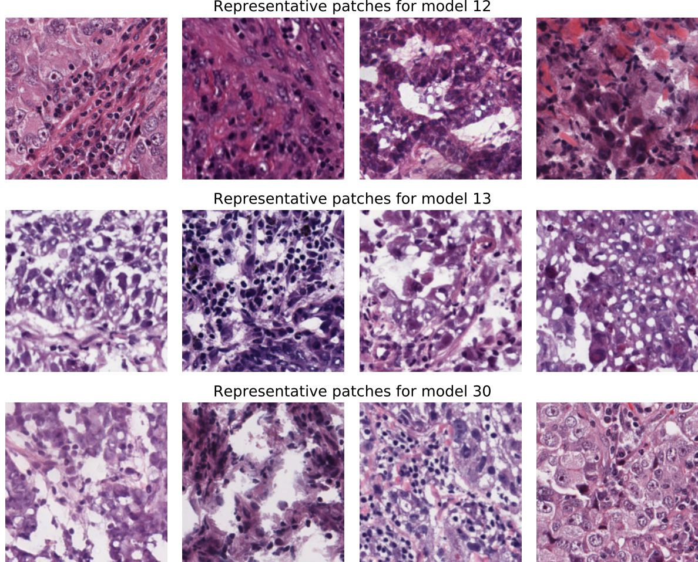

> > Hình ảnh hiển thị một lưới gồm 12 ảnh cắt nhỏ (patches) về tiêu bản mô bệnh học được nhuộm màu H&E (Hematoxylin và Eosin). Các ảnh này được sắp xếp thành 3 hàng, mỗi hàng gồm 4 ảnh vuông thể hiện các đặc điểm cấu trúc tế bào và mô khác nhau dưới kính hiển vi. > > Cấu trúc chi tiết của hình ảnh bao gồm: >:
- Hàng thứ nhất: Phía trên có dòng chữ "Representative patches for model 12", gồm 4 ảnh cắt thể hiện các cấu trúc mô với tế bào nhuộm màu hồng (bào tương) và tím (nhân tế bào), có sự xuất hiện của các đám tế bào viêm hoặc tế bào u. >
- Hàng thứ hai: Phía trên có dòng chữ "Representative patches for model 13", gồm 4 ảnh cắt thể hiện các vùng mô có mật độ nhân tế bào dày đặc, kích thước nhân không đều và cấu trúc mô bị xáo trộn. >
- Hàng thứ ba: Phía trên có dòng chữ "Representative patches for model 30", gồm 4 ảnh cắt thể hiện các đặc điểm mô học khác nhau, bao gồm các vùng có nhiều khoảng trống sáng màu xen kẽ các đám tế bào dị dạng hoặc tế bào lympho xâm nhập.

Figure 4.4: Patches that made CEN assign the highest weights to the corresponding models in the dictionary. Morphology of the patches is homogeneous within model-specific cluster and varies between the clusters.

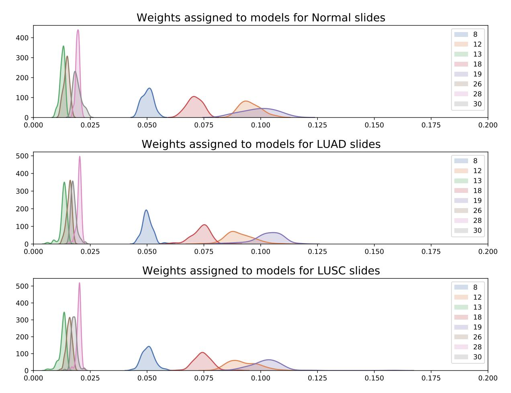

Figure 4.5: Class-conditional distributions over the weights assigned to different archetypes by CEN, visualized for healthy, LUAD, and LUSC slides. Observe only slight variation between distributions of the weights assigned to different archetypes, while the relative ordering between the archetypes being strictly preserved.

# Chapter 5

# Cell-Specific Transcriptomic Regulatory Networks

A common task in bioinformatics is to infer regulatory networks from gene expression data. That is, we seek a graphical model which we can use to understand which gene products regulate the production of other gene products. These networks enable systems biologists to ask probing questions about the function of genes and proteins, and to understand causal mechanisms through knockout and peturbation analyses.

Historically, inference of these transcriptomic regulatory networks was performed at a populationlevel. While biologists did not believe that the regulatory network was the same for all cells in a population, the number of samples was lacking and the statistical methods lacked the power necessary to estimate different regulatory networks for different settings. However, recent advances in both the experimental side (with high-throughput single-cell sequencing) and the modeling side have enabled new analyses to be performed at a more granular scale. In recent years, inference of tissue-specific [[93]](#page-63-8) and cell-type specific [15, 16, 54, [67]](#page-61-11) regulatory networks have redefined biological understanding of many genetic functions.

Here, we propose to take these analyses to the next level of granularity: a different regulatory network for each cell. Successfully estimating different networks for every cell would enable the next stage of biological inquires to be performed at a new level of specificity, allowing biologists to understand the cellular diversity within and between defined cell types. In addition, this technique could be applied to a cancer patient's transcriptomic assay to identify aberrations in the regulatory network caused by the disease. These aberrations may provide therapeutic targets.

For this project, we will adapt the methodology used in Section 3 to estimate probabilistic graphical models. Because Personalized Regression has been designed as a separable Mestimator (i.e. a sum of a predictive loss and a regularizer), it is straightforward to change the class of functions used for the predictive loss. Thus, instead of optimizing personalized linear regression models, we will optimize personalized Gaussian graphical models. That is, for each sample i of the training data, define a regularized, sample-specific loss by

L (i) (Z, Q, φ) = `(X(i), QTZ (i)) + ψλ(Q TZ (i)) + D (i) γ (Z, φ), (5.1)

where (X(i), QTZ(i)) is the negative log-likelihood of X(i) under precision matrix QTZ(i), ψλ is an 1 penalty and D (i) γ is the distance-matching regularizer defined in Eq. (3.6). We learn Ω and φ by minimizing the following composite objective:

L(Z, Q, φ) = n ∑ i=1 L (i) (Z, Q, φ) + υ∥φ − 1∥ 2 2, (5.2)

We will apply this methodology to data from [[132]](#page-67-11). This study measured the single-cell expression of approximately 1000 induced pluri-potent stem cells in mice, with experimental variables including genotype and reprogramming stimulus. We will use these experimental variables as covariates for which we can estimate personalized networks. In addition, we will also explore using the methodology described in Section 4.1 to estimate patient-specific regulatory networks from images.

As described in Section 1.3, I intend to complete this project during the Fall 2020 semester.

# Bibliography

[1] Ilieva I Ageenko, Kelley A Doherty, and Adrian Paul Van Cleave. Personalized lifetime financial planning tool, June 24 2010. US Patent App. 12/316,967. 2.3 [2] Maruan Al-Shedivat, Avinava Dubey, and Eric P Xing. Contextual explanation networks. arXiv preprint arXiv:1705.10301, 2017. 2.3, 2.3, 4.1 [3] Maruan Al-Shedivat, Avinava Dubey, and Eric P Xing. Personalized survival prediction with contextual explanation networks. arXiv preprint arXiv:1801.09810, 2018. 2.3 [4] Ahmed M Alaa, Jinsung Yoon, Scott Hu, and Mihaela van der Schaar. Personalized risk scoring for critical care patients using mixtures of gaussian process experts. ICML 2016 Workshop on Computational Frameworks for Personalization, 2016. 3, 4.1 [5] Sanjeev Arora, Yingyu Liang, and Tengyu Ma. A simple but tough-to-beat baseline for sentence embeddings. In International Conference on Learning Representations (ICLR), 2017. 3 [6] Jordan Ash, Gregory Darnell, Daniel Munro, and Barbara Engelhardt. Joint analysis of gene expression levels and histological images identifies genes associated with tissue morphology. bioRxiv, page 458711, 2018. 4.1 [7] Michael Ashburner, Catherine A Ball, Judith A Blake, David Botstein, Heather Butler, J Michael Cherry, Allan P Davis, Kara Dolinski, Selina S Dwight, Janan T Eppig, et al. Gene ontology: tool for the unification of biology. Nature genetics, 25(1):25–29, 2000. 4.1 [8] D R Baldwin, B White, M Schmidt-Hansen, A R Champion, and A M Melder. Diagnosis and treatment of lung cancer: summary of updated NICE guidance. BMJ, 342, 2011. ISSN 0959-8138. doi: 10.1136/bmj.d2110. URL https://www.bmj.com/ content/342/bmj.d2110. 4.1 [9] Sally Bamford, Emily Dawson, Simon Forbes, Jody Clements, Roger Pettett, Ahmet Dogan, A Flanagan, Jon Teague, P Andrew Futreal, Michael R Stratton, et al. The cosmic (catalogue of somatic mutations in cancer) database and website. British journal of cancer, 91(2):355–358, 2004. 4.1 [10] Adham Beykikhoshk, Thomas P Quinn, Samuel C Lee, Truyen Tran, and Svetha Venkatesh. Deeptriage: Interpretable and individualised biomarker scores using attention mechanism for the classification of breast cancer sub-types. bioRxiv, page 533406, 2019. 4.1

[11] Cristian Bucilua, Rich Caruana, and Alexandru Niculescu-Mizil. Model compression. In ˇ Proceedings of the 12th ACM SIGKDD international conference on Knowledge discovery and data mining, pages 535–541, 2006. 2 [12] Florian Buettner, Kedar N Natarajan, F Paolo Casale, Valentina Proserpio, Antonio Scialdone, Fabian J Theis, Sarah A Teichmann, John C Marioni, and Oliver Stegle. Computational analysis of cell-to-cell heterogeneity in single-cell rna-sequencing data reveals hidden subpopulations of cells. Nature biotechnology, 33(2):155, 2015. 2.3, 3, 4.1 [13] Kristina L Buschur, Maria Chikina, and Panayiotis V Benos. Causal network perturbations for instance-specific analysis of single cell and disease samples. bioRxiv, page 637710, 2019. 4.1 [14] Gabriele Campanella, Matthew G Hanna, Luke Geneslaw, Allen Miraflor, Vitor Werneck Krauss Silva, Klaus J Busam, Edi Brogi, Victor E Reuter, David S Klimstra, and Thomas J Fuchs. Clinical-grade computational pathology using weakly supervised deep learning on whole slide images. Nature Medicine, 25(8):1301–1309, 2019. ISSN 1546-170X. doi: 10.1038/s41591-019-0508-1. URL https://doi.org/10.1038/ s41591-019-0508-1. 4.1, 4.1 [15] Deborah Chasman and Sushmita Roy. Inference of cell type specific regulatory networks on mammalian lineages. Current opinion in systems biology, 2:130–139, 2017. 5 [16] Chen Chen, Shihua Zhang, and Xiang-Sun Zhang. Discovery of cell-type specific regulatory elements in the human genome using differential chromatin modification analysis. Nucleic acids research, 41(20):9230–9242, 2013. 5 [17] Tianqi Chen and Carlos Guestrin. Xgboost: A scalable tree boosting system. ArXiv, abs/1603.02754, 2016. 2 [18] Jun Cheng, Jie Zhang, Yatong Han, Xusheng Wang, Xiufen Ye, Yuebo Meng, Anil Parwani, Zhi Han, Qianjin Feng, and Kun Huang. Integrative Analysis of Histopathological Images and Genomic Data Predicts Clear Cell Renal Cell Carcinoma Prognosis. Cancer Research, 77(21):e91—-e100, 2017. ISSN 0008-5472. doi: 10.1158/0008-5472. CAN-17-0313. URL https://cancerres.aacrjournals.org/content/ 77/21/e91. 4.1 [19] Jean Chiou, Chia-Yi Su, Yi-Hua Jan, Chih-Jen Yang, Ming-Shyan Huang, Yung-Luen Yu, and Michael Hsiao. Decrease of FSTL1-BMP4-Smad signaling predicts poor prognosis in lung adenocarcinoma but not in squamous cell carcinoma. Scientific reports, 7(1):9830, aug 2017. ISSN 2045-2322. doi: 10.1038/s41598-017-10366-2. URL https://pubmed.ncbi.nlm.nih.gov/28852126https://www.ncbi. nlm.nih.gov/pmc/articles/PMC5575295/. 4.1 [20] Eric A Collisson, Peter Bailey, David K Chang, and Andrew V Biankin. Molecular subtypes of pancreatic cancer. Nature Reviews Gastroenterology & Hepatology, 16(4): 207–220, 2019. ISSN 1759-5053. doi: 10.1038/s41575-019-0109-y. URL https: //doi.org/10.1038/s41575-019-0109-y. 4.1 [21] Gene Ontology Consortium. The gene ontology resource: 20 years and still going strong. Nucleic acids research, 47(D1):D330–D338, 2019. 4.1

[22] Nicolas Coudray, Paolo Santiago Ocampo, Theodore Sakellaropoulos, Navneet Narula, Matija Snuderl, David Fenyo, Andre L Moreira, Narges Razavian, and Aristotelis Tsiri- ¨ gos. Classification and mutation prediction from non–small cell lung cancer histopathology images using deep learning. Nature Medicine, 24(10):1559–1567, 2018. ISSN 1546-170X. doi: 10.1038/s41591-018-0177-5. URL https://doi.org/10.1038/ s41591-018-0177-5. 4.1, 4.1, 4.1, 4.1, 4.1, 4.1, 4.1 [23] Judy M Coulson, Jodie L Edgson, Penella J Woll, and John P Quinn. A splice variant of the neuron-restrictive silencer factor repressor is expressed in small cell lung cancer: a potential role in derepression of neuroendocrine genes and a useful clinical marker. Cancer research, 60(7):1840–1844, 2000. 4.1 [24] Simon J Crabb, Maggie CU Cheang, Samuel Leung, Taina Immonen, Torsten O Nielsen, David D Huntsman, Chris D Bajdik, and Stephen K Chia. Basal breast cancer molecular subtype predicts for lower incidence of axillary lymph node metastases in primary breast cancer. Clinical breast cancer, 8(3):249–256, 2008. 4.1 [25] Charles S Dela Cruz, Lynn T Tanoue, and Richard A Matthay. Lung cancer: epidemiology, etiology, and prevention. Clinics in chest medicine, 32(4):605–644, 2011. 4.1 [26] Antonio Cuevas, Manuel Febrero, and Ricardo Fraiman. An anova test for functional data. Computational statistics & data analysis, 47(1):111–122, 2004. 2 [27] Mark A Dawson. The cancer epigenome: Concepts, challenges, and therapeutic opportunities. Science, 355(6330):1147–1152, 2017. ISSN 0036-8075. doi: 10.1126/science. aam7304. URL https://science.sciencemag.org/content/355/6330/ 1147. 4.1 [28] Jennifer B Dennison, Maria Shahmoradgoli, Wenbin Liu, Zhenlin Ju, Funda Meric-Bernstam, Charles M Perou, Aysegul A Sahin, Alana Welm, Steffi Oesterreich, Matthew J Sikora, et al. High intratumoral stromal content defines reactive breast cancer as a low-risk breast cancer subtype. Clinical Cancer Research, 22(20):5068–5078, 2016. 3 [29] Xiao Ding, Yue Zhang, Ting Liu, and Junwen Duan. Deep learning for event-driven stock prediction. In IJCAI, pages 2327–2333, 2015. 3 [30] Xin Dong, Dong Lin, Chris Low, Emily A. Vucic, John C. English, John Yee, Nevin Murray, Wan L. Lam, Victor Ling, Stephen Lam, Peter W. Gout, and Yuzhuo Wang. Elevated expression of birc6 protein in non-small-cell lung cancers is associated with cancer recurrence and chemoresistance. Journal of Thoracic Oncology, 8(2):161–170, 2013. ISSN 15561380. doi: 10.1097/JTO.0b013e31827d5237. 4.1 [31] Holly K Dressman, Andrew Berchuck, Gina Chan, Jun Zhai, Andrea Bild, Robyn Sayer, Janiel Cragun, Jennifer Clarke, Regina S Whitaker, LiHua Li, et al. An integrated genomic-based approach to individualized treatment of patients with advanced-stage ovarian cancer. Journal of Clinical Oncology, 25(5):517–525, 2007. 3 [32] Jianqing Fan and Wenyang Zhang. Statistical estimation in varying coefficient models. Annals of Statistics, pages 1491–1518, 1999. 2.3 [33] Dean A Fennell. Caspase Regulation in Non{/textendash}Small Cell Lung Cancer

and its Potential for Therapeutic Exploitation. Clinical Cancer Research, 11(6):2097– 2105, 2005. ISSN 1078-0432. doi: 10.1158/1078-0432.CCR-04-1482. URL https: //clincancerres.aacrjournals.org/content/11/6/2097. 4.1 [34] Sebastiano Filetti, Jean-Michel Bidart, Franco Arturi, Bernard Caillou, Diego Russo, and Martin Schlumberger. Sodium/iodide symporter: a key transport system in thyroid cancer cell metabolism. European Journal of Endocrinology, 141(5):443–457, 1999. 3 [35] Aaron J. Fisher, John D. Medaglia, and Bertus F. Jeronimus. Lack of group-to-individual generalizability is a threat to human subjects research. Proceedings of the National Academy of Sciences, 115(27):E6106–E6115, 2018. ISSN 0027-8424. doi: 10.1073/pnas. 1711978115. URL <https://www.pnas.org/content/115/27/E6106>. 2.3 [36] R Fisher, L Pusztai, and C Swanton. Cancer heterogeneity: implications for targeted therapeutics. British journal of cancer, 108(3):479, 2013. 3 [37] Simon A Forbes, David Beare, Prasad Gunasekaran, Kenric Leung, Nidhi Bindal, Harry Boutselakis, Minjie Ding, Sally Bamford, Charlotte Cole, and Sari Ward. Cosmic: exploring the world's knowledge of somatic mutations in human cancer. Nucleic acids research, 43(D1):D805–D811, 2014. 3, 3 [38] Yu Fu, Alexander W Jung, Ramon Vinas Torne, Santiago Gonzalez, Harald Vohringer, ˜ Mercedes Jimenez-Linan, Luiza Moore, and Moritz Gerstung. Pan-cancer computational histopathology reveals mutations, tumor composition and prognosis. bioRxiv, page 813543, 2019. 4.1 [39] Andrew Gelman. Statistical modeling, causal inference, and social science, Mar 2018. URL https://statmodeling.stat.columbia.edu/2018/03/15/ need-16-times-sample-size-estimate-interaction-estimate-main-effect/. 2 [40] Arkadiusz Gertych, Zaneta Swiderska-Chadaj, Zhaoxuan Ma, Nathan Ing, Tomasz Markiewicz, Szczepan Cierniak, Hootan Salemi, Samuel Guzman, Ann E Walts, and Beatrice S Knudsen. Convolutional neural networks can accurately distinguish four histologic growth patterns of lung adenocarcinoma in digital slides. Scientific Reports, 9 (1):1483, 2019. ISSN 2045-2322. doi: 10.1038/s41598-018-37638-9. URL https: //doi.org/10.1038/s41598-018-37638-9. 4.1, 4.1, 4.1 [41] A Goldhirsch, E P Winer, A S Coates, R D Gelber, M Piccart-Gebhart, B Thurlimann, H-J Senn, and Panel Members. Personalizing the treatment of ¨ women with early breast cancer: highlights of the St Gallen International Expert Consensus on the Primary Therapy of Early Breast Cancer 2013. Annals of oncology: official journal of the European Society for Medical Oncology, 24(9):2206–2223, sep 2013. ISSN 1569-8041. doi: 10.1093/annonc/ mdt303. URL https://pubmed.ncbi.nlm.nih.gov/23917950https:// www.ncbi.nlm.nih.gov/pmc/articles/PMC3755334/. 4.1 [42] Isobel Claire Gormley, Thomas Brendan Murphy, et al. A mixture of experts model for rank data with applications in election studies. The Annals of Applied Statistics, 2(4): 1452–1477, 2008. 2.3

- [43] A M Groeger, V Esposito, A De Luca, R Cassandro, G Tonini, V Ambrogi, F Baldi, R Goldfarb, T C Mineo, A Baldi, and E Wolner. Prognostic value of immunohistochemical expression of p53, bax, Bcl-2 and Bcl-xL in resected non-small-cell lung cancers. Histopathology, 44(1):54–63, 2004. doi: 10.1111/j.1365-2559.2004. 01750.x. URL https://onlinelibrary.wiley.com/doi/abs/10.1111/ j.1365-2559.2004.01750.x. 4.1 [44] Robert L Grossman, Allison P Heath, Vincent Ferretti, Harold E Varmus, Douglas R Lowy, Warren A Kibbe, and Louis M Staudt. Toward a shared vision for cancer genomic data. New England Journal of Medicine, 375(12):1109–1112, 2016. 4.1 [45] S M Haeger, J J Thompson, S Kalra, T G Cleaver, D Merrick, X-J Wang, and S P Malkoski. Smad4 loss promotes lung cancer formation but increases sensitivity to DNA topoisomerase inhibitors. Oncogene, 35(5):577–586, 2016. ISSN 1476-5594. doi: 10.1038/onc.2015.112. URL <https://doi.org/10.1038/onc.2015.112>. 4.1 [46] David Hallac, Jure Leskovec, and Stephen Boyd. Network lasso: Clustering and optimization in large graphs. In Proceedings of the 21th ACM SIGKDD international conference on knowledge discovery and data mining, pages 387–396. ACM, 2015. 2.3, 2.3 [47] Douglas Hanahan and Robert A Weinberg. The hallmarks of cancer. cell, 100(1):57–70, 2000. 4.1 [48] Douglas Hanahan and Robert A. Weinberg. Hallmarks of cancer: The next generation, mar 2011. ISSN 00928674. 4.1, 4.1 [49] Jie Hao, Sai Chandra Kosaraju, Nelson Zange Tsaku, Dae Hyun Song, and Mingon Kang. PAGE-Net: Interpretable and Integrative Deep Learning for Survival Analysis Using Histopathological Images and Genomic Data. In Biocomputing 2020, pages 355–366. WORLD SCIENTIFIC, nov 2019. ISBN 978-981-12-1562-
- 9. doi: doi:10.1142/9789811215636 0032. URL https://doi.org/10.1142/ 9789811215636{_}0032. 4.1 [50] Sara A. Hart. Precision education initiative: Moving toward personalized education. Mind, Brain, and Education, 10(4):209–211, 2016. doi: 10.1111/mbe.12109. URL https: //onlinelibrary.wiley.com/doi/abs/10.1111/mbe.12109. 2.3 [51] Trevor Hastie and Robert Tibshirani. Varying-coefficient models. Journal of the Royal Statistical Society: Series B (Methodological), 55(4):757–779, 1993. 2.3, 2.3, 3 [52] Tristan J Hayeck, Noah A Zaitlen, Po-Ru Loh, Bjarni Vilhjalmsson, Samuela Pollack, Alexander Gusev, Jian Yang, Guo-Bo Chen, Michael E Goddard, Peter M Visscher, et al. Mixed model with correction for case-control ascertainment increases association power. The American Journal of Human Genetics, 96(5):720–730, 2015. 3 [53] Josie Hayes, Pier Paolo Peruzzi, and Sean Lawler. MicroRNAs in cancer: Biomarkers, functions and therapy, 2014. ISSN 1471499X. 4.1 [54] Yuan He, Surya B Chhetri, Marios Arvanitis, Kaushik Srinivasan, Franc¸ois Aguet, Kristin G Ardlie, Alvaro N Barbeira, Rodrigo Bonazzola, Hae Kyung Im, Christopher D Brown, et al. Mechanisms of tissue-specific genetic regulation revealed by latent factors

across eqtls. bioRxiv, page 785584, 2019. 5 [55] Geoffrey Hinton, Oriol Vinyals, and Jeff Dean. Distilling the knowledge in a neural network. arXiv preprint arXiv:1503.02531, 2015. 2 [56] Giles Hooker. Diagnostics and Extrapolation in Machine Learning. Stanford University, 2004. 2 [57] Giles Hooker. Generalized functional anova diagnostics for high-dimensional functions of dependent variables. Journal of Computational and Graphical Statistics, 16(3):709–732, 2007. 2 [58] Osamu Iizuka, Fahdi Kanavati, Kei Kato, Michael Rambeau, Koji Arihiro, and Masayuki Tsuneki. Deep Learning Models for Histopathological Classification of Gastric and Colonic Epithelial Tumours. Scientific Reports, 10(1):1504, 2020. ISSN 2045:
- 2322. doi: 10.1038/s41598-020-58467-9. URL https://doi.org/10.1038/ s41598-020-58467-9. 4.1, 4.1 [59] Marcin Imielinski, Alice H. Berger, Peter S. Hammerman, Bryan Hernandez, Trevor J. Pugh, Eran Hodis, Jeonghee Cho, James Suh, Marzia Capelletti, Andrey Sivachenko, Carrie Sougnez, Daniel Auclair, Michael S. Lawrence, Petar Stojanov, Kristian Cibulskis, Kyusam Choi, Luc De Waal, Tanaz Sharifnia, Angela Brooks, Heidi Greulich, Shantanu Banerji, Thomas Zander, Danila Seidel, Frauke Leenders, Sascha Ansen, Corinna Ludwig, ´ Walburga Engel-Riedel, Erich Stoelben, Jurgen Wolf, Chandra Goparju, Kristin Thomp
- ¨ son, Wendy Winckler, David Kwiatkowski, Bruce E. Johnson, Pasi A. Janne, Vincent A. ¨ Miller, William Pao, William D. Travis, Harvey I. Pass, Stacey B. Gabriel, Eric S. Lander, Roman K. Thomas, Levi A. Garraway, Gad Getz, and Matthew Meyerson. Mapping the hallmarks of lung adenocarcinoma with massively parallel sequencing. Cell, 150(6): 1107–1120, sep 2012. ISSN 00928674. doi: 10.1016/j.cell.2012.08.029. 4.1 [60] Kentaro Inamura. Lung Cancer: Understanding Its Molecular Pathology and the 2015 WHO Classification. Frontiers in Oncology, 7:193, 2017. ISSN 2234-943X. doi: 10. 3389/fonc.2017.00193. URL https://www.frontiersin.org/article/10. 3389/fonc.2017.00193. 4.1 [61] Claudio Isella, Andrea Terrasi, Sara Erika Bellomo, Consalvo Petti, Giovanni Galatola, Andrea Muratore, Alfredo Mellano, Rebecca Senetta, Adele Cassenti, Cristina Sonetto, et al. Stromal contribution to the colorectal cancer transcriptome. Nature genetics, 47(4): 312, 2015. 3 [62] Fattaneh Jabbari, Shyam Visweswaran, and Gregory F. Cooper. Instance-specific bayesian network structure learning. In Vaclav Kratochv ´ ´ıl and Milan Studeny, editors, ´ Proceedings of the Ninth International Conference on Probabilistic Graphical Models, volume 72 of Proceedings of Machine Learning Research, pages 169–180, Prague, Czech Republic, 11–14 Sep 2018. PMLR. URL http://proceedings.mlr.press/v72/ jabbari18a.html. 2.3 [63] Fattaneh Jabbari, Shyam Visweswaran, and Gregory F Cooper. An empirical investigation of instance-specific causal bayesian network learning. In 2019 IEEE International Conference on Bioinformatics and Biomedicine (BIBM), pages 2582–2585. IEEE, 2019. 2.3,

- [64] Jiming Jiang. Linear and generalized linear mixed models and their applications. Springer Science & Business Media, 2007. 2.3 [65] Bertrand Joseph, Jessica Ekedahl, Rolf Lewensohn, Philippe Marchetti, Pierre Formstecher, and Boris Zhivotovsky. Defective caspase-3 relocalization in non-small cell lung carcinoma. Oncogene, 20(23):2877–2888, 2001. ISSN 1476-5594. doi: 10.1038/sj.onc. 1204402. URL <https://doi.org/10.1038/sj.onc.1204402>. 4.1 [66] Hyun Seok Kim, Saurabh Mendiratta, Jiyeon Kim, Chad Victor Pecot, Jill E Larsen, Iryna Zubovych, Bo Yeun Seo, Jimi Kim, Banu Eskiocak, Hannah Chung, et al. Systematic identification of molecular subtype-selective vulnerabilities in non-small-cell lung cancer. Cell, 155(3):552–566, 2013. 4.1 [67] Sarah Kim-Hellmuth, Franc¸ois Aguet, Meritxell Oliva, Manuel Munoz-Aguirre, Valentin ˜ Wucher, Silva Kasela, Stephane E Castel, Andrew Hamel, Ana Vinuela, Amy L Roberts, ˜ et al. Cell type specific genetic regulation of gene expression across human tissues. bioRxiv, page 806117, 2019. 5 [68] Mladen Kolar, Le Song, and Eric P Xing. Sparsistent learning of varying-coefficient models with structural changes. In Advances in neural information processing systems, pages 1006–1014, 2009. 1 [69] Daisuke Komura and Shumpei Ishikawa. Machine Learning Methods for Histopathological Image Analysis. Computational and Structural Biotechnology Journal, 16:34–42, 2018. ISSN 2001-0370. doi: https://doi.org/10.1016/j.csbj.2018.01.
- 001. URL http://www.sciencedirect.com/science/article/pii/ S2001037017300867. 4.1, 4.1 [70] Marieke Lydia Kuijjer, Matthew Tung, GuoCheng Yuan, John Quackenbush, and Kimberly Glass. Estimating sample-specific regulatory networks. arXiv preprint arXiv:1505.06440, 2015. 4.1 [71] Marieke Lydia Kuijjer, Matthew George Tung, GuoCheng Yuan, John Quackenbush, and Kimberly Glass. Estimating sample-specific regulatory networks. iScience, 14:226–240, 2019. 2.3 [72] Chandan Kumar-Sinha and Arul M Chinnaiyan. Precision oncology in the age of integrative genomics. Nature biotechnology, 36(1):46, 2018. 3 [73] Benjamin Lengerich, Bryon Aragam, and Eric P. Xing. Personalized regression enables sample-specific pan-cancer analysis. bioRxiv, 2018. doi: 10.1101/294496. URL https: //www.biorxiv.org/content/early/2018/04/05/294496. 4.1 [74] Benjamin Lengerich, Sarah Tan, Chun-Hao Chang, Giles Hooker, and Rich Caruana. Purifying interaction effects with the functional anova: An efficient algorithm for recovering identifiable additive models. 2019. 2, 2, 2, 2.2 [75] Benjamin Lengerich, Maruan Al-Shedivat, Amir Alavi, Jennifer Williams, Sami Labbaki, and Eric P. Xing. Discriminative subtyping of lung cancers from histopathology images with contextual deep learning. Under Review, 2020. 4

[76] Benjamin Lengerich, Chun-Hao Chang, Eric P. Xing, and Rich Caruana. Dropout regularizes interaction effects, 2020. 2 [77] Benjamin J Lengerich, Bryon Aragam, and Eric P Xing. Personalized regression enables sample-specific pan-cancer analysis. Bioinformatics, 34(13):i178–i186, 2018. 2.3, 3, 4.1 [78] Benjamin J. Lengerich, Bryon Aragam, and Eric P Xing. Learning sample-specific models with low-rank personalized regression. In Advances in Neural Information Processing Systems (In Press), 2019. 2.3, 3, 3, 4.1 [79] Andrew C Leon and Moonseong Heo. Sample sizes required to detect interactions between two binary fixed-effects in a mixed-effects linear regression model. Computational statistics & data analysis, 53(3):603–608, 2009. 2 [80] Xiang Li, Shanghong Xie, Peter McColgan, Sarah J Tabrizi, Rachael I Scahill, Donglin Zeng, and Yuanjia Wang. Learning subject-specific directed acyclic graphs with mixed effects structural equation models from observational data. Frontiers in genetics, 9, 2018. 2.3 [81] Neal I Lindeman, Philip T Cagle, Mary Beth Beasley, Dhananjay Arun Chitale, Sanja Dacic, Giuseppe Giaccone, Robert Brian Jenkins, David J Kwiatkowski, Juan-Sebastian Saldivar, Jeremy Squire, Erik Thunnissen, and Marc Ladanyi. Molecular testing guideline for selection of lung cancer patients for EGFR and ALK tyrosine kinase inhibitors: guideline from the College of American Pathologists, International Association for the Study of Lung Cancer, and Association for Molecular Pathology. Journal of thoracic oncology: official publication of the International Association for the Study of Lung Cancer, 8 (7):823–859, jul 2013. ISSN 1556-1380. doi: 10.1097/JTO.0b013e318290868f. URL https://pubmed.ncbi.nlm.nih.gov/23552377https://www.ncbi. nlm.nih.gov/pmc/articles/PMC4159960/. 4.1 [82] Chong Liu, Jonathan C Sage, Michael R Miller, Roel GW Verhaak, Simon Hippenmeyer, Hannes Vogel, Oded Foreman, Roderick T Bronson, Akiko Nishiyama, and Liqun Luo. Mosaic analysis with double markers reveals tumor cell of origin in glioma. Cell, 146(2): 209–221, 2011. 3 [83] Guangbo Liu, Fen Pei, Fengqing Yang, Lingxiao Li, Amit Dipak Amin, Songnian Liu, J Ross Buchan, and William C Cho. Role of Autophagy and Apoptosis in Non-Small-Cell Lung Cancer. International journal of molecular sciences, 18(2):367, feb 2017. ISSN 1422-0067. doi: 10.3390/ijms18020367. URL https://pubmed.ncbi.nlm.nih.gov/28208579https://www.ncbi. nlm.nih.gov/pmc/articles/PMC5343902/. 4.1 [84] Xiaoping Liu, Yuetong Wang, Hongbin Ji, Kazuyuki Aihara, and Luonan Chen. Personalized characterization of diseases using sample-specific networks. Nucleic acids research, 44(22):e164–e164, 2016. 4.1 [85] Xiaoping Liu, Yuetong Wang, Hongbin Ji, Kazuyuki Aihara, and Luonan Chen. Personalized characterization of diseases using sample-specific networks. Nucleic acids research, 44(22):e164–e164, 2016. 2.3 [86] Chad A Livasy, Gamze Karaca, Rita Nanda, Maria S Tretiakova, Olufunmilayo I Olopade, Dominic T Moore, and Charles M Perou. Phenotypic evaluation of the basal-like subtype

- of invasive breast carcinoma. Modern pathology, 19(2):264, 2006. 3 [87] Daniel Lopez-Martinez and Rosalind Picard. Multi-task neural networks for personalized pain recognition from physiological signals. arXiv preprint arXiv:1708.08755, 2017. 3, 4.1 [88] Marta Lucchetta, Isabelle da Piedade, Mohamed Mounir, Marina Vabistsevits, Thilde Terkelsen, and Elena Papaleo. Distinct signatures of lung cancer types: aberrant mucin Oglycosylation and compromised immune response. BMC Cancer, 19(1):824, 2019. ISSN 1471-2407. doi: 10.1186/s12885-019-5965-x. URL https://doi.org/10.1186/ s12885-019-5965-x. 4.1 [89] Xin Luo, Xiao Zang, Lin Yang, Junzhou Huang, Faming Liang, Jaime Rodriguez-Canales, Ignacio I Wistuba, Adi Gazdar, Yang Xie, and Guanghua Xiao. Comprehensive Computational Pathological Image Analysis Predicts Lung Cancer Prognosis. Journal of Thoracic Oncology, 12(3):501–509, 2017. ISSN 1556-0864. doi: https://doi.org/10.1016/j.jtho. 2016.10.017. URL http://www.sciencedirect.com/science/article/ pii/S1556086416312369. 4.1 [90] Siyuan Ma, Shuji Ogino, Princy Parsana, Reiko Nishihara, Zhirong Qian, Jeanne Shen, Kosuke Mima, Yohei Masugi, Yin Cao, and Jonathan A Nowak. Continuity of transcriptomes among colorectal cancer subtypes based on meta-analysis. Genome biology, 19(1): 142, 2018. 4.1 [91] Siyuan Ma, Shuji Ogino, Princy Parsana, Reiko Nishihara, Zhirong Qian, Jeanne Shen, Kosuke Mima, Yohei Masugi, Yin Cao, Jonathan A. Nowak, Kaori Shima, Yujin Hoshida, Edward L. Giovannucci, Manish K. Gala, Andrew T. Chan, Charles S. Fuchs, Giovanni Parmigiani, Curtis Huttenhower, and Levi Waldron. Continuity of transcriptomes among colorectal cancer subtypes based on meta-analysis. Genome Biology, 19(1):142, Sep 2018. ISSN 1474-760X. doi: 10.1186/s13059-018-1511-4. URL https://doi.org/10. 1186/s13059-018-1511-4. 3 [92] Stephen P Malkoski and Xiao-Jing Wang. Two sides of the story? Smad4 loss in pancreatic cancer versus head-and-neck cancer. FEBS letters, 586 (14):1984–1992, jul 2012. ISSN 1873-3468. doi: 10.1016/j.febslet.2012.01.
- 054. URL https://pubmed.ncbi.nlm.nih.gov/22321641https://www. ncbi.nlm.nih.gov/pmc/articles/PMC3285395/. 4.1 [93] Daniel Marbach, David Lamparter, Gerald Quon, Manolis Kellis, Zoltan Kutalik, and ´ Sven Bergmann. Tissue-specific regulatory circuits reveal variable modular perturbations across complex diseases. Nature methods, 13(4):366, 2016. 5 [94] Katherine Margulis, Albert S. Chiou, Sumaira Z. Aasi, Robert J. Tibshirani, Jean Y. Tang, and Richard N. Zare. Distinguishing malignant from benign microscopic skin lesions using desorption electrospray ionization mass spectrometry imaging. Proceedings of the National Academy of Sciences, 115(25):6347–6352, 2018. ISSN 0027-8424. doi: 10.1073/ pnas.1803733115. URL <https://www.pnas.org/content/115/25/6347>. 3 [95] Andriy Marusyk, Vanessa Almendro, and Kornelia Polyak. Intra-tumour heterogeneity: a

looking glass for cancer? Nature Reviews Cancer, 12(5):323, 2012. 3

[96] Andreas Maurer, Massimiliano Pontil, and Bernardino Romera-Paredes. Sparse coding for multitask and transfer learning. In ICML (2), pages 343–351, 2013. 3 [97] Huaiyu Mi and Paul Thomas. PANTHER Pathway: An Ontology-Based Pathway Database Coupled with Data Analysis Tools, pages 123–140. Humana Press, Totowa, NJ, 2009. ISBN 978-1-60761-175-2. doi: 10.1007/978-1-60761-175-2 7. URL https://doi. org/10.1007/978-1-60761-175-2_7. 3 [98] Huaiyu Mi, Xiaosong Huang, Anushya Muruganujan, Haiming Tang, Caitlin Mills, Diane Kang, and Paul D. Thomas. Panther version 11: expanded annotation data from gene ontology and reactome pathways, and data analysis tool enhancements. Nucleic Acids Research, 45(D1):D183–D189, 2017. doi: 10.1093/nar/gkw1138. URL +http://dx. doi.org/10.1093/nar/gkw1138. 3 [99] Pooya Mobadersany, Safoora Yousefi, Mohamed Amgad, David A Gutman, Jill S Barnholtz-Sloan, Jose E Vel ´ azquez Vega, Daniel J Brat, and Lee A D Cooper. Predicting ´ cancer outcomes from histology and genomics using convolutional networks. Proceedings of the National Academy of Sciences, 115(13):E2970—-E2979, 2018. ISSN 0027-8424. doi: 10.1073/pnas.1717139115. URL https://www.pnas.org/content/115/ 13/E2970. 4.1, 4.1, 4.1 [100] Hojin Moon, Hongshik Ahn, Ralph L Kodell, Songjoon Baek, Chien-Ju Lin, and James J Chen. Ensemble methods for classification of patients for personalized medicine with high-dimensional data. Artificial intelligence in medicine, 41(3):197–207, 2007. 3, 4.1 [101] Kevin Morgan, Gillian Spurlock, Richard C Brown, and M Afzal Mir. Release of a sodium transport inhibitor (inhibitin) from cultured human cancer cells. Cancer research, 46(12 Part 1):6095–6100, 1986. 3 [102] Thanos P Mourikis, Lorena Benedetti, Elizabeth Foxall, Julianne Perner, Matteo Cereda, Jesper Lagergren, Michael Howell, Christopher Yau, Rebecca Fitzgerald, Paola Scaffidi, et al. Patient-specific detection of cancer genes reveals recurrently perturbed processes in esophageal adenocarcinoma. bioRxiv, page 321612, 2018. 4.1 [103] Hassan Muhammad, Carlie S. Sigel, Gabriele Campanella, Thomas Boerner, Linda M. Pak, Stefan Buttner, Jan N. M. IJzermans, Bas Groot Koerkamp, Michael Doukas, ¨ William R. Jarnagin, Amber Simpson, and Thomas J. Fuchs. Towards unsupervised cancer subtyping: Predicting prognosis using a histologic visual dictionary, 2019. 4.1, 4.1 [104] Sara Negrini, Ilaria Prada, Rosalba D'Alessandro, and Jacopo Meldolesi. Rest: an oncogene or a tumor suppressor? Trends in cell biology, 23(6):289–295, 2013. 4.1 [105] Kenney Ng, Jimeng Sun, Jianying Hu, and Fei Wang. Personalized predictive modeling and risk factor identification using patient similarity. AMIA Summits on Translational Science Proceedings, 2015:132, 2015. 2.3 [106] Ankur P Parikh, Wei Wu, Ross E Curtis, and Eric P Xing. Treegl: reverse engineering tree-evolving gene networks underlying developing biological lineages. Bioinformatics, 27(13):i196–i204, 2011. 1

- [107] I Paul, A D Chacko, I Stasik, S Busacca, N Crawford, F McCoy, N McTavish, B Wilson, M Barr, K J O'Byrne, D B Longley, and D A Fennell. Acquired differential regulation of caspase-8 in cisplatin-resistant non-small-cell lung cancer. Cell Death & Disease, 3 (12):e449–e449, 2012. ISSN 2041-4889. doi: 10.1038/cddis.2012.186. URL https: //doi.org/10.1038/cddis.2012.186. 4.1 [108] Jeffrey Pennington, Richard Socher, and Christopher Manning. Glove: Global vectors for word representation. In Proceedings of the 2014 conference on empirical methods in natural language processing (EMNLP), pages 1532–1543, 2014. 3 [109] Jennifer Pittman, Erich Huang, Holly Dressman, Cheng-Fang Horng, Skye H Cheng, Mei-Hua Tsou, Chii-Ming Chen, Andrea Bild, Edwin S Iversen, and Andrew T Huang. Integrated modeling of clinical and gene expression information for personalized prediction of disease outcomes. Proceedings of the National Academy of Sciences of the United States of America, 101(22):8431–8436, 2004. 3 [110] Emmanouil Antonios Platanios, Mrinmaya Sachan, Graham Neubig, and Tom Mitchell. Contextual parameter generation for universal neural machine translation. arXiv preprint arXiv:1808.08493, 2018. 2.3 [111] Vlad Popovici, Eva Budinska, Lenka Capkova, Daniel Schwarz, Ladislav Dusek, Josef Feit, and Rolf Jaggi. Joint analysis of histopathology image features and gene expression in breast cancer. BMC Bioinformatics, 17:1–9, 2016. 4.1, 4.1 [112] Milind M. Pore, T. J. Hiltermann, and Frank A. E. Kruyt. Targeting apoptosis pathways in lung cancer. Cancer letters, 332(2):359–368, May 28 2013. URL http: //pitt.idm.oclc.org/login?url=https://search-proquest-com. pitt.idm.oclc.org/docview/1668042138?accountid=14709. Copyright
- - Copyright Elsevier Limited May 28, 2013; Last updated - 2015-04-10. 4.1 [113] Xavier Puig and Josep Ginebra. A bayesian cluster analysis of election results. Journal of Applied Statistics, 41(1):73–94, 2014. 2.3 [114] Martin Reck and Klaus F Rabe. Precision Diagnosis and Treatment for Advanced Non–Small-Cell Lung Cancer. New England Journal of Medicine, 377(9):849–861, aug 2017. ISSN 0028-4793. doi: 10.1056/NEJMra1703413. URL https://doi.org/ 10.1056/NEJMra1703413. 4.1 [115] Juri Reimand, Tambet Arak, Priit Adler, Liis Kolberg, Sulev Reisberg, Hedi Peterson, ¨ and Jaak Vilo. g: Profiler—a web server for functional interpretation of gene lists (2016 update). Nucleic acids research, 44(W1):W83–W89, 2016. 4.1 [116] Valeria Relli, Marco Trerotola, Emanuela Guerra, and Saverio Alberti. Abandoning the Notion of Non-Small Cell Lung Cancer. Trends in Molecular Medicine, 25 (7):585–594, 2019. ISSN 1471-4914. doi: https://doi.org/10.1016/j.molmed.2019. 04.012. URL http://www.sciencedirect.com/science/article/pii/ S1471491419301017. 4.1 [117] Marco Tulio Ribeiro, Sameer Singh, and Carlos Guestrin. Why should i trust you?: Explaining the predictions of any classifier. In Proceedings of the 22nd ACM SIGKDD international conference on knowledge discovery and data mining, pages 1135–1144. ACM,

2016. 3 [118] Sara Ricardo, Andre Filipe Vieira, Ren ´ e Gerhard, Dina Leit ˆ ao, Regina Pinto, Jorge F ˜ Cameselle-Teijeiro, Fernanda Milanezi, Fernando Schmitt, and Joana Paredes. Breast cancer stem cell markers cd44, cd24 and aldh1: expression distribution within intrinsic molecular subtype. Journal of clinical pathology, 64(11):937–946, 2011. 4.1 [119] Andrew Roth, Jaswinder Khattra, Damian Yap, Adrian Wan, Emma Laks, Justina Biele, Gavin Ha, Samuel Aparicio, Alexandre Bouchard-Cotˆ e, and Sohrab P Shah. Pyclone: ´ statistical inference of clonal population structure in cancer. Nature methods, 11(4):396, 2014. 1 [120] Artem Rozantsev, Mathieu Salzmann, and Pascal Fua. Beyond sharing weights for deep domain adaptation. IEEE transactions on pattern analysis and machine intelligence, 41 (4):801–814, 2018. 2.3 [121] Claudio Scafoglio, Bruce A. Hirayama, Vladimir Kepe, Jie Liu, Chiara Ghezzi, Nagichettiar Satyamurthy, Neda A. Moatamed, Jiaoti Huang, Hermann Koepsell, Jorge R. Barrio, and Ernest M. Wright. Functional expression of sodium-glucose transporters in cancer. Proceedings of the National Academy of Sciences, 112(30):E4111–E4119, 2015. ISSN 0027-8424. doi: 10.1073/pnas.1511698112. URL http://www.pnas.org/ content/112/30/E4111. 3 [122] Stuart J Schnitt. Classification and prognosis of invasive breast cancer: from morphology to molecular taxonomy. Modern Pathology, 23(2):S60–S64, 2010. ISSN 1530-0285. doi: 10.1038/modpathol.2010.33. URL https://doi.org/10.1038/ modpathol.2010.33. 4.1 [123] Jeong-Sun Seo, Ahreum Kim, Jong-Yeon Shin, and Young Tae Kim. Comprehensive analysis of the tumor immune micro-environment in non-small cell lung cancer for efficacy of checkpoint inhibitor. Scientific Reports, 8(1):14576, 2018. ISSN 2045- 2322. doi: 10.1038/s41598-018-32855-8. URL https://doi.org/10.1038/ s41598-018-32855-8. 4.1 [124] Masahito Shimojo, Yoshie Shudo, Masatoshi Ikeda, Tomoyo Kobashi, and Seiji Ito. The small cell lung cancer-specific isoform of re1-silencing transcription factor (rest) is regulated by neural-specific ser/arg repeat-related protein of 100 kda (nsr100). Molecular Cancer Research, 11(10):1258–1268, 2013. 4.1 [125] William M Shyu, Eric Grosse, and William S Cleveland. Local regression models. In Statistical models in S, pages 309–376. Routledge, 1991. 2.3 [126] Wengong Si, Jiaying Shen, Huilin Zheng, and Weimin Fan. The role and mechanisms of action of microRNAs in cancer drug resistance. Clinical Epigenetics, 11(1):25, 2019. ISSN 1868-7083. doi: 10.1186/s13148-018-0587-8. URL https://doi.org/10. 1186/s13148-018-0587-8. 4.1 [127] Rebecca L Siegel, Kimberly D Miller, and Ahmedin Jemal. Cancer statistics, 2020. CA: A Cancer Journal for Clinicians, 70(1):7–30, 2020. 4.1 [128] Peter Sollich and Anders Krogh. Learning with ensembles: How overfitting can be useful.

- In Advances in neural information processing systems, pages 190–196, 1996. 3 [129] Le Song, Mladen Kolar, and Eric P Xing. Time-varying dynamic bayesian networks. In Advances in neural information processing systems, pages 1732–1740, 2009. 1 [130] T. Sorlie, C. M. Perou, R. Tibshirani, T. Aas, S. Geisler, H. Johnsen, T. Hastie, M. B. Eisen, M. van de Rijn, S. S. Jeffrey, T. Thorsen, H. Quist, J. C. Matese, P. O. Brown,
- D. Botstein, P. E. Lonning, and A. L. Borresen-Dale. Gene expression patterns of breast carcinomas distinguish tumor subclasses with clinical implications. Proc Natl Acad Sci U S A, 98(19):10869–74, 2001. ISSN 0027-8424 (Print) 0027-8424 (Linking). doi: 10.1073/ pnas.191367098. URL <http://www.ncbi.nlm.nih.gov/pubmed/11553815>. 4.1 [131] Chetan L. Srinidhi, Ozan Ciga, and Anne L. Martel. Deep neural network models for computational histopathology: A survey, 2019. 4.1, 4.1 [132] Hannah T Stuart, Giuliano G Stirparo, Tim Lohoff, Lawrence E Bates, Masaki Kinoshita, Chee Y Lim, Elsa J Sousa, Katsiaryna Maskalenka, Aliaksandra Radzisheuskaya, Andrew A Malcolm, et al. Distinct molecular trajectories converge to induce na¨ıve pluripotency. Cell stem cell, 25(3):388–406, 2019. 5 [133] Christian Szegedy, Sergey Ioffe, Vincent Vanhoucke, and Alexander A Alemi. Inceptionv4, inception-resnet and the impact of residual connections on learning. In Thirty-first AAAI conference on artificial intelligence, 2017. 4.1 [134] Tetsuya Takata, Fumihiro Tanaka, Tomoko Yamada, Kazuhiro Yanagihara, Yosuke Otake, Yozo Kawano, Tatsuo Nakagawa, Ryo Miyahara, Hiroki Oyanagi, Kenji Inui, and Hiromi Wada. Clinical significance of caspase-3 expression in pathologic-stage I, nonsmall-cell lung cancer. International Journal of Cancer, 96(S1):54–60, jan 2001. ISSN 0020-7136. doi: 10.1002/ijc.10347. URL <https://doi.org/10.1002/ijc.10347>. 4.1 [135] Robert Tibshirani and Jerome Friedman. A pliable lasso. arXiv preprint arXiv:1712.00484, 2017. 2.3 [136] William D Travis, Elisabeth Brambilla, Allen Burke, Alexander Marx, and Andrew G Nicholson. WHO classification of tumours of the lung, pleura, thymus and heart. International Agency for Research on Cancer, 2015. 4.1 [137] Laurens Van Der Maaten. Accelerating t-sne using tree-based algorithms. The Journal of Machine Learning Research, 15(1):3221–3245, 2014. 3.1 [138] Michel E Vandenberghe, Marietta L J Scott, Paul W Scorer, Magnus Soderberg, Denis ¨ Balcerzak, and Craig Barker. Relevance of deep learning to facilitate the diagnosis of HER2 status in breast cancer. Scientific Reports, 7(1):45938, 2017. ISSN 2045-2322. doi: 10.1038/srep45938. URL <https://doi.org/10.1038/srep45938>. 4.1 [139] Ramya Korlakai Vinayak, Weihao Kong, Gregory Valiant, and Sham Kakade. Maximum likelihood estimation for learning populations of parameters. In International Conference on Machine Learning, pages 6448–6457, 2019. 4.1 [140] Shyam Visweswaran, Derek C Angus, Margaret Hsieh, Lisa Weissfeld, Donald Yealy, and Gregory F Cooper. Learning patient-specific predictive models from clinical data. Journal

[141] Matthew P Wagoner, Kearney TW Gunsalus, Barry Schoenike, Andrea L Richardson, Andreas Friedl, and Avtar Roopra. The transcription factor rest is lost in aggressive breast cancer. PLoS genetics, 6(6), 2010. 4.1 [142] Bo Wang, Aziz M Mezlini, Feyyaz Demir, Marc Fiume, Zhuowen Tu, Michael Brudno, Benjamin Haibe-Kains, and Anna Goldenberg. Similarity network fusion for aggregating data types on a genomic scale. Nature methods, 11(3):333, 2014. 3 [143] Shidan Wang, Alyssa Chen, Lin Yang, Ling Cai, Yang Xie, Junya Fujimoto, Adi Gazdar, and Guanghua Xiao. Comprehensive analysis of lung cancer pathology images to discover tumor shape and boundary features that predict survival outcome. Scientific Reports, 8 (1):10393, 2018. ISSN 2045-2322. doi: 10.1038/s41598-018-27707-4. URL https: //doi.org/10.1038/s41598-018-27707-4. 4.1, 4.1, 4.1 [144] Jason W Wei, Laura J Tafe, Yevgeniy A Linnik, Louis J Vaickus, Naofumi Tomita, and Saeed Hassanpour. Pathologist-level classification of histologic patterns on resected lung adenocarcinoma slides with deep neural networks. Scientific Reports, 9(1):3358, 2019. ISSN 2045-2322. doi: 10.1038/s41598-019-40041-7. URL https://doi.org/10. 1038/s41598-019-40041-7. 4.1, 4.1, 4.1 [145] John N Weinstein, Eric A Collisson, Gordon B Mills, Kenna R Mills Shaw, Brad A Ozenberger, Kyle Ellrott, Ilya Shmulevich, Chris Sander, Joshua M Stuart, Cancer Genome Atlas Research Network, et al. The cancer genome atlas pan-cancer analysis project. Nature genetics, 45(10):1113, 2013. 3 [146] Eric P Xing, Michael I Jordan, Stuart J Russell, and Andrew Y Ng. Distance metric learning with application to clustering with side-information. In Advances in neural information processing systems, pages 521–528, 2003. 3 [147] Jianpeng Xu, Jiayu Zhou, and Pang-Ning Tan. Formula: Factorized multi-task learning for task discovery in personalized medical models. In Proceedings of the 2015 International Conference on Data Mining. SIAM, 2015. 1, 2.3, 2.3, 3 [148] Makoto Yamada, Koh Takeuchi, Tomoharu Iwata, John Shawe-Taylor, and Samuel Kaski. Localized lasso for high-dimensional regression. stat, 1050:20, 2016. 1, 2.3, 2.3, 3 [149] Qian Yang, Aaron Steinfeld, and John Zimmerman. Unremarkable ai: Fitting intelligent decision support into critical, clinical decision-making processes. In Proceedings of the 2019 CHI Conference on Human Factors in Computing Systems, CHI '19, New York, NY, USA, 2019. Association for Computing Machinery. ISBN 9781450359702. doi: 10.1145/ 3290605.3300468. URL <https://doi.org/10.1145/3290605.3300468>. 1 [150] J M Yingling, M B Datto, C Wong, J P Frederick, N T Liberati, and X F Wang. Tumor suppressor Smad4 is a transforming growth factor beta-inducible DNA binding protein. Molecular and Cellular Biology, 17(12):7019–7028, 1997. ISSN 0270-7306. doi: 10. 1128/MCB.17.12.7019. URL <https://mcb.asm.org/content/17/12/7019>. 4.1 [151] Jin young Yoo, Chi Hong Kim, So Hyang Song, Byoung Yong Shim, Youn Ju Jeong,

Meyung Im Ahn, Suji Kim, Deog Gon Cho, Min Seop Jo, Kyu Do Cho, Hong Joo Cho, Seok Jin Kang, and Hoon Kyo Kim. Expression of caspase-3 and c-myc in non-small cell lung cancer. Cancer research and treatment: official journal of Korean Cancer Association, 36(5):303–307, oct 2004. ISSN 2005-9256. doi: 10.4143/crt.2004.36.5. 303. URL https://pubmed.ncbi.nlm.nih.gov/20368820https://www. ncbi.nlm.nih.gov/pmc/articles/PMC2843874/. 4.1

[152] Kun-Hsing Yu, Ce Zhang, Gerald J Berry, Russ B Altman, Christopher Re, Daniel L ´ Rubin, and Michael Snyder. Predicting non-small cell lung cancer prognosis by fully automated microscopic pathology image features. Nature Communications, 7(1):12474, 2016. ISSN 2041-1723. doi: 10.1038/ncomms12474. URL https://doi.org/10. 1038/ncomms12474. 4.1 [153] Ming Zhao, Lopa Mishra, and Chu-Xia Deng. The role of TGF-β/SMAD4 signaling in cancer. International journal of biological sciences, 14(2):111– 123, jan 2018. ISSN 1449-2288. doi: 10.7150/ijbs.23230. URL https: //pubmed.ncbi.nlm.nih.gov/29483830https://www.ncbi.nlm. nih.gov/pmc/articles/PMC5821033/. 4.1 [154] S Zhou, P Buckhaults, L Zawel, F Bunz, G Riggins, J L Dai, S E Kern, K W Kinzler, and B Vogelstein. Targeted deletion of Smad4 shows it is required for transforming growth factor beta and activin signaling in colorectal cancer cells. Proceedings of the National Academy of Sciences of the United States of America, 95(5):2412–2416, mar 1998. ISSN 0027-8424. doi: 10.1073/pnas.95.5. 2412. URL https://pubmed.ncbi.nlm.nih.gov/9482899https://www. ncbi.nlm.nih.gov/pmc/articles/PMC19358/. 4.1 [155] X. Zhu, J. Yao, X. Luo, G. Xiao, Y. Xie, A. Gazdar, and J. Huang. Lung cancer survival prediction from pathological images and genetic data — an integration study. In 2016 IEEE 13th International Symposium on Biomedical Imaging (ISBI), pages 1173–1176, 2016. 4.1, 4.1 [156] Hui Zou and Trevor Hastie. Regularization and variable selection via the elastic net. Journal of the Royal Statistical Society: Series B (Statistical Methodology), 67(2):301– 320, 2005. 3