## Thesis Proposal: Analyzing Systems with Redundant Requests

Kristen Gardner

December 2015

School of Computer Science Carnegie Mellon University Pittsburgh, PA 15213 Thesis Committee: Mor Harchol-Balter, Chair Guy Blelloch Anupam Gupta Rhonda Righter Alan Scheller-Wolf

Submitted in partial fulfillment of the requirements for the degree of Doctor of Philosophy.

Copyright c 2015 Kristen Gardner

### Abstract

Reducing response time is a primary focus of computer systems research. One key factor that influences a job's response time in a multi-server system is dispatching: when a job arrives to the system, it must be sent immediately to one of the servers. This thesis focuses on a new dispatching policy: redundancy. Unlike traditional dispatching policies, which send only a single copy of each job, the idea of redundancy is to dispatch multiple copies of the same job and wait for the first copy to complete service. A great deal of empirical work has demonstrated that redundancy can provide substantial response time improvements. For example, using redundancy in MapReduce systems has been shown to reduce the response time of straggling tasks by 20 − 50%. However, despite the extensive empirical studies on redundancy, there has been very little theoretical work analyzing performance in redundancy systems.

In this thesis, we propose to (1) quantify the benefits and costs of redundancy by providing the first analysis of systems with redundancy, and (2) design better redundancy systems to reduce response time. This proposal begins by reviewing our completed work, in which we develop exact analysis of response time in an idealized redundancy model. We use this analysis to explore initial messages on the benefits and costs of redundancy in small systems; we then analyze response time in systems with large numbers of servers. Our proposed future work consists of three major foci: developing and analyzing theoretical models of redundancy that capture the characteristics of real systems; investigating how smart scheduling policies can be used to improve performance in redundancy systems; and exploring applications for redundancy systems.

# Contents

|1 | Introduction |  |  | 1 |
|--- | -------------- | ------------ | ------------------------- | ---- |
|2 | Models | of | Redundancy | 3 |
|3 | Prior | Work |  | 5 |
|4 | First | Analysis | of Redundancy Systems | 8 |
|5 | Scaling | Redundancy | to Large Systems | 13 |
|6 | Redundancy | in | Practice | 16 |
|7 | Scheduling | in | Systems with Redundancy | 21 |
|8 | Applications | of | Redundancy | 24 |
|9 | Timeline |  |  | 27 |
| | Bibliography |  |  | 28 |

# 1 Introduction

Reducing latency is a primary focus of computer systems research. In many multi-server systems, each job that arrives to the system must be dispatched immediately to a server, where it waits in the queue before being processed. The job's response time - the time from when it arrives to the system until it completes service depends critically on the dispatching decision. Many dispatching policies, including Join-the-Shortest-Queue (JSQ), Least-Work-Left (LWL), and Size-Interval Task Assignment (SITA), among others, have been developed to reduce response time. In this thesis, we develop theoretical analysis of a new dispatching policy: Redundancy.

A great deal of recent empirical work has shown the response time benefits provided by redundancy. The idea is to dispatch multiple copies of the same job to different servers and wait for the first copy to complete. In MapReduce systems, where jobs consist of many small tasks that all have to complete before the job is complete, sending redundant copies of tasks speeds up the mean response time of straggling tasks by 20 − 50% [4, 5, 6]. Redundancy also reduces response time in database systems by a factor of 2, and sending redundant DNS queries yields a 30 − 50% improvement in response time [46]. Redundancy produces an even more pronounced improvement in the tail of response time: in Google's BigTable service, sending redundant requests leads to a 20-fold improvement in tail latency [15].

Redundancy provides such a big response time benefit because it leverages two sources of variability. First, queueing times on different servers can be highly variable because of load contributed by different applications. By waiting in the queue at multiple servers, a job experiences the minimum queueing time. Second, the same job's service times can vary when the job is run on different servers. This is because factors such as network interference, disk seek times, and background work can cause a job to be slowed down on some servers more than others. Running a job on multiple servers at the same time allows the job to take advantage of this variability by experiencing the minimum service time.

While redundancy has shown to be beneficial in practice in many systems, there are also important concerns about the potential costs of redundancy. Running multiple copies of the same job on different servers adds load to the system if the variability in service times across servers is not sufficiently high. Furthermore, a job's extra copies need to be cancelled upon completion of the first copy, and this cancellation may take some time, causing subsequent jobs to be delayed. Empirical studies have shown that too much redundancy can even drive the system into overload [46].

Despite the extensive empirical work exploring the benefits and costs of redundancy, there has been very little theoretical work analyzing the performance of systems with redundancy. Under certain assumptions about service times, increasing the degree of redundancy has been shown to reduce response time [26, 30]. However, these papers do not quantify response time in systems with redundancy. Bounds and approximations have been derived in related systems in which multiple copies of each job may need to complete (e.g., [26, 38, 39]; see Section 3 for a detailed overview of related work). Nonetheless, there are a great number of unanswered questions related to the analysis of systems with redundancy; in this thesis we propose to answer some of these questions.

## 1.1 Thesis Statement

The first goal of this thesis is to quantify the benefits and costs of redundancy by providing the first analysis of response time in systems with redundancy. The second goal is to design better redundancy schemes to improve response time.

## 1.2 Outline

The remainder of this proposal is organized as follows. In Section 2 we describe our general redundancy system model. Section 3 reviews prior work on redundancy systems as well as other related queueing systems. We then turn to our completed and proposed work on analyzing redundancy systems.

### 1.2.1 Completed Work (Section 4 and 5)

Thus far we have developed the first analysis of redundancy. Our work in Section 4 appeared in Sigmetrics 2015 [19] and our work in Section 5 is currently under submission [20]. We consider an idealized theoretical model, and within this model we answer the following questions:

- Q1: How does redundancy benefit redundant jobs and hurt non-redundant jobs?
- Q2: How does response time under redundancy compare to that under alternative dispatching policies?
- Q3: When scaling redundancy to large systems, how many copies should each job make?

### 1.2.2 Proposed Work (Sections 6-8)

Our proposed work consists of three major foci:

- (A) Removing the assumptions used in our idealized theoretical model
- (B) Investigating how scheduling can be used in combination with redundancy to boost the benefits of redundancy
- (C) Exploring applications for redundancy systems.

Within these categories, we pose the following questions:

- (A) Redundancy in Practice (Section 6)
- Q4: To what extent do our modeling assumptions hold in practice?
- Q5: How should we model systems with redundancy to better capture the characteristics of real systems?
- Q6: How can we analyze response time in "realistic" redundancy systems?

(B) Scheduling in Systems with Redundancy (Section 7)

- Q7: How can we improve the performance of redundancy via scheduling?
- Q8: Can smart scheduling policies reduce the pain to non-redundant jobs caused by redundancy?
- Q9: How does the analysis of systems with redundancy change under different scheduling policies?

(C) Applications of Redundancy (Section 8)

- Q10: How can we use redundancy to model multiple listing for kidney donation?
- Q11: How can redundancy be used to provide priority to different classes of users?
- Q12: How should one set prices in systems with redundancy?

# 2 Models of Redundancy

In this thesis we consider many different models of redundancy. The simplest example of a redundancy system consists of just two servers (see Figure 2.1). Green jobs store their data only at server 2, so when a green job arrives to the system it joins the queue at server 2 only. Red jobs store their data at both servers, so when a red job arrives it creates two copies of itself and send one copy to each queue. Each server works on the jobs in its queue in first come first served (FCFS) order. A red job is allowed to be in service at both servers at the same time. As soon as one copy completes, the job is considered complete and the other copy is deleted immediately.

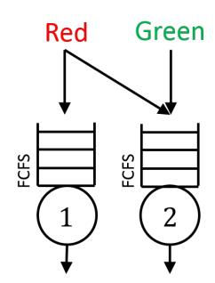

Figure 2.1: A simple redundancy model. Green jobs arrive to the system and join the queue at server 2 only. Red jobs join the queue at both server 1 and server 2. A red job is allowed to be in service at both servers simultaneously, and leaves the system as soon as the first copy completes service.

More generally, we can imagine a system with many servers and many classes of jobs (see Figure 2.2). Each class of jobs stores its data at some subset of the servers. Jobs of a particular class Ci send copies of themselves to all servers in their subset, denoted by SCi. For example, in Figure 2.2 jobs of class C2 send copies to servers 1, 2, and 3 (SC2 = {1, 2, 3}) and jobs of class C3 are non-redundant and send only a single copy to server 3 (SC3 = {3}). Different classes of jobs may have different degrees of redundancy (i.e., they

Figure 2.2: A more general redundancy system. Each class of jobs Ci arrives and sends copies to some subset of the servers. For example, jobs in class C1 send copies to servers 1 and 2.

create different numbers of copies), and classes are allowed to be non-redundant (i.e., to create only a single copy). As in the two-server model described above, each server works on the jobs in its queue in FCFS order. A redundant job may be in service at multiple servers at the same time, in which case it experiences the minimum service time among all servers at which it is in service. As soon as the first copy of a job has completed service, the job is considered complete and all remaining copies are discarded regardless of whether they are in service or in the queue at other servers.

In the redundancy models described above, each class of jobs is only capable of running on a particular set of servers due to data locality constraints. In other systems, all jobs are capable of running on any server. However, it might not be a good idea to send copies everywhere because there may be some cost to redundancy. Hence each job chooses d servers to which to send copies, where d is small relative to the number of servers in the system (see Figure 2.3). All jobs might have the same value of d, but we can also imagine systems in which some jobs are "more important" and thus send out higher numbers of copies.

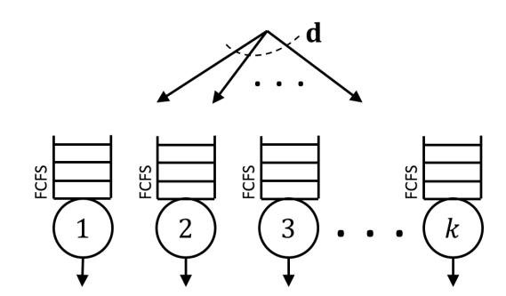

Figure 2.3: In this redundancy model, all jobs are capable of running at all servers. Each job that arrives to the system chooses d servers at random at which to join the queue.

We can also imagine redundancy systems in which the servers are not constrained to FCFS scheduling. For example, the servers could implement a priority queueing algorithm (see Figure 2.4). If there are different classes of jobs that send out different numbers of copies, the servers could prioritize more redundant jobs, or they could prioritize less redundant jobs. As before, a job that is in service at multiple servers simultaneously experiences the minimum service time across its servers. The scheduling policy allows us to control the likelihood that a job actually enters service at more than one server.

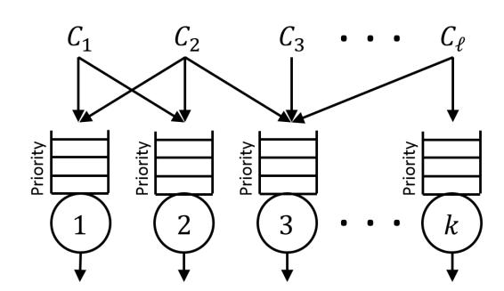

Figure 2.4: In this redundancy model, instead of scheduling jobs in FCFS order, each server schedules jobs according to some priority order. Some possible priority disciplines include prioritizing the most redundant jobs, or prioritizing the least redundant jobs.

In this thesis, we will study all of the above models of redundancy.

# 3 Prior Work

Redundancy has only begun to be studied from a theoretical perspective in the past few years. However, redundancy closely resembles several classic queueing problems, which we review here. We then discuss the recent theoretical results on redundancy systems.

## 3.1 Non-Redundancy Systems

In a coupled processor system, there are two servers and two classes of jobs, A and B. Server 1 works on class A jobs in FCFS order, and server 2 works on class B jobs in FCFS order. However, if there are only jobs of one class in the system, the servers "couple" to serve that class at a faster rate. That is, class A jobs only get to use server 2 when the system is empty of B's (and vice-versa). The coupled processor system looks somewhat similar to the redundancy model in Figure 2.1. The difference is that in the coupled processor model both classes of jobs get to share both servers, but only when no jobs of the other class are present. The coupled processor system has been analyzed in several cases using boundary value problems and generating functions [13, 16, 24, 29]; much of the remaining work on coupled processor models involves deriving bounds and asymptotic results (for example, [11]).

The donor-beneficiary model (one-way cycle stealing) is similar to coupled processor, except only one class of jobs (the beneficiary) receives access to both servers, typically only when no jobs of the other class are present. In addition, if there is only one beneficiary job present, one server must idle (the servers do not "couple"). The donor-beneficiary model has been studied, in approximation, in a variety of settings [23, 37]. While the donor-beneficiary model looks very similar to the redundancy model in Figure 2.1, the two systems are different because in the donor-beneficiary model, a job is never in service at more than one server.

Another related model is the fork-join system, in which each job that enters a system with k servers splits into k pieces, one of which goes to each server. The job is considered complete only when all k pieces have completed service. This resembles the redundancy model in Figure 2.3 if we set d = k. However, all k copies need to complete in a fork-join system, whereas only one redundant request needs to complete in the redundancy model. The fork-join model is known to be very difficult to analyze. Many papers have derived bounds and approximations for such a system (for example, [8, 9, 28, 35, 50]). Exact analysis remains an open problem except for the two-server case [17, 18]; see [12] for a more detailed overview.

A third related model is the flexible server system, in which each class of jobs has its own queue, and each server can serve some subset of classes; this looks similar to the redundancy system shown in Figure 2.2. In a flexible server system, traditionally, when a server becomes available, it chooses the queue from which to take its next job according to some policy. By contrast, in redundancy systems each server has its own FCFS queue and jobs are routed to a subset of servers upon arrival. The key difference between flexible server systems and redundancy systems is that redundant jobs may be served by multiple servers simultaneously, whereas in a flexible server system, each job may be processed by only one server. The design and performance of flexible server systems has been studied in [10, 40, 43, 44].

A special case of the flexible server system uses the following policy. When a server becomes available, it chooses the job that arrived earliest from among the jobs it can serve. This policy is similar to the redundancy system because each server works in FCFS order among the jobs it can serve. However, there are no redundant jobs in this flexible server system; jobs cannot be in service at two servers at once. For this model, under a specific routing assumption when an arriving job sees multiple idle servers, the stationary distribution that satisfies the balance equations is given [2, 45]. Our redundancy model requires no such routing assumption, because arriving redundant jobs enter service at all idle servers.

## 3.2 Redundancy Systems

An important difference between redundancy systems and all of the systems described above is that none of the above work includes multiple copies of the same job. Recently, theoretical work has begun to address questions related to redundancy systems.

### 3.2.1 Performance Analysis

Much of the theoretical work related to redundancy comes from the coding community. In a Maximum Distance Separable code, data is encoded into k pieces, and any d ≤ k of these are sufficient to recover the original data. The corresponding queueing problem involves a k-server system in which each piece of data is stored on a different server, and a job arriving to the system waits in all k queues to retrieve data. Unlike in a redundancy system, in an MDS system the job is not considered complete until d pieces have completed service. The MDS queue was first studied in [38], which derives upper and lower bounds on response time in a central-queue MDS queue system with exponential service times using quasi-birth-death Markov chains. Additional bounds for response time in a similar system are derived in [25, 26], which require each job to send requests to all servers in the system. Under this assumption, the authors view the system as an M/G/1 and bound a job's service time using order statistics. The upper bound in [26] also allows for general service times.

In [39], a variation on the MDS queue is introduced in which each job sends r ≤ k redundant requests and needs d ≤ r of these to complete. Both central-queue and distributed-queue versions of the problem are considered in [39], which determines the optimal degree of redundancy based on factors such as the system load, cancellation time, and job size distribution. However, there is no performance analysis quantifying response time. The redundancy system shown in Figure 2.3 can be seen as a generalized version of a distributed-queue MDS queue in which only one copy of each job needs to complete. This thesis will present the first exact analysis of response time in such a system.

The scenario in which only one copy of a job needs to complete, which most closely resembles our setting, has been studied in several other papers. For example, [30] studies the optimal degree of redundancy in a system where jobs are allowed to run on multiple servers at the same time but only one copy needs to complete. The authors find that for service time distributions with decreasing failure rate, it is optimal to send redundant copies of each job to all servers. While [30] makes it clear that more redundancy is better, the authors do not analyze the performance of redundancy.

Several recent papers have begun to address the issue of cancellation times, which we discuss in Section 6. The work in [32] finds exact expressions for mean response time in a two-server system in which each job sends copies to both servers and needs one copy to complete. Here service times are exponentially distributed and when one copy completes, the other server experiences an exponentially distributed cancellation time. In [46], an extreme setting is considered in which extra copies of jobs are not cancelled at all. The authors consider a system with many servers and derive approximations for mean response time when each job sends copies to two randomly chosen servers. They find that above a threshold load, redundancy sends the system into overload; this is to be expected given that extra copies are not cancelled. The question of when to cancel extra copies of jobs:
- when the first copy completes service or when the first copy enters service
- has been studied in [27], which identifies the job size distributions under which each option is optimal. However [27] does not consider systems in which cancellation requires some non-zero amount of time.

While the work discussed above provides bounds and approximations for mean response time in redundancy systems, there is no exact analysis. The work proposed in this thesis represents the first exact analysis of response time in systems with redundancy; in many cases we derive the full distribution of response time rather than just the mean. Furthermore, all of the papers discussed above assume that instead of having an inherent size, a job's service times are i.i.d. across servers and determined solely by the server. Our proposed work in Section 6 will explore the downsides of making this assumption and provide the first analysis that models redundancy systems more realistically.

### 3.2.2 Scheduling

While most of the recent theoretical work on redundancy has focused on performance approximations, a few papers have considered the question of scheduling. For central-queue systems, [30] finds that when service times have decreasing failure rate it is optimal to schedule multiple copies of the same job at the same time, whereas the opposite is true when service times have increasing failure rate. In a related model in which jobs successfully complete with some probability and otherwise are lost, the optimal scheduling policy is the cµ rule, which schedules the task that has the highest probability of successfully completing. The work presented in [48] presents heuristic scheduling policies designed to achieve close to the optimal tradeoff between response time and resource usage.

The scheduling work discussed here assumes that all jobs send the same number of copies, and as such does not consider how redundancy affects different classes of jobs with different degrees of redundancy. Our proposed work in Section 7 asks new questions about how scheduling can be used to help the overall performance of the system while causing minimal pain to jobs that send only a small number of redundant requests.

# 4 First Analysis of Redundancy Systems

In this section we describe our completed work giving the first analysis of systems with redundancy; this work appeared in Sigmetrics 2015 [19]. We begin by describing our analytical results and then use these result to explore the effects of redundancy.

We consider the redundancy system from Figure 2.2 in Section 2; the system details are shown in Figure 4.1. The system consists of k servers and ` classes of jobs. Jobs of class Ci arrive to the system as a Poisson process with rate λi and send copies to all servers in a fixed subset SCi. Each server works on the jobs in its queue in FCFS order. A job's service time on server i is exponentially distributed with rate µi and service times are i.i.d. across servers. While this may not be realistic, we make these assumptions here for analytical tractability; we discuss more realistic redundancy models in Section 6. A job may be in service at multiple servers at the same time. As soon as the first copy completes service, the job is considered complete and all remaining copies are discarded immediately.

Our analytical approach involves modeling the system as a Markov chain. The first step is identifying an appropriate state space. Looking at Figure 4.1, it is difficult to figure out the right state space. One might think that you could track the number of jobs of each class at each queue, but this state space is missing information about which specific jobs are in service. Furthermore, servers are not independent, and job classes are not independent, so typical product-form type state spaces and solutions are unlikely to work.

The key insight that allows us to model this system is that we can view the system as having a single central queue in which all jobs wait in the order that they arrived (see Figure 4.2). Each server processes jobs from this central queue in FCFS order, skipping over those jobs it cannot serve. For example, in Figure 4.2, server 3 will skip over job A(1) and move to job B(1) when choosing its next job. We can write the state of the system as (cn, cn−1,..., c1), where there are n jobs in the system, and ci is the class of the i th job in this central queue; c1 is the class of the job at the head of the queue, which is also in service at all servers in SC1.

Once we have formulated this state space, we find the limiting probability of being in state (cn,..., c1) as follows:

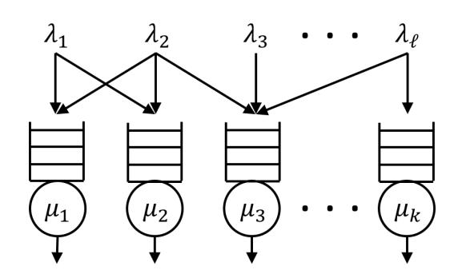

Figure 4.1: The general redundancy system. Jobs of class Ci arrive to the system as a Poisson process with rate λCi and send copies to all servers in the subset SCi. Each server i provides exponential service times with rate µi and works on the jobs in its queue in FCFS order.

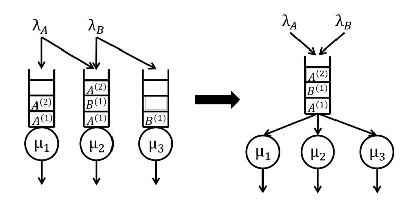

Figure 4.2: Let A and B be two job classes, where A(i) is the ith arrival of class A. We can view the general redundancy system (left) as having a single central queue from which each server works in FCFS order, skipping over those jobs it cannot serve (right). The central queue is an interleaving of the individual servers' queues, where each job appears only once, and appears in the order in which it arrived.

Theorem 1. When ∀ Y ⊆ {C1,..., C`},

X C∈Y λC < X m∈ S C∈Y SC µm,

the system is stable, and the limiting probability of being in state (cn, cn−1,..., c1) is

π(cn,...,c1) = C Yn i=1 P λci m∈ S j≤i Scj µm,

where C is a normalizing constant.

Although π(cn, cn−1,..., c1) looks like a product-form solution, it is not; we cannot write the limiting probabilities as a product of independent marginal per-server terms, or as a product of independent marginal perclass terms. In fact, the form is quite unusual, as illustrated in Example 1.

Example 1. Consider the system shown in Figure 4.2. Here, the current state is (A, B, A), where the head of the queue is at the right, job A(1) is currently in service at servers 1 and 2, and job B(1) is currently in service at server 3. From Theorem 1, the limiting probability of this state is

π(A,B,A) = C λA µ1 + µ2 λB µ1 + µ2 + µ3 λA µ1 + µ2 + µ3.

Note that the denominator for the first class-A job is µ1 + µ2 whereas the denominator for the second class-A job is µ1 + µ2 + µ3. The denominator for the ith job in the queue depends on the classes of all jobs ahead of it, and so the limiting probability cannot be written as a product of per-class terms.

We use the result from Theorem 1 to study response time in small systems, which helps us to develop initial results about the benefits and costs of redundancy.

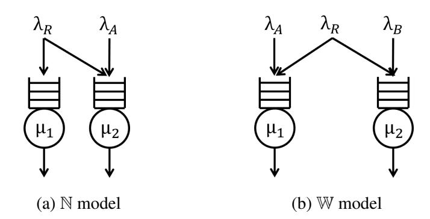

Figure 4.3: (a) The N model. Class A jobs join the queue at server 2 only, while class R jobs are redundant at both servers. (b) The W model. Class A jobs join the queue at server 1 only, class B jobs join the queue at server 2 only, and class R jobs are redundant at both servers.

## 4.1 Q1: How does redundancy benefit redundant jobs and hurt non-redundant jobs?

We first study the benefits and costs of redundancy in a redundancy system called the N model, which is the smallest non-trivial example of a redundancy system that includes both redundant and non-redundant classes. This is the model in Figure 2.1 in Section 2; the details of the model are shown in Figure 4.3(a). In an N model there are two servers running at rates µ1 and µ2 and two classes of jobs. Class A jobs are non-redundant; they arrive with rate λA and join the queue at server 2 only (SA = {2}). Class R jobs are redundant; they arrive with rate λR and join the queue at both servers (SR = {1, 2}).

We use the limiting distribution given in Theorem 1 to find the distribution of response time for both class R (redundant) and class A (non-redundant) jobs.

Theorem 2. In the N model,

- 1. Class R jobs have response time TR ∼ Exp(µ1 + µ2 − λA − λR).
- 2. Class A jobs have response time TA ∼ H2(νN1, νN2, ωN), where

νN1 = µ2 − λA νN2 = µ1 + µ2 − λA − λR νN3 = µ1 + µ2 − λA (4.1) ωN = λRνN1 (µ1 − λR)νN3.

We use the response time distributions derived in Theorem 2 to understand how the response time for each class differs before and after class R becomes redundant. Figure 4.4 compares mean response time before class R jobs become redundant (each class sees its own independent M/M/1), and after class R jobs become redundant. We hold µ1 = µ2 = 1 and vary the load by increasing λR = λA. We find redundancy helps class R jobs by a factor of two (Figure 4.4(a)), but can hurt class A by up to 50% (Figure 4.4(b)).

In the N model, the non-redundant class A jobs are hurt by the redundancy of the class R jobs. We next consider a system with multiple non-redundant classes:
- the W model
- and ask how the pain caused by redundancy is shared among the non-redundant classes. In the W model, there are two servers running at rates µ1 and µ2 and three classes of jobs (see Figure 4.3(b)). Class A jobs arrive with rate λA and join the queue at server 1 only (SA = {1}), class B jobs arrive with rate λB and join the queue at server 2 only (SB = {2}), and class R jobs arrive with rate λR and join the queue at both servers (SR = {1, 2}).

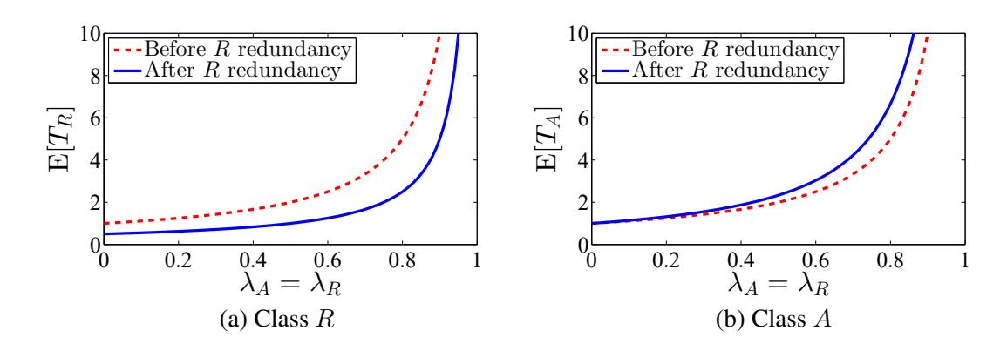

Figure 4.4: Comparing mean response time before and after class R becomes redundant when µ1 = µ2 = 1 and λA = λR for (a) class R, and (b) class A. The mean response time for the overall system is the weighted average of these two classes.

We find that like in the N model, in the W model class R jobs experience an exponentially distributed response time, and class A and B jobs experience a hyperexponentially distributed response time. In Theorem 3, we look at the mean response time of class A (or class B) jobs.

Theorem 3. In the W model, the mean response time of class A jobs is

E[TA] = 1 νW1 |{z} M/M/1 + 1 νW2 − 1 νW3 | {z } penalty, (4.2)

where

νW1 = µ1 − λA νW2 = µ1 + µ2 − λA − λB − λR νW3 = µ1 + µ2 − λA − λB.

Class B jobs are symmetric.

We can interpret the class A (respectively, class B) mean response time as that in an M/M/1 with arrival rate λA (respectively, λB) and service rate µ1 (respectively, µ2), plus a penalty term that captures the extent to which the redundant class hurts the A's (or B's) (Equation 4.2). Surprisingly, this penalty is the same for class A and class B even if they have different loads: the pain caused by the redundant class is shared equally among the non-redundant classes.

## 4.2 Q2: How does response time under redundancy compare to that under alternative dispatching policies?

The existence of a redundant class clearly hurts the response time of non-redundant classes, because the nonredundant classes must share their servers with the redundant class. We now ask what would happen if class R jobs were dispatched according to some alternative policy. Is there some other class-R dispatching policy that causes less pain to the class A and class B jobs in the W model?

We consider two alternative dispatching policies. Under Join-the-Shortest-Queue (JSQ), each arriving class R job is dispatched to the queue with the fewest jobs. Under Opt-Split, class R jobs probabilistically

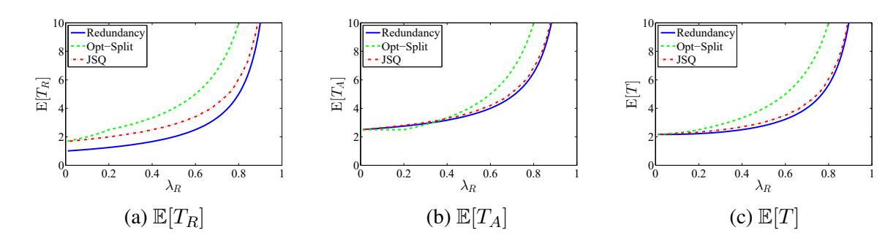

Figure 4.5: Comparing redundancy (solid blue), Opt-Split (dashed green), and JSQ (dashed red) for the W model as λR increases, for µ1 = µ2 = 1, λA = 0.6, and λB = 0.4. Lines shown include mean response time for (a) class R, (b) class A, and (c) the system. Results for other values of µ1 and µ2 are similar.

split between the two queues, where the probability of being sent to each queue is chosen to minimize mean response time for the overall system.

In Figure 4.5 we compare mean response time under redundancy to that under JSQ and Opt-Split as λR increases in a system where λA = 0.6, λB = 0.4, and µ1 = µ2 = 1 (mean response time under Opt-Split is derived analytically; JSQ is simulated). For the redundant class R, redundancy outperforms JSQ, which in turn outperforms Opt-Split (Figure 4.5(a)). Even for the non-redundant class A, redundancy is often preferred over JSQ or Opt-Split, particularly under higher loads of redundant jobs (Figure 4.5(b)). This is because even though a larger number of R jobs compete with class A at server 1, some of these R jobs depart the system without ever using server 1 (they complete service at server 2 before entering service at server 1), and some of these R jobs receive service on both servers at once, thus departing the system faster. As in the N model, redundancy is always better for the overall system (Figure 4.5(c)).

# 5 Scaling Redundancy to Large Systems

The results presented in Section 4 provide an important foundation for understanding the benefits and drawbacks of redundancy. However, in Section 4 we only considered the effects of redundancy in small two-server systems. Given that today's server farms consist of hundreds or thousands of servers, in this section we turn to analyzing response time in large redundancy systems. The work described in this section is currently under submission [20].

We consider the redundancy model shown in Figure 2.3 in Section 2. This model is called the Redundancyd system; the system details are shown in Figure 5.1. The system consists of k servers, and jobs arrive to the system as a Poisson process with total rate kλ, where λ is a constant (the total arrival rate scales in proportion to the number of servers in the system). Each job dispatches d copies of itself to d different servers chosen uniformly at random. The servers work in FCFS order and provide exponential service times with rate µ; a job's service times are i.i.d. across servers. Unlike the system considered in Section 4, in this section we assume that all servers have the same rate.

Our analysis begins with the observation that the Redundancy-d system can be seen as fitting the classbased redundancy model shown in Figure 2.2. In the Redundancy-d system, we define a job's class as the set of d particular servers to which the job sends copies. There are k d possible classes; all classes are equally likely since each job chooses its servers uniformly at random. Let λclass denote the arrival rate of any class, where λclass = kλ (k).

d As in Section 4, we model the system as a Markov chain with state space (cn,..., c1), where the state tracks all jobs in order in which they arrived to the system, and ci is the class of the job in position i. The limiting distribution on this state space in the Redundancy-d system follows immediately from Theorem 1. Unfortunately, knowing the limiting distribution on the state space does not immediately yield results for the distribution of the number of jobs in system or for mean response time. This is because we must first find πm = Pr{m jobs in system}. To do this, we need to sum over all possible classes for each queue position j, 1 ≤ j ≤ m.

The difficulty in aggregating states to find πm lies in the fact that the denominators in the limiting probabilities depend on the order of all jobs in the system: π(cm,...,c1) depends on the particular choices of c1,..., cm. In the small systems discussed in Section 4, this aggregation was fairly straightforward because class R jobs

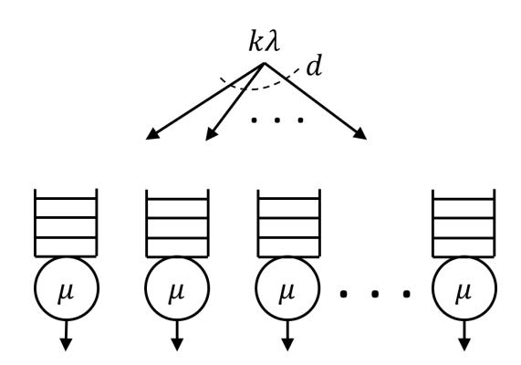

Figure 5.1: The Redundancy-d system. Jobs arrive as a Poisson process with rate kλ and each job sends copies to d servers chosen uniformly at random. Each server works on the jobs in its queues in FCFS order and provides exponential service times with rate µ.

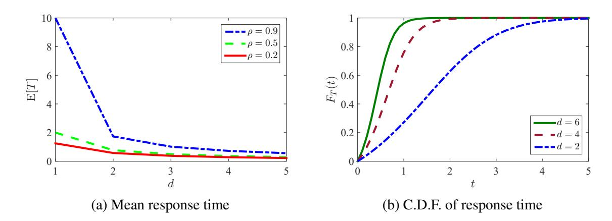

Figure 5.2: The effect of increasing d on response time in the Redundancy-d system. (a) Mean response time as d increases for low (ρ = 0.2), medium (ρ = 0.5), and high (ρ = 0.9) load. (b) c.d.f. of response time at high load (ρ = 0.9) when d = 2, 4, and 6.

were fully redundant, meaning that as soon as a class R job appeared in the state at position i, the denominators for all jobs in positions > i no longer changed. In the Redundancy-d system, aggregating states is much more complicated because there are k d classes with very little overlap across servers. We develop a new state aggregation approach that enables us to find an exact expression for mean response time in a system with any number of servers k and any number of copies per job d, given in Theorem 4.

Theorem 4. For 2 ≤ d ≤ 5 and d ≤ k ≤ 19, the mean response time in the Redundancy-d system with k servers is

E[T] = X k i=d i−1 d−1 k d · 1 µd − i−1 d−1 λclass. (5.1)

Remark Our approach for finding E[T] involves solving a system of k − d recurrences. For any particular values of k and d this system is easily solved using Mathematica. However, Mathematica is unable to solve a system of k − d recurrences when the values of k and d have not been specified. At the time of this writing we have verified the result given in (5.1) for k ≤ 19 and 2 ≤ d ≤ 5 (for k = 18 and d = 5, this verification takes on the order of 40 hours). We conjecture that Theorem 4 holds for all d ≥ 2 and k ≥ d.

We now turn to the question of the distribution of response time. The Markov chain approach only allows us to find mean response time, hence we consider an alternative approach to find the full distribution. We look at the system in the limit as the number of servers k → ∞. In this regime, a common assumption is that the queues are asymptotically independent (e.g., [34, 47, 51]). Under this assumption, we formulate a set of differential equations that track the amount of work in a queue as seen by a tagged arrival to the system. We solve these differential equations to obtain an asymptotically exact expression for the c.c.d.f. of response time, given in Theorem 5.

Theorem 5. Assuming queues are d-wise asymptotically independent as k → ∞, the response time in the Redundancy-d system with d > 1 has c.c.d.f.

Pr{T > t} = F¯ T (t) = 1 ρ + (1 − ρ)e tµ(d−1) d d−1, (5.2)

where ρ = λ µ.

## 5.1 Q3: When scaling redundancy to large systems, how many copies should each job make?

The above analysis allows us to answer the question of how to set d in large systems: how much redundancy is enough to achieve a significant response time benefit? In Figure 5.2 we use our analysis to explore this question. Figure 5.2(a) shows mean response time as a function of d for low, medium, and high load. At all loads, as d increases mean response time decreases. The greatest improvement occurs in adding a single extra copy of each job: going from d = 1 to d = 2 reduces response time by a factor of 2 at low load and by a factor of 6 at high load. Figure 5.2(b) shows the c.d.f. of response time at high load for d = 2, 4, and 6. The benefit of increasing d is even greater at the tail of response time than at the mean: going from d = 1 (not shown) to d = 2 reduces response time by a factor of 8.

## 6 Redundancy in Practice

The work presented in Sections 4 and 5 represents an important first step in analyzing systems with redundancy. However, our analysis makes several simplifying assumptions that are typical in all prior work on redundancy, but which do not necessarily accurately capture the characteristics of real systems. We propose to evaluate the extent to which our modeling assumptions hold in practice and, based on this evaluation, to develop and analyze theoretical models that more closely resemble real systems.

## 6.1 Q4: To what extent do our modeling assumptions hold in practice?

Prior work on redundancy, including our own, makes three key assumptions about systems with redundancy:

Assumption 1: Service times are associated with servers All prior analytical work on systems with redundancy, including our own [19, 20] and others' [25, 26, 38, 39], assumes that a job's service time on server i is drawn i.i.d. from a single distribution which is associated with the server rather than with the job. In using a single distribution for jobs' service times, prior work ignores the fact that there are two sources of variability in systems with redundancy. First, each job has an inherent size that depends on the amount of work associated with the job. Typically the inherent sizes of different jobs are highly variable, following a heavy-tailed distribution [14, 22]. Second, the running times of the same job on different servers have low variability. Assuming that a single distribution can capture both of these types of variability can lead to wrong conclusions. Consider for example a job with a large inherent size. If we assume that the job's service times on different servers are drawn i.i.d. from a single distribution, then the time until its first copy completes, which is the minimum of many independent random variables, is bound to be small. In reality, a job that has a large inherent size should have a relatively long running time on all servers.

Assumption 2: Service times are exponentially distributed Prior theoretical work on redundancy, including our own work in Sections 4 and 5, often assumes that service times are exponentially distributed. This assumption is made for analytical tractability: analyzing response time in systems with generally distributed service times is typically challenging. For example, even queueing systems such as the M/G/k have only been studied in approximation [21, 31]. However, job sizes are known to follow heavy-tailed distributions and the job size distribution greatly impacts response time (e.g., [14, 22]). In immediate dispatching systems, highly variable service times can cause significant response time increases because short jobs can get stuck waiting in the queue behind long jobs. We believe that when job sizes are highly variable, response time in redundancy systems will increase because it is likely that all copies of a long job will enter service, thereby blocking many servers at the same time.

Assumption 3: Cancellation is immediate In practice, it is reasonable to believe that when the first copy of a job completes service, it takes some time to cancel the remaining copies. This cancellation time delays other jobs from entering service. If the cancellation time is high enough, sending (and therefore potentially cancelling) many copies of each job could drive the system into overload.

We propose to conduct empirical studies to investigate the validity of each of these assumptions in real systems. We will begin with microbenchmarking experiments to measure cancellation times and correlations between the same job's service times on different servers. Further directions of potential future work include larger-scale experiments to measure the effects of redundancy in practice. In addition, analyzing traces from systems deployed by companies that use redundancy (e.g., Google, Microsoft) could help identify the factors that are most important when developing theoretical models of redundancy. These empirical results will help guide our modeling assumptions for future theoretical work.

### 6.2 Q5: How should we model systems with redundancy to better capture the characteristics of real systems?

Concurrently to our empirical experiments described above, we will conduct extensive simulations to develop an understanding of the impact of each of the assumptions identified above. Here we present preliminary results obtained by simulating a system with k = 50 servers and total arrival rate Λ = 10 in which each job sends copies to d servers chosen uniformly at random (the setup is similar to our Redundancy-d system described in Section 5).

Assumption 1: Service times are associated with servers Figure 6.1(a) shows mean response time as a function of d under three different assumptions about the extent to which job sizes are correlated across servers, all assuming that job sizes are exponentially distributed. When job sizes are associated with servers and i.i.d. across servers, increasing d always reduces mean response time (this is the result we observed in the Redundancy-d system in Section 5). On the other end of the spectrum, when each job has an inherent size that is the same on all servers (there is no variability across servers), increasing d from 1 to 2 reduces response time, but response time increases beyond d = 2. We also consider a model of variability that lies in the middle: each job arrives to the system with an exponentially distributed inherent size, and its service time on each server is equal to its inherent size multiplied by a uniformly distributed slowdown which is serverdependent and i.i.d. across servers. In this case, the optimal degree of redundancy occurs around d = 5, but above that mean response time increases and the system becomes unstable at d = 12. When inherent job sizes follow a Bounded Pareto distribution (Figure 6.1(b)), the mean response time curves for the three different between-server variability models have a similar shape to those under exponential service times.

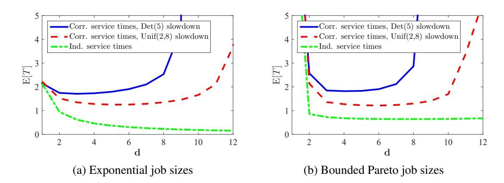

Figure 6.1: Mean response time as a function of d in a system with k = 50 servers and total arrival rate Λ = 10. Left: job sizes are distributed Exp(3.33), Right: job sizes are distributed Bounded Pareto(0.1001,100000,1.5). Both job size distributions have mean 0.3. Lines shown include service times associated with jobs with Deterministic(5) server slowdowns (blue solid line) and Uniform(2,8) server slowdowns (red dashed line) as well as independent service times associated with jobs and Deterministic(5) server slowdowns (green dot-dashed line).

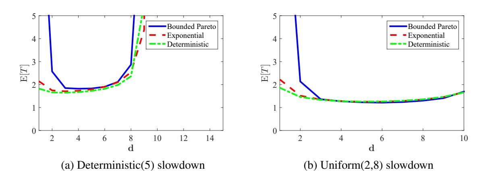

Figure 6.2: Mean response time as a function of d under Bounded Pareto(0.1001,100000,1.5), Exp(3.33), and Deterministic(0.3) job size distributions for (a) Deterministic(5) server slowdowns, and (b) Uniform(2,8) server slowdowns in a system with k = 50 servers and total arrival rate Λ = 10.

Assumption 2: Service times are exponentially distributed Figure 6.2 shows mean response time as a function of d for three different job size distributions: Bounded Pareto(0.1001, 100000, 1.5), Exp(3.33), and Deterministic(0.3) (all have mean 0.3). Each server slows down each job by some factor, where these factors are i.i.d. Deterministic(5) (left) and Uniform(2, 8) (right). When inherent job sizes are highly variable (Bounded Pareto) there is a big improvement in going from d = 1 to d = 2, whereas this improvement is less pronounced for less variable (exponential and deterministic) inherent job sizes. Nonetheless, the stability region, the optimal value of d and the mean response time close to this value of d appears largely insensitive to the job size distribution. These values depend much more strongly on the amount of between-server variability (Figure 6.2(a) vs. Figure 6.2(b)).

Assumption 3: Cancellation is immediate Figure 6.3 shows mean response time as a function of d in a system with Bounded Pareto(0.6, 10000, 2.5) inherent job sizes (the mean job size is 1) and Uniform(1, 2) slowdown on each server. We assume that cancellation times are deterministic and show results for cancellation times equal to 0.000001, 0.1, and 1. For the two smaller cancellation times - which differ by a factor of

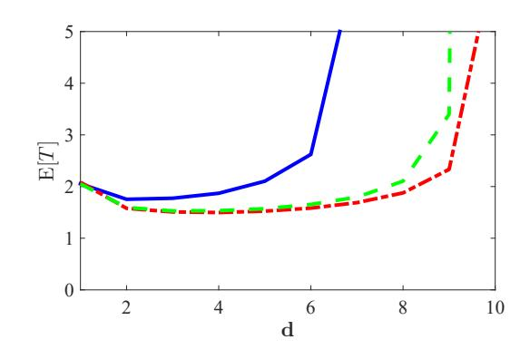

Figure 6.3: Mean response time as a function of d for low (0.000001), medium (0.1), and high (1) cancellation times. Here the system has k = 50 servers, total arrival rate Λ = 10, job sizes follow a Bounded Pareto(0.6, 10000, 2.5) distribution, and slowdowns on different servers are i.i.d. Uniform(1, 2).

105 - the mean response times are virtually the same until d is high enough that the system is approaching instability. Cancellation times of 1 (equal to the mean job size) are high enough to increase mean response time even at low d. However our preliminary experimental results (not shown) indicate that 1 is an impractically high cancellation time: typical cancellation times are several orders of magnitude smaller than mean job sizes.

### 6.2.1 Implications for modeling systems with redundancy

We propose to develop a theoretical system model for redundancy that accurately models real systems. The preliminary results described above suggest several factors to take into account when developing such a model:

- 1. Modeling inherent job sizes rather than associating job sizes with servers is of high importance. Failing to do so can lead to incorrect conclusions regarding the trends when increasing the degree of redundancy.
- 2. Modeling inherent job sizes as being generally distributed is less important. Exponential job sizes which are typically more tractable to analyze - may be sufficient to approximate systems with generally distributed response times.
- 3. Modeling cancellation times is unnecessary. Cancellation times are typically small enough relative to job sizes that they do not contribute substantially to delay or increased load.

Our first step in developing a model for systems with redundancy will be to explore the parameter space in more detail via simulation to ensure that the modeling guidelines suggested above hold across different amounts of job size variability, different system loads, and different models of server slowdown.

## 6.3 Q6: How can we analyze response time in "realistic" redundancy systems?

Once we determine an appropriate set of modeling assumptions for systems with redundancy, we propose to study response time analytically. There are many possible directions for work in this area. These include, but are not limited to (ordered according to rough estimates on analytical difficulty):

- [Stability] The preliminary results discussed above suggest that as d increases, there is a clear threshold value of d above which the system is unstable. Below this threshold, the particular choice of d appears to have only a small effect on mean response time. Thus finding the stability region for redundancy systems could lead to important insights on the appropriate level of redundancy.
- [Finding the optimal d] The optimal value of d appears to be relatively insensitive to the particular job size distribution. Rather, the amount of variability between the same job's running times on different servers is much more important. Ignoring one source of variability may enable us to simplify analysis by considering exponential or deterministic job sizes.
- [Bounding and/or approximating mean response time] As with the optimal value of d, the mean response time at this optimal value appears to be relatively insensitive to the particular job size distribution. Hence it may be possible to simplify analysis by considering exponential or deterministic job sizes. This type of analysis would only apply to values of d near the optimal, since the inherent job size variability greatly affects response time at low d.
- [Bounding and/or approximating the distribution of response time] Finding the distribution of response time is always the "gold standard" for analyzing queueing systems. The full distribution is particularly important in redundancy systems because empirical studies show that a major benefit of redundancy is the reduction of the tail of response time. Understanding the distribution of response time would allow us to quantify this benefit in the tail. While we expect this analysis to be very difficult, it is an interesting and important question to explore if time permits.

We plan to begin by considering the questions of finding the stability region and the optimal value of d. As mentioned above, considering exponential or deterministic inherent job sizes may simplify analysis because these distributions are typically easier to work with than general distributions. As a first step in answering these questions, we will consider a system in which all jobs send copies to all servers (d = k). This system is much easier to analyze because each job enters service at all servers simultaneously and completes service at all servers simultaneously, so the system can be viewed as an M/G/1 where the service time is the minimum service time the job sees across all k servers. Deriving the stability region and the optimal value of d under this simplifying assumption may lead to approximations for the more general scenario where d < k.

To find the mean and distribution of response time, we will begin by revisiting the differential equation approach used in Section 5 to find the distribution of response time under the i.i.d. exponential service times assumption. Formulating the differential equations did not require exponential service times, hence it is reasonable to believe that the approach might generalize to other service time distributions. Another idea is to consider queueing time rather than service time: a job's service times on different servers are correlated due to the job's inherent size, but in large systems the queueing times should be independent. Analyzing the queueing time by, for example, considering a tagged arrival to the system might prove more tractable than deriving the overall response time. We could then lower bound a job's response time by assuming that it experiences the minimum queueing time across d servers and the minimum service time across d servers.

# 7 Scheduling in Systems with Redundancy

Thus far we have considered only servers that work in FCFS order. In this section, we relax this constraint to ask how smart scheduling can improve the performance of redundancy and reduce the pain to non-redundant classes of jobs. This work will be done in collaboration with Rhonda Righter, a specialist in stochastic ordering techniques, during a semester-long visit to UC Berkeley in the spring of 2016.

## 7.1 Q7: How can we improve the performance of redundancy via scheduling?

We begin by presenting some preliminary results on optimal scheduling policies. We consider a system similar to that shown in Figure 2.2. The system consists of k servers and ` classes of jobs, where jobs of class Ci send copies to all servers in a fixed subset SCi. Each server i provides exponential service times with rate µi; we begin by assuming that like in Section 4 a job's service times are i.i.d. across servers. We further restrict our attention to systems in which the classes of jobs exhibit a nested structure (see Figure 7.1):

Definition 1. In a nested redundancy system, for all classes of jobs Ci and Cj, either

- 1. SCi ∩ SCj = ∅, or
- 2. SCi ⊂ SCj, or
- 3. SCi ⊃ SCj.

Our goal is to identify alternative scheduling policies to FCFS that might help reduce overall mean response time. For example, one could use a priority queueing algorithm, as shown in the model in Figure 2.4. One idea is to prioritize the most redundant jobs since running these jobs on many servers helps them to depart the system as quickly as possible, thereby freeing up servers for other less redundant jobs. On the other hand, prioritizing the most redundant jobs means that less redundant jobs have fewer opportunities to enter service since they only get to run when there are no highly redundant jobs in the system. Hence it may be beneficial to instead prioritize the less redundant jobs. In addition to preventing non-redundant jobs from experiencing very long response times, prioritizing less redundant jobs also increases system utilization by "saving" the more redundant jobs to run in the future.

It turns out that we are able to prove that for nested redundancy systems, the Least Redundant First (LRF) policy stochastically minimizes response time. Under LRF, at all times each server works on the job with the

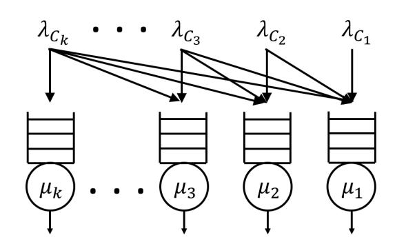

Figure 7.1: An example of a nested redundancy system. Jobs of class Ci send copies to all servers j ≤ i. A job's service time on server i is exponentially distributed with rate µi.

fewest copies among those jobs in its queue.

Theorem 6. Let Xi(t) denote the number of class Ci jobs in the system at time t, let Xi (t) = P j:SCj ⊂SCi Xj (t) denote the total number of jobs with priority over class Ci jobs on the servers in SCi, and let X~ (t) = (X1 (t), X2 (t),..., X` (t)). In a nested redundancy system, Least Redundant First scheduling stochastically minimizes {X~ (t)}∞ t=0 and therefore also stochastically minimizes response time.

The result in Theorem 6 only applies to nested redundancy systems. The nested structure itself may be suboptimal with respect to response time because if a job is waiting in the queue at one server, it is likely waiting behind other copies of the same jobs at other servers. Thus an important direction of future work is identifying optimal scheduling policies for non-nested redundancy structures. We believe that LRF scheduling is optimal for non-nested structures; proving this remains open. Our first approach in trying to prove the optimality of LRF scheduling in more general redundancy structures will be to use coupling arguments similar to those used for the nested case.

Thus far in this section we have only discussed systems in which service times are i.i.d. exponentials associated with servers. Another direction of future work is to extend our investigation of scheduling policies to the more general modeling assumptions discussed in Section 6. It is unclear whether LRF remains optimal under general service times; a first step to address this question is to study different scheduling policies via simulation.

## 7.2 Q8: Can smart scheduling reduce the pain to non-redundant jobs?

An important concern in systems with redundancy is fairness. While redundancy helps to reduce the overall system response time, it is important to ensure that highly redundant jobs do not experience a disproportionately large benefit at the expense of less redundant or non-redundant jobs. Indeed, we saw in Section 4 that non-redundant jobs are hurt when some jobs are allowed to become redundant.

The LRF scheduling policy is appealing because in addition to stochastically minimizing overall response time, LRF also prevents non-redundant jobs from suffering. However, LRF provides a disincentive for jobs to become redundant because highly redundant jobs have lower priority. Ideally, a scheduling policy would provide low overall mean response time while not hurting non-redundant jobs and helping redundant jobs relative to a system with no redundancy. One idea for such a policy is Primary-Secondary (P-S) scheduling. Under P-S, all jobs have a primary copy, and the remaining copies of redundant jobs are designated secondary copies. On all servers, primary copies receive high priority and secondary copies receive low priority. Within a priority class, jobs are served in FCFS order. Hence the primary copies behave exactly like a FCFS system with no redundancy: non-redundant jobs are no worse off. Redundant jobs receive a benefit because they are allowed extra servers when there are no non-redundant jobs present. This in turn benefits the non-redundant jobs because the redundant jobs depart from the system faster.

Given the practical value of P-S scheduling (it provides an overall response time benefit without hurting non-redundant jobs), we propose to further investigate the performance of this policy. First, we propose to prove that P-S stochastically reduces response time for both redundant and non-redundant jobs relative to nested redundancy systems with FCFS scheduling and relative to systems with no redundancy. We believe that coupling arguments similar to those used to prove the optimality of LRF in nested structures will allow us to prove that P-S achieves better performance than FCFS or no redundancy. Second, we propose to extend stochastic ordering results on P-S to non-nested redundancy systems. Finally, we propose to consider P-S scheduling under general service times.

We note that P-S is just one example of a scheduling policy that benefits redundant jobs without hurting non-redundant jobs. Another potential direction of future work is to identify other such policies and compare their performance to P-S, LRF, and FCFS.

## 7.3 Q9: How does the analysis of redundancy systems change under different scheduling policies?

We now turn to the question of quantifying the performance gains under different scheduling policies. The proposed work in the above two sections only addresses the relative performance of different policies. We propose to develop bounds or approximations for mean response time under the LRF and P-S scheduling policies in order to understand how big a benefit these policies provide. In nested redundancy systems, for which we already have preliminary results proving the optimality of LRF, our analysis in Section 4 allows us to upper bound the performance under LRF by that under FCFS. Both LRF and P-S are priority queueing policies; while the full transform of per-class response time is known for a single-server priority queue, analyzing multiserver priority queues typically is difficult. However, a recent paper on the M/M/c priority queue with two classes of jobs presents a new approach for finding response time by reducing the dimensionality of the Markov chain for the system [49]. While our system is not an M/M/c, we are hopeful that similar approaches might help us approximate response time under LRF or P-S.

# 8 Applications of Redundancy

Thus far we have focused on analyzing redundancy in theoretical models. We now discuss three practical problems that represent possible applications for our analysis.

## 8.1 Q10: How can we use redundancy to model multiple listing for kidney donation?

Today in the U.S. the waitlist to receive a kidney transplant includes over 93,000 people [36]. After joining the waitlist, patients can wait for days, months, or years to receive a kidney. The average wait depends significantly on the region of the country in which the patient joins the waitlist. For example, it might take on average much longer to reach the front of the waitlist in New York than in Kansas. Because of this disparity, many people have begun advocating multiple listing, in which a patient joins the waitlist in more than one region [7].

Kidney waitlists have been modeled as queueing systems in several papers, (e.g., [7, 41]; see [7] for a detailed overview). When modeling kidney donation as a queueing system, typically each of the 58 transplant regions throughout the country has its own queue (see Figure 8.1). A patient's "service time" is the time it takes for the patient to receive a kidney once she is at the front of the queue. Unlike in computer systems, in kidney donation systems with multiple listing it is reasonable to model service times as being i.i.d. across servers because the time until a kidney becomes available in one region should be independent of other regions. It is also reasonable to assume that the time until a kidney becomes available is exponentially distributed.

One might think that because our i.i.d. exponential service times assumption is reasonable in the kidney donation application, our Markov chain analysis from Section 4 applies immediately. However, there are two important obstacles in applying our results. First, as we saw in Section 5, finding mean response time in redundancy systems with many servers is difficult even though we know the limiting distribution on the state space because finding mean response time requires aggregating states, which is combinatorially challenging. We are able to perform this state aggregation in the Redundancy-d system because of the symmetry inherent in the system structure. The kidney donation system with multiple listing does not have any obvious symmetries, so it is not clear whether a similar approach to the one we used for the Redundancy-d system will apply. A possible alternative approach is to aggregate states and find mean response time numerically; while less appealing from a theoretical perspective, a numerical approach could prove very useful for the kidney donation application.

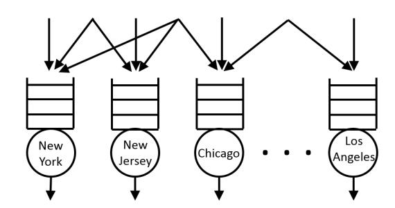

> 📝 Mô tả hình ảnh: > > Sơ đồ biểu diễn một hệ thống hàng đợi song song (queuing system) với các nút xử lý đại diện cho các thành phố khác nhau. > > Sơ đồ bao gồm các thành phần chính sau: >:
- Các nút xử lý (Servers): Được biểu diễn bằng các hình tròn ở phía dưới, chứa tên các thành phố lần lượt từ trái sang phải là: "New York", "New Jersey", "Chicago", và "Los Angeles". Giữa nút "Chicago" và "Los Angeles" có dấu ba chấm nằm ngang biểu thị hệ thống còn có các nút trung gian khác. Dưới mỗi nút tròn có một mũi tên hướng xuống biểu thị luồng đầu ra (output) sau khi xử lý. >
- Hàng đợi (Queues): Phía trên mỗi nút tròn là một biểu tượng hàng đợi gồm 3 ngăn xếp nằm ngang, đại diện cho bộ đệm lưu trữ các yêu cầu đang chờ xử lý. >
- Luồng đầu vào (Inputs): Phía trên cùng là các mũi tên chỉ luồng công việc đi vào các hàng đợi: >
- Có các mũi tên thẳng đứng đi trực tiếp vào từng hàng đợi riêng lẻ. >
- Có các đường rẽ nhánh từ một điểm nguồn phía trên đi vào nhiều hàng đợi khác nhau (ví dụ: một nguồn phân phối vào cả "New York" và "New Jersey"; một nguồn khác phân phối vào cả "New York", "New Jersey" và "Chicago"; một nguồn khác phân phối vào "Chicago" và "Los Angeles"). Điều này thể hiện cơ chế phân phối tải hoặc định tuyến yêu cầu đến các hàng đợi khác nhau.

> 🔍 OCR Text: > > New York > New Jersey > Chicago >... > Los Angeles

Figure 8.1: The kidney transplant waitlists in the U.S. can be modeled as a queueing system. Each donation region has its own queue (for example, New York and Chicago each have their own queue). Patients join the queue in their local region, but some patients multiple list, joining the queue in multiple regions.

A more significant obstacle in modeling multiple listing in kidney donation systems is abandonment. Not everyone who joins the waitlist for a kidney donor ends up receiving a transplant off the waitlist: some people are matched with living donors through alternative matching systems, and others die before receiving a transplant. In order to accurately capture the dynamics of the kidney donation system, we would need to include abandonment in our model.

Finding response time in systems with abandonment is a notoriously difficult queueing problem. Even in an M/M/1 with exponential abandonments, mean response time does not have a closed form. One promising new direction for analyzing systems with abandonment is presented in [1], which considers a system of two tandem queues with abandonment. The approach in [1] uses queue decomposition, last come first served scheduling, and renewal theory to obtain exact numerical results for various system metrics. We are hopeful that similar methods might apply to redundancy systems with abandonment, allowing us to model kidney donation systems.

Finally, an important concern in multiple listing for kidney donation is fairness. It is much more feasible for wealthy people to multiple list than it is for less fortunate people who cannot afford to travel to remote locations for testing and transplant. While companies such as OrganJet offer plane-sharing services to alleviate the costs of traveling for transplants [42], socioeconomic inequality remains a major criticism of multiple listing [33]. Multiple listing has only recently begun to be analyzed; [7] studies multiple listing using a diffusion limit analysis, but leaves open the question of whether multiple listing leads to socioeconomic inequity. Our proposed work in Section 7 addresses this concern by developing scheduling policies that benefit overall response time without hurting non-redundant jobs (i.e., patients who do not multiple list). We believe that kidney donation is an ideal setting in which to apply such scheduling policies.

## 8.2 Q11: How can redundancy be used to provide priority to different classes of users?

Our results in Section 4 indicate that in systems with both redundant and non-redundant jobs, the redundant jobs experience much lower response times. A natural question is whether we can leverage this response time disparity to provide different priority levels to different classes of users.

Traditional priority queueing differentiates response time among classes through scheduling: low-priority jobs are only allowed to run once the system is empty of high-priority jobs. A criticism of strict priority scheduling algorithms is that they can cause the low priority jobs to experience extremely long response times. Redundancy provides an alternative mechanism for providing priority: higher-priority jobs can create more copies than lower-priority jobs, thereby achieving lower response times. By using redundancy in combination with FCFS scheduling, we can prevent the low-priority jobs from experiencing extremely long response times.

Our proposed work on this topic involves investigating the redundancy structures best suited to differentiating between priority classes' response times. One idea is to use nested structures, as described in Section 7. Another possibility is to employ a Redundancy-d structure where different priority classes have different values of d. We plan to study ways in which redundancy can be used for priority by leveraging our existing results from Sections 4 and 5 as well as new results that we obtain in the more general setting described in Section 6.

## 8.3 Q12: How should one set prices in systems with redundancy?

When allowing different users to select different levels of redundancy to obtain faster service, a natural question is how to set prices for higher redundancy. Pricing in queueing systems, including for priority queues, has been studied previously, (e.g., [3]). Typically pricing work assumes that each user has an inherent valuation for receiving service v and incurs some cost per unit of time spent waiting to receive service c. The user also pays a price p upon receiving service. A user's utility is equal to v − cT − p; the user will enter the system if she has positive expected utility. The goal is to set prices so as to maximize profit, where the system's profit is the total price paid by all users who choose to enter the system.

Often, an important pricing constraint in classed-based systems is incentive-compatibility: prices should be set such that no user from class i could achieve higher utility by switching to class j. This is relevant when pricing for redundancy-based priority. It is possible that some redundancy structures (e.g., nesting, Redundancy-d, etc.) are more conducive to incentive-compatible pricing than others. We propose to explore this question as part of this thesis.

# 9 Timeline

#### January - March 2016

- Spend Spring 2016 semester visiting UC Berkeley
- Begin work on scheduling for redundancy (Section 7), including learning background on stochastic ordering techniques

#### April - June 2016

- Continue to visit UC Berkeley
- Continue work on scheduling for redundancy (Section 7)
- Begin work on modeling redundancy in practice (Section 6)

#### July - September 2016

- Continue work on modeling redundancy in practice (Section 6)

#### October - December 2016

- Prepare papers for submission to Sigmetrics (November deadline)

#### January - March 2017

- Begin work on applications of redundancy, specifically focusing on kidney donation (Section 8)
- Prepare papers for submission to Performance (April deadline)

#### April - June 2017

- Continue work on modeling kidney donation systems (Section 8)
- Begin work on using redundancy for priority and pricing for redundancy (Section 8)

#### July - September 2017

- Continue work on using redundancy for priority and pricing for redundancy (Section 8)

#### October - December 2017

- Prepare papers for submission to Sigmetrics (November deadline)
- Work on writing thesis
- Prepare job applications

#### January - April 2018

- Write thesis
- Job interviews

#### May 2018

- Graduate

# Bibliography

[1] Hossein Abouee-Mehrizi, Opher Baron, Oded Berman, and Jianfu Wang. Tandem queues with reneging– analysis and insights. [2] Ivo Adan and Gideon Weiss. A skill based parallel service system under FCFS-ALIS:
- steady state, overloads, and abandonments. Stochastic Systems, 4(1):250–299, 2014. [3] Philipp Afeche and Haim Mendelson. Pricing and priority auctions in queueing systems with a general
- ` ized delay cost structure. Management Science, 50(7):869–882, 2004. [4] Ganesh Ananthanarayanan, Ali Ghodsi, Scott Shenker, and Ion Stoica. Effective straggler mitigation: Attack of the clones. In NSDI, pages 185–198, April 2013. [5] Ganesh Ananthanarayanan, Michael Chien-Chun Hung, Xiaoqi Ren, Ion Stoica, Adam Wierman, and Minlan Yu. Grass: trimming stragglers in approximation analytics. In Proceedings of the 11th USENIX Conference on Networked Systems Design and Implementation, pages 289–302. USENIX Association, 2014. [6] Ganesh Ananthanarayanan, Srikanth Kandula, Albert G Greenberg, Ion Stoica, Yi Lu, Bikas Saha, and Edward Harris. Reining in the outliers in map-reduce clusters using mantri. In OSDI, volume 10, page 24, 2010. [7] Barıs Ata, Anton Skaro, and Sridhar Tayur. Organjet: Overcoming geographical disparities in access to deceased donor kidneys in the united states. Technical report, Working paper, Northwestern University, 2012. [8] Franc¸ois Baccelli and A. Makowski. Simple computable bounds for the fork-join queue. Technical Report RR-0394, Inria, 1985. [9] Franc¸ois Baccelli, Armand M. Makowski, and Adam Shwartz. The fork-join queue and related systems with synchronization constraints: Stochastic ordering and computable bounds. Advances in Applied Probability, 21:629–660, 1989. [10] A. Bassamboo, R. S. Randhawa, and J. A. Van Mieghem. A little flexibility is all you need: On the value of flexible resources in queueing systems. Operations Research, 60:1423–1435, 2012. [11] Sem Borst, Onno Boxma, and Miranda Van Uitert. The asymptotic workload behavior of two coupled queues. Queueing Systems, 43(1-2):81–102, January 2003. [12] Onno Boxma, Ger Koole, and Zhen Liu. Queueing-theoretic solution methods for models of parallel and distributed systems. In Performance Evaluation of Parallel and Distributed Systems Solution Methods. CWI Tract 105 & 106, pages 1–24, 1994. [13] J. W. Cohen and O. J. Boxma. Boundary Value Problems in Queueing System Analysis. North-Holland Publishing Company, 1983. [14] Mark E Crovella, Murad S Taqqu, and Azer Bestavros. Heavy-tailed probability distributions in the world wide web. A practical guide to heavy tails, 1:3–26, 1998. [15] Jeffrey Dean and Luis Andre Barroso. The tail at scale. Communications of the ACM, 56(2):74–80, February 2013. [16] Guy Fayolle and Roudolf Iasnogorodski. Two coupled processors: The reduction to a Riemann-Hilbert problem. Zeitschrift fur Wahrscheinlichkeitstheorie und vervandte Gebiete, 47(3):325–351, 1979.

[17] L. Flatto. Two parallel queues created by arrivals with two demands II. SIAM Journal on Applied Mathematics, 45(5):1159–1166, October 1985. [18] L. Flatto and S. Hahn. Two parallel queues created by arrivals with two demands I. SIAM Journal on Applied Mathematics, 44(5):250–255, October 1984. [19] Kristen Gardner, Samuel Zbarsky, Sherwin Doroudi, Mor Harchol-Balter, Esa Hyytia, and Alan Scheller- ¨ Wolf. Reducing latency via redundant requests: Exact analysis, June 2015. [20] Kristen Gardner, Samuel Zbarsky, Mor Harchol-Balter, and Alan Scheller-Wolf. Analyzing response time in the Redundancy-d system. Technical Report CMU-CS-15-141, December 2015. [21] Varun Gupta, Mor Harchol-Balter, JG Dai, and Bert Zwart. On the inapproximability of m/g/k: why two moments of job size distribution are not enough. Queueing Systems, 64(1):5–48, 2010. [22] Mor Harchol-Balter and Allen B Downey. Exploiting process lifetime distributions for dynamic load balancing. ACM Transactions on Computer Systems (TOCS), 15(3):253–285, 1997. [23] Mor Harchol-Balter, Cuihong Li, Takayuki Osogami, Alan Scheller-Wolf, and Mark Squillante. Cycle stealing under immediate dispatch task assignment. In Annual Symposium on Parallel Algorithms and Architectures, pages 274–285, June 2003. [24] Gerard Hooghiemstra, Michael Keane, and Simon Van de Ree. Power series for stationary distributions of coupled processor models. SIAM Journal on Applied Mathematics, 48(5):861–878, October 1988. [25] Gauri Joshi, Yanpei Liu, and Emina Soljanin. Coding for fast content download. In Allerton Conference'12, pages 326–333, 2012. [26] Gauri Joshi, Yanpei Liu, and Emina Soljanin. On the delay-storage trade-off in content download from coded distributed storage systems. IEEE Journal on Selected Areas in Communications, 32(5):989–997, May 2014. [27] Gauri Joshi, Emina Soljanin, and Gregory Wornell. Efficient redundancy techniques for latency reduction in cloud systems. arXiv preprint arXiv:1508.03599, 2015. [28] Cheeha Kim and Ashok K. Agrawala. Analysis of the fork-join queue. IEEE Transactions on Computers, 38(2):1041–1053, February 1989. [29] Alan G. Konheim, Isaac Meilijson, and Abraham Melkman. Processor-sharing of two parallel lines. Journal of Applied Probability, 18(4):952–956, December 1981. [30] Ger Koole and Rhonda Righter. Resource allocation in grid computing. Journal of Scheduling, 11:163– 173, 2009. [31] AM Lee and PA Longton. Queueing processes associated with airline passenger check-in. OR, pages 56–71, 1959. [32] Kangwook Lee, Ramtin Pedarsani, and Kannan Ramchandran. On scheduling redundant requests with cancellation overheads. [33] Sydney Lupkin. Good luck getting an organ transplant if you're poor in america. November 2015. [34] Michael Mitzenmacher. The power of two choices in randomized load balancing. Parallel and Distributed Systems, IEEE Transactions on, 12(10):1094–1104, 2001. [35] R. Nelson and A. N. Tantawi. Approximate analysis of fork/join synchronization in parallel queues. IEEE Transactions on Computers, 37(6):739–743, 1988. [36] Living Kidney Donors Network. The kidney transplant waiting list, 2015. [37] Takayuki Osogami, Mor Harchol-Balter, and Alan Scheller-Wolf. Analysis of cycle stealing with switch-

ing times and thresholds. In SIGMETRICS, pages 184–195, June 2003. [38] Nihar B. Shah, Kangwook Lee, and Kannan Ramchandran. The MDS queue: Analysing latency performance of codes and redundant requests. Technical Report arXiv:1211.5405, November 2012. [39] Nihar B. Shah, Kangwook Lee, and Kannan Ramchandran. When do redundant requests reduce latency? Technical Report arXiv:1311.2851, June 2013. [40] Alexander L. Stolyar and Tolga Tezcan. Control of systems with flexible multi-server pools: a shadow routing approach. Queueing Systems, 66:1–51, 2010. [41] Xuanming Su and Stefanos Zenios. Patient choice in kidney allocation: The role of the queueing discipline. Manufacturing & Service Operations Management, 6(4):280–301, 2004. [42] Sridhar Tayur. Organjet. http://www.organjet.com/. [43] John Tsitsiklis and Kuang Xu. On the power of (even a little) resource pooling. Stochastic Systems, 2:1–66, 2012. [44] John Tsitsiklis and Kuang Xu. Queueing system topologies with limited flexibility. In SIGMETRICS, 2013. [45] Jeremy Visschers, Ivo Adan, and Gideon Weiss. A product form solution to a system with multi-type jobs and multi-type servers. Queueing Systems, 70:269–298, 2012. [46] Ashish Vulimiri, P. Brighten Godfrey, Radhika Mittal, Justine Sherry, Sylvia Ratnasamy, and Scott Shenker. Low latency via redundancy. In CoNEXT, pages 283–294, December 2013. [47] N.D. Vvedenskaya, R.L. Dobrushin, and F.I. Karpelevich. Queueing system with selection of the shortest of two queues: An asymptotic approach. Probl. Peredachi Inf., 32(1):20–34, 1996. [48] Da Wang, Gauri Joshi, and Gregory Wornell. Efficient task replication for fast response times in parallel computation. Technical Report arXiv:1404.1328, April 2014. [49] Jianfu Wang, Opher Baron, and Alan Scheller-Wolf. M/m/c queue with two priority classes. Operations Research, 2015. [50] Cathy Xia, Zhen Liu, Don Towsley, and Marc Lelarge. Scalability of fork/join queueing networks with blocking. In SIGMETRICS, pages 133–144, June 2007. [51] Lei Ying, R Srikant, and Xiaohan Kang. The power of slightly more than one sample in randomized load balancing. In Proc. of IEEE INFOCOM, 2015.