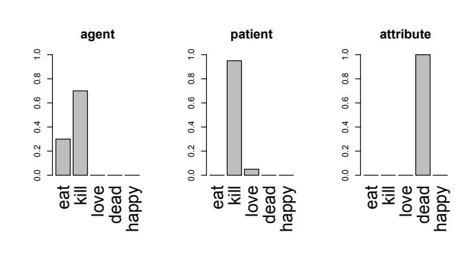
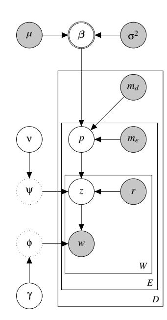
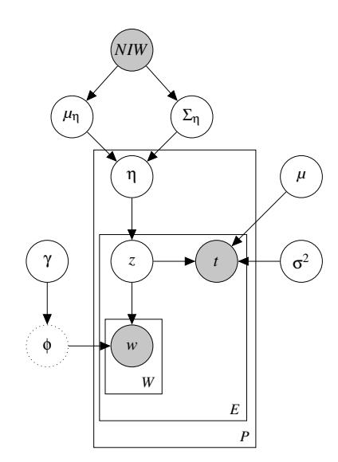
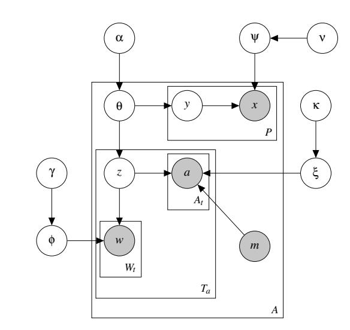
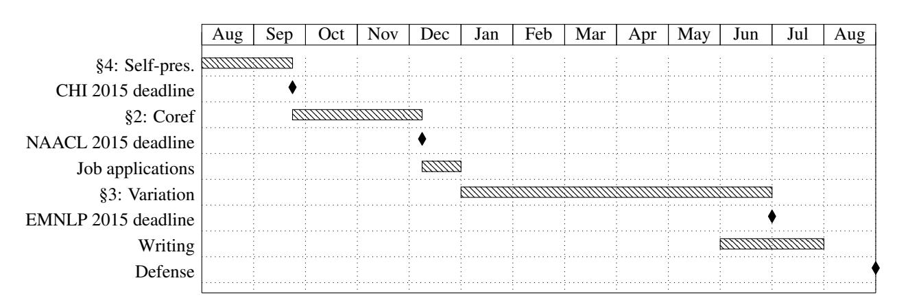

# Thesis Proposal: People-Centric Natural Language Processing

David Bamman Language Technologies Institute School of Computer Science Carnegie Mellon University

dbamman@cs.cmu.edu

## Thesis committee

Noah Smith (chair), Carnegie Mellon University Justine Cassell, Carnegie Mellon University Tom Mitchell, Carnegie Mellon University Jacob Eisenstein, Georgia Institute of Technology Ted Underwood, University of Illinois

### Contents

|1 | Introduction | 1 |
|----- | ------------------------------------------------- | ------ |
|1.1 | Persona inference (Chapter 2) | 2 |
|1.2 | Persona characterization and variation (Chapter | 3) 2 |
|1.3 | Persona self-presentation (Chapter 4) | 2 |
|1.4 | Personas | 3 |
|1.5 | Thesis statement | 3 |
|2 | Persona Inference | 3 |
|2.1 | Completed work | 4 |
| | 2.1.1 ACL 2013 | 5 |
| | 2.1.2 ACL 2014 | 6 |
|2.2 | Proposed work | 6 |
|2.3 | Evaluation | 7 |
|2.4 | Significance | 7 |
|3 | Persona Characterization and Variation | 7 |
|3.1 | Completed work | 8 |
| | 3.1.1 TACL 2014 | 8 |
|3.2 | Proposed work | 9 |
| | 3.2.1 Prototypicality | 10 |
| | 3.2.2 Variation | 10 |
|3.3 | Evaluation | 11 |
|3.4 | Significance | 11 |
|4 | Persona Self-presentation | 11 |
|4.1 | Completed work | 12 |
| | 4.1.1 Journal of Sociolinguistics 2014. | 12 |
|4.2 | Proposed work | 13 |
|4.3 | Evaluation | 14 |
|4.4 | Significance | 14 |
|5 | Conclusion | 15 |
|6 | Timeline | 15 |
|7 | References | 16 |

## 1 Introduction

The written text that we interact with on an everyday basis—news articles, emails, social media, books is the product of a profoundly social phenomenon with people at its core. With few exceptions, all of the text we see is written by people, and others constitute its audience. A vast amount of the content itself is centered on people: news (including classic NLP corpora such as the Wall Street Journal and the New York Times) details the roles of actors in current events, social media (including Twitter and Facebook) documents the actions and attitudes of friends, and books chronicle the stories of fictional characters and real people alike.

Robust text analysis methods provide us one way to understand or synthesize this volume of text without reading all of it; commercial and popular successes like IBM's Watson and Apple's Siri hinge on robust computational models of naturally occurring data. Where these methods consider people has, to date, focused on their individual roles of author and content in this social process: the information extraction task of named entity recognition identifies people in content, while relation identification for knowledge bases asserts relationships among those identified; the machine learning problem of latent attribute prediction attempts to infer qualities of people (such as identity, age, gender, or stance) from the text they author.

This thesis explores a new approach to modeling and processing natural language that transforms the primitives of linguistic analysis—namely, from events to people—in anticipation of more "socially aware" language technologies. Computational models for linguistic analysis to date have largely focused on events as the organizing concept for representing text meaning. This is evident in many of the major trends in computational semantic analysis: frame semantics and semantic role labeling (Gildea and Jurafsky, 2002; Palmer et al., 2005; Das et al., 2010); information extraction into structured databases (Hobbs et al., 1993; Banko et al., 2007; Carlson et al., 2010); and semantic parsing models based on truth-conditional semantics (Zelle and Mooney, 1996; Zettlemoyer and Collins, 2005). In such methods, what happens (or is true) is central, and who is involved is represented by a string, perhaps with a type,1 and in a few cases by an identifier linking into a database. Considerable work has led to advances in resolving coreference of those strings (Bagga and Baldwin, 1998; Haghighi and Klein, 2009; Raghunathan et al., 2010, among others), and into resolving them to catalogs of real-world entities such as Freebase or Wikipedia (Bunescu and Pasca, 2006; Cucerzan, 2007). People, however, are not entries in relational databases. Their attributes, motivations, intentions, etc., cannot be stated with perfect objectivity, and so meaningful descriptions of who a person is must be qualified by the source of the description: who authors the description, as well as their attributes, motivations and intentions.

In this work, I propose to build NLP around people instead of events, developing methods that consider the joint interaction of author, audience and content in text analysis. Throughout this thesis, I consider representations of people, in each of their social roles, through the lens of fine-grained entity types or personas, such as HERO, VILLAIN, VEGETARIAN, MUSICIAN and FIREFIGHTER (more fully defined in §1.4). Modeling personas has the potential to tap into humans' natural tendencies to abstract and generalize about each other and our relationships and also—perhaps more importantly—to help bring those tendencies to light, supporting both literary studies and social-scientific research that uses text as data. This project therefore falls into a larger research agenda, a computational and statistical characterization of human social behavior. Throughout the proposal, I highlight research questions and potential applications inspiring the methods to be developed and which might be more fully explored in future research endeavors.

This thesis is organized around three axes, each approaching an aspect of persona-centric NLP from a different vantage point; each carves out a slice of a much larger research agenda. Each section is grounded on existing, published work and proposes further work along its axis.

1 For example, Person, Organization, Location, and Miscellaneous comprise a nominal taxonomy widely used in named entity recognition; knowledge bases also implicitly perform fine-grained typing when asserting IS-A relationships among people.

#### 1.1 Persona inference (Chapter 2)

The first axis covers an ontological question of inference: can computational models uncover patterns of identity and behavior in personas that are similar to those that human readers construct? Can we learn what an entity type like a POLICEMAN is, not in a factual sense (e.g., "employed by a municipal law enforcement agency") but in a broader, socio-cultural sense? What are the set of qualities and actions by which we recognize a member of this group, and what connotations does it have in contemporary discourse? My answer to this question builds on two pieces of prior work (Bamman et al., 2013, 2014b), each leveraging the machinery of probabilistic latent variable models to learn hidden structure from statistical regularities in text. Research planned along this axis will explore the practical value of these deeper representations for the core NLP task of entity-centric coreference resolution (Haghighi and Klein, 2010; Durrett et al., 2013).

### 1.2 Persona characterization and variation (Chapter 3)

The second axis deals with the intersection of author and content on representations of people, exploring variation in how personas are characterized among different authors, with specific application to knowledge base construction. Texts are never written from a neutral point of view, nor are they disembodied objects; they are always written by some person at some historical moment. Since individual authors all have their own innate set of biases (Entman, 1993), and since the boundaries of group membership are additionally subject to debate (Latour, 2005), I contend that large-scale knowledge bases that learn relational facts from text (Carlson et al., 2010; Fader et al., 2011) must consider the provenance of the text during inference. Rather than being an obstacle, this constitutes an opportunity for expanding the scope of facts contained therein. How do different individuals characterize what a POLICEMAN is? How important is the choice to ascribe different salient characteristics, and how connected are these biases to other qualities of the author (or of the subject)? While one individual may describe a POLICEMAN by the salient characteristic of bravery, others may see them through the lens of concepts like brutality. This part of my proposed research builds on work into learning abstract life event classes in 242,000 Wikipedia biographies to quantify biases in descriptions of men and women (Bamman and Smith, 2014). Research planned in this phase will explore methods for uniquely describing entity types in terms of their characteristic attributes, and learning variation in the characteristic rank of those attributes according to properties of the author.

#### 1.3 Persona self-presentation (Chapter 4)

The third axis covers the intersection of author and audience on personal representations, exploring variation in how individualsself-present different personas to different imagined audiences online (Marwick and boyd, 2011; Papacharissi, 2012; Zhao et al., 2013). Much work in social media analysis has sought to infer latent attributes of users from the text they publish. These attributes are often defined in terms of broad categories such as gender, age, regional origin, personality, and political affiliation, as well as fine-grained categories like MUSICIAN and ATHLETE (El-Arini et al., 2012, 2013; Bergsma and Van Durme, 2013; Beller et al., 2014). One assumption this work makes is that such social categories are true of individuals as a whole; I explore here another option, that individuals have access to a range of social roles and choose to present those roles at different times to different audiences. Since online social media platforms like Twitter and Facebook are subject to the phenomenon of "context collapse" (boyd, 2008), where a single user broadcasts the same message to people from different (and often non-overlapping) social circles, disentangling which social roles are active for which audiences is an interesting open question. This axis of work builds on completed research exploring the varying presentation of gender on Twitter (Bamman et al., 2014a) and will focus on learning not simply a set of active social roles for users on Twitter, but also the circumstances in which each one is evoked.

#### 1.4 Personas

Throughout this work, I use the term persona interchangeably with character type and entity type (where entities are understood to be restricted to people, and not locations, organizations or other named entity classes). By this I mean an abstract category of person, which encompasses archetypal concepts like HERO and VILLAIN, group membership like DEMOCRAT and REPUBLICAN, and familiar personal noun phrase categories like POLICEMAN and RUNNER; in short, any abstract category defined over people. As I explore in this thesis, personas appear in many different domains, from literary theory and cognitive psychology to knowledge bases and social media:

- Structuralist theories view personas such as BLOCKING FIGURES as formal dimensions of narrative (Propp, 1968).
- Knowledge bases include propositional statements that reference personas, such as Sam Cooke is a MUSICIAN (Fader et al., 2011; Carlson et al., 2010).
- Twitter users often define themselves through the lens of these categories, such as RUNNER and WINE ENTHUSIAST (El-Arini et al., 2012).

It is exactly the pervasiveness of these fine-grained entity types that makes them a worthy object of study; how we choose to define others through these categories, and how we choose to present ourselves, has significant potential for any computational systems that attempt to learn about the world.

#### 1.5 Thesis statement

In this thesis, I advocate for a model of text analysis that focuses on people, leveraging ideas from machine learning, the humanities and the social sciences. People intersect with text in multiple ways: they are its authors, its audience, and often the subjects of its content. While much current work in NLP (including named entity recognition, knowledge base inference and latent attribute prediction) approaches each of these aspects individually, I argue that developing computational models that capture the complexity of their interaction will yield deeper, socio-culturally relevant descriptions of these actors, and that these deeper representations will open the door to new NLP and machine learning applications that have a more useful understanding of the world.

I explore this perspective by designing, implementing and evaluating computational models of three kinds: a.) unsupervised models of personas, through which we can capture patterns of identity and behavior in descriptions of people that are similar to those that human readers construct; b.) models of characterization, through we can define categories of people through their description in text and measure how that definition varies according to qualities of the author; and c.) models of self-presentation, through which we can capture how individuals choose to present themselves as authors on social media as a function of their audience. Each of these research fronts captures one dimension of how people interact with each other as mediated through text (as author, audience and content); by the end of this thesis, I expect to be able to judge the validity of this people-centric perspective for real applications and its potential to help guide future work.

## 2 Persona Inference

The first part of this thesis concerns the unsupervised inference of personas in text. While supervised methods for fine-grained named entity recognition have been used with success (as we consider in section 3 below), unsupervised methods are appropriate when an ontology of personas (and labeled training data) is lacking, or when an existing ontology is inappropriate for a particular domain of interest; in this case, unsupervised methods are useful for finding latent structure in text.

The domain of fiction—whether in the medium of film or books—provides an intuitive starting point

for thinking about abstract character types. The notion that a fixed set of character types recur throughout narratives is common to structuralist theories of sociology, anthropology and literature (Campbell, 1949; Jung, 1981; Propp, 1968; Frye, 1957; Greimas, 1984); in this view, the role of a character in a story is less a depiction of an imagined person (with a real personality) and more a narrative function. A Campbellian view of narrative may see a protagonist depicted as the THE HERO, and other characters whose sole function is to offer guidance and training for them (the MENTOR) or to employ cunning as a way of advancing the plot (the TRICKSTER). A Proppian view of narrative likewise sees grand types such as the THE HERO and THE VILLAIN, and also many more specialized characters requisite in Russian folktales (such as THE DONOR, whose sole narrative function is to give THE HERO a magical object).2 Character types of this sort cut across different media: the BYRONIC HERO, for example, represents a specialized type of the brooding, mysterious loner, and has been used to describe Heathcliff in Wuthering Heights, Edward Cullen in the Twilight books and movies, and Angel in the television series of the same name (Stein, 2004).

While such structuralist theories of narrative have tended to be eclipsed over the past fifty years by materialist theories that concentrate on the historical context in which a narrative in produced, they form a very living means by which contemporary audiences organize their perception. The community-driven website TV Tropes3 is one example of this passion: users submit examples of common tropes (recurring narrative, character and plot devices) found in television, film, and fiction, among other media. A movie like Star Wars has long been seen through a structuralist lens, but user-submitted tropes like A PUPIL OF MINE UNTIL HE TURNED TO EVIL illustrates how fine-grained the character types may be: first predicated of Darth Vader, users also see this trope in a number of later movies as well (Clu from Tron: Legacy, Magneto and Mystique from X-Men: First Class, Benecio del Toro's character in The Hunted). The DEFIANT CAPTIVE is first predicated of the prisoner Princess Leia, and used to describe later characters such as John McClane's captive daughter in Die Hard IV and Elizabeth Swann in Pirates of the Caribbean. TV Tropes provides one example of how long a user's narrative memory can be, linking superficially very different characters from very different movies into meaningful abstractions.

The central research question along this axis asks, when readers and viewers group characters into what may seem to be ad hoc abstractions like A PUPIL OF MINE UNTIL HE TURNED TO EVIL or a BYRONIC HERO, what patterns do they use to support these judgments? I frame this as a problem of knowledge discovery: can computational models uncover patterns of identity and behavior that are similar to those that human readers construct? One advantage of looking first at characters in fiction as opposed to real people is that all of the evidence for the characters is in the text (there are no real-world truth conditions involved); in that sense, we can learn from a closed world.4

### 2.1 Completed work

Completed work has begun to explore this question by attempting to infer a set of latent personas in two domains: a.) a collection of 42,306 movie plot summaries from Wikipedia (Bamman et al., 2013); and b.) a collection of 15,099 18th- and 19th-century English novels (Bamman et al., 2014b). Both works leverage the machinery of probabilistic graphical models to learn latent entity classes from different forms of textual and extra-linguistic evidence.

2Woloch (2003) provides one vivid example of characters defined by their structural relations in the "twelve young men" Achilles murders in The Iliad as revenge for his companion Patroklus' death (Il. 21.97–113); we know nothing of these characters outside of their function as THOSE KILLED IN REVENGE.

3http://tvtropes.org

4Though fictional worlds are artificial, they are often sufficiently elaborate to hold the attention of readers, and the texts we consider are naturally occurring in the sense that they are a by-product of human activity, not a contrived "blocks world."

#### 2.1.1 ACL 2013

In our work on inferring character types from Wikipedia movie plot summaries, we built on past work into the unsupervised induction of named entity classes (Collins and Singer, 1999; Elsner et al., 2009; Yao et al., 2011) and designed a probabilistic graphical model that articulates the relationship between each character in a movie, its observed metadata (drawn from Freebase, including the gender and age of the actor who portrays it), the actions it takes and has done to it, and the attributes by which it is described, all operationalized as Stanford typed dependency paths (de Marneffe and Manning, 2008). This information captures one way we might think to recognize a character's persona, by observing:

- the stereotypical actions they perform—VILLAINS strangle;
- the actions done to them—VILLAINS are foiled and arrested; and
- the words by which they are described—VILLAINS are evil.

Figure 1: A persona is a set of three distributions over latent topics. In this toy example, the ZOMBIE persona is primarily characterized by being the agent of words from the eat and kill topics, the patient of kill words, and the object of words from

the dead topic. The machinery of a probabilistic graphical model provides us with a powerful computational framework. By delineating the exact relationships between all of the variables we consider (which include both observed data and presumed hidden structure), we clearly articulate our modeling assumptions, and have access to a wide range of established inference techniques, including variational methods (Jordan et al., 1999) and MCMC techniques like Gibbs sampling (Geman and Geman, 1984; Casella and George, 1992; Griffiths and Steyvers, 2004).

To capture this intuition, we computationally define a persona in this work as a set of three typed probabilistic distributions: one for the words for which the character is the semantic agent, one for which it is the patient, and one for words by which the character is attributively modified. Each distribution ranges over a fixed set of latent word classes, or topics. Figure 1 illustrates this definition for a toy example: a ZOMBIE persona may be characterized as being the agent of primarily eating and killing actions, the patient of killing actions, and the object of dead attributes. The topic labeled eat may include words like eat, drink, and devour.

Figure 2 illustrates one such graphical model in this work, the persona regression model. While this illustration is necessarily abbreviated, it states that the probability of a given persona (p) of a particular character is influenced by the observed gender and age of the actor who portrays them (me), the movie genre (md), along with all of the topics z of the words for which they are the agent, patient and attributive object (w). What this model learns is the relative influence of each of those terms on a given persona, and lets us characterize a persona in those terms. We infer, for example, the classic MALE ACTION HERO (epitomized by Jason Bourne in The Bourne Supremacy; characterized as being both the agent and patient of verbs like shoot, aim and overpower); the FEMALE ACTION HERO (epitomized by Ginormica in Monsters vs. Aliens, characterized as being the agent of infiltrate, deduce, the patient of actions like capture and corner, flee and escape, and predominantly appearing in adventure movies); and the ROMANTIC COMEDY LEAD (epitomized by Abby Richter in The Ugly Truth, characterized by being the agent of reply and say, and the patient of talk, tell, reassure, flirt, reconcile and date).

#### 2.1.2 ACL 2014

While Wikipedia plot summaries provide a convenient dataset for a concise synopsis of the important plot points and character highlights in a movie, the personas we learn naturally reflect the inherent bias of the data—we are not learning character types implicit in movies so much as we are learning personas implicit in a given population's description of those movies, including which events and aspects of character that population may be biased in their choice to report on. (As we see in section 3 below, one clear bias in Wikipedia descriptions is differential characterizations of men and women.)

Figure 2: Persona regression model.

To address this, we learned personas directly on primary texts—a collection of 15,099 English novels published between 1700 and 1899 found in the HathiTrust Digital Library,5 where the textual description of characters and events is only mediated through the perspective of the active narrator (Genette, 1982); a reader's experience of the text is self-contained within the text itself. In leveraging statistical regularities about how entities are depicted in text, the model described above makes a generative assumption that all of the text we observe associated with an entity is directly dependent only on the class of entity. This has important consequences for learning: entity types learned in this way will be increasingly similar the more similar the domain, author and other extra-linguistic effects are between them (simply because all of Jane Austen's characters, for example, use similar vocabulary by virtue of being penned by Jane Austen). To account for this, we introduced a log-linear parameterization of word probabilities (Rosenfeld, 1996; Eisenstein et al., 2011) in a larger generative model to account for varying effects of latent personas and fixed effects of observed metadata (such as author). This modeling choice allowed us to flexibly build in different literary assumptions into the set of character types we learn.

## 2.2 Proposed work

While the work completed so far has provided several methods for inferring character types, and ongoing work is exploring the impact of these types on literary history, my proposed work in this section will focus on the practical application of these unsupervised types for core NLP tasks. In particular, by re-orienting inference around individuals and the abstract personal categories they embody, we may have a way for improving entity-centric tasks like coreference resolution, especially in long documents like books.

Coreference resolution on long documents is already a difficult problem for current systems; part of the contribution of Bamman et al. (2014b) is the release of an NLP system6 that scales well to book-length documents; coreference under this system is performed by first clustering proper name mentions (Elson et al., 2010) and then training a local log-linear classifier to predict coreference links given this fixed set of known entities. Unsupervised character types have the potential to improve coreference by leveraging information from outside the scope of the text being resolved. For example, if we learn a set of 100 character types over the entirety of 15,099 novels (each defined by the distribution over syntactic dependency paths illustrated in figure 1 above) we can assign to each person mention in a document—every proper name, animate NP and pronoun—our belief as to which of those 100 types it embodies. Mentions that agree in

5http://www.hathitrust.org

6https://github.com/dbamman/book-nlp

their latent types can constitute additional evidence that they corefer. Haghighi and Klein (2010) showed gains in coreference performance by including coarse-grained type information; we conjecture that finegrained personal types learned from a much bigger dataset will yield improvements as well.

We might expect entity-level information to help much more with books than with other documents simply as a function of length: books (with an average length of 200,000 words) naturally have much more evidence for any single individual than a news article does. To compare this, models developed for this task will be tested on both standard newswire corpora (such as OntoNotes), as well as a corpus of coreference annotations on literary novels, which I will develop as part of this work. Annotation on this task has already begun: the target is an annotated corpus of 200,000 words (the first 10,000 words from each of 20 novels); to date, this task is 20% complete, with 2,979 coreference links among 150 entities annotated in five literary works—Tom Sawyer (Twain, 1876), Heart of Darkness (Conrad, 1899), Turn of the Screw (James, 1898), Treasure Island (Stevenson, 1883), and Pride and Prejudice (Austen, 1813).

#### 2.3 Evaluation

In completed work, we measured the utility of the inferred entity types in two ways: by comparing automatically learned clusters of entities learned by our models to pre-existing partitions (such as those labeled in TV Tropes categories) using the metrics of purity and variation of information (Bamman et al., 2013), and by comparing different models' performance at confirming pre-registering hypotheses created by a literary scholar (Bamman et al., 2014b). For our planned task of coreference resolution, we have access to standard evaluation metrics like MUC (Vilain et al., 1995) and B3 (Bagga and Baldwin, 1998) which enable comparison across models and systems. As mentioned above, we will evaluate our models on standard newswire corpora such as OntoNotes (Hovy et al., 2006) and on our newly annotated book coreference corpus (which we will publicly release).

### 2.4 Significance

One natural place where the methods we propose for learning personas of fictional characters have value is in organizing large document collections. Much like topic models have been used to organize digital libraries by providing automatically inferred subject classifications (Mimno and McCallum, 2007), a method for inferring character types present in books and movies provides an inherently meaningful facet for search and discovery—for precedent and potential large-scale value, we only need to look at the microgenres employed by Netflix to organize its library, which include "Thrillers Featuring a Strong Female Lead" (Madrigal, 2014), or the X-ray feature of the Amazon Kindle reading environment, which presents salient information about the characters in the book a user is reading.

Going farther, I envision tools that infer the social network in a novel. While aspects of this problem have been explored in the past (Mori et al., 2007; Elson et al., 2010), I propose that inferred social networks among characters in a fictional work will be transformed by the explicit characterization of characters' personas, and by inferring many social networks, in many works, at the same time, in order to discover and exploit patterns among personas. For example, the VILLAIN tends to interact with the HERO in particular ways. We can apply the same graphical modeling techniques to characterize relationships between personas, in simple terms (e.g., friend or foe, using signed networks (Leskovec et al., 2010)) or with richer relationship types discovered analogously to the personas themselves.

## 3 Persona Characterization and Variation

The personas that we have considered so far are unsupervised clusters of individuals described in text; we assign labels to these clusters with post hoc analysis. In a broader sense, a persona is simply an abstract category of person—into which we might also group common personal categories with which we are all familiar, such as POLICEMAN, MUSICIAN and ATHLETE. Like the BYRONIC HERO, these more familiar, everyday noun phrases are still abstract categories that are asserted of individuals.

Computationally, assigning such categories as MUSICIAN to individuals in a supervised setting falls under the domain of fine-grained named entity recognition (NER). At its simplest, NER segments text into the four-way classification of PERSON, ORGANIZATION, LOCATION and OTHER, though the number of classes in fine-grained typing can range from under ten up to hundreds (Fleischman and Hovy, 2002; Bunescu and Pasca, 2006; Rahman and Ng, 2010; Ling and Weld, 2012). One practical and useful application of such fine-grained typing is in knowledge base inference (Lee et al., 2007; Yosef et al., 2012; Nakashole et al., 2013). Knowledge bases like NELL (Carlson et al., 2010), Reverb (Fader et al., 2011) and Yago (Suchanek et al., 2007) all rely on such fine-grained typing to infer relations that hold among such categories, rather than simply among the individuals who instantiate them.

One opportunity that remains for knowledge bases is not simply to assert unary and binary relations among individuals and their categories, but to characterize what those categories are in the first place. When we describe someone as a WRITER, what exactly do we mean by that term? The word "writer," even when restricted to a single sense, evokes many modes of being, ranging from a hobbyist to a professional (Barthes, 1964). Current work now simply asserts the category as a self-contained atomic unit, or links it to a Wikipedia page, when such exist. To the degree that knowledge bases encode common-sense information, we can expand them by asserting qualities and characteristics of those classes, to define them, as with unsupervised personas described above, as the set of things they do, have done to them, and the attributes by which they are described. POLICE in this world are not simply an atomic symbol, or the set of individuals classified as them, but rather those who MAKE ARRESTS, WEAR UNIFORMS, SOLVE CRIMES and so on. The set of characteristics define what a member of this category is, not in the narrow ontological sense we might get by linking to dictionary definitions ("employed by a municipal law enforcement agency") but in a broader, socio-cultural sense that captures the roles those entities have (and are perceived to have) in our larger society. By characterizing "prototypical" qualities of types, we can have a more nuanced understanding of individuals described as belonging to particular categories by contrasting their observed qualities with expectations of the class (e.g., a backup QUARTERBACK who never THROWS A PASS).

At the same time, asking what the defining social characteristics of an entity type are must naturally lead us to ask: according to whom? While one individual may associate POLICE with characteristics like bravery, they may be seen by another through the lens of brutality. In a small pilot experiment, I solicited judgments from Amazon Mechanical Turkers asking them to pick five statements that they felt are "prototypical" of POLICE (from a list of the 100 most frequent SVO tuples from NELL in which the word police was the subject); even among ten respondents, answers varied from stereotypical actions like police solve crimes and police make arrests to more negative beliefs like police used excessive force and police do nothing.

Accordingly, this section of my work will focus on two aspects of expanding the representation of personal categories in knowledge bases: establishing methods by which we can judge "prototypical" characteristics of them; and measuring how characterizations of fixed entity types vary according to qualities of the authors. I conjecture that capturing deeper, socio-culturally relevant descriptions of these categories, along with how those descriptions meaningfully vary, will allow knowledge bases to have a more useful understanding of the world.

## 3.1 Completed work

#### 3.1.1 TACL 2014

The motivation for this part of my thesis comes from completed work on the unsupervised induction of life events in biographies, forthcoming in Transactions of the ACL (Bamman and Smith, 2014). In this work, we developed a set of probabilistic graphical models for inferring latent event classes like BORN, GRADUATES HIGH SCHOOL, and BECOMES CITIZEN from timestamped text, leveraging the correlation structure of events in individual's lives to help guide inference (as a logistic normal prior). Figure 3 illustrates

|P | Number of biographies |
|----- | ----------------------------------------------------------- |
|E | Number of events for biography b |
|W | Number of observed terms in event e |
|µ η | logistic normal prior mean ∼ NIW ( µ 0 , λ, Ψ , ν ) |
|Σ η | logistic normal prior covariance ∼ NIW ( µ 0 , λ, Ψ , ν ) |
|η | User-event proportions ∼ N ( µ η , Σ η ) |
|z | event class indicator ∼ Cat ( SoftMax ( η )) |
|w | observed term for event e ∼ Cat ( φ z ) |
|t | observed timestamp for event e ∼ N ( µ z , σ 2 |
|µ | event class time mean |
| | event class time variance |
|φ z | event class-term distribution ∼ Dir ( γ ) |

Figure 3: Definition of variables (left) and graphical model (right) for the unsupervised induction of latent event classes in biographical text.

the form of the graphical model, and table 1 shows a small sample of the event classes learned when running this model on 242,970 Wikipedia biographies of people born between 1800 and the present.

For each event class, we learn the mean time (and standard deviation) in an individual's life when the class takes place (so that GRADUATING COLLEGE is learned to take place around age 22, BECOMING CEO takes place around age 54, while HAVING A STATUE OF YOU BUILT takes place 95 years after birth), correlations between event classes (KILLING is highly correlated with BEING ARRESTED and BEING BROUGHT TO TRIAL), and also historical distributions of event classes over time (JOINING THE ARMY has natural peaks during World Wars I and II, the Korea War and Vietnam); see the paper for more details.

For Wikipedia biographies, we are able to infer the gender of the subject with high accuracy, and this enables post-hoc data analysis. While it is known that women are greatly underrepresented on Wikipedia, both in terms of participation (Collier and Bear, 2012; Cassell, 2011; Hill and Shaw, 2013; Wikipedia, 2011) and as subjects of biographies (Reagle and Rhue, 2011), our analysis uncovers evidence of a substantial bias in their characterization as well, with biographies of women containing nearly three times as much emphasis on event classes of MARRIAGE and DIVORCE as biographies of men.

The impact of this phenomenon on knowledge base inference is clear: if we rely on textual evidence to categorize individuals into classes (in this case, into the categories of MALE and FEMALE), our understanding of those classes is shaped by the biases inherent in the text. In this case, we might incorrectly surmise that MARRIAGE is an action more characteristic of WOMEN than of MEN; given the near-equal proportion of men and women participating in this event worldwide, we can be confident that is not. If a bias this strong exists in Wikipedia, we should expect it to exist in the wider web (whose text we learn from) as well.

#### 3.2 Proposed work

The proposed work will take the form of two parts: a.) developing measures for establishing "prototypical" qualities of entity types, and b.) measuring how that prototypicality varies according to qualities of the authors. While the completed work exposed variation in how two different entity classes are described in terms of a fixed set of attributes (MARRIAGE, DIVORCE), the proposed work will look at variation in how the same entity type is characterized differently by different populations, either a population defined by some common observed characteristic (e.g., affiliation as a DEMOCRAT vs. REPUBLICAN) or by membership in an automatically inferred latent community of shared beliefs.

|Age µ | Age σ | % Fem. | Most | probable | terms in | class |  |  |  |  |  |  |
|------- | ------- | -------- | ------------ | ------------- | -------------- | ---------------- | --------------- | -------------------- | ------------ | ----------------- | ----------- | ------------ |
|0.0 | 0.32 | 14.6% | born, | early life, | biography, | family, | life, | education, | village, | career, | district |  |
|22.27 | 1.19 | 17.6% | graduated, | bachelor, | degree, | university, |  | received, | college, | attended, | earned, | b. a. |
|32.32 | 8.19 | 12.0% | thesis, | received, | university, | phd, | dissertation, | doctorate, |  | degree, | ph. d., | completed |
|39.33 | 12.53 | 39.4% | divorce, | marriage, | divorced, | married, | filed, | wife, | separated, | years, | ended, | later |
|46.22 | 16.30 | 11.2% | prison, | released, | years, | sentence, | sentenced, | months, | parole, | federal, |  | serving |
|49.81 | 10.28 | 7.0% | governor, | candidate, | unsuccessful |  | candidate, | congress, |  | ran, reelection |  |  |
|51.41 | 11.23 | 1.2% | bishop, | appointed, | archbishop, |  | diocese, | pope, consecrated, |  | named, | cathedral |  |
|54.91 | 12.04 | 7.9% | chairman, | board, | president, | ceo, | became, | company, | directors, | appointed, |  | position |
|72.52 | 13.69 | 12.4% | died, | hospital, | age, death, | complications, |  | cancer, | home, | heart attack, |  | washington |
|95.29 | 42.65 | 12.1% | statue, | unveiled, | memorial, | plaque, | anniversary, |  | erected, | monument, | death, | bronze |

Table 1: 10 sample event classes learned from 242,970 Wikipedia biographies.

## 3.2.1 Prototypicality

Establishing the prototypicality of attributes for defining categories has roots in cognitive psychology (cf. the notion of "cue validity" (Rosch et al., 1976), the probability that a given feature x predicts category y). Given a set of attributes, establishing prototypicality may be as simple as calculating the pointwise mutual information between an attribute and entity type, which discounts actions common to all entities (e.g., a QUARTERBACK EATS) in favor of those that distinguish them from entities overall (e.g., a QUARTERBACK THROWS PASSES). PMI, however, does not necessarily overlap with what we cognitively associate with actions that define a class; QUATERBACKS also COMPETE IN CELEBRITY GOLF TOURNAMENTS more than other personas, but very few people would offer that action as something that defines the class. Part of this work will define this problem of prototypicality judgments as a coherent task for annotators. One possible avenue this work can take is as a ranking problem: given a set of SVO tuples from NELL, rank those that prototypically define the class.

### 3.2.2 Variation

To tease apart how different social groups can differently characterize the same entity type, I will build on the previous section on establishing "prototypicality" judgements to measure how different texts (from different sources, and written by people with different observed characteristics) can vary in how they prototypically describe an entity type. In this work, I will consider two kinds of textual sources that vary according to the salient (and controversial) dimension of political affiliation: Twitter (where users often self-declare affiliation with political parties in their profiles; see §4 below); and blog comments on politically left:
- and right
- leaning websites.

In this work, I will pre-define a set of personas of interest; categories where we might a priori expect to see substantial variation in how the class is described include DEMOCRATS and REPUBLICANS, ATHEISTS, CHRISTIANS, SCIENTISTS, IMMIGRANTS, and THE HOMELESS. While each of these might have a dictionary definition that ontologically specifies the class (e.g., an HOMELESS person is "without a home, and therefore typically living on the streets"), we expect to see substantial variation in how this class is discussed in social discourse. A sample of tweets containing the phrase "homeless are" illustrates this variety:

- The #homeless are more likely to be victims than perpetrators of a crime.
- The homeless are amongst the most vulnerable in our society.
- homeless are lazy
- The homeless are victims of their own choices
- 33% of our homeless are Vets

While some may argue that statements of this kind are outside the scope of relational knowledge bases, I contend that this is, in fact, our opportunity: learning prototypical descriptions of entity types lets us paint a richer picture of how these entities exist in the real world. As Rosch notes on categorization in general, our domain is the "perceived world, not a metaphysical world without a knower" (Rosch et al., 1976). Personal categories are social constructs; they require evidence of their use in social texts to describe them fully. By focusing on variation in how these entity types are described, we root ourselves in the notion from the outset that perceivers are just as important to consider in knowledge base construction as well.

### 3.3 Evaluation

Information extraction systems like Carlson et al. (2010) and Fader et al. (2011) generally evaluate the quality of extracted relations by manually classifying each one as correct or incorrect (and calculating the resulting precision and recall as quantities of interest). For my proposed work on prototypicality learning, I envision a similar quantitive metric: for a given automatically inferred rank of prototypical attributes of an entity class, we can compare against a set of manually ranked judgments from individuals (and measuring either the rank correlation coefficient between the ranked lists or more common IR metrics like the precision at k of individual machine-generated attributes.)

Evaluating the qualitative level of variation among different authors in their characterization of fixed entity classes can take a similar form used in Bamman et al. (2014b), in which we pre-register a set of fixed hypotheses about the differences we expect to see, and quantify the degree to which we confirm or disconfirm those hypotheses in practice. One quantitive way in which we might measure variation in prototypicality judgments for a fixed entity class in its impact on knowledge base inference is by soliciting judgments from individuals who identify with the metadata variables under consideration (i.e., asking Amazon Mechanical Turkers who identify as DEMOCRATS to list the qualities they most associate with THE HOMELESS) and comparing the machine-generated attribute ranks learned for those metadata values with those manually given.

## 3.4 Significance

The long-term significance of this work touches on both knowledge base inference and on the measurement of human social behavior. One concrete application of this line of thinking is character-centric information extraction. In classical information extraction, we seek to identify entities in text, assign them to categories, and infer the relations among them. For example, Barack Obama might be identified as an entity, assigned to categories including PERSON and POLITICIAN, and he might be linked to the U.S. Presidency through a HOLDSELECTEDPOSITION relation. This is primarily a first-order model of the world. I envision extracting character information: Barack Obama is presented as a SOCIALIST by some, as a REFORMER by some, and as many other personas. Allowing different, contradictory characterizations to associate with an individual, qualified by the identities (and perhaps personas) of those doing the characterizing requires a second-order model of the social world. To our knowledge, such a computational representation of a social network is entirely novel, but it hinges on reshaping our models of natural language meaning around human and social primitives.

At a social level, the question of how individuals differently describe the same fixed phenomenon has been richly studied in the context of framing (Entman, 1993). By restricting our scope of those phenomena to people, we enable study of how different individuals characterize social groups in different ways; this paves the way for the computational measurement of such phenomena as stereotyping.

## 4 Persona Self-presentation

In this third part of my work, I consider the joint interaction of author and audience on representations of people. Much work over the past few years has focused on inferring latent qualities of individualssuch as age, gender, political affiliation—from the text they write. While this work can be thought to date back to the original task of authorship attribution (Mosteller and Wallace, 1964), where the hidden quality of interest is author identity, the rise of user-generated content on the web and (especially) social media has made this a thriving cottage industry. Prior to streaming social media, gender and age were common prediction targets in blogs (Herring and Paolillo, 2006; Koppel et al., 2006; Argamon et al., 2007; Mukherjee and Liu, 2010; Rosenthal and McKeown, 2011). With the rise of Twitter, these studies have expanded to encompass gender, age, political affiliation, place of birth, personality and ethnicity, among many others (Rao et al., 2010; Golbeck et al., 2011; Burger et al., 2011; Pennacchiotti and Popescu, 2011; Conover et al., 2011; Volkova et al., 2014). Recent work has expanded this attribute set even further, into the domain of fine-grained categories like MUSICIAN and ATHLETE (El-Arini et al., 2012, 2013; Bergsma and Van Durme, 2013; Beller et al., 2014). Unlike fine-grained named entity classification or relation extraction, the text for this task is not comprised of third-person descriptions of people; the input is first-person narrative.

One common assumption throughout this attribute-prediction literature is that attributes are inherent, essential qualities of individuals; a person is at heart either a DEMOCRAT or a REPUBLICAN, a MAN or a WOMAN, and all of the text they write, in any circumstance, serves as evidence for these fundamental qualities about themselves. In this part of my work, I make a different set of assumptions borrowed from sociological work on self-presentation (Goffman, 1959), audience design (Bell, 1984) and third-wave studies in linguistic variation (Eckert, 2008; Johnstone and Kiesling, 2008): that people project different aspects of themselves to different interlocutors; context is crucial for measuring these aspects of identity.

Much contemporary research has looked at the role of identity construction and self-presentation in computer-mediated communication (Ellison et al., 2006; Rui and Stefanone, 2013; Zhao et al., 2008). Social media, however, presents a challenge for users' self-presentation, since the actual audience (the set of people who are addressed or overhear a conversation) is not necessarily the same as an imagined audience (the set of people the speaker believes to be addressing). Disparity between these two can often have negative consequences (Litt, 2012); as Bernstein et al. (2013) note for Facebook, users are often poor judges for estimating their actual audience, substantially underestimating the number of people who read their posts. Additionally, while Facebook has means for limiting the audience exposed to a given post, Twitter is a site of "context collapse" (boyd, 2008; Marwick and boyd, 2011), where a single message is broadcast to individuals from all walks of a person's life. Where one person, in different contexts, may tweet in ways that individually reflect their identity as a RED SOX FAN, MACHINE LEARNING RESEARCHER and VEGETARIAN, the heterogeneity of their audience assures that only a subset of their actual listeners will likely care about any one of those topics in particular. In other words, personas like RED SOX FAN are less inherent qualities of individuals, and better described as properties of interactions between an individual and a specific audience. The problem we face, then, is not simply in inferring the latent attributes of individuals, but learning when, and to whom, they express those qualities of themselves.

The focus of this work is not on inferring the absolute qualities of whether or not a person possesses a particular attribute (such as DEMOCRAT) or embodies a particular type (x is a MUSICIAN), but rather on learning in what circumstances they present that persona to others. By building on past qualitative work on self-presentation in social media (Marwick and boyd, 2011; Papacharissi, 2012; Zhao et al., 2013) and and designing a computational model to capture variation in how individuals choose to present themselves online (according to factors such as perceived audience), I conjecture that we will be able to paint a more nuanced picture of them—one that has tangible benefits for applications like filtering news streams.

## 4.1 Completed work

## 4.1.1 Journal of Sociolinguistics 2014.

This work builds on completed work with Jacob Eisenstein and Tyler Schnoebelen published in the Journal of Sociolinguistics (Bamman et al., 2014a). In this work, we considered the relationship between A Number of users

Ta Number of tweets for user a Wt Number of terms in tweet t

Pa Number of terms in profile for user a At Number of @users mentioned in tweet t θ User persona proprotions ∼ Dir(α) y profile term persona indicator ∼ Cat(θ)

x profile term ∼ Cat(ψy)

z tweet term persona indicator ∼ Cat(θ)

w tweet term ∼ Cat(φz) a tweet @user ∼ Cat(ξm,z)

φz persona-tweet term distribution ∼ Dir(γ) ψz persona-profile term distribution ∼ Dir(ν) ξm,z author persona-user term distribution ∼ Dir(κ)

m author metadata

Figure 4: Definition of variables (left) and graphical model (right).

gender, style and social network composition in a collection of 14,464 Twitter users. In this work, we trained a standard `2-regularized log-linear classifier at the binary task of gender prediction (using user-level binary indicators of unigrams as features) and achieved state-of-the-art prediction accuracy of 88.0% in a ten-fold cross validation. As in other past work on attribute inference, we then analyzed the terms most strongly associated with either gender, finding pronouns, emotion terms, and computer-mediated terms like omg and lol to be largely used by female users; and numbers, technology words, and swear words largely being used by male users), largely in accord with past linguistic studies. Clustering users by their text alone, however, told a different story. Using EM to assign all users to a set of 20 different clusters, we found many clusters to be strongly gendered but with linguistic styles that are markedly at odds with the population-level trends (such as much lower rates of taboo terms in some male-oriented clusters than among females overall). What this points to is the necessity of being wary of explaining all of a user's linguistic style exclusively through single attributes like gender; what we see in our analysis are multiple ways of enacting gender.

### 4.2 Proposed work

The proposed work here takes as a starting point the theoretical assumption that users have a range of personas at their disposal, and choose to adopt one according to different circumstances of their context. What we want to learn is a.) the distribution of personas a user has access to; and b.) under what circumstances they appear. Our dataset will be comprised of tweets from 155 million users users on Twitter, gathered over a period of four years from January 2010 through July 2014.

Figure 4 illustrates one possible model. Let A define a set of users on Twitter; each user is associated with a latent set of personas θa, a multinomial drawn from a global Dirichlet; this multinomial represents the proportion of qualities (like VEGETARIAN, DEMOCRAT, MACHINE LEARNING RESEARCHER) associated with a given individual. Each user has a profile that constitutes their self-description, and may include descriptive phrases x such as democrat, greens lover, ML aficionado. Each of these profile terms is generated by first by drawing a latent topic indicator y from the user's topic-specific proportions, and then drawing the term itself from a multinomial (ψy) indexed by that topic indicator. Let Ta define a set of tweets observed with user a. Each of these tweets contains a bag of terms (unigrams, multiword expressions, etc.); call each term w. Each of these observed terms is likewise generated by first drawing a latent topic indicator z from the same user-specific topic multinomial θa, and then generating the term itself as a draw from a multinomial φz indexed by that drawn topic indicator. If any users are directly mentioned in the tweet, those usernames are generated from a separate multinomial ξm,z, indexed by the author metadata m and the single topic indicator z drawn for that tweet.

A model like this lets us capture a range of how self-presentation varies according to the people addressed: after inference, we would be able to measure several quantities of interest:

- What terms in a profile express personas like VEGETARIAN?
- How is a persona like VEGETARIAN reflected in tweets?
- In what tweets does user m present a VEGETARIAN persona to user n?
- In the aggregate, what personas does user m present generally, and which specific ones to other individuals? Are some interactions defined entirely by a small number of personas? (e.g., user m and user n may be said to be BEARS FANS together, but nothing more).
- For a given message, if no users are explicitly mentioned, what are the most likely users this message was directed to?

This last point raises an interesting question on how we might learn what a user's imagined audience is for a given tweet, even in the presence of the context collapse implicit on Twitter. By explicitly modeling the users mentioned in some tweets (as the a variable) as a function of the persona being projected by the author (z), for any choice of persona we learn a probabilistic distribution (in ξm,z) over the most likely recipients. Even in the absence of any explicitly mentioned users, we can still estimate what its most likely audience (under the assumptions of our model) would be. One direct application of this would be in news stream filtering: if we reason that user m is among the imagined audience for a given tweet, but that user n is not, that tweet can be given priority in m's feed, but not in that of n. This basic model might be extended (and improved) by including explicit interactions (such as tweet responses and retweets) between users.

In this case, the machinery of a latent persona associated with a tweet, as distinct from a latent topic (Michelson and Macskassy, 2010; Bernstein et al., 2010), may benefit inference in two ways: first, in being forced to explain a small set of self-descriptive phrases (like vegetarian) in the user profile, personas may be more interpretable than topics would be (and we may experiment with this by explicitly tying personas to fixed observed phrases by clamping ψ); and second, by being tied to such user-defined attributes at the entity level (like democrat), we conjecture that personas offer a more useful level of granularity than topics (as past work in using entity-level "badges" to characterize news stories has shown (El-Arini et al., 2013)).

### 4.3 Evaluation

In capturing how a given user can vary in terms of self-presentation with respect to differences in imagined audience, one natural evaluation that emerges here is predicting who a user is directing a message toward, given the text of a message and our posterior belief of which persona it embodies. Rather than evaluating persona assignment intrinsically, we can quantify performance on a meaningful extrinsic evaluation. In this case, we can split our entire dataset into training data (on which we perform parameter learning) and test data (where we perform latent variable inference given fixed parameters). We can restrict test data in this case to only those messages that contain at least one addressed @username; the evaluation task is to predict all such users mentioned given that message.

### 4.4 Significance

One practical application of this work is for the task of news feed filtering (Phelan et al., 2009; Chen et al., 2010, 2012; Garcia Esparza et al., 2013): given a variety of streaming messages originating from friends in multiple social circles, each targeting a different imagined audience, how can we filter those messages to only those that are potentially of interest to a user? While in many cases users may want to consume all messages published by their friends, this use case is increasingly important the denser social networks become; the constraint of seeing all of your social network's messages places an upper bound on the feasible size of that network simply due to demands on attention (Simon, 1971). Additionally, by predicting entity-level information for each tweet, we can provide another kind of organizational structure for conversation threading (Ritter et al., 2010; Aumayr et al., 2011), grouping together messages in a user's stream that correspond to aspects of their interests they embody at different times (e.g. grouping together tweets in their news feed that may interest them as a RED SOX FAN separate from those that may interest them as a VEGETARIAN). From the perspective of social science, the question of how individuals adapt their self-presentation as a function of their addressees dates at least to William James (1890); quantifying how people adopt different personas for different audiences in current social media can give us more insight into this more general social phenomenon.

## 5 Conclusion

The work presented in this thesis outlines three dimensions on which representations of people interact with text analysis: people are simultaneously the authors of nearly all text we see, they naturally constitute the audience for whom that text is written, and they are often the subjects of that content itself. Each of these roles interacts with the others in complex ways; I argue for the necessity of reasoning over them together, rather than individually, in order to improve core NLP tasks like coreference resolution, to give application areas like information extraction and knowledge base inference a richer representation of the world, and to enable more complex analysis of human social behavior.

In this thesis, I restrict the scope of my research to the fine-grained entity types, or personas, associated with people in each of these categories. This represents a necessary simplification of the full range in which people are depicted in each of those roles, but results in a more tractable set of problems for the scope of this thesis. The people-centric approach to text analysis that I advocate for here represents a fundamental transformation of the primitives of analysis; by adopting this approach in three different vantage points, this thesis will determine the degree to which this perspective can carve out a new research agenda.

## 6 Timeline

Each of the three sections that comprise this thesis are relatively self-sustaining and can be pursued independently of the others. The timeline for this work will therefore be organized around paper submission deadlines. The overall goal is to complete this work within a span of one year, defending in August 2015. I therefore also budget some time in December for job applications.

- Personas in self-representation. Target: CHI 2015 (deadline September 22, 2014). Fallback: WWW 2015 (deadline November 10, 2014).
- Personas in coreference resolution. Target: NAACL 2015 (deadline December 4, 2014). Fallback: ACL 2015 (deadline February 27, 2015).
- Persona variation. Target: EMNLP 2015 (deadline July 2015).

## 7 References

Shlomo Argamon, Moshe Koppel, James W Pennebaker, and Jonathan Schler. Mining the blogosphere: Age, gender and the varieties of self-expression. First Monday, 12(9), 2007. Erik Aumayr, Jeffrey Chan, and Conor Hayes. Reconstruction of threaded conversations in online discussion forums. International AAAI Conference on Weblogs and Social Media, 2011. Amit Bagga and Breck Baldwin. Entity-based cross-document coreferencing using the vector space model. In Proceedings of the 36th Annual Meeting of the Association for Computational Linguistics and 17th International Conference on Computational Linguistics, pages 79–85, Montréal, Québec, Canada, August 1998. David Bamman and Noah A. Smith. Mining biographical structure in Wikipedia. Transactions of the ACL. http://www.cs.cmu.edu/~dbamman/drafts/biographies.pdf, 2014. David Bamman, Brendan O'Connor, and Noah A. Smith. Learning latent personas of film characters. In Proceedings of the 51st Annual Meeting of the Association for Computational Linguistics (Volume 1: Long Papers), pages 352– 361, Sofia, Bulgaria, August 2013. Association for Computational Linguistics. David Bamman, Jacob Eisenstein, and Tyler Schnoebelen. Gender identity and lexical variation in social media. Journal of Sociolinguistics, 18(2), 2014a. David Bamman, Ted Underwood, and Noah A. Smith. A Bayesian mixed effects model of literary character. In Proceedings of the 52nd Annual Meeting of the Association for Computational Linguistics (Volume 1: Long Papers), pages 370–379, Baltimore, Maryland, June 2014b. Association for Computational Linguistics. Michele Banko, Michael J Cafarella, Stephen Soderland, Matthew Broadhead, and Oren Etzioni. Open information extraction for the web. In IJCAI, volume 7, pages 2670–2676, 2007. Roland Barthes. Écrivains et écrivants. In Essais critiques, Paris, 1964. Seuil. Allan Bell. Language style as audience design. Language in Society, 13:145–204, 1984. Charley Beller, Rebecca Knowles, Craig Harman, Shane Bergsma, Margaret Mitchell, and Benjamin Van Durme. I'm a belieber: Social roles via self-identification and conceptual attributes. In Association for Computational Linguistics (ACL), Short Papers, 2014. Shane Bergsma and Benjamin Van Durme. Using conceptual class attributes to characterize social media users. In ACL, pages 710–720, 2013. Michael S. Bernstein, Bongwon Suh, Lichan Hong, Jilin Chen, Sanjay Kairam, and Ed H. Chi. Eddi: Interactive topicbased browsing of social status streams. In Proceedings of the 23nd Annual ACM Symposium on User Interface Software and Technology, UIST '10, pages 303–312, New York, NY, USA, 2010. ACM. Michael S. Bernstein, Eytan Bakshy, Moira Burke, and Brian Karrer. Quantifying the invisible audience in social networks. In CHI '13, 2013. danah boyd. Taken Out of Context: American Teen Sociality in Networked Publics. PhD thesis, University of California-Berkeley, School of Information, 2008. Razvan Bunescu and Marius Pasca. Using encyclopedic knowledge for named entity disambiguation. In Proceedings of the 11th Conference of the European Chapter of the Association for Computational Linguistics (EACL-06), pages 9–16, Trento, Italy, 2006. John D. Burger, John Henderson, George Kim, and Guido Zarrella. Discriminating gender on Twitter. In Proceedings of the 2011 Conference on Empirical Methods in Natural Language Processing, pages 1301–1309, Edinburgh, Scotland, UK., July 2011. Association for Computational Linguistics. Joseph Campbell. The Hero with a Thousand Faces. Pantheon Books, 1949.

Andrew Carlson, Justin Betteridge, Bryan Kisiel, Burr Settles, Estevam R. Hruschka Jr., and Tom M. Mitchell. Toward an architecture for never-ending language learning. In Proceedings of the Twenty-Fourth Conference on Artificial Intelligence (AAAI 2010), 2010. George Casella and Edward I. George. Explaining the Gibbs sampler. The American Statistician, 46(3):167–174, 1992. Justine Cassell. Editing wars behind the scenes. New York Times, February 4 2011. Jilin Chen, Rowan Nairn, Les Nelson, Michael Bernstein, and Ed Chi. Short and tweet: experiments on recommending content from information streams. In Proceedings of the SIGCHI Conference on Human Factors in Computing Systems, pages 1185–1194. ACM, 2010. Kailong Chen, Tianqi Chen, Guoqing Zheng, Ou Jin, Enpeng Yao, and Yong Yu. Collaborative personalized tweet recommendation. In Proceedings of the 35th International ACM SIGIR Conference on Research and Development in Information Retrieval, SIGIR '12, pages 661–670, New York, NY, USA, 2012. ACM. Benjamin Collier and Julia Bear. Conflict, criticism, or confidence: An empirical examination of the gender gap in wikipedia contributions. In Proceedings of the ACM 2012 Conference on Computer Supported Cooperative Work, CSCW '12, pages 383–392, New York, NY, USA, 2012. ACM. Michael Collins and Yoram Singer. Unsupervised models for named entity classification. In 1999 Joint SIGDAT Conference on Empirical Methods in Natural Language Processing and Very Large Corpora, pages 100–110, 1999. M.D. Conover, B. Goncalves, J. Ratkiewicz, A Flammini, and F. Menczer. Predicting the political alignment of Twitter users. In Proceedings of 3rd IEEE Conference on Social Computing SocialCom, 2011. Silviu Cucerzan. Large-scale named entity disambiguation based on Wikipedia data. In Proceedings of the 2007 Joint Conference on Empirical Methods in Natural Language Processing and Computational Natural Language Learning (EMNLP-CoNLL), pages 708–716, Prague, Czech Republic, June 2007. Association for Computational Linguistics. Dipanjan Das, Nathan Schneider, Desai Chen, and Noah A. Smith. Probabilistic frame-semantic parsing. In Proceedings of the North American Chapter of the Association for Computational Linguistics Human Language Technologies Conference, Los Angeles, CA, June 2010. Marie-Catherine de Marneffe and Christopher D. Manning. Stanford typed dependencies manual. Technical report, Stanford University, 2008. Greg Durrett, David Hall, and Dan Klein. Decentralized entity-level modeling for coreference resolution. In ACL, pages 114–124, Sofia, Bulgaria, August 2013. Association for Computational Linguistics. Penelope Eckert. Variation and the indexical field. Journal of Sociolinguistics, 12(4):453–476, 2008. Jacob Eisenstein, Amr Ahmed, and Eric P. Xing. Sparse additive generative models of text. In ICML, 2011. Khalid El-Arini, Ulrich Paquet, Ralf Herbrich, Jurgen Van Gael, and Blaise Agüera y Arcas. Transparent user models for personalization. In Proceedings of the 18th ACM SIGKDD international conference on Knowledge discovery and data mining, KDD '12, pages 678–686, New York, NY, USA, 2012. ACM. Khalid El-Arini, Min Xu, Emily B. Fox, and Carlos Guestrin. Representing documents through their readers. In Proceedings of the 19th ACM SIGKDD International Conference on Knowledge Discovery and Data Mining, KDD '13, pages 14–22, New York, NY, USA, 2013. ACM. Nicole Ellison, Rebecca Heino, and Jennifer Gibbs. Managing Impressions Online: Self-Presentation Processes in the Online Dating Environment. Journal of Computer-mediated Communication, 11:415–441, 2006.

Micha Elsner, Eugene Charniak, and Mark Johnson. Structured generative models for unsupervised named-entity clustering. In Proceedings of Human Language Technologies: The 2009 Annual Conference of the North American Chapter of the Association for Computational Linguistics, NAACL '09, pages 164–172, Stroudsburg, PA, USA, 2009. Association for Computational Linguistics. David K. Elson, Nicholas Dames, and Kathleen R. McKeown. Extracting social networks from literary fiction. In Proceedings of the 48th Annual Meeting of the Association for Computational Linguistics, ACL '10, pages 138–147, Stroudsburg, PA, USA, 2010. Association for Computational Linguistics. Robert M. Entman. Framing: Toward clarification of a fractured paradigm. Journal of Communication, 43(4):51–58, 1993. Anthony Fader, Stephen Soderland, and Oren Etzioni. Identifying relations for open information extraction. In Proceedings of the Conference on Empirical Methods in Natural Language Processing, EMNLP '11, pages 1535– 1545, Stroudsburg, PA, USA, 2011. Association for Computational Linguistics. Michael Fleischman and Eduard Hovy. Fine grained classification of named entities. In Proceedings of the 19th International Conference on Computational Linguistics - Volume 1, COLING '02, pages 1–7, Stroudsburg, PA, USA, 2002. Association for Computational Linguistics. Northrup Frye. Anatomy of Criticism. Princeton University Press, 1957. Sandra Garcia Esparza, Michael P. O'Mahony, and Barry Smyth. Catstream: Categorising tweets for user profiling and stream filtering. In Proceedings of the 2013 International Conference on Intelligent User Interfaces, IUI '13, pages 25–36, New York, NY, USA, 2013. ACM. Stuart Geman and Donald Geman. Stochastic relaxation, Gibbs distributions, and the Bayesian restoration of images. Pattern Analysis and Machine Intelligence, IEEE Transactions on, (6):721–741, 1984. Gérard Genette. Figures of Literary Discourse. Columbia University Press, New York, 1982. Daniel Gildea and Daniel Jurafsky. Automatic labeling of semantic roles. Computational Linguistics, 24(3):245–288, 2002. Erving Goffman. The Presentation of the Self in Everyday Life. Anchor, 1959. Jennifer Golbeck, Cristina Robles, and Karen Turner. Predicting personality with social media. In CHI '11 Extended Abstracts on Human Factors in Computing Systems, CHI EA '11, pages 253–262, New York, NY, USA, 2011. ACM. Algirdas Julien Greimas. Structural Semantics: An Attempt at a Method. University of Nebraska Press, Lincoln, 1984. Thomas L Griffiths and Mark Steyvers. Finding scientific topics. Proceedings of the National Academy of Sciences of the United States of America, 101(Suppl 1):5228–5235, 2004. Aria Haghighi and Dan Klein. Simple coreference resolution with rich syntactic and semantic features. In Proceedings of the Conference on Empirical Methods in Natural Language Processing, pages 1152–1161, Singapore, August 2009. Aria Haghighi and Dan Klein. Coreference resolution in a modular, entity-centered model. In Human Language Technologies: The 2010 Annual Conference of the North American Chapter of the Association for Computational Linguistics, HLT '10, pages 385–393, Stroudsburg, PA, USA, 2010. Association for Computational Linguistics. Susan C. Herring and John C. Paolillo. Gender and genre variation in weblogs. Journal of Sociolinguistics, 10(4): 439–459, 2006. Benjamin Mako Hill and Aaron Shaw. The wikipedia gender gap revisited: Characterizing survey response bias with propensity score estimation. PLoS ONE, 8(6), 2013.

- Jerry R Hobbs, Douglas Appelt, John Bear, David Israel, Megumi Kameyama, and Mabry Tyson. Fastus: A system for extracting information from text. In Proceedings of the workshop on Human Language Technology, pages 133–137. Association for Computational Linguistics, 1993. Eduard Hovy, Mitchell Marcus, Martha Palmer, Lance Ramshaw, and Ralph Weischedel. OntoNotes: the 90% solution. In Proceedings of the Human Language Technology Conference of the NAACL, Companion Volume: Short Papers, NAACL-Short '06, pages 57–60, Stroudsburg, PA, USA, 2006. Association for Computational Linguistics. Barbara Johnstone and Scott F. Kiesling. Indexicality and experience: Exploring the meanings of /aw/ monophthongization in Pittsburgh. Journal of Sociolinguistics, 12(1):5–33, 2008. Michael I Jordan, Zoubin Ghahramani, Tommi S Jaakkola, and Lawrence K Saul. An introduction to variational methods for graphical models. Machine learning, 37(2):183–233, 1999. Carl Jung. The Archetypes and The Collective Unconscious, volume 9 of Collected Works. Bollingen, Princeton, NJ, 2nd edition, 1981. Moshe Koppel, J. Schler, Shlomo Argamon, and J. Pennebaker. Effects of age and gender on blogging. In In AAAI 2006 Spring Symposium on Computational Approaches to Analysing Weblogs, 2006. Bruno Latour. Reassembling the Social. Oxford University Press, Oxford, 2005. Changki Lee, Yi-Gyu Hwang, and Myung-Gil Jang. Fine-grained named entity recognition and relation extraction for question answering. In Proceedings of the 30th Annual International ACM SIGIR Conference on Research and Development in Information Retrieval, SIGIR '07, pages 799–800, New York, NY, USA, 2007. ACM. Jure Leskovec, Daniel Huttenlocher, and Jon Kleinberg. Predicting positive and negative links in online social networks. In Proceedings of the 19th international conference on World Wide Web, pages 641–650. ACM, 2010.
- X. Ling and D.S. Weld. Fine-grained entity recognition. In Proceedings of the 26th Conference on Artificial Intelligence (AAAI), 2012. Eden Litt. Knock, knock. Who's there? The imagined audience. Journal of Broadcasting & Electronic Media, 56(3): 330–345, 2012. Alexis Madrigal. How Netflix reverse engineered Hollywood. The Atlantic, Jan 2 2014. Alice E Marwick and danah boyd. I tweet honestly, I tweet passionately: Twitter users, context collapse, and the imagined audience. New media & Society, 13(1):114–133, 2011. Matthew Michelson and Sofus A. Macskassy. Discovering users' topics of interest on Twitter: A first look. In Proceedings of the Fourth Workshop on Analytics for Noisy Unstructured Text Data, AND '10, pages 73–80, New York, NY, USA, 2010. ACM. David Mimno and Andrew McCallum. Organizing the OCA: Learning faceted subjects from a library of digital books. In Proceedings of the 7th ACM/IEEE-CS Joint Conference on Digital Libraries, JCDL '07, pages 376–385, New York, NY, USA, 2007. ACM. Junichiro Mori, Mitsuru Ishizuka, and Yutaka Matsuo. Extracting keyphrases to represent relations in social networks from web. In Proc. of IJCAI, volume 7, pages 2820–2827, 2007.
- F. Mosteller and D. Wallace. Inference and Disputed Authorship: The Federalist. Addison-Wesley, 1964. Arjun Mukherjee and Bing Liu. Improving gender classification of blog authors. In Proceedings of the 2010 conference on Empirical Methods in natural Language Processing, pages 207–217. Association for Computational Linguistics, 2010. Ndapandula Nakashole, Tomasz Tylenda, and Gerhard Weikum. Fine-Grained Semantic Typing of Emerging Entities. In Proceedings of the 51st Annual Meeting of the Association for Computational Linguistics, pages 1488 – 1497, Stroudsburg, PA, 2013. ACL.

Martha Palmer, Daniel Gildea, and Paul Kingsbury. The Proposition Bank: An annotated corpus of semantic roles. Computational Linguistics, 31(1):71–105, 2005. Zizi Papacharissi. Without you, I'm nothing: Performances of the self on Twitter. International Journal of Communication, 6(0), 2012. ISSN 1932-8036. Marco Pennacchiotti and Ana-Maria Popescu. Democrats, Republicans and Starbucks afficionados: User classification in Twitter. In Proceedings of the 17th ACM SIGKDD International Conference on Knowledge Discovery and Data Mining, KDD '11, pages 430–438, New York, NY, USA, 2011. ACM. Owen Phelan, Kevin McCarthy, and Barry Smyth. Using twitter to recommend real-time topical news. In Proceedings of the third ACM conference on Recommender systems, pages 385–388. ACM, 2009. Vladimir Propp. Morphology of the Folktale. University of Texas Press, Austin, 2nd edition, 1968. Karthik Raghunathan, Heeyoung Lee, Sudarshan Rangarajan, Nathanael Chambers, Mihai Surdeanu, Dan Jurafsky, and Christopher Manning. A multi-pass sieve for coreference resolution. In Proceedings of the 2010 Conference on Empirical Methods in Natural Language Processing, EMNLP '10, pages 492–501, Stroudsburg, PA, USA, 2010. Association for Computational Linguistics. Altaf Rahman and Vincent Ng. Inducing fine-grained semantic classes via hierarchical and collective classification. In Proceedings of the 23rd International Conference on Computational Linguistics, COLING '10, pages 931–939, Stroudsburg, PA, USA, 2010. Association for Computational Linguistics. Delip Rao, David Yarowsky, Abhishek Shreevats, and Manaswi Gupta. Classifying latent user attributes in Twitter. In Proceedings of the 2nd International Workshop on Search and Mining User-generated Contents, SMUC '10, pages 37–44, New York, NY, USA, 2010. ACM. Joseph Reagle and Lauren Rhue. Gender bias in Wikipedia and Britannica. International Journal of Communication, 5, 2011. Alan Ritter, Colin Cherry, and Bill Dolan. Unsupervised modeling of Twitter conversations. In Human Language Technologies: The 2010 Annual Conference of the North American Chapter of the Association for Computational Linguistics, HLT '10, pages 172–180, Stroudsburg, PA, USA, 2010. Association for Computational Linguistics. Eleanor Rosch, Carolyn B Mervis, Wayne D Gray, David M Johnson, and Penny Boyes-Braem. Basic objects in natural categories. Cognitive psychology, 8(3):382–439, 1976. Roni Rosenfeld. A maximum entropy approach to adaptive statistical language modelling. Computer Speech and Language, 10(3):187–228, 1996. Sara Rosenthal and Kathleen McKeown. Age prediction in blogs: A study of style, content, and online behavior in preand post-social media generations. In Proceedings of the 49th Annual Meeting of the Association for Computational Linguistics: Human Language Technologies-Volume 1, pages 763–772. Association for Computational Linguistics, 2011. Jian Rui and Michael A. Stefanone. Strategic self-presentation online: A cross-cultural study. Computers in Human Behavior, 29(1):110 – 118, 2013. Herbert A. Simon. Designing Organizations for an Information-Rich World. In Martin Greenberger, editor, Computers, Communications, and the Public Interest, pages 37–72, 1971. Atara Stein. The Byronic Hero in Film, Fiction and Television. Southern Illinois University, 2004. Fabian M Suchanek, Gjergji Kasneci, and Gerhard Weikum. Yago: a core of semantic knowledge. In Proceedings of the 16th international conference on World Wide Web, pages 697–706. ACM, 2007.

Marc Vilain, John Burger, John Aberdeen, Dennis Connolly, and Lynette Hirschman. A model-theoretic coreference scoring scheme. In Proceedings of the 6th Conference on Message Understanding, MUC6 '95, pages 45–52, Stroudsburg, PA, USA, 1995. Association for Computational Linguistics. Svitlana Volkova, Glen Coppersmith, and Benjamin Van Durme. Inferring user political preferences from streaming communications. In Proceedings of the 52nd Annual Meeting of the Association for Computational Linguistics (Volume 1: Long Papers), pages 186–196, Baltimore, Maryland, June 2014. Association for Computational Linguistics. Wikipedia. Wikipedia editors study: Results from the editor survey, April 2011. Alex Woloch. The One vs. the Many: Minor Characters and the Space of the Protagonist in the Novel. Princeton University Press, Princeton NJ, 2003. Limin Yao, Aria Haghighi, Sebastian Riedel, and Andrew McCallum. Structured relation discovery using generative models. In Proceedings of the Conference on Empirical Methods in Natural Language Processing, EMNLP '11, pages 1456–1466, Stroudsburg, PA, USA, 2011. Association for Computational Linguistics. Mohamed Amir Yosef, Sandro Bauer, Johannes Hoffart Marc Spaniol, and Gerhard Weikum. HYENA: Hierarchical Type Classification for Entity Names. In Proc. of the 24th Intl. Conference on Computational Linguistics (Coling 2012), December 8-15, Mumbai, India, pages pp. 1361–1370, 2012. John M. Zelle and Raymond J. Mooney. Learning to parse database queries using inductive logic programming. In Proceedings of the 13th National Conference on Artificial Intelligence, pages 1050–1055, Portland, Oregon, USA, August 1996. Luke S. Zettlemoyer and Michael Collins. Learning to map sentences to logical form: Structured classification with probabilistic categorial grammars. In Proceedings of the 21st Conference in Uncertainty in Artificial Intelligence, pages 658–666, Edinburgh, UK, July 2005. Shanyang Zhao, Sherri Grasmuck, and Jason Martin. Identity construction on facebook: Digital empowerment in anchored relationships. Computers in Human Behavior, 24(5):1816 – 1836, 2008. Xuan Zhao, Niloufar Salehi, Sasha Naranjit, Sara Alwaalan, Stephen Voida, and Dan Cosley. The many faces of facebook: Experiencing social media as performance, exhibition, and personal archive. In Proceedings of the SIGCHI Conference on Human Factors in Computing Systems, CHI '13, pages 1–10, New York, NY, USA, 2013. ACM.