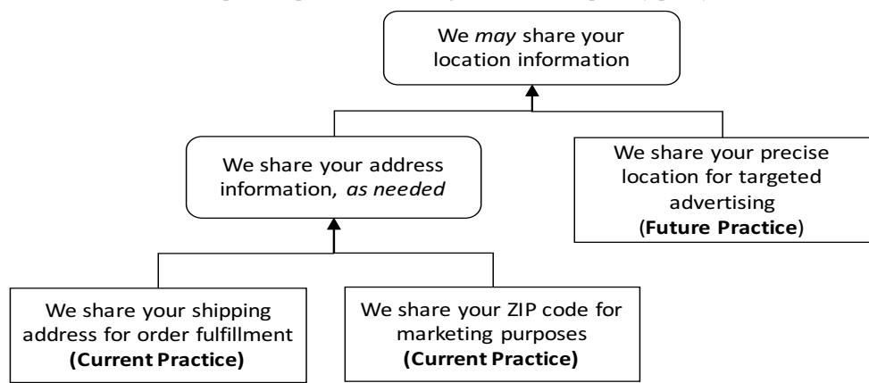
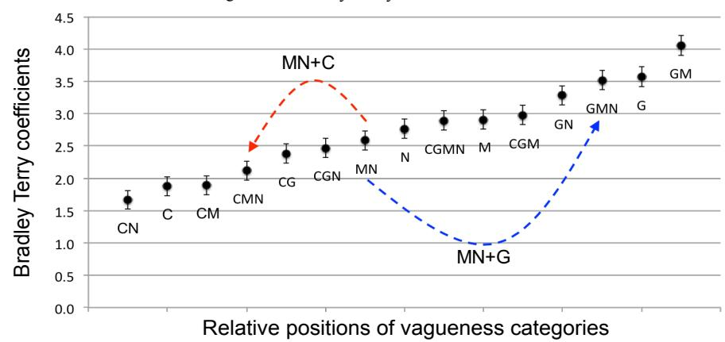
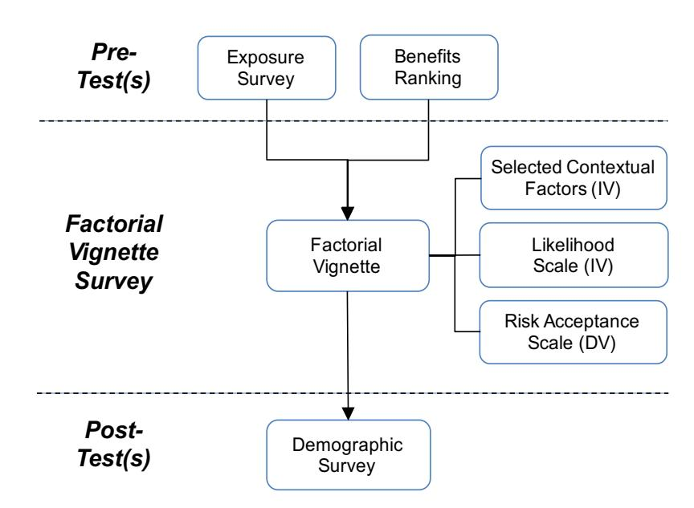
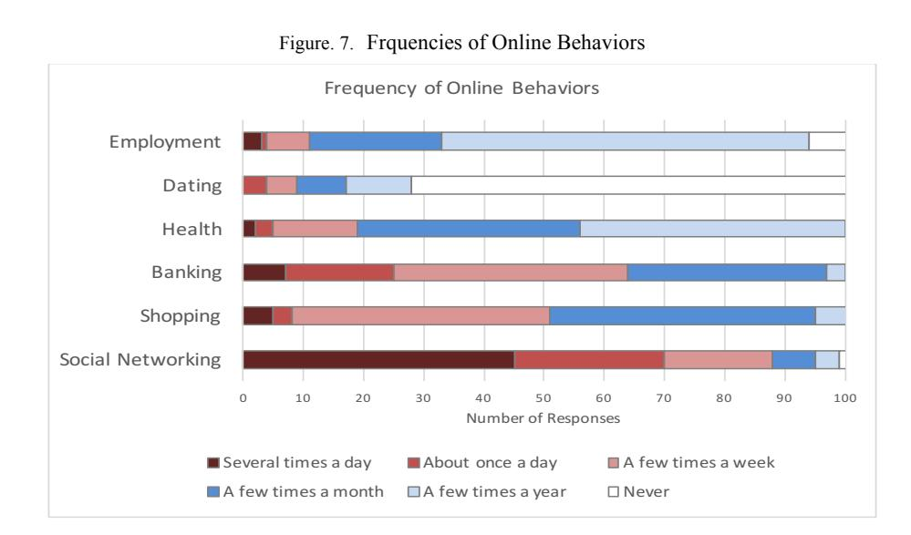
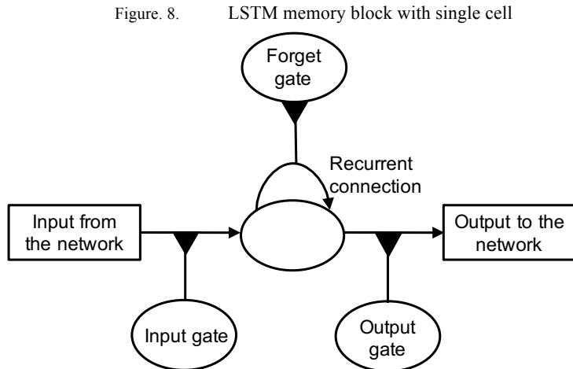
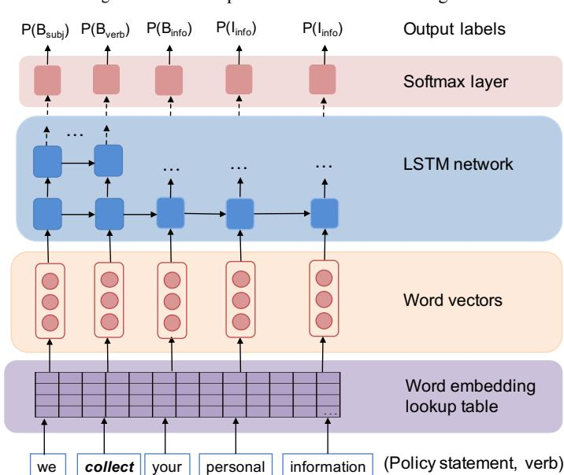

# Thesis Proposal Ambiguity in Privacy Policies and Perceived Privacy Risk

Jaspreet Bhatia Software Engineering Institute for Software Research Carnegie Mellon University jbhatia@cs.cmu.edu

November 2017

Submitted in partial fulfillment of the requirements for the degree of Doctor of Philosophy

#### Thesis Committee

Travis D. Breaux (Chair) Institute for Software Research Carnegie Mellon University

James D. Herbsleb Institute for Software Research Carnegie Mellon University

Eduard Hovy Language Technologies Institute Carnegie Mellon University

Joel Reidenberg School of Law Fordham University

#### Abstract

Software designers and engineers make use of software specifications to design and develop a software system. Software specifications are generally expressed in natural language and are thus subject to its underlying ambiguity. Ambiguity in these specifications could lead to different stakeholders, including the software designers, regulators and users having different interpretations of the behavior and functionality of the system. One example where policy and specification overlap is when the data practices in the privacy polices describe the website's functionality such as collection of particular types of user data to provide a service. Website companies describe their data practices in their privacy policies and these data practices should not be inconsistent with the website's specification. Software designers can use these data practices to inform the design of the website, regulators align these data practices with government regulations to check for compliance, and users can use these data practices to better understand what the website does with their information and make informed decisions about using the services provided by the website. In order to summarize their data practices comprehensively and accurately over multiple types of products and under different situations, and to afford flexibility for future practices these website companies resort to using ambiguity in describing their data practices. This ambiguity in data practices thus undermines its utility as an effective way to inform software design choices, or act as a regulatory mechanism, and does not give the users an accurate description of corporate data practices, thus increasing the perceived privacy risk for the user.

In this thesis, we propose a theory of ambiguity to understand, identify, and measure ambiguity in data practices described in the privacy policies of website companies. In addition, we also propose an empirically validated framework to measure the associated privacy risk perceived by users due to ambiguity in natural language. This theory and framework could benefit the software designers by helping them better align the functionality of the website with the company data practices described in privacy policies, and the policy writers by providing them linguistic guidelines to help them write unambiguous policies.

# 1 Introduction

Companies and government agencies use personal information to improve service quality by tailoring services to individual needs. To support privacy, regulators rely on the privacy notice requirement, in which organizations summarize their data practices to increase user awareness about privacy. These notices, also called privacy policies, further serve to align company privacy goals with government regulations. In addition, software designers and developers use the data practice descriptions in these privacy policies to inform the design of the website, and to make decisions related to user data such as "what information should be collected from the user?" "what should that information be used for?" "who should be given access to the data?" among other decisions. Users use these privacy policies to better understand the data practices of the company, and in turn make informed decisions about using the website. The underlying ambiguity in privacy policies, however, undermines the utility of such notices to serve as design guidelines for the software designers, and as effective regulatory mechanisms that could be used to check for compliance with the government regulations. Consequently, privacy policies also fail to offer a clear description of the organization's privacy practices to users and in turn effect their ability to make an informed decision about the website. The ambiguity could lead to multiple interpretations of the same data practice by different stakeholders, including the regulators, software designers and engineers, and the users.

Privacy policies pose a challenging requirements problem for organizations, because policies must: (a) be comprehensive, which includes describing data practices across physical places where business is conducted (e.g., stores, offices, etc.), as well as web and mobile platforms; and (b) be accurate, which means all policy statements must be true for all data practices and systems. Ensuring privacy policies are comprehensive and accurate means that policy authors can resort to ambiguity when summarizing their data practices, which includes using vague terms to describe their data practices and using incomplete description of the data practices. Variations in data practices may exist because two or more current practices that are semantically different must be generalized into a broader category of statement.

In Figure 1, the data types "shipping address" and "ZIP code" are generalized into "address information," and the purposes "order fulfillment" and "marketing purposes" are combined into a vague condition "as needed," to encompass both practices. To account for future practices, a vague modal verb "may" is added to the general policy statement, while "address" is subsumed by "location information", and the purpose is removed.

Figure. 1. Example data practices that are generalized into privacy policy statements

Ambiguity (as shown in Figure 1) can cause different stakeholders to be confused about the actual data practices of the website. For instance, in the example in Figure 1, the ambiguity makes difficult for the stakeholders to accurately predict different aspects of the data practice and does not answer questions such as: (1) "what constitutes their location information?" (2) "what are the conditions under which the user's information will be shared?" (due to the presence of the keyword "may"), (3) "with whom is the location information being shared?" (due to the absence of the value for the semantic role "target" i.e. who/what is the receipt of the user's information), and (4) "what will the shared data be used for?" (due to the absence of the value for the semantic role "purpose" i.e. for what purposes will the user's information will be used). This lack of clarity in the information provided in the privacy policy about their data practices could have the following consequences: the software designers would not be able to align the functionality of the system with the company's data practices; the regulators may not be able to accurately align the data practices with government regulations to check for inconsistencies and violations; and finally, it could affect the users' decision making about their use of the website services. Ambiguity can in turn cause users to perceive higher privacy risk, because the flexibility entailed by ambiguous policy statements may conceal privacy-threatening practices. Moreover, ambiguous statements can limit an individual's ability to make informed decisions about their willingness to share their personal information, which may also increase their perceived privacy risk.

Ambiguity can also lead to users or regulators coming to incomplete or inconsistent conclusions, due to the missing or unclear information in the privacy policies which they assume or comprehended in an incorrect way. Consequently, it can lead to misestimation of the privacy risk. For example, in the summary privacy statement "we may share your location information" in Figure 1, the purpose for which the user's location information is shared is missing, which gives the user a chance to make an assumption about the missing purpose. The user may assume that the sharing is being undertaken for a primary purpose, which leads to underestimating the risk. On the other hand, the user may assume that the shared data is used for a secondary purpose, which leads to overestimating the risk, while it remains unknown what the actual data practice is. The overestimation of privacy risk is not a favorable situation for the company, because it could lead to either the users not using their services due to fear of misuse of their

Legend: Arrows lead from practices to general privacy policy statements Summary Policy Statement Data Practice

data, or the regulators concluding that the data practice is not in compliance with a regulation. In 2015, social networking website and application Snapchat changed its data practice descriptions in their privacy policy concerning collection, use and retention of users data, stating that "…we may access, review, screen, delete your content at any time and for any reason" and "…publicly display that content in any form and in any and all media or distribution methods," among other such statements which made the users worried about the ways in which their information could be collected, retained and used1, since the policy was not very clear about it. This led to some users reporting that they had deleted their accounts2. In another incident, Google was warned by European regulators for being vague about its data retention practices and not showing commitment towards the European Data Protection Directive3. To ensure accuracy, we believe business analysts and system developers, in addition to legal advisors, must participate in deciding which practices to summarize in a privacy policy, and when to use ambiguity to minimize the privacy risk.

Some researchers believe that one can measure the "actual" privacy risk, which is a hypothetical, data subject-independent measure of the above-chance probability that any data subject would experience a privacy harm. The concept of an "actual" privacy risk would require continuous surveillance data on data subjects, which details how a system affects those subject's emotional, psychological and physical well-being. This data would include whether data subjects accept a risk by participating in an activity. Fischhoff et al. argue that human behavior does not reliably reflect an actual risk estimate, if they cannot iterate over the system's design space, including both the possibility of hazards and reliability of safety features [Fischhoff et al. 1978]. In addition, accumulating this surveillance data would introduce a privacy risk paradox, in which the measurement of actual risk would introduce a new, more serious risk by amassing this surveillance data. Finally, the measure of whether a data subject actually experiences a privacy harm, such as whether a data subject's personal information were distorted or mischaracterized, is necessarily a subjective assessment. Fischhoff et al. argue that such assessments are subject to estimator biases and their methods of assessment, if not well documented, can be difficult to reproduce [Fischhoff et al., 1978]. Therefore, while actual privacy risk presents an objective ideal, the concept's general validity and reliability has been criticized in prior work. In this thesis we measure perceived privacy risk, which is based on expressed preferences [Slovic 2000] and which we define as an individual's willingness to share their personal data with others given the likelihood of a potential privacy harm.

In the next section, we discuss in detail our approach to identify and measure ambiguity and the associated perceived privacy risk.

#### 1.1 Proposed Approach

Ambiguity undermines the ability of organizations to align their privacy policies with their actual data practices, which can confuse or mislead users, thus leading to an increase in perceived privacy risk. This thesis examines the presence of ambiguity, which consists of vagueness and incompleteness in data practices, and its effect on perceived privacy risk. The outcome of this

1 Alex Heath, "Why you don't need to freak out about Snapchat's new privacy policy," Business Insider, 30 October 2015. http://www.businessinsider.com/snapchat-privacy-policy-update-explained-2015-10

2 Sally French, "Snapchat's new 'scary' privacy policy has left users outraged," Market Watch, 2 November 2015. http://www.marketwatch.com/story/snapchats-new-scary-privacy-policy-has-left-users-outraged-2015-10-29

3 Zack Whittaker, "Google must review privacy policy, EU data regulators rule," ZDNet, 16 October 2012. http://www.zdnet.com/article/google-must-review-privacy-policy-eu-data-regulators-rule/

thesis is a theory of ambiguity in privacy policies, which includes an approach to: (1) understand, identify and measure vagueness; (2) understand and detect incompleteness using semantic roles; (3) and understand and measure perceived privacy risk due to ambiguity.

We propose to study the concept of vagueness in privacy policies, which is caused by the use of vague terms, that reduce the clarity of the data practices. We consider a privacy policy statement as vague when words such as "may," "generally," "some," etc. are used to describe the data practices. We studied vagueness present in privacy policies by conducting grounded analysis [Saldaña 2012] on privacy policies, and we measured the relative differences in vagueness of vague terms by performing user studies. Based on the findings from these studies we propose a theory of vagueness which consists of three main parts: a taxonomy of vague terms and their categorization which is based on grounded analysis, a technique to measure the relative inter-and intra-category vagueness using paired comparisons, and an explanation for differences in vagueness based on different semantic functions. We used techniques from natural language processing (NLP), to develop a vagueness scoring tool that is based on the results from the different vagueness studies we conducted (see Section 4 for details).

We also propose to analyze incompleteness due to missing contextual information about data actions in data practices using grounded analysis. Incompleteness occurs in privacy policies when it does not answer all the questions the users or regulators may have regarding the company's data practices. For example, in context of the data action "share," the questions that one could have include: what type of data is being shared? what is the source of the data being shared? with whom is it shared? for what purpose is it shared? and under what conditions will it be shared? If the data practice does not answer one or more of these questions, the data practice can be considered incomplete with respect to the data action. The context for a given data action can be represented using semantic frames. We can construct these semantic frames by answering different questions about that data action, which are called semantic roles associated with the action. Failure to provide the values for different semantic roles for a given data action can lead to incompleteness in describing the context for that action. We propose to develop a theory to understand what semantic roles are expected for different data actions for a complete semantic frame representation, how do these roles help build the context for the action, and how are these roles expressed in privacy policies. We also propose to identify such incompleteness by automatically labeling semantic roles in a data practice using neural networks and then identifying missing values for expected semantic roles (see Section 6 for details). Both vagueness and incompleteness cause ambiguity, and prevent us from making accurate predictions about how the user's data is collected, retained, shared or used by the company. The constructs vagueness and incompleteness, in addition to other factors such as risk likelihood and demographic factors, etc. inform the design of our empirically validated framework to measure perceived privacy risk (see Sections 5 and 6.4 for details).

An approach to identify and measure ambiguities and the associated privacy risk can benefit software designers, policy writers, regulators and users. Users and regulators use the privacy policies to understand the data practices of the website, that is to understand what the company says it does with their data, whereas what the company actually does with the user data is reflected in their software design. Software designers can therefore use our approach to identify ambiguity in the data practices, and ask for clarifications when required, so that there are no gaps between what the company says it does with user data, and what it actually does. This would help the website company make sure that the website's functionality is in sync with the data practices described in the privacy policy. Software designers can consequently also use the data practices from the privacy policy to inform their design decisions during the development of the website.

Using the theory and framework proposed herein, policy writers can identify the ambiguity in the data practices and take measures to reduce this ambiguity such that it provides an accurate description of the website's data practices and reduces the assumptions the stakeholders have to make. The theory and the corresponding linguistic guidelines that emerge from this thesis can help policy writers understand when and how to summarize their data practices in order to reduce the ambiguity and the associated privacy risk. For example, if the company is sharing the user's data with a third-party company, the privacy policy should provide details about the purposes for which the data would be shared, if that has been shown to reduce the associated privacy risk. Regulators need a means to identify if the data practices of a website align with the laws and government regulations. Regulators can use the proposed approach to identify ambiguous data practices and score privacy policies for ambiguity. This could help them identify ambiguous data practices which can lead to inconsistencies and non-compliance, and suggest corrective measures to website companies which have a privacy policy with high ambiguity score, or with high associated privacy risk.

In the future, we envision extension points to our approach that can be used with other privacy related research ideas such as those of nutrition labels for privacy [Kelley et al. 2009]. Our results can be used to adjust how they help users make privacy related decisions. The results from our thesis can also be used to augment the findings of NLP and ML tools being developed to automatically process privacy policies [Bhatia et al. 2016b, Sathyendra et al. 2017] by helping these tools process the instances of ambiguity as special cases.

In addition, we envision that the empirically validated framework to measure privacy risk can be used by itself with different contexts, by developers, public policy, regulators and users. System developers, including designers, aim to build systems that users feel comfortable and safe using. In privacy, this includes accounting for Privacy by Design (PbD) [Hustinx 2010], wherein the user's privacy is considered throughout the development of the system. To perform PbD, however, developers need a systematic and scalable framework that can help them understand and measure the privacy risk that users experience while using a software system. Developers can use this privacy risk framework to frame their design choices in a given context and then measure how users perceive the risks that arise due to the context, so that designs can be improved to reduce risk. For instance, if a particular information type or data practice is high risk, designers may introduce risk mitigations to affect the storage and use of that information. This may include limiting collection from the user, or encrypting the information before it is stored; and also, the policy writers could pay more attention to describing more clearly the data practices associated with the sensitive information types. This framework can also help regulators identify systems that could put users' privacy at greater risk, and suggest corrective measures. Furthermore, known high-risk data practices and information can be used to introduce privacy nudges [Acquisti et al. 2017 and Wang et al. 2014] to users in real-time based on user demographics associated with high perceptions of risk. On the other hand, if data subjects misunderstand a technology and consequently perceive it as high risk, public policy could be used to explain the technology and provide additional guidance to reduce the risk in data handling.

In summary, this thesis aims at building a theory of ambiguity for privacy policies that provides an early, novel foundation upon which to improve the summarization of data practices and readability of these privacy policies, which are known to be hard to read [McDonald and Cranor 2008], in a way that they minimize the associated privacy risk. In addition, it aims to enhance emerging techniques for automating the processing of privacy policies [Bhatia et al. 2016b, Sathyendra 2017].

## 2 Thesis Statement

Thesis Statement: Ambiguity undermines the ability of organizations to align their privacy policies with their actual data practices, which can confuse or mislead users, thus leading to an increase in perceived privacy risk. This thesis examines the presence of ambiguity, which consists of vagueness and incompleteness in data practices, and its effect on perceived privacy risk. The outcome of this thesis is a theory of ambiguity in privacy policies, which includes an approach to: (1) understand, identify and measure vagueness; (2) understand and detect incompleteness using semantic frames; (3) and understand and measure perceived privacy risk due to ambiguity and vagueness.

We present the background and related work in Section 3. In Section 4, we explain in detail the grounded analysis for identifying vague terms in data practices and the user studies for measuring the relative vagueness of these vague terms in privacy policies that lead to the formation of the theory of vagueness. In Section 5 we present the empirically validated framework for understanding and measuring perceived privacy risk. The preliminary work and the proposed research work on semantic role labeling is described in Section 6. In Section 7 we summarize the completed and proposed research work. And finally, in Section 8 we present the timeline for the proposed research work.

# 3 Background and Related Work

This section reports the background and related work on (1) ambiguity in natural language and in requirements; (2) privacy and privacy risk; and (3) semantic role labelling.

#### 3.1 Ambiguity in Natural Language and Requirements

Lakoff notes that natural language (NL) concepts have vague boundaries and fuzzy edges. Consequently, he introduced the term hedging to describe the fuzziness in the truth value of NL sentences, meaning, that they are true to a certain extent, and false to a certain extent, true in certain respects and false in certain other respects [Lakoff 1972]. In natural language processing (NLP), machine learning (ML) systems have been developed as part of the CoNLL-2010 shared task to identify hedge cues and their scopes in Wikipedia and Biomedical texts [Farkas et al. 2010].

Requirements are often written in NL and thus suffer from inherent NL ambiguity [Berry et al. 2003]. For example, Yang et al. report that, out of the 26,829 requirements statements that they analyzed, 12.7% had ambiguity due to a coordinating conjunction (and/or), which is a type of syntactic ambiguity [Yang et al. 2010]. Ambiguity is often considered a potentially dangerous attribute of requirements [Boyd et al. 2005]. Gause and Weinberg note that ambiguity in requirements can lead to subconscious disambiguation, wherein readers disambiguate using their first interpretation, unaware of other possible interpretations [Gause 1989]. This leads different stakeholders with different interpretations of the same requirements. Ambiguity detection is difficult, even if the reader is aware of all the facets of ambiguity [Kamsties 2006].

Table 1 presents Massey et al.'s ambiguity taxonomy that was applied to natural language legal texts [Massey et al. 2014]. In this thesis proposal, we focus on vagueness from the use of vague terms, and incompleteness due to missing semantic roles in context of a data action.

AMBIGUITY TAXONOMY FOR LEGAL TEXT

|Type | Definition |
|------------- | ------------------------------------------------------ |
|Lexical | a word or phrase with multiple, valid meanings, |
|Syntactic | a sequence of words with multiple valid |
|Semantic | a sentence with more than one interpretation in its |
|Vagueness | a statement that admits borderline cases or relative |
|Referential | a grammatically correct sentence with a reference |

Many attempts have been previously made to address the problem of ambiguity in requirements. Fuchs and Schwitter propose Attempto Controlled English, a restricted NL, to align NL specifications with first order logic to reduce the ambiguity in requirements [Fuchs and Schwitter 1995]. However, restricted or formal languages are not as expressive as NL, and incorrectly interpreted NL specifications lead to incorrect formal specifications [Tjong 2013]. Alternatively, Berry et al. introduced the Ambiguity Handbook, which describes ambiguity in

requirements and legal contracts, including strategies for avoiding and detecting ambiguity [Berry et al. 2003].

Pattern based techniques have also been used to identify ambiguity in requirements [Kamsties 2001, Denger 2002]. Kiyavitskaya et al. propose a tool that combines lexical and syntactic measures applied to a semantic network to identify ambiguous sentences and determine potential ambiguities [Kiyavitskaya et al. 2008]. Alternatively, object oriented analysis models of the specified system can be used to identify ambiguities [Popescu et al. 2008]. Tjong describes ambiguities found in NL requirements, such as lexical ambiguity, ambiguity due to uncertainty, etc., and guidelines to avoid these ambiguities [Tjong 2008]. The tool called SREE identifies instances of a set of vague words using simple keyword matching and marks it as potentially ambiguous [Tjong and Berry 2013]. In our approach, we do not employ keyword matching, because we do not consider all instances of a vague term to be potentially vague. Instead, we rely on manual annotations to identify vague terms.

Requirements quality evaluation tools, such as IBM Doors and QuARS [Fabbrini et al. 2001] and ARM [Wilson et al. 1997], also identify ambiguous terms. Yang et al. identify speculative requirements and uncertainty cues, using a technique that combines ML and a rule-based approach. They utilize lexical and syntactic features of requirements to identify uncertainty [Yang et al. 2012]. More recently, researchers have used ML based on heuristics drawn from human judgments to identify nocuous coordination and anaphoric ambiguities in requirements [Yang et al. 2010, Yang et al. 2011]. This approach still requires human interpretation to resolve ambiguity. To our knowledge, this prior work to identify vague requirements terms [Berry et al. 2003, Kamsties et al. 2001, Tjong 2008, Tjong and Berry 2013, Fabbrini et al. 2001, Wilson et al. 1997, Yang et al. 2012] does not differentiate the relative vagueness of these terms. We address this limitation with a new vagueness taxonomy and predictions of how vague terms increase and decrease vagueness.

#### 3.2 Privacy and Privacy Risk

In this section, we review background and related work on privacy, risk perception and privacy risk.

#### 3.2.1 Background on Privacy

Over the course of the last century, multiple definitions of privacy have emerged. Westin describes privacy as when a person, group or company can decide for themselves when, how and to what extent information about them is shared with others. Westin defines four states of privacy: (1) solitude, which refers to how one person distances his or herself from others, (2) intimacy, where a person chooses to have a close relationship with a small group of people, (3) anonymity, where a person can move through public spaces while protecting his or her identity, and (4) reserve, where a person can regulate the amount of information about himself or herself that one wants to communicate to others in order to protect against unwanted intrusion [Westin 1967]. Murphy describes the "right to privacy" as being safe from intrusion, the right to make confidential decisions without government interference, the right to prohibit public use of a person's name or image, and to regulate the use of personal information [Murphy 1996]. Nissenbaum argues that privacy and data sharing are contextual, meaning that the factors, data type, data recipient, and data purpose among others affect a person's willingness to share [Nissenbaum 2004, 2009]. Consistent with this argument made by Nissenbaum we observed that contextual factors including data type, type of harm, purposes which provide societal benefits and the person who is experiencing the risk effect users' perception of privacy risk [Bhatia et al. 2017b]. In this thesis, we also propose to study how the presence or absence of different contextual factors, which are also called semantic roles associated with the data action effect a user's perception of privacy risk (See Sections 5 and 6.3).

There are different and conflicting views about the importance of privacy. Solove argues that privacy is "a fundamental right, essential for freedom, democracy, psychological well-being, individuality, and creativity" [Solove 2008]. On the other hand, other scholars, such as Moor, argue that privacy is not a "core value" in comparison to the values of life, happiness, and freedom; rather privacy is an expression of the core value of security and asserts that privacy is instrumental for protecting personal security [Moor 1997].

Studies have shown differences between a user's privacy preferences and their actual behavior in similar situations, called the privacy paradox [Acquisti and Grossklags 2005, Berendt et al. 2005]. This paradox could be explained by the argument made by Slovic et al. that people who see social or technological benefits of an activity tend to perceive a reduction in risks associated with that activity [Slovic 2000]. The studies reported in our paper (under review at TOCHI) further support this argument, that perceived benefits from services will reduce the users' perception of privacy risk [Bhatia et al. 2017b].

#### 3.2.2 Risk Perception and Privacy Risk

Risk is a multidisciplinary topic that spans marketing, psychology, and economics. In marketing, risk is defined as a choice among multiple options, which are valued based on the likelihood and desirability of the consequences of the choice [Bauer 1960]. Starr first proposed that risk preferences could be revealed from economic data, in which both effect likelihood and magnitude were previously measured (e.g., the acceptable risk of death in motor vehicle accidents based on the number of cars sold) [Starr 1969]. In psychology, Fischhoff et al. note that so-called revealed preferences assume that past behavior is a predictor of present-day preferences, which cannot be applied to situations where technological risk or personal attitudes are changing [Fischhoff et al. 1978]. To address these limitations, the psychometric paradigm of perceived risk emerged in which surveys are designed to measure personal attitudes about risks and benefits [Slovic 2000]. Two insights that emerged from this paradigm and inform our approach are: (a) people better accept technological risks when presented with enumerable benefits, and: (b) perceived risk can account for benefits that are not measurable in dollars, such as lifestyle improvements, which includes solitude, anonymity and other definitions of privacy [Slovic 2000]. In other words, people who see technological benefits are more inclined to see lower risks than those who do not see benefits. Notably, privacy is difficult to quantify, as evidenced by ordering effects and bimodal value distributions in privacy pricing experiments [Acquisti et al. 2013]. Rather, privacy is more closely associated with lifestyle improvements, e.g., private communications with friends and family, or the ability to avoid stigmatization. Acquisti et al. observed that estimated valuations of privacy were larger when the participants of the study were asked to consider giving up their personal data for money and smaller when they had to pay money for privacy [Acquisti et al. 2013]. Their studies also showed that the participants' decisions about privacy were inconsistent. Finally, the economist Knight argues that subjective estimates based on partial knowledge represent uncertainty and not risk, also known as ambiguity aversion, wherein respondents are unwilling to accept a risk due to uncertainty in the question or question context [Knight 1921].

#### 3.3 Semantic Role Labelling

Semantic role labelling (SRL) is a type of shallow semantic parsing with the objective of determining the predicate-argument structure for each predicate in a statement [Jurafsky and Martin 2000, Zhou and Xu 2015]. A semantic role is a semantic relationship that a word or phrase in the given statement has with the given verb in the statement. For example, consider the following modified statement from the Barnes and Noble privacy policy:

[subject We] collect [information-type your personal information] [purpose in an effort to provide you with a superior customer experience].

In this statement, the data action is "collect"; the semantic role subject has the value "we", which refers to the website company; the semantic role information type has the value "your personal information", and the semantic role purpose has the value "in an effort…." The SRL task is determining the values of different semantic roles attached to the given verb in the statement. The techniques used for developing SRL systems can be categorized into two main groups: (1) traditional methods using syntactic features with machine learning classifier, and (2) end to end systems with word embeddings and neural networks. The first and the most widely used method (till recently) is the tradition method which involves extracting syntactic and lexical features from text which are then used with different classifiers to develop a SRL system [Gildea and Jurafsky 2002, Carreras and Màrquez 2005, Cohn and Blunsom 2005, Mitsumori et al. 2005]. The emphasis is on extracting features that can best describe the properties of the text from the training corpus [Zhou and Xu 2015]. The most important features come from the combination of different syntactic parsers. Pradhan et al. treat SRL as a multi-class classification problem and use features generated from the syntactic parses from Charniak parser [Charniak 2000] and Collins parser [Collins 2003], and then assign constituents of each parse a semantic role label using support vector machine classifier (SVM) [Pradhan et al. 2005]. They then convert the semantic role labels into BIO tags (beginning-inside-outside of the semantic role span) [Ramshaw and Marcus 1995], which are used as input features as well with another SVM layer which produces the final SRL tags. The combination of the features from these three different syntactic views leads to significant improvement in performance over features from individual views. In the 2005 CoNLL shared task, 19 teams participated and developed different SRL systems using varied syntactic information such as part of speech tagging, chunking, syntactic parses, and named entities, and various learning algorithms including SVMs, CRFs, maximum entropy frameworks and other such variations [Carreras and Màrquez 2005].

The traditional methods rely heavily on the output of the different syntactic parsers, and Pradhan et al. showed that errors in the syntactic parsing are major sources of errors in the SRL systems [Pradhan et al. 2005]. And therefore, more recently the focus has been on techniques based on word embeddings and neural networks, which try to solve the SRL problem without using feature engineering. Collobert et al. introduced an architecture for SRL, which consists of a word embedding layer, convolution neural network (CNN) layers, and a CRF layer [Collobert et al. 2011]. They used word embedding which are trained on a large corpus of text, to address the problem of data sparsity [Zhou and Xu 2015]. However, they had to use features from parse tree of the Charniak parser [Charniak 2000] in order to perform as well as the traditional methods. They also used CNN layer which does not model long term dependencies as well as other types of neural networks since it only includes words in a limited context [Zhou and Xu 2015]. To overcome this limitation, we plan to use long short-term memory architecture, which can model long term dependencies [Hochreiter and Schmidhuber 1997]. In the past few years the focus has been on developing end to end systems which do not have any intermediate tag, and the only input they use is the statement, the verb of interest, and the word embeddings for the words in the statement. Zhou and Xu have developed such a system which takes as input the word embeddings, and use deep bi-directional LSTMs to perform the task of SRL [Zhou and Xu 2015]. He et al. use deep highway bi-directional LSTMs to develop their SRL system [He et al. 2017]. They also observe that syntactic parser can be used with their system to further improve their results. In this thesis, we propose to develop an end to end system which uses LSTMs as the machine learning algorithm and word embeddings as the input to the system.

In the next section, we describe in detail the studies we conducted to identify and measure vagueness in privacy policies and their results.

### 4 A Theory of Vagueness

Creswell defines a theory as an interrelated set of constructs formed into propositions and hypothesis that specify the relationship among variables, typically in terms of magnitude and direction [Creswell 2008]. To that end, our three-part vagueness theory is: (1) the construct vagueness is described by multiple, exclusive semantic categories; (2) the categories, independently and through composition, predict how vagueness increases and decreases; and (3) semantic functions, called likelihood, authority and certitude, suggest why semantic categories predict vagueness [Bhatia et al. 2016a]. In addition, we used this theory to develop a vagueness scoring mechanism to compare the relative vagueness of privacy policies. The vagueness scores for a set of privacy policies are then compared to those for two benchmarks to determine whether government-mandated privacy disclosures result in notices less vague than those emerging from the market [Reidenberg et al. 2016].

The use of vague terms, such as may, as necessary, and generally, to describe goals in privacy policies introduces uncertainty into the goal's action or the associated information type. Consider the following statements:

- We will share your personal information, such as your name, email address and phone number, with our marketing affiliates for advertising purposes.
- We might share some of your personal information with our third-party affiliates as necessary.

In the first statement, the modal phrase will is certain, whereas the modal phrase might in the second statement leaves open the possibility of sharing, and is thus vague. In addition, the first statement elaborates upon what personal information is included, name, email address and phone number, which adds additional clarity missing from the second statement, which mentions sharing some of your personal information. Similarly, the description of the purpose advertising purposes is more clear than the phrase as necessary, which leaves open a range of possible purposes, such as legal, marketing, etc.

In this section, we report the two studies we conducted and the results which led to the development of a theory of vagueness for privacy policies, and a third study where we used the results from this theory to score privacy policies for vagueness [Bhatia et al. 2016a, Reidenberg 2016]. The first study was based on content analysis [Saldaña 2012] to identify vague terms in privacy policy statements and to categorize them into different vagueness categories, and the second study used paired comparison technique [David 1988] and Bradley Terry Model [David 1988, Hunter 2004] to measure the relative differences in the vagueness of these vagueness categories and terms by ranking them in the order of vagueness. We then used the results from these two studies to conduct a third study, which was aimed at scoring policies for vagueness and comparing it to benchmark policies.

We describe the content analysis study in Section 4.1, the paired comparison study in Section 4.2, the vagueness scoring study in section 4.3, and we then report the results from these three studies in Section 4.4. We summarize the conclusions from the all the vagueness studies in Section 4.5.

### 4.1 Content Analysis of Vague Terms

We manually annotated 15 privacy policies (see Table 2) using content analysis [Saldaña 2012] to identify words or phrases that introduce vagueness into policy statements. We limited our analysis to statements about collection, use, disclosure and retention of personal information, which have also been discussed by Antón and Earp [Antón and Earp 2004]. These policies are part of a convenience sample, although, we include a mix shopping companies who maintain both online and "brick-and-mortar" stores, and we chose the top employment websites and Internet service providers in the U.S. Table 2 presents the 15 policies by category and date last updated.

PRIVACY POLICY DATASET FOR VAGUENESS STUDY

|Company’s Privacy Policy | Industry Category | Last Updated |
|-------------------------- | ------------------- | -------------- |
|Barnes and Noble | Shopping | 05/07/2013 |
|Costco | Shopping | 12/31/2013 |
|JC Penny | Shopping | 05/22/2015 |
|Lowes | Shopping | 04/25/2015 |
|Over Stock | Shopping | 01/09/2013 |
|AT&T | Telecom | 09/16/2013 |
|Charter Communication | Telecom | 05/04/2009 |
|Comcast | Telecom | 03/01/2011 |
|Time Warner | Telecom | 09/2012 |
|Verizon | Telecom | 10/2014 |
|Career Builder | Employment | 05/18/2014 |
|Glassdoor | Employment | 09/09/2014 |
|Indeed | Employment | 2015 |
|Monster | Employment | 03/31/2014 |
|Simply Hired | Employment | 4/21/2010 |

The policies are first prepared by removing section headers and boilerplate language that does not describe relevant data practices, before saving the prepared data to an input file for an Amazon Mechanical Turk (AMT) task. The task employs an annotation tool developed by Breaux and Schaub [Breaux and Schaub 2014], which allows annotators to select relevant phrases matching a category, in this case, the vague terms belonging to a certain category. I, and two graduate law students, performed the annotation task.

The annotation process employs two-cycle coding [Saldaña 2012]. In the first cycle, I analyzed five policies to identify an initial set of vague terms, and then applied second-cycle coding to group these terms into emergent categories based on the kind of vagueness introduced by related terms. In addition, I developed guidelines to predict into which category a vague term should be placed. The terms, categories and guidelines were shared with the other two annotators, who independently annotated the same five policies. Next, I and the other two annotators met to discuss results, to add new terms to the categories and to refine the guidelines. After agreeing on the categories and guidelines, we annotated the remaining ten policies, before meeting again to reconcile disagreements. Saturation was reached after no new vague terms or new categories were discovered, which occurred after analyzing the first five policies (Barnes and Noble, Lowes, Costco, AT&T, and Comcast).

The resulting vagueness categories and their definitions are:

- Conditionality the action to be performed is dependent upon a variable or unclear trigger
- Generalization the action or information types are vaguely abstracted with unclear conditions
- Modality the likelihood or possibility of the action is vague or ambiguous
- Numeric Quantifier the action or information type has a vague quantifier

This approach is also known as grounded theory in literature [Saldaña 2012]. The guidelines help disambiguate the policy statement in a given context, for example, the phrase "as necessary" when followed by a specific purpose: "We will use your personal information as necessary for law enforcement purposes…" states that the information is used for legal purposes, thus disambiguating the condition "as necessary" in this context.

We use the semi-automated privacy goal-mining framework developed by Bhatia et al. to identify statements with privacy goals [Bhatia et al. 2016b]. This technique was extended to use the Stanford Dependency Parser [Marne et al. 2006] to automatically identify which annotated vague terms are attached to either an action or information type in the privacy goal. The resulting vagueness dataset consists only of privacy goals with a vague term attached to either the action or information type.

We applied Fleiss' Kappa, an inter-rater agreement statistic [Fleiss 1971], to the annotationsvagueness category mappings. Because Fleiss' Kappa assumes that categories are exclusive, we compute the Kappa statistic for the complete composition of all vagueness categories assigned to each policy statement. A statement that contains one or more Modality category terms is assigned to the singleton category M, whereas a statement with terms from a combination of the Conditionality, Generality and Modality categories is assigned to the composite category CGM. The Fleiss Kappa for all mappings from annotations to vagueness categories and the three annotators was 0.94, which is a very high probability of agreement above chance alone.

#### 4.2 Ranking Vagueness Categories and Terms using Paired Comparisons

In this study, we measured the differences in vagueness within and across vagueness categories and their combinations. Paired comparison is a statistical technique used to compare N different items by comparing just two items at once [David 1988]. The overall results are computed by combining data from all paired comparisons. This technique is especially useful when items are comprised of multiple factors, when the comparison context is difficult to control, or when the comparison order influences the outcome. This technique is beneficial when differences between items are small, and when comparison between two items should be as free as possible from any extraneous influence caused by the presence of other entities [David 1988]. To compare N entities, a total �� ∗ (�� − 1) 2 paired comparisons are performed.

We designed multiple surveys to compare combinations of one or more vague terms, within and across the four vagueness categories. The first survey is an exploratory survey designed to compare statements containing combinations of vague terms from across the four vagueness categories (see Section 4.1). We chose one exemplary vague term from each category. The vague terms were then inserted into a baseline privacy policy statement: "We share your personal information." For example, variants 1 and 2 below show two statements that result from inserting the underlined vague terms selected from the corresponding vagueness categories (in parenthesis):

Variant 1 (Modality, Condition): We may share your personal information as necessary.

Variant 2 (Numeric Quantifier): We share some of your personal information.

For the four vagueness categories, we have 24 -1 or 15 category combinations and thus one statement variant per combination. The 15 statement variants yield 105 paired comparisons.

The survey consists of a scenario, and five of 105 paired comparisons (see Figure 2). The scenario frames the survey rationale for the participants.

Figure. 2. Paired Comparison Survey Questions

The number of participants needed to judge each paired comparison was based on Pearson and Hartley's data for calculating power for paired comparisons [Pearson and Hartley 1962, 1966]. To attain 95% power, at least four participants are needed to judge each paired comparison. We solicited 60 participants to judge each paired comparison. The additional 56 participants only reduce standard error to further delineate between vagueness levels; four participants are sufficient to discover rank order.

We designed four additional surveys based on the design shown in Figure 2 to measure intracategory vagueness. For the intra-category vagueness surveys, each survey has a total �� ∗ (�� − 1) 2 paired comparisons for N vague terms in the corresponding vagueness category. We use the Bradley Terry model, which estimates the probability that one item is chosen over another item using past judgments about the items [David 1988, Hunter 2004], to determine the rank order of the vague terms. Model fitting is either by maximum likelihood, by penalized quasi-likelihood (for models which involve a random effect), or by bias-reduced maximum likelihood in which the first-order asymptotic bias of parameter estimates is eliminated [Turner and Firth 2012]. The Bradley Terry model has been implemented using statistical R package [R 2013, Turner and Firth 2012].

#### 4.3 Scoring Privacy Policies for Vagueness

The objective of this study was to develop a vagueness scoring model for privacy policies and to determine if the benchmark privacy policies were more or less vague as compared to market privacy policies. We observed that simply counting the number of vague terms in a privacy policy will not provide an adequate measure of vagueness. For example, the AT&T policy contains 70 vague phrases, which places it at the median of 70 vague phrases and just below Time Warner, which has 85 vague phrases. But this frequency count does not indicate the relative context. Context matters, and a granular scoring model needs to take into account three key variables: (1) the existence of vague terms and their relation to specific categories of data practice (e.g., collection, retention, sharing, and usage); (2) the relative impact that a combination of vague terms may have on overall ambiguity; and, (3) the completeness of the policy. To accomplish this goal, we propose a scoring model based on a relative comparison of

Instructions: A company wants to improve the clarity of their website privacy policies. Therefore, they are considering alternative language to help users better understand what their data practices are. For each numbered question, please read each pair of statements, and identify which of the two statements best represents a more clear description of the company's treatment of personal information.

For example, a clear description of the company's treatment of personal information could be "We share your personal information such as your name and contact details, as needed for legal purposes."

In the following statement, any pronouns "We" or "Us" refer to the company, and "you" refers to the user.

- 1. Which one of the following statements is a more clear description of the company's treatment of personal information than the other?
- We may share your personal information.
- We share some of your personal information, as needed.

vagueness in phrases for each policy. This score is based on a statistical measure that scales the overall vagueness of individual statements in each policy based on the Bradley-Terry model for paired comparisons. To calculate the score for each of the data practice statement with a vague attachment we use the Bradley-Terry coefficients from the study described in Section 4.2 above. The vagueness scores appropriately ignore phrases that do not specifically describe a data processing activity or that do not contain any vague terms. This means that non-relevant language, such as a corporation's philosophy relating to privacy, or unambiguously described data practices will not factor into the vagueness score. For each policy, we can then calculate an aggregate vagueness score by taking the sum of the coefficients for each action-information pair containing vague terms. This policy-specific aggregate score is not, however, sufficient to compare two policies. For example, if a policy is long, it may contain more action-information pairs containing vague terms than a shorter policy, but proportionately be much clearer. To account for this situation, we normalize the aggregate vagueness score by dividing the aggregate score by the total number of action-information pairs in the policy; we call this normalized score the vagueness score. The vagueness score reflects positively on the policy and improves if a policy has more action-information pairs that clearly describe data practices and reflects negatively on the policy and worsens if the policy has more pairs that include vague terms. Moreover, it reflects the total unit vagueness independent of policy length, but relative to the level of contribution to vagueness by the vagueness categories. This can be represented by the following equation:

∑ (BTC A-I) V = ----------------- (1) ∑ (A-I)

where V is vagueness score, BTC is the Bradley-Terry coefficient, and A-I is the actioninformation pair.

Lastly, in the event that a policy has a high level of vagueness in paragraphs pertaining to key elements that may be masked by clear language elsewhere in the policy, we calculate the vagueness scores for the collection of policy statements addressing each of the four key data practices: collection, retention, sharing and usage. These scores are calculated in the same manner as those for the overall policy. Separately, we report on the completeness of the privacy policies using a scale of 0 to 4. For each element missing from the four data practices (collection, retention, sharing and use), the policy is assigned one point. Thus, a policy containing any description for all four elements will score a 0 and a policy missing all four elements will score a 4.

#### 4.4 Summary Results from the Vagueness Studies

In this section, we summarize our results from the three vagueness studies described above in Sections 4.1, 4.2 and 4.3.

#### 4.4.1 Vagueness Taxonomy from Content Analysis

In Table 3 we present the content analysis results applied to the 15 policies in Table 2. The categorization was done by me and checked by the other two annotators. The frequency represents the number of times the term appeared across all selected statements in the 15 policies. Table 4 presents a breakdown of number of terms per category that appear across all 15 policies and the privacy goal types present in the policy (C: Collection, R: Retention, T: Transfer, U: Use).

TAXONOMY OF VAGUE TERMS

FREQUENCY OF VAGUE TERMS ACROSS POLICIES

|Policy | C | G | Vagueness M | N | C | R | Goal Types T | U |
|--------------------------- | ---- | --- | ------------- | ---- | ---- | ---- | -------------- | ---- |
|Barnes & Noble Shopping | 12 | 4 | 98 | 17 | 55 | 7 | 47 | 48 |
|Costco | 6 | 7 | 50 | 1 | 47 | 12 | 70 | 43 |
|JC Penny | 6 | 0 | 29 | 5 | 31 | 2 | 31 | 30 |
|Lowes | 2 | 0 | 62 | 6 | 61 | 16 | 16 | 54 |
|OverStock | 1 | 1 | 19 | 3 | 9 | 2 | 10 | 14 |
|AT&T | 3 | 0 | 52 | 0 | 41 | 4 | 47 | 77 |
|Charter Comm. Telecom | 8 | 4 | 81 | 12 | 46 | 16 | 70 | 48 |
|Comcast | 20 | 9 | 91 | 9 | 30 | 18 | 68 | 56 |
|Time Warner | 1 | 6 | 47 | 18 | 24 | 12 | 29 | 27 |
|Verizon | 14 | 1 | 101 | 12 | 57 | 13 | 83 | 87 |
|Career Builder Employment | 1 | 3 | 28 | 4 | 24 | 14 | 13 | 52 |
|GlassDoor | 5 | 3 | 42 | 6 | 30 | 13 | 19 | 34 |
|Indeed | 0 | 1 | 33 | 4 | 19 | 13 | 25 | 57 |
|Monster | 3 | 0 | 28 | 1 | 31 | 20 | 23 | 38 |
|Simply Hired | 1 | 3 | 55 | 8 | 37 | 9 | 12 | 44 |

#### 4.4.2 Vagueness Ranking using Paired Comparison

In Section 4.2 we describe a method for rank ordering exemplar terms selected from each vagueness category to measure how vagueness varies within and across categories, and how do vague terms interact in combination to affect overall vagueness. The selected terms are as needed (C), generally (G), may (M), and some (N). The survey was conducted on Amazon Mechanical Turk (AMT), and each paired comparison was judged by 60 participants, who were paid \$0.12 to judge five paired comparisons at once. We analyze the paired comparisons using the Bradley-Terry (BT) model; the BT model coefficients and standard error appear in Table 5.

|Category | Vague terms | % Freq. |
|------------------------ | ------------------------------------------------------------- | --------- |
|Conditionality (C) | depending, necessary, appropriate, inappropriate, as needed | 7.9% |
|Generalization (G) | generally, mostly, widely, general, commonly, usually, |  |
| | normally, typically, largely, often | 4.0% |
|Modality (M) | may, might, can, could, would, likely, possible, possibly | 77.9% |
|Numeric Quantifier (N) | certain, some, most | 10.1% |

BRADLEY TERRY COEFFICIENTS

|Vagueness Category | Coefficient | Standard Error |
|-------------------- | ------------- | ---------------- |
|CN | 1.619 | 0.146 |
|C | 1.783 | 0.146 |
|CM | 1.864 | 0.146 |
|CMN | 2.125 | 0.146 |
|CG | 2.345 | 0.146 |
|CGN | 2.443 | 0.146 |
|MN | 2.569 | 0.146 |
|N | 2.710 | 0.146 |
|M | 2.865 | 0.147 |
|CGMN | 2.899 | 0.147 |
|CGM | 2.968 | 0.147 |
|GN | 3.281 | 0.149 |
|GMN | 3.506 | 0.150 |
|G | 3.550 | 0.150 |
|GM | 4.045 | 0.156 |

C: Conditionality, G: Generality, M: Modality, N: Numeric Quantifier

Figure 3 presents the BT coefficients and standard error in an annotated scatter plot to show the linear relationship of vagueness categories and their combination. The coefficients show the quantity that each vague term contributes to the overall concept of vagueness. The data practices described with combinations to the left of Figure 3 (CN, C, CM, …) have greater clarity than practices described with combinations to the right of Figure 3 (GMN, G, GM, …). For example, while phrases with both a conditional term and numeric quantifier (CN) are statistically indistinguishable compared to phrases with only a conditional term (C), we observe how the vagueness taxonomy influences overall vagueness. In Figure 3, the red arrow from MN to CMN shows a condition term increases clarity and reduces vagueness: statements with both a modal term and numerical quantifier (MN) are significantly less clear than similar statements with an added conditional term (CMN). The blue arrow from MN to GMN shows how generalization increase vagueness: the MN statements with the added generalization (GMN) are significantly more vague. By comparison, statements with a generalization and modal term (GM=4.045) are twice as vague as statements with a condition and a modal term (CM=1.864).

Figure. 3. Bradley Terry Coefficients

Table 6 presents the BT coefficients for intra-category vagueness: the shaded rows present the model intercepts, which consist of the vague terms in the inter-category survey. In the Conditionality category, "as appropriate" was several times more vague than "as necessary". Under Generalization, the vagueness appears to increase as the adverbs transition from the routine (e.g., typical, normal or usual) to the unrestricted (e.g., widely, largely, mostly). Under Modality, the past tense verbs "might" and "could" are perceived to be more vague than the present tense variants, "may" and "can", respectively.

BRADLEY TERRY COEFFICIENTS FOR INTRA-CATEGORY VAGUENESS

|Vague term | Coefficient | Standard Error |
|--------------------------------- | ------------- | ---------------- |
|as needed | 0.00 | 0.00 |
|as necessary Conditionality | 0.01 | 0.15 |
|as appropriate | 0.70 | 0.14 |
|depending | 0.77 | 0.14 |
|sometimes | 1.20 | 0.15 |
|as applicable | 1.37 | 0.15 |
|otherwise reasonably determined | 1.52 | 0.15 |
|from time to time | 1.81 | 0.15 |
|typically | -0.38 | 0.11 |
|normally | -0.34 | 0.11 |
|often | -0.15 | 0.11 |
|general Generalization | -0.11 | 0.11 |
|usually | -0.04 | 0.11 |
|generally | 0.00 | 0.00 |
|commonly | 0.03 | 0.11 |
|among other things | 0.64 | 0.11 |
|widely | 0.67 | 0.11 |
|primarily | 0.70 | 0.11 |
|largely | 1.25 | 0.13 |
|mostly | 1.71 | 0.14 |
|certain Num. | -0.53 | 0.22 |
|most Q. | -1.21 | 0.24 |
|some | 0.00 | 0.00 |
|likely | -0.32 | 0.13 |
|may Modality | 0.00 | 0.00 |
|can | 0.42 | 0.13 |
|would | 0.60 | 0.13 |
|might | 0.76 | 0.13 |
|could | 0.96 | 0.14 |
|possibly | 1.78 | 0.15 |

#### 4.4.3 Computing Vagueness Scores for Privacy Policies

We apply our scoring model described in Section 4.3 to our privacy policy dataset (Table 2), and two benchmarks, with five policies for each benchmark. Because the score ratios are designed to compare the clarity of policies against each other and do not provide a minimum level of acceptability for vagueness, the Model Privacy Form adopted under the Gramm Leach Bliley Act can serve as an informative target benchmark for a regulated notice. This model form was adopted by regulatory agencies after careful analysis and testing of language options [Levy and Hastak 2008]. The language used in this standardized privacy disclosure statement has been approved by eight federal financial service regulatory agencies. Financial service providers may use the model form to satisfy their obligations under the Gramm-Leach-Bliley Act, though they are not required to adopt its language. The second benchmark are the companies which are part of the US-EU Safe Harbor Agreement. Out of a total of 15 policies in our dataset, five policies are part of the EU Safe Harbor. The EU Safe Harbor identifies data practices that must be contained and described in a privacy policy to satisfy European data export requirements, but stops short of providing model language like the Model Privacy Form in the United States. The framework was negotiated between the US and Europe and then approved by the US Department of Commerce. Companies may benefit from the EU Safe Harbor if they include specified provisions in their privacy notices and register with the US Commerce Department.

We report the results of applying the scoring model described in Section 4.3 to the privacy policies of companies that do not have specific notice obligations, and our two benchmarks national financial institutions that adopted privacy policies based on the Model Privacy Form and Safe Harbor companies in Table 7. When the ratios are in proximity to each other, they indicate that those policies have similar levels of vagueness. Where a ratio is double another, the ratios indicate that the policy with the higher ratio is twice as vague as the policy with the lower ratio.

VAGUENESS SCORES FOR UNREGULATED COMPANIES PRIVACY POLICY

|Privacy Policy | Total Score | Collect | Retain | Share | Use | Completeness |
|--------------------------------------------------------- | ------------- | --------- | -------- | ------- | ------ | -------------- |
|Costco | 1.02 | 0.68 | 0.95 | 1.51 | 0.63 | 0 |
|JC Penny | 1.19 | 1.32 | 1.44 | 1.16 | 1.07 | 0 |
|Lowes | 1.28 | 0.87 | 2.15 | 2.06 | 1.25 | 0 |
|OverStock Unregulated Policies | 1.71 | 1.56 | 1.44 | 2.03 | 1.62 | 0 |
|AT&T Charter | 1.04 | 0.92 | 0.45 | 1.25 | 0.99 | 0 |
|Comm. | 1.64 | 1.54 | 1.02 | 1.72 | 1.84 | 0 |
|Comcast Time | 1.80 | 1.71 | 1.75 | 1.96 | 1.66 | 0 |
|Warner | 2.09 | 2.1 | 2.79 | 1.72 | 2.17 | 0 |
|Verizon Simply | 1.38 | 1.41 | 0.80 | 1.48 | 1.34 | 0 |
|Hired | 1.56 | 1.44 | 0.64 | 1.12 | 1.97 | 0 |
|Mean Bank of | 1.36 | 1.34 | 1.60 | 1.45 | 1.47 | 0 |
|America Financial Institutions using Model Privacy Form | 0.96 | 0.48 | 2.87 | 1.03 | 0 | 0 |
|Capital One Citi | 0.52 | 0.58 | 2.87 | 0.38 | 0 | 0 |
|Group | 0.45 | 0.58 |  | 0.43 | 0 | 1 |
|JP Morgan | 0.36 | 0.48 | 0 | 0.56 | 0 | 0 |
|PNC | 0.35 | 0.58 |  | 0.31 | 0 | 1 |
|Mean Barnes & Harbor | 0.52 | 0.54 | 1.91 | 0.54 | 0 |  |
|Noble Compa Safe nies Career | 2.07 | 2.19 | 1.49 | 2.3 | 1.78 | 0 |
|Builder | 0.84 | 0.83 | 0.81 | 0.89 | 0.85 | 0 |

|GlassDoor | 1.36 | 1.41 | 1.23 | 1.54 | 1.26 | 0 |
|----------- | ------ | ------ | ------ | ------ | ------ | --- |
|Indeed | 0.96 | 0.8 | 1.08 | 1.04 | 0.94 | 0 |
|Monster | 0.79 | 0.86 | 0.72 | 1.12 | 0.58 | 0 |
|Mean | 1.20 | 1.22 | 1.07 | 1.38 | 1.08 |  |

Table 7 shows that the most ambiguous policies among the unregulated entities belong to Time Warner, with Comcast, Overstock, and Charter Communications clustered close behind. These policies use large numbers of vague modal verbs and quantifiers. For example, the Comcast policy describes sharing with third-parties using both a modal verb and numeric quantifier: "In certain situations, third party service providers may transmit, collect, and store this information on our behalf to provide features of our services." By contrast, Costco's language describing sharing with third parties is more direct: "We do not otherwise sell, share, rent or disclose personal information collected from our pharmacy pages or maintained in pharmacist records unless you have authorized such disclosure, or such disclosure is permitted or required by law."

By comparison to these most vague policies, the policies belonging to Costco and AT&T are almost twice as clear. Table 7 also shows the vagueness scores for actions to collect, retain, share and use information. The overall mean vagueness across these four data actions varies little from 1.34-1.60; however, the mean variance is not homogenous across practices (collect variance =0.21, retain variance=0.52, share variance=0.10, and use variance=0.30). This variance across practices shows divergent uses of vague terms across companies, with the least consistency across policy descriptions of retention practices, and the most consistency around descriptions of sharing practices. Notably, companies such as Comcast, and Time Warner score higher than average vagueness in all four data practice categories. For the website user, however, Overstock's high vagueness score for sharing (2.03) presents a more significant, or fundamentally different, privacy risk than Comcast's vagueness regarding collection (1.71) and retention (1.75). Vagueness with respect to sharing is significant because third parties are rarely identified in privacy policies and most privacy policies disclaim responsibility for the data practices of the unnamed third parties. Vagueness with respect to collection and retention affords companies greater flexibility in broadening what kinds of information they are potentially collecting. This may or may not present heightened privacy risks. However, when combined with vague sharing terms, website users will not be able to ascertain exactly what information may be at risk of sharing with third parties. All the policies not subject to regulation were complete.

The mean vagueness score for the financial services policies is considerably lower than the Safe Harbor policies: 0.52 vs. 1.20. This striking two-plus fold difference means that financial services policies are more than twice as clear as the Safe Harbor policies. Similarly, the vagueness scores show that the descriptions of three of the four data practices found in the financial services policies have greater clarity than those found in the Safe Harbor policies. As a benchmark, the Model Privacy Form for the financial services industry holds privacy policies to a higher standard of clarity and allows less vagueness than the US-EU Safe Harbor.

All the benchmark policies were complete with the exception of the Citi Group and PNC policies that were silent on data retention.

#### 4.5 Summary Conclusions for the Theory of Vagueness

In this section, we summarize our results for the vagueness studies [Bhatia et al. 2016a, Reidenberg et al. 2016].

We categorized the vague terms we identified in privacy policies into four broad categories: conditionality, generalization, modality and numeric quantifier. From the inter- and intracategory vagueness results, we theorize that differences in clarity may be due to one of three semantic functions: likelihood, which is the possibility that something is true; authority, which is whether an action is discretionary or mandatory; and certitude, which is the absoluteness with which something is true. For example, "likely" is more clear than "possibly," both of which concern the degree or likelihood that a data practice occurs. Authority refers to whether the practice is permitted, required or prohibited, and it may be true that required practices are perceived as more clear than permitted practices: "as needed" is perceived as more clear than "as appropriate." Similarly, the vague term "may" denotes both permissibility and possibility, and is perceived to be more clear than "can," which denotes capability and not necessarily authority. Concerning certitude, "as needed" and "normally" describe minimal versus routine behavior, respectively. These two vague terms may have a higher degree of absoluteness than "generally," which assumes the existence of unstated exceptions, and which is perceived to be more vague and less clear than "as needed" and "normally."

Goals are formulated at different levels of abstraction and refined using sub-goals, which provides a natural mechanism for structuring complex specifications at different levels of concern [Lamsweerde 2009]. A theory of vagueness that accounts for variants of summarization, i.e., likelihood, authority, and certitude, can be used to augment goal refinement patterns by introducing formalized notions of vague terms. For example, the coarse-grained privacy goal "May share personal information" can be refined into finer-grained sub-goals using ORrefinement to surface the specific situations that a user's personal information will and will not be shared. Regarding certitude, "mostly" implies larger coverage of cases where a goal will be achieved, whereas "typically" could emphasize common cases at the exclusion of boundary cases, and thus yield a lower frequency of achievement. The vague terms "likely" and "possibly" can indicate planned features for a future system version.

Comparing the vagueness scores for the regulated financial benchmark policies (mean vagueness score=0.52) against the unregulated policies (mean vagueness score=1.36) shows that the unregulated policies have notably higher scores and use significantly more vague language (see Table 7). The findings indicate that more specific regulation of policy language has a positive impact on the clarity with which privacy policies describe data practices.

# 5 Empirical Framework to Measure Perceived Privacy Risk

In this section, we describe the empirical framework we developed to understand and measure perceived privacy risk, along with the study to measure the effect of vagueness and risk likelihood on perceived privacy risk [ Bhatia et al. 2016a, Bhatia and Breaux 2017b].

#### 5.1 Framework for Measuring Perceived Privacy Risk

The empirical framework for measuring privacy risk consists of a collection of surveys that are tailored to fit an information technology scenario. The surveys can be administered to actual or potential users of a system, to data subjects, or the general public. As shown in Figure 4, the framework consists of pre-tests, one or more vignette surveys, and post-tests. The pre-tests could measure participants' online behavior, their exposure to privacy risks and how they rank the technological benefits or privacy harms. The exposure surveys ask participants to report the frequency of their participation in online activities, such as online shopping or banking or searching for employment. In addition, the exposure survey asks participants about their experiences of privacy harms. The exposure survey is conducted as a pre-test prior to asking participants about their risk tolerances, or as a separate study to inform vignette design. Each vignette consists of a scenario with multiple contextual factors, a risk likelihood scale, and a risk acceptance scale. The scenarios situate participants in the context of a specific cost-benefit tradeoff. Finally, the vignette survey is followed by a post-test demographic survey to compare the sample population against standard demographics, such as age, gender, education level, and income. The post-survey helps determine the extent to which the collected risk measures will generalize to the population of interest.

Figure. 4. Empirically validated framework to measure perceived privacy risk

We now discuss factorial vignette survey design, followed by the statistical method used to analyze the data, called multilevel modeling and lastly, the privacy risk study for measuring the effect of vagueness on perceived privacy risk.

### 5.2 Factorial Vignette Survey Design

Factorial vignettes provide a method to measure the extent to which discrete factors contribute to human judgment [Auspurg and Hinz 2014]. The factorial vignette method employs a detailed scenario with multiple factors and their corresponding levels, designed to obtain deeper insights, into a person's judgment and decision principles, than is possible using direct questions (i.e., with a prompt "Please rate your level of perceived risk" and a scale). Our factorial vignette survey design measures the interactions between the different independent variables, and their effect on a dependent variable, the person's willingness to share their personal information. This includes whether the different independent variables alone, in combination, or none of these factors affect willingness to share.

The factorial vignettes are presented using a template in which factors correspond to independent variables and each factor takes on a level of interest. For each factorial vignette survey (see Section 5.4), the factor levels replace an independent variable in the survey. The factors are often presented in the context of a scenario, which serves to situate the survey participant in a specific context. For example, a vignette may ask a participant to think about an online shopping experience with a website they routinely use, or to think about applying for a job online at an employment website. While the primary scenario does not change across vignettes, the embedded factors do change. For example, if we are interested in whether privacy risk changes when the vagueness changes, the survey designer can introduce a new factor \$VS with four levels: conditionality, generalization, modality and numeric quantifier. For a betweensubjects variable, a participant only sees and judges one level of the factor, whereas for a withinsubjects variable, the participant sees all factor levels. In Figure 5, we present a vignette for an example study with two independent variables, which are vagueness (\$VS), and data type (\$DT), and a dependent variable, which is willingness to share (\$WtS). The variable \$DT is a withinsubjects variable, which means that all the participants see and rate all the levels of this variable, whereas the variable \$VS is between-subject variable, and each participant sees and rates only one level of this variable. In this vignette, the place holders for the variables are replaced by the values of the levels of these variables for each participant. For instance, for the variable vagueness, the variable placeholder \$VS will be replaced by a statement with one category of vagueness. The semantic scale for \$WtS consists of eight options starting from Extremely Unwilling (0) to Extremely Willing (8), part of the scale has been omitted for brevity (…).

Figure. 5. Example Factorial Vignette

Please rate your willingness to share your information below with the Federal government, given the following statement about sharing of your information:

#### \$VS

When choosing your rating for the information types below, consider the \$VS above.

Kaplan and Garrick define risk as a function of the probability and consequence, where consequence is the measure of damage [Kaplan and Garrick 1981]. More recently, NIST defines risk as the likelihood times the impact of an adverse consequence or harm [Stoneburner 2002]. One approach to measure probability or likelihood is to describe the number of people affected by the adverse consequence: the greater the number of people affected, the greater the probability is that the consequence may affect a randomly selected person. When considering how many people are affected by a consequence, prior research shows that lay people can map ratios (e.g., 1/10,000) to physical people much better than they can map probabilities (e.g., 0.0001%) [Fischhoff et al. 1978]. To evaluate this conclusion, we pilot tested a between-subjects risk likelihood factor with ratio-based likelihood levels. The risk likelihood had four levels, which were the ratios of people who experienced the privacy harm: 1/4, 1/10, 1/100 and 1/1,000. In the pilot study, we found no significant effects among the ratios, which suggests that participants perceive no greater privacy harm when the harm affects 1/4 people versus 1/1,000 people.

As an alternative to ratios, we designed a new risk likelihood scale based on construal-level theory from psychology. Construal-level theory shows that people correlate increased unlikelihood along four dimensions of increased spatial, temporal, social and hypothetical distances, than they do with shorter psychological distances along these four dimensions [Wakslak and Trope 2009]. We chose spatial and social distance as correlate measures of likelihood as follows: a privacy harm affecting only one person in your family is deemed a psychologically closer and more likely factor level than one person in your city or one person in your country, which are more distal and perceived less likely. The risk likelihood levels used in the framework are as follows, ordered from most likely and least hypothetical to least likely and most hypothetical:

- Only one person in your family
- Only one person in your workplace
- Only one person in your city
- Only one person in your state
- Only one person in your country

The evaluation of the risk likelihood scale is reported later in Section 5.4.

Risk has been described in terms of an individual's willingness to participate in an activity [Fischhoff et al. 1978], for example, one accepts the risk of a motor vehicle accident each time they assume control of a motor vehicle as the driver. To measure privacy risk, we propose to estimate a computer user's willingness to share data, including but not limited to personal data. The independent variable willingness to share (\$WtS) is estimated from survey participant ratings on an eight-point, bipolar semantic scale, labeled at each anchor point: 1=Extremely Unwilling, 2=Very Unwilling, 3=Unwilling, 4=Somewhat Unwilling, 5=Somewhat Willing, 6=Willing, 7=Very Willing and 8=Extremely Willing. This scale omits the midpoint, such as "Indifferent" or "Unsure," which can produce scale attenuation when responses are prone to cluster, and which can indicate vague or ambiguous contexts rather than a respondent's attitude [Kulas and Stachowski 2013].

#### 5.3 Multilevel Modeling Analysis Method

Multilevel modeling is a statistical regression model with parameters that account for multiple levels in datasets, and limits the biased covariance estimates by assigning a random intercept for each subject [Gelman and Hill 2007]. Multilevel modeling has been used to study interactions among security and privacy requirements [Bhatia et al. 2016a, Hibshi et al. 2015].

In our studies, the main dependent variable of interest is willingness to share, labeled \$WtS. We conducted multiple studies, that have different independent variables of interest that affect our dependent variable \$WtS. For the within-subject design, subject-to-subject variability is accounted for by using a random effect variable \$PID, which is a unique identifier for each participant. Equation 2 below is our main additive regression model with a random intercept grouped by participant's unique identifier. The additive model is a formula that defines the dependent variable \$WtS, willingness to share, in terms of the intercept α and a series of components, which are the different independent variables (\$IV1, \$IV2 and so on). Each component is multiplied by a coefficient (β) that represents the weight of that variable in the formula. The formula in Equation 2 is simplified as it excludes the dummy (0/1) variable coding for reader convenience.

\$WtS = α + β1\$IV1 + β4\$IV4 + ⋯ + ϵ (2)

We analyze the data from our studies in R [R Core Team 2015] using the package lme4 [Bates et al. 2015]. We test the multi-level models' significance using the standard likelihood ratio test: we fit the regression model of interest; we fit a null model that excludes the independent variables used in the first model; we compute the likelihood ratio; and then, we report the chi-square, p-value, and degrees of freedom [Gelman and Hill 2007]. We performed a priori power analysis for each study using G*Power [Faul et al. 2007] to test for the required sample size for repeated measures ANOVA.

#### 5.4 Risk Likelihood, Vagueness and Perceived Privacy risk

In this section, we describe the study design and results for the study we conducted to understand and measure how changes in vagueness and risk likelihood effect users' perception of privacy risk.

#### 5.4.1 Privacy Risk Perception Survey Design

In this study, we designed our factorial vignette survey (described in Section 5.2) to measure the interactions between two independent variables, vagueness and likelihood of privacy violation, and their effect on a dependent variable, the Internet user's willingness to share their personal information. This includes whether vagueness or likelihood of violation alone, or neither of these two factors affect willingness to share. For this study, we chose to control several factors that affect willingness to share. For example, Nissenbaum argues that privacy and information sharing are contextual, meaning that the factors, data type, data recipient, and data purpose, affect willingness to share [Nissenbaum 2009]. We chose to control these factors by examining a single context that many Internet users engage in: shopping for products online [Horrigan 2008]. As suggested by Fischhoff et al., we presented the survey participants with numerous benefits while they were judging the specific privacy event [Fischhoff et al. 1978]. We conducted a brief

one-hour, four-person focus group to elicit benefits of online shopping (as opposed to visiting a physical store), without considering potential harms of online shopping. The elicited benefits include: convenience, discounts and price comparisons, anonymous and discreet shopping, certainty that the product is available, wider product variety, and informative customer reviews.

As described in Section 5.2, we designed our risk likelihood scale to combine spatial and social distance as a correlate measure of likelihood (see Table 8): a privacy harm affecting only one person in your family is deemed a psychologically closer and more likely factor level than one person in your city or one person in your country, which are more distal and perceived less likely.

VIGNETTE FACTORS AND THEIR LEVELS

Factorial vignettes are presented using a template in which factors correspond to independent and dependent variables and each factor takes on a level of interest. The two independent factors are Risk Likelihood and Vague Statement with the levels described in Table 8. Figure 6 shows the vignette template: for each participant, each factor is replaced by one level. Because the independent variables are within-subjects factors, each participant sees and responds to all combinations of levels (4x5=20). Within-subject designs reduce subject-to-subject variability thereby increasing power.

For each vignette, participants rate their willingness to share their personal information on an eight-point, bipolar semantic scale, labeled: Extremely Willing, Very Willing, Willing, Somewhat Willing, Somewhat Unwilling, Unwilling, Very Unwilling and Extremely Unwilling.

Figure. 6. Template used for vignette generation (fields with \$ sign are replaced with values selected from Table 8)

Please rate your willingness to share your personal information with a shopping website you regularly use, given the following benefits and risks of using that website.

Benefits: convenience, discounts and price comparisons, anonymous and discreet shopping, certainty that the product is available, wider product variety, and informative customer reviews

Risks: In the last 6 months, \$RiskLikelihood experienced a privacy violation while using this website.

When choosing your rating, given the above benefits and risks, also consider the following website's privacy policy statements. Website privacy policies are intended to protect your personal information.

Before the vignettes, participants are presented a pre-survey to elicit their demographic characteristics (gender, age, race, education, income) and frequency of online behavior in six activities: using social networking sites; shopping for products or services; paying bills, checking account balances, or transferring money; searching for health information; using dating websites; and searching for jobs. The semantic scale response options for frequency of online behavior are: a few times a day, once a day, few times a week, few times a month, few times a year, and never.

In our study, the main dependent variable of interest is willingness to share, labeled \$WtS in our model. The two fixed independent variables, which are within-subject factors, are risk likelihood labeled \$RL (with five levels) and vague statement labeled \$VS (with four levels). The independent exploratory variable \$Shopping is based on the pre-test online behavior question about online shopping frequency and has two levels: S1 for participants who shop online a few times a week or more, and S0 for participants who shop less than a few times a week. For the within-subject design, subject-to-subject variability is accounted for by using a random effect variable \$PID, which is unique to each participant.

The data is analyzed in R [R 2013] using the package lme4 [Bates et al. 2015]. Each participant sees all 20 combinations of our two within subject factors. Thus, our analysis accounts for dependencies in the repeated measures, calculates the coefficients (weights) for each explanatory independent variable, and tests for interactions. As described in Section 5.3 we test the multi-level models' significance using the standard likelihood ratio test: we fit the regression model of interest; we fit a null model that excludes the independent variables used in the first model; we compute the likelihood ratio; and then, we report the chi-square, p-value, and degrees of freedom [Gelman and Hill 2006]. We performed a priori power analysis using G*Power [Faul et al. 2007] to test for the required sample size for repeated measures ANOVA. The power analysis estimate is at least two participants per combination of the within-subject factors to achieve 95% power, and a medium effect size [Cohen 1988].

#### 5.4.2 Perceived Privacy Risk Survey Results

In this study, we were interested in understanding and measuring how vagueness and risk likelihood affect user willingness to share personal information. We recruited 102 participants using Amazon Mechanical Turk (AMT), where we paid \$3 for completing the survey. We now discuss our results from the privacy risk perception survey (see Section 5.4.1).

#### 5.4.2.1 Descriptive Statistics

A total 102 participants responded to our risk perception survey: 45.1% are female and 54.9% are male; 84.3% reported "white" as their ethnicity; 87.3% reported having at least some college level education; and 84.3% reported having annual household income less than \$75,000. Figure 7 shows frequency of online behavior by participants. While 70% of respondents report viewing social networking sites daily, while 33% in a separate survey reported sharing personal information on these sites a few times a week or more.

#### 5.4.2.2 Willingness to Share

Equation 3 below is our main additive regression model with a random intercept grouped by participant's unique ID, the independent within-subjects measure \$RL, which is the likelihood of a privacy violation, and \$VS, which is the vague privacy statement with a single vague term from one of the four categories (see Table 8 in Section 5.4.1). The additive model is a formula that defines the dependent variable \$WtS, willingness to share, in terms of the intercept α and a series of components, which are the independent variables. Each component is multiplied by a coefficient (β) that represents the weight of that variable in the formula. The formula in Eq. 3 is simplified as it excludes the dummy (0/1) variable coding for the reader's convenience.

\$WtS = α + βRL\$RL + βVS\$VS + ϵ (3)

To compare dependent variable \$WtS across vignettes, we establish the baseline level for the factor \$RL to be "only one person in your family" who experiences the privacy violation and, for the factor \$VS, we set the vagueness category to Condition, "We share your personal information as needed". The intercept (α) is the value of the dependent variable, \$WtS, when the independent variables, \$RL and \$VS take their baseline values.

We found a significant contribution of the two independent factors, for predicting the \$WtS (χ4(7)=875.15, p<0.000), over the null model, which did not have any of the independent variables. In our model, we did not observe any effect of the interaction term \$RL\$VS, (χ4(12)=4.7, p=0.97), which means vagueness and risk likelihood did not interact to affect the willingness to share. In Table 9, we present the Model Term, the corresponding model-estimated Coefficient (along with the p-value, which tells us the statistical significance of the term over the corresponding baseline level), and the coefficient's Standard Error. In our survey, the semantic scale option Extremely Unwilling has a value of 1, and Extremely Willing* has a value of 8. A positive coefficient in the model signifies an increase in willingness to share and a negative coefficient signifies a decrease in willingness to share.

MULTILEVEL MODELING RESULTS

| | Term | Coeff. | Stand. Error |
|------------------------------ | --------------------------------- | ----------- | -------------- |
|Intercept (Family+Condition) |  | 3.133*** | 0.164 |
|Risk - | only 1 person in your workplace | 0.162* | 0.080 |
|Risk - | only 1 person in your city | 0.968*** | 0.080 |
|Risk - | only 1 person in your state | 1.517*** | 0.080 |
|Risk - | only 1 person in your country | 2.118*** | 0.080 |
|Vagueness - | generalization | -0.729*** | 0.072 |
|Vagueness - | modal | -0.155* | 0.072 |
|Vagueness - | numeric | -0.218** | 0.072 |

p≤.05 p≤.01 p≤.001

The results in Table 9 show that \$WtS is significantly different and increasing for decreasing levels of \$RL, as compared to the baseline level "only 1 person in your family". For the \$RL level "only 1 person in your workplace", the \$WtS increases by 0.16 over the baseline level, which is "only 1 person in your family", which denotes an increasing willingness to share. For the baseline \$VS level "Condition," however, the \$WtS is at the maximum. The \$VS level "Generalization" shows a 0.73 decrease in the value of the dependent variable \$WtS, as compared to the baseline level, which means generalization reduces the willingness to share.

#### 5.4.2.3 Effect of the Online Behavior Shopping

We computed a new, two-level independent exploratory variable \$Shopping based on the participant responses to the online behavior questions. The two levels correspond to the frequency that respondents shop online: S1, which is a few times a week or more, and S0, which is less than a few times a week. The new additive model in Eq. 4, below, has a component for the \$Shopping variable. The new model in Equation 4 improves the prediction of the \$WtS over the model in Eq. 3 (χ4(1)=4.3, p<0.05), which means respondents who shop more often express increased certainty about their willingness to share their personal information.

\$WtS = α + βRL\$Rl + βVS\$VS + βS\$Shopping + ϵ (4)

We found that participants who shop online a few times a week or more, are also more willing to share their personal information (\$WtS is 0.62 higher than other participants), which means they may be more likely to comprehend the presented benefits of shopping while evaluating the risk.

#### 5.5 Summary Conclusions from the Perceived Privacy Risk Study

The terms in the vagueness taxonomy are associated with two semantic roles: the action performed on the information and the information type. While we did not observe an interaction between risk likelihood and vagueness on willingness to share personal information, there may be an interaction with respect to specific roles, e.g., vague disclosure recipients may be perceived as higher risk ambiguities, than the type of information disclosed.

We conclude from the results that willingness to share increases as a participant's social and physical distance from the person experiencing the privacy violation (\$RL) increases. This means that the users' perception of privacy risk increases, when they think about a person from their family or workplace experiencing the violation, as compared to the experience of a person somewhere in their state or country. We also found that the willingness to share is highest for the least vague category Condition, as compared to other vague categories, and willingness to share was the lowest for Generalization, which is the most vague category in Figure 3, Section 4.4.2 and Table 9 in Section 5.4.2.2. Furthermore, there was no statistically significant difference between willingness to share for Modality and Numeric Quantifier (p=0.38), which have similar vagueness measures. The inverse decrease in willingness to share due in the presence of increased vagueness is in contrast to Acquisti and Grossklags, who found that a user is less likely to protect their personal information in presence of benefits with missing information about data use [Acquisti and Grossklags 2005]. The explanation offered is that the missing information leads the user to not think about the risk [Acquisti and Grossklags 2005]. In our study, the vague terms are signals that information is missing, which may explain why users reduce their willingness to share.

### 6 Proposed Research Work

In this thesis, we propose to understand and identify the ambiguity due to incompleteness in description of data practices, and measure the effect of incompleteness on perceived privacy risk. We are interested in studying the data practices of website companies that concern collection, usage, retention and transfer of user data [Antón and Earp 2004]. To understand the context of a given data action we need to be able to answer questions such as "who performed the action?" "on what was the action performed?" among other such questions [Jurafsky and Martin 2000]. The answers to these questions can be expressed in many different ways in a statement. For example, consider the following data practice statements:

- We collect users' information.
- The users' information is logged by us.
- We gather the information about our users.
- The users provide us with their information.

The above statements use different action words such as collect, log, gather, and provide, and have different syntactic structures, but have the same semantic meaning which is that the users' information is collected by the website. The shallow representation level that lets us capture the commonality between these statements is called semantic roles [Jurafsky and Martin 2000]. Using semantic role representation, we can represent the fact that there is a "collection" action taking place, the action is being performed by the subject, the website company, and the object of the action is the users' information. Semantic roles represent abstract roles that the arguments of the predicate can take in the event of the action, like the subject and object [Jurafsky and Martin 2000]. The context of a data action can be expressed using different semantic roles such as agent (who initiates and performs an action?), patient (undergoes the action and changes its state), instrument (used to carry out the action), source (where the action originated) and other such roles [Gruber 1965].

Data practices described in the privacy policies can sometimes be incomplete in their description of the context about the data action. For example, the data practices described above do not answer the question, "for what purposes is the users' information collected?", that is the semantic role purpose is missing in the description of the data practice. To detect this incompleteness, we first need to determine the expected semantic roles that can be used to describe different data actions, and then we need a way to automatically perform semantic role labeling to identify the values of these semantic roles in a given privacy statement. Once we have automatically identified the values for semantic roles attached to a given data action in a privacy policy statement, we can then use our analysis of expected semantic roles for the given data action, and determine which roles are missing values in the statement.

Ambiguity due to incompleteness can also lead to privacy risk, that is when the data practice description is missing a value for an expected semantic role. For instance, in context of a shopping website, stating that the website company will share a user's information with third parties, without stating the purpose for which it will be shared, can lead to increased perception of privacy risk. However, specifying the purpose, for example, the information is being shared for shipping the products to the user's shipping address or for advertising, could lead to a decrease in the perception of risk.

To study ambiguity due to incompleteness in privacy policies we propose to answer the following two research questions:

RQ1. What are the semantic roles associated with different categories of data actions and how can we automate the detection of semantic roles to identify incompleteness in privacy policies? RQ2. How does the presence/absence of different semantic roles affect the users' perception of privacy risk?

In this section, we first describe our proposed approach to answer the first research questions, and then describe how our risk framework (see Section 5 for details) can be used to answer research question 2.

#### 6.1 Incompleteness Identification in Data Practices

In this section, we describe our proposed approach to identify incompleteness in data practices due to missing values for expected semantic roles. This consists of two parts: (1) performing grounded analysis to determine the semantic roles that are used to describe the context of different data actions, and (2) developing an automated approach to identify values for different semantic roles in a given statement.

As the first step to determine the semantic roles associated with different data actions, we used the frame based markup tool [Breaux and Antón 2007] to annotate privacy policies, using first cycle coding [Saldaña 2012]. We first prepare the text file which is given as input to this tool by downloading the privacy policy of the website company, and separating it into individual statements, and removing statements that are not of interest to us, for example, statements which provide the contact information of the website, or statements that talk about California laws, etc. We then use this tool to annotate the statements. So far, we have annotated five privacy policies (Barnes and Noble, Costco, JC Penny, Lowes, and Overstock). An example annotated statement using this tool from the Lowes privacy policy is:

[[This information] may be used {to [provide a better-tailored shopping experience]}, |and for [<market research,| data analytics,| and system administration> purposes].]

The guidelines we use to annotate the statements are as follows:

- Square brackets: We use square brackets to annotate role fillers that are required to make the statement grammatically correct. For example, in the above statement, the information type "this information" is required. And similarly, we can remove the roles within the "to" and "for" patterns, but if the words "to" and "for" are present, the roles within the square brackets would be required for the statement to make grammatical sense. Each statement is also enclosed in a square bracket as well.
- Curly brackets: Curly brackets are used for roles that are optional, meaning they can be removed and the statement would still be grammatically correct. For instance, in the statement above, if we remove the roles in the "to" and "for" patterns, the statement would become "This information may be used." Even though this statement does not tell us much about the context of the data action "use", but still the statement is grammatically correct.

- Angular brackets: Angular brackets are used when multiple phrases are joined by conjunction or disjunction, and the phrase outside these brackets is associated with all the phrases within these brackets. For example, in the statement above, the phrase "purposes" is the suffix for different phrases within the angular brackets, "market research", "data analytics" and "system administration" and the angular brackets with the disjunction sign "|" depict that.

We then use the tool [Breaux and Antón 2007] to parse the annotated statements to extract different syntactic patterns that are used to specify the values for the semantic roles and use second cycle coding [Saldaña 2012] to analyze these semantic roles and patterns. Analyzing the statements and their annotations from the five policies (Barnes and Noble, Costco, JC Penny, Lowes, and Overstock) we found the following core semantic roles of interest that are associated with different data actions. We also present in brackets the questions that the semantic role answers with respect to the data action.

Core semantic roles for the collection, retention, use and transfer data actions:

- Subject: The value for this role is the entity which is acting on the user's information. (Who is performing the data action?)
- Information type: The value for this role is the user information on the data action is being performed. (What is being acted upon?)
- Data Purpose: The value for this role is the purpose for which the information type is being acted upon. (Why is the information type being acted upon?)
- Condition: The value for this role is the condition under which the data action will be performed on the information type. (When will the data action be performed?)
- Source: The value for this role is the source of the information type. (To whom does the information type belong or where is it obtained from?)

Additional core semantic role for the transfer data action:

- Target: The value for this role is the entity which is the recipient of the information type in the transfer action. (Who is the data being transferred to?)

In addition to these core roles, we also found other non-core roles associated with these data actions which are as follows:

Non-core role for collection data action:

- Mode of collection: The value of this role is the mode of collecting data which could be a technology. (How is the data collected?)

Non-core role for retention data action:

- Duration of retention: The value for this role is the duration for which the user data is stored. (For how long is the data retained?)

Motivated by the study by Cranor et al. where the authors found that data purpose for which user data would be used was one of the biggest concerns the users' had [Cranor 2006], we conducted a case study to understand the semantic role data purpose [Bhatia and Breaux 2017a]. In this case study, we categorized the values for the semantic role data purpose into six different categories: service purpose, communication purpose, legal purpose, protection purpose, merger purpose and vague purpose. In addition, we also identified different lexico-syntactic patterns that were used in our dataset to express these data purposes, that could be further used to automate the detection of data purposes.

To automatically identify the semantic roles described above, we propose to design and implement an end to end semantic role labelling (SRL) system for data practices using neural networks. In previous work, feature based approaches have been used to perform the task of SRL which rely heavily on the output of the syntactic parsers [Gildea and Jurafsky 2002, Carreras and Màrquez 2005, Cohn and Blunsom 2005, Mitsumori et al. 2005]. In many of these approaches, the features extracted from the training corpus using syntactic parsers and heuristics are used to train machine learning algorithms such Conditional Random Fields [Cohn and Blunsom 2005] or Support Vector Machines [Mitsumori et al. 2005] to perform the task of SRL. However, Pradhan et al. showed that errors in syntactic parsing lead to majority of the errors in SRL systems [Pradhan 2005]. Therefore, more recently there has been a shift towards using neural network models for the SRL task which take as input the words in the statement, and predict role labels for each word without using any syntactic parsers [Zhou and Xu 2015, He et al. 2017].

We propose to use Long Short-Term Memory (LSTM) to design the neural network for our SRL task. The LSTMs are a Recurrent Neural Network (RNN) architecture that were introduced in 1997 by Hochreiter and Schmidhuber [Hochreiter and Schmidhuber 1997]. We believe that LSTMs would be a good choice for our neural network architecture because LSTMs can handle long term dependencies and are able to capture sequences of any length [Goodfellow et al. 2016]. This is important for designing a SRL system since information about the current word can also depend on distant words, rather than just the neighboring words [Zhou and Xu 2015]. For instance, during the development of our hybrid framework to identify action-information type pairs in privacy policies we observed that many of the information types occur as long lists, and thus information types later in the list are further away from the data action being studied [Bhatia and Breaux 2016b]. In the example statement from the Barnes and Noble Privacy Policy, "We may partner with third party advertising networks that collect IP addresses, unique device identifiers (UDIDs), browser type, operating system, time zone, country, referring pages, and other information through the use of cookies…" The information types "referring pages" and "other such information" are distant from the data action "collect". In another of our previous studies to automatically identify information type hypernymy we identified 304 instances of information type hypernymy across 30 privacy policies, where the information types occurred as a list of hyponyms [Evans et al. 2017]. Similarly, during the case study we conducted for analyzing data purposes, we observed that values for the purpose semantic roles can include long phrases, for example in this statement from the Lowes privacy policy, "This information will allow targeted marketing designed specifically for your shopping preferences such as specific coupons based upon the sites and pages you visited…", one of the values for the purpose semantic role is "targeted marketing designed specifically for your shopping preferences" [Bhatia and Breaux 2017a]. We therefore need a model that can handle longer sequences for the overall length of the statement, and also model longer sequences of role values.

Graves et al. note that the length of contextual information standard RNNs can access in practice is limited because of the vanishing and exploding gradient problems, when the gradient changes exponentially and vanishes when it is less than 1 in magnitude or explodes when it is greater than 1 in magnitude [Graves et al. 2009, Hochreiter et al. 2001]. LSTMs have been designed to address these problems of vanishing gradient and exploding gradient [Goldberg and Hirst 2017, Graves et al. 2009]. The hidden layers in LSTMs are built from recurrently connected sub-networks called memory blocks. These memory blocks are in turn built from internal cells, the activation for which are controlled by three types of gate: input gate, which controls how much of the state computed for the current input should be let through; forget gate, which controls how much of the previously computed state should be passed and output gate, which controls how much of the current state should be sent to the external network which could be the other higher layers or the next time step [Goodfellow et al. 2016].

In Figure 8 we show a LSTM memory block with one cell. The gates allow the storage and access of information in the cell over long periods of time. If the input gate is closed, that is if we do not want the current state of the cell to be changed due to the new input, then the activation of the cell will not be overwritten by the new inputs arriving in the network. This means that when the input gate is closed, the new incoming information cannot change the state of the cell. The rest of the network has access to the information in the cell when the output gate is open. And the recurrent connection of the cell is switched off and on using the forget gate, i.e. the historical information, that is information about the previous state in the cell can be removed using the forget gate [Zhou and Xu 2015, Graves et al. 2009].

In natural language processing, LSTMs have successfully been used for multiple tasks such as machine translation [Sutskever et al. 2014], named entity recognition [Limsopatham and Collier 2016], relation extraction [Miwa and Bansal 2016], etc. LSTMs have also been successfully used for SRL task in the past [Zhou and Xu 2015, He et al. 2017].

The task we are interested in is to identify values for different semantic roles for a given data action. This can also be formulated as predicting the label for each word in the statement, since we are interested in developing an end to end system that does not have any intermediate tags. Therefore, our task is to predict the sequence of labels y for the words in the given statement and verb pair (s, v). The role label for i th word wi in statement s is yi (yi Îy), and it belongs to our set of BIO labels for the roles r Î (subject, infotype, purpose, source, target, etc.). In this scheme of labels, Br denotes the beginning of the span for role r, Ir denotes that the word is inside the span for role r, and all other words which do not belong to any of the roles are labelled O.

We propose to develop an end to end SRL model as shown in Figure 9.

Figure. 9. Proposed semantic role labelling model

The model will take as input a statement and the data action in the statement, without any intermediate syntactic information or tag. The first step is to perform a table lookup to extract the word vector for each word in the statement, from pre-trained word embeddings, which are trained on a large corpus of unlabeled text. We plan to use word embeddings in our model because these embeddings can capture the latent semantic and syntactic properties of words [Bengio et al. 2001, Mikolov et al. 2013]. These embeddings have also been shown to improve the accuracy of state of the art baselines of named entity recognition task, and chunking [Turian et al. 2010]. In addition, they are now used extensively in neural network-based designs for various NLP tasks such as SRL [Zhou and Xu 2015, He et al. 2017], relation extraction [Nguyen and Grishman 2015] and named entity recognition [Das et al. 2017] among others, minimizing or completely doing away with the need for other types of lexical and syntactic feature engineering. We showed in previous work that typed dependencies were by themselves insufficient to identify data action-information type pairs since they lacked tacit knowledge [Bhatia and Breaux 2016b]. And even the dependencies which performed well with help from crowdsourced identification of action and information types, by themselves did not give accurate results. Therefore, we aim to develop a system that does not rely on such syntactic features and instead makes use of semantic information in the statement which we intend to model using word embeddings and neural networks.

In the model proposed in Figure 9, we plan to use word2vec word embeddings developed by Mikolov et al. [Mikolov et al. 2013]. These embeddings have dimensionality of 300, and have been trained on 100 billion words of Google News using continuous bag of words architecture. The word2vec embeddings have been shown to perform well on answering questions on semantic relationships, such as city and the country it belongs to, e.g. France is to Paris as Germany is to Berlin [Mikolov et al. 2013]. These embeddings could therefore help us model the semantic relationships we are interested in accurately too. For words that do not occur in these pre-trained embeddings, we plan to initialize them randomly, and then optimize them over time with our training examples. The word2vec embeddings have shown to perform well for the SRL task with CNNs [Nguyen and Grishman 2015]. We plan to study how these embeddings perform

for our SRL task, by evaluating the performance of the system in three different cases [Nguyen and Grishman 2015]: (1) when the word embeddings are randomly initialized and optimized during training (2) word embeddings are initialized with word2vec vectors and kept constant (3) initialized with word2vec vectors and optimized during training.

The word vectors for each word in the statement will then be given as input to the first LSTM layer in the network, which processes the input statement and its output is then given as input to the next LSTM layer. In the last step, the output from the final LSTM layer is given as input to the softmax layer which will compute the probabilities for the all the possible role labels for each word, and consequently help us select the most probable role label for each word. Softmax function is used to predict the probabilities associated with the a multinoulli distribution [Goodfellow et al. 2016]. The softmax function is described in equation 4 below:

�������������� �� @ = ABC(DE) ABC(DF) G FHI (4)

In our case, softmax computes the probability that the word x has the semantic role label i, where i can be one among the c labels, and it computes this probability for all the possible c role labels. And the label with the highest probability is chosen as the label for the given word x.

The model has a BIO constraint, which rejects any sequence of labels which is not a valid BIO transition. For example, Bsubj is followed by Ipurpose, and Bpurpose is missing. The SRL constraint of unique core roles [Tackstrom 2015] does not hold for our dataset since in some statements we have multiple instances of the same types of semantic roles. For example, in this privacy statement from Lowes, "This information may be used to provide a better-tailored shopping experience, and for market research, data analytics, and system administration purposes," there are four values for the semantic role purpose: "to provide a better-tailored shopping experience," "for market research," "data analytics," and "system administration purposes".

We plan to annotate 100 policies for our SRL dataset. The five policies we have analyzed so far (Barnes and Noble, Overstock, Costco, Lowes, JC Penny) on average have 116 statements each, and so our dataset will have around 11,600 annotated statements.

#### 6.2 Incompleteness and Perceived Privacy Risk

As mentioned in the introduction of Section 6, during the preliminary analysis of semantic roles we observed that presence or absence of different semantic roles could lead to different perceptions of privacy risk. For example, consider the following variations of a statement modified from the JC Penny privacy policy (Variant 4 occurs in JC Penny):

Variant 1 (missing the semantic roles target and purpose): We may share your aggregate information.

Variant 2 (missing the semantic role purpose): We may share your aggregate information with third parties.

Variant 3 (missing the semantic role target): We may share your aggregate information for legal purposes.

Variant 4: We may share your aggregate information with third parties for legal purposes.

In the variants 1, 2 and 3 of a privacy statement, either or both of the semantic roles target and purpose are missing. Variant 4 describes the purpose for which the users' information might be shared, and it also specifies with whom. On the other hand, missing roles in the other three variants can lead to users making assumptions about the probable role values for those roles, and could therefore change their perception about the risk associated with the context.

Similarly, some roles could be more important from a user's perspective for a given data action. For example, when the user's data is being transferred, it might be more important to the user to know for what purposes, as compared to when the user's data is being collected by first party company.

The research questions we want to answer is as follows:

#### RQ: How does the presence/absence of roles in a given context impact user's perception of privacy risk?

We will use the empirically validated privacy risk framework which we described in Section 5 to answer the above research question. The factorial vignette template for studies for this research questions will be similar to the template shown in Figure 6 in Section 5.4.1.

The research question concerns how the presence or absence of different core semantic roles and their combinations effect the users' perception of privacy risk. In Table 10 below we show the different vignette factors and their levels for conducting privacy risk surveys for answering the research question. The exact values to be used for the different levels of the factors in Table 10 will be informed by our analysis of semantic roles for the 100 policy dataset we plan to build.

VIGNETTE FACTORS AND THEIR LEVELS FOR ROLES RISK SURVEY

Analyzing the results of the survey with factors listed in Table 10 we will be able to measure how presence or absence of different semantic roles effects a user's perception of privacy risk.

In the next section, we summarize the proposed work on semantic roles and their effect on users' perception of privacy risk.

#### 6.3 Summary

In summary, we propose to identify the semantic roles associated with different data actions in our dataset and develop a semantic role labelling (SRL) system to identify values for semantic roles automatically, and then identify incompleteness due to missing values for expected semantic roles. This SRL system will be developed using long short-term memory, which are a kind of recurrent neural networks. In addition, we propose to study the effect of presence or absence of semantic role values on the user's perception of privacy risk.

# 7 Conclusions

Ambiguous privacy policies fail to provide their users with adequate or appropriate notice of treatment of their personal information, undermine their ability as regulatory mechanisms, and can in turn lead to an increase in privacy risk as perceived by the users. These concerns motivate our proposed thesis which is to identify and measure ambiguity in privacy policies which includes vagueness and incompleteness, and to develop an empirically validated framework to measure the associated perceived privacy risk.

In this thesis, we propose a theory of vagueness which consists of three main parts: a taxonomy of vague terms and their categorization which is based on grounded analysis, a technique to measure the relative inter-and intra-category vagueness using paired comparisons, and an explanation for differences in vagueness based on different semantic functions. We propose to measure incompleteness in privacy policies by identifying semantic roles that describe the context for a given data action, and then developing an automated semantic role labeling system to identify missing values for expected semantic roles. In addition, in this thesis we also present an empirically validated framework to measure the effect of different contextual factors on users' perception of privacy risk. Using this framework, we show that increase in vagueness leads to an increase in perceived privacy risk.

In summary, we introduce an approach to identify and measure ambiguity and the associated privacy risk in this thesis. We envision that the results and observations from our studies can be used to provide companies with mechanisms to improve drafting, enable regulators to easily identify ambiguous privacy policies especially ambiguity associated with high risk components such as sensitive data types, empower regulators to more effectively target enforcement actions, and help software designers make better and more informed decisions about software design during the software development phase taking into account the perceived privacy risk.

# 8 Remaining Tasks and their Timeline

In this section, we list the proposed research work and the corresponding duration.

TIMELNE FOR PROPOSED RESEARCH WORK

| | Task Duration |
|----- | ----------------------------------------------------------------------- |
|1. | Annotate semantic roles in 10 policies/1160 sentences |
|2. | Design, pilot and IRB-approve formative surveys to measure effect of |
|3. | Literature survey on techniques and frameworks for automated semantic |
| | October 2017 – January |
|4. | Write RE 2018 paper on semantic frames and formative survey results, |
| | limited to single-statement incompleteness January 2018 |
|5. | Build Semantic Role Labeling Corpus for Privacy Policies |
|6. | Prototype neural network design for automatic role labelling on 100 |
|7. | Update the TOSEM 2016 goal-mining code base |
| | March 2018 – October |
|8. | Take a course for the elective category |
|9. | TA a course |
|10. | Write research and teaching statements, and apply for academic jobs |
|11. | Conduct privacy risk and incompleteness surveys based on multiple |
|12. | Draft linguistic guidelines for policy writers |
| | October 2018 – January |
|13. | Write journal paper for semantic role labeling work |
|14. | Interview for faculty positions |
| | February 2019 – March |
|15. | Write Thesis March 2019 – April 2019 |
|16. | Defend Thesis May 2019 |

# Bibliography

[Antón and Earp 2004] A.I. Antón, J.B. Earp, "A requirements taxonomy for reducing web site privacy vulnerabilities," Req'ts Engr. J., 9(3):169-185, 2004. [Acquisti and Grossklags 2005] A. Acquisti and J. Grossklags, "Privacy and rationality in individual decision making," IEEE Security and Privacy, vol. 3, no. 1, pp. 26–33, 2005. [Acquisti et al. 2013] A. Acquisti, L.K. John, G. Lowestein. "What is the price of privacy," Journal of Legal Studies, 42(2): Article 1, 2013. [Acquisti et al. 2017] A. Acquisti, I. Adjerid, R. Balebako, L. Brandimarte, L. Cranor, S. Komanduri, P. Leon, N. Sadeh, F. Schaub, M. Sleeper, Y. Wang, and S. Wilson, "Nudges for Privacy and Security: Understanding and Assisting Users' Choices Online," ACM Comput. Surv. 50, 3, Article 44 (August 2017). Available at SSRN: https://ssrn.com/abstract=2859227 [Auspurg and Hinz 2014] K. Auspurg and T. Hinz. Factorial Survey Experiments. Sage Publications, 2014. [Bates et al. 2015] D. Bates, M. Maechler, B. Bolker, S. Walker, "Fitting linear mixed-effects models using lme4," J. Stat. Soft., 67(1): 1-48, 2015. [Bauer 1960] R.A. Bauer, "Consumer behavior as risk-taking, dynamic marketing for changing world," American Marketing Association, Chicago, 389, 1960. [Berendt et al. 2005] B. Berendt, O. Günther, and S. Spiekermann, "Privacy in e-commerce: Stated preferences vs. actual behavior," Communications of the ACM, vol. 48, no. 4, pp. 101– 106, 2005. [Berry et al. 2003] D.M. Berry, E. Kamsties, M.M. Krieger. "From Contract Drafting to Software Specification: Linguistic Sources of Ambiguity," Univ. of Waterloo, Tech. Rep., Nov. 2003. [Bhatia and Breaux 2015] Jaspreet Bhatia, Travis D. Breaux, "Towards an Information Type Lexicon for Privacy Policies," IEEE 8th International Workshop on Requirements Engineering and Law (RELAW), Ottawa, Canada, pp. 19-24, Aug. 2015. [Bhatia et al. 2016a] J. Bhatia, T.D. Breaux, J.R. Reidenberg, T.B. Norton, "A Theory of Vagueness and Privacy Risk Perception," 24th IEEE International Requirements Engineering Conference (RE'16), Beijing, China, 2016. [Bhatia et al. 2016b] J. Bhatia, T.D. Breaux, F. Schaub. "Privacy goal mining through hybridized task re-composition," ACM Trans. Soft. Engr. Method., 25(3): Article 22, 2016. [Bhatia and Breaux 2017a] Jaspreet Bhatia, Travis D. Breaux, "A Data Purpose Case Study of Privacy Policies," 25th IEEE International Requirements Engineering Conference, RE:Next! Track, Lisbon, Portugal, 2017. [Bhatia and Breaux 2017b] Jaspreet Bhatia, Travis D. Breaux, "Empirical Measurement of Perceived Privacy Risk," Under Review at ACM Transaction on Computer-Human Interaction (TOCHI), 2017. [Bengio et al. 2001] Yoshua Bengio, R´ejean Ducharme, and Pascal Vincent, "A Neural Probabilistic Language Model," In Advances in Neural Information Processing Systems 13 (NIPS'00), pages 932938, MIT Press, 2001. [Boyd et al. 2005] S. Boyd, D. Zowghi, and A. Farroukh, "Measuring the expressiveness of a constrained natural language: an empirical study," 13th IEEE Int'l Req'ts Engr. Conf., pp. 339-352, 2005.

[Breaux and Antón 2007] T.D. Breaux and A.I. Antón, "Impalpable constraints: Framing requirements for formal methods," Technical Report Technical Report TR-2006-06, Department of Computer Science, North Carolina State University, Raleigh, North Carolina, February 2007. [Breaux and Schaub 2014] T.D. Breaux, F. Schaub. "Scaling requirements extraction to the crowd: experiments on privacy policies," 22nd IEEE Int'l Req'ts Engr. Conf., pp. 163-172, 2014. [Carreras and Màrquez 2005] Xavier Carreras and Lluís Màrquez, "Introduction to the CoNLL-2005 shared task: semantic role labeling," Conference on Computational Natural Language Learning (CONLL '05), Association for Computational Linguistics, Stroudsburg, PA, USA, 152-164. [Charniak 2000] Eugene Charniak, " A maximum-entropyinspired parser," 1st North American Chapter of the Association for Computational Linguistics Conference, NAACL 2000, pages 132–139, Stroudsburg, PA, USA. Association for Computational Linguistics. [Cohn and Blunsom 2005] Trevor Cohn and Philip Blunsom, "Semantic role labelling with tree conditional random fields," Ninth Conference on Computational Natural Language Learning (CONLL '05), Association for Computational Linguistics, Stroudsburg, PA, USA, 169-172. [Cohen 1988] J. Cohen. Statistical Power Analysis for the Behavioral Sciences. L. Erlbaum Associates, 1988. [Collins 2003] Michael Collins, "Head-driven statistical models for natural language parsing," Comput. Linguist., 29(4):589–637, December 2003. [Collobert et al. 2011] Ronan Collobert, Jason Weston, Leon Bottou, Michael Karlen, Koray Kavukcuoglu, and Pavel Kuksa, "Natural language processing (almost) from scratch," Journal of Marchine Learning Research, 12:2493–2537, November. [Cranor 2006] L.F. Cranor, P. Guduru, and M. Arjula, "User interfaces for privacy agents," ACM Trans. Comput.-Hum. Interact. 13, 2 (June 2006), pp. 135-178. [Creswell 2008] R. Creswell. Research Design: Qualitative, Quantitative, and Mixed Methods Approaches. 3rd ed. SAGE Publications, 2008. [Das et al. 2017] Arjun Das, Debasis Ganguly, and Utpal Garain, "Named Entity Recognition with Word Embeddings and Wikipedia Categories for a Low-Resource Language," ACM Trans. Asian Low-Resour. Lang. Inf. Process, 16, 3, Article 18 (January 2017), 19 pages. DOI: https://doi.org/10.1145/3015467 [David 1988] H. A. David. The Method of Paired Comparisons. 2nd ed. Oxford University Press, 1988. [Denger 2002] C. Denger. High Quality Requirements Specifications for Embedded Systems through Authoring Rules and Language Patterns. M.Sc. Thesis, Fachbereich Informatik, Universität Kaiserslautern, Germany 2002. [Evans et al. 2017] M. C. Evans, J. Bhatia, S. Wadkar, T. D. Breaux, "An Evaluation of Constituency-based Hyponymy Extraction from Privacy Policies," Accepted To: 25th IEEE International Requirements Engineering Conference (RE'17), Lisbon, Portugal, 2017. [Fabbrini et al. 2001] F. Fabbrini, M. Fusani, S. Gnesi, and G. Lami, "The linguistic approach to the natural language requirements, quality: benefits of the use of an automatic tool," 26th IEEE Comp. Soc.-NASA GSFC Soft. Engr. W'shp, pp. 97-105, 2001.

[Farkas et al. 2010] R. Farkas, V. Vincze, G. Móra, J. Csirik, G. Szarvas, "The CoNLL-2010 shared task: learning to detect hedges and their scope in natural language text," 14th Conf. Comp. NL Learning-Shared Task, pp. 1-12, 2010. [Faul et al. 2007] F. Faul, E. Erdfelder, A.-G. Lang, and A. Buchner, "G Power 3: A flexible statistical power analysis program for the social, behavioral, and biomedical sciences," Behav. Res. Methods, 39(2): 175-191, 2007. [Fischhoff et al. 1978] B. Fischhoff, P. Slovic, S. Lichtenstein, S. Read, B. Combs, "How safe is safe enough? A psychometric study of attitudes towards technological risks and benefits," Policy Sci. 9: 127-152, 1978. [Fleiss 1971] J. L. Fleiss, "Measuring nominal scale agreement among many raters," Psych. Bulletin, 76(5): 378-382, 1971. [Fuchs and Schwitter 1995] N. E. Fuchs, R. Schwitter, "Specifying logic programs in controlled natural language," Workshop on Comp. Logic for NLP, pp. 3-5, 1995. [Gause 1989] D.C. Gause, G.M. Weinberg. Exploring Requirements: Quality Before Design. Dorset House, 1989. [Gelman and Hill 2007] A. Gelman and J. Hill, "Data analysis using regression and multilevel/hierarchical models," Policy Anal., pp. 1-651, 2007. [Gildea and Jurafsky 2002] Daniel Gildea and Daniel Jurafsky, " Automatic labeling of semantic roles," Comput. Linguist. 28, 3 (September 2002), 245-288. DOI=http://dx.doi.org/10.1162/089120102760275983 [Goldberg and Hirst 2017] Yoav Goldberg and Graeme Hirst. Neural Network Methods in Natural Language Processing. Morgan & Claypool Publishers. 2017 [Goodfellow et al. 2016] Ian Goodfellow and Yoshua Bengio and Aaron Courville. Deep Learning. MIT Press 2016. [Graves et al. 2009] Alex Graves, Marcus Liwicki, Santiago Fernandez, Roman Bertolami, Horst Bunke, and J¨urgen Schmidhuber, "A novel connectionist system for unconstrained handwriting recognition," IEEE Transactions on Pattern Analysis and Machine Intelligence, 31(5):855–868. [Gruber 1965] J.S. Gruber. Studies in Lexical Relations. Ph.D. thesis, MIT, 1965. [He et al. 2017] Luheng He, Kenton Lee, Mike Lewis, and Luke Zettlemoyer, "Deep Semantic Role Labeling: What Works and What's Next," Annual Meeting of the Association for Computational Linguistics (ACL), 2017. [Hibshi et al. 2015] H. Hibshi, T. D. Breaux, and S. B. Broomell, "Assessment of risk perception in security requirements composition," 2015 IEEE 23rd Int. Requir. Eng. Conf. (RE), pp. 146-155, 2015. [Hochreiter et al. 2001] S. Hochreiter, Y. Bengio, P. Frasconi, and J. Schmidhuber, "Gradient Flow in Recurrent Nets: The Difficulty of Learning Long-Term Dependencies," in A Field Guide to Dynamical Recurrent Neural Networks, S.C. Kremer and J.F. Kolen, 1, Wiley-IEEE Press, 2001, pp.237-243. [Hochreiter and Schmidhuber 1997] Sepp Hochreiter; Jürgen Schmidhuber, "Long short-term memory," Neural Computation*. 9 (8): 1735–1780, 1997. [Horrigan 2008] J. Horrigan, "Online shopping," PEW Internet and American Life Project, Feb. 13, 2008.

[Hunter 2004] D. R. Hunter, "MM algorithms for generalized Bradley–Terry models," The Annals of Statistics, 32(1): 384–406, 2004. [Hustinx 2010] Peter Hustinx, "Privacy by design: delivering the promises," Identity in the Information Society, Volume 3, Issue 2, pp 253–255, August 2010. [Jurafsky and Martin 2000] Daniel Jurafsky and James H. Martin. Speech and Language Processing: An Introduction to Natural Language Processing, Computational Linguistics, and Speech Recognition. Prentice Hall PTR, Upper Saddle River, NJ, USA, 2000. [Kamsties 2006] E. Kamsties, "Understanding ambiguity in requirements engineering," Engr. & Managing Soft. Req'ts, pp.245-266, 2006. [Kamsties et al. 2001] E. Kamsties, D. Berry, B. Paech, "Detecting ambiguities in requirements documents using inspections," 1st Workshop on Inspection in Soft. Engr. (WISE'01), pp. 68:
- 80, 2001. [Kaplan and Garrick 1981] S. Kaplan and B. J. Garrick, "On the quantitative definition of risk," Risk Analysis, 1 (1): 11-27, 1981. [Kelley et al. 2009] Patrick Gage Kelley, Joanna Bresee, Lorrie Faith Cranor, and Robert W. Reeder, "A "nutrition label" for privacy," 5th Symposium on Usable Privacy and Security (SOUPS '09), ACM, New York, NY, USA,, Article 4, 12 pages. DOI=http://dx.doi.org/10.1145/1572532.1572538 [Kiyavitskaya 2008] N. Kiyavitskaya, N. Zeni, L. Mich, D. M. Berry, "Requirements for tools for ambiguity identification and measurement in natural language requirements specifications," Req'ts Engr. J., 13(3): 207–240, 2008. [Knight 1921] F.H. Knight. Risk, Uncertainty, and Profit. Houghton Mifflin Company, 1921. [Kulas and Stachowski 2013] J. T. Kulas and A. A. Stachowski, "Respondent rationale for neither agreeing nor disagreeing: Person and item contributors to middle category endorsement intent on Likert personality indicators," J. Res. Pers., vol. 47, no. 4, pp. 254
- 262, Aug. 2013. [Lakoff 1972] G. Lakoff, "Linguistics and natural logic," The Semantics of Natural Language, pp. 545– 665, 1972. [Lamsweerde 2009] A. van Lamsweerde. Requirements Engineering
- From System Goals to UML Models to Software Specifications. Wiley 2009. [Levy and Hastak 2008] Alan Levy and Manoj Hastak, "Consumer Comprehension of Financial Privacy Notices: A Report on the Results of the Quantitative Testing. Interagency notice research project," December 15. http://www.sec.gov/comments/s7-09 -07/s70907-21 levy.pdf. [Limsopatham and Collier 2016] N. Limsopatham, N. H. Collier, "Bidirectional LSTM for Named Entity Recognition in Twitter Messages," Proceedings of the 2nd Workshop on Noisy User-generated Text, 145-152. https://doi.org/10.17863/CAM.7201 [Marne et al. 2006] M. C. de Marne, B. MacCartney, C. D. Manning. "Generating typed dependency parses from phrase structure parses," Intl. Conf. Lang. Res. & Eval., pp. 449
- 454, 2006. [Massey et al. 2014] A. Massey, R.L. Rutledge, A.I. Antón, P.P. Swire, "Identifying and classifying ambiguity for regulatory requirements," 22nd IEEE Int'l Req'ts Engr. Conf, pp. 83-92, 2014.

[McDonald and Cranor 2008] A. M. McDonald and L. F. Cranor, "The cost of reading privacy policies," I/S – A Journal of Law and Policy for the Information Society, 4(3): 540-565, 2008. [Mikolov et al. 2013] Tomas Mikolov, Ilya Sutskever, Kai Chen, Greg Corrado, and Jeffrey Dean, "Distributed Representations of Words and Phrases and their Compositionality," In Proceedings of NIPS, 2013. [Mitsumori et al. 2005] Tomohiro Mitsumori, Masaki Murata, Yasushi Fukuda, Kouichi Doi, and Hirohumi Doi, "Semantic role labeling using support vector machines," In Proceedings of the Ninth Conference on Computational Natural Language Learning (CONLL '05), Association for Computational Linguistics, Stroudsburg, PA, USA, 197-200. [Miwa and Bansal 2016] Makoto Miwa and Mohit Bansal, "End-to-end Relation Extraction using LSTMs on Sequences and Tree Structures," Proceedings of ACL 2016, Berlin, Germany. [Moor 1997] J. H. Moor, "Towards a theory of privacy in the information age," Computers and Society, vol. 27, no. 3, pp. 27–32, 1997. [Murphy 1996] R. S. Murphy, "Property rights in personal information: An economic defense of privacy," Georgetown Law Journal, vol. 84, p. 2381, 1996. [Nissenbaum 2004] H. Nissenbaum, "Privacy as contextual integrity," Washington Law Review, 79, 2004 [Nissenbaum 2009] H. Nissenbaum. Privacy in Context: Technology, Policy, and the Integrity of Social Life. Stanford Law Books, 2009. [Nguyen and Grishman 2015] Thien Huu Nguyen and Ralph Grishman, "Relation Extraction: Perspective from Convolutional Neural Networks," in Proceedings of NAACL Workshop on Vector Space Modeling for NLP, Denver, Colorado, June, 2015. [Pearson and Hartley 1962] E.S. Pearson, H. O. Hartley (eds). Biometrika Tables for Statisticians. v. I, 2. Aufl. Cambridge University Press, 1962. [Pearson and Hartley 1966] E.S. Pearson, H. O. Hartley (eds). Biometrika Tables for Statisticians. v. I, 3. Auflage. Cambridge University Press, 1966. [Popescu 2008] D. Popescu, S. Rugaber, N. Medvidovic, D. M. Berry, "Reducing ambiguities in requirements specifications via automatically created object-oriented models," Lecture Notes Comp. Sci., 5320: 103-124, 2008. [Pradhan et al. 2005] Sameer Pradhan, Kadri Hacioglu, Wayne Ward, James H. Martin, and Daniel Jurafsky, "Semantic role chunking combining complementary syntactic views," In Proceedings of the 9th Conference on Computational Natural Language Learning, CONLL '05, pages 217–220, Stroudsburg, PA, USA. Association for Computational Linguistics. [R 2013] R Core Team, "R: A Language and Environment for Statistical Computing," R Foundation for Statistical Computing, 2013. [R Core Team 2015] R Core Team, "R: A Language and Environment for Statistical Computing," R Foundation for Statistical Computing, Vienna, Austria. 2015. URL http://www.R-project.org/. [Ramshaw and Marcus 1995] L. A. Ramshaw and M. P. Marcus, "1995. Text chunking using transformationbased learning," In Proceedings of the Third Annual Workshop on Very Large Corpora, pages 82–94. ACL.

[Reidenberg et al. 2016] Joel R. Reidenberg, Jaspreet Bhatia, Travis D. Breaux, Thomas B. Norton, "Ambiguity in Privacy Policies and the Impact of Regulation," The Journal of Legal Studies, 45(S2): S163-S190, June 2016. [OECD 2013] OECD, "The OECD Privacy Framework", 2013. [Saldaña 2012] J. Saldaña. The Coding Manual for Qualitative Researchers. SAGE Publications, 2012. [Sathyendra 2017] Kanthashree Mysore Sathyendra, Shomir Wilson, Florian Schaub, Sebastian Zimmeck, and Norman Sadeh, "Identifying the Provision of Choices in Privacy Policy Text", Conference on Empirical Methods in Natural Language Processing (EMNLP), Copenhagen, Denmark, Sep 2017 [Slovic 2000] P. Slovic. The Perception of Risk. Earthscan Publication, 2000. [Solove 2008] Daniel J. Solove. Understanding Privacy. Harvard University Press, 2008. [Starr 1969] C. Starr, "Social benefit versus technological risk," Science, 165, pp. 1232-1238, 1969. [Stoneburner 2002] Gary Stoneburner, Alice Y. Goguen, and Alexis Feringa, "Risk Management Guide for Information Technology Systems," SP 800-30, Technical Report, NIST, Gaithersburg, MD, United States, 2002. [Sutskever et al. 2014] I. Sutskever, O. Vinyals, Q. V. Le, "Sequence to sequence learning with neural networks," In NIPS'2014. [Tackstrom 2015] Oscar Tackstrom, Kuzman Ganchev, and Dipanjan Das, "Efficient inference and structured learning for semantic role labeling," Transactions of the Association for Computational Linguistics 3:29–41, 2015. [Tjong 2008] S.F. Tjong. Avoiding Ambiguities in Requirements Specifications. PhD Thesis, Univ. of Nottingham, 2008. [Tjong and Berry 2013] S.F. Tjong, D.M. Berry, "The design of SREE - a prototype potential ambiguity finder for requirements specifications and lessons learned," REFSQ, pp. 80-95, 2013. [Turian et al. 2010] Joseph Turian, Lev Ratinov, and Yoshua Bengio, "Word representations: a simple and general method for semi-supervised learning," In Proceedings of the 48th Annual Meeting of the Association for Computational Linguistics (ACL '10), Association for Computational Linguistics, Stroudsburg, PA, USA, 384-394. [Turner and Firth 2012] H. Turner, D. Firth, "Bradley-Terry models in R: the BradleyTerry2 package," J. Stat. Soft., 48(9): 1-21. 2012. [Wang et al. 2014] Yang Wang, Pedro Giovanni Leon, Alessandro Acquisti, Lorrie Faith Cranor, Alain Forget, and Norman Sadeh, "A field trial of privacy nudges for Facebook," In Proceedings of the SIGCHI Conference on Human Factors in Computing Systems (CHI '14), ACM, New York, NY, USA, 2367-2376. DOI=http://dx.doi.org/10.1145/2556288.2557413 [Wilson et al. 1997] W. M. Wilson, L. H. Rosenberg, L. E. Hyatt, "Automated analysis of requirement specifications," 19th ACM/IEEE Int'l Conf. Soft. Engr., pp. 161-171, 1997. [Yang et al. 2010] H. Yang, A. Willis, A. de Roeck, B. Nuseibeh. "Automatic detection of nocuous coordination ambiguities in natural language requirements," 25th IEEE/ACM Int'l Conf. Auto. Soft. Engr., pp. 53-62, 2010.

[Yang et al. 2011] H. Yang, A. de Roeck, V. Gervasi, A. Willis, and B. Nuseibeh. "Analysing anaphoric ambiguity in natural language requirements," Req'ts Engr. J., 16: 163-189, 2011. [Yang et al. 2012] H. Yang, A. De Roeck, V. Gervasi, A. Willis and B. Nuseibeh, "Speculative requirements: Automatic detection of uncertainty in natural language requirements," 20th IEEE Int'l Req'ts Engr. Conf., pp. 11-20, 2012. [Wakslak and Trope 2009] C. Wakslak and Y. Trope, "The effect of construal level on subjective probability estimates," Psychol. Sci., vol. 20, no. 1, pp. 52-58, Jan. 2009. [Westin 1967] A. F. Westin. Privacy and Freedom. New York, NY: Atheneum, 1967. [Zhou and Xu 2015] Jie Zhou and Wei Xu, "End-to-end learning of semantic role labeling using recurrent neural networks," Annual Meeting of the Association for Computational Linguistics (ACL), pages 1127–1137 2015.