# Thesis Proposal: Hybrid Resource-Bound Analysis of Programs

### Long Pham1

Committee: Jan Hoffmann1, Feras Saad1, Matt Fredrikson1, François Pottier2

1Carnegie Mellon University

2 Inria Paris

January 17th, 2025

# Resource Analysis

## Goal of resource analysis

Infer a worst-case bound of the cost of a program as a function of inputs

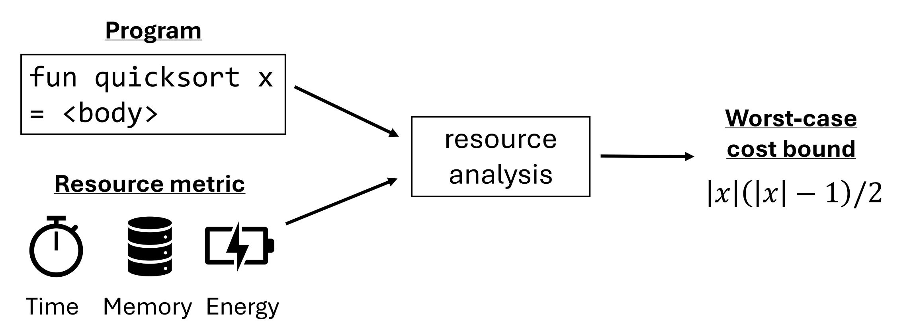

# Applications of Resource Analysis

1. Prevent algorithmic complexity attacks by inferring worst-case resource usage / inputs

2. Estimate job size for job scheduling in cloud computing

3. Infer tool used at Meta/Facebook

4. Worst-case execution time (WCET) for safety-critical embedded systems <https://github.com/facebook/infer>

# Existing Approaches to Resource Analysis

(Automatic) static analysis of the source code

- + Sound: any result is a valid bound
- Incomplete: cannot handle all programs

Data-driven analysis of runtime cost data

- + Always returns a result
- Only sound with respect to runtime cost data

Interactive analysis with proof assistants (e.g., Coq and Agda)

- + Sound and expressive cost bounds
- Not fully automatic

# Proposal: Hybrid Resource Analysis

Idea Integrate complementary analysis techniques to overcome their respective limitations

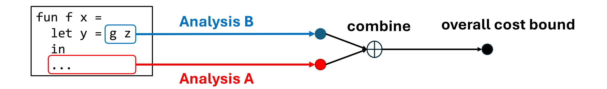

# Proposal: Hybrid Resource Analysis

Hybrid resource analysis covers a spectrum ranging from Analysis A to Analysis B

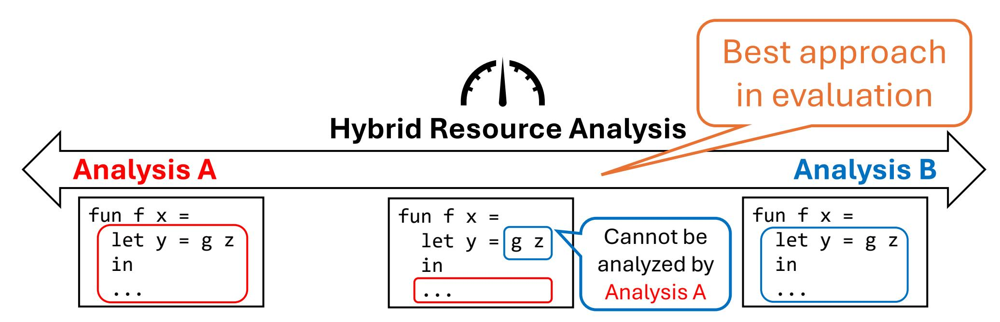

# Proposal: Hybrid Resource Analysis

## Benefit of hybrid analysis

Retains the strengths of analysis techniques while mitigating their respective weaknesses

- Analyze a larger class of programs
- Infer a larger class of symbolic cost bounds

## Thesis statement

Hybrid resource analysis enables the analysis of programs and inference of cost bounds that are beyond the reach of individual analysis techniques

# Structure of the Thesis

[1] Long Pham, Jan Hoffmann. Typable Fragments of Polynomial Automatic Amortized Resource Analysis. Published at CSL 2021

[2] Long Pham, Feras Saad, Jan Hoffmann. Robust Resource Bounds with Static Analysis and Bayesian Inference. Published at PLDI 2024

[3] Long Pham, Yue Niu, Nathan Glover, Feras Saad, Jan Hoffmann. Integrating Resource Analyses via Resource Decomposition. Under submission

### Static analysis

- Background on AARA (§2.1)
- Polynomial-time completeness of AARA (§2.2) [1]

### Data-driven analysis

- Bayesian data-driven analysis (§2.3) [2]
- Program-input generator inference (§2.7)

### Hybrid analysis

- Hybrid AARA (§2.4) [2]
- Resource decomposition (§2.5, 2.6) [3]

# Outline

❑Motivation and overview ❑Background on AARA ❑Contribution: Bayesian data-driven analysis ❑Contribution: Hybrid AARA ❑Contribution: resource decomposition ❑Proposed work: inference of program-input generator ❑Timeline and conclusion

# State of the Art in Static Analysis

Static analysis examines the source code, constructs constraints defining the worst-case behavior, and solves them

- Type systems (e.g., AARA by Hoffmann, Hofmann, Jost et al.)
- Recurrence relations (e.g., COSTA by Albert et al.)
- Ranking functions (e.g., AProVE and KoAT by Giesl et al.)

### Advantage

+ Soundness guarantee

### Disadvantages

- Incomplete due to the undecidability of resource analysis
- Rewriting a program is difficult for non-expert users

## Automatic Amortized Resource Analysis (AARA)

Input [1, 2, 3, 4] Output ([, ], [, ])

One unit of potential has been consumed

# Static Analysis: AARA

## Automatic Amortized Resource Analysis (AARA)

Input [1, 2, 3, 4] Output ([, ], [, ])

## Automatic Amortized Resource Analysis (AARA)

Input [1, 2, 3, 4] Output ([1, ], [, ])

The input list element is added to the output

## Automatic Amortized Resource Analysis (AARA)

Input [1, 2, 3, 4] Output ([1, 2], [3, 4])

## Resource-annotated typing judgment

partition: int × �� 2 (int) → (�� 1 int × �� 1 int) Input potential: 2 ⋅ �� Output potential: 1 ⋅ ��1 +1 ⋅ ��2

### 1. Assign variables

partition: int × �� �� (int) → (�� ��1 int × �� ��2 int)

### 2. Collect linear constraints

�� ≥ 1 + ��1 �� ≥ 1 + ��2 Input potential Output potential Cost

Sound: any cost bound inferred by AARA is a valid worst-case cost bound

Incomplete: there exists a polynomial-cost program that AARA cannot analyze because resource analysis is undecidable in general

### Why AARA for static analysis

+ Compositionality offered by types + Automatic bound inference by LP solving + Precise cost bounds by amortized analysis + Soundness guarantee

AARA can express polynomial cost bounds in general

# Outline

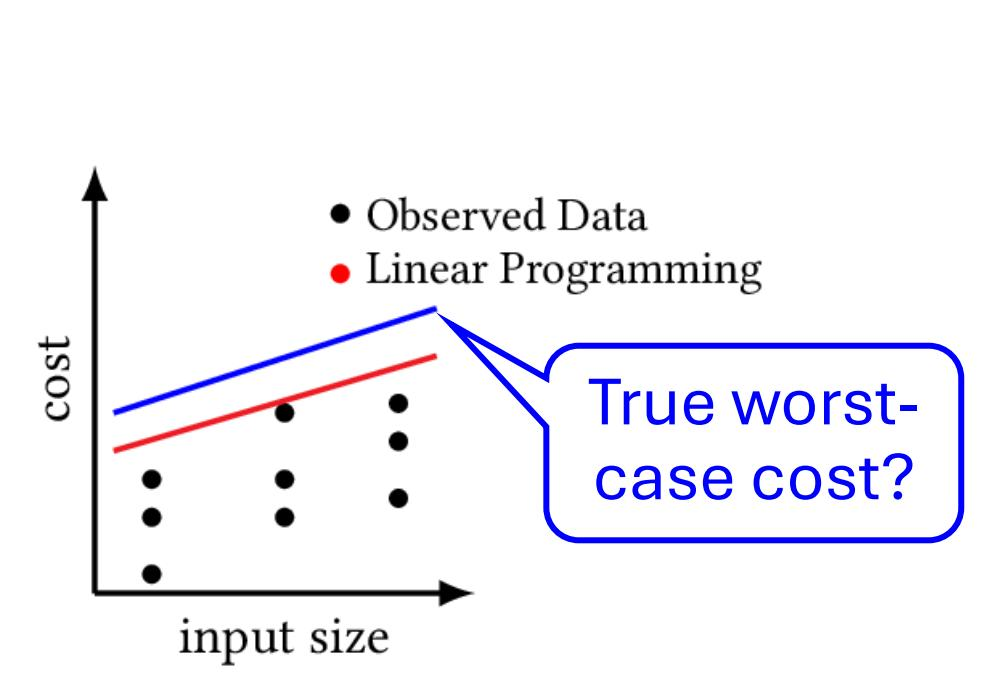

# Bayesian Data-Driven Analysis: Overview

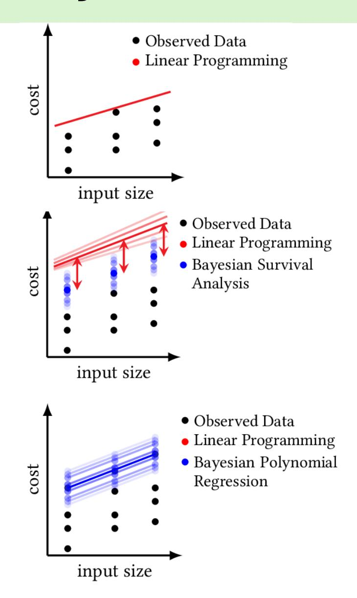

Previous: Optimization (Opt)

New: Bayesian inference of worst-case costs (BayesWC)

New: Bayesian inference of polynomial coefficients (BayesPC)

# Bayesian Data-Driven Analysis: BayesWC

## Bayesian inference of worst-case costs (BayesWC)

1. Define a probabilistic model ��(θ, ��

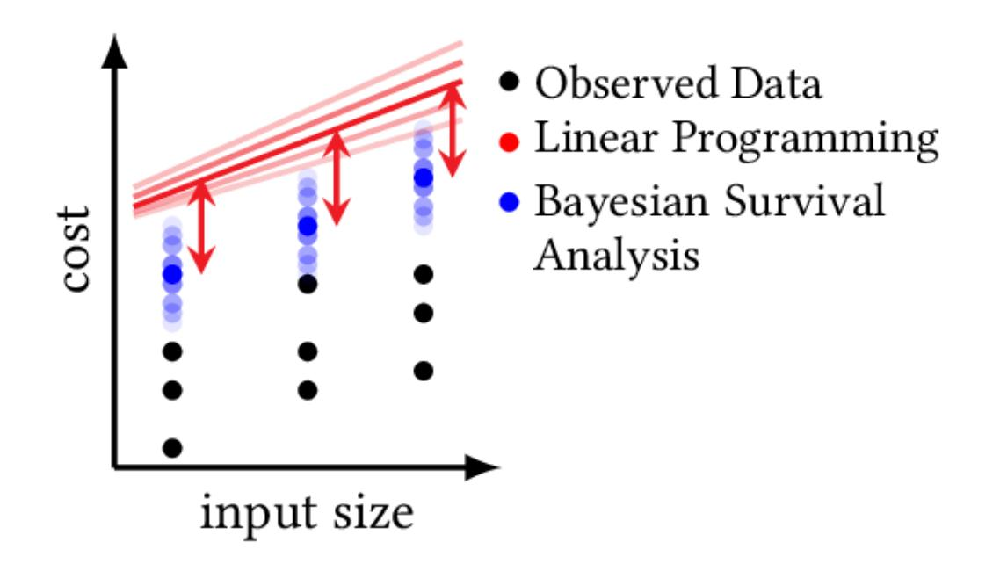

max

, ��)

�� max: hidden worst-case cost (blue dots)

��: observed cost (black dots)

2. Draw posterior samples of �� max

3. Optimize cost bound (red line)

Minimize red line − blue dots

Subject to red line ≥ blue dots

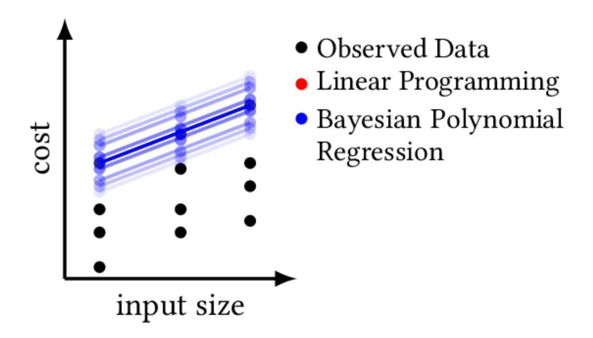

# Outline

# Hybrid Analysis: Goal and Challenge

## Goal

## Key challenge

Hybrid analysis needs an interface between:

- 1. Bayesian data-driven analysis draws samples
- 2. Static analysis solves constraints

How do we coherently combine constraints and posterior samples?

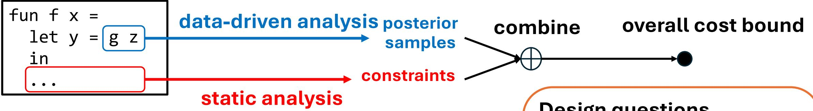

### Design questions

- 1. What is the format of inference results?
- 2. What information needs to be exchanged during inference?

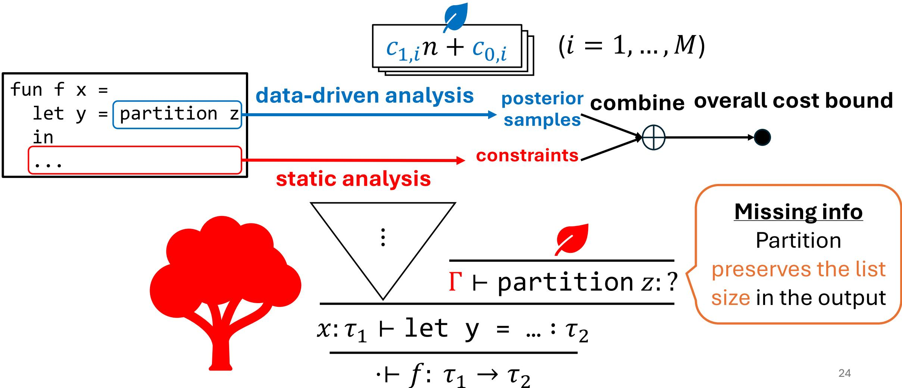

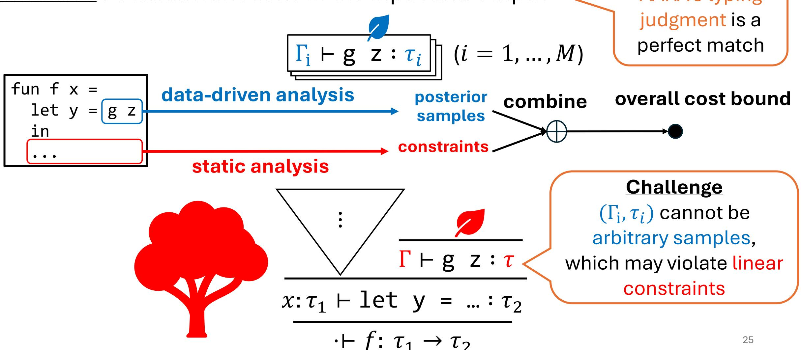

# Hybrid AARA: Contribution

## Hybrid AARA It integrates

- Bayesian data-driven analysis (BayesWC and BayesPC) and
- Automatic Amortized Resource Analysis (AARA)

by a novel interface between sampling algorithms and linear programming

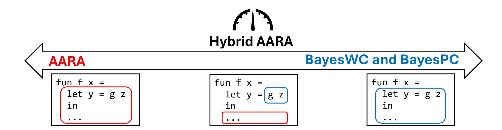

# Example Evaluation: Quicksort

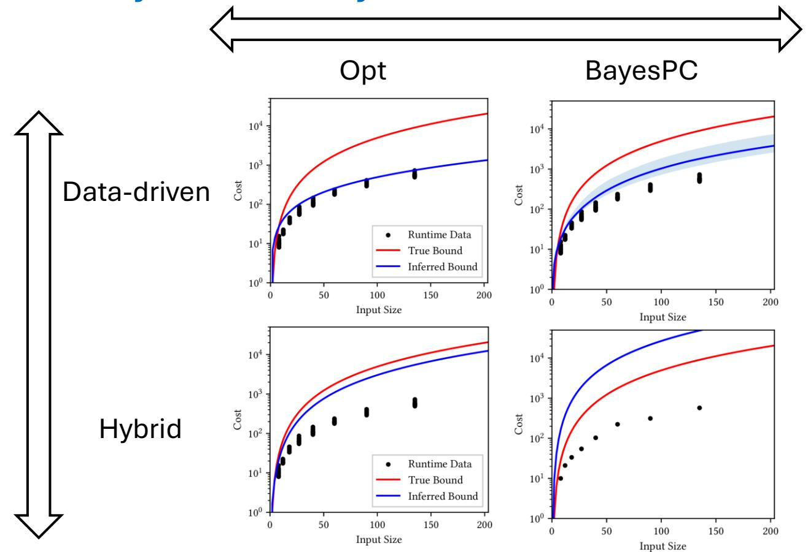

Resource metric: comparisons, each of which varies between 0.5 and 1.0

1. Bayesian analysis is more accurate than opt.

2. Hybrid analysis is more accurate than data-driven analysis

Static analysis is inapplicable to the partition function

# Outline

# Limitations of Hybrid AARA

Two limitations Analysis techniques combined by Hybrid AARA must infer

- Polynomial bounds
- Quantities of the same resource metric

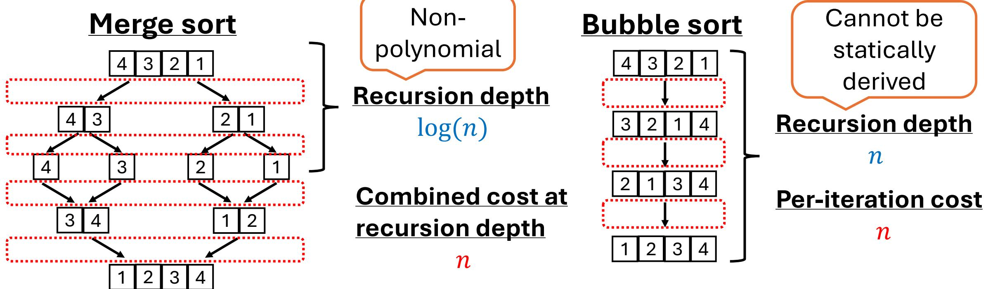

# Contribution: Resource Decomposition

Key idea Extend a program with an extra numeric non-negative variable to represent user-defined quantities (e.g., recursion depths and costs)

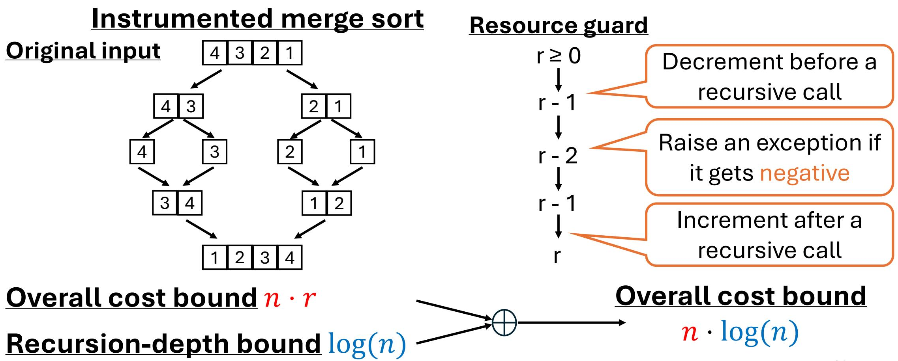

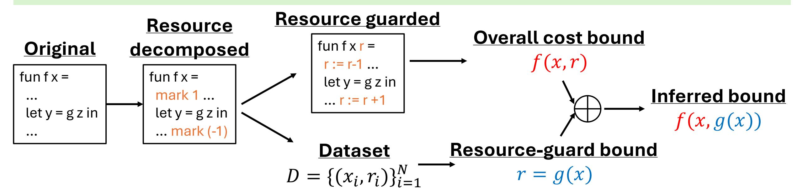

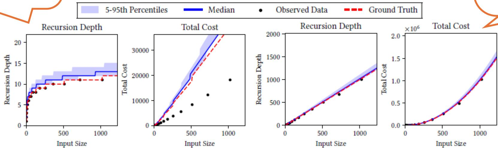

# Comparison between Hybrid Analyses

### Hybrid AARA

Interface: potential functions in the input and output

- + Precise cost bounds parametric in the input and output sizes
- Inflexible: only polynomial bounds of the same resource metric

## Resource decomposition

Interface: numeric non-negative variable

- + Flexible: r can represent any quantity with any symbolic bound
- Resource-guard bounds are only parametric in input sizes

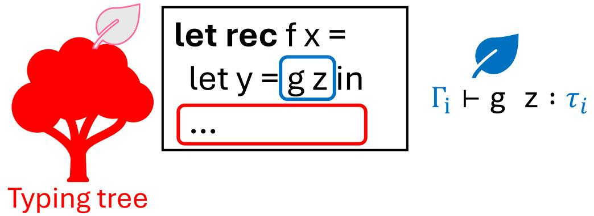

��(��, ��)

let rec f x r = let y = g z in … r:= r – 1 … �� = ��(��)

# Outline

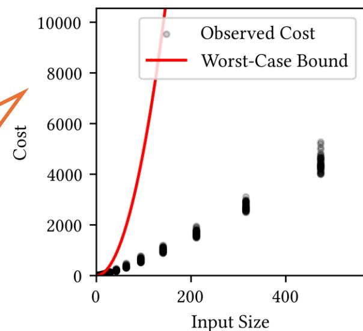

## Proposed Work: Program-Input Generator Inference

Proposal Statistically infer worst-case input generators as well as worstcase cost bounds

1. Statistical analysis

Infer an input generator ��

### 2. Cost measurement

Use �� to generate cost dataset ��

3. Statistical analysis

Infer a cost bound

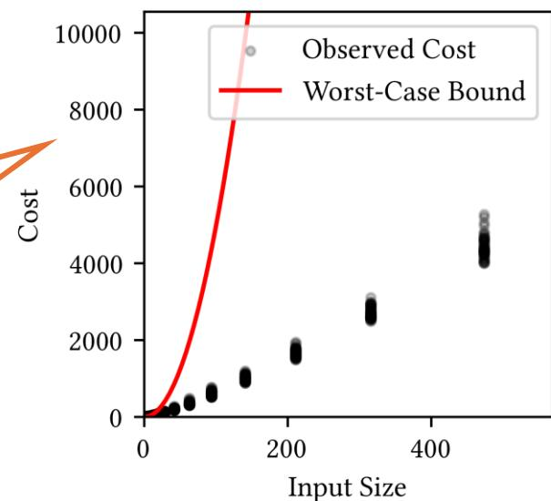

Quicksort Inputs are generated randomly

Solution

Use sorted lists to generate

cost measurements

Statistical analysis has control

# Program-Input Generator Inference: DSL

## DSL of program-input generators

- 1. Probabilistic generators
- The ability to generate all possible values (with some probability) is necessary for a statistical soundness guarantee of data-driven analysis
- More accurate characterization of a class of program inputs

## 2. Inductively defined by types

�� = unit + (int × ��)

let rec gL x = let e = gbool x in if e then gunit x else let v1 = gint x in let v2 = gL x in (v1, v2)

Generate a Boolean Generate the unit element Generate a head and tail

# Program-Input Generator Inference: Inference

## Challenge in generator inference

How do we score generators?

Optimization We can run fuzzing (e.g., based on genetic algorithms) over the space of generators to find a generator with the highest score

Bayesian inference We cannot have a probability distribution where generators with higher scores have higher densities

# Outline

# Timeline

## Fall 2024

- Submit the resource-decomposition paper to PLDI 2025

## Spring 2025

- Thesis proposal
- Complete the design of the DSL for generators and implement a prototype
- Resubmit the resource-decomposition paper (if necessary)
- Complete the speaking-skill requirement
- Complete a thesis draft

## Summer 2025

- Thesis defense

# Conclusion

1. Hybrid resource analysis integrates complementary analysis techniques to retain their strengths while mitigating their weaknesses

2. Two interfaces: resource-annotated types in Hybrid AARA and numeric

- program variables in resource decomposition
- 3. Proposed work: data-driven analysis for inferring worst-case programinput generators as well as worst-case cost bounds

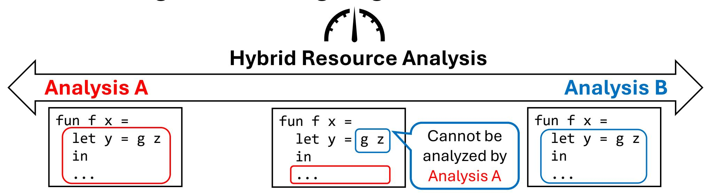

# Thank you

# Polynomial-time completeness of AARA

## Polynomial-time completeness

Typable fragment of AARA contains all polynomial-time functions

## Theorem 2.2

Given a polynomial-time Turing machine ��: ℕ → ℕ, there exists a functional program ��: ℕ → ℕ such that

- For every input �� ∈ ℕ, we have �� �� = ��(��)
- The cost of �� is equal to the cost of ��
- AARA can infer a polynomial cost bound of ��

## Key idea in the proof

Add an extra program variable to represent the known cost bound

This idea will be exploited in the design of hybrid resource analysis

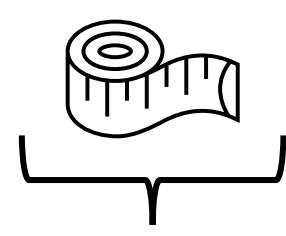

# Comparison: Resource Guards and Clocks

## Comparison

Usage: resource guards are for decomposing resource analysis, while clocks are for termination proofs. If termination checkers are strong enough, we may no longer need clocks.

Quantities: resource guards can be any quantity that can be defined as a high-water mark cost, while clocks are (at least in the calf paper) recursion depths.

## Summary

A clock is a special case of a resource guard for (i) a recursion depth and (ii) decomposing resource analysis into Agda and a termination proof.