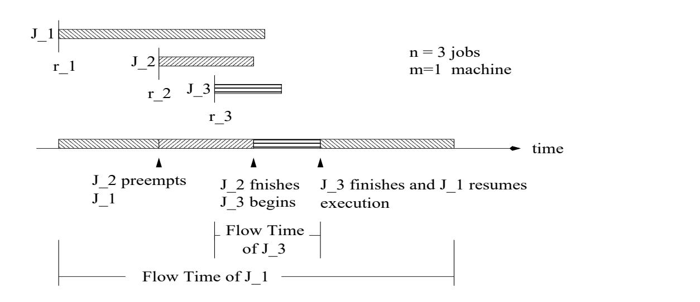

#### - "!# %\$'&' ()+* , .-/021354687

9':<;0=>:@?ACBED>FGBH?

### IKJ#LNMPORQTSM

UWVYX ZT[]\X ZT^N_[\baTc daEde\ fhgjik^Kflmlnc_^8_\aTc_deoTg^Pp"[Vq_rsZm^NlntTg[VTuvc ^Pg]fRX_^8lwX_dvpx[VT[pC[yP[VTu{zHdRi X [|px^e},~ZT^zmdRiX [|px^2d#f6do)[\X_ZT^X_[px^2[X_aE^PVmlT\tTVX_[g0[Xs\\^Nc_[]r^c_^8tT[|c ^Ppx^NVeX[]\px^XN}5w^ \X_tHlnxX_ZTc ^P^tTVmlTfpx^PVX fgEamc_deoTg|^Np"\P>#[|cs\X8eik^6rPdVm_[]ln^Pc%X_ZT^6aTc doTg^PpdhpC[VT[px[|yN[|VTui%^N[|ueZX_^Nl zHdRiX [|px^dVf_[VTug^p"frsZT[VT^e}3^u[^2X ZT^Hc \XX_c tTgdVTg[|Vm^bfhgudec_[|X_ZTpi[|X_Zf"VmdVn@X_c [|[]fhg rPdpxaE^X_[|X_[^6c fhX_[dm}5^NrPdVml0eik^\X_tmlnxdeVTg|[VT^fg|uedc [X ZTp">dc%px[|VT[px[|yN[|VmuX_Zm^6>VTdc p"\jdEzHdRi X [|px^xfhVml\X c_^PX rsZq\X_c ^XsrsZvdh deov[][|X \zmdRiX_[px^Cln[[lT^Nl{o[Xs\6_[yP^8 }6¡kdhX Z{X_Zm^N_^baTc doTg^Pp"\ fc_^Cfhg]\d)\X tmln[^Nl[|VX_ZT^CVTdVT¢rPgf[|c dRfhVX\^PXX_[VTu)iZT^Pc ^X ZT^x[yP^dh%fdo[]\VTdhX£VTdRiVvtTaEdV [|X \6fhc c_[Rfhg@}53^bu[^2fxu^NVT^Pcsfhg¤X ^NrsZTVT[]tT^X_dKc_^8lntmr^2fxVTdeVnWrg]fh[c_edRefhVXkaTc_deoTg^Pp¥X df{tm_tmfg|g _[pCamg|^Ncs brg]fh[c_edRefhVXaTc doTg^Pp}~ZT[csl >[\X_ZT^'dh¦"[|Vm^KaTc doTg^Pp§dhpx[VT[|px[yP[VTuvX ZT^X dhXsfhgjzHdRi X [|px^)dVqptTg|X_[aTg|^'p"frsZT[VT^N\N}w^)u[^Kf3¨6tHf_[¢aHdeg|VTdepx[fg5X_[px^)faTaTc dG©[p"fRX [|deVY\ rsZT^NpC^wf ª«/¬ faTaTc dG©n[|p"fRX [|deVqfhgudec_[|X_ZTpi[|X_Z®fc tTVTVm[|VTu3X_[px^¯0°5±² ³ ´Tµh¶ bdcxf3rPdVm\X fVeXxVtTpboE^Pcxd p"fersZT[|Vm^N\N}>~Zm^6aTc ^P[dtm\,oH^8\X£VTdRiV'faTaTc dG©n[|p"fRX [|deVxc_^8\tTg|Xkdc%X_ZT^aTc doTg`^Ppif\kfhV)·xg|deu,¯¸ faTaTc dG©n[|p"fRX [|deV0iZT^Pc ^¯3[]\kX_Zm^2VtmpboE^PcdhEdoH\2¹ºe»nmºR¼¢}

UWV'X_Zm[\aTc daEde\ fhg¤ik^lT^N\ rc [|oE^dtTcikdc £CdeVKX ZT^2fhoEdR^px^PVX_[dVT^8lKamc_deoTg|^Np"\P}5½lmln[X [|deVmfhgg ik^rPdVm_[lT^Pc'_dpx^vdX_ZT^NcKaTc domg|^Npx\KiZT[]rsZ0iZT[g|^3[|VX_^Nc_^8\X [|VmuqoX ZT^Pp"_^Pg^N\Nfhg]_d\^Nc_e^X_d [gg|tm\X_csfRX ^X_ZT^2faTaTg[rNfhoT[g|[|XKddetTcX_^8rsZTVT[]etm^N\N}

### ¾ ¿0ÀxÁ#Â5ÃÄvÅÆkÁ5ÇÃÀ

ȤÉNÊ ËhÌ0Í0ÎÏÐ ÑÒÉRÓnÐÕÔ>ËÌ ËhÖPÉG×PÏØÔ>ËhÌÙÓnÖ3ÓnÎÎØÚEÉRÓÛÏÐ ÑÒ×ËhÖÚTÍ ×NÉGËhÖÚeÜnËR×3ÛÏÝvËnÞßbÊ Ëq×ËhÖÚTÍ0×PÉGËhÖÓ×ËàÝ{Ú¤Ì ËhÎØËhÌ ÓnÖÝÓnÉPÊ0ÏÐ0ËhÖvÓnÐ0ÌÙÛÊ Ë×ËháHÍ0ËhÖÛ{â<Ún×3×ËhÖÚTÍ ×NÉGËhÖvÓ×ËÝ{Ú¤Ì ËhÎØËhÌÕÓnÖxãÚnÔ¸Ö{äbÏØÛÊÙÓ/ÖËR×ܤÏÉGËå×ËháEÍ0ÏØ×ËhÝ{ËhÐHÛRÞ æxÏØÜnËhÐqÛÊ0ÏÖÔ0×ÚTÓnÌåÌ ËGç#Ð0ÏØÛÏØÚTÐ5è¤ÖÉNÊ ËhÌ0Í0ÎÏÐ Ñ)ʸÓnÖÔ#ËRËhÐåÖÛÍ0Ì0ÏØËhÌYÏÐYÜÓ×PÏØÚTÍ0Ö2ÖPÉGËhÐ0Ó×PÏØÚTÖ2Ö͸ÉPÊåÓnÖ2é0×NÓnÉGÛÏÉRÓnÎ ÉGÚTÝ{é¸Í0ÛËR×3Öê¤ÖÛËhÝvÖRèé0×Ú¤Ì0Í0ÉGÛÏÚTÐëé¸ÎÓnÐ0Ð0ÏÐ ÑàÏÐÙâ@ÓnÉGÛÚn×NÏØËhÖRè2ÎØÚTÓnÌÙÔ¸ÓnÎÓnÐ0ÉRÏÐ ÑÓnÐ0ÌÕÖÚÚTÐ5ÞȤÉPÊ Ëh̸Í0ÎÏÐ Ñ é0×ÚnÔÎØËhÝvÖbÉGÚTиÖÛÏØÛÍ ÛËÓYÖÍ Ô¸ÖÛÓnÐHÛÏÓnÎ,é¸Ó×ÛCÚnâÚné0ÛÏÝvÏìhÓÛÏØÚTÐ5è>ÓnÐ0ÌíʸÓhÜnËÔ>ËRËhÐíÖÛ͸Ì0ÏØËhÌíÔHêå×ËhÖËhÓ×PÉPÊ ËR×NÖ ÏÐYÜÓ×PÏØÚTÍ0Ö2ÉGÚTÝÝ'Í0иÏØÛÏØËhÖÖ͸ÉPÊqÓnÖ2Úné>ËR×PÓÛÏÚTÐ0Ö2×ËhÖËhÓ×NÉPÊ5è¸ÓnÎÑnÚn×PÏØÛÊ0ÝvÖbÓnÐ0ÌåáHÍ0ËhÍ ËhÏÐ Ñ{ÛÊ ËRÚn×PênÞ

îÎØÑnÚn×PÏØÛʸÝvÖâ@Ún×)ÖPÉPÊ ËhÌ0͸ÎÏÐ ÑqÊ0ÓÜnËYÔ#ËRËhÐÖÛÍ0Ì0ÏËhÌ/ÖÏиÉGËvÛÊ Ë3ç¸â<ÛÏËhÖRèkÓnиÌÛÊ ËhÏØ×ÖÛÍ0Ì0ê®Ê¸ÓnÖ'ÎØËhÌ/ÛÚ ÜÓ×PÏØÚTÍ0ÖÏÌ ËhÓnÖÓnÐ0ÌÒéÓ×PÓnÌ0ÏØÑTÝvÖ"ÏÐÒÛÊ Ëç¸ËhÎÌÚnâÓnÎÑnÚn×PÏØÛÊ0ÝvÖhÞvï Ún×'ËGð ÓnÝ{é¸ÎËnèjÛÊ ËvËhÓ×PÎÏØËhÖÛÚTÐ0ÎÏÐ Ë{ÓnÐ0Ì Óé0é0×PÚhð ÏÝvÓÛÏØÚTÐYÓnÎØÑnÚn×PÏÛÊ0ÝvÖñ¤Ð ÚäbÐYäËR×Ë"â@Ún×2ÛÊ Ë"é0×ÚnÔÎØËhݧÚnâ%ÝvÓñnËhÖéÓnÐqÝvÏÐ0ÏÝvÏØìhÓÛÏØÚTÐ3ÚTÐåÝ'͸ÎØÛÏØé¸ÎØË ÝvÓnÉNÊ0ÏÐ ËhÖRÞ îÑTÓnÏÐ5èÌ0Í ËYÛÚ/ÏØÛÖäbÏÌ ËåÖÉGÚné>ËnèÖÉNÊ ËhÌ0Í0ÎÏÐ Ñàé0×ÚnÔ¸ÎØËhÝÖ)ʸÓhÜnËqÔ>ËRËhÐÙÖÛÍ0̸ÏØËhÌëÏÐëÜÓ×NÏØÚTÍ0Ö Ý{Ú¤Ì ËhÎÖÖÍ0ÉNÊòÊ0ÓnÖ{ÖÏÐ ÑTÎØËYÝvÓnÉPÊ0ÏÐ Ënè6Ý)Í0ÎØÛÏØéÎØË3ÝvÓnÉNÊ0ÏÐ Ënèó¸ÚäôÖÊ Úné¸ÖRè5ãsÚnÔòÖÊ0Úné¸ÖRèÚné>ËhÐÙÖÊ ÚnéÖRè>ãÚnÔ¸Ö äbÏØÛÊëÌ ËRé>ËhÐ0Ì0ËhÐ0ÉRÏØËhÖ)ÓnÐ0Ìëé0×ËhÉGËhÌ ËhиÉGËYÉGÚTиÖÛ×PÓnÏÐHÛÖ{ÓnÐ0Ìëâ@Ún×{ÜÓ×PÏÚTÍ0ÖÝ{ËhÓnÖÍ ×ËhÖ{ÖPÍ0ÉPÊëÓnÖvÉGÚTÝ{éÎØËRÛÏØÚTÐ ÛÏÝ{Ënè0ÝÓñnËhÖé¸ÓnÐ5è óÚäõÛÏÝ{Ënè ÛÊ ËhÏØ×2äËhÏØÑTÊHÛËhÌqÜnËR×PÖÏÚTÐ0Ö2ËRÛÉÞ

öÐÕÛÊ0ËàÎÓnÖÛ3ÛËhÐ÷ênËhÓ×PÖYÚn×åÖÚ èbÓÝvÓeãÚn×Yâ<Ú¤ÉRÍ0ÖYÊ0ÓnÖ3Ô#ËRËhÐøÚTÐÓnÎØÑnÚn×PÏØÛʸÝvÖâ@Ún×åÝvÏÐ0ÏÝvÏØìhÏÐ Ñàó¸Úeä ÛÏÝ{ËnÞvßbÊ Ëó¸ÚäùÛÏÝ{Ë{Únâ2Ó'ãsÚnÔÏÖÌ ËGçÐ0ËhÌÒÓnÖ"ÛÊ ËvÛÏÝvËvÖé>ËhÐ0ÌàÔHê®Ó)ãÚnÔ/Í0ÐHÛÏÎÏØÛ"Ý{ËRËRÛÖKÏÛÖÖËR×ܤÏÉGË ×ËháEÍ0ÏØ×ËhÝvËhÐmÛRÞïÎØÚäøÛÏÝ{ËCÉRÎØÚTÖËhÎØê×ËhÎÓÛËhÖ6ÛÚKÛÊ0ËÍ0ÖËR×6ËGðEé>ËR×PÏËhÐ0ÉGËbÓnÖÏÛÝ{ËhÓnÖÍ ×PËhÖÛÊ ËCÓnÝ{ÚTÍ0ÐHÛ6Ó'Í0ÖËR×

Ê0ÓnÖÛÚKäÓnÏØÛÛÚKÑnËRÛ6Ê0ÏÖ¸ãÚnÔ¸ÖÖËR×PÜEÏÉGËhÌjÞ öÐ0Ì ËRËhÌ)óÚäòÛÏÝvËÊ0ÓnÖÔ>ËRËhÐ{ÉGÚTÐ0ÖÏÌ0ËR×ËhÌ{äbÏÌ0ËhÎØêKÏÐÛÊ ËÉGÚTÐHÛËGð¤Û Únâ>Úné>ËR×PÓÛÏÐ ÑKÖêEÖÛËhÝÖRèmäËRÔ3ÖËR×PÜnËR×PÖRè¤áHÍ ËR×Pê'ÛÏÝvËbÏÐvÌ0ÓÛÓÔÓnÖËhÖRèEé0×ÚܤÏÌ0ÏÐ ÑxÍ0ÓnÎÏØÛ_ê'Únâ,ÈEËR×PÜEÏÉGË-CÚHÈ ÑTÍ0Ó×PÓnÐHÛËRËhÖbÏÐwÐ0ËRÛäÚn×ñEÖ2ÓnиÌåÖÚ{ÚTÐ5Þ öÐ3ÛʸÏÖÛÊ ËhÖÏÖäË"ÖÛÍ0Ì êwÖÚTÝ{Ëxâ@͸Ð0Ì0ÓnÝ{ËhÐHÛÓnÎ>é0×ÚnÔ¸ÎËhÝvÖ×PËhÎÓÛËhÌ ÛÚÝvÏÐ0ÏÝvÏØìhÏÐ Ñó¸Úeä¥ÛÏÝ{ËÓnиÌqÏØÛÖ2ÜÓ×PÏÓnÐHÛÖRÞÒËKÔ>ËRÑTÏÐYÔEêYÌ ËhÖÉG×PÏØÔÏÐ Ñ)ÛÊ ËKÝ{Ú¤Ì ËhÎ>â@Ún×PÝvÓnÎÎØênÞ

### !"#\$

îÐíÏиÖÛÓnÐ0ÉGË)ÚnâÓ3ÖÉNÊ ËhÌ0Í0ÎÏÐ Ñvé0×PÚnÔ¸ÎØËhÝ ÉGÚTиÖÏÖÛÖÚnâÓwÉGÚTÎÎØËhÉGÛÏØÚTÐíÚnâ>ãÚnÔ¸ÖbäÊ0ÏÉPÊàÓ××PÏÜnË'Ì ê¤Ð0ÓnÝvÏÉRÓnÎÎØê ÚÜnËR×ÛÏÝ{ËnÞßÊ0Ë"ÛÏÝ{ËxäbÊ ËhÐåÓãÚnÔ&%('"Ó××NÏØÜnËhÖÏÖ2ÏØÛÖ×PËhÎØËhÓnÖË"ÛÏÝ{Ë"ÓnÐ0ÌÌ ËhÐ ÚnÛËhÌåÔEê)*'TÞ+ÓnÉNÊãÚnÔqÊ0ÓnÖ ÓåÖËR×ܤÏÉGË×ËháEÍ0ÏØ×ËhÝvËhÐmÛRè5ÓnÎÖÚYñ¤Ð ÚäÐÒÓnÖÏØÛÖxÖÏØìRË{ÓnÐ0ÌÒÏÖxÌ ËhÐ0ÚnÛËhÌÒÔHê,' Þ öЮÛÊ ËÛ_êHé¸ÏÉRÓnÎÖÉPÊ Ëh̸Í0ÎÏÐ Ñ Ý{Ú¤Ì ËhÎWèTÏØÛÏÖÓnÖÖPÍ0Ý{ËhÌ)ÛÊ0ÓÛ,-'Ô>ËhÉGÚTÝ{ËhÖñ¤Ð ÚeäbÐÛÚ"ÛÊ ËÖÉNÊ ËhÌ0Í0ÎÏÐ ÑÓnÎØÑnÚn×NÏØÛÊ0ÝäbÊ ËhÐ.%('2Ó×P×PÏØÜnËhÖ0/RÞßÊ Ë ÐEÍ0ÝKÔ>ËR×ÚnâãÚnÔ¸ÖbÏÖÓnÎØäÓhê¤ÖÌ ËhÐ0ÚnÛËhÌqÔEê.1èÓnÐ0ÌqÛÊ Ë'ÐHÍ0Ý'Ô>ËR×ÚnâÝvÓnÉNÊ0ÏÐ ËhÖÏÖbÓnÎØäÓhê¤Ö32ÒÞ î ÖÉPÊ0ËhÌ0Í0ÎØË â@Ún×Óé¸×ÚnÔ¸ÎØËhÝ-ÏÐ0ÖÛÓnиÉGËÖé>ËhÉRÏØËhÖkâ@Ún×ËhÓnÉPÊãÚnÔ{ÜÓ×NÏØÚTÍ0ÖÏÐHÛËR×ÜÓnÎÖ,ÚnâÛÏÝ{ËäbÊ ËR×ËÏØÛÏÖkËGðEËhÉRÍ0ÛËhÌ5ÞïkÏÑTÍ ×Ë ú ÖÊ ÚäÖ'Óíé>ÚTÖÖÏØÔ¸ÎËvÖÉPÊ Ëh̸Í0ÎØËâ@Ún×1!465ãÚnÔ¸Ö)ÓnÐ0Ì7284 ú ÝvÓnÉPʸÏÐ ËnÞ î ÖÉPÊ Ëh̸Í0ÎÏÐ ÑqÓnÎÑnÚn×PÏØÛÊ0Ý ÏÖ Óåé0×PÚEÉGËhÌ0Í0×Ë{ÛÚÉGÚTÐ0ÖÛ×NÍ0ÉGÛKÓqÖÉNÊ ËhÌ0Í0ÎË{â<×ÚTÝ ÓnÐ/ÏÐ éÍ Û"ÏÐ0ÖÛÓnÐ0ÉGËnÞ3ï Ún×'ËGð ÓnÝ{é¸ÎËnè%ÖÚTÝ{Ëä6ËhÎÎñ¤Ð ÚeäbÐ ÖÉNÊ ËhÌ0Í0ÎÏÐ Ñ)ÓnÎÑnÚn×PÏØÛÊ0ÝvÖbÓ×Ë:9

ú Þ<;bÚTÍ0Ð0Ì=;ÚnÔÏÐ>-?;@;A9 îÛÓnÐHêÛÏÝ{Ënè ÖʸÓ×ËÛÊ0ËCé¸×ÚEÉGËhÖPÖÚn×2ËháH͸ÓnÎÎØêvÓnÝ{ÚTÐ Ñ{ÓnÎÎ#ÛÊ Ë6ãÚnÔ¸Öé0×ËhÖËhÐHÛ ÓÛbÛÊ0ÓÛÛÏÝ{ËnÞ B ÞCÈ Ê Ún×ÛËhÖÛ<CTÚnÔïÏØ×PÖÛD-ÈECmï9 îÛbÓnÐmêwÛÏÝ{Ënè¸ä6Ún×ñwÚTÐåÛÊ ËãÚnÔqäbʸÏÉPÊåÊ0ÓnÖÛÊ0ËKÖÊ Ún×ÛËhÖÛÖÏØìRË-F,HGNÞ 5EÞCÈ Ê Ún×ÛËhÖÛI;ËhÝvÓnÏÐ0ÏÐ ÑßbÏÝ{Ë3ïÏØ×NÖÛ.-ÈJ;@Kß@9 îÛ{ÓnÐmêÛÏÝ{Ënèä6Ún×ñ/ÚTÐÛÊ0ËãÚnÔäÊ0ÏÉPÊÊ0ÓnÖ)ÛÊ Ë ÎËhÓnÖÛ×ËhÝvÓnÏÐ0ÏÐ Ñ)é0×Ú¤ÉGËhÖÖÏÐ0Ñ{×ËháH͸ÏØ×ËhÝ{ËhÐHÛ2ÓÛÛÊ0ÓÛÛÏÝvËnÞ L ÞCÈ Ê Ún×ÛËhÖÛ+ÎÓéÖËhÌíßbÏÝ{Ë'ïÏØ×NÖÛ-ÈJ+6ßï9 îÛ"ÓnÐHêqÛÏÝ{Ënè#äÚn×ñqÚTÐàÛÊ ËbãsÚnÔàäbÊ0ÏÉNÊíʸÓnÖ×PËhÉGËhÏØÜnËhÌ ÛÊ0ËKÎØËhÓnÖÛÓnÝ{ÚT͸ÐmÛÚnâÖËR×PÜEÏÉGËÓÛbÛÊ0ÓÛÛÏÝ{ËnÞ

### MNOMHN?M PRQSUTWVX(Y[ZT>\^]`_aV:XbY[cd_ae

æxÏØÜnËhÐYÓÖÉNÊ ËhÌ0Í0ÎØËnèEÛÊ ËxÉGÚTÝ{é¸ÎØËRÛÏÚTÐ3ÛÏÝ{ËAfg'Câ@Ún×ÓbãÚnÔåÏÖÛÊ0ËCÛÏÝ{ËÓÛäbÊ0ÏÉPÊwÏØÛÉGÚTÝvé¸ÎØËRÛËhÖ2ÏØÛÖÖËR×ܤÏÉGË ×ËháEÍ0ÏØ×ËhÝvËhÐmÛRÞÕßbÊ Ëåó¸Úeä ÛÏÝ{Ëihj'qÚnâ"ÓwãsÚnÔ÷ÏÖÛÏÝ{ËíÓwãsÚnÔ÷Öé>ËhÐ0Ì0Ö{ÏÐëÛÊ0ËÖê¤ÖÛËhÝåÞÏWÞ ËnÞÕÏØÛÏÖ{ÛÊ Ë Ì0Ïlk>ËR×ËhÐ0ÉGË{Ô>ËRÛ_ä6ËRËhÐÛÊ ËÉGÚTÝ{éÎØËRÛÏØÚTÐÒÛÏÝvËÓnÐ0ÌÒÛÊ Ë×ËhÎØËhÓnÖËvÛÏÝ{Ëm-Ohj'4nfg'op)*'bNÞ3ïÏØÑTÍ ×Ë ú ÖÊ ÚeäbÖ ÛÊ ËCó¸ÚeäÛÏÝ{ËhÖÚnâ ãÚnÔ¸Ö@%/ ÓnÐ0Ìm%#qÞ öÛ2ÏÖÓ)â@ÚTÎØñEÎÚn×ËI-¢ÓnиÌYËhÓnÖê3ÛÚé0×PÚÜnË(6×ËhÖ͸ÎØÛ6ÛʸÓÛ2ÛÊ Ë"ÖÉPÊ Ëh̸Í0ÎÏÐ Ñ ÓnÎØÑnÚn×PÏÛÊ0Ý ÈJ;<K6ߥÏÖÚné0ÛÏÝvÓnÎ>â<Ún×CÝvÏÐ0ÏÝvÏØìhÏÐ ÑKÛÚnÛÓnÎ5ó¸ÚeäõÛÏÝ{Ë"ÚTÐÓvÖÏÐ ÑTÎËxÝÓnÉPÊ0ÏÐ0ËnÞ

îÐ ÚnÛÊ ËR×)Ý{ËhÓnÖÍ ×ËvÉRÎÚTÖËhÎØêà×ËhÎÓÛËhÌÛÚqó¸Úä ÛÏÝ{ËvÏÖIr0s?tguvsw0xmÞqæxÏØÜnËhÐ/ÓqÖÉPÊ0ËhÌ0Í0ÎØËnè%ÛÊ ËvÖÛ×ËRÛÉNÊzy{' ÚnâÓ"ãsÚnÔ®ÏÖÛÊ ËK×PÓÛÏÚ3ÚnâÏØÛÖbó¸Úeä-ÛÏÝ{Ë'ÓnÐ0ÌàÏØÛÖÖÏØìRËÏWÞ ËnÞ@y{'D4|hj'(}~,-'nÞ"ÈEÛ×ËRÛÉPÊ®ÉRÓnÐíÔ>ËKÛÊ ÚTÍ ÑTÊHÛCÚnâÓnÖ t{R(ubó¸ÚäÕÛÏÝ{ËnèHÓnиÌ×ËhÎÓÛËhÖÛÊ0ËäÓnÏÛÏÐ ÑxÛÏÝ{Ë2Únâ>ÛÊ Ëb͸ÖËR×PÖÛÚÛÊ ËhÏ×Ì ËhÝvÓnÐ0̸ÖRÞ öÐé¸Ó×ÛÏÉRÍ0ÎÓ×hè ÏØÛ)Ý{ÚEÌ0ËhÎÖKÛÊ0Ë3â¢ÓnÉGÛÛÊ0ÓÛ)͸ÖËR×PÖ)Ó×Ëw͸ÖÍ0ÓnÎÎØê®äbÏÎÎÏÐ ÑYÛÚ®äÓnÏØÛ)ÎÚTÐ ÑnËR×'â@Ún×{ÎÓ×ÑnËKãsÚnÔÖ'ÓnÖ)Úné0é>ÚTÖËhÌÛÚ ÖÊ Ún×PÛ0ãÚnÔ¸ÖRÞ öÛÏÖkÍ0Ð ñ¤Ð ÚeäbÐKäÊ ËRÛÊ ËR×ÝvÏÐ0ÏÝvÏØìhÏÐ Ñ2ÛÊ0ËÛÚnÛÓnÎ ÖÛ×ËRÛÉPÊÚTÐ{ÓxÖÏÐ0ÑTÎØË6ÝvÓnÉNÊ0ÏÐ ËÏÖAK CÓ×PÌ5Þ;ËhÉGËhÐHÛÎØêåÏØÛ2äÓnÖbÖÊ0ÚäbÐÛÊ0ÓÛÛÊ ËKÓnÎÑnÚn×PÏØÛÊ0Ý ÈJ;@KߥÏÖ B ÉGÚTÝ{é>ËRÛÏØÛÏØÜnË"â@Ún×ÝÏÐ0ÏÝvÏìhÏÐ ÑKÛÚnÛÓnÎ%ÖÛ×ËRÛÉNÊ ÚTÐqÓvÖPÏÐ ÑTÎØË"ÝvÓnÉNÊ0ÏÐ Ë5 Bb Þ

W~gd ¢¡{£(¤OF¥U¦(§¨¡v¥U¢W¦(`©vª«§3¢¬A:®(£b¯v£b¡g£¡3¦b¤O "¦(g¥(®(°£(±A~±{¡*¦(§³²´ {´©vª¢§3~£b¤ ®b£(¯v£b¡g£@¡¦b¤O ¦bg¥U®b®b£jJµ~ª§¨¢¤¤¤O¶v° g·j®b¢§¨¢£j~£¥@¸b£b¤O¦b¢¤"¹(¢®(¡{£º

ïkÏÑTÍ ×Ë ú 9 îÐåËGð ÓnÝ{é¸ÎØË"ÚnâÓvÖÉNÊ ËhÌ0Í0ÎË

# MNOMHN bTWT "!^X(Yc_

î ÖÉNÊ ËhÌ0Í0ÎØËÏÖÐ ÚTÐEé0×ËRËhÝ{é0ÛÏÜnËbÏØâ5ÓãÚnÔwÉRÓnиÐ ÚnÛÔ>ËÏÐmÛËR××NÍ é0ÛËhÌ{ÚTÐ0ÉGËxÏØÛÏÖÖÛÓ×ÛËhÌjÞ öÐ3Óé0×ËRËhÝvé0ÛÏØÜnË ÖÉNÊ ËhÌ0Í0ÎØËCÓãÚnÔwÉRÓnÐwÔ>ËÏÐmÛËR××NÍ é0ÛËhÌvÓ×ÔÏØÛ×PÓ×PÏÎê)ÓnÐ0Ì3ÛÊ ËËGðEËhÉRÍ ÛÏÚTÐwÉRÓnÐ3Ô>Ëb×ËhÖPÍ0Ý{ËhÌ3â<×ÚTÝùÛÊ ËCé#ÚTÏÐmÛ ÚnâÏÐHÛËR××PÍ é0ÛÏÚTÐ3äÏØÛÊ ÚTÍ Û2ÓnÐHêwé>ËhÐ0ÓnÎÛê>-@â@Ún×bËGð ÓnÝ{é¸ÎËÏÐåïÏØÑTÍ ×Ë ú è0ÛÊ0ËãsÚnÔ %\$#xé0×ËRËhÝ{é0ÛÖA%/ NÞ

%ËhÏÐ Ñ"Í0иÓÔ¸ÎØËÛÚxé0×PËRËhÝ{é0Ûké¸ÎÓnÉGËhÖÓxÖËR×PÏØÚTÍ0Ö%×ËhÖÛ×NÏÉGÛÏØÚTÐ)ÚTÐ)ÛÊ Ë2áHÍ0ÓnÎÏØÛêÚnâÖÉPÊ Ëh̸Í0ÎØËhÖkäbÏØÛÊ'×ËhÖé>ËhÉGÛ ÛÚÛÊ ËóÚäÕÛÏÝ{Ë2ÓnÐ0ÌvÖÛ×ËRÛÉNÊÝ{ËRÛ×NÏÉRÖRèmÓnÐ0ÌÊ ËhÐ0ÉGËÍ0Ö͸ÓnÎÎØê"ó¸ÚeäòÛÏÝ{ËÓnиÌvÖÛ×ËRÛÉNÊv×ËhÎÓÛËhÌvÚnÔ¤ãsËhÉGÛÏÜnËhÖ â¢Í0Ð0ÉGÛÏØÚTÐ0Ö)Ó×ËqÖÛ͸Ì0ÏØËhÌÏÐÛÊ ËYé0×ËRËhÝ{é0ÛÏÜnËwÝ{Ú¤Ì ËhÎWÞ öÐÛÊ ËYÛÊ ËhÖÏÖhèä6ËYâ@ÚEÉR͸ÖÚTÐ0ÎØêÚTÐé0×ËRËhÝvé0ÛÏØÜnË ÖÉNÊ ËhÌ0Í0ÎÏÐ Ñ Þ ÚnÛËvÛÊ0ÓÛÓnÎÎÛÊ0ËvÓnÎØÑnÚn×PÏØÛÊ0ÝÖ"Ý{ËhÐmÛÏÚTÐ ËhÌÒÓÔ>ÚÜnËm-¢ÏWÞ ËnÞ;@;è%ÈECmï6è,ÈJ;@Kß ÓnÐ0Ì/ÈE+ßï Ó×Ëé¸×ËRËhÝ{é0ÛÏØÜnËnÞ

# MNOMHN'& (icd_*),+.-0/HY0(Zc213/_dX54V76^T98]:-?Y?_:;</H_:8>=T-evc]:bVT@?.]:;3TJ_dXA/EX(Yc_

öÐ/ÝvÓnÐHêÒé0×PÓnÉGÛÏÉRÓnÎ6Öê¤ÖÛËhÝvÖRèÖÍ0ÉNÊ/ÓnÖ)ÏÐÒÚné>ËR×PÓÛÏÐ0ÑÖê¤ÖÛËhÝvÖRèÓé0×PÏÚn×PÏÏÐ â@Ún×PÝvÓÛÏÚTÐÓÔ>ÚTÍ ÛÛÊ ËwÖÏØìRË ÚnâbÓãÚnÔëÝÏØÑTÊmÛ'Ô>ËwÊ0Ó×NÌ/Ún×{ÏÝ{é>ÚTÖÖPÏØÔ¸ÎØË{ÛÚ®ÚnÔ0ÛÓnÏÐjÞCBíÚnÛÏØÜÓÛËhÌëÔHêÛʸÏÖ'ÖPÉGËhÐ0Ó×PÏØÚ èDBíÚnÛäÓnÐ0ÏËRÛ{ÓnÎ 5 ú0 ÏÐHÛ×Ú¤Ì0Í0ÉGËhÌvÛÊ0Ë dFE wj[tHGJI s5ÖÉPÊ0ËhÌ0Í0ÎÏÐ0ÑKÝ{Ú¤Ì ËhÎWÞbËR×PËnèãsÚnÔ¸ÖÓ××PÏÜnËÚeÜnËR×ÛÏÝ{ËxÓnÐ0ÌwÛÊ ËxÖÏØìRË ÚnâÓãsÚnÔ®ÏÖCÍ0Ð ñ¤Ð ÚäÐqÛÚwÛÊ Ë)ÖPÉPÊ ËhÌ0͸ÎØËR×Í0ÐHÛÏÎ,ÛÊ ËãÚnÔíçÐ0ÏÖÊ0ËhÖRÞ î Ð ÚTÐJÉRÎÓnÏØ×ÜnÚêTÓnÐHÛ"ÓnÎØÑnÚn×PÏØÛʸÝ ÛÊEÍ0Ö ÖÉNÊ ËhÌ0Í0ÎØËhÖÛÊ0ËãsÚnÔÖ2äbÏØÛÊ ÚTÍ0ÛÛÊ0ËñEÐ0ÚäbÎØËhÌ0ÑnË"ÚnâkÛÊ0ËhÏØ×ÖÏØìRËhÖRÞ

ßÊ0ËÉGÚTÝvé#ËRÛÏÛÏØÜnË×PÓÛÏØÚxÚnâ#ÓxÐ ÚTÐEÉRÎÓnÏØ×ÜnÚeêTÓnÐmÛÓnÎÑnÚn×PÏØÛÊ0ÝLK÷ÏÖkÛÊ Ë2ÖÍ é0×ËhÝ)Í0Ý-ÚÜnËR×6ÓnÎΤÏÐ é¸Í ÛÖNM"Únâ 1ãsÚnÔ¸Ö6ÚnâjÛÊ Ëx×PÓÛÏÚ.KI-OM-g}JP,RQ0-OMJNè äbÊ ËR×ËSKI-OM-6ÏÖ6ÛÊ ËCÉGÚTÖÛÚnâ:KÚTÐTM{ÓnÐ0ÌUP«,RQj-OM-ÏÖ6ÛÊ ËCÉGÚTÖÛ2ÚnâjÛÊ Ë Úné0ÛÏÝÓnÎwjtVG 7I s¤ÓnÎØÑnÚn×PÏÛÊ0Ý¥ÚTÐ.M0Þ îÖ%ÛÊ ËÉGÚTÝ{é¸Ó×PÏÖÚTÐKÏÖ%ÝvÓnÌ Ë6ÓÑTÓnÏÐ0ÖÛ%ÓÉRÎÓnÏØ×ÜnÚeêTÓnÐmÛÓnÎØÑnÚn×NÏØÛÊ0Ýåè Í0Ö͸ÓnÎÎØêÐ ÚíÐ ÚTÐJÉRÎÓnÏØ×PÜnÚêTÓnÐHÛ'ÓnÎØÑnÚn×PÏÛÊ0ÝÉRÓnÐé>ËR×â@Ún×PÝ ÛÚEÚäËhÎÎÏÐÒÛʸÏÖ"Ý{Ú¤Ì ËhÎWÞï Ún×)ËGð ÓnÝ{é¸ÎØËnèkÏØÛÏÖ ñ¤Ð ÚäbЮÛʸÓÛÓnÐmêÒÌ ËRÛËR×PÝÏÐ0ÏÖÛÏÉ -@×ËhÖé,Þ'×PÓnиÌ ÚTÝvÏØìRËhÌÐ ÚTÐEÉRÎÓnÏØ×ÜnÚeêTÓnÐmÛKÓnÎÑnÚn×PÏØÛÊ0ÝÏÖW-1 /YX q I-@×PËhÖé WD-¢ÎØÚnÑ1^gÉGÚTÝ{é>ËRÛÏØÛÏØÜnËâ@Ún×ÛÚnÛÓnÎjó¸Úä¥ÛÏÝ{Ë5 új Þ

ZÓnÎêTÓnÐ0ÓnÖÍ0Ð0̸Ó×PÓnÝùÓnÐ0Ì.K×NÍ0Ê0Ö<BJ[b é0×Úné>ÚTÖËhÌÛÊ ËÝvÚEÌ ËhθÚnâtgu0r 7\tgw*u \^]us:s?:è äbÊ ËR×ËÛÊ Ë ÚTÐ0ÎÏÐ ËÓnÎØÑnÚn×NÏØÛÊ0ÝÏÖÓÑTÓnÏÐåÉGÚTÝ{é¸Ó×ËhÌYäÏØÛÊ3ÓnÐYÚné¸ÛÏÝvÓnÎÚ7_3ÏÐ ËxÉRÎÓnÏØ×ÜnÚeêTÓnÐmÛÓnÌ0ÜnËR×PÖÓ×ê3Ô¸Í ÛÚTÐ ËxÛÊ0ÓÛ Ê0ÓnÖÓ'ÖÎØÚeä6ËR×é¸×ÚEÉGËhÖPÖÚn×hÞ öÐvÛÊ0ÏÖÝ{Ú¤Ì ËhÎBJ[b è¤ÓnÐvÓnÎØÑnÚn×NÏØÛÊ0Ý ÏÖyobÖé#ËRËhÌjèf(oÉGÚTÝ{é>ËRÛÏØÛÏØÜnËbÏØâ>ÏØÛÍ0ÖËhÖÓnÐ yKÛÏÝ{ËhÖâ¢ÓnÖÛËR×bé0×PÚEÉGËhÖÖÚn×2ÛÊ0ÓnÐåÛÊ Ë"Úné0ÛÏÝ'Í0Ý ÓnÎØÑnÚn×PÏØÛÊ0Ý ÓnиÌYé0×Ú¤Ì0Í0ÉGËhÖ2Ó{ÖÚTÎÍ0ÛÏØÚTÐYÛÊ0ÓÛbÏÖ2Ð0ÚvÝ{Ún×Ë ÛÊ0ÓnÐRfÛÏÝ{ËhÖäÚn×PÖËnÞ;ËhÖÚTÍ ×PÉGËbÓnÍ ÑTÝvËhÐmÛÓÛÏØÚTÐÚnâ<ÛËhÐé0×ÚeÜEÏÌ0ËhÖÓÐ0ÏÉGË2â@×PÓnÝ{ËRäÚn×ñâ@Ún×ÉGÚTÝ{é¸Ó×PÏÐ Ñ"ÛÊ Ë é>ËR×â@Ún×PÝvÓnÐ0ÉGËxÚnâ%ÓnÎÑnÚn×PÏØÛÊ0ÝvÖhèEäÊ ËR×ËxÛÊ Ë"Û×PÓnÌ0ÏÛÏØÚTÐ0ÓnÎ>ÉGÚTÝ{é>ËRÛÏØÛÏØÜnË"ÓnÐ0ÓnÎØê¤ÖÏÖÑTÏØÜnËhÖbÓÜnËR×ê3é>ËhÖÖPÏÝvÏÖÛÏÉ ÑTÍ0Ó×PÓnÐHÛËRËKâ@Ún×bÓnÎÎ5ÓnÎÑnÚn×PÏØÛÊ0ÝvÖhÞ

### MNOMHN -«T97Y?_^c3-cR;R1 c3]-[X(Y0!-T/HV6`Y?_aT-e

öÐàÓYÝ)Í0ÎØÛÏØéÎØËKÝvÓnÉNÊ0ÏÐ ËÖËRÛÛÏÐ Ñ è5äË{ÉGÚTÐ0ÖÏÌ0ËR×Û_ä6ÚqÝ{Ú¤Ì ËhÎÖhÞxßbÊ Ë O#us??w*>ÝvÓnÉPÊ0ÏÐ ËhÖxÉRÓnÖË{äbÊ ËR×ËÓ ãÚnÔÊ0ÓnÖ"ÛÊ ËvÖÓnÝvËvÖÏØìRË{ÚTÐÓnÐHêàÝÓnÉPÊ0ÏÐ0ËnÞ î Ý{Ún×Ë{ÑnËhÐ0ËR×PÓnÎÝ{Ú¤Ì ËhÎÏÖxÛÊ0ÓÛ"Únâ \Jtgujls u3ÝvÓnÉPÊ0ÏÐ ËhÖRè äbÊ ËR×PËíÛÊ ËÒÖÏìRËíÚnâ)ÓåãÚnÔ%('®ÏÖwÝvÓnÉPÊ0ÏÐ ËÒÌ ËRé>ËhÐ0Ì ËhÐHÛRèbÓnÐ0Ì÷ÏÖYÌ ËhÖÉG×PÏØÔ>ËhÌÕÔHê÷ÓnÐ÷Ó×PÔ¸ÏØÛ×PÓ×êÙÜnËhÉGÛÚn×,' 4-F,/ ',# ', ' Nè0äbÊ0ËR×Ë,G ' ÌËhÐ ÚnÛËhÖbÛÊ ËÖÏØìRËKÚnâ3ÝvÓnÉPʸÏÐ ËÞ

îÐ ÚnÛÊ ËR×ÏÖÖPÍ ËäbÊ0ÏÎØËÖÉNÊ ËhÌ0Í0ÎÏÐ ÑãÚnÔ¸Ö,ÚTÐ)Ý)Í0ÎØÛÏØé¸ÎËÝvÓnÉPʸÏÐ ËhÖkÏÖ,ÛʸÓÛ%Únâ¸ÝÏØÑn×PÓÛÏØÚTÐ5Þ î ÖÉNÊ ËhÌ0Í0ÎØËÏÖ I]t¢s tI ÏØâ0ÏÛkÉRÓnÐÝ{ÚeÜnË2é¸Ó×ÛÏÓnÎÎêCËGð¤ËhÉRÍ ÛËhÌãÚnÔ¸Ökâ<×PÚTÝõÚTÐ ËÝvÓnÉNÊ0ÏÐ ËÛÚ"ÓnÐ ÚnÛÊ ËR×hÞ BàÏØÑn×PÓÛÏØÚTÐ'ÚnâãÚnÔ¸Ö ÏÖ2Í0ÖPÍ0ÓnÎÎØêÉGÚTиÖÏÌ ËR×ËhÌå͸Ð0ÓÛÛ×PÓnÉGÛÏØÜnËKÓnÖbÏØÛÏÐ0ÉRÍ ×NÖÓ{ÊEÍ ÑnË"ÚeÜnËR×PÊ ËhÓnÌp-¢ÉGÚTÖÛ*ÏÐYé0×NÓnÉGÛÏÉGËnÞßÊ ×PÚTÍ ÑTÊ ÚTÍ Û ÛÊ0ÏÖÛÊ0ËhÖÏÖ2äËÚTÐ0ÎØêwÉGÚTÐ0ÖÏÌ0ËR×Ð ÚTÐJÝvÏØÑn×NÓÛÚn×êwÖPÉPÊ ËhÌ0͸ÎØËhÖRÞ

# MNOMHN cV\$/R-),+c3<!TWX(Y[X(Y[ZTJ_aT-eve

Ú¤ÉRÓnÎlÉGÚTÝ{é>ËRÛÏØÛÏÜnËhÐ ËhÖÖCÏÖÓÑnËhÐ ËR×PÓnÎkÛËhÉPʸÐ0ÏáEÍ ËKâ@Ún×CÓnиÓnÎØêHìhÏÐ Ñvó¸ÚeäÛÏÝ{ËK×ËhÎÓÛËhÌíÝ{ËhÓnÖPÍ ×ËhÖRÞ öÛCÊ0ÓnÖ Ô>ËRËhÐqÍ0ÖËhÌYâ@×ËháEÍ ËhÐHÛÎØêwÏÐYÔ#ÚnÛÊYé¸×ËRÜEÏÚTÍ0Öä6Ún×PñYÓnиÌåÚTÍ ×2äÚn×ñÞ

ÚTиÖÏÌ ËR×'ÛÊ ËËGð ÓnÝ{é¸ÎØË3ÚnâÛÚnÛÓnÎä6ËhÏÑTÊmÛËhÌ/ó¸ÚäÛÏÝvËnèÏÛKÏÖ'ËGðEé0×PËhÖÖËhÌ''Uhj'nèÏÞ ËnÞqÛÊ ËYÖÍ0Ý ÚÜnËR×xÓnÎÎHãÚnÔ¸Ö2ÚnâÛÊ Ë"äËhÏØÑTÊHÛÚnâãsÚnÔ&%('ÛÏÝ{ËhÖ2ÛÊ0Ë"ó¸ÚäõÛÏÝ{ËÚnâ¸ãsÚnÔ %('nÞ îÎØÛËR×PÐ0ÓÛÏÜnËhÎØênè0äËKÉRÓnÐåÛÊ0ÏÐ0ñ ÚnâËhÓnÉPÊãÚnÔíÚnâäËhÏØÑTÊHÛ ÉGÚTÐHÛ×PÏØÔÍ ÛÏÐ Ñ ËRÜnËR×êíÍ0Ð0ÏØÛ2ÚnâÛÏÝvË'ÏØÛCÖé>ËhÐ0Ì0ÖÏÐÛÊ Ë'ÖêEÖÛËhÝqÞbßÊ ËhÐ5èÛÊ Ë ÛÚnÛÓnÎä6ËhÏÑTÊmÛËhÌó¸Úeä ÛÏÝvË3Í0Ð0Ì0ËR×'ÓnÐÓnÎØÑnÚn×PÏØÛÊ0Ý ÉRÓnÐÔ#Ë3ËGðEé¸×ËhÖÖËhÌÓnÖ "! \$# -0QgNèäbÊ0ËR×Ë \$# -0Q ÏÖÛÊ Ë)ÛÚnÛÓnÎ%äËhÏØÑTÊHÛxÚnâ#ãsÚnÔ¸ÖxÓnÎÏÜnË'Í0Ð0Ì0ËR×% ÓÛCÛÏÝ{Ë.QNÞCßÊEÍ0ÖRè#ÛÊ Ë)ÏÌ ËhÓvÚnâÎÚEÉRÓnÎlÉGÚTÝvé#ËRÛÏÛÏØÜnËhÐ ËhÖÖCÏÖ ÛÊ0ÓÛRè5ÛÚåé0×PÚÜnË f'ÉGÚTÝvé#ËRÛÏÛÏØÜnËhÐ ËhÖÖCÚnâ&ôÏØÛ"ÖÍ('3ÉGËhÖCÛÚåÖÊ Úeä ÛÊ0ÓÛ"ÓÛÓnÎÎ,ÛÏÝ{ËhÖ QNè \$# -0Q*) f%+ -0QNè äbÊ ËR×PË %, -0QÌ ËhÐ ÚnÛËhÖbÛÊ Ë"ÛÚnÛÓnÎjäËhÏØÑTÊHÛé>ÚTÖÖÏØÔ¸ÎËCÍ0иÌ ËR×ÓnÐmêYÚnÛÊ ËR×ÓnÎØÑnÚn×PÏØÛÊ0Ý.-§ÓÛÛÏÝ{Ë Q8Þ

### / 0'Å2131542ÂjÇ7698

öÐíÛʸÏÖxÖËhÉGÛÏØÚTÐÒäËÚTÍ ÛÎÏÐ ËÖÚTÝ{Ë{é¸×ÚnÔ¸ÎØËhÝvÖÛÊ0ÓÛ"äË{Ê0ÓhÜnËvé¸×ËRÜEÏÚTÍ0ÖÎØêqÉGÚTÐ0ÖPÏÌ ËR×ËhÌàÓnÐ0ÌÒÖÍ0ÝÝvÓ×PÏØìRË ÚTÍ ××ËhÖ͸ÎØÛÖkâ<Ún×ÛÊ ËhÖËnÞï0Ún×ÉRÎÓ×PÏØÛ_ênèTä6Ë2ÓnÎÖÚxÖÛÓÛËÛÊ Ë×ËhÎÓÛËhÌé0×PËRÜEÏØÚT͸Ö,äÚn×ñ'ÓnиÌ'ÛÊ0ËÚné>ËhÐé0×PÚnÔ¸ÎØËhÝvÖ äbÏØÛÊYËhÓnÉNÊÚnâkÛÊ ËhÖËKé0×ÚnÔ¸ÎØËhÝÖRÞ

### : " !<; 9=?>H@=BADC:HFE GIH"

öÐÒÝvÓnÐmê®ÖËRÛÛÏÐ0ÑTÖãÚnÔ¸Ö"Ê0ÓhÜnËÜÓ×ê¤ÏÐ ÑqÌ0ËRÑn×ËRËhÖ"ÚnâÏÝ{é>Ún×ÛÓnÐ0ÉGËvÓnÐ0Ì®ÛʸÏÖ"ÏÖ"Í0Ö͸ÓnÎÎØêq×ËRé¸×ËhÖËhÐHÛËhÌÒÔHê ÓnÖÖÏÑTÐ0ÏÐ ÑäËhÏØÑTÊmÛÖbÛÚxãÚnÔ¸ÖRÞßÊ0ÏÖ2Ý{ÚnÛÏØÜÓÛËhÖÛÊ Ë"â@ÚTÎÎØÚeäbÏÐ Ñé0×ÚnÔÎØËhÝåÞ

# NOMHN?M bcHQN-[T 4dXA/XUT2TJ_dX

ÒË"Ó×ËbÑTÏÜnËhÐwÓ'ÖÏÐ ÑTÎËbÝvÓnÉPʸÏÐ ËbäÏØÛÊvé0×PËRËhÝ{é0ÛÏØÚTÐ0ÖhÞCTÚnÔ¸ÖÓ××PÏØÜnËÚTÐ0ÎÏÐ ËÓnиÌ3Ê0ÓÜnË"Ó×Ô¸ÏØÛ×PÓ×Pê)×PËhÎØËhÓnÖË ÛÏÝ{ËhÖhèmÖÏØìRËÓnÐ0Ìvä6ËhÏØÑTÊHÛÖRÞßÊ0ËÑnÚTÓnÎÏÖÛÚKÖPÉPÊ ËhÌ0͸ÎØËÛÊ ËhÖËÛÚKÝÏÐ0ÏÝvÏìRË6ÛÊ ËbÛÚnÛÓnÎ0äËhÏØÑTÊmÛËhÌvó¸ÚäÕÛÏÝ{ËnÞ

ï Ún×)ÑnËhÐ ËR×PÓnÎ6äËhÏØÑTÊmÛÖKÛÊ Ëé¸×ÚnÔ¸ÎØËhÝÏÖD@K Ó×NÌ Bb Þ=ÒË3äbÏÎÎÉGÚTÐ0ÖPÏÌ ËR×ÛÊ Ë3é0×ÚnÔ¸ÎËhÝÏÐÒÔ>ÚnÛÊ ÛÊ Ë)ÉRÎÓnÏØ×ÜnÚeêTÓnÐmÛCÓnÐ0ÌÐ ÚTÐEÉRÎÓnÏØ×ÜnÚeêTÓnÐmÛxÝ{Ú¤Ì ËhÎÖRÞ öÐÛÊ ËKÐ ÚTÐJÉRÎÓnÏØ×ÜnÚêTÓnÐHÛxÝ{ÚEÌ0ËhÎWè0ÚTÐ0ÎØêwÛÊ Ë'ä6ËhÏØÑTÊHÛbÚnâ ÛÊ ËãÚnÔÏÖ×PËRÜnËhÓnÎØËhÌ5è¸ÓnÐ0ÌÏØÛÖÖÏØìRËÏÖ2Í0Ð ñ¤Ð ÚäbÐå͸ÐmÛÏÎ>ÛÊ0ËãsÚnÔÉGÚTÝvé¸ÎØËRÛËhÖRÞ

### NOMHN bT#ZaYc]^ec3

öÐåÛÊ ËÉRÎÓnÏØ×PÜnÚêTÓnÐHÛÝ{Ú¤Ì ËhÎWè Û_ä6Úv×PËhÖÍ0ÎØÛÖäËR×Ëñ¤Ð ÚäÐåé0×PÏØÚn×2ÛÚÚTÍ ×äÚn×ñÞ

- ú Þ îÐ PR-¢ÎØÚnÑ#'ÉGÚTÝ{é>ËRÛÏØÛÏØÜnËYÖËhÝvÏlÚTÐ0ÎÏÐ ËÓnÎØÑnÚn×NÏØÛÊ0Ý8 ú b ÞßÊ ËwÓnÎØÑnÚn×PÏØÛʸÝ ÏÖ'ÖËhÝÏlÚTÐ0ÎÏÐ0ËÏÐ ÛÊ0ËÖËhÐ0ÖË{ÛʸÓÛ'ÏØÛ"×ËháEÍ0ÏØ×PËhÖxÛÊ Ë{ñEÐ0ÚäbÎØËhÌ0ÑnËvÚnâ ÏÐÒÓnÌ ÜÓnÐ0ÉGËnÞ ËR×Ë Ì ËhÐ ÚnÛËhÖ"ÛÊ0Ëv×PÓÛÏØÚqÚnâ ÛÊ0ËKÝvÓð ÏÝ'͸ÝÛÚÝvÏÐ0ÏÝ'Í0ÝõãÚnÔÖÏØìRËnÞ B Þ î ú
- Öé>ËRËhÌ5èa ú ú } ÉGÚTÝ{é>ËRÛÏØÛÏÜnËKÓnÎØÑnÚn×PÏØÛʸÝ únú0 Þ

öÐàÛÊ Ë{Ð ÚTÐJÉRÎÓnÏØ×PÜnÚêTÓnÐHÛÝ{ÚEÌ0ËhÎWè#Ð0Ú3é0×PËRÜEÏØÚT͸Öb×ËhÖPÍ0ÎØÛÖxÓ×ËñEÐ0ÚäbÐàâ@Ún×CäËhÏØÑTÊHÛËhÌàó¸Úä ÛÏÝ{ËnÞ"ßÊ Ë ÚTÐ0ÎØê)×ËhÎÓÛËhÌ×ËhÖÍ0ÎÛÏÖÓ ú Öé>ËRËhÌ5è ú Òú } ÉGÚTÝ{é>ËRÛÏØÛÏØÜnËCÓnÎØÑnÚn×PÏØÛÊ0Ý â<Ún× -u0]xWs u~2ó¸ÚeäÕÛÏÝvËBJ[b Þ

# NOMHN'& P] =T-eU]-[XUe

ú Þ3ÒËCÑTÏØÜnËxÓnÐ3ÓnÎÑnÚn×PÏØÛÊ0ÝùÛÊ0ÓÛ6ÏÖWÉGÚTÝ{é>ËRÛÏØÛÏØÜnËxÏØâ#ÛÊ ËãÚnÔäËhÏØÑTÊHÛÖÉRÓnÐ3Ê0ÓÜnËÌ0Ïlk>ËR×ËhÐHÛÜÓnÎÍ ËhÖRÞ È ÏÐ0ÉGËCãÚnÔ¸ÖKÉRÓnÐ/Ô#Ë×ÚTÍ0Ð0Ì ËhÌ®ÛÚíé>ÚäËR×PÖÚnâ B èkÛÊ0ÏÖÌ0Ï×ËhÉGÛÎØêàÑTÏØÜnËhÖKÓnÐ PR-¢ÎØÚnѳ"ÉGÚTÝ{é>ËRÛÏØÛÏØÜnË ÓnÎÑnÚn×PÏØÛÊ0Ýåè äÊ ËR×Ë ÌËhÐ ÚnÛËhÖ2ÛÊ0Ë×PÓÛÏØÚ{ÚnâÛÊ ËÝvÓð ÏÝ)Í0Ý ÛÚÝÏÐ0ÏÝ)Í0Ý ä6ËhÏØÑTÊHÛRÞ "Í ×2ÓnÎØÑnÚn×PÏØÛÊ0Ý ê¤ÏØËhÎÌ0Ö6ÛÊ ËCç¸×PÖÛ PRú ÉGÚTÝ{é>ËRÛÏØÛÏÜnËÓnÎØÑnÚn×PÏØÛÊ0ÝÏØâ 4 PRú NÞßbÊ ËCÓnÎÑnÚn×PÏØÛÊ0ݧÏÐ ú äÓnÖ WD-¢ÎØÚnÑ ÉGÚTÝ{é>ËRÛÏØÛÏØÜnË"ËRÜnËhÐâ<Ún×R4 B Þ "Í ×ÓnÎØÑnÚn×PÏØÛʸÝ ÏÖ2ÓnÎÖÚÛ×PÍ0ÎØê3ÚTÐ0ÎÏÐ ËnèEäbÊ0ÏÉPÊqÓnÐ0Öä6ËR×PÖbÓnÐåÚné>ËhÐqáHÍ0ËhÖÛÏØÚTÐYÚnâ3 ú b Þ B Þ3ÒËYÓnÎÖÚíÑTÏØÜnË3ÓnÐ PR-¢ÎÚnÑ1 ÎØÚnÑ "ÉGÚTÝ{é>ËRÛÏØÛÏØÜnËwÖËhÝvÏlÚTиÎÏÐ ËvÓnÎØÑnÚn×NÏØÛÊ0ÝåÞåßÊ Ë3ÓnÎØÑnÚn×PÏØÛÊ0Ý ÏÖ ÖËhÝvÏlÚTÐ0ÎÏÐ ËÏÐåÛÊ Ë'ÖËhÐ0ÖË'ÛÊ0ÓÛÏØÛb×ËháH͸ÏØ×ËhÖ2ÛÊ ËKñEÐ ÚeäbÎØËhÌ ÑnË'Únâ1è ÓnÐ0Ì ÏÐqÓnÌ ÜÓnÐ0ÉGËnÞßÊEÍ0Ö ÚTÍ0×bÓnÎØÑnÚn×PÏØÛÊ¸Ý êEÏËhÎÌ0ÖÓ{Ô>ËRÛÛËR×ÑTÍ0Ó×PÓnÐHÛËRËKÛʸÓnÐåÛÊ0ÓÛÚnâ3 ú b è¸Í¸Ð0ÎØËhÖÖ 4 B!#"%\$'&(Þ 5EÞ3ÒËKÑTÏØÜnË"Ó ú) * Öé#ËRËhÌ ú+ /, ÉGÚTÝ{é>ËRÛÏØÛÏØÜnËÓnÎØÑnÚn×NÏØÛÊ0ݧâ<Ún×ÝÏÐ0ÏÝvÏìhÏÐ Ñ"ÛÊ Ë"ÛÚnÛÓnÎ5äËhÏØÑTÊHÛËhÌ óÚäõÛÏÝ{ËÏÐYÛÊ Ë:FE wvl:[tHG7I s%ÖËRÛÛÏÐ Ñ Þ

ßÊ ËCé0×ÚEÚnâ¢Ö6ÚnâkÓnÎÎÛÊ ËhÖËx×ËhÖÍ0ÎÛÖ6×PËhÎØêvÚTÐYÎØÚ¤ÉRÓnÎlÉGÚTÝ{é>ËRÛÏØÛÏØÜnËhÐ ËhÖPÖRè Ê ÚäËRÜnËR×ÛÊ ËRêÓ×PËC×NÓÛÊ ËR×2ÛËhÉPÊ0иÏÉRÓnÎ ÓnÐ0ÌqÓ×PËKÐ ÚnÛÏÐ0ÉRÎÍ0Ì ËhÌYÏÐYÛÊ0ÏÖé¸×Úné>ÚTÖÓnÎWÞßÊ ËÌ ËRÛÓnÏÎÖÉRÓnÐåÔ>Ë"â@ÚTÍ0Ð0ÌåÏÐ b Þ

# NOMHN P!T-_ bcHQN-T2e

ú Þ-xÔ0ÛÓnÏÐ0ÏÐ0ÑYÓnÐ PRú "ÉGÚTÝvé#ËRÛÏÛÏØÜnË{ÚTÐ0ÎÏÐ0ËÓnÎÑnÚn×PÏØÛÊ0Ýåè,Ún×KËRÜnËhÐ/ÓnÐ PRú "Óé¸é0×Úhð ÏÝvÓÛÏÚTÐÒÓnÎØÑnÚ ×NÏØÛÊ0Ýôâ<Ún×"äËhÏØÑTÊHÛËhÌàó¸Úä.ÛÏÝ{Ë{ÏÖCÓYÝvÓeãÚn×"Úné#ËhÐàé0×PÚnÔ¸ÎØËhÝåÞ ö äÚTÍ0ÎÌí×ËhÓnÎÎØêíÎÏØñnË)ÛÚYÖÚTÎØÜnËÛÊ0ÏÖ é¸×ÚnÔ¸ÎØËhÝâ@Ún×bÝ'êwÛÊ0ËhÖÏÖRÞ B Þ<ÚnÛÊ0ÏÐ0Ñ3ÏÖbñEÐ ÚeäbÐíâ<Ún×xÝvÏÐ0ÏÝvÏØìhÏÐ ÑäËhÏØÑTÊHÛËhÌqó¸Úeä.ÛÏÝ{ËKÐ ÚTÐEÉRÎÓnÏØ×ÜnÚeêTÓnÐmÛÎØê sx J\sk×ËhÖÚTÍ ×PÉGË ÓnÍ0ÑTÝ{ËhÐmÛÓÛÏÚTÐ5ÞÒËbÔ>ËhÎÏØËRÜnË2ÛʸÓÛ6ÓnÐ P-¢ÎØÚnÑ. ÎØÚnÑ1^ÉGÚTÝ{é>ËRÛÏØÛÏØÜnËbÓnÎØÑnÚn×NÏØÛÊ0Ý ÉRÓnÐvÔ>ËÚnÔ¸ÛÓnÏÐ ËhÌ â@Ún×ÛÊ0ÏÖÉRÓnÖËCÔEêvÉGÚTÝ'Ô¸ÏÐ0ÏÐ0Ñ"ÚTÍ ×6ÛËhÉNÊ0Ð0ÏáEÍ ËhÖ6äbÏØÛÊÛÊ0ÓÛâ@Ún×ÓnÐ5PR-¢ÎÚnÑ1^ÉGÚTÝvé#ËRÛÏÛÏØÜnËb×PÓnиÌ ÚTÝI ÏìRËhÌqÐ ÚTÐJÉRÎÓnÏ×ÜnÚêTÓnÐHÛÓnÎØÑnÚn×NÏØÛÊ0Ýâ@Ún×bÍ0ÐHä6ËhÏØÑTÊHÛËhÌåóÚä¥ÛÏÝvËBL è ú0/ Þ

#### : : BC:C-AAH" 9=! C Aa E ^ aBCm H

ö ÛÏÖñEÐ0ÚäbÐåÛʸÓÛÛÊ ËÓnÎØÑnÚn×PÏÛÊ0Ý ȤÊ Ún×ÛËhÖÛ3;ËhÝvÓnÏиÏÐ Ñ K×Ú¤ÉGËhÖÖÏÐ Ñ{ßÏÝ{ËR-ÈJ;@Kß@ÏÖ BÉGÚTÝvé#ËRÛÏÛÏØÜnË â@Ún×)ÝvÏÐ0ÏÝvÏØìhÏÐ ÑwÖÛ×ËRÛÉPÊÚTÐÓíÖÏÐ ÑTÎØËvÝvÓnÉNÊ0ÏÐ Ë 5 Bb Þ öÐÛÊ0ÏÖKÛÊ ËhÖÏÖ'äË3ÖÛÍ0Ì0êàÛÊ0Ë3é0×PÚnÔ¸ÎØËhÝÏÐ/ÛÊ Ë Ð ÚTÐJÉRÎÓnÏØ×ÜnÚêTÓnÐHÛYÝ{ÚEÌ0ËhÎWÞøßÊ0Ëqé0×ÚnÔ¸ÎËhÝ äÓnÖ3é>ÚTÖËhÌòÏÐ| ú0/ ÞöÛwÏÖvÓnÎÖÚÏÐHÛËR×ËhÖÛÏÐ ÑÒÛÊ0ËRÚn×ËRÛÏÉRÓnÎÎØê ÓnÖKÎÚEÉRÓnÎlÉGÚTÝvé#ËRÛÏÛÏØÜnËhÐ ËhÖÖ"ÏÖé0×ÚÜÓÔ¸ÎØË{ÏиÓé0é¸ÎÏÉRÓÔÎØËKÛÚqÛʸÏÖ"é0×ÚnÔÎØËhÝåÞIÒËÖÚTÎØÜnËÛÊ0ÏÖ"Í0ÖÏÐ ÑåÓåÐ ËRä ÛËhÉPʸÐ0ÏáEÍ ËÌ ËhÖÉG×PÏÔ#ËhÌYÏÐȤËhÉGÛÏØÚTÐm5EÞ

BàÏÐ0ÏÝÏØìhÏÐ Ñ{ÛÚnÛÓnÎÖÛ×ËRÛÉNÊÒÉRÓnÐàÔ#Ë'ÛÊ ÚTÍ ÑTÊHÛxÚnâÓnÖxÓ3Öé>ËhÉRÏÓnÎ%ÉRÓnÖËÚnâÝvÏиÏÝvÏØìhÏÐ0Ñ)ÛÚnÛÓnÎäËhÏØÑTÊHÛËhÌ ó¸Úeä÷ÛÏÝ{ËnèHäÊ ËR×ËbÛÊ0ËäËhÏØÑTÊHÛÚnâjÓbãÚnÔwÏÖ6ÏÐHÜnËR×PÖËhÎê{é0×Úné>Ún×ÛÏØÚTÐ0ÓnÎ0ÛÚÏÛÖ6ÖÏìRËnÞbÚeä6ËRÜnËR×hè äÊ0ÓÛÝÓñnËhÖ ÛÊ ËCé0×ÚnÔ¸ÎËhÝ ÏÐHÛËR×ËhÖÛÏÐ Ñ)ÓnÐ0ÌwÉGÚTÐ0ÖÏÌ ËR×NÓÔ¸ÎØêÊ0Ó×PÌ ËR×ÏÐÓ'Ð ÚTÐJÉRÎÓnÏ×ÜnÚêTÓnÐHÛ2ÖËRÛÛÏÐ ÑÏÖÛʸÓÛ6ÛÊ ËxÖÏØìRËËhÖ -¢Ê ËhÐ0ÉGË'ä6ËhÏÑTÊmÛÖbÓ×Ë)Ð ÚnÛbñ¤Ð ÚäÐ5Þ¨bËhÐ0ÉGË)Ð ÚnÛbÚTиÎØêåÌ ÚHËhÖbÛÊ ËKÚTиÎÏÐ ËÖÉNÊ ËhÌ0Í0ÎËR×Ê0ÓÜnË)Ð Ú3ÏÌ ËhÓ{Únâ#ãÚnÔ ÖÏØìRËhÖhè0ÏØÛÓnÎÖÚʸÓnÖÐ ÚvÏÌ ËhÓ{ÓnÖÛÚäbÊ0ÏÉPÊ'ãÚnÔÏÖ2Ý{Ún×Ë'ÏÝ{é>Ún×ÛÓnÐHÛ -¢Ê¸ÓnÖbÓ{Ê0ÏØÑTÊ0ËR×2ä6ËhÏØÑTÊHÛNÞ

îÐ{ÏÐHÛËR×ËhÖÛÏÐ ÑxÓnÖé>ËhÉGÛÚnâÖPÎØÚäbÌ0ÚäbÐÏÖÛÊ0ÓÛÐ ËhÏÛÊ ËR××ËhÖÚTÍ ×PÉGËÓnÍ0ÑTÝ{ËhÐmÛÓÛÏÚTÐ{Ð Ún××PÓnÐ0Ì ÚTÝÏØìhÓÛÏØÚTÐ ÖËRËhÝvÖÛÚvÊ ËhÎØéåÏÐwÛÊ Ë"Ð ÚTÐJÉRÎÓnÏ×ÜnÚêTÓnÐHÛbÉRÓnÖËnÞßbÊ0ÏÖÏÖÏÐYÖÊ0Ó×éåÉGÚTÐHÛ×PÓnÖÛÛÚ{ÛÚnÛÓnÎ5ó¸Úä¥ÛÏÝ{ËxäbÊ ËR×Ë"Ó ú Öé>ËRËhÌvÑTÏØÜnËhÖÓ.ú /, ÉGÚTÝ{é>ËRÛÏØÛÏØÜnËÓnÎÑnÚn×PÏØÛÊ0Ý BJ[b èÓnÐ0Ìv×PÓnиÌ ÚTÝvÏØìhÓÛÏØÚTÐ3ÓnÎÎØÚeäbÖÍ0Ö6ÛÚKÚnÔ¸ÛÓnÏÐ ÓnÐ P-¢ÎØÚnÑ1^ÉGÚTÝ{é>ËRÛÏØÛÏÜnËKÐ ÚTÐJÉRÎÓnÏ×ÜnÚêTÓnÐHÛbÓnÎØÑnÚn×PÏÛÊ0Ý BL è ú0/ Þ

ß%ÚvÑnËRÛbÓâ@ËRËhÎ5â@Ún×ÛÊ Ë"é0×ÚnÔÎØËhÝåè ÖÍ é0é>ÚTÖËxÛÊ ËR×PËÓ×ËD13ãsÚnÔÖ2ÚnâkÖPÏØìRË ú B L B & /bÓnÎÎ>ÚnâkäbÊ0ÏÉPÊ Ó×Ë×ËhÎØËhÓnÖËhÌwÓÛ6ÛÏÝ{Ë Q4 / Þ %êvÖÉPÊ Ëh̸Í0ÎÏÐ Ñ"ÛÊ0ËhÖËÏÐÛÊ ËbÚn×NÌ ËR×ÚnâjÏиÉG×ËhÓnÖÏÐ Ñ2ãsÚnÔwÖÏØìRËhÖRèEÛÊ ËbÚné¸ÛÏÝvÓnÎ ÉRÎÓnÏØ×PÜnÚêTÓnÐHÛbÓnÎØÑnÚn×PÏØÛʸݧʸÓnÖÓÛÚnÛÓnÎ,ÖÛ×ËRÛÉPÊYÚnâDPR-1^NÞÚäËRÜnËR×hèÛÊ Ë"Ð ÚTÐJÉRÎÓnÏØ×PÜnÚêTÓnÐHÛÊ0ÓnÖ2Ð ÚäÓê3Únâ ç¸ÑTÍ ×NÏÐ ÑwÚTÍ ÛxÛÊ ËvÖÏØìRË ú ãÚnÔÍ0ÐmÛÏÎkÏÛxʸÓnÖ"Öé>ËhÐmÛ"ÓÛKÎØËhÓnÖÛ ú ͸Ð0ÏØÛCÚnâ6ÛÏÝvË)ÚTÐÒÓnÎÎÛÊ Ë{ÖÏØìRË ú ãÚnÔ¸ÖR-@Ún× ÚTÐåÓÔ>ÚTÍ ÛÊ0ÓnÎØâ,ÛÊ ËãsÚnÔÖ2ÏØâjÛÊ ËÓnÎØÑnÚn×NÏØÛÊ0ÝÏÖ×PÓnÐ0Ì0ÚTÝvÏØìRËhÌNÞßÊEÍ0ÖÛÊ Ë"ÖÏØìRË ú ãÚnÔåäbÏÎθÊ0ÓÜnËKÓ{ÖÛ×ËRÛÉNÊ Únâ WD-1^NÞ î×ÑTÍ0ÏÐ ÑÖÏÝÏÎÓ×PÎØê{â@Ún×ÚnÛÊ ËR×ãsÚnÔ¸Öhè0ÏÝ{é¸ÎÏËhÖÛÊ0ÓÛbÛÊ Ë"ÛÚnÛÓnÎ,ÖÛ×PËRÛÉPÊqÏÖ W-1 # NèÊ ËhÐ0ÉGË"ÑTÏØܤÏÐ Ñ ÓÎÚäËR×'Ô>ÚTÍ0Ð0ÌÚnâ WD-1^xÚTÐ/ÛÊ Ë3ÉGÚTÝ{é>ËRÛÏØÛÏÜnË×PÓÛÏØÚ ÞUBíÚn×ËRÚeÜnËR×hèÖÏиÉGËÓnÎÎ>ãÚnÔ¸Ö'Ó××PÏØÜnËwÓÛ Q4 / èÓ Öé>ËRËhÌ0Í éíÚnâíÏÝ{é¸ÎÏØËhÖÛÊ0ÓÛxÛÊ Ë'ó¸Úeä ÛÏÝ{Ë)×ËhÌ0Í0ÉGËhÖCÔEê qÛÏÝ{ËhÖxÓnÐ0Ì®Ê ËhÐ0ÉGË)äbÏØÛÊàÓnÐ"PRú Öé>ËRËhÌ0Í é ÛÊ ËKÉGÚTÝvé#ËRÛÏÛÏØÜnË"×PÓÛÏØÚvÏÖbÖÛÏÎÎ*WD-1^NÞ

# N N?M P] =T-eU]-[XUe

ÒË'ʸÓhÜnËÛÊ ËKâ<ÚTÎÎÚäbÏÐ0Ñ)×PËhÖÍ0ÎØÛÖD 9

ú Þ3ÏØÛÊ ÚTÍ0Ûv×ËhÖÚTÍ ×NÉGËíÓnÍ ÑTÝ{ËhÐHÛÓÛÏØÚTÐ5èÓnÐHêë×PÓnÐ0Ì ÚTÝÏØìRËhÌÙÚTÐ0ÎÏÐ ËqÓnÎØÑnÚn×PÏØÛʸÝ â<Ún×3ÛÚnÛÓnÎÖÛ×ËRÛÉPÊ÷ÏÖ W-¢ÝvÏÐ-1 gÉGÚTÝ{é>ËRÛÏØÛÏØÜnËnÞ+ÜnËhÐ3äbÏØÛÊÓnÐ PRú Öé>ËRËhÌ0Í é3ÓnÐmê{×PÓnиÌ ÚTÝvÏØìRËhÌ{ÚTиÎÏÐ ËÓnÎØÑnÚn×NÏØÛÊ0Ý ÏÖ WD-¢ÝvÏÐ-1 ÎØÚnÑ gÉGÚTÝ{é>ËRÛÏØÛÏÜnËnÞ B Þ3ÒËåÑTÏÜnËYÓnÐ Pú Öé>ËRËhÌ5è P-¢ÎØÚnÑ# ÉGÚTÝvé#ËRÛÏÛÏØÜnËåÓnÎØÑnÚn×PÏØÛÊ0ÝqÞßÊ0ÏÖ'×ËhÖÍ0ÎÛ)ÏÖÊ Úeä6ËRÜnËR×3ÖÍ ÔE ÖPÍ0Ý{ËhÌqÓ{Ý{Ún×PËÑnËhÐ ËR×PÓnÎ5×PËhÖÍ0ÎØÛÌ ËhÖPÉG×PÏØÔ>ËhÌwÔ#ËhÎÚä¥ÏÐåÖËhÉGÛÏÚTÐ B Þ°5EÞ 5EÞbï0Ún×bÛÊ ËÉRÓnÖËKäbÊ ËhÐåÓnÎÎHãÚnÔ¸Ö2Ó××PÏÜnËÓÛÛÏÝ{ËSQ4 / è0äËKÖÊ ÚeäÛÊ0ÓÛbÓnÐHê3×PÓnиÌ ÚTÝvÏØìRËhÌåÓnÎØÑnÚn×NÏØÛÊ0Ý ÏÖ WD-¢ÝÏÐ-1 ÎØÚnÑ gÉGÚTÝ{é>ËRÛÏØÛÏÜnËCÓnÐ0Ì3ÑTÏØÜnËxÓ)ÛÏØÑTÊmÛ PR-¢ÝÏÐ-¢ÎØÚnÑ 1^g6ÉGÚTÝ{é>ËRÛÏØÛÏÜnËCÓnÎØÑnÚn×NÏØÛÊ0ÝåÞ

# N N P!T-_ bcHQN-T2e

ö ÛCÏÖbÚné>ËhÐíÏØâÛÊ Ë)ÑTÓé®Ô>ËRÛäËRËhÐíÛÊ0Ë)ÎØÚeä6ËR×xÔ>ÚTÍ0Ð0ÌqÚnâ WD-¢ÎØÚnÑ ÓnÐ0ÌíÛÊ ËÍ é0é>ËR×Ô>ÚTÍ0Ð0ÌÚnâ PR-¢ÎØÚnÑ# â@Ún×ÛÊ ËÑnËhÐ ËR×NÓnÎ5é0×ÚnÔ¸ÎËhÝ ÉRÓnÐqÔ>Ë"ÉRÎØÚTÖËhÌ5Þ

#### : AH "9= " C A-#

ö ÛbÏÖ2äËhÎÎ5ñ¤Ð ÚäÐqÛÊ0ÓÛ"ȤÊ Ún×ÛËhÖÛ@;ËhÝvÓnÏиÏÐ Ñ K×Ú¤ÉGËhÖÖÏÐ ÑßÏÝvË-ÈJ;<K6ß@ÏÖÚné¸ÛÏÝvÓnÎ5â@Ún×ÝvÏÐ0ÏÝvÏØìhÏÐ Ñ ÛÊ Ë s s,ó¸ÚäÛÏÝ{ËnÞÒȤÏÝvÏÎÓ×PÎØênèkïkÏ×PÖÛ ÚTÝ{ËwïÏØ×NÖÛÈEËR×PÜnË -¢ïB2ïÈHÏÖ'Úné0ÛÏÝÓnÎÚnâbÝÏÐ0ÏÝvÏìhÏÐ ÑYÛÊ Ë R:\ó¸Úä ÛÏÝvËnÞ ÚäËRÜnËR×hè%ËhÓnÉNÊÚnâ6ÛÊ ËvÓnÎØÑnÚn×PÏØÛʸÝvÖxÊ0ÓnÖ"ÏØÛÖ"Ì ×PÓäÔ¸ÓnÉPñEÖRÞ î ÉGÚTÝÝ{ÚTÐ0ÎØêàÉRÏØÛËhÌ ×ËhÓnÖÚTÐÓÑTÓnÏÐ0ÖÛ)Í0ÖPÏÐ ÑíÈJ;@KßùÏÐ/Óq×PËhÓnÎ6Öê¤ÖÛËhÝ ÏÖÛÊ0Ë3â@ËhÓ×'ÛʸÓÛ'ÏØÛ)ÝvÓhê ÖÛÓ×ÜnË ®ÎÓ×ÑnË"ãÚnÔ¸Ö.-¢ÏWÞ ËnÞ ÎÓ×ÑnËCãÚnÔ¸ÖÝÏØÑTÊmÛ"Ê0ÓÜnËÓåËGð¤Û×ËhÝ{ËhÎØê®Ê0ÏØÑTÊíó¸Úeä ÛÏÝ{Ë{Ún×'ÖÛ×ËRÛÉPÊdNÞwȤÏÝvÏÎÓ×PÎØênè>ïBïÈ®ÝvÏÑTÊmÛ"Ê0ÓÜnË3Ó ÜnËR×êYé>ÚHÚn×ÓÜnËR×PÓÑnË)Ô#ËhʸÓhܤÏØÚn× -@â@Ún×ËGð¤ÓnÝvé¸ÎØËnè0ÉGÚTÐ0ÖÏÌ ËR×31=o ú ÖÝÓnÎÎHãsÚnÔÖÖÛÍ0ÉPñwÔ>ËhÊ0ÏÐ0Ì3ÓÎÓ×ÑnËãÚnÔdNÞ

ß%ÚÖÛ×PÏñnËÓvÉGÚTÝ{é0×ÚTÝÏÖËxÔ>ËRÛäËRËhÐqÛÊ ËKÖPÍ0Ý ÓnÐ0ÌåÛÊ ËÝÓðåÝvËRÛ×PÏÉxäËé0×Úné>ÚTÖËxÛÊ Ë ÐÚn×PÝvÖ2Únâ ó¸ÚeäòÛÏÝ{ËÓnÐ0ÌÖÛ×ËRÛÉPÊ3ÓnÖÓÝvËhÓnÖÍ ×Ë2Únâ#â@ÓnÏ×PÐ ËhÖÖRÞ`Ê0ÏÎØË Ð0Ún×PÝvÖÚnâ5Ý{ËhÓnÖÍ ×PËhÖÖÍ0ÉNÊvÓnÖÉGÚTÝ{éÎØËRÛÏØÚTÐ ÛÏÝ{Ë)ÓnÐ0ÌàÎØÚTÓnÌíʸÓhÜnËÔ>ËRËhÐíÉGÚTÐ0ÖPÏÌ ËR×ËhÌé0×ËRܤÏØÚTÍ0ÖÎØê& ú è ú è B(è>Ð0Úé0×ËRܤÏØÚTÍ0Öbä6Ún×PñÊ0ÓnÖÔ#ËRËhÐàÌ ÚTÐ Ë'ÚTÐ ó¸Úeä¥ÛÏÝ{Ë"×ËhÎÓÛËhÌÝ{ËhÓnÖÍ0×ËhÖRÞ

# N&N?M =T-eU]-[XUe

ßkÓÔ¸ÎØË B Þ°5EÞ ú Ô>ËhÎØÚeäõÖÍ0ÝÝvÓ×PÏØìRËhÖÚTÍ ×b×ËhÖÍ0ÎØÛÖv9ßbÊ ËÝvÓnÏÐåÉGÚTÐHÛ×PÏØÔ¸Í0ÛÏØÚTÐåÏÖ2ÛÊ Ë"â@ÚTÎÎØÚeäbÏÐ Ñ Þ

- ú Þ3ÒË"ÖÊ0ÚäÛÊ0ÓÛ2ÓnÐmêÚTÐ0ÎÏÐ Ëb×PÓnÐ0Ì ÚTÝvÏìRËhÌ3ÓnÎØÑnÚn×NÏØÛÊ0Ý â<Ún×ÝvÏÐ0ÏÝvÏØìhÏÐ Ñ"ÛÊ0Ë ÐÚn×PÝ Únâ5ó¸ÚeäÛÏÝ{Ë Ún×ÖÛ×ËRÛÉPÊqÏÖ1 / (ÉGÚTÝ{é>ËRÛÏØÛÏØÜnËxâ@Ún×`, ú ÞßÊ0Ë×ËhÖPÍ0ÎØÛÏÖé>ËR×PʸÓé¸Ö6ÖPÍ ×é0×PÏÖÏÐ ÑKÖPÏÐ0ÉGËCÛÊ ËR×Ë"Ó×Ë Úné¸ÛÏÝ'Í¸Ý ÚTÐ0ÎÏÐ0ËCÓnÎØÑnÚn×NÏØÛÊ0ÝvÖ2â@Ún×,=4 ú ÓnÐ0ÌI,=4Þ B ÞCæ"ÏØÜnËhÐàÛÊ Ë)ÖÛ×ÚTÐ Ñ3ÎÚäËR×CÔ>ÚTÍ0иÌ0ÖRè0äË)͸ÖË'×PËhÖÚTÍ ×PÉGËÓnÍ ÑTÝ{ËhÐHÛÓÛÏØÚTÐ5ÞAÒË{ÖÊ Úä-ÛÊ0ÓÛCÛÊ ËÓnÎØÑnÚ ×NÏØÛÊ0ÝvÖȤÊ0Ún×ÛËhÖÛCnÚnÔ3ïkÏ×PÖÛ<-ÈECmïÓnÐ0Ì3ÈJ;@KßÙÓ×ËbÉRÎÚTÖËÛÚÚné0ÛÏÝvÓnÎ ÏÐÛÊ ËbÉRÎÓnÏØ×ÜnÚêTÓnÐHÛ6ÖËRÛÛÏÐ Ñ Ô>ÚnÛÊ{äÏØÛÊ×ËhÖé>ËhÉGÛÛÚÛÊ Ë ÐÚn×PÝÖÚnâ¸ó¸ÚeäÕÛÏÝvËÓnÐ0Ì{ÛÊ Ë ÐÚn×PÝvÖÚnâ5ÖÛ×ËRÛÉNÊ5ÞÒËbÓnÎÖÚ"ÑTÏØÜnË ÓÉRÎØÚTÖËÛÚvÚné¸ÛÏÝvÓnÎ5ÖÛ×PÓÛËRÑnêíÈ Ê Ún×ÛËhÖÛ3+6ÎÓé¸ÖËhÌåßÏÝ{Ë"ïkÏ×PÖÛ-ÈJ+6ßï6â<Ún×ÛÊ0ËKÐ ÚTÐJÉRÎÓnÏ×ÜnÚêTÓnÐHÛ ÖËRÛÛÏÐ Ñ Þ 5EÞ3ÒËqÖPÊ ÚäÛÊ0ÓÛ×ËhÖÚTÍ0×PÉGËwÓnÍ0ÑTÝ{ËhÐmÛÓÛÏÚTÐòÌ ÚEËhÖ)Ð0ÚnÛ)ÝvÓñnËåÛÊ0Ë3é0×PÚnÔ¸ÎØËhÝ Û×PÏØܤÏÓnÎWÞ öÐâ@ÓnÉGÛRè6ÛÊ Ë ÓnÎÑnÚn×PÏØÛÊ0Ý;ÚT͸Ð0Ìm;bÚnÔ¸ÏÐp-?;<;äbÊ0ÏÉNÊíÏÖCäbÏÌ ËhÎØêåÉGÚTÐ0ÖÏÌ0ËR×ËhÌ®ÓnÖCÓwâ¢ÓnÏØ×"ÓnÎØÑnÚn×PÏØÛʸÝ ÏÖ ú
- Öé#ËRËhÌ WD-1 / #, 2ÉGÚTÝ{é>ËRÛÏØÛÏØÜnËnÞËhÐ0ÉGËKâ@Ún×bÖÍ('wÉRÏØËhÐmÛÎê3ÖÝvÓnÎÎ ÏØÛÏÖ2Ð0ÚnÛ PRú ÉGÚTÝvé#ËRÛÏÛÏØÜnËnÞ

| |  | €ÚTÝ{é>ËRÛÏØÛÏØÜnËD;ӋÛÏØÚ | œÚTÝ{é>ËRÛÏØÛÏØÜnËD;bӋÛÏÚ |
|------------------------------------------------------ | ----------- | --------------------------------- | --------------------------------- |
|îΏÑnÚn×PÏØÛÊ0Ý | ÈEé>ËRËhÌ | â<Ún× ‹bÚn×NÝ Únâ | â@Ún× ‹Ún×PÝ Únâ |
| |  | ïÎØÚeä | ÈEÛ×ËRÛÉPÊ |
|ËR×PÓnÎ œÎÓnÏØ×ÜnÚeêTÓnÐmÛ îΏÑnÚn×PÏØÛÊ0Ý | ú |   |  |
| |  | ú  |   |
| |  |  | ú  |
| |  |  |  |
| |  | P |  |
| |  | ú }  | PR |
| |  |  | ú }  |
| "! |  |  |  |
| |  | P |  |
| |  | ú }  | PR |
| |  |  | ú }  |
|#! |  |  |  |
| |  | P |  |
| |  | ú } |  |
| |  | X  |  |
| |  |  | PR |
| |  |  | / ,'&)( ’*,+.- ÎÑ / \$ |
| |  |  | /YX   |
| |  |  |  |
| |  | WD |  |
| |  | 1 /  |  |
| |  |  | WD |
|ËR×PÓnÎa‹bÚTÐ0ÉRΞÓnÏØ×ÜnÚêTÓnÐHÛ îÎØÑnÚn×NÏØÛÊ0Ý |  |  |  |
| |  |  | W |
| |  |  | ¢ÝvϏÐ/v1 ÎØÚnÑ 10  |

ßkÓÔ¸ÎØË ú 9;bËhÖÚTÍ ×PÉGË'ÓnÍ ÑTÝ{ËhÐHÛÓÛÏØÚTÐq×ËhÖPÍ0ÎØÛÖ2â@Ún×ÛÊ ËÖÛÓnиÌ0Ó×PÌqÓÜnËR×PÓÑnË xÚHÈYÓnÎØÑnÚn×PÏØÛʸÝvÖ

ßÊ ËëÝvÓnÏÐ.ÏÌ0ËhÓÕÚnâ3ÛÊ ËÙÓnÐ0ÓnÎØê¤ÖÏÖàÏÖàÛÚ÷ÛʸÏÐ ñÚnâÛÊ0Ëm,!32 é>ÚäËR×ÒÚnâvóÚä ÛÏÝ{ËÚnâ3Ó/ãÚnÔn%('ÙÓnÖ 54!7698;:=<?>:
- Qg /è6äÊ ËR×Ë:=<?>
- QgÏÖÛÊ ËÓÑnËz-@ÛÏÝ{ËÖÏÐ0ÉGËYÛÊ ËãÚnÔÕÓ××PÏØÜnËhÌd'Únâ%('ÓÛvÛÏÝ{Ë5Q8èÏâ)*') Q) f¢'CÓnÐ0Ì / ÚnÛÊ ËR×äbÏÖËnÞ`ÒËCÛÊ ËhÐYÍ0ÖËCÎØÚ¤ÉRÓnÎlÉGÚTÝ{é>ËRÛÏØÛÏØÜnËhÐ ËhÖPÖRèHÏÐé¸Ó×ÛÏÉR͸ÎÓ×hèmäËxÖÊ Úä÷ÛÊ0ÓÛÓÛ ÓnÎÎ,ÛÏÝ{ËhÖCÛÊ ËKÛÚnÛÓnÎÖPÍ0Ý Únâ,.o ú!32 é>ÚäËR×PÖÚnâÓÑnËhÖxÚnâÓnÎÎ0ãsÚnÔ¸ÖCÏÖÐ ÚwÝvÚn×ËKÛÊ0ÓnЮÓwÉGÚTÐ0ÖÛÓnÐHÛÛÏÝ{ËhÖ ÛÊ0ÓÛÍ0иÌ ËR×ÓnÐHêÚné¸ÛÏÝvÓnÎ>ÓnÎØÑnÚn×PÏØÛʸÝåÞßÊ ËxÛËhÉPÊ0иÏÉRÓnÎ5Ì ËRÛÓnÏÎÖÓ×Ëx×PÓÛÊ0ËR×ÏÐmÜnÚTÎÜnËhÌwÓnиÌåÉRÓnÐYÔ#ËCâ@ÚTÍ0Ð0Ì ÏÐ b Þ

ï Ún×ÛÊ ËKÐ ÚTÐEÉRÎÓnÏØ×ÜnÚeêTÓnÐmÛ×ËhÖÍ0ÎØÛÖhèEäËKÍ0ÖË"ÛÊ Ë"ÛËhÉPÊ0иÏáHÍ0ËÌ ËhÖÉG×PÏØÔ>ËhÌåÏÐȤËhÉGÛÏØÚTÐi5EÞ

#### : -" C a AH H\$ ¢ G C" a @C 7 A"H\$

ÒË3Ð0ÚäùÉGÚTÐ0ÖPÏÌ ËR×Û_ä6Úqé¸×ÚnÔ¸ÎØËhÝvÖx×PËhÎÓÛËhÌÒÛÚíÝÏÐ0ÏÝvÏìhÏÐ Ñ{ó¸ÚeäùÛÏÝvË{ÚTÐÝ'͸ÎØÛÏØé¸ÎØË{ÝvÓnÉNÊ0ÏÐ ËhÖKÏЮÛÊ Ë Ú7_3ÏÐ0ËÖËRÛÛÏÐ Ñ Þ

xÍ0×ç¸×PÖÛé0×ÚnÔÎØËhÝ ÉGÚTÐ0ÖÏÌ ËR×NÖ)ÝÏÐ0ÏÝvÏìhÏÐ ÑqÛÊ ËåÛÚnÛÓnÎó¸Úä ÛÏÝ{ËnÞëßÊ ËYÔ>ËhÖÛ{ñEÐ0ÚäbÐÙÓnÎØÑnÚn×NÏØÛÊ0Ý ÏÖ{ÓnÐ P-¢ÎØÚnÑd-¢ÝÏÐ/ & 10 gÉGÚTÝ{é>ËRÛÏØÛÏØÜnËqÚTиÎÏÐ ËYÓnÎØÑnÚn×PÏØÛʸÝ â<Ún×ÏÌ ËhÐmÛÏÉRÓnÎé¸Ó×PÓnÎÎØËhÎ2ÝÓnÉPÊ0ÏÐ0ËhÖRÞÙßÊ Ë ÓnÎØÑnÚn×PÏÛÊ0ÝÏÐHÜnÚTÎØÜnËhÖKÝvÏÑn×PÓÛÏØÚTЮÚnâ,ãsÚnÔ¸ÖhÞ îÐÒËháEÍ0ÓnÎÎêË0k>ËhÉGÛÏØÜnË3ÓnÎØÑnÚn×NÏØÛÊ0ÝÏЮÛËR×PÝÖ"Únâ2ÉGÚTÝ{é>ËRÛÏØÛÏØÜnË ×PÓÛÏØÚÔ¸Í Û2äbÊ0ÏÉPÊqÌ ÚEËhÖbÐ0ÚnÛ×ËháEÍ0ÏØ×Ë6ãÚnÔíÝvÏØÑn×NÓÛÏØÚTÐqÏÖÓnÎÖÚvñ¤Ð ÚäbÐ 5 ÞxÔ0ÛÓnÏÐ0ÏÐ0Ñ)Ó3ÉGÚTÐ0ÖÛÓnÐHÛbâ¢ÓnÉGÛÚn× Óé0é0×PÚhð ÏÝvÓÛÏØÚTÐ"Ún×Ó<K6ßîÈ"ÏÖjÉGÚTÐ0ÖÏÌ0ËR×ËhÌ"ÚTÐ Ë6Únâ ÛÊ ËÝvÓeãÚn×%Úné>ËhÐ"é¸×ÚnÔ¸ÎØËhÝvÖ,ÏÐÖÉNÊ ËhÌ0Í0ÎÏÐ Ñ5L èb5 / è5 Þ ÒËíÝÓñnËíÖÚTÝ{Ëé0×ÚnÑn×ËhÖÖvÚTÐòÛÊ Ëåé0×PÚnÔ¸ÎØËhÝ ÔEêÑTÏÜEÏÐ0Ñ®ÓpxÍ0ÓnÖÏé#ÚTÎêEÐ ÚTÝÏÓnÎÛÏÝ{ËqÓé0é0×Úð¤ÏÝvÓÛÏØÚTÐ ÖÉNÊ ËhÝ{Ë&-KßîÈHNèkÏWÞ ËnÞíÓnÐÓnÎØÑnÚn×NÏØÛÊ0ÝäÊ0ÏÉPÊ/é0×Ú¤Ì0Í0ÉGËhÖ'ÓnÐ ú Óé0é¸×Úhð ÏÝvÓÛËYÖÚTÎÍ ÛÏÚTÐ/ÓnÐ0ÌÊ0ÓnÖ ×PÍ0иÐ0ÏÐ ÑÛÏÝ{Ë PR-1!#"%\$ & NèHâ<Ún×Ó"ÉGÚTÐ0ÖÛÓnÐmÛÐEÍ0Ý'Ô#ËR×Únâ#ÝvÓnÉPʸÏÐ ËhÖRÞ xÍ ××ËhÖPÍ0ÎØÛÍ0ÖËhÖÓ"Ð ËRäÙÛËhÉNÊ0Ð0ÏáEÍ Ë äbÊ ËR×PË)äË{ÖÊ Úeä Ê Úä ÛÚåËhÐEÍ0Ý{ËR×PÓÛËvÓnÎÎ%é>ÚTÖÖPÏØÔ¸ÎØËKÖPÉPÊ ËhÌ0͸ÎØËhÖxÍ0Ð0Ì ËR×KÈJ;@Kß.Í0ÖÏÐ0Ñ3áEÍ0ÓnÖÏlé>ÚTÎØê¤Ð ÚTÝvÏÓnÎ Öé¸ÓnÉGËnÞòßbÊ0ÏÖ)ÛËhÉPÊ0иÏáHÍ0ËYÏÖ{Ì ËhÖÉG×PÏØÔ>ËhÌëÏÐòÈEËhÉGÛÏØÚTÐ L ÓnÐ0ÌÙÏÖ{ÓnÎÖÚ͸ÖËhÌëÛÚÒÚnÔ0ÛÓnÏÐòÓ7KßîÈâ@Ún×Ó é0×ÚnÔÎØËhÝ Ì0ÏÖÉR͸ÖÖËhÌYÏÐÈEËhÉGÛÏØÚTÐ B Þ [ Ô>ËhÎØÚäKÞ

ÈEËhÉGÚTиÌ5è,äË3ÉGÚTÐ0ÖPÏÌ ËR×ÛÊ Ëé0×ÚnÔ¸ÎØËhÝ Únâ2ÝvÏÐ0ÏÝvÏØìhÏÐ ÑÛÊ Ë3ÝvÓð¤ÏÝ'Í0Ýó¸Úä ÛÏÝ{ËvÚTÐ&2 ÝvÓnÉPÊ0ÏÐ ËhÖRÞ ÚnÛËÛʸÓÛÏâ0ÓnÎÎTÛÊ Ë,ãÚnÔ¸ÖÓ×Ë6×PËhÎØËhÓnÖËhÌÓÛÛÏÝ{Ë / ènÛʸÏÖ,×PËhÌ0Í0ÉGËhÖ%ÛÚCÛÊ0ËÉRÎÓnÖPÖÏÉRÓnÎHé0×ÚnÔ¸ÎØËhÝÚnâ¸ÝvÓñnËhÖé¸ÓnÐ ÝvÏиÏÝvÏØìhÓÛÏØÚTÐjèhâ<Ún×käbÊ0ÏÉPÊKÓÎØÚnÛ,Únâ é¸×ËRÜEÏÚTÍ0Ö5äÚn×ñKÊ0ÓnÖ,Ô#ËRËhÐ)Ì ÚTÐ ËAB:B è B¤ú è B èB 5 Þkï0Ún×kÑnËhÐ0ËR×PÓnÎm×PËhÎØËhÓnÖË ÛÏÝ{ËhÖbÛÊ Ë)ÚTÐ0ÎØêY×ËhÖÍ0ÎÛ2ñEÐ ÚeäbÐàÏÖbÓ.5 o B }(2 ÚTÐ0ÎÏÐ0ËÓnÎØÑnÚn×PÏØÛÊ0Ý úvBb Þ-CÔ¸ÛÓnÏÐ0ÏÐ ÑvÓ KßîÈåäÓnÖCÚné>ËhÐ â@Ún×ÛÊ0ÏÖ"é¸×ÚnÔ¸ÎØËhÝ úvB è`5L ÞÒË3é¸Ó×ÛÏÓnÎÎêÖÚTÎØÜnËvÛÊ0Ëvé0×ÚnÔ¸ÎËhÝ ÔHê®ÚnÔ0ÛÓnÏиÏÐ ÑåÓ KßîÈàâ<Ún×)ÉGÚTÐ0ÖÛÓnÐHÛ ÐEÍ0ÝKÔ>ËR×2ÚnâÝvÓnÉNÊ0ÏÐ ËhÖRÞ

# N aN?M =T-eU]-[XUe

- ú Þ-"Í ×'ÝvÓnÏÐ/×ËhÖPÍ0ÎØÛKÏÖ'ÓnÐëÓnÎØÑnÚn×PÏØÛÊ0Ý â<Ún×ÝvÏиÏÝvÏØìhÏÐ0ÑwÛÚnÛÓnÎ6ó¸ÚeäÛÏÝ{ËÚTÐÏÌ ËhÐHÛÏÉRÓnÎ6ÝvÓnÉPÊ0ÏÐ ËhÖRè äÊ0ÏÉPÊíé0×Ú¤Ì0Í0ÉGËhÖxÓ ú.
- Óé0é0×PÚhð ÏÝvÓÛË{ÖÚTÎÍ ÛÏÚTÐíÓnÐ0Ì®Ê0ÓnÖC×P͸Ð0Ð0ÏÐ ÑÛÏÝ{Ë1+!#"%\$ & X, (ÞßÊEÍ0Ö â@Ún×bÓç¸ðEËhÌqÐEÍ0Ý'Ô>ËR×2ÚnâkÝvÓnÉNÊ0ÏÐ ËhÖhè0ÛÊ0ÏÖÑTÏØÜnËhÖÓKßîÈ#Þ B ÞbßbÊ ËKÓÔ>ÚÜnË'×ËhÖÍ0ÎØÛËhÓnÖÏÎØêYËGðEÛËhÐ0̸Ö2ÛÚÛÊ Ë'ÉRÓnÖËKäbÊ0ËhÐåÛÊ ËKÝvÓnÉNÊ0ÏÐ ËhÖbÓ×Ë'Í0Ð0×ËhÎÓÛËhÌ5è0ÓnÐ0ÌÓnÌ0Ì0Ïl ÛÏÚTÐ0ÓnÎÎØênèËRÜnËhÐ'ÏâEÚTÍ0×%Ý{ËhÓnÖÍ0×ËÏÖ,ä6ËhÏØÑTÊHÛËhÌKó¸ÚäÛÏÝ{ËnèÔ¸Í ÛjäË6ʸÓhÜnËÛÊ0ÓÛ,ËhÏØÛÊ0ËR×) Ún× ÏÖ,é#ÚTÎê# Ô>ÚTÍ0иÌ ËhÌYÏÐ 1Þ öÐYÛÊ0ÏÖÉRÓnÖËKÚTÍ ×bÓé0é0×PÚhð ÏÝvÓÛÏØÚTÐåÖÉNÊ ËhÝ{ËKʸÓnÖ×PÍ0иÐ0ÏÐ Ñ'ÛÏÝ{Ë 1+!#"%\$ & X, & (Þ

ï0Ún×ä6ËhÏÑTÊmÛËhÌYóÚäÛÏÝ{Ënè¤ÛÊ ËxÚTÐ0Îêé0×ËRܤÏØÚTÍ0ÖÓé0é0×PÚhð ÏÝvÓÛÏØÚTÐYÖÉNÊ ËhÝ{Ë"ñ¤Ð ÚäbÐåÊ0ÚTÎÌ0Ö6ÚTÐ0ÎØêâ@Ún×Ó ÖPÏÐ ÑTÎØËCÝvÓnÉPÊ0ÏÐ ËCÓnиÌ3Ê0ÓnÖÓ)×PÍ0иÐ0ÏÐ Ñ"ÛÏÝvË@1+!#"%\$!#"%\$X,& (ú [b Þï0Ún×2ÛÊ Ë"ÉRÓnÖËxäbÊ ËR×ËËhÏØÛÊ ËR× Ún× ÏÖxé#ÚTÎê#Ô>ÚTÍ0Ð0Ì0ËhÌàÏÐm1è%ÛÊ ËhÏØ×"×ËhÖPÍ0ÎØÛ"ÉRÓnÐÔ>Ë{ÖÛ×ËhÐ ÑnÛÊ0ËhÐ ËhÌÒÛÚqÑTÏØÜnË3ÓnÐÓé0é0×Úð¤ÏÝvÓÛÏØÚTÐ ÖPÉPÊ ËhÝ{ËwäbÏØÛÊ×PÍ0Ð0Ð0ÏÐ ÑYÛÏÝ{Ë1+!#"%\$ & X, & (ÞqßÊEÍ0ÖÚTÍ ×'×ËhÖÍ0ÎÛâ<Ún×'ä6ËhÏÑTÊmÛËhÌ/ó¸Úä§ÛÏÝ{ËwÉRÓnÐ/Ô>Ë ÛÊ0ÚTÍ ÑTÊmÛxÚnâÓnÖxËGðEÛËhÐ0̸ÏÐ ÑwÛÊ Ë×ËhÖÍ0ÎØÛÚnâA ú [b ÛÚqÝ)Í0ÎØÛÏØéÎØËKÝvÓnÉNÊ0ÏÐ ËhÖRÞDÚäËRÜnËR×hèkÏÐíÓwäÓhêàÛÊ Ë ×PËhÖÍ0ÎØÛÚnâ@ ú [ ÏÖCÝ{Ún×Ë)ÑnËhÐ ËR×PÓnÎkÛÊ0ÓnÐàÚTÍ ×PÖj9xÍ ×b×PËhÖÍ0ÎØÛCÌ ÚHËhÖxÐ ÚnÛxÊ ÚTÎÌàÏØâÔ>ÚnÛÊ ÓnÐ0Ì Ó×Ë Ó×PÔ¸ÏØÛ×PÓ×ênÞ

- 5EÞbï0Ún×)ÝvÓð ÏÝ)Í0Ý ó¸ÚeäùÛÏÝvËvÚTÐ/Í0Ð0×ËhÎÓÛËhÌÝvÓnÉNÊ0ÏÐ ËhÖhè,äËÑTÏØÜnËÓnÐÓnÎØÑnÚn×PÏØÛʸÝÛÊ0ÓÛKé¸×ÚE̸Í0ÉGËhÖÓ ú
- Óé0é¸×Úhð ÏÝvÓÛËKÖÚTÎÍ ÛÏØÚTÐYÏÐåÛÏÝ{Ë PR-1 X, NÞ

# N aN P!T-_ bcHQN-T2e

- ú Þ-xÔ0ÛÓnÏÐ0ÏÐ0ÑíÓ®ÉGÚTÐ0ÖÛÓnÐHÛÓé0é0×PÚhð ÏÝvÓÛÏØÚTÐÚn×vÓ&KßîÈ/â@Ún×{ÛÚnÛÓnÎ2Í0ÐHä6ËhÏØÑTÊHÛËhÌó¸Úeä ÛÏÝ{ËåÏÖ)ÛÊ Ë ÝÓeãsÚn×Úné#ËhÐYé¸×ÚnÔ¸ÎØËhÝåÞ B Þ î K6ßîÈvâ<Ún×ä6ËhÏÑTÊmÛËhÌó¸Úä÷ÛÏÝ{ËÚTÐ3Ó'ÉGÚTÐ0ÖÛÓnÐHÛÐEÍ0Ý'Ô>ËR×ÚnâjÝvÓnÉNÊ0ÏÐ ËhÖ6ä6ÚT͸ÎÌ{Ô>ËÓ'ÖÏØÑTÐ0Ï]ç#ÉRÓnÐmÛ Ô¸×ËhÓñHÛÊ0×ÚTÍ ÑTÊ5Þ îÐíÏÐHÛËR×ËhÖÛÏÐ ÑÏÐHÛËR×PÝ{ËhÌ0ÏÓÛËÑnÚTÓnÎÝvÏØÑTÊHÛÔ>ËÛÚ3ËGð¤ÛËhÐ0ÌíÛÊ ËK×PËhÖÍ0ÎØÛ2Únâ< ú [b ÛÚ Ý)Í0ÎØÛÏé¸ÎØË'ÝÓnÉPÊ0ÏÐ0ËhÖäÏØÛÊ®Ó×Ô¸ÏØÛ×PÓ×Pê ÓnÐ0Ì -¢ÏWÞ ËnÞKÚnÔ0ÛÓnÏЮÓnÐÒÓé0é0×Úð¤ÏÝvÓÛÏØÚTЮÖÉPÊ0ËhÝ{ËäbÏØÛÊ ×NÍ0Ð0Ð0ÏÐ0Ñ'ÛÏÝvË PR-1
- -
-!#"%\$!#"%\$ /YX, (äbÊ0ËhÐYÔ#ÚnÛÊ ÓnÐ0Ì Ó×ËÓ×ÔÏØÛ×PÓ×êNÞ 5EÞbï0Ún×ÛÊ Ë{ÝvÓð ÏÝ'͸Ý ó¸Úeä ÛÏÝ{Ëé0×ÚnÔÎØËhÝ äË{Ì ÚåÐ ÚnÛxñEÐ0Úä ÏØâÛÊ0ËÌ0ËRé#ËhиÌ ËhÐ0ÉGËKÚnâ6ÛÊ Ë{ÐH͸ÝKÔ>ËR× ÚnâÝvÓnÉNÊ0ÏÐ ËhÖbÉRÓnÐåÔ>ËÝvÓnÌ Ëé>ÚTÎØê¤Ð ÚTÝvÏÓnÎÞ L Þ îÐÏÐHÛËR×ËhÖÛÏÐ Ñé0×ÚnÔÎØËhÝ ÏÖÛÚëÚnÔ0ÛÓnÏÐÓzKßîÈÕâ@Ún×åÝvÏÐ0ÏÝÏØìhÏÐ ÑÖÛ×PËRÛÉPÊÚTÐÝ'͸ÎØÛÏØé¸ÎØËíÝvÓb ÉNÊ0ÏÐ ËhÖhÞ îÛKé0×ËhÖËhÐHÛRè%Ó K6ßîÈ®ÏÖxñ¤Ð ÚäЮâ<Ún×ÛÊ0ËvÖÏÐ ÑTÎØË{ÝvÓnÉNÊ0ÏÐ Ë{ÉRÓnÖË> ú [ è ú 5 ÓnÐ0ÌÒÓnÐ* ú Óé¸é0×Úhð ÏÝvÓÛÏÚTÐåâ<Ún×bÛÊ ËÝ'͸ÎØÛÏØé¸ÎØËxÝvÓnÉNÊ0ÏÐ ËhÖÉRÓnÖË.5 Bb Þ [ Þ ö ÛCä6ÚTÍ0ÎÌÓnÎÖÚwÔ>Ë'ÏÐHÛËR×ËhÖÛÏÐ ÑÛÚYÖËRËÏØâä6ËÉGÚTÍ0ÎÌíÓé0é¸ÎØêYÛÊ ËhÖË'ÛËhÉNÊ0Ð0ÏáEÍ ËhÖÛÚwÚnÔ¸ÛÓnÏÐíÓé¸é0×Úhð- ÏÝvÓÛÏØÚTÐàÖÉPÊ ËhÝvËhÖâ@Ún×CÛÊ Ë. ÐÚn×PÝÖbÚnâó¸Úeä.ÛÏÝ{Ë'ÓnиÌíÖÛ×PËRÛÉPÊ5ÞCßÊ ËR×Ë)Ê0ÓnÖbÔ>ËRËhÐàÐ ÚäÚn×ñqÚnâ ÛʸÏÖ2é0×ÚnÔÎØËhÝÖÚvâ¢Ó×hÞ

#### : a &= EG C:" AH "9= " -& "\$\$b a

ÒË{ÖÛÍ0Ì êÛÊ Ë'é¸×ÚnÔ¸ÎØËhÝ Únâ6ÖÉNÊ ËhÌ0Í0ÎÏÐ ÑvÚTЮÓ3ÖPÏÐ ÑTÎØË)ÝvÓnÉPÊ0ÏÐ Ë'ÛÚåÝvÏÐ0ÏÝvÏØìRËxóÚä.ÛÏÝ{Ë -¢ÓnÎÖÚYäÓnÏØÛÏÐ Ñ ÛÏÝ{ËnèkÌ ËGçÐ ËhÌÒÓnÖ h' om,' äbÊ ËhÐYãsÚnÔ¸ÖKÉRÓnÐÒÔ>Ë{×Ë ãsËhÉGÛËhÌÓÛ'ÖÚTÝvËvÉGÚTÖÛRÞ +6ÓnÉPÊYãÚnÔ %' Ê0ÓnÖÓå×PËhÎØËhÓnÖË Ì0ÓÛËD){'nè0Ó{é0×PÚEÉGËhÖÖPÏÐ ÑÛÏÝ{Ë,-'nè¸ÓnÐ0ÌåäËÝvÓhêåÓÛCÓnÐmêwÛÏÝ{ËÉRÓnÐ0ÉGËhÎ%ÓCãÚnÔÓÛbÖÚTÝ{Ë'ÉGÚTÖÛRÞ

îÌ0ÝvÏÖPÖÏØÚTÐvÉGÚTÐHÛ×ÚTÎ5Ê0ÓnÖ6Ô>ËRËhÐ3ÖÛ͸Ì0ÏØËhÌvâ@Ún×2Ó'ÎÚTÐ ÑKÛÏÝvËCÏÐ3ÉRÏØ×PÉRÍ0ÏÛ×ÚTÍ ÛÏÐ Ñé0×ÚnÔÎØËhÝvÖ@-¢ÖËRËCâ@Ún×ËnÞ Ñ Þ ú L NÞÚäËRÜnËR×hè ÛÊ Ëâ<Ú¤ÉRÍ0ÖÛÊ0ËR×ËÏÖÚTÐ3ÝÓð¤ÏÝÏØìhÏÐ ÑxÛÊ ËÛÊ ×ÚTÍ ÑTÊ éÍ ÛÚnâ5ÛÊ ËCÐ ËRÛäÚn×ñ#Þ öÐ3ÖÉPÊ Ëh̸Í0ÎÏÐ Ñ é0×ÚnÔÎØËhÝvÖRènÛÊ ËÝ{ÚEÌ0ËhΤÚnâ#×PË ãsËhÉGÛÏØÚTÐäbÏØÛÊé>ËhÐ0ÓnÎØÛ_ê'äÓnÖç×PÖÛÉGÚTÐ0ÖÏÌ ËR×ËhÌ{ÏÐ{ÛÊ0ËÉGÚTÐmÛËGð¤Û6Únâ5ÝvÏÐ0ÏÝvÏØìhÏÐ Ñ ÝvÓñnËhÖéÓnÐÒÚTÐÒÝ'͸ÎØÛÏØé¸ÎØË)ÝvÓnÉPʸÏÐ ËhÖRb èjÛÊ0ËRêÑTÓhÜnËwÓnÐ"PRú CÓé0é¸×Úhð ÏÝvÓÛÏØÚTÐjÞ BàÏÐ0ÏÝvÏìhÏÐ ÑäËhÏØÑTÊHÛËhÌ w duvs? ÛÏÝ{ËKäbÏØÛÊY×Ë ãËhÉGÛÏØÚTÐ0Ö2Ú7_wÏÐ ËÊ0ÓnÖÓnÎÖÚ{Ô>ËRËhÐqÖÛÍ0Ì0ÏËhÌ ú

# N N?M P] =T-eU]-[XUe

ú Þbï0Ún×ÛÊ0ËCÉRÓnÖËCäbÊ ËhÐ3ÓnÎÎãÚnÔ¸ÖÊ0ÓhÜnËxÓnÐ3ËháHÍ0ÓnÎ×Ë ãËhÉGÛÏØÚTÐ3é#ËhиÓnÎØÛê{äËbÑTÏØÜnËxÓ BÉGÚTÝ{é>ËRÛÏØÛÏØÜnËCÚTÐ0ÎÏÐ Ë ÓnÎÑnÚn×PÏØÛÊ0Ý â@Ún×2ó¸Úeä¨ÛÏÝ{Ë-@×PËhÖéjÞäÓnÏØÛÏÐ ÑÛÏÝvË(NÞ ï0Ún×bÛÊ ËÚ7_wÏÐ Ë"ÜnËR×PÖÏÚTÐ5è ä6ËKÑTÏØÜnËÓváEÍ0ÓnÖÏlé>ÚTÎØê¤Ð ÚTÝvÏÓnÎÛÏÝ{ËÓé¸é0×Úhð ÏÝvÓÛÏÚTÐqÖÉPÊ0ËhÝ{ËnÞ B Þ3ÒËwËGð¤ÛËhÐ0Ì/ÛÊ0ËwÓÔ>ÚÜnËw×ËhÖ͸ÎØÛÛÚäËhÏØÑTÊHÛËhÌó¸Úä§ÛÏÝ{ËväÏØÛÊ×Ë ãËhÉGÛÏØÚTÐ0ÖhèkäÊ ËR×ËvËhÓnÉNÊíãsÚnÔÊ0ÓnÖ Ó3äËhÏØÑTÊmÛxÓnÖÖÚ¤ÉRÏÓÛËhÌàäbÏØÛÊíÏØÛRÞ3ÒË{ÉGÚTÐ0ÖÏÌ ËR×bÛ_ä6ÚåÝ{Ú¤Ì ËhÎÖbâ<Ún×Cé>ËhÐ0ÓnÎØÛêd9ç¸×PÖÛRèäbÊ ËR×Ë'ËRÜnËR×êãÚnÔ ʸÓnÖxÛÊ Ë)ÖPÓnÝ{Ëé#ËhиÓnÎØÛêif'Únâ×PË ãsËhÉGÛÏØÚTÐjè>ÓnиÌàÖËhÉGÚTÐ0Ì5è5äbÊ ËR×PË'é>ËhÐ0ÓnÎØÛ_êqÚnâÓKãÚnÔÏÖbé¸×Úné>Ún×ÛÏØÚTÐ0ÓnÎ ÛÚàÏØÛÖäËhÏØÑTÊHÛ.-¢ÏWÞ ËnÞåÓ{ãsÚnÔÚnâ2ä6ËhÏØÑTÊHÛ Ê0ÓnÖKé>ËhÐ0ÓnÎØÛê fjNÞ ÚnÛËÛʸÓÛ'ÏÐ/Ô#ÚnÛÊÛÊ ËÜÓ×PÏÓnÐHÛÖRè ÔEêqÉPÊ0ÚHÚTÖÏÐ Ñ fKÜnËR×êqÎÓ×ÑnËnè#ä6Ë)ÚnÔ0ÛÓnÏÐàÉRÎÓnÖÖPÏÉ"äËhÏØÑTÊmÛËhÌíó¸ÚeäÛÏÝ{Ë'ÝvÏÐ0ÏÝvÏØìhÓÛÏÚTÐYé0×ÚnÔ¸ÎØËhÝôÓnÖ

Ó{Öé#ËhÉRÏÓnÎ#ÉRÓnÖËnÞÒË"ÑTÏØÜnËÓnÐ PR-¢ÎÚnÑ# 6ÉGÚTÝ{é>ËRÛÏØÛÏØÜnË"ÓnÎØÑnÚn×PÏØÛʸÝ â@Ún×2Ô>ÚnÛÊwÛÊ Ë"ÜÓ×NÏÓnÐmÛÖhè¤Í¸ÖÏÐ Ñ ÛÊ0ËKÏÌ ËhÓnÖ2â@×ÚTÝ (Þ

5EÞbïÏиÓnÎÎØênè2äË®ÉGÚTиÖÏÌ ËR×wÛÊ Ë®Ý{ÚTÖÛYÑnËhÐ ËR×PÓnÎCé0×ÚnÔÎØËhÝ Únâ)ÝvÏÐ0ÏÝÏØìhÏÐ Ñ®ÛÊ Ë®äËhÏØÑTÊmÛËhÌøó¸Úeä ÛÏÝ{Ë äÏØÛÊíÓ×PÔ¸ÏØÛ×PÓ×êé#ËhиÓnÎØÛÏØËhÖRÞAÒË{ÖÊ Úä ×NÓÛÊ ËR×"ÖÛ×ÚTÐ ÑåÎØÚeä6ËR×xÔ>ÚTÍ0Ð0Ì0Öbâ<Ún×"ÛÊ0Ë)ÉRÓnÖË{Únâ6Ó×Ô¸ÏØÛ×PÓ×Pê é>ËhÐ0ÓnÎÛÏØËhÖRè¤ËRÜnËhÐqâ@Ún×bÛÊ ËÉRÓnÖËKÚnâÍ0ÐmäËhÏØÑTÊHÛËhÌ)ãÚnÔ¸ÖRÞ

BíÚnÛÏØÜÓÛËhÌ/ÔEêàÛÊ ËÎØÚeä6ËR×Ô>ÚTÍ0иÌ0ÖRè5äËÍ0ÖË{×ËhÖÚTÍ ×PÉGËÓnÍ ÑTÝvËhÐmÛÓÛÏØÚTÐÓnÐ0ÌÒÑTÏØÜnË3Ó ú Öé>ËRËhÌ5è P:
- /, -¢ÎØÚnÑ ÎØÚnÑ # ÉGÚTÝ{é>ËRÛÏØÛÏØÜnËqÚTиÎÏÐ ËYÓnÎØÑnÚn×PÏØÛʸÝ â<Ún×ÝÏÐ0ÏÝvÏìhÏÐ ÑqäËhÏØÑTÊHÛËhÌëó¸Úä ÛÏÝ{Ë äÏØÛÊÒÓ×Ô¸ÏØÛ×NÓ×êqé>ËhÐ0ÓnÎØÛÏØËhÖxÚTÐÒÓ ú. CÖé#ËRËhÌ®é¸×ÚEÉGËhÖPÖÚn×hÞ bËR×PË
- ÏÖCÛÊ Ë{×PÓÛÏÚåÔ#ËRÛ_ä6ËRËhÐ/ÛÊ Ë ÝÓð¤ÏÝ)Í0Ý ÛÚ3ÝvÏÐ0ÏÝ)Í0Ý é>ËhÐ0ÓnÎØÛênÞ

ßÊ0Ëé0×ÚEÚnâ@Öâ<Ún×ÉGÚTÝ{é>ËRÛÏØÛÏØÜnËhÐ ËhÖPÖÚnâ>ÛÊ ËÚTÐ0ÎÏÐ ËÓnÎÑnÚn×PÏØÛÊ0ÝvÖ×ËhÎØê)ÚTÐ3ÎÚEÉRÓnÎlÉGÚTÝvé#ËRÛÏÛÏØÜnËhÐ ËhÖÖA-@äbÏØÛÊ ÓÌ0Ïk#ËR×ËhÐHÛjÏÌ ËhÓÛÚbÓnÉRÉGÚTÍ0ÐHÛ%â@Ún×jÛÊ Ë×PË ãsËhÉGÛÏØÚTÐ'ÉGÚTÖÛ*NÞßÊ ËÚ7_3ÏÐ Ë×ËhÖÍ0ÎÛjÏÖ5é0×ÚeÜnËhÌKÍ0ÖPÏÐ ÑÛÊ ËÛËhÉNÊ0Ð0ÏáEÍ Ë Ì ËhÖÉG×NÏØÔ>ËhÌwÏÐÈEËhÉGÛÏØÚTÐ L Þ

#### 6À6Â4 6Æ {À{Ç KÅ6Ãb ÃÀ4ÇPÂÃ4ÀCÁ bÃÂjÇsÁ 2158

öÐÛÊ0ÏÖ)ÖËhÉGÛÏØÚTÐjèkäËÑTÏÜnËwÓíÛËhÉPÊ0иÏáHÍ0Ëâ@Ún×)ÓnÐ0ÓnÎêHìhÏÐ0ÑÐ ÚTÐJÉRÎÓnÏ×ÜnÚêTÓnÐHÛ)ÓnÎÑnÚn×PÏØÛÊ0ÝvÖ'ÏÐ/ÉRÓnÖËhÖ'äÊ ËR×Ë ÎØÚ¤ÉRÓnÎlÉGÚTÝ{é>ËRÛÏØÛÏØÜnËhÐ0ËhÖÖÌ ÚEËhÖÐ0ÚnÛäÚn×ñÞ öÐòÛÊ0ÏÖÖËhÉGÛÏØÚTÐjè2ä6ËíÑTÏØÜnËíÓ ú Öé#ËRËhÌ PRú } #%\$# X ÉGÚTÝ{é>ËRÛÏØÛÏØÜnË)ÓnÎØÑnÚn×PÏØÛʸÝ â@Ún×CÝvÏÐ0ÏÝvÏØìhÏÐ Ñ'ÛÊ0Ë. ÐÚn×PÝôÚnâó¸Úä-ÛÏÝ{ËKÐ0ÚTÐJÉRÎÓnÏØ×ÜnÚeêTÓnÐmÛÎênè>ÓnиÌÓm ú. Öé#ËRËhÌ ú } - ÎÚnÑ + / (ÉGÚTÝ{é>ËRÛÏØÛÏØÜnËqÓnÎÑnÚn×PÏØÛÊ0Ý â<Ún×vÝÏÐ0ÏÝvÏìhÏÐ ÑåÛÊ Ë ÐÚn×PÝ ÚnâCÖÛ×ËRÛÉNÊÙÐ ÚTÐJ ÉRÎÓnÏØ×PÜnÚêTÓnÐHÛÎØê b Þ

#### EG -& \$ \$

ÒËKäÏÎÎ5ÉGÚTÐ0ÖÏÌ ËR×ÛÊ Ë{ȤÊ Ún×ÛËhÖÛ@+ÎÓé¸ÖËhÌqßÏÝ{ËïÏØ×NÖÛ#"!èäbÊ0ÏÉNÊqÓÛÓnÐHêYÛÏÝ{ËäÚn×ñ¤ÖbÚTÐÛÊ ËãÚnÔ äbÊ0ÏÉPÊÊ0ÓnÖk×ËhÉGËhÏØÜnËhÌ{ÛÊ0ËÎËhÓnÖÛÓnÝ{ÚTÍ0ÐHÛkÚnâ#ÖËR×ܤÏÉGËnÞ öâ¸ÛÊ ËR×Ë2Ó×Ë2Ý'͸ÎØÛÏØé¸ÎØËjãsÚnÔÖ%äÏØÛÊ)ÛÊ Ë2ÖÓnÝ{Ë2ÓnÝ{ÚTÍ0ÐHÛ ÚnâÖËR×ܤÏÉGËnè0ÏØÛ2ÛÏÝvË0ÖÊ0Ó×ËhÖÓnÝvÚTÐ ÑvÛÊ ËhÖË2ãsÚnÔ¸ÖhÞ

ÒËàç¸×PÖÛ×ËhÌ0͸ÉGËíÛÊ Ë®ÓnÐ0ÓnÎØê¤ÖÏÖÚnâ #"! ÛÚëÛÊ0ÓÛwÚnâ è-xÍ ×! ÏÖ3ÓÜÓ×NÏÓÛÏØÚTÐøÚnâÛÊ Ë ÖÛÓnÐ0̸Ó×PÌ@Bí͸ÎØÛÏÎØËRÜnËhÎkï ËRËhÌ Ô¸ÓnÉPñ xÍ ËhÍ ËÓnÎØÑnÚn×PÏÛÊ0Ý äbÊ ËR×ËÛÊ Ë{áEÍ0ÓnÐHÛÓYâ<Ún×ÛÊ0ËáEÍ ËhÍ ËhÖ"Ó×PËvÖËRÛÓnÖÓ â¢Í0Ð0ÉGÛÏØÚTÐÒÚnâ Þ ËRÛ"G 4 gú G o ú Nè # / èÓnÐ0ÌÎØËRÛ\$G 4"G3\$ / o%"G 4 # ú G èB&# Þ öÐ õÓãÚnÔ %('YÏÖ'ÏÐ u,Guj)!:sDs?u=sÏØâ2ÛÊ Ëwä6Ún×ñÌ ÚTÐ ËwÚTÐ %('3ÔEêÛÏÝ{Ë QÏÖ-#'")(åÓnÐ0Ì+*")(\$ / Þ ÝvÓnÏÐHÛÓnÏÐ0ÖÛÊ Ë"ÏÐHÜÓ×PÏÓnÐmÛÛÊ0ÓÛÏØÛÏÖÓnÎØäÓhê¤Ö2×PÍ0Ð0иÏÐ ÑÛÊ ËxËhÓ×PÎÏØËhÖÛ2Ó××PÏØܤÏÐ Ñ2ãsÚnÔqÏÐwÛÊ Ë"ÖÝÓnÎÎØËhÖÛ Ð ÚTÐ ËhÝvé0ÛêYÎØËRÜnËhÎWÞ

ÒË®Ô>ËRÑTÏÐòäÏØÛÊÕÖÚTÝvËàÐ ÚnÛÓÛÏÚTÐ5Þï0Ún×YÓnÐÓnÎØÑnÚn×NÏØÛÊ0Ý K ÓnÐ0ÌøÏÐ0ÖÛÓnÐ0ÉGË-,bè- -OKI-., yi-@×PËhÖéjÞ / -OKI-., ygÌ0ËhÐ ÚnÛËhÖ)ÛÊ Ë,!32 é>ÚäËR×'Únâó¸Úä§ÛÏÝ{Ë -@×ËhÖéëÖÛ×ËRÛÉPÊdäÊ ËhÐ<K ÏÖ×PÍ0Ð/ÚTÐëÏÐ0ÖÛÓnÐ0ÉGË&, Í0ÖÏÐ Ñ{ÓnÐiyKÖé#ËRËhÌqé0×Ú¤ÉGËhÖÖÚn×hÞ

«T2"/pM10 tIFI r0sw{u,243 t FI %'65,72%' w ujs u{r #"!¨-., ú &8*u93 tu%' w duvs u{r -., ú):7; Jt0s??w\t<2 sxWrD Fu{rsx-:s

- -)#!¨-., y)=- -9 3-.,¨ yb}J ú. g:1?> / -)#!«-.,¨ yb)1/ -9 ¨-., y}J ú g ú

Úä§ÚTÍ ×ÑnÚTÓnÎäbÏÎÎkÔ>Ë{ÛÚ×ËhÎÓÛË ÓnÐ0Ì-_Þ ËRÛÛÊ0ËvÚn×PÏØÑTÏиÓnÎÏÐ0ÖÛÓnÐ0ÉGË{Ô>Ë,Þ ËRÛÔ>Ë ÛÊ ËvÏиÖÛÓnÐ0ÉGË{ÚnÔ0ÛÓnÏÐ0ËhÌÒâ<×PÚTÝ,õÓnÖâ@ÚTÎÎØÚeäbÖRÞ ÚTÐ0ÖPÏÌ ËR×"Ó)ãÚnÔ %('vÓnÐ0Ì/ÎØËRÛÔ>Ë{ÛÊ ËvÖÝvÓnÎÎØËhÖÛÏÐHÛËRÑnËR× ÖÍ0ÉNÊÙÛÊ0ÓÛ,-') ú:
- G ÞÙßÊ Ëåé0×PÚEÉGËhÖÖPÏÐ ÑàÛÏÝ{ËåÚnâ %('qÏÐ ÏÖÛÊ ËhÐ ú
- G Þ ËRÛ Ô>Ë ÛÊ Ë{ÏÐ0ÖÛÓnÐ0ÉGË'ÚnÔ¸ÛÓnÏÐ ËhÌíâ<×ÚTÝ ÔHêÌ0ËhÉG×ËhÓnÖÏÐ ÑwËhÓnÉPÊYãsÚnÔÒÖÏØìRË)ÔEê Þ"ßÊEÍ0ÖRè#ËhÓnÉPÊYãsÚnÔÒÏÐ Ê0ÓnÖxÖÏØìRË "(4 gú (o ú â@Ún×KÖÚTÝ{Ë #ÞIbÚnÛËÛÊ0ÓÛÏÐàÛÊ0ÏÖxÛ×PÓnиÖâ<Ún×NÝvÓÛÏØÚTÐàâ<×PÚTÝ,¥ÛÚ èjÛÊ ËvÖÏìRË)ÚnâÓ ãÚnÔ/Ì ÚEËhÖÐ ÛÌ ËhÉG×ËhÓnÖËnèkÓnÐ0Ì/ÏØÛ"ÏÐ0ÉG×ËhÓnÖËhÖÔHêÒÓÛKÝ{ÚTÖÛÓåâ@ÓnÉGÛÚn×'ÚnâD ú # Þ3ȤÏÐ0ÉGË ÏÖʸÓnÖ"ÛÊ Ë é0×Úné>ËR×Û_êqÛÊ0ÓÛÏиÉG×ËhÓnÖÏÐ Ñ3ÛÊ Ë{ÎØËhÐ ÑnÛÊàÚnâ6Ówé¸Ó×PÛÏÉRÍ0ÎÓ×6ãÚnÔàäÏÎÎ,Ð0ÚnÛxÌ0ËhÉG×ËhÓnÖË{ÛÊ Ë{ÉGÚTÝ{é¸ÎËRÛÏØÚTÐàÛÏÝ{Ë ÚnâÓnÐmêKãÚnÔjè0äËÉRÓnÐÉGÚTÐ0ÉRÎ͸Ì Ë"ÛÊ0ÓÛ

- -9 3-.,¨ yb}J ú. g) - -9 3- yb}J ú g -B

ïÏÐ0ÓnÎÎê{ä6Ë"ÉG×ËhÓÛËÓnÐåÏиÖÛÓnÐ0ÉGËòÔEêv×ËRé¸ÎÓnÉRÏÐ Ñ'ËhÓnÉNÊ)ãÚnÔwÚnâkÖÏØìRË g ú+ (o újãÚnÔåÏÐ ÔEê "ãÚnÔ¸Ö ÚnâÖÏØìRË \$ / \$(/ Þ bÚnÛËÛÊ0ÓÛ "(4 \$8 \$ / D \$(/ Þ{ï Ún×'Ó'ãÚnÔÚnâ@%(' 5 è%ä6ËvÌ ËhÐ0ÚnÛËvÛÊ Ë ÉGÚn××ËhÖé#ÚTиÌ0ÏÐ ÑbãsÚnÔÖÏÐøÔHê>%(' %(' D %(' Þ

ÚnÛÏÉGË2ÛÊ0ÓÛÓnÐHêKÛÏÝ{Ë Q8è ¨-¨,ÏÖ%äÚn×ñ¤ÏÐ ÑCÚTÐÓãÚnÔ=%(' 5 ÏØâÓnÐ0Ì)ÚTÐ0ÎØêKÏØâ:
- kÏÖ%äÚn×ñ¤ÏÐ Ñ ÚTÐãÚnÔ&%(' 5 ùÛÊ0ÓÛÏÖbÏÐåÎØËRÜnËhÎxÓÛbÛÏÝ{ËQ8Þ öÐqé¸Ó×PÛÏÉRÍ0ÎÓ×hè¤ÛÊ0ÏÖÏÝ{é¸ÎÏØËhÖÛÊ0ÓÛbÛÊ Ë'ÉGÚTÝ{é¸ÎØËRÛÏØÚTÐqÛÏÝ{Ë Únâ«%' ÏÐ ¨
- ÏÖËGð¤ÓnÉGÛÎêwÛÊ0ËKÉGÚTÝ{é¸ÎØËRÛÏÚTÐåÛÏÝ{Ë"ÚnâÖÚTÝ{ËãÚnÔ&%'5 -NÞËhÐ0ÉGËnè

- -9 3- y}J ú g)=- -)¨- y}J ú g -O5

ȤÏиÉGË ëÏÖ ú Öé>ËRËhÌ5è3PR ú ú } ÉGÚTÝ{é>ËRÛÏØÛÏÜnËKâ@Ún× ÐÚn×NÝÚnâ%óÚäÛÏÝvËb è0äËñEÐ0Úä¥ÛÊ0ÓÛ

- -)¨-¨ yb}J ú. 4 PRú } - --¨ yb}J ú. # -L

ÒË×ËhÎÓÛËÛÊ ËbÚné0ÛÏÝvÓnÎ0ÖPÉPÊ ËhÌ0͸ÎØË2â<Ún× /ÔÓnÉñ{ÛÚKÛÊ0ËÚné0ÛÏÝvÓnÎ ÖPÉPÊ ËhÌ0͸ÎØËâ@Ún×?,bÞß%ÚKÌ ÚÛÊ0ÏÖä6Ëbç¸×PÖÛ ×ËhÎÓÛË!ÛÚ" ÓnÖCâ@ÚTÎÎØÚäÖRÞ ËRÛ bÌ ËhÐ ÚnÛËÛÊ ËÏÐ0ÖÛÓnÐ0ÉGË)ÚnÔ0ÛÓnÏÐ0ËhÌâ@×ÚTÝ# ÔEêqÝ'Í0ÎÛÏØé¸ÎØê¤ÏÐ Ñ{ËhÓnÉNÊ ãÚnÔqÖÏØìRË"ÏÐ ÔEê }J ú) (ÞËGðEÛRè äË"×ËhÝ{ÚeÜnË"â<×ÚTÝ\$:
- 6ÓnÐmêKãÚnÔwäÊ ÚTÖË"ÖÏØìRË"ÏÖÎØËhÖÖÛÊ0ÓnÐ # ÞÒË ÉRÎÓnÏÝ ÛÊ0ÓÛ% 4&Aú ('!
- B)' Þß,ÚÖËRËxÛÊ0ÏÖRè¤ÎØËRÛÍ0ÖÉGÚTÐ0ÖÏÌ0ËR×ÖÚTÝvËãÚnÔ>%(' 5 Únâ,ÖÏØìRË ú) G Þ ßÊ ËhÐjè=@ú ÉGÚTÐHÛÓnÏÐ0ÖÛÊ ËÉGÚn××ËhÖé#ÚTиÌ0ÏÐ Ñ6ãÚnÔ %(' Únâ>ÖÏØìRË }J ú
- ú G 4 # ú G / 41\$jG / Þ ȤÏÝÏÎÓ×PÎØê+
- B kÉGÚTÐmÛÓnÏÐ0ÖÛÊ Ë%ãÚnÔ %('
- Únâ>ÖÏØìRË\$jG #ÓnÐ0Ì{ÖÚ"ÚTÐ5ÞßÊEÍ0ÖRè,ÏÖkËGð¤ÓnÉGÛÎØêú -'.
- B -' Þ ȤÍ0ÝÝvÓ×PÏØìhÏÐ0Ñ è¸äËʸÓhÜnË{ÛÊ0ÓÛ"ÛÊ Ë
- 0/ y{Ó×ËÑnËRÚTÝ{ËRÛ×PÏÉRÓnÎÎØêíÖÉRÓnÎËhÌàÌ0ÚäbÐÒÉGÚné¸ÏËhÖÚnâ<%ëÓnиÌíÛʸÓÛ ÏÖËGð ÓnÉGÛÎØêåÛÊ ËÍ0иÏØÚTÐYÚnâ%ÛÊ0ËhÖË1-/ ymÞ

xÍ0×wÏÌ0ËhÓ/ÓÛåÓʸÏØÑTÊøÎËRÜnËhÎCÏÖ3ÓnÖwâ@ÚTÎÎØÚäÖj9æxÏØÜnËhÐÓ ]#vÖÉPÊ Ëh̸Í0ÎØËÚnâ!qèbä6ËàÚnÔ0ÛÓnÏÐÓÑnÚHÚ¤Ì ÖÉNÊ ËhÌ0Í0ÎØËKâ<Ún×A:
- NÞCßÊ0ÏÖäbÏÎÎ5Ô>ËËhÓnÖêqÛÚwÌ0Ú3ÓnÖA
- ÏÖCÓÖÉRÓnÎØËhÌàÌ ÚeäbÐÜnËR×NÖÏØÚTÐqÚnâ2åÞbïÏиÓnÎÎØênè0äË äbÏÎÎ%ÖÍ0é#ËR×NÏÝ{é>ÚTÖËKÛÊ0ËÖÉPÊ0ËhÌ0Í0ÎØËhÖxâ@Ún×ËhÓnÉPÊ3A
- ÛÚÚnÔ0ÛÓnÏÐÒÓqÖÉNÊ ËhÌ0Í0ÎË)â@Ún×1Þ{ßÊ0ÏÖCäbÏÎÎ%ÑTÏÜnËvÍ0ÖÓ é0×Ú¤ÉGËhÌ0Í ×PËÛÚÚnÔ0ÛÓnÏÐíÓ ]#vÖPÉPÊ ËhÌ0͸ÎØËâ@Ún×.ÑTÏØÜnËhÐàÓvÑnÚEÚEÌàÖÉNÊ ËhÌ0Í0ÎØËKâ<Ún×+qÞß%ÚéÍ ÛbËRÜnËR×êEÛÊ0ÏÐ0ÑÏÐ é¸ÎÓnÉGËnè¸ä6ËÐ ËRËhÌÛÊ Ë"â@ÚTÎÎØÚäÏÐ Ñ{ÎØËhÝvÝvÓâ@×ÚTÝ (äbÊ0ÏÎØËC×ËhÎÓÛËhÖôÓnÐ0Ì-NÞ

«T2"/ 54ujs6A- -8~u br#u7 u 8 Gu: 4uvs --Oy %G 8 g"9tu{r EuwUs?G:u0I /¨-Oy %G 8;: Wu s u.sxEu < s?u9tu{r EuwUs?G:u0I r{s?tujswjx=: 3 > 8 %G 5?8 xJu ³[r t\Jz 8?sx r Euu.y dtw{u{rr t: @xJu2 3 t BA # ú 2

- ú (
- A
- y %GC g) ú A --Oy %G = /¨
- ú (
- A
- y %GC -) ú (A /¨-Oy %G =

«T2"/@&:
- --¨ ú pB 4 PRú } #
- -)¨-. ú

bcc96æxÏØÜnËhÐYÛÊ ËxÖÉPÊ0ËhÌ0Í0ÎØË ¨-=Nè¤ä6Ë"ÉGÚTÐ0ÖÛ×NÍ0ÉGÛÓ)â@ÚTÎÎØÚeäbÏÐ ÑKÖPÉPÊ ËhÌ0͸ÎØË K¥â<Ún×%òÓnÖâ@ÚTÎÎØÚäÖRÞßÊ Ë ãÚnÔ¸ÖÏÐ- Ó×Ë"×PÍ0ÐYäÏØÛÊYÓvÖé>ËRËhÌA(4 ú, / \$, (é0×Ú¤ÉGËhÖÖÚn×bÍ0ÖPÏÐ Ñ)ÛÊ ËKÓnÎØÑnÚn×PÏÛÊ0Ý 6ÞÚnÛË ÛÊ0ÓÛÛÊ0ËÛÚnÛÓnÎ,Öé>ËRËhÌY×ËháEÍ0ÏØ×PËhÌYÔHêTK.ÏÖ2ÓÛbÝ{ÚTÖÛ

4 G6 / AHG4 4 G6 / ú ú, / \$, G 4 ú o / \$, / \$#, 4 ú B

%ê ËhÝvÝÓ B è:
- -OKI
- g ú B jäbÏÎÎÔ>ËÓÛ,Ý{ÚTÖÛ-, / \$, (4
- / \$#, (/ \$, ((ÛÏÝvËhÖ?
- -) ú NÞ ËhÐ0ÉGËnè

- -OK-¨ ú B - -)¨-= ú) 4 G6 / ú B ú # G 4 G698 ú o # ú # G 4 PRú } #

ßÊ Ë"é¸×ÚHÚnâ%ÛÊ

ËhÐqâ@ÚTÎÎØÚeäbÖÔ>ËhÉRÓnÍ0ÖË ÏÖÓÛbÎØËhÓnÖÛÓnÖÑnÚEÚEÌqÓnÖ KKÞ ËhÐ0ÉGËKÔEê ËhÝvÝÓ5Eè ú Öé>ËRËhÌ5è3Pú } ÉGÚTÝ{é>ËRÛÏØÛÏØÜnËhÐ0ËhÖÖbÚnâ ëâ<Ún× ÐÚn×NÝ Únâkó¸ÚäÛÏÝ{Ënè ÓnÐ0ÌwÛÊ0ÓÛ2ÛÊ Ë6ãÚnÔ¸ÖÎØËhÐ ÑnÛÊ0ÖÏÐ Ó×Ë"ÓÛÝ{ÚTÖÛD ú) # ÛÏÝ{ËhÖ2ÓnÖ2ÎÚTÐ Ñ)ÓnÖÛÊ ËRê3Ó×Ë"ÏÐ&,bè¤äËxÑnËRÛ2ÛÊ0ÓÛ

- -- y}J ú # 4 Pú } # - - -)¨-= y ú B 0 ú # -[

4 Pú } \$# - - --= y ú B 0 ú q -

4 Pú } \$# - - --., y ú B 0 ú -:

%êåÖÛ×PÏÐ0ÑTÏÐ Ñ)ÛÚnÑnËRÛÊ ËR×ÛÊ0ËKÏÐ ËháEÍ0ÓnÎÏØÛÏËhÖ ú è B è5Eè L è[ è è Hè0ä6Ëxç#Ð0ÌYÛÊ0ÓÛ

- -)#!«-.,¨ yb4 PRú } #\$# - --.,¨ y ú B 0 ú.

ËhÐ0ÉGËÛÊ Ë×PËhÖÍ0ÎØÛâ@ÚTÎÎØÚäÖ2â<Ún×bÛÊ Ë ÐÚn×NÝ Únâ,óÚäõÛÏÝ{ËnÞ

#### : BC:C A -& \$ \$

%ê ËhÝvÝvÓ ú èxÏØÛYâ<ÚTÎÎÚäbÖwÛÊ0ÓÛ / -)#!¨-., ú) / -9 3-.,¨ ú NÞ ȤÏÝvÏÎÓ×PÎØênè2ÖÏÐ0ÉGË®ËhÓnÉNÊ ãÚnÔÕÏÐ %G 5,ùÏÖ{ÓÛvÝ{ÚTÖÛm ú # ÛÏÝ{ËhÖ{ÖÝvÓnÎÎËR×{ÛÊ0ÓnÐëÛÊ ËÉGÚn××PËhÖé>ÚTÐ0Ì0ÏÐ ÑvãsÚnÔøÏÐ èÓnиÌÙÓnÎÖÚ Ê0ÓnÖYÖÏØìRËÒÐ ÚëÝ{Ún×Ë®ÛÊ0ÓnÐ÷ÛÊ0ÓÛYÚnâ'ÛÊ ËàÉGÚn×P×ËhÖé>ÚTÐ0Ì0ÏÐ0ÑåãÚnÔÏÐ&èbäË®ÑnËRÛYÛÊ0ÓÛ / -9 3-., ú) ú # / -9 3- ú NÞßÊ ËhÖË"ÛÚnÑnËRÛÊ ËR×CÑTÏØÜnËK͸ÖÛÊ0ÓÛ

/ -)#!-., ú)| ú # / -9 ¨- ú -

ï Ún×ÓãsÚnÔYÚnâÖÏØìRË ú+:
- (o ú{ ÏÐ è ÛÊ Ë"ÉGÚn××ËhÖé>ÚTÐ0̸ÏÐ Ñ2ãÚnÔåÚnâ%ÖPÏØìRË # ú+ (5 ÕÊ0ÓnÖËháEÍ0ÓnÎ ó¸ÚeäõÛÏÝ{ËnÞßÊEÍ0Ö2ÛÊ Ë×NÓÛÏØÚvÚnâÛÊ ËKÉGÚTÐHÛ×PÏØÔ¸Í0ÛÏØÚTÐ0ÖÛÚÛÊ0˨,!32 é>ÚäËR×bÚnâÖÛ×PËRÛÉPÊqâ@Ún×.ÓnÐ0Ì" äbÏÎÎ>Ô>Ë ÓÛÎØËhÓnÖÛ-, / \$, (, / \$, (/ è äÊ0ÏÉPÊåÏÖ2ÓÛÎØËhÓnÖÛ-, / / \$, (ÞÚäõÖPÏÐ0ÉGË ú (o ú{ # ú â@Ún×bÓnÎÎ>ÜÓnÎÏÌ ãÚnÔÖÏØìRËhÖxÏÐ èjäË)ÑnËRÛKÛÊ0ÓÛR ú (), / \$, ÓnÐ0Ì®Ê ËhиÉGË{ÛÊ0ÓÛR-, / / \$, (,)n
- ú g Þ'ßÊEÍ0Ö äË)ÑnËRÛxÛÊ0ÓÛ/ -9 3
- ú)
- ú g / -)¨
- ú NÞÚäKè5ÔHêqÛÊ0Ë ú Öé>ËRËhÌ5è PR ú ¥ú }

ÉGÚTÝ{é>ËRÛÏØÛÏØÜnËhÐ0ËhÖÖbÚnâ6ÈCTïÙâ@Ún×CÖÛ×ËRÛÉPÊ5è5ÏØÛbâ<ÚTÎÎÚäbÖÛÊ0ÓÛ6/ -)¨-¨ ú. «4 Pú } / --¨ ú NÞ ßÊEÍ0ÖäËÑnËRÛbÛÊ0ÓÛ

/ -9 3- ú 4 PRg ú / -)-¨ ú -

ÒË)Ð Úä¥é¸×ÚÜnËKÓv×ËhÖÍ0ÎØÛ2ÖÏÝvÏÎÓ×ÛÚ ËhÝvÝvÓ5)â@Ún×ÖÛ×PËRÛÉPÊ5Þ

«T2"/ / --¨ ú 4 PR-!#"%\$+((-,+ / -)¨-ú):

bcc9ÈEËRÛ AG 4 ú G â<Ún×.4 ú B ÎØÚnÑ / \$, ÎØÚnÑ / \$:
- } NèÓnÐ0Ì AG 4 }kÎØÚnÑ / \$,
- } {â@Ún× øÎØÚnÑ / \$, ÎØÚnÑ / \$,
- } NÞÒË×PÍ0Ð{ÛÊ0ËãsÚnÔÖÏÐ
- Í0ÖÏÐ Ñ ®ÚTÐÓ'Öé>ËRËhÌAHG>é0×Ú¤ÉGËhÖÖÚn×ÞÚnÛÏÉGËÛÊ0ÓÛ ÛÊ ËÛÚnÛÓnÎ%Öé>ËRËhÌ0Í éY×ËháEÍ0ÏØ×ËhÌåÏÖ!#"%\$ (X, (G6 / AG äÊ0ÏÉPÊåÏÖ2ÓÛbÝ{ÚTÖÛ ú Þ

%ênè0ÎØËhÝvÝÓ B è / -)¨-A:
- ¢g AHG"6ÏÖÓÛú }-A G / -)¨-. ú NÞ %ê3ÖÏÝ{é¸ÎØËCÓnÎØÑnËRÔ0×PÓnÏÉxÉRÓnÎÉR͸ÎÓÛÏØÚTÐ ÏØÛÉRÓnÐÔ#Ë"ÖËRËhÐÛÊ0ÓÛ G
- /
- ÏÖ PR
- /,+ ÎØÚnÑ\$ / / \$, NÞ ÚTÝ'Ô¸ÏÐ0ÏÐ Ñ'ËháEÍ0ÓÛÏØÚTиÖ è è¸ÓnÐ0ÌÎØËhÝvÝvÓ L è0äË ÑnËRÛbÛʸÓÛ

/ -)#!¨-.,¨ ú # 4 PR:
- ú q
- ÎØÚnÑ\$ / / \$, / -)-= ú ú0/

ßÊEÍ0ÖäËÑnËRÛbÛÊ0ÓÛ / -9 3:
- ú \$)|
- ú g / -)¨-¨ ú NÞ

/ -)¨-= ú 4 PRú } / --= ú únú

îÎÖÚ è5ÖÏÐ0ÉGË)ËhÓnÉPÊ3ãÚnÔp%G 5 Ê0ÓnÖxÖÏìRËÓÛ"Ý{ÚTÖÛ ú # ÛÏÝ{ËhÖxÝ{Ún×Ë)ÛÊ0ÓnÐàÛÊ Ë{ÉGÚn××ËhÖé>ÚTÐ0̸ÏÐ ÑxãÚnÔ %G 5,|-¢ÓnÐ0ÌÏÖÐ ÚnÛÖÝÓnÎÎØËR×{Nè äËÛ×PÏØܤÏÓnÎÎêvÊ0ÓhÜnË'ÛÊ0ÓÛ

/ --= ú #)+/ --., ú úvB

Úä ÉGÚTÝ'Ô¸ÏÐ0ÏÐ0ÑÕËháEÍ0ÓÛÏØÚTÐ0Ö ú0/ è únú ÓnÐ0Ì úvB ÏØÛàâ@ÚTÎÎØÚäÖÛÊ0ÓÛ / -)#! ú, 4 PR:
- /, +
- ÎØÚnÑ\$ / / \$, / --.,¨ ú NèÚn×,ËháHÍ0ÏÜÓnÎØËhÐHÛÎØêÛÊ0ÓÛ / -)#"! ú,¨4 PR
- /, &+(
- ÎØÑ\$ / / --.,¨ ú NÞ ßÊEÍ0ÖÛÊ Ë×PËhÖÍ0ÎØÛâ@Ún×bÖÛ×ËRÛÉNÊâ@ÚTÎÎØÚeäbÖRÞ

#### Å4\$8#ÇÃ4'ÀÃ1Ç4 Ç71 6 Â5Ã )Ç154Á>ÇPÃÀ 0KÆ 6&15698

öÐ"ÛÊ0ÏÖjÖËhÉGÛÏØÚTÐ5èä6ËÌ ËhÖÉG×PÏØÔ>ËÚTÍ ×,áEÍ0ÓnÖÏé#ÚTÎêEÐ ÚTÝÏÓnÎÛÏÝ{ËÓé0é0×PÚhð ÏÝvÓÛÏØÚTÐÖPÉPÊ ËhÝ{Ë6â<Ún×%ÛÊ ËÝvÏÐ0ÏÝvÏØìhÏÐ Ñ ÛÊ ËÛÚnÛÓnÎjó¸ÚäõÛÏÝ{ËÚTÐqÓÉGÚTÐ0ÖÛÓnÐHÛbÐH͸ÝKÔ>ËR×ÚnâÏÌ ËhÐHÛÏÉRÓnÎjÝvÓnÉNÊ0ÏÐ ËhÖ L ÞßÊ ËÏÌ0ËhÓ{ÉRÓnÐqÔ>Ë"ËGðEÛËhиÌ ËhÌ ÛÚäÚn×ñâ<Ún×vÛÊ0ËqÉRÓnÖËäbÊ0ËhÐëÛÊ ËqÝvÓnÉPʸÏÐ ËhÖvÓ×Ëq͸Ð ×ËhÎÓÛËhÌÙÓnÐ0Ìòä6ËqÉGÚTÐ0ÖPÏÌ ËR×väËhÏØÑTÊHÛËhÌëó¸Úä ÛÏÝ{Ë -@é0×ÚeÜEÏÌ ËhÌYËhÏØÛÊ ËR× Ún× ÏÖé>ÚTÎØê¤Ð ÚTÝvÏÓnÎÎØêÔ>ÚTÍ0Ð0Ì ËhÌYÏÐ.1^L Þ6ȤÏÝvÏÎÓ×PÎê{ÛÊ ËÏÌ ËhÓÉRÓnÐåÔ>Ë"Ì0ÏØ×ËhÉGÛÎê Óé0é¸ÎÏØËhÌwÛÚvÑTÏØÜnËKÓ KßîÈwâ@Ún×ÛÊ ËÉRÓnÖËKÚnâÝvÏÐ0ÏÝÏØìhÏÐ ÑKó¸Úä¥ÛÏÝ{Ë"äbÏØÛÊY×Ë ãËhÉGÛÏØÚTÐíÉGÚTÖÛÖ [b Þ

#### -& \$"\$

ËRÛ MÔ>ËÓ)é0×PÚnÔ¸ÎØËhÝùÏÐ0ÖÛÓnÐ0ÉGËCäbÏØÛÊwÎÓ×ÑnËhÖÛ,ãÚnÔYÖPÏØìRË Þ÷ÏØÛÊ0ÚTÍ Û6ÎØÚTÖPÖ6Únâ,ÑnËhÐ ËR×PÓnÎÏØÛ_êväËxÉRÓnÐYÓnÖÖPÍ0Ý{Ë ÛÊ0ÓÛÓnÎÎ0×ËhÎËhÓnÖËÛÏÝ{ËhÖÓ×ËbÓÛÝ{ÚTÖÛ1 ÓnÐ0ÌÛÊ0ÓÛ6ÓnÎÎãsÚnÔÖçÐ0ÏÖÊËGðEËhÉRÍ0ÛÏØÚTÐÔEêÛÏÝ{Ë B1 -@ÚnÛÊ ËR×äÏÖË äËÉGÚTÍ0ÎÌ×ËhÌ0͸ÉGËÛÊ0Ë2é0×ÚnÔ¸ÎØËhÝ.ÏÐHÛÚxÛäÚKÌ0ÏÖ¢ãsÚTÏÐHÛké0×ÚnÔ¸ÎØËhÝÖ*NÞ ËRÛ P«,RQkÌ ËhÐ ÚnÛË2ÛÊ Ë2Úné0ÛÏÝvÓnΤÖÉPÊ Ëh̸Í0ÎØËnè äËÓnÎÖÚvÓÔ¸Í0ÖËÐ ÚnÛÓÛÏØÚTÐqÓnÐ0ÌÍ0ÖË P«,RQÛÚÌ ËhÐ0ÚnÛË"ÛÊ Ë"ÛÚnÛÓnÎ5ó¸Úeä¥ÛÏÝ{Ë͸Ð0Ì ËR×ÛÊ Ë"Úné0ÛÏÝÓnÎ5ÖÉPÊ Ëh̸Í0ÎØËnÞ

«T2"/ G:u M 2t7\J 9] \ sxJu > 8«r*Uu{r tu0ubrvu¨s?u{rs A\ls? u 3 }(1# wjturju{r sxJuIw r{s 3DsxJu ds?[\6r \ s? 8 I 3jwvs t 3:s r{s¨ ú B):

bcc9íæxÏØÜnËhÐÙÓÒÖÉNÊ ËhÌ0Í0ÎØËwâ@Ún×{ÛÊ ËåÚn×PÏØÑTÏиÓnÎ6ÏиÖÛÓnÐ0ÉGËnè×PÚTÍ0Ð0Ì0ÏÐ0ÑíÍ éëÛÊ Ë)ãÚnÔòÖÏØìRËhÖ{ÓnÌ0̸Ö)ÓÛ3Ý{ÚTÖÛ 1 - }(1# 4 }(1ÛÚåÛÊ Ë'ó¸Úä ÛÏÝvË'Únâ6ËhÓnÉPÊ3ãÚnÔjÞ'ȤÏÝvÏÎÓ×PÎØêw×ÚTÍ0Ð0̸ÏÐ ÑÍ éàÛÊ Ë×ËhÎØËhÓnÖË)ÛÏÝ{ËhÖxÓnÌ0Ì0Ö ÓÛ"Ý{ÚTÖÛ }(1# ÛÚåÛÊ Ë'ó¸Úeä ÛÏÝ{Ë)ÚnâËhÓnÉPÊYãsÚnÔjÞßbÊHÍ0Öhè#ÛÊ0Ë)ÛÚnÛÓnÎkóÚä ÛÏÝ{ËÏÖxÓbk>ËhÉGÛËhÌÒÔHêíÓÛÝ{ÚTÖÛ B

) B P,RQ8Þ ËRÛ M/Ì ËhÐ ÚnÛËYÛÊ0ÏÖ×ÚTÍ0иÌ ËhÌÏÐ0ÖÛÓnÐ0ÉGËnÞ %ê ËhÝÝvÓ [ äËYÉRÓnÐëÓnÖÖPÍ0Ý{ËwÛÊ0ÓÛ)ÓnÎÎ5ãÚnÔÙÖÏØìRËhÖÓ×Ë ÏÐHÛËRÑnËR×PÖCÏÐåÛÊ Ë×NÓnÐ ÑnË. ú 1 # } g ÞȤÏÝvÏÎÓ×PÎØênè ÓnÖbÐ Ú3×ËhÎØËhÓnÖËKÛÏÝ{ËKÏÐ M3ÏÖbÝ{Ún×ËKÛÊ0ÓnÐ B1 è#ÓnÎÎj×PËhÎØËhÓnÖË ÛÏÝ{ËhÖKÏÐ M,/Ó×ËÏÐmÛËRÑnËR×PÖ'ÏÐÒÛÊ Ë×PÓnÐ ÑnËi ú 1 q g ÞRÒËäbÏÎÎkÚnÔ0ÛÓnÏÐÓqÖPÉPÊ ËhÌ0͸ÎØË-/¨-OM,/ CäÏØÛÊ®Úné0ÛÏÝ)Í0Ý ÛÚnÛÓnÎ óÚäÕÛÏÝ{Ë2â<Ún× M/ Þ&ÎØËhÓ×PÎØênèTÓnÎÎ ËRÜnËhÐmÛÖ-¢Ó××PÏÜÓnÎÖÓnиÌvÌ ËRé¸Ó×ÛÍ0×ËhÖ*kÍ0Ð0Ì0ËR× /3-OM/ ÓÛÏÐHÛËRÑn×PÓnÎ ÛÏÝ{ËhÖ ÏÐåÛÊ0Ë×PÓnÐ ÑnË ú B1 q } g ÞîÎÖÚ3ÏØÛÌ0ÏØ×ËhÉGÛÎêwÖËRËhÐqÛÊ0ÓÛÓvÖPÉPÊ ËhÌ0͸ÎØË&/¨-OM-2â<Ún× Mâ@ÚTÎÎØÚeäbÖ2â@×ÚTÝ /¨-OM/ÓnÐ0Ì ÛÊ0ÓÛ2ÛÊ Ë"ÛÚnÛÓnÎjó¸ÚäõÛÏÝ{Ë"Í0Ð0Ì ËR×7/¨-OMJÏÖ2ÓÛÝ{ÚTÖÛ2ÛÊ0ÓÛbÍ0Ð0Ì0ËR×/3-OM,/ NÞbËhиÉGËRâ<Ún×ÛÊjè0ä6Ë"ÚTиÎØê3ÉGÚTÐ0ÖPÏÌ ËR× M/ Þ

ÒËKç¸×PÖÛ2Ì0ÏØܤÏÌ ËxÛÊ ËãÚnÔ¸ÖÏÐmÛÚ P:
- /, ÎØÚnÑ1^ÉRÎÓnÖÖËhÖRÞÒË'ÖÓhêYÛÊ0ÓÛbÓxãsÚnÔqäÏØÛÊåÖÏØìRË,-'KÎÏØËhÖ2ÏÐåÉRÎÓnÖÖ è#Ïlk ú. G /%)7,-'*³ ú G Þ\$ÚTиÖÏÌ ËR×2ÛÊ ËKÚné0ÛÏÝ)Í0Ý ÓnÎØÑnÚn×NÏØÛÊ0ÝåÞ ËRÛ /E'#
- QgÌ ËhÐ ÚnÛË'ÛÊ ËãÚnÔ¸Ö ÚnâÉRÎÓnÖÖ ÚTÐåÝvÓnÉNÊ0ÏÐ Ë {äÊ0ÏÉPÊYÓ×ËÓnÎÏØÜnË"ÓÛ2ÛÏÝ{ËSQNÞbÚnÛË"ÛÊ0ÓÛ2ÛÊ0ËÉRÎÓnÖÖÚnâ%ÓãÚnÔqÌ ËRé>ËhÐ0Ì0ÖÚTÐ0ÎêvÚTÐ ÏØÛÖ2ÏиÏØÛÏÓnÎ#é0×Ú¤ÉGËhÖÖÏÐ0Ñ'ÛÏÝvËÓnÐ0ÌqÊ ËhÐ0ÉGËÌ0ÚHËhÖÐ0ÚnÛÉPÊ0ÓnÐ ÑnËKäbÏØÛÊYÛÏÝ{ËnÞ ö ÛÏÖËhÓnÖêYÛÚÖËRË"ÛÊ0ÓÛÚTÐåËhÓnÉNÊ ÝvÓnÉNÊ0ÏÐ Ë3ÛÊ ËãÚnÔ¸Ö'Ó×Ë3é¸×ÚEÉGËhÖPÖËhÌÏÐÛÊ ËwÚn×PÌ ËR×'Ún×ÖPÊ Ún×ÛËhÖÛ'×ËhÝvÓnÏÐ0ÏÐ Ñqé0×Ú¤ÉGËhÖÖÏÐ ÑqÛÏÝ{Ë -ÈJ;<K6ß@NÞ ßÊEÍ0Ö'ä6ËYÊ0ÓhÜnËåÛʸÓÛRèâ<Ún×{ÓnÐHê 4 ú D 2 ÓnÐ0ÌëÓnÐmê/ÛÏÝ{Ë QNèÓÛÝ{ÚTÖÛÚTÐ ËKãsÚnÔÙÏÐ%/E'#
- Qg'Ê0ÓnÖÓ ×ËhÝvÓnÏÐ0ÏÐ Ñ)é0×Ú¤ÉGËhÖÖÏÐ0Ñ{ÛÏÝ{Ë"ÛÊ0ÓÛbÏÖ2Ð ÚnÛbÏÐYÛÊ Ë"×NÓnÐ ÑnË ú G /bÓnÐ0Ì7 ú G Þ

ÒË"Ð Úeä÷Ì ËGç#Ð ËÛÊ ËxÖÛÓÛËCÚnâ5ÛÊ ËCÓnÎÑnÚn×PÏØÛÊ0Ý-R-0QÓÛÛÏÝ{Ë Q8Þï Ún×ËhÓnÉPÊYÉRÎÓnÖPÖ&ÓnÐ0Ì3ËhÓnÉPÊYÝvÓnÉPʸÏÐ Ë èäËwÖÛÚn×Ë3ÓÛÝ{ÚTÖÛ /, ú ÐEÍ0ÝKÔ>ËR×PÖv9'ÛÊ Ëç¸×PÖÛ /, Ó×Ë3ÛÊ Ë×ËhÝÓnÏÐ0ÏÐ Ñé0×Ú¤ÉGËhÖÖÏÐ ÑåÛÏÝ{ËhÖKÚnâ2ÛÊ0Ë /, ãÚnÔ¸ÖÏÐ /E':
- Q'äbÏØÛÊÛÊ ËåÎÓ×ÑnËhÖÛ×ËhÝÓnÏÐ0ÏÐ Ñíé0×Ú¤ÉGËhÖÖÏÐ0ÑÛÏÝ{ËÛÊ ËåÎÓnÖÛËhÐHÛ×êÏÖKÛÊ ËåÖ͸Ý ÚnâÛÊ Ë ×ËhÝvÓnÏÐ0ÏÐ Ñ{é0×PÚEÉGËhÖÖPÏÐ ÑvÛÏÝvËhÖÚnâÛÊ Ë'×ËhÖÛÚnâÛÊ Ë2ãÚnÔ¸ÖCÏÐ /'
- QgNÞAbÚnÛÏÉGË'ÛÊ0ÓÛCÓnÖbËhÓnÉNÊ3ãsÚnÔàÊ0ÓnÖCÖÏØìRË ÓÛKÝ{ÚTÖÛ 1 # } è,ÛÊ ËR×PËÓ×ËvÓÛKÝ{ÚTÖÛ-1 # } ~/YX, 4 P-1 # X, é>ÚTÖÖÏÔ¸ÎØËÉPÊ ÚTÏÉGËhÖKâ<Ún×KÛÊ Ëç¸×PÖÛ ú } ËhÐmÛ×NÏØËhÖ ÓnÐ0Ì 1 q } é#ÚTÖPÖÏØÔ¸ÎØËÉNÊ ÚTÏÉGËhÖâ@Ún×6ÛÊ0ËCÖ͸Ý Únâj×ËhÝÓnÏÐ0ÏÐ Ñ'ÖÏØìRËhÖRÞïÏÐ0ÓnÎÎØênèmÖÏиÉGËbÛÊ ËR×ËCÛÊ ËR×ËxÓ×ËxÓÛ2Ý{ÚTÖÛ PR-¢ÎÚnÑ1^} 2ÉRÎÓnÖÖËhÖCÓnÐ0Ì 2 ÝvÓnÉPÊ0ÏÐ ËhÖRè¸ÛÊ0ËÛÚnÛÓnÎÐHÍ0Ý'Ô>ËR×ÚnâÌ0ÏÖÛÏÐ0ÉGÛ2ÖÛÓÛËhÖxÓÛÓnÐHêqÖÛËRé®ÏÖÓÛxÝ{ÚTÖÛ 1+!#"%\$ & X, (Þ

ßÊ0Ëåâ<ÚTÎÎÚäbÏÐ0Ñ®ÎËhÝvÝvÓÖÊ0ÚäbÖvÊ0Úä ÛʸÏÖ{ÏÐ â@Ún×PÝvÓÛÏØÚTÐÙÊ0ËhÎØé¸Ö{Í0ÖvÏÐëËhÖÛÏÝvÓÛÏÐ0ÑÛÊ ËqÐEÍ0ÝKÔ>ËR×vÚnâ Í0Фç#Ð0ÏÖÊ ËhÌãÚnÔ¸ÖÓÛbÓnÐHêYé#ÚTÏÐmÛÚnâkÛÏÝ{ËnÞ

«T2"/ uw~ u0r{s?s usxJu F\8~ujt 3 > 8{r3,\ u\ u@:s`s?[u Q<s?sx# 3jwvs t 3@ ú B \r9] sxJu 3 tR:s? --0Qg):

bcc9 öâkÛÊ ËR×ËÓ×PËâ<ËRäËR×ÛÊ0ÓnÐ ú } ãÚnÔ¸ÖÏÐYÎØËRÜnËhÎè0äËñEÐ0Úä¥ÛÊ ËhÏ×ÐHÍ0Ý'Ô>ËR×2é0×ËhÉRÏÖËhÎØêvÔ>ËhÉRÓnÍ0ÖË"äË ÖÛÚn×Ë'ÛÊ ËhÏØ××PËhÝvÓnÏÐ0ÏÐ0Ñ)é¸×ÚEÉGËhÖPÖÏÐ Ñ{ÛÏÝvËhÖ2é0×ËhÉRÏÖËhÎØênÞ ËRÛÍ0ÖÐ0ÚäÉGÚTиÖÏÌ ËR×ÛÊ0ËKÉRÓnÖËKäÊ ËhÐåÛÊ ËR×Ë)Ó×Ë Ý{Ún×ËKÛÊ0ÓnÐ ú } ãsÚnÔ¸ÖbÏÐåÖÚTÝ{ËÎØËRÜnËhÎDÞ

ȤÍ0é0é>ÚTÖË2ÓÛç¸×PÖÛÛÊ0ÓÛÛÊ Ëb×ËhÝvÓnÏÐ0ÏÐ Ñxé0×Ú¤ÉGËhÖÖÏÐ Ñ"ÛÏÝ{ËhÖÚnâ5ÓnÎÎ ÛÊ0ËhÖËãÚnÔ¸ÖÎÏËhÖÔ#ËRÛ_ä6ËRËhÐ ú G / ÓnÐ0Ì ú G ÞòßbÊ ËhÐ5èÔEêëÓnÖÖÍ0ÝvÏÐ ÑíÛʸÓÛÓnÎÎÛÊ Ë)ãÚnÔ¸ÖvÊ0ÓÜnËÖÏØìRË7ú G / ÓnÐ0ÌÙÉGÚTÝ{é¸Í ÛÏÐ ÑÒÛÊ Ë ÐEÍ0ÝKÔ>ËR×2Únâ¸ãsÚnÔÖÍ0ÖÏÐ0Ñ)ÛÊ0Ë"ÛÚnÛÓnÎj×ËhÝvÓnÏÐ0ÏÐ Ñé0×Ú¤ÉGËhÖÖÏÐ ÑÛÏÝ{Ënè ÚTÍ ×ËhÖÛÏÝvÓÛËKÏÖÚkÒâ@×ÚTÝÛÊ ËKÉGÚn×P×ËhÉGÛ ÐEÍ0ÝKÔ>ËR×2ÔEêwÓÛÝ{ÚTÖÛbÓ{â¢ÓnÉGÛÚn×bÚnâ ú Þ

ïÏÐ0ÓnÎÎØênèjÓnÖÓÛKÝ{ÚTÖÛÚTÐ ËCãÚnÔ/ÏÐàËRÜnËR×êÒÎØËRÜnËhÎ bÎÏØËhÖxÚTÍ ÛÖÏÌ0Ë)ÛÊ0Ëv×PÓnÐ ÑnËiú G /KÓnÐ0Ì ú G Þ ßÊEÍ0ÖkÚTÍ ×ËhÖÛÏÝvÓÛË2ÓÔ>ÚÜnËÉGÚT͸ÎÌ)Ô#ËÚk3ÔEê'ÓnÐ0ÚnÛÊ ËR×#ãsÚnÔ,Þ`ÚäËRÜnËR×hèmÛÊ0ËR×Ë2Ó×ËÓÛÎØËhÓnÖÛ ú } Í0Фç#Ð0ÏÖÊ ËhÌ ãÚnÔ¸ÖRÞßÊEÍ0Ö2äË"ÑnËRÛÓnÐåËhÖÛÏÝvÓÛËäbÏÛÊ0ÏÐYÓ{â¢ÓnÉGÛÚn×bÚnâ ú B Þ

ßÊEÍ0Ö'ÛÊ ËYÓnÎØÑnÚn×PÏØÛÊ0Ý ÏÖ)ÓíÎÓ×PÑnËwÌ ê¤Ð0ÓnÝvÏÉ{é0×ÚnÑn×PÓnÝ äbÏØÛÊ PR-1 q } "ÛÏÝvËhÖ1+!#"%\$ & X, (ÖÛÓÛËhÖhè ÓnÐ0ÌYâ@Ún×2ËhÓnÉPÊqÖÛÓÛËÖÛÚn×Ë"ÛÊ Ë"ÜÓnÎÍ ËCÚnâ%ÛÊ0ËxÝÏÐ0ÏÝ)Í0Ý ÛÚnÛÓnÎ5ó¸Úä¥ÛÏÝ{ËÛʸÓÛÉRÓnÐåÔ>ËCÓnÉNÊ0ÏØËRÜnËhÌqÏØâ,ÛÊ0ÓÛ ÖÛÓÛË)ÏÖ×ËhÓnÉPÊ0ËhÌ5Þ

Úä äËÚTÐ0ÎØêàÐ ËRËhÌàÛÚqÖÊ Úä Ê0Úä ÛÚqÍ é5Ì0ÓÛË)ÛÊ ËvÖÛÓÛË{Únâ6ÛÊ Ë{ÓnÎØÑnÚn×PÏØÛÊ0Ý äbÏÛÊíÛÏÝ{ËnÞÊ ËhÐÒÓ Ð ËRäøãÚnÔ®Ó×P×PÏØÜnËhÖRè>äËʸÓhÜnË 2 ÉPÊ ÚTÏÉGËhÖxâ@Ún×xÛÊ Ë{ÝvÓnÉPʸÏÐ Ë)ÛÚwäÊ0ÏÉPÊíÛÊ0ÏÖãÚnÔ®ÉRÓnЮÔ>ËÓnÖÖÏØÑTÐ0ËhÌ5Þ xÐ0ÉGË ÓYÝvÓnÉPʸÏÐ ËÏÖxÌ ËhÉRÏÌ ËhÌ5è#ÛÊ Ë{ÖÏØìRË)ÚnâÛÊ0ËãÚnÔÌ ËRÛËR×PÝvÏÐ ËhÖbÛÊ0ËÉRÎÓnÖÖCÛÚwäÊ0ÏÉPÊ®ÏØÛCÔ>ËhÎØÚTÐ ÑTÖRÞ îÎÖÚ è5ÏØÛxÏÖ ÖÛ×PÓnÏÑTÊmÛâ@Ún×äÓ×PÌ{ÛÚKÍ é5Ì0ÓÛËÛÊ ËÖÛÓÛËnèEÓnÖËhÏÛÊ ËR×ÛÊ ËãÚnÔvÏÖÓnÌ0Ì ËhÌvÛÚÛÊ Ëç¸×PÖÛ ú } ãÚnÔ¸ÖÏÐ /E'- QgNèEÚn× ËhÎÖËxÏØâjÏØÛÏÖÖÝvÓnÎÎØËR×ÛÊ0ÓÛÛÊ Ë ú } ÎÓ×ÑnËhÖÛ%ãÚnÔ¸ÖÏÐ3ÏÛÖ6ÉRÎÓnÖPÖRè¤ÛÊ ËhÐYÏØÛÖ6ÖPÏØìRËCÏÖ6ÓnÌ0Ì0ËhÌÛÚÛÊ Ë ú } ëú!32 ËhÐHÛ×ênÞÊ ËhÐqÛÊ ËÓnÎÑnÚn×PÏØÛÊ0Ý äÚn×ñ¤Ö2ÚTÐqÓCãÚnÔÏÐåÎËRÜnËhÎ ÚTÐqÝÓnÉPÊ0ÏÐ0Ë% è

ÚäÙÉGÚTÐ0ÖÏÌ ËR×,ÛÊ ËÉRÓnÖËäbÊ ËhÐ'ÛÊ ËR×Ë6Ó×PË6Ð ÚCÓ××PÏØÜÓnÎÖRÞȤÍ é0é>ÚTÖËÓÛkÛÏÝ{Ë QNèÛÊ ËÓnÎØÑnÚn×PÏØÛÊ0Ýõä6Ún×PñEÖ%ÚTÐ ÛÊ ËCÖÛÓÛËDyW--ÚTÐwÝvÓnÉPʸÏÐ Ë 0ÞÒË"Ì Ú'Ð ÚnÛ6ñEÐ0Úä yW--NèEÔÍ ÛäËCÉRÓnÐ3Û×ê{ÚTÍ ÛÓnÎθé#ÚTÖPÖÏØÔ¸ÎØË P-¢ÎØÚnÑ1^} ÉPÊ0ÚTÏÉGËhÖâ@Ún×ÛÊ ËÌ0Ïlk>ËR×ËhÐHÛy--W%ÚTÐËhÓnÉNÊÝvÓnÉNÊ0ÏÐ Ë90Þï0Ún×ÓCç0ð¤ËhÌ)ÉNÊ ÚTÏÉGËÚnâyW--NèHÉRÎØËhÓ×NÎØêÛÊ ËÓnÎØÑnÚn×NÏØÛÊ0Ý äÚn×ñEÖÚTÐYÛÊ0ËãsÚnÔåäbÏÛÊ3ÛÊ0ËxÎËhÓnÖÛ2×ËhÝvÓnÏиÏÐ ÑKé¸×ÚEÉGËhÖPÖÏÐ Ñ)ÛÏÝ{Ë"ÏÐwÛÊ Ë"ÉRÎÓnÖÖ3y--WNÞ2ÈEÚä6ËxËhÏØÛÊ0ËR×Ð ËRËhÌ ÛÚåÌ ËhÉG×ËhÝ{ËhÐHÛ"ÛÊ Ë /, õú Û 2 ËhÐHÛ×êqÚnâ«y--WÔEêqÚTÐ Ënè5Ún×ÏâÛÊ ËR×Ë{Ó×Ë{Ð ÚYÝ{Ún×ËÛÊ0ÓnÐ /, ãsÚnÔÖRè>ÛÊ ËhЮÛÊ Ë ÎÓnÖÛÐ0ÚTÐJìRËR×ÚvËhÐHÛ×êåÏÖ2Ì ËhÉG×ËhÝvËhÐmÛËhÌÔHê ú Þ

ßÊEÍ0ÖäËKÊ0ÓÜnË'ÖÊ ÚeäbÐåÛÊ0ÓÛj9

-.6aT-cRbT2 @xEuD 8 Gu]W t{ sx# ]0Gu{rRú t:s? 3 tsxJu dt 8juj 3AIIj2] s s < s?u 2 O#us??w*aRwjx# u{r.t\JrD s?u@1+!#"%\$ & X, (:

#### õÁ 6Â6À øÂ5Ã6158

ÈEÚTÝ{Ë"é¸×ÚnÔ¸ÎØËhÝvÖäbʸÏÉPÊYÌ ÚvÐ ÚnÛ2â¢ÓnÎÎ>ÏÐYÛÊ Ë"â@×PÓnÝ{ËRäÚn×ñwÛÊ0ÓÛ2äËÌ0ÏÖÉRÍ0ÖPÖËhÌYÏÐwÛÊ Ë"é0×ËRܤÏØÚTÍ0Ö2ÖËhÉGÛÏÚTÐ0ÖRè Ô¸Í Û ö äÚTÍ0ÎÌåÎÏØñnË"ÛÚ3ÖÛÍ0Ì ê3â@Í ×PÛÊ ËR×2â<Ún×bÛÊ ËÛÊ ËhÖÏÖÓ×Ë"ÛÊ Ëâ@ÚTÎÎØÚeäbÏÐ ÑE9

ú Þ<twbr{s dw0xJu~\F9]?sx 7\ s 3u0r 7\tgwu \^]Rus:s?

öÐÒÛÊ ËÔ0×ÚTÓnÌ0ÉRÓnÖÛ'ÖÉPÊ Ëh̸Í0ÎÏÐ ÑåÝ{Ú¤Ì ËhÎWè,ÛÊ ËR×ËÏÖKÓqÉGËhÐmÛ×NÓnÎÖËR×ÜnËR×'äbÏØÛÊ ®Ì¸Ïlk#ËR×PËhÐmÛ"ç#ÎØËhÖRèjËhÓnÉNÊ Únâ6ÖÏØìRË ú ÞSBàÍ0ÎØÛÏé¸ÎØËKÍ0ÖËR×PÖÉGÚT͸ÎÌ×PËháHÍ ËhÖÛxÓçÎØË)ÓÛ"Ì0Ïlk>ËR×ËhÐmÛÛÏÝ{ËhÖRÞ öâÛÊ ËÖËR×ÜnËR×"Ô0×ÚTÓn̸ÉRÓnÖÛÖ ÓíçÎËnèÏÛK×ËhÓnÉNÊ ËhÖ{ÓnÎÎÍ0ÖËR×PÖr\ls u7\rIÞ/ßÊ ËwÑnÚTÓnÎÏÖKÛÚÒÝvÏÐ0ÏÝvÏØìRË{ÛÊ0Ë3ÛÚnÛÓnÎó¸ÚeäÛÏÝ{Ë Ú7_wÏÐ ËnÞ3ßbÊ Ë{ÚTÐ0ÎØêà×ËhÖÍ0ÎÛÖxñEÐ ÚeäbÐ/͸ÖË{×ËhÖÚTÍ ×NÉGËÓnÍ ÑTÝ{ËhÐHÛÓÛÏØÚTÐ!B è ú è B/: Þ ö ÛKÏÖ"Úné>ËhÐÏØâÓ Ð0ÚTÐJÛ×PÏØܤÏÓnÎ>Óé0é0×Úð¤ÏÝvÓÛÏØÚTÐå×PÓÛÏÚvÉRÓnÐqÔ>Ë"ÚnÔ0ÛÓnÏÐ ËhÌYäÏØÛÊ ÚTÍ Û2×ËhÖÚTÍ ×PÉGËÓnÍ ÑTÝ{ËhÐHÛÓÛÏØÚTÐ5Þ

#### B Þ Pú E r Eu~u~ PRú E dt[R:s? ]# t{ sxW 3 t dFE tgu*u0 ds?0GuRs s < s?Ru

ßbÊ ×ÚTÍ ÑTÊ ÚTÍ0Û)ÛʸÏÖ)é0×Úné>ÚTÖÓnÎäËåÚTÐ0ÎØê/ÉGÚTÐ0ÖPÏÌ ËR×ËhÌëé0×PÚnÔ¸ÎØËhÝvÖÏÐëÓ®é0×ËRËhÝvé0ÛÏØÜnËåÖËRÛÛÏÐ Ñ Þ ö ÛvÏÖ ñ¤Ð ÚeäbÐÛʸÓÛÐ ÚÐ ÚTÐJé¸×ËRËhÝ{é0ÛÏØÜnËCÓnÎØÑnÚn×PÏØÛʸÝùÉRÓnÐwÚnÔ0ÛÓnÏÐwÓnÐYÓé0é0×Úð¤ÏÝÓÛÏØÚTÐv×PÓÛÏÚ'Ô>ËRÛÛËR×ÛÊ0ÓnÐ P-1 /YX # bâ<Ún×"ÓwÖÏÐ ÑTÎØË)ÝvÓnÉPʸÏÐ Ë B ÞKæxÏØÜnËhÐàÛÊ Ë{ÖÛ×ÚTÐ0ÑwÎØÚeä6ËR×"Ô>ÚTÍ0иÌ5èÏØÛxÏÖCÐ0ÓÛÍ ×PÓnÎkÛÚåÖÛÍ0Ì0ê ÛÊ0Ëvé0×ÚnÔ¸ÎËhÝ ÏЮÛÊ Ë{×ËhÖÚTÍ ×NÉGËÓnÍ ÑTÝ{ËhÐHÛÓÛÏØÚTÐ/ÝvÚEÌ ËhÎÞ îÐ"PR-¢ÝÏÐ-¢ÎØÚnÑ ÎØÚnÑ1^g Öé>ËRËhÌ<Pú Óé¸é0×Úhð ÏÝvÓÛÏÚTÐÓnÎØÑnÚn×PÏØÛÊ0Ý ÏÐñEÐ ÚeäbÐ 5:5 Þ ÚäËRÜnËR×àÏÛYÏÖYÚné#ËhÐäÊ ËRÛÊ ËR×ÓnÐ Pú Öé>ËRËhÌ Pú Óé0é0×Úð¤ÏÝvÓÛÏØÚTÐÓnÎÑnÚn×PÏØÛÊ0ÝËGð ÏÖÛÖRÞ

### 66Â6ÀÆ698

¹ ª ¼"½}E½[]lndc8C}E½yNfhc8mfVmlm}¤uefg|g@}½VmrP[|^NVX6fhVmlVm^Piòfhgudec_[|X_Zmpx\kdecgdefel'oHfhg]fhVmrP[|VTu"[`V{X ZT^|"VTdc p}! #"%\$'&)(+-,m<ºe./10%.-. ª /h»e» ª }

| ¹*G¼"¡} ½ik^Pc oTtmrsZ0 C}0½y8fhc8-}c_dRe^å}2fdm>}c [_ZTVmfV0 fhVml m} 6[X_X_^Pc8} 0defelvomfgfVmr[`VTu)[ | V3X_Zm^ | VTdec_p}>UWV |  |  |  |  |  |  |  |  |  |  |  |  |  |  |  |  |  |  |  |  |  |  |  |  |  |
|---|---|---|---|---|---|---|---|---|---|---|---|---|---|---|---|---|---|---|---|---|---|---|---|---|---|---|---|
| \$)\$ "!/('#%\$'&\$")(& *(++&,(ª,/,.-n} ¹ºR¼"¡}H½i%^Nc_oTtHrsZ0 C} ½yNfcN¤¤} 0^PdeVmfhcsln[@EfVml0/} 1^Pue^P¤}{[VT[pC[yP[VTuKX_ZT^bzmdRiX_[`pC^Ci[ | X_ZTdetnX6px[ucsfRX_[dV¸} UWV 2&43 "\$56\$ 87"9(%\$ &\$5 %Hamfhue^N\ ª,.:0*h».-T ª,-,-,m} ¹.h¼';}R¡fhVH_fg<}½aTamc_dG©n[pxfhX_[dVb\ rsZT^NpC^8\0dec#zmdRiYX_[`px^%deVbpbtmgX [ | aTg^p"frsZT[VT^N\N=<kfhc VT^Pue[ | ^>{^PggdV2?VT[`^Pcs_[Xe ~^NrsZTVT[]rPfg-1^PaEdc_XN<>0?%<¢»eºR ª »eºT%efV *»»ºm} ¹-G¼';}j¡fVm_fg<%½}j¡kg | tmp)¤}@<%ZmfGig]fT,fVmlAx}B6ZmfpxlTZT^Pc ^}®nrsZT^NlTtTg | [`VTu3dcCzmdRiX [ | px^{i[ | X_Z®flnpx[]__[dV rdeVX_c dg@p"fVtH_rPc_[anXN »»n} ¹CR¼';} ¡fhVH_fgfhVHl0x}BZHfhp"lnZT^Nc_^e}Dv[ | VT[`px[ | yN[ | Vmu'ik^P[`uZX_^8lzmdRiëX [ | px^}2UWVA\$\$ 0EF & ()(G! #"%\$2 IHE amfu^N\J-»=:0#- ª CT *h»»eºT} ¹LK8¼';}e¡kfVm\ fhg@=x}=B6Zmfhp"lnZT^Nc_^e/H}dVT^Np"fhVTV0efhVmlx½}[VTZmfT}";deVn¢rPgf[ | c dRfhVX#\ rsZT^8lntTg`[ | VTudecjpx[ | VT[`px[ | yN[ | Vmu px^NfV)_g | dRilTdRiV0}¸UWVM\$6\$ 87"#()N('&)(DO#()& P\$ &\$")(& (Q &N(SR72&=TRX_d"fhamaH^8fhc8 *h»e»ºm} ¹:R¼';}8¡fhVm\ fhgfVmlUx}V,c_tmZm\P}n^Pc ^Pc_rsZT^8lntTg`[ | Vmu[ | VX ZT^ | VTdc p0½qc [_[VTuX_[]ln^,g`[ | ØX #fhg`goEdefRXs\P}RUWVW\$)\$ X7+"9() %\$ &\$" YR7H &TRX dfhaTaE^NfcN *»»ºm} ¹,R¼}e¡kfcXsfhg@e¤}Z0^PdeVmfhcsln[@½}ZvfhcsrsZT^PXX_[ | amfrNrPfpC^Ng`fm m}uefg | g@efVml j}eX dtTue[ | ^e}"vtTgX [ | amc_dnr^8__dcj\ rsZT^8lntTg | [`VTuxi[X Z)c ^^8rX [ | deV0}5UWV 2&I3G[ |
| \3 \$6\$ ]EF & ()(! #"%\$2'R4HETR ª,/,=Cm} ¹ ª »R¼'j}¡%^8rPrsZT^PXX [,fhVmlå¤}I0^NdVmfc ln[@}S;dVnWrg]fh[c_edRefVeX_rsZm^NlntTg[VTu)X_dvpx[VT[ | px[yP^"X ZT^fG^Nc fu^zmdRiøX_[pC^"deV _[ | VTueg | ^fVmlbaHfhcsfhg`g | ^Ngp"fersZT[ | Vm^N\N}TUWV 2&43 "\$56\$ ^7+"9() %\$U&\$" _R7H &TRRamfu^8\,.0 ª »eºT *h»e» ª } ¹ ªª ¼'j}G¡k^NrNrsZT^X_X_[@¤}¸^PdeVmfhcsln[@G½b}q}RnamfrNrPfhpx^Ngfm8fVmlax}6jc tTZm\N}[/6VTg[ | Vm^,ik^P[uZX_^8lzmdRiwX_[px^kfVmlln^8flng`[ | Vm^ \ rsZT^Nlntmg | [VTum}>UWVbcE H3Geddb2HIfeamfu^8\kº.C0%.[K»» ª } ¹ ª G¼'å}¤¡k^PVmln^NcN¤¤}-<%Zmfh£csfhomfcX [<mfVml¤} {tnX ZtT£c_[]\ZmVmfhV0}#gdRiòfhVml{\X_c ^XsrsZ{px^X_c []rP\dc6\ rsZT^8lntTg`[ | VTu'rdVT X_[`VtTdtH#dov\X_c ^Nfhp"\N}5UWV 2&43G |  |  |  |  |  |  |  |  |  |  |  |  |  |  |  |  |  |  |
| \3 "\$56\$ gEF & ()(! #"%\$2WRIHETRamfhue^N\ ZKR»0.K,T ª,/,=:m} ¹ ª ºR¼'å}¡k^PVmln^NcNT¤} {tTX_ZtT£c_[]_ZTVmfhV¸fVmlS12}[1fhfhcsfhp"fhV0} UWpxaTc dR^8l"fhg`udec_[ | X_ZTp"\jdc\X c_^PX rsZK\ rsZT^NlTtTg | [`VTuH}0UWV hi!" e9(2&I3G[ |  |  |  |  |  |  |  |  |  |  |  |  |  |  |  |  |  |  |  |  |  |  |  |  |  |
| D3 \$)\$ gEF & (j(/!!"\$k h»»n} ¹ ª.h¼"½}0¡kdec_dnln[`V3fVmlY1}jg | ,fVT[`E}MH9Gml"(g&\$" (' (!n&\$#(! o(e (F }S<kfhpoTc_[]lnue^p?VT[ ^Nc _[ | XWjc ^N\ \P ª,/,=:m} ¹ ª -G¼S<6} <%Zm^P£tTc [fhVHlv¤}"ZHfhVTVmfm}½aTaTc dG©n[ | p"fhX_[dV{_rsZm^Ppx^N\dcaTc ^P^NpxanX_[^ik^P[uZX ^Nl)zmdRiX_[px^}UWV 2&I3 \$6\$ 87"#() P\$ &\$" YR7H &TR h»»n} ¹ ª CR¼S<6} <%Zm^P£tTc [< ¤}ZHfhVTVmfmHfVml{½}qEZt0}½g`udec_[ | X_Zmpx\dc6i%^N[ | ueZeX ^Nl'zmdRiX_[px^}UWV 2&I3 "\$56\$ 7"#() P\$ &\$" YR7H &TG+*h»» ª } ¹ ª K8¼'B},VTu^Ng\NB}62fhc u^Pc88 }Vdgg[ | deaHdetTg | d\PR¤}R^PVmutTanXsfT12}`?p"fThfVml m}N3^N[ | V¸}~^NrsZTVm[tT^8\ dc#_rsZm^NlntTg[`VTu i[ | X_Zc_^^NrX_[dV0}r,#()(\$6\$! #"%\$2 mamfu^8\.,»0 -h» ª ª,-,.:T} ¹ ª:R¼'j},am\X ^P[V)fVml m}mufhgg<}>½amaTc_dG©n[p"fRX_[`dV'_rsZT^Npx^N\%dc\ rsZT^NlTtTg | [`VTuCdV)tTVT[ | dc pxg | "c ^Pg]fRX ^Nl)fhVmlK[`ln^NVX_[]rPfhg amfc fg | g^Pg¤p"frsZT[VT^8\P}>UWV0,#()(\$\$! #"%\$2'R>TRTaHfhu^8\ ª - ª 0ª C/*n ª,/,-,T} ¹ ª,R¼'12}JfhVmlTZT[<¤}>ZtTgg^Pc8 }s[ | pfVml 6P<6}kwfV0}Õ½g | uedc [X ZTp"\decKpx[ | Vm[ | px[yP[VTuc ^N_aHdeVm_^{X_[px^3[V oTc defelTrPfe\Xx_rsZT^8lntTg`[ | Vmum}qUWVt |  |  |  |  |  |  |  |  |  |

| ¹*h»R¼'12}@fVmlnZT[@¤}rZtTg`g | ^NcN¤}r5fcX Zmf\ fhcsfRX ZjfhVHlà½b}kc [`VT[ | Rfe_fV0} B^NaH^NVmln^NVeX'c_detTVmln[`VTuY[ | V®oT[`amfcX [X ^ ucsfhamZm\P}#UWV d1& \$\$ g "!/('9 %\$'&\$")(& (++&,(SRH &=TRTamfu^N\ºhº0nººn h»e»/T} ¹* ª ¼'B}¤}dnrsZomfhtmp÷fVml'Bb}¡}ZmpCdRn\N}?_[ | VTulntmfhgEfhaTamc_dG©n[pxfhX_[dVxfhg`udec_[ | X_ZTp">dec%\ rsZT^NlTtTg | [`VTuamc_deoTg | ^Np"\ X_Zm^Pdc ^X [`rNfhg fhVHl'amc ferX_[]rPfg¤c_^8\tTg | X \N} (P\$!"9(2&I3 R2&I3TRTº.E ª ª.-.0ª Cn ª,=:[K} ¹-*G¼'}dc dRi[ | X_y2fhVmlv }EnfZTVT[@}>j©nferXfhVHl{fhaTaTc dG©n[ | p"fhX_^2fhg`udec_[ | X_ZTp"\kdec_rsZm^NlntTg[VTu"VTdVm[ln^NVX_[]rPfhg¸aTc_dnrP^N\ _dcs\P}+(P\$ #"#(2&I3 R2&I3TR hºH º ª K10º/ZK ª,ZKCT} ¹hºR¼'x} efVm\^NVqfhVml j} >dc £degfo0}vUWpxaTc dR^NlåfaTaTc dG©n[ | p"fRX [ | deVå_rsZT^Npx^N\bdcx_rsZT^8lntTg`[ | VmutTVTc ^Pg]fRX ^NlåaHfhcsfhg`g | ^Ng p"frsZT[V)^N\N}#UWV 2&I3 \$56\$ 87"9(%\$ &\$5 %mamfhue^N\.e».:0%. ª Kn ª,-,-,m} ¹*.h¼"¡}92fhgefVmf_tTVmlmfhcsfhpfhVmlgx}9,c_tmZm\P}>{[`VT[ | px[yP[VTuxzmdRiX_[px^VTdVHrg]fh[c_edRefhVX g | e}#UWV |  |  |  |  |  |  |  |
|---|---|---|---|---|---|---|---|---|---|---|---|---|---|---|---|---|---|---|---|---|---|---|---|---|
| N \$)\$ g "!-('#%\$ &\$5 j(& (++&,(mamfhue^N\º.[-10nº.--T ª,-,ZKn} ¹*=-G¼"¡}-2fhgefVmf_tTVmlTfc fpfVmlYx}-,c_tmZm\P}xaE^P^Nl3[]\2f\aHdRik^Pc_tTg5f\2rPgf[ | c dRfhVmrP^} (P\$ #"#(2&43.[KT#. C ª K10[C-.eºTh»»e»T} ¹CR¼"¡}`2fg | fhVmfe\tmVmlTfhcsfhp`x}6,c_tmZm\PRfVmlaå}6 5^Pg]fhtTX_ZmfaT[ | g`g]fh[@}nTrsZT^Nlntmg | [VTuomc_dflTrNf\X \0[Vbi[c ^Pg^N\ \¸VT^PXi%dec_£n\N} UWVN9()(\$)\$! #"%\$2 @ Tamfhue^N\,e»0nº» ª »»»m} ¹*.K8¼-}^Ng | g^Pc ^Pc8R~}h~ftnX_^NVTZmfZTV0fVmlpC} H}G3d^Nu[VTu^NcN}n½amaTc_dG©n[p"fhoT[g | [ | XfhVHlbVTdeVmfhamaTc_dG©n[p"fhoT[g | [ | Xc_^8\tmgXs\ dcpx[VT[pC[yP[VTuCX_dX fg zmdRiÒX [ | px^2dVfx[`VTueg | ^p"frsZT[VT^e}5UWV 2&I3 \$\$ X7"#() P\$ &\$" R7H &TGnaHfhu^8\. ª:0.%Cm ª,/,=Cm} ¹:R¼ H}@0^NVm\X_csfT½}>2fhV0fVmlt>}%¡kc tmrs£^NcN} <%dpxaTg^©n[Xàdh2p"frsZm[ | VT^3_rsZT^8lntTg`[ | VmuqaTc doTg^Pp"\N} e+(%\$ EF & (j(U3(#"#(\$('&Q ª º-.eº0nº=Cn ª,ZK.K} ¹,R¼ H}=0^NVm\X c fm.B}nZTpxdR\NefVml }~fc lnd\P}E½aTamc_dG©n[pxfhX_[dV"fhgudec_[ | X_Zmpx\5dc,\ rsZT^NlTtTg | [VTutmVTc_^NgfhX_^8laHfhcsfhg`g | ^Ng p"frsZT[`VT^8\P} 3(#"#(\$('&)(d-(\$\$%..Cm.-,0.K ª ª,-,»m} ¹º»R¼¤}=¸^PdeVmfhcsln[TfhVHlpB}=1fy}E½aTaTc dG©n[ | p"fhX_[VTuX_dhXsfhgnzHdRiqX_[px^dVCamfc fg | g`^Pgnp"frsZm[ | VT^8\P}HUWV 2&I3 \$)\$ X7+"9() %\$ &\$" YR7H &TRnamfu^8\ ªª »0ªeª,T ª,/,ZK} ¹º ª ¼'12} {dXikfVT[<T¤}#,ZT[`g | g`[ | aH\PnfhVHl_}~dc VTuH};deVmrg]fh[c_edRefVeXk_rsZT^8lntTg[ | Vmum} 7"9(('&)(r&\$5 j(& (++&,(ª ºe»m ª ª K10. K ª,-,-.m} ¹º/G¼¤}{tTX_ZtT£c_[]_ZTVmfhV¸r12}r1fhfhcsfhp"fhV¸j½},ZmfZT^P^NV0%fVml m}^PZmc_£e^}X/6Vmg | [VT^{_rsZm^NlntTg[VTuX dYpC[VT[`px[ | yN^ fG^Nc fu^b\X_c ^XsrsZ0}CUWV^ |
| N "\$56\$ M!-('9 P\$g&\$")(& (++&,(0RH &.TR amfhue^N\.eºeº0.-.%n ª,/,-,m} ¹ººR¼S<6}5½},ZT[ | gg[ | am\Ns<6}jX ^P[`V0s}5~¸dec_Vmum,fVml H}>3^N[ | V0}t/6anX_[`p"fhgX [ | px^Wrc [ | X_[]rPfhg\ rsZT^NlTtTg | [VTuw[f3c_^8\detTcsr^ fhtmupx^PVX fhX_[dV0}#UWV 2&I3 "\$56\$ t7+"9() %\$'&\$" 0R7H &TRTamfu^8\ ª.e»0ª.,T ª,/,ZK} ¹º.h¼'>}nrsZtTtTc p"fhVfVml C} m}wd^Pu[VTue^Pc8} >dgVTdpx[]fhg6X_[px^YfaTaTc dG©n[ | p"fRX [ | deV/fhg`udec_[ | X_Zmpx\'dec{pxfersZT[`VT^ \ rsZT^Nlntmg | [`VTum5~^NV)deaH^NV'amc_deoTg | ^Np"\P} (%\$ &)"#(,!% n h»eº 0 *ª ºT ª,/,-,m} |  |  |  |  |  |  |  |  |  |  |  |  |  |