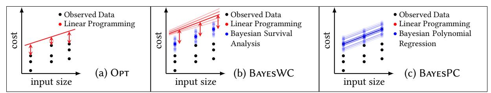
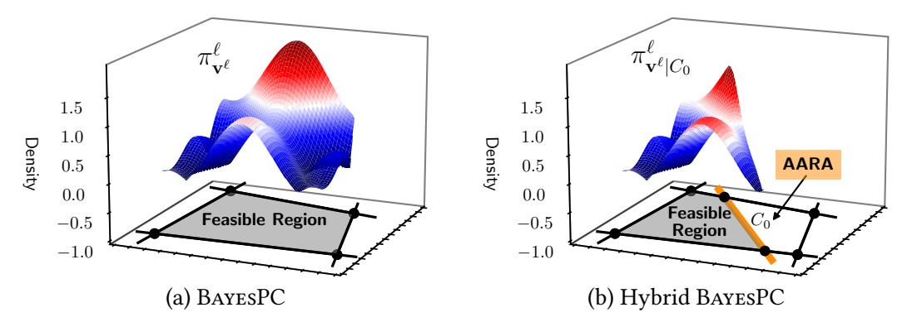
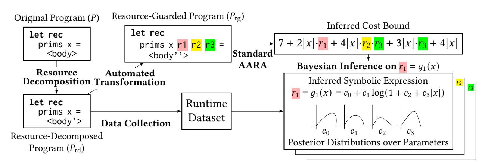

# Thesis Proposal: Hybrid Resource-Bound Analyses of Programs

Long Pham

January 2025

Computer Science Department School of Computer Science Carnegie Mellon University Pittsburgh, PA 15213 Thesis Committee: Jan Hoffmann, Chair Feras Saad Matt Fredrikson François Pottier (Inria Paris)

Submitted in partial fulfillment of the requirements for the degree of Doctor of Philosophy.

Copyright © 2025 Long Pham

### Abstract

Resource-bound analysis aims to infer symbolic bounds of worst-case resource usage (e.g., running time, memory, and energy) of programs as functions of program inputs. Resource analysis has numerous applications, including job scheduling in cloud computing and prevention of side-channel attacks. Various resource analysis technique have been developed, and they have unique strengths and weaknesses that complement each other. (Automatic) static resource analysis, which analyzes the source code of programs, is sound: if it successfully infers a cost bound, it is guaranteed to be a valid bound. However, due to undecidability of resource analysis in general, every static analysis technique is incomplete: there exists a program that the analysis technique cannot handle. Meanwhile, data-driven analysis, which statistically analyzes cost measurements obtained by running programs on many inputs, can infer a candidate cost bound for any program. However, it does not guarantee soundness of inference results.

To overcome limitations of individual analysis techniques, I propose hybrid resource analysis, which integrates two complementary analysis techniques to retain their strengths while mitigating their respective weaknesses. The user first specifies which analysis techniques are used to analyze which code fragments and quantities. Hybrid analysis then performs its constituent analysis techniques on their respective code fragments and quantities. Finally, their inference results are combined into an overall cost bound.

The development of hybrid resource analysis has been driven by the desire to go beyond Automatic Amortized Resource Analysis (AARA), a state-of-the-art type-based static resource analysis technique. I start by proving polynomial-time completeness of AARA. I next introduce Bayesian data-driven analysis, which conducts Bayesian inference on cost measurements to infer a posterior distribution of symbolic cost bounds. I then present the first hybrid resource analysis, Hybrid AARA, followed by a discussion of its limitations. To overcome these limitations, I introduce the second hybrid resource analysis, resource decomposition. I additionally describe Swiftlet, which instantiates the resource-decomposition framework with AARA and Bayesian resource analysis.

For proposed work, my collaborators and I plan to develop data-driven-analysis for statistically inferring not only a worst-case symbolic cost bound but also a worst-case input generator, which is a program generating worst-case program inputs of various sizes. In existing data-driven analyses, program inputs used for recording cost measurements are usually either generated randomly or assumed to be representative of real-world workload. Consequently, it is challenging to statistically infer worst-case bounds of those programs (e.g. quicksort) whose average-case complexity is significantly lower than the worst-case complexity. By testing programs with various input generators and inferring worst-case input generators, we can improve the inference quality of data-driven resource analysis.

## Contents

|1 | Introduction | 1 |
|--- | ------------------------------------------------------------------- | ---- |
| | 1.1 Resource Analysis | 1 |
| | 1.2 Hybrid Resource Analysis | 2 |
| | 1.3 Roadmap of the Thesis | 3 |
| | 1.4 Publications | 5 |
|2 | Overview | 7 |
| | 2.1 Background | 7 |
| | 2.2 Polytime Completeness of AARA (Completed) | 10 |
| | 2.3 Bayesian Data-Driven Resource Analyses (Completed) | 11 |
| | 2.3.1 Optimization-Based Data-Driven Analysis | 13 |
| | 2.3.2 Bayesian Inference on Worst-Case Costs | 14 |
| | 2.3.3 Bayesian Inference on Polynomial Coefficients | 15 |
| | 2.3.4 Extension to Non-Monotone Resource Metrics | 16 |
| | 2.4 Hybrid AARA (Completed) | 16 |
| | 2.4.1 Hybrid BayesWC and Opt | 17 |
| | 2.4.2 Hybrid BayesPC | 17 |
| | 2.5 Resource Decomposition (Completed) | 19 |
| | 2.5.1 Limitations of Hybrid AARA | 19 |
| | 2.5.2 Overview | 21 |
| | 2.5.3 Formalization | 23 |
| | 2.6 Swiftlet: Instantiation of Resource Decomposition (Completed) | 25 |
| | 2.6.1 Data Collection | 25 |
| | 2.6.2 Bayesian Inference for Recursion Depths | 25 |
| | 2.7 Inference of Program-Input Generators (Proposed Work) | 27 |
| | 2.7.1 Motivation | 27 |
| | 2.7.2 Domain-Specific Language of Input Generators | 28 |
| | 2.7.3 Statistical Inference of Worst-Case Input Generators | 29 |
|3 | Timeline | 30 |

## 1 Introduction

In this section, I first introduce resource-bound analysis of programs and review resource analysis techniques studied in the literature. I then propose hybrid resource analysis, which integrates two complementary resource analysis techniques to retain their strengths while mitigating their respective weaknesses. Lastly, I outline three completed works and a proposed work for the thesis.

## 1.1 Resource Analysis

Given a program ��, resource-bound analysis aims to infer a symbolic bound �� (��) on the worstcase resource usage (e.g., running time, memory, and energy) of the program �� as a function of a program input ��. The symbolic bound �� (��) must be a valid upper bound on the computational cost of executing �� (��) for any input ��. Hence, the bound �� (��) inferred by resource analysis is more precise than the result of asymptotic complexity analysis, which only concerns sufficiently large inputs and disregards constant factors.

Resource analysis of programs has a number of applications. For example, in cloud computing [49, 75, [78]](#page-40-0), a cloud-service provider seeks to avoid over-provisioning resources, which would waste resources and hence reduce profits, and under-provisioning resources, which could violate service-level agreements. To this end, the cloud-service provider can perform resource analysis to infer cost bounds of the clients' programs. Other applications of resource analysis include worst-case input generation to identify potential algorithmic complexity attacks [13, 56, 59, 69, 83, [87]](#page-40-2), ensuring constant resource usage to prevent side-channel attacks [9, 14, [67]](#page-39-2), and detecting performance bugs for programmers [21, [27]](#page-35-0).

Three approaches to resource analysis exist in the literature: (automatic) static analysis, data-driven analysis, and interactive analysis. Static resource analysis examines the source code of a program and reasons about all possible behaviors of the program, including its worst-case behaviors, to automatically infer a cost bound. Since the pioneering work of Wegbreit [[85]](#page-40-3), numerous static resource analysis techniques have been developed: type systems [6, 20, 23, 25, 36, 55, [82]](#page-40-4), recurrence relations [1–3, 10, 24, 31, 37, 51, 52, 58, 76, [77]](#page-40-5), term rewriting [7, 8, 46, [66]](#page-39-4), ranking functions [11, 12, 19, 28, 29, [79]](#page-40-6), and invariant generation [34, 35, [89]](#page-41-0).

Data-driven resource analysis first runs a program on many inputs of varying sizes and records execution costs. It then analyzes the dataset of cost measurements to statistically infer a cost bound. To collect cost measurements, most existing works [22, 26, 30, 48, 50, 73, 74, [88]](#page-41-1) use randomly generated program inputs or representative workloads, which do not necessarily reveal worst-case behaviors of the program. Also, to statistically infer bounds from cost measurements, these works perform optimization (e.g., polynomial regression) without quantifying statistical uncertainty or incorporating the user's domain knowledge into the statistical model.

In interactive resource analysis, the user manually writes formal proofs of cost bounds, and the proofs are machine-checked for correctness. Existing works include those based on separation logic [4, 18, 33, 63, [65]](#page-39-7) and dependent types [5, 25, 32, [68]](#page-39-8).

Static and data-driven analyses have their own strengths and weaknesses that complement each other. Static resource analysis is sound: whenever it successfully returns an inference result, it is guaranteed to be a valid worst-case cost bound of the program. However, static analysis is incomplete: for any technique, there exists a program whose cost bound cannot be automatically inferred even if the bound is expressible in the language of symbolic bounds supported by the technique. The incompleteness is due to the undecidability of resource analysis for a Turing-complete programming language.

In contrast to static analysis, data-driven analysis can infer a candidate cost bound for any program. Another advantage is that data-driven analysis only needs a black-box access to the source code, making the analysis applicable to third-party programs whose source code is not publicly available. However, data-driven analysis does not guarantee soundness of inferred cost bounds, because the analysis does not rigorously reason about worst-case behaviors of the program. Also, a finite dataset of cost measurements used in data-driven analysis may not contain worst-case inputs, making it challenging to infer the true worst-case costs.

# 1.2 Hybrid Resource Analysis

In this thesis, to overcome the limitations of individual analysis techniques, I propose and develop hybrid resource analysis, which integrates two (or more) resource analysis techniques with complementary strengths and weaknesses. In hybrid resource analysis, the user first specifies which techniques should analyze which code fragments and quantities in the source code. Next, hybrid analysis performs the two constituent techniques on their designated code fragments and quantities. Finally, the two inference results are combined into an overall cost bound of the entire program. By integrating two complementary analysis techniques, hybrid resource analysis retains their strengths while mitigating their respective weaknesses.

The primary technical challenge of hybrid analysis lies in the design of the interface between the two constituent analysis techniques. The interface specifies (i) representations of cost bounds inferred by the two analyses and (ii) what information (if any) is exchanged between the two analyses during their inference of cost bounds. Firstly, the cost bounds inferred by the two analyses must have compatible representations such that they can be composed together to yield an overall cost bound. Secondly, some resource analysis techniques impose numerical constraints on cost bounds to define a set of accepted bounds. Consequently, to successfully compose such a cost bound with another cost bound inferred by a different analysis, the latter bound must satisfy the numeric constraints imposed by the former bound. Therefore, the two analyses must take into account each other's numeric constraints on bounds.

To illustrate the benefit of hybrid resource analysis in a real-world use case, let us consider a cloud-service provider who wishes to estimate resource usage of a client's program to optimize resource allocation on the cloud. One reasonable choice of resource analysis techniques is static resource analysis as it offers soundness guarantees. The soundness guarantees are beneficial to the service provider because they can rest assured that they will never accidentally underprovision resources. Without the soundness guarantees, it is possible that the client's program consumes more resources than anticipated. In such a case, the provider may need to rerun the program from scratch with more resources, violating service-level agreements on timely execution of the program. However, any single static analysis technique cannot be used to automatically infer cost bounds of all programs due to the incompleteness of static resource analysis. If a static analysis technique of the provider's choice fails to infer a cost bound for a program, the cloud-service provider is left with no clues to guide the resource allocation and scheduling for the program.

Data-driven resource analysis, on the other hand, can always infer a candidate cost bound for any program from its finitely many cost measurements. These measurements are often readily available, especially when the same program is repeatedly executed on many inputs (e.g., the serverless cloud service AWS Lambda). However, data-driven analysis provides no soundness guarantees of inferred cost bounds. Even if the statistical model adds an extra buffer on top of maximum observed costs in the dataset, it may still fail to yield a sufficiently conservative cost bound desired by the cloud-service provider.

Hybrid resource analysis lets the cloud-service provider integrate static and data-driven analyses, thereby striking a desirable balance between soundness (achieved by static analysis) and completeness (achieved by data-driven analysis). For example, the provider can apply static analysis to all code fragments that are amenable to static analysis, and data-driven analysis to the rest of the source code. The two cost bounds by static and data-driven analyses are then combined into an overall bound. Oftentimes, even if static analysis fails to analyze the entire program, it is still capable of analyzing a non-trivial amount of code fragments. So it makes sense to apply static analysis wherever possible in the source code, retaining its soundness guarantees as much as possible. Meanwhile, data-driven analysis yields reasonable (but not necessarily sound) cost bounds for those code fragments that cannot be handled by static analysis. Even though cost bounds inferred by data-driven analysis are not guaranteed to be sound, they are sensible inference results derived using mathematically principled methods (e.g., Bayesian statistics) from observed cost measurements and a statistical model incorporating the user's domain knowledge. Thus, data-driven resource analysis is no less useful than, for example, weather forecasting from observed data and a scientific model, where forecasts never come with guarantees but are nonetheless helpful in our lives. As I empirically demonstrate in this thesis, hybrid resource analysis returns more accurate cost bounds (i.e., the inferred cost bounds are closer to the ground-truth bound) than purely data-driven analysis, thanks to the integration of static analysis. In summary, hybrid resource analysis can infer cost bounds for program that purely static analysis cannot handle, while obtaining more accurate bounds than purely data-driven analysis.

The thesis statement is therefore:

Thesis Statement Hybrid resource analysis, which integrates two resource analysis techniques with complementary strengths and weaknesses, enables the analysis of programs and inference of cost bounds that are beyond the reach of individual analysis techniques.

# 1.3 Roadmap of the Thesis

AARA For the static-analysis part of hybrid resource analysis, I focus on Automatic Amortized Resource Analysis (AARA) [39, 41, 43, [45]](#page-37-7), which is a type-based static resource analysis technique that automatically infers polynomial cost bounds of functional programs. The thesis starts by introducing background information on AARA (§2.1).

AARA is sound: whenever it returns a polynomial cost bound, the bound is guaranteed to be sound. However, AARA is incomplete: there exists a (terminating) polynomial-cost program for which AARA cannot infer any polynomial cost bound. The incompleteness is not unique to AARA. Every static analysis technique suffers incompleteness because resource analysis is undecidable for a Turing-complete programming language in general.

Polynomial-time completeness of AARA In the first completed work (§2.2), I prove that the typable fragment of AARA is polynomial-time complete [[70]](#page-39-9): for every polynomial-time function ��, there exists a polynomial-cost program �� that (i) simulates the function �� with the same computational cost and (ii) is typable in AARA (i.e., a polynomial cost bound of the program �� can be inferred by AARA). The proof creates a functional program with a (polynomiallength) list, where an element is removed from the list whenever the polynomial-time Turing machine of the function �� consumes one unit of time. This idea of adding an extra program variable to represent a certain symbolic bound will later be exploited in the development of the second hybrid resource analysis.

Hybrid AARA I describe the first hybrid resource analysis, Hybrid AARA [[72]](#page-39-10), which integrates AARA and data-driven analysis. For the data-driven-analysis part of Hybrid AARA, my collaborators and I have developed two Bayesian data-driven analyses (§2.3). They perform Bayesian inference to infer posterior distributions of cost bounds from observed cost measurements according to a user-customizable probabilistic model. Hybrid AARA (§2.4) integrates AARA with data-driven analyses, including the two newly developed Bayesian resource analyses as well as an optimization-based baseline from the literature. The primary technical challenge is the design of an interface between AARA, which runs an optimization algorithm (i.e., linear-program solver) to infer cost bounds, and data-driven analysis, which runs a samplingbased probabilistic inference algorithm to infer cost bounds. I propose novel interface designs to overcome the challenge.

Because Hybrid AARA reuses types from AARA to capture polynomial potential functions assigned to program variables, Hybrid AARA inherits two limitations from AARA. Firstly, Hybrid AARA cannot apply two constituent resource analyses to infer quantities of different resource metrics. For instance, given a recursive function, its total cost is given by the product of (i) the cost (e.g., running time and memory) of a single recursive call and (ii) the number of recursive calls. However, because these two quantities have different units (i.e., resource metrics), Hybrid AARA cannot perform resource analyses on the two quantities separately and then combine their inferred bounds. Secondly, due to the use of polynomial potential functions in Hybrid AARA, it cannot express non-polynomial cost bounds (e.g., ��(�� log��) for merge sort).

Resource decomposition To address the limitations of Hybrid AARA, my collaborators and I have designed the second hybrid-resource analysis, resource decomposition [[71]](#page-39-11) (§2.5), which integrates two complementary analyses using a different interface from Hybrid AARA. The key idea of the resource-decomposition framework is to extend an input program with an additional numeric input variable called a resource guard ��. The resource guard �� captures a user-specified quantity, such as the cost and recursion depth of a code fragment. We perform some resource analysis technique (e.g., data-driven analysis) to infer a symbolic bound ��(��) of the resource guard �� parametric in a program input ��. Next, we run a different resource analysis technique (e.g., AARA) to infer an overall cost bound �� (��, ��) of the entire program parametric in both the original program input �� and the newly inserted program input ��. Finally, we substitute the symbolic bound ��(��) for the resource guard �� in the overall cost bound �� (��, ��), obtaining a bound �� (��, ��(��)) parametric only in the original input ��. In addition to formalizing resource decomposition and proving its soundness theorem, the thesis presents a concrete instantiation of the resource-decomposition framework, called Swiftlet (§2.6), integrates AARA and Bayesian data-driven analysis.

Inference of Program Input Generators In existing data-driven analyses, program inputs used for recording cost measurements are either generated randomly or assumed to be representative of real-world workload. Either case, the user has no control over the process of generating program inputs (and their associated cost measurements)—the dataset of program inputs and cost measurements is fixed before data-driven analysis. It is challenging to statistically infer worst-case cost bounds from a fixed dataset of cost measurements, especially when the dataset rarely contains worst-case inputs. For example, if we use a random input generator in data-driven resource analysis of QuickSort, it is difficult to correctly infer a worst-case��(�� 2) cost bound from a dataset where cost measurements highly concentrate around the averagecase ��(�� log��) complexity.

For proposed work, my collaborators and I plan to develop a data-driven-resource-analysis methodology that statistically infers not only a worst-case symbolic cost bound but also a worstcase program input generator (§2.7). A program input generator is a (domain-specific) program that generates program inputs of various sizes conforming to a certain pattern (e.g., sorted lists and balanced trees). In the proposed methodology, the user has control over the data-collection process: they are enabled to run an input program with various input generators, instead of working with a fixed input generator. By testing various input generators, we are more likely able to find a more desirable input generator that yields worse program inputs than a random input generator, hence inferring a more accurate worst-case cost bound.

### 1.4 Publications

This thesis proposal is based on the following three publications:

- 1. Long Pham and Jan Hoffmann. Typable Fragments of Polynomial Automatic Amortized Resource Analysis [[70]](#page-39-9). Published at CSL 2021.
- 2. Long Pham, Feras A. Saad, and Jan Hoffmann. Robust Resource Bounds with Static Analysis and Bayesian Inference [[72]](#page-39-10). Published at PLDI 2024.
- 3. Long Pham, Yue Niu, Nathan Glover, Feras A. Saad, and Jan Hoffmann. Integrating Resource Analyses via Resource Decomposition [[71]](#page-39-11). Under submission.

The first paper proves polynomial-time completeness of AARA. The second paper presents Bayesian data-driven analysis and the first hybrid resource analysis, Hybrid AARA. The third paper (under submission) presents the second hybrid resource analysis, resource decomposition, and its instantiation, Swiftlet, which integrates AARA and Bayesian data-driven analysis.

Yue Niu and I collaborated on the theoretical foundation of resource decomposition. I first formulated resource decomposition and proved its soundness in an operational semantics of a first-order language. Yue Niu then recast the formulation in a domain-theoretic denotational semantics of a higher-order language, proving the soundness using a logical relation.

### 2 Overview

This section first introduces the static resource analysis that I focus on throughout the thesis. It then describes three completed works and a proposed work for the thesis.

## 2.1 Background

Resource analysis Given a program ��, the goal of resource analysis is to infer a symbolic bound �� (��) on the worst-case resource usage of the program �� as a function of a program input ��. For every input ��, the predicted cost �� (��) must be a valid upper bound of the computational cost of executing �� (��).

Resource analysis generally supports a wide range of resource metrics, such as running time, memory, and energy. To specify a resource metric of interest, the user (manually or automatically) inserts a program construct tick �� for �� ∈ Q throughout the source code. The construct tick �� increments a cost counter by �� ∈ Q and returns the unit element ⟨ ⟩. If �� ≥ 0, it means �� units of resources are consumed. Otherwise, if �� &lt; 0, it means |��| units of resources are freed up (and become available to be reused later).

If all tick �� satisfy �� ≥ 0, the resource metric is said to be monotone. Running time of programs is a monotone resource metrics because we cannot reuse time. By contrast, memory usage is a non-monotone resource metric because memory can be freed up as well as consumed. In non-monotone resource metrics, we have two notions of costs: net costs and high-water-mark costs. The net cost refers to the net amount of resources consumed after program execution, while the high-water-mark cost refers to the maximum cost at any point during program execution. In monotone resource metrics, these two notions of costs coincide.

Programming language Throughout this thesis, I consider a call-by-value functional programming language. A program P is a finite set of (mutually recursive) function definitions of the form �� (��) = ��, where �� is a function name, �� is the function input, and �� is the function body that is allowed to mention function names (including �� itself) defined in the program P. For resource analysis, the user specifies which function (�� (��) = ��) ∈ P is to be analyzed. Given a program P (i.e., a finite set of function definitions), the cost semantics of an expression �� under an environment �� (i.e., a mapping from variables to values) is given by a judgment

�� ⊢P �� ⇓ ℎ,�� ��, (2.1)

where �� is the output value, ℎ is the high-water-mark cost, and �� is the remaining potential. The net cost is given by ℎ − ��.

AARA For the static-analysis part of hybrid resource analysis, I focus on a state-of-the-art static analysis technique, Automatic Amortized Resource Analysis (AARA) [39, 41, 43, [45]](#page-37-7) and its implementation Resource-Aware ML (RaML) [42, [44]](#page-37-8) for OCaml programs. AARA is a typebased technique that automatically infers polynomial cost bounds. AARA automates the potential method from amortized analysis of algorithms and data structures by Sleator and Tarjan [80, [81]](#page-40-8). Given a functional program, all variables in the program are assigned polynomial potential function parametric in the input size such that (i) the potential is always non-negative

# 2.2 Polytime Completeness of AARA (Completed)

Despite the incompleteness of AARA, the typable fragments of AARA is polynomial-time complete [[70]](#page-39-9). That is, for any function ��: N → N, if it is polynomial-time (i.e., there exists a polynomial-time Turing machine that computes the function ��), there is a program that (i) computes the same function �� and (ii) is typable in AARA.

Thm. 2.2 formally states the polynomial-time completeness of the typable fragment of AARA. Theorem 2.2 (Polynomial-time completeness of AARA). Given a finite alphabet Σ, let �� be a polynomial-time one-tape Turing machine that take in and returns bit strings from Σ ∗. Then there exists a functional program ��: Σ ∗ → Σ ∗ such that

- For every input �� ∈ Σ ∗, we have ��(��) = �� (��);
- The computational cost of the functional program �� (according to the tick resource metrics) is larger than or equal to the running time of the Turing machine ��;
- AARA can infer a resource-annotated type of the functional program ��.

That is, the set of functional programs typable in AARA is complete with respect to polynomialtime functions.

To prove Thm. 2.2, given a polynomial-time one-tape Turing machine ��, we assume that a polynomial time bound ��(��) of the Turing machine �� is known, where �� is the input size of �� (i.e., the length of an input bit string). We translate the Turing machine �� to a functional program �� that first creates a list ℓpotential whose length is equal to the known time bound ��(��). The list ℓpotential acts as a reservoir of potential, storing one unit of potential in each list element. The program �� then simulates the Turing machine ��, consuming one element of the list every time the simulated Turing machine �� moves its tape head. In every consumption of the list elements of ℓpotential, the program �� runs the expression tick 1, which can be paid by the potential stored in the list. Thus, the program �� has the same cost (and also the output) as the Turing machine ��. Furthermore, the program �� constructs the list ℓpotential of size ��(��) in such a way AARA's type system can infer a polynomial potential function for the list. Hence, the program �� is typable in AARA. The idea of adding a list to a program that explicitly encodes a known cost bound will later be exploited in the development of hybrid resource analysis (§2.5).

Turing machines Consider a one-tape Turing machine �� = (��, Σ, Γ, ⊢, ⊔, ��, ��0, ��final). Here, �� is a finite set of states, Σ is a finite alphabet of input symbols, and Γ ⊃ Σ is a finite alphabet of tape symbols (including input symbols). The tape symbol ⊢ ∈ Γ \ Σ is the left end marker, and ⊔ ∈ Γ \ Σ is the blank symbol on the tape. Finally, ��: �� × Γ → �� × Γ × {left,right} is the transition function, ��0 is the initial state, and ��final is the final state.

In the initial configuration of a Turing machine, an input string �� ∈ Σ ∗ is placed immediately after the left end marker ⊢ on the tape. The state of the machine is initially ��0, and the read/write head is positioned on the first symbol of the input string ��. The rest of the tape is filled with the blank symbol ⊔.

The Turing machine first (i) reads the content of the cell currently under the tape head and (ii) identifies the current state of the machine. The machine then overwrites the current cell (if necessary), updates the machine's state, and moves the head to the left or right according to the transition function ��. The machine terminates when it enters ��final. Upon termination, the

### Algorithm 1 Operational working of the target functional program ��

Require: Input string �� ∈ Σ ∗

1: procedure ��(��) 2: Create a singleton list ℓleft ≔ [⊢] and a list ℓright ≔ [⊔,..., ⊔] of length ��(|��|) 3: Prepend the list ℓright with the input string �� 4: Create a list ℓpotential of size ��(|��|) ⊲ Reservoir of potential 5: �� ← ��0 ⊲ Initialize the current state 6: while �� ≠ ��final ∧ ℓpotential ≠ [ ] do 7: ℓpotential ← tail ℓpotential ⊲ Potential is released 8: Run tick 1 to consume one unit of resources 9: Compute �� (��, ℓright[0]) 10: Update �� and ℓright[0] appropriately 11: Update the tape head's position by moving the head of ℓleft or ℓright to the other 12: return append(reverse ℓleft, ℓright)

content of the tape before the first blank symbol ⊔ is considered as the machine's output. The running time is defined as the number of steps the Turing machine makes before termination.

Simualtion of polynomial-time Turing machines I show how to translate a polynomialtime Turing machine to a functional program while preserving the semantics and cost. Fix a polynomial-time one-tape Turing machine �� = (��, Σ, Γ, ⊢, ⊔, ��, ��0, ��final). Assume that the running time of �� is bounded above by ��(��) for some polynomial ��: N → N. Let �� denote the functional program obtained by translating the Turing machine ��.

Alg. 1 describes how the program �� simulates the Turing machine �� given an input string �� ∈ Σ ∗. In §2.2, the list ℓleft represents the region on the Turing machine ��'s tape to the left of the tape head (in the reverse order and excluding the cell where the tape head is currently on), and ℓright represents the region to the right of the head (including the current cell). Since it is assumed that ��(|��|), where |��| denotes the length of the input string ��, is a bound on the running time of the Turing machine ��, we are assured that the machine �� requires at most ��(|��|) many cells on the tape. Hence, we safely initialize ℓleft to a list of length ��(|��|) without running out of the space later. In §2.2, the list ℓpotential acts as a reservoir of potential, storing one unit of potential in each element. As the head of ℓpotential is removed in §2.2, the potential stored in this element is released and is used to pay for tick 1 in §2.2.

# 2.3 Bayesian Data-Driven Resource Analyses (Completed)

This section presents Bayesian data-driven analysis [[72]](#page-39-10), which infers a cost bound by Bayesian inference on a dataset of cost measurements obtained by running a program on many inputs. Bayesian data-driven analysis offers two advantages over existing data-driven resource analyses, which are mostly optimization-based:

- 1. Bayesian inference lets the user express their domain knowledge (e.g., how conservative inferred cost bounds should be with respect to the observed costs) in the form of

Whereas traditional Markov chain Monte Carlo algorithms struggle in this setting, we leverage "reflective" Hamiltonian Monte Carlo (reflective HMC) sampling [15, 17, 53, [64]](#page-38-5) for posterior inference in BayesPC, where simulated trajectories reflect at the boundaries of the convex polytopes. A high-quality implementation is available in the C++ library Volesti [[16]](#page-34-9). «

### 2.3.4 Extension to Non-Monotone Resource Metrics

I discuss how to extend data-driven resource analysis to non-monotone resource metrics where resources can be freed up as well as consumed (e.g., memory). To ensure the soundness of AARA (Thm. 2.1) with respect to a runtime cost dataset D, we record not only net costs �� ℓ ��,�� but also high-water-mark costs ℎ ℓ ��,�� during data collection (2.9). In Opt, we then incorporate into the linear program (Opt-LP) the linear constraints that the input potential Ψ(|���� |; ��0, ��®) must be larger than or equal to the observed high-water marks ℎ ℓ ��,��. The objective function of the linear program (Opt-LP) can remain unchanged, but the user is allowed to adjust it.

For BayesWC to handle non-monotone resource metrics, we infer worst-case high-watermark costs ℎ ′ �� ≥ 0 (�� ∈ ��D) by Bayesian inference, in addition to worst-case net costs �� ′ ��. Furthermore, ℎ ′ �� ≥ �� ′ �� must hold for all �� ∈ ��D, and the net costs �� ′ are now allowed to be negative because resources can be freed up. The linear program (BayesWC-LP) is then modified by incorporating the inferred worst-case high-water-mark costs ℎ ′ �� into linear constraints.

Finally, for BayesPC, the Bayesian model is modified by incorporating the observed highwater-mark costs ℎ ℓ ��,�� into (i) the joint probability distribution and (ii) the linear constraints defining the region of positive density to draw posterior samples from.

# 2.4 Hybrid AARA (Completed)

This section presents Hybrid AARA [[72]](#page-39-10), the first hybrid resource analysis technique that integrates static and data-driven analyses. Specifically, Hybrid AARA integrates AARA with one of the three data-driven analysis methods: Opt, BayesWC, and BayesPC. To run Hybrid AARA, the user first annotates the source code to specify which code fragments are to be analyzed by data-driven analysis. The rest of the program is analyzed by static analysis.

Hybrid AARA is based on a formal typing system that extends AARA with a new type judgment:

Γ; ��0 ⊢D statℓ ��: ⟨��, ��0⟩. (2.21)

The judgment (2.21) extends the judgment (2.6) of Conventional AARA by including a dataset D of runtime cost measurements. A key technical challenge is the design of the interface between (i) data-driven resource analysis using sampling-based Bayesian inference algorithms and (ii) Conventional AARA using static inference and linear programming.

Figure 2: Posterior distributions over resource coefficients restricted to convex polytopes using BayesPC. (a) In pure BayesPC, the feasible region of the distribution �� ℓ v (and its posterior distribution) is defined by the linear constraints from a dataset Dℓ of cost measurements. (b) In Hybrid BayesPC, the feasible region of the distribution �� ℓ v |��0 (and its posterior distribution) is defined by the linear constraints ��0 produced by Conventional AARA's type system, as well as the linear constraints induced by the dataset Dℓ.

Type inference I address this challenge by adding linear constraints to the BayesPC probabilistic models that encode feasible regions of linear programs computed by Conventional AARA. This approach guarantees that judgments from BayesPC cannot impose new constraints that cause the linear programs to fail to have a solution.

Hybrid BayesPC operates as follows. Suppose we have an annotated code fragment with a resource-annotated typing judgment

Γ; ��0 ⊢D statℓ ��: ⟨��, ��0⟩. (2.24)

We start by performing a static-analysis pass through the program using the conventional AARA type system to obtain a set of linear constraints ��0, treating any statℓ using the rule H:Opt to ensure consistency with runtime data Dℓ. Next, for each subexpression statℓ encountered in the first pass, we apply a variant of BayesPC where a Bayesian model �� ℓ v (2.20) is extended by including all LP variables appearing in the constraints ��0, as well as the original LP variables in the typing judgment (2.24). The additional LP variables added to the Bayesian model are assigned with uninformative priors (e.g., uniform if ��0 is bounded).

We then run reflective Hamiltonian Monte Carlo (reflective HMC), which is a recently developed sampling algorithm that allows HMC sampling to be restricted to a convex polytope defined by linear constraints [15–17, 53, [64]](#page-38-5). Specifically, we run reflective HMC on the extended Bayesian model, subject to (i) the linear constraints induced by the dataset Dℓ and (ii) the linear constraints ��0 imposed by AARA from the first pass. Let �� ℓ v |��0 denote the extended Bayesian model restricted to the convex polytope defined by the linear constraints ��0 from the first pass. The linear constraints of D are already included in the original Bayesian model �� ℓ v (Remark 2.3), and hence are also included in the extended Bayesian model �� ℓ v |��0. Fig. 2 illustrates the difference between the distribution �� ℓ v for pure BayesPC and the distribution �� ℓ v |��0 in Hybrid BayesPC. Thanks to reflective HMC, any posterior sample drawn from the posterior distribution of �� ℓ v |��0 is guaranteed to satisfy these linear constraints.

 let rec merge_sort xs = let _ = Raml.tick 1.0 in match xs with | [] → [] | [ x ] → [ x ] 6 | _ → let lo, hi = split xs in let lo_sorted = merge_sort lo in let hi_sorted = merge_sort hi in merge lo_sorted hi_sorted

(a) MergeSort.

 let rec bubble_sort xs = let _ = Raml.tick 1.0 in let is_xs_sorted, xs_swapped = traverse_and_swap xs in if is_xs_sorted then xs_swapped 7 else bubble_sort xs_swapped

(b) BubbleSort.

Lst. 1: MergeSort and BubbleSort in OCaml. (a) The construct Raml.tick 1.0 (§2.5.1) indicates the cost of 1.0 for every function call to merge_sort. This construct comes from RaML [[42]](#page-36-8), an implementation of AARA for OCaml. (b) The function traverse_and_swap (§2.5.1) traverses the input xs and returns two outputs: (i) whether xs is sorted; and (ii) the result of swapping all out-of-order pairs of consecutive elements in xs.

Finally, we draw �� many samples from the posterior distribution:

(Γ ℓ ��, ��ℓ 0,��, ��ℓ ��, ��ℓ 0,��) ∼ �� ℓ v |��0 (Γ, ��0, ��0, ��|c ℓ) (�� = 1,..., ��;ℓ ∈ �� ′). (2.25)

Substituting these posterior samples for the corresponding LP variables in��0, we obtain �� new constraints:

���� ≔ ��0 ⊕ {(Γ ℓ ��, ��ℓ 0,��, ��ℓ ��, ��ℓ 0,��) | ℓ ∈ �� ′ } (�� = 1,..., ��) (2.26)

Each ���� is then fed to an LP solver to obtain �� posterior samples (��1,..., ����) of cost bounds.

# 2.5 Resource Decomposition (Completed)

This section introduces the second hybrid-analysis framework, dubbed resource decomposition [[71]](#page-39-11), which integrates two complementary analysis techniques using a different interface design from Hybrid AARA. I first describe two limitations of AARA using concrete examples. I then motivate vertical integration of resource analyses, which cannot be achieved by Hybrid AARA. Finally, I illustrate resource decomposition on the examples.

## 2.5.1 Limitations of Hybrid AARA

Running examples I use MergeSort (Listing 1a) and BubbleSort (Listing 1b) as running examples. In BubbleSort, the input list xs is iteratively traversed, and every out-of-order pair of consecutive list elements is swapped until the list is ordered. As a concrete resource metric, I consider the number of function calls performed during evaluation, including all recursive calls and helper functions, as an illustrative metric. This metric is represented with functions Raml.tick in the code. With this metric, MergeSort and BubbleSort have cost bounds �� (��) = 1 + 3.5|�� | + 3.5|�� | ⌈log2 (|�� |)⌉ and �� (��) = 1 + 2|�� | + |�� | 2, respectively, where |�� | is the length of the input list ��.

AARA on running examples MergeSort and BubbleSort are both challenging for traditional static resource analyses, including AARA. To infer a resource bound for MergeSort, the static analysis must infer that the input list is always split in half. This property can then be used to conclude that (i) the recursion depth scales logarithmically; (ii) the cost across all recursive calls at the same depth scales linearly. AARA automatically infers a bound �� (��) = 1 − 2.5|�� | + 3.5|�� | 2 for MergeSort, which has incorrect asymptotics.

For BubbleSort, the analysis must infer that the number of out-of-order pairs of consecutive list elements decreases over time. If the analysis only considers changes in the input size, it cannot infer the termination of BubbleSort, let alone infer its quadratic resource bound. AARA fails to infer any bound for BubbleSort altogether.

Limitations of AARA AARA, as implemented in RaML, has two major limitations. The first limitation is that AARA can only express polynomial bounds, but not logarithmic bounds. Even though AARA infers a sound quadratic bound for MergeSort, it cannot infer an asymptotically tight bound of the form �� (��) = ��|�� | log(|�� |). The second limitation of AARA is that it cannot infer a polynomial cost bound of BubbleSort, because the size of the input list does not decrease at each recursive step. The potential function assigned to the input list xs by AARA can only be parametric in the size of xs, but not in its content. In BubbleSort, however, the length of the input list xs is the same at each recursive call. Instead, what decreases over time is the number of out-of-order pairs of elements in the list. But this is beyond the expressive and reasoning power of AARA.

These two limitations are not unique to AARA—they are also representative for other static analysis techniques [47, [57]](#page-38-6). It is difficult to design an automatic analysis that can derive arbitrary cost functions. If we want, for instance, compositionality, then it is nontrivial to statically infer cost bounds involving logarithm (e.g.,��|�� | log(|�� |) for MergeSort) because logarithm does not compose well with other functions such as polynomials. For BubbleSort, the resource analysis requires reasoning about the input list's content as well as its size, which goes beyond the expressive power of all existing static analysis techniques that I am aware of.

Vertical integration of resource analyses To analyze MergeSort and BubbleSort by hybrid analysis (without resorting to fully data-driven analysis), we seek to vertically integrate two analysis techniques. Vertical integration means, given a program ��, two analysis techniques separately analyze two quantities of different resource metrics, and then their inferred symbolic bounds are combined into an overall cost bound of the program ��. For instance, in MergeSort, the logarithmic factor in the asymptotically tight bound ���� log�� stems from the logarithmic recursion depth of the function merge_sort. It is this logarithmic recursion depth that poses a challenge to AARA. So we wish to perform two analysis techniques (e.g., datadriven analysis and AARA) to infer, respectively, the recursion depth and the combined cost of all recursive calls at the same recursion depth, which are two quantities of different resource metrics. Likewise, in BubbleSort, although AARA cannot reason about the linear recursion depth, AARA is still capable of inferring a linear cost bound of each recursive call. Hence, we would like to separately infer the linear recursion depth and the linear cost of a single recursive call, then composing (i.e., multiplying) their inferred symbolic bounds.

 let rec merge_sort xs = let _ = Raml.mark0 1.0 in let _ = Raml.tick 1.0 in let result = match xs with | [] → [] | [ x ] → [ x ] 8 | _ → let lo, hi = split xs in let lo_sorted = merge_sort lo in let hi_sorted = merge_sort hi in merge lo_sorted hi_sorted in let _ = Raml.mark0 (-1.0) in result let rec merge_sort xs r = let _ = Raml.tick 1.0 in let r1 = decrement_r r in let result, r_final = match xs with | [] → ([], r1) | [ x ] → ([ x ], r1) 8 | _ → let (lo, hi) = split xs in let lo_sorted, r2 = merge_sort lo r1 in let hi_sorted, r3 = merge_sort hi r2 in (merge lo_sorted hi_sorted, r3) in (result, increment_r r_final)

(a) Resource-decomposed MergeSort. (b) Resource-guarded MergeSort.

Lst. 2: Resource-decomposed and resource-guarded MergeSort. A resource component is the recursion depth of the function merge_sort. (a) The annotations Raml.mark0 1.0 (§2.5.2) and Raml.mark0 (-1.0) (§2.5.2) increment and decrement a resource-component counter by one, respectively. Hence, the recursion depth of merge_sort is equal to the high-water mark of this counter. The suffix 0 in the annotation Raml.mark0 identifies a resource component (i.e., the first resource component). (b) The function merge_sort is extended with a resource guard r. The function decrement_r (§2.5.2) decrements the resource guard by one (if it is positive, else raises an exception). The function increment_r (§2.5.2) increments the resource guard by one.

Unfortunately, Hybrid AARA does not support vertical integration of analysis techniques. Hybrid AARA only supports horizontal integration, where two resource analyses are performed on quantities of the same resource metric (e.g., running time) of different code fragments.

The root cause is that Hybrid AARA uses resource-annotated types in an interface between AARA and data-driven analysis. In Hybrid AARA, given an annotated code fragmentstatℓ ��, the inference result of a data-driven analyses is expressed using a resource-annotated typing judgment Γ; ��0 ⊢D statℓ ��: ⟨��, ��0⟩, which contains polynomial potential functions assigned to the input (i.e., Γ and ��0) and output (i.e., �� and ��0). These statistically inferred resource-annotated types are then plugged into a typing tree inferred by AARA. As all resource-annotated types for an input program �� must concern the same resource metric (e.g., running time of code fragments inside ��), we cannot use them to capture quantities of different resource metrics inside the same program (e.g., recursion depth and the running time of a single recursive call).

### 2.5.2 Overview

I introduce a general hybrid-resource-analysis framework, resource decomposition, to enable vertical integration of two complementary analysis techniques.

Key insight To illustrate a key insight of the new resource analysis framework, consider a modified version of MergeSort in Listing 2b. This version is obtained by augmenting the original program (Listing 1a) with a nonnegative numeric variable r, called a resource guard. This variable is intended to track the recursion depth of MergeSort. At the start of the function

Figure 3: Overview of resource decomposition instantiated with AARA and Bayesian datadriven analysis.

body, r is decremented (§2.5.2). If an attempt to decrement r is made when its value is zero, then an exception is raised. The decremented resource guard r is then successively passed on to the next recursive calls (§2.5.2), if there are any. Finally, once the last recursive call terminates, its output value of the resource guard r is incremented (§2.5.2) before it is returned as the second output of the current function call, alongside the original output of MergeSort.

For this modified MergeSort, AARA infers a symbolic resource bound �� (��, ��) = 1+3.5·�� · |�� |, where �� denotes the resource guard variable r (which is always a nonnegative number) and |�� | is the size of the input list xs. The modified program is related to the original version as follows: as long as the resource guard r is initialized to at least the recursion depth of MergeSort (i.e., 1 + ⌈log2 (|�� |)⌉), the modified code successfully terminates (i.e., it does not raise an exception), returns the same output as the original code, and incurs the same cost.

Resource decomposition My collaborators and I have developed resource decomposition as a way to systematically exploit the insight illustrated with the modified code of MergeSort. To derive a bound for the original function, we first derive the bound �� (��, ��) = 1 + 3.5 · �� · |�� | for the modified function. Next, we use another analysis method to infer a cost bound (say ��(��)) for �� in terms of the original input ��, and substitute the result in �� to obtain an overall bound �� (��) = 1 + 3.5 · ��(��) · |�� |.

Workflow Fig. 3 shows the overall workflow of resource decomposition. Given a program �� (��), the user (or an automatic tool) first decides on a set of �� ≥ 1 resource components, i.e., the quantities that the resource guards should track. Examples of resource components include the recursion depth, the number of recursive calls, and the cost of a code fragment. The program �� (��) is then (manually or automatically) instrumented with code annotations markℓ ��, where ℓ is a label that uniquely identifies a resource component and �� ∈ Q is a rational number, such that their high-water marks (i.e., the highest values reached so far) are equal to the user-specified resource components. Let ��rd(x) denote the resulting resource-decomposed program. By way of example, a resource-decomposed program of MergeSort is displayed in Listing 2a, where a user-specified resource component is the recursion depth of the function merge_sort.

Next, the decomposed program ��rd(��) is automatically translated to a resource-guarded program ��rg (��, r) by augmenting the former with resource guards r = (��1,..., ����) as extra input variables, one for each user-specified resource component. In contrast to the annotations markℓ �� for resource components, the resource guards r count down, i.e., they are decremented whenever the corresponding resource components are incremented. If the resource-guarded program ��rg attempts to decrement a resource guard that is zero, the program raises an exception. We then conduct resource analyses (possibly using different techniques) on (i) the resource-guarded program ��rg to derive a symbolic cost bound �� (��, r) for the cost of program ��; (ii) the resource components of ��rd to derive their symbolic bounds ���� = ����(��) (�� = 1,...,��). Finally, we substitute the resource components' symbolic bounds ����(��) for the resource guards ���� (�� = 1,...,��) in the bound �� (��, r), obtaining an overall cost bound �� (��, ��1 (��),..., ���� (��)) for the original program ��.

Comparison with Hybrid AARA Thanks to the use of resource guards in the interface between constituent resource analyses, resource decomposition enables vertical integration without any restriction on symbolic bounds of resource components. Resource components can represent any user-specified quantities as long as they can be expressed as high-water-mark costs. Hence, resource components are allowed to have different resource metrics from each other and also from the overall cost bound of the program. This enables vertical integration, as well as horizontal integration, of resource analyses. Additionally, resource guards, which are numeric variables tracking resource components, can be any symbolic bounds, including non-polynomial symbolic bounds that cannot be captured by resource-annotated types.

Furthermore, resource decomposition is more general than Hybrid AARA in term of supported analysis techniques. Hybrid AARA is specific to the integration of AARA (and its variants) and data-driven analysis, where cost bounds from both analyses are expressed as resourceannotated types. By contrast, resource decomposition can be applied to any combination of analysis techniques: static, data-driven, and interactive resource analyses.

Although resource decomposition is better at vertical integration than Hybrid AARA, the latter also some advantages over the former in terms of expressive power. In Hybrid AARA, cost bounds are expressed by resource-annotated types assigned to the input and output of an expression. Hence, Hybrid AARA can express cost bounds parametric in output sizes as well as input sizes. By contrast, in resource decomposition, symbolic bounds of resource components can only be parametric in input sizes, but not output sizes.

### 2.5.3 Formalization

This section first introduces a programming language with constructs for resource-decomposed programs. I then describe the program transformation from resource-decomposed programs to resource-decomposed ones. Finally, I state the soundness theorem of the program transformation, which has been proved using a logical relation in Pham et al. [[71]](#page-39-11).

Code annotations Fix a countable set L of labels to identify resource components. For resource-decomposed programs, I define a call-by-value higher-order programming language Rpcf��, where �� ∈ N is the (statically known) number of distinct labels ℓ ∈ L that appear in the source code of an input program. The parameter �� ∈ N determines the number of resource guards that are tracked in the denotational semantics. In addition to tick �� (�� ∈ Q) for resource consumption, Rpcf�� contains the following constructs for resource decomposition:

(C1) markℓ ��: unit increments a counter of the resource component ℓ ∈ L by �� ∈ Q. (C2) resetℓ: unit records the current high-water mark of the resource component ℓ ∈ L in a dataset Dℓ and resets the counter to zero.

These constructs have the following semantics. During program execution, each resource component has a "current" value ��ℓ and a "high-water mark" value ℎℓ (i.e., the maximum value reached so far), which are both initialized to zero. The expression markℓ �� sets ��ℓ ← ��ℓ + �� and ℎℓ ← max(ℎℓ, ��ℓ). The expression resetℓ first saves the measurement (ℓ, ℎℓ) in a dataset Dℓ, then resets ��ℓ ← 0 and ℎℓ ← 0. These expressions must be inserted in such a way that the high-water mark ℎℓ of the resource component ℓ is equal to the quantity it is intended to represent.

In many settings, it is possible to automate the insertion of expressions markℓ �� and resetℓ to produce desirable resource-decomposed programs. For example, consider a program �� (��) that contains a subexpression ��(��), where �� is a recursive function with available source code. Suppose the user would like a resource component ℓ to represent the recursion depth of an evaluation ��(��). First, we insert markℓ 1 at the beginning and markℓ (−1) at the end of the function body of ��. Next, we insert resetℓ right after the function call ��(��) from �� (��), so that it records the high-water mark of the resource component ℓ while evaluating ��(��).

Types and Semantics The type system of Rpcf�� makes computational effects (e.g., divergence and costs) explicit by distinguishing between computation types and value types. A computation type is marked with a modality F. For example, an expression ��: F1, where 1 is the unit (value) type, is a computation that returns the unit element (if terminates) and possibly incurs costs.

I work with domain-theoretic denotational semantics of the language Rpcf��. To track resource usage during program execution, I use a bicyclic monoid (N 2, (0, 0), ⊕) to represent a resource state, which is a pair (ℎ, ��) of a high-water mark cost ℎ so far and the leftover resource �� [[39]](#page-36-6). A resource effect ��: N 2 �� → N 2 �� of a computation ��: F�� is a mapping from the initial resource states (for all �� resource components) before running �� to updated resource states.

Program Transformation An expression ��: F�� in a resource-annotated program is transformed to an expression ⌜��⌝��: nat2 �� → F nat2 �� × ⌜��⌝�� in the corresponding resourceguarded program, where ⌜��⌝�� is the result of recursively translating the type��. In this transformation, the expression �� is extended with �� resource guards, each of which is a pair of numeric non-negative variables. We need two numeric variables for each resource guard to maintain both the current counter value and its high-water mark. The latter is used when we encounter the expression resetℓ to record and reset the counter.

Thm. 2.4 formally states the soundness of the program transformation of resource-decomposed programs to resource-guarded ones. The theorem is proved by a logical relation, which is a type-indexed binary relation between the source and target programs that makes the inductive proof go through.

���� to appear in symbolic bounds ���� of resource components in the Bayesian model, we select the one with the highest statistical dependence with the observed high-water marks hℓ. The quantitative measure of dependence we use is mutual information, which characterizes all types of possible dependencies (e.g., linear, nonlinear, etc.) between a pair of random variables. The method of Kraskov et al. [[54]](#page-38-7) is used to estimate mutual information from finitely many samples {(ℎℓ,��,���� (����)) | 1 ≤ �� ≤ ��}.

# 2.7 Inference of Program-Input Generators (Proposed Work)

To improve the accuracy of data-driven resource analysis, my collaborators and I will develop a data-driven analysis method that statistically infers not only worst-case cost bounds but also worst-case input generators. An input generator is a program that can generate program inputs of varying sizes that all conform to a certain pattern. For instance, consider a program ��: ��(int) → ��(int) takes integer lists as input. A trivial input generator for the program �� is a random generator that fills in the content of an input list by sampling integers from a distribution (e.g., uniform distribution over some interval of integers). The goal is to infer a worst-case input generator, which, for each input size, generates a worst-case input (with a high probability).

### 2.7.1 Motivation

In the evaluation of data-driven and hybrid resource analyses in Hybrid AARA [[72]](#page-39-10), I run random input generators to generate program inputs, which are then fed to the programs to record cost measurements. However, when the average-case complexity of a program is significantly lower than its worst-case complexity, statistical analysis struggles to infer correct worst-case bounds from cost measurements of randomly generated inputs. For example, in QuickSort, the worst-case complexity is ��(�� 2), while the average-case complexity over randomly generated inputs is ��(�� log��). Furthermore, the complexity of QuickSort concentrates tightly around ��(�� log��) [60–62, [84]](#page-40-9). Unless the user explicitly embeds this knowledge into a statistical model, it is difficult for statistical analysis to correctly infer the ��(�� 2) worst-case complexity from a dataset that highly concentrates around ��(�� log��).

To outperform data-driven analysis that uses randomly generated inputs, I enable datadriven analysis to test an input program �� with different input generators, instead of using a fixed dataset of cost measurements. The data-driven analysis then infers a worst-case input generator in addition to a worst-case symbolic bound, where the worst-case generator serves as a witness of the worst-case bound. Thanks to the ability to run the input program ��, the new data-driven analysis is capable of inferring more accurate worst-case bounds than a random input generator. For instance, for QuickSort, if the data-driven analysis successfully notices that sorted lists accrue higher costs than randomly generated lists, we use sorted lists, instead of randomly generated lists, to record cost measurements. We then perform statistical analysis on these cost measurements, correctly inferring a ��(�� 2) worst-case bound.

where ��bool is generator of the boolean type and ���� (�� = 1, 2) is a generator of type ����. For a product types ��1 × ��2, a probabilistic generator �� has the form

��(��1, · · ·, ����) ≔ let ��1 = ��1 (��1, · · ·, ����) in let ��2 = ��2 (��1, · · ·, ����, ��1) in ⟨��1, ��2⟩, (2.37)

where ���� (�� = 1, 2) is a generator of type ����.

Challenges The design of a DSL for probabilistic generators poses two challenges:

- 1. The trade-off between expressiveness and ease of generator inference. The expressions �� inside normal distributions Norm contain operators such as succ (for incrementing integers) and hd (for returning the head element of a non-empty list). The more operators the DSL supports, the more expressive it becomes. However, it also grows the state space of input generators, making the inference of worst-case generators more challenging.
- 2. Probabilistic generation of varying input sizes. In lists, for instance, if we probabilistically choose between two constructors (i.e., nil and cons) using the same Bernoulli distribution in all list cells, then the lengths of generated lists follow a geometric distribution. However, the user may want a different distribution for list lengths. To support such distributions, we need to select the size and shape of a data structure globally, instead of locally deciding what data constructor to use.

## 2.7.3 Statistical Inference of Worst-Case Input Generators

Once I design a DSL of probabilistic generators, the next step is to develop a methodology for statistically inferring a worst-case input generator (or a distribution thereof), in addition to a worst-case cost bound. Ideally, I would like to conduct Bayesian inference to infer a posterior distribution of worst-case generators, rather than a single generator. However, it is challenging to design a fully Bayesian methodology such that generators with worse program inputs (i.e., program inputs incurring higher computational costs) are more preferable.

In an optimization-based approach to generator inference (e.g., Singularity [[86]](#page-40-10)), a generator �� is assigned a numeric score based on the computational costs of program inputs generated by ��. The goal is then to find an optimal generator with the highest score. A Bayesian approach to generator inference, however, cannot adopt the same scoring scheme as optimization. This is because, in Bayesian inference, the density of a prior distribution for generators, which is analogous to a score in optimization, cannot increase monotonically forever.

Example To illustrate this challenge, consider QuickSort that uses the head element of an input list as a pivot. Under a resource metric of running time, a worst-case input to QuickSort is a sorted list. Let ��random be a random input generator and ��sorted be a generator that generates sorted integer lists (with a sufficiently high probability). The generator ��sorted incurs an (asymptotically) higher cost on average than the random generator ��random: the former has a��(�� 2) cost bound, while the latter has a ��(�� log��) cost bond. Additionally, let ��random be a symbolic cost bound that fits well with a dataset Drandom generated by the random generator ��random. Likewise, let ��sorted be a symbolic cost bound that fits well with a dataset Dsorted generated by the generator ��sorted.

Our goal is to correctly infer that the pair (��sorted, ��sorted) is a worst-case choice of a generator and a cost bound for QuickSort.

Consider a probabilistic model �� (��, ��, D), where a latent variable�� is a worst-case generator, a latent variable �� is a worst-case cost bound, and an observed variable D is a dataset of program inputs and their associated cost measurements. Typically, a probabilistic model assigns a higher density to a cost bound �� if it is closer to a dataset D of cost measurements. This means the following two conditional densities are close to each other:

�� (Drandom | ��random, ��random) ≈ �� (Dsorted | ��sorted, ��sorted). (2.38)

This is because the cost bounds ��random and ��sorted are both assumed to fit well with their respective datasets. Consequently, if we only concern how well cost bounds fit datasets, then the two pairs (��random, ��random) and (��sorted, ��sorted) are equally preferable by Eq. (2.38), even though the latter should be chosen over the former as the inference result of resource analysis.

To prefer the latter pair (��sorted, ��sorted), one may attempt to design a prior distribution �� (��) such that

�� (��sorted) &gt; �� (��random) &gt; 0.

However, such a prior distribution �� (��) does not exist. The density of a probability distribution cannot strictly increase forever; otherwise, the integral ∫ �� (��) d�� would be infinite.

�� To overcome this challenge, one idea is to incorporate optimization into the Bayesian methodology of generator inference. Wei et al. [[86]](#page-40-10), for instance, frame generator inference as an optimization problem. They develop a fuzzer for (deterministic) program-input generators, called Singularity [[86]](#page-40-10), where the fuzzer runs a genetic algorithm on abstract syntax trees of generators to find a worst-case generator.

# 3 Timeline

Table 1: Thesis timeline.

|Semester | Plan |  |  |
|------------- | ---------- | ---------- | ------------------------------------------------------------------------ |
|Fall 2024 | Submit | the | resource-decomposition paper to PLDI 2025 |
|Spring 2025 | Thesis | proposal |  |
| | Complete |  | the design of the DSL for input generators and implement a prototype |
| | Resubmit |  | the resource-decomposition paper to ICFP or OOPSLA 2025 (if necessary) |
| | Complete |  | the speaking-skill requirement |
| | Complete |  | a thesis draft |
|Summer 2025 | Thesis | defense |  |

# References

[1] E. Albert, P. Arenas, S. Genaim, G. Puebla, and D. Zanardini. Cost Analysis of Java Bytecode. In Rocco De Nicola, editor, Programming Languages and Systems, Lecture Notes in Computer Science, pages 157–172, Berlin, Heidelberg, 2007. Springer. ISBN 978-3-540- 71316-6. doi: 10.1007/978-3-540-71316-6_12. 1.1 [2] Elvira Albert, Puri Arenas, Samir Genaim, and Germán Puebla. Automatic Inference of Upper Bounds for Recurrence Relations in Cost Analysis. In María Alpuente and Germán Vidal, editors, Static Analysis, Lecture Notes in Computer Science, pages 221–237, Berlin, Heidelberg, 2008. Springer. ISBN 978-3-540-69166-2. doi: 10.1007/978-3-540-69166-2_15. [3] Elvira Albert, Puri Arenas, Samir Genaim, German Puebla, and Damiano Zanardini. COSTA: Design and Implementation of a Cost and Termination Analyzer for Java Bytecode. In Frank S. de Boer, Marcello M. Bonsangue, Susanne Graf, and Willem-Paul de Roever, editors, Formal Methods for Components and Objects, Lecture Notes in Computer Science, pages 113–132, Berlin, Heidelberg, 2008. Springer. ISBN 978-3-540-92188-2. doi: 10.1007/978-3-540-92188-2_5. 1.1 [4] Robert Atkey. Amortised resource analysis with separation logic. In Andrew D. Gordon, editor, Programming Languages and Systems, pages 85–103, Berlin, Heidelberg, 2010. Springer Berlin Heidelberg. ISBN 978-3-642-11957-6. 1.1 [5] Robert Atkey. Polynomial Time and Dependent Types. Agda formalisation of Polynomial Time and Dependent Types, 8(POPL):76:2288–76:2317, January 2024. doi: 10.1145/3632918. 1.1 [6] Martin Avanzini and Ugo Dal Lago. Automating sized-type inference for complexity analysis. Proc. ACM Program. Lang., 1(ICFP), August 2017. doi: 10.1145/3110287. 1.1 [7] Martin Avanzini and Georg Moser. A combination framework for complexity. In 24th International Conference on Rewriting Techniques and Applications (RTA'13), 2013. 1.1 [8] Martin Avanzini, Ugo Dal Lago, and Georg Moser. Analysing the complexity of functional programs: Higher-order meets first-order. In Proceedings of the 20th ACM SIGPLAN International Conference on Functional Programming, ICFP 2015, pages 152–164, New York, NY, USA, 2015. Association for Computing Machinery. ISBN 978-1-4503-3669-7. doi: 10.1145/2784731.2784753. 1.1 [9] Gilles Barthe, Sandrine Blazy, Benjamin Grégoire, Rémi Hutin, Vincent Laporte, David Pichardie, and Alix Trieu. Formal verification of a constant-time preserving C compiler. Proceedings of the ACM on Programming Languages, 4(POPL):7:1–7:30, December 2019. doi: 10.1145/3371075. 1.1 [10] Jason Breck, John Cyphert, Zachary Kincaid, and Thomas Reps. Templates and recurrences: Better together. In Proceedings of the 41st ACM SIGPLAN Conference on Programming Language Design and Implementation, PLDI 2020, pages 688–702, New York, NY, USA, June 2020. Association for Computing Machinery. ISBN 978-1-4503-7613-6. doi: 10.1145/3385412.3386035. 1.1 [11] Marc Brockschmidt, Fabian Emmes, Stephan Falke, Carsten Fuhs, and Jürgen Giesl. Alternating runtime and size complexity analysis of integer programs. In 20th Int. Conf. on

Tools and Alg. for the Constr. and Anal. of Systems (TACAS'14), 2014. 1.1 [12] Marc Brockschmidt, Fabian Emmes, Stephan Falke, Carsten Fuhs, and Jürgen Giesl. Analyzing Runtime and Size Complexity of Integer Programs. ACM Trans. Program. Lang. Syst., 38(4):13:1–13:50, August 2016. ISSN 0164-0925. doi: 10.1145/2866575. 1.1 [13] Jacob Burnim, Sudeep Juvekar, and Koushik Sen. WISE: Automated test generation for worst-case complexity. In 2009 IEEE 31st International Conference on Software Engineering, pages 463–473, May 2009. doi: 10.1109/ICSE.2009.5070545. 1.1 [14] Sunjay Cauligi, Gary Soeller, Brian Johannesmeyer, Fraser Brown, Riad S. Wahby, John Renner, Benjamin Grégoire, Gilles Barthe, Ranjit Jhala, and Deian Stefan. FaCT: A DSL for timing-sensitive computation. In Proceedings of the 40th ACM SIGPLAN Conference on Programming Language Design and Implementation, PLDI 2019, pages 174–189, New York, NY, USA, June 2019. Association for Computing Machinery. ISBN 978-1-4503-6712-7. doi: 10.1145/3314221.3314605. 1.1 [15] Frederic Cazals, Augustin Chevallier, and Sylvain Pion. Improved polytope volume calculations based on Hamiltonian Monte Carlo with boundary reflections and sweet arithmetics. Journal of Computational Geometry, 13(1):52–88, April 2022. ISSN 1920-180X. doi: 10.20382/jocg.v13i1a3. 2.3, 2.4.2 [16] Apostolos Chalkis and Vissarion Fisikopoulos. Volesti: Volume Approximation and Sampling for Convex Polytopes in R. The R Journal, 13(2):642–660, 2021. ISSN 2073-4859. 2.3 [17] Apostolos Chalkis, Vissarion Fisikopoulos, Marios Papachristou, and Elias Tsigaridas. Truncated Log-concave Sampling for Convex Bodies with Reflective Hamiltonian Monte Carlo. ACM Transactions on Mathematical Software, 49(2):16:1–16:25, June 2023. ISSN 0098-3500. doi: 10.1145/3589505. 2.3, 2.4.2 [18] Arthur Charguéraud and François Pottier. Verifying the Correctness and Amortized Complexity of a Union-Find Implementation in Separation Logic with Time Credits. Journal of Automated Reasoning, 62(3):331–365, March 2019. ISSN 1573-0670. doi: 10.1007/ s10817-017-9431-7. 1.1 [19] Krishnendu Chatterjee, Hongfei Fu, and Amir Kafshdar Goharshady. Non-polynomial Worst-Case Analysis of Recursive Programs. ACM Transactions on Programming Languages and Systems, 41(4):20:1–20:52, October 2019. ISSN 0164-0925. doi: 10.1145/3339984. 1.1 [20] Ezgi Çiçek, Gilles Barthe, Marco Gaboardi, Deepak Garg, and Jan Hoffmann. Relational cost analysis. In Proceedings of the 44th ACM SIGPLAN Symposium on Principles of Programming Languages, POPL '17, pages 316–329, New York, NY, USA, January 2017. Association for Computing Machinery. ISBN 978-1-4503-4660-3. doi: 10.1145/3009837.3009858. 1.1 [21] Ezgi Çiçek, Mehdi Bouaziz, Sungkeun Cho, and Dino Distefano. Static Resource Analysis at Scale (Extended Abstract). In David Pichardie and Mihaela Sighireanu, editors, Static Analysis, Lecture Notes in Computer Science, pages 3–6, Cham, 2020. Springer International Publishing. ISBN 978-3-030-65474-0. doi: 10.1007/978-3-030-65474-0_1. 1.1

[22] Emilio Coppa, Camil Demetrescu, and Irene Finocchi. Input-sensitive profiling. In Proceedings of the 33rd ACM SIGPLAN Conference on Programming Language Design and Implementation, PLDI '12, pages 89–98, New York, NY, USA, June 2012. Association for Computing Machinery. ISBN 978-1-4503-1205-9. doi: 10.1145/2254064.2254076. 1.1, 2.3.1 [23] Karl Crary and Stephnie Weirich. Resource bound certification. In Proceedings of the 27th ACM SIGPLAN-SIGACT Symposium on Principles of Programming Languages, POPL '00, pages 184–198, New York, NY, USA, 2000. Association for Computing Machinery. ISBN 1-58113-125-9. doi: 10.1145/325694.325716. 1.1 [24] Joseph W. Cutler, Daniel R. Licata, and Norman Danner. Denotational recurrence extraction for amortized analysis. Proceedings of the ACM on Programming Languages, 4(ICFP): 97:1–97:29, August 2020. doi: 10.1145/3408979. 1.1 [25] Nils Anders Danielsson. Lightweight semiformal time complexity analysis for purely functional data structures. In Proceedings of the 35th Annual ACM SIGPLAN-SIGACT Symposium on Principles of Programming Languages, POPL '08, pages 133–144, New York, NY, USA, 2008. Association for Computing Machinery. ISBN 978-1-59593-689-9. doi: 10.1145/1328438.1328457. 1.1 [26] Francisco Demontiê, Junio Cezar, Mariza Bigonha, Frederico Campos, and Fernando Magno Quintão Pereira. Automatic Inference of Loop Complexity Through Polynomial Interpolation. In Alberto Pardo and S. Doaitse Swierstra, editors, Programming Languages, Lecture Notes in Computer Science, pages 1–15, Cham, 2015. Springer International Publishing. ISBN 978-3-319-24012-1. doi: 10.1007/978-3-319-24012-1_1. 1.1 [27] Inc. Facebook. Infer website - cost: Runtime complexity analysis, 2024. 1.1 [28] Antonio Flores-Montoya and Reiner Hähnle. Resource Analysis of Complex Programs with Cost Equations. In Jacques Garrigue, editor, Programming Languages and Systems, pages 275–295, Cham, 2014. Springer International Publishing. ISBN 978-3-319-12736-1. doi: 10.1007/978-3-319-12736-1_15. 1.1 [29] Jürgen Giesl, Nils Lommen, Marcel Hark, and Fabian Meyer. Improving Automatic Complexity Analysis of Integer Programs. In Wolfgang Ahrendt, Bernhard Beckert, Richard Bubel, and Einar Broch Johnsen, editors, The Logic of Software. A Tasting Menu of Formal Methods: Essays Dedicated to Reiner Hähnle on the Occasion of His 60th Birthday, Lecture Notes in Computer Science, pages 193–228. Springer International Publishing, Cham, 2022. ISBN 978-3-031-08166-8. doi: 10.1007/978-3-031-08166-8_10. 1.1 [30] Simon F. Goldsmith, Alex S. Aiken, and Daniel S. Wilkerson. Measuring empirical computational complexity. In Proceedings of the the 6th Joint Meeting of the European Software Engineering Conference and the ACM SIGSOFT Symposium on The Foundations of Software Engineering, ESEC-FSE '07, pages 395–404, New York, NY, USA, September 2007. Association for Computing Machinery. ISBN 978-1-59593-811-4. doi: 10.1145/1287624.1287681. 1.1, 2.3.1 [31] Bernd Grobauer. Cost recurrences for DML programs. In Proceedings of the Sixth ACM SIGPLAN International Conference on Functional Programming, ICFP '01, pages 253–264, New York, NY, USA, 2001. Association for Computing Machinery. ISBN 1-58113-415-0.

doi: 10.1145/507635.507666. 1.1 [32] Harrison Grodin, Yue Niu, Jonathan Sterling, and Robert Harper. Decalf: A Directed, Effectful Cost-Aware Logical Framework. calf: A Cost-Aware Logical Framework, 8 (POPL):10:273–10:301, January 2024. doi: 10.1145/3632852. 1.1 [33] Armaël Guéneau, Arthur Charguéraud, and François Pottier. A Fistful of Dollars: Formalizing Asymptotic Complexity Claims via Deductive Program Verification. In Amal Ahmed, editor, Programming Languages and Systems, Lecture Notes in Computer Science, pages 533–560, Cham, 2018. Springer International Publishing. ISBN 978-3-319-89884-1. doi: 10.1007/978-3-319-89884-1_19. 1.1 [34] Bhargav S. Gulavani and Sumit Gulwani. A Numerical Abstract Domain Based on Expression Abstraction and Max Operator with Application in Timing Analysis. In Aarti Gupta and Sharad Malik, editors, Computer Aided Verification, pages 370–384, Berlin, Heidelberg, 2008. Springer. ISBN 978-3-540-70545-1. doi: 10.1007/978-3-540-70545-1_35. 1.1 [35] Sumit Gulwani, Krishna K. Mehra, and Trishul Chilimbi. SPEED: Precise and efficient static estimation of program computational complexity. In Proceedings of the 36th Annual ACM SIGPLAN-SIGACT Symposium on Principles of Programming Languages, POPL '09, pages 127–139, New York, NY, USA, 2009. Association for Computing Machinery. ISBN 978-1-60558-379-2. doi: 10.1145/1480881.1480898. 1.1 [36] Martin A. T. Handley, Niki Vazou, and Graham Hutton. Liquidate your assets: Reasoning about resource usage in liquid Haskell. Proceedings of the ACM on Programming Languages, 4(POPL):24:1–24:27, December 2019. doi: 10.1145/3371092. 1.1 [37] Manuel V. Hermenegildo, Germán Puebla, Francisco Bueno, and Pedro López-García. Integrated program debugging, verification, and optimization using abstract interpretation (and the Ciao system preprocessor). Science of Computer Programming, 58(1):115–140, October 2005. ISSN 0167-6423. doi: 10.1016/j.scico.2005.02.006. 1.1 [38] Jennifer A. Hoeting, David Madigan, Adrian E. Raftery, and Chris T. Volinsky. Bayesian model averaging: A tutorial. Statistical Science, 14(4):382–401, 1999. ISSN 08834237. 2.6.2 [39] Jan Hoffmann. Types with potential: polynomial resource bounds via automatic amortized analysis. Text.PhDThesis, Ludwig-Maximilians-Universität München, October 2011. 1.3, 2.1, 2.5.3 [40] Jan Hoffmann and Martin Hofmann. Amortized Resource Analysis with Polynomial Potential. In Andrew D. Gordon, editor, Programming Languages and Systems, Lecture Notes in Computer Science, pages 287–306, Berlin, Heidelberg, 2010. Springer. ISBN 978-3-642- 11957-6. doi: 10.1007/978-3-642-11957-6_16. 2.1, 2.1 [41] Jan Hoffmann and Steffen Jost. Two decades of automatic amortized resource analysis. Mathematical Structures in Computer Science, 32(6):729–759, June 2022. ISSN 0960-1295, 1469-8072. doi: 10.1017/S0960129521000487. 1.3, 2.1 [42] Jan Hoffmann, Ankush Das, Martin Hofmann, David Kahn, Prachi Laud, Benjamin Lichtman, Stefan Muller, Chan Ngo, Yue Nue, Zhong Shao, Di Wang, and Shu-Chun Weng. Resource Aware ML. 2.1, 1

[43] Jan Hoffmann, Klaus Aehlig, and Martin Hofmann. Multivariate amortized resource analysis. In Proceedings of the 38th Annual ACM SIGPLAN-SIGACT Symposium on Principles of Programming Languages, Popl '11, pages 357–370, New York, NY, USA, 2011. Association for Computing Machinery. ISBN 978-1-4503-0490-0. doi: 10.1145/1926385.1926427. 1.3, 2.1, 2.1 [44] Jan Hoffmann, Ankush Das, and Shu-Chun Weng. Towards automatic resource bound analysis for OCaml. In Proceedings of the 44th ACM SIGPLAN Symposium on Principles of Programming Languages, POPL '17, pages 359–373, New York, NY, USA, January 2017. Association for Computing Machinery. ISBN 978-1-4503-4660-3. doi: 10.1145/3009837. 3009842. 2.1 [45] Martin Hofmann and Steffen Jost. Static prediction of heap space usage for first-order functional programs. In Proceedings of the 30th ACM SIGPLAN-SIGACT Symposium on Principles of Programming Languages, Popl '03, pages 185–197, New York, NY, USA, 2003. Association for Computing Machinery. ISBN 1-58113-628-5. doi: 10.1145/604131.604148. 1.3, 2.1 [46] Martin Hofmann and Georg Moser. Amortised resource analysis and typed polynomial interpretations. In Rewriting and Typed Lambda Calculi (RTA-TLCA;14), 2014. 1.1 [47] Martin Hofmann, Lorenz Leutgeb, David Obwaller, Georg Moser, and Florian Zuleger. Type-based analysis of logarithmic amortised complexity. Mathematical Structures in Computer Science, 32(6):794–826, June 2022. ISSN 0960-1295, 1469-8072. doi: 10.1017/ S0960129521000232. 2.5.1 [48] Ling Huang, Jinzhu Jia, Bin Yu, Byung-Gon Chun, Petros Maniatis, and Mayur Naik. Predicting execution time of computer programs using sparse polynomial regression. In Proceedings of the 23rd International Conference on Neural Information Processing Systems - Volume 1, NIPS'10, pages 883–891, Red Hook, NY, USA, 2010. Curran Associates Inc. 1.1 [49] Xiuqi Huang, Shiyi Cao, Yuanning Gao, Xiaofeng Gao, and Guihai Chen. LightPro: Lightweight Probabilistic Workload Prediction Framework for Database-as-a-Service. In 2022 IEEE International Conference on Web Services (ICWS), pages 160–169, July 2022. doi: 10.1109/ICWS55610.2022.00036. 1.1 [50] Didier Ishimwe, KimHao Nguyen, and ThanhVu Nguyen. Dynaplex: Analyzing program complexity using dynamically inferred recurrence relations. Proc. ACM Program. Lang., 5 (OOPSLA), October 2021. doi: 10.1145/3485515. 1.1 [51] G. A. Kavvos, Edward Morehouse, Daniel R. Licata, and Norman Danner. Recurrence extraction for functional programs through call-by-push-value. Proc. ACM Program. Lang., 4(POPL), December 2019. doi: 10.1145/3371083. 1.1 [52] Zachary Kincaid, John Cyphert, Jason Breck, and Thomas Reps. Non-linear reasoning for invariant synthesis. Proc. ACM Program. Lang., 2(POPL), December 2017. doi: 10.1145/ 3158142. 1.1 [53] Yunbum Kook, YinTat Lee, Ruoqi Shen, and Santosh Vempala. Sampling with Riemannian Hamiltonian Monte Carlo in a Constrained Space. In Advances in Neural Information Processing Systems, October 2022. 2.3, 2.4.2

[54] Alexander Kraskov, Harald Stögbauer, and Peter Grassberger. Estimating mutual information. Physical Review E: Statistical Physics, Plasmas, Fluids, and Related Interdisciplinary Topics, 69(6):066138, June 2004. doi: 10.1103/PhysRevE.69.066138. 2.6.2 [55] Ugo Dal Lago and Marco Gaboardi. Linear dependent types and relative completeness. In 26th IEEE Symp. on Logic in Computer Science (LICS'11), 2011. 1.1 [56] Caroline Lemieux, Rohan Padhye, Koushik Sen, and Dawn Song. PerfFuzz: Automatically generating pathological inputs. In Proceedings of the 27th ACM SIGSOFT International Symposium on Software Testing and Analysis, ISSTA 2018, pages 254–265, New York, NY, USA, July 2018. Association for Computing Machinery. ISBN 978-1-4503-5699-2. doi: 10.1145/3213846.3213874. 1.1 [57] Lorenz Leutgeb, Georg Moser, and Florian Zuleger. ATLAS: Automated Amortised Complexity Analysis of Self-adjusting Data Structures. In Computer Aided Verification: 33rd International Conference, CAV 2021, Virtual Event, July 20–23, 2021, Proceedings, Part II, pages 99–122, Berlin, Heidelberg, July 2021. Springer-Verlag. ISBN 978-3-030-81687-2. doi: 10.1007/978-3-030-81688-9_5. 2.5.1 [58] P. Lopez-Garcia, L. Darmawan, M. Klemen, U. Liqat, F. Bueno, and M. V. Hermenegildo. Interval-based resource usage verification by translation into Horn clauses and an application to energy consumption. Theory and Practice of Logic Programming, 18(2):167–223, March 2018. ISSN 1471-0684, 1475-3081. doi: 10.1017/S1471068418000042. 1.1 [59] Kasper Luckow, Rody Kersten, and Corina Păsăreanu. Symbolic Complexity Analysis Using Context-Preserving Histories. In 2017 IEEE International Conference on Software Testing, Verification and Validation (ICST), pages 58–68, March 2017. doi: 10.1109/ICST. 2017.13. 1.1 [60] C.J.H. McDiarmid and R.B. Hayward. Large Deviations for Quicksort. J. Algorithms, 21 (3):476–507, November 1996. ISSN 0196-6774. doi: 10.1006/jagm.1996.0055. 2.7.1 [61] Colin McDiarmid. Quicksort and Large Deviations. In Antonín Kučera, Thomas A. Henzinger, Jaroslav Nešetřil, Tomáš Vojnar, and David Antoš, editors, Mathematical and Engineering Methods in Computer Science, pages 43–52, Berlin, Heidelberg, 2013. Springer. ISBN 978-3-642-36046-6. doi: 10.1007/978-3-642-36046-6_5. [62] Colin McDiarmid and Ryan Hayward. Strong concentration for Quicksort. In Proceedings of the Third Annual ACM-SIAM Symposium on Discrete Algorithms, SODA '92, pages 414– 421, USA, September 1992. Society for Industrial and Applied Mathematics. ISBN 978-0- 89791-466-6. 2.7.1 [63] Glen Mével, Jacques-Henri Jourdan, and François Pottier. Time Credits and Time Receipts in Iris. In Luís Caires, editor, Programming Languages and Systems, Lecture Notes in Computer Science, pages 3–29, Cham, 2019. Springer International Publishing. ISBN 978-3-030-17184-1. doi: 10.1007/978-3-030-17184-1_1. 1.1 [64] Hadi Mohasel Afshar and Justin Domke. Reflection, Refraction, and Hamiltonian Monte Carlo. In Advances in Neural Information Processing Systems, volume 28. Curran Associates, Inc., 2015. 2.3, 2.4.2

- [65] Alexandre Moine, Arthur Charguéraud, and François Pottier. A High-Level Separation Logic for Heap Space under Garbage Collection. Proceedings of the ACM on Programming Languages, 7(POPL):25:718–25:747, January 2023. doi: 10.1145/3571218. 1.1 [66] Georg Moser and Manuel Schneckenreither. Automated amortised resource analysis for term rewrite systems. Science of Computer Programming, 185:102306, January 2020. ISSN 0167-6423. doi: 10.1016/j.scico.2019.102306. 1.1 [67] Van Chan Ngo, Mario Dehesa-Azuara, Matthew Fredrikson, and Jan Hoffmann. Verifying and Synthesizing Constant-Resource Implementations with Types. In 2017 IEEE Symposium on Security and Privacy (SP), pages 710–728, May 2017. doi: 10.1109/SP.2017.53. 1.1 [68] Yue Niu, Jonathan Sterling, Harrison Grodin, and Robert Harper. A cost-aware logical framework. Proceedings of the ACM on Programming Languages, 6(POPL):9:1–9:31, January 2022. doi: 10.1145/3498670. 1.1 [69] Theofilos Petsios, Jason Zhao, Angelos D. Keromytis, and Suman Jana. SlowFuzz: Automated Domain-Independent Detection of Algorithmic Complexity Vulnerabilities. In Proceedings of the 2017 ACM SIGSAC Conference on Computer and Communications Security, CCS '17, pages 2155–2168, New York, NY, USA, October 2017. Association for Computing Machinery. ISBN 978-1-4503-4946-8. doi: 10.1145/3133956.3134073. 1.1 [70] Long Pham and Jan Hoffmann. Typable Fragments of Polynomial Automatic Amortized Resource Analysis. In DROPS-IDN/v2/Document/10.4230/LIPIcs.CSL.2021.34. Schloss Dagstuhl – Leibniz-Zentrum für Informatik, 2021. doi: 10.4230/LIPIcs.CSL.2021.34. 1.3, 1, 2.2 [71] Long Pham, Yue Niu, Nathan Glover, Feras A. Saad, and Jan Hoffmann. Integrating Resource Analyses via Resource Decomposition, November 2024. 1.3, 3, 2.5, 2.5.3, 2.6, 2.6.2 [72] Long Pham, Feras A. Saad, and Jan Hoffmann. Robust resource bounds with static analysis and bayesian inference. Proc. ACM Program. Lang., 8(PLDI), June 2024. doi: 10.1145/ 3656380. 1.3, 2, 2.3, 2.4, 2.7.1 [73] Boqin Qin, Tengfei Tu, Ziheng Liu, Tingting Yu, and Linhai Song. Algorithmic Profiling for Real-World Complexity Problems. IEEE Transactions on Software Engineering, 48(7): 2680–2694, July 2022. ISSN 1939-3520. doi: 10.1109/TSE.2021.3067652. 1.1 [74] Daniele Rogora, Antonio Carzaniga, Amer Diwan, Matthias Hauswirth, and Robert Soulé. Analyzing system performance with probabilistic performance annotations. In Proceedings of the Fifteenth European Conference on Computer Systems, EuroSys '20, pages 1–14, New York, NY, USA, April 2020. Association for Computing Machinery. ISBN 978-1-4503-6882-
- 7. doi: 10.1145/3342195.3387554. 1.1 [75] Nilabja Roy, Abhishek Dubey, and Aniruddha Gokhale. Efficient Autoscaling in the Cloud Using Predictive Models for Workload Forecasting. In 2011 IEEE 4th International Conference on Cloud Computing, pages 500–507, July 2011. doi: 10.1109/CLOUD.2011.42. 1.1 [76] A. Serrano, P. Lopez-Garcia, and M. V. Hermenegildo. Resource Usage Analysis of Logic Programs via Abstract Interpretation Using Sized Types. Theory and Practice of Logic Programming, 14(4-5):739–754, July 2014. ISSN 1471-0684, 1475-3081. doi:

10.1017/S147106841400057X. 1.1

[77] Alejandro Serrano Mena, Pedro López García, Francisco Bueno Carrillo, and Manuel V. Hermenegildo. Sized type analysis for logic programs (technical communication). July 2013. 1.1 [78] Zhiming Shen, Sethuraman Subbiah, Xiaohui Gu, and John Wilkes. CloudScale: Elastic resource scaling for multi-tenant cloud systems. In Proceedings of the 2nd ACM Symposium on Cloud Computing, SOCC '11, pages 1–14, New York, NY, USA, October 2011. Association for Computing Machinery. ISBN 978-1-4503-0976-9. doi: 10.1145/2038916.2038921. 1.1 [79] Moritz Sinn, Florian Zuleger, and Helmut Veith. A Simple and Scalable Static Analysis for Bound Analysis and Amortized Complexity Analysis. In Armin Biere and Roderick Bloem, editors, Computer Aided Verification, Lecture Notes in Computer Science, pages 745–761, Cham, 2014. Springer International Publishing. ISBN 978-3-319-08867-9. doi: 10.1007/978-3-319-08867-9_50. 1.1 [80] Daniel D. Sleator and Robert E. Tarjan. Amortized efficiency of list update and paging rules. Communications of the ACM, 28(2):202–208, February 1985. ISSN 0001-0782. doi: 10.1145/2786.2793. 2.1 [81] Daniel Dominic Sleator and Robert Endre Tarjan. Self-adjusting binary trees. In Proceedings of the Fifteenth Annual ACM Symposium on Theory of Computing, STOC '83, pages 235–245, New York, NY, USA, December 1983. Association for Computing Machinery. ISBN 978-0-89791-099-6. doi: 10.1145/800061.808752. 2.1 [82] Pedro B. Vasconcelos. Space Cost Analysis Using Sized Types. PhD thesis, University of St Andrews, UK, 2008. 1.1 [83] Di Wang and Jan Hoffmann. Type-guided worst-case input generation. Proceedings of the ACM on Programming Languages, 3(POPL):13:1–13:30, January 2019. doi: 10.1145/3290326. 1.1 [84] Jinyi Wang, Yican Sun, Hongfei Fu, Mingzhang Huang, Amir Kafshdar Goharshady, and Krishnendu Chatterjee. Concentration-Bound Analysis for Probabilistic Programs and Probabilistic Recurrence Relations, August 2020. 2.7.1 [85] Ben Wegbreit. Mechanical program analysis. Communications of the ACM, 18(9):528–539, September 1975. ISSN 0001-0782. doi: 10.1145/361002.361016. 1.1 [86] Jiayi Wei, Jia Chen, Yu Feng, Kostas Ferles, and Isil Dillig. Singularity: Pattern fuzzing for worst case complexity. In Proceedings of the 2018 26th ACM Joint Meeting on European Software Engineering Conference and Symposium on the Foundations of Software Engineering, ESEC/FSE 2018, pages 213–223, New York, NY, USA, October 2018. Association for Computing Machinery. ISBN 978-1-4503-5573-5. doi: 10.1145/3236024.3236039. 2.7.2, 2.7.3, 2.7.3 [87] Cheng Wen, Haijun Wang, Yuekang Li, Shengchao Qin, Yang Liu, Zhiwu Xu, Hongxu Chen, Xiaofei Xie, Geguang Pu, and Ting Liu. MEMLOCK: Memory Usage Guided Fuzzing. In 2020 IEEE/ACM 42nd International Conference on Software Engineering (ICSE), pages 765– 777, October 2020. doi: 10.1145/3377811.3380396. 1.1

[88] Dmitrijs Zaparanuks and Matthias Hauswirth. Algorithmic profiling. In Proceedings of the 33rd ACM SIGPLAN Conference on Programming Language Design and Implementation, PLDI '12, pages 67–76, New York, NY, USA, June 2012. Association for Computing Machinery. ISBN 978-1-4503-1205-9. doi: 10.1145/2254064.2254074. 1.1, 2.3.1 [89] Florian Zuleger, Sumit Gulwani, Moritz Sinn, and Helmut Veith. Bound Analysis of Imperative Programs with the Size-Change Abstraction. In Eran Yahav, editor, Static Analysis, Lecture Notes in Computer Science, pages 280–297, Berlin, Heidelberg, 2011. Springer. ISBN 978-3-642-23702-7. doi: 10.1007/978-3-642-23702-7_22. 1.1