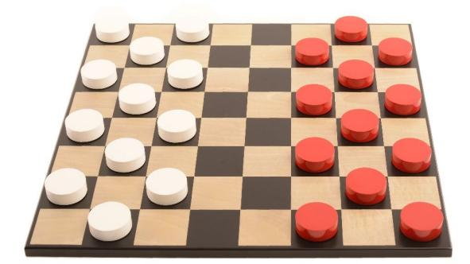
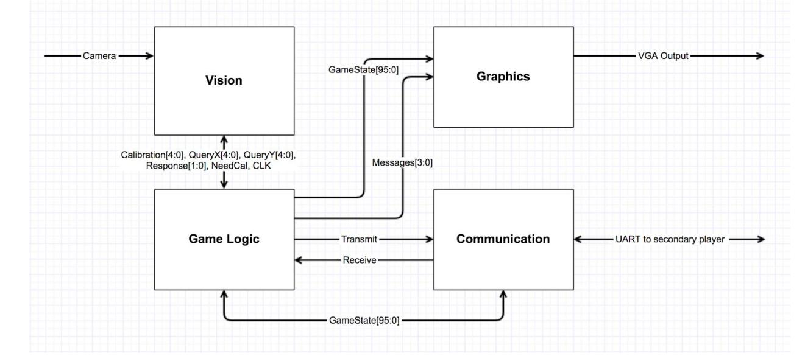
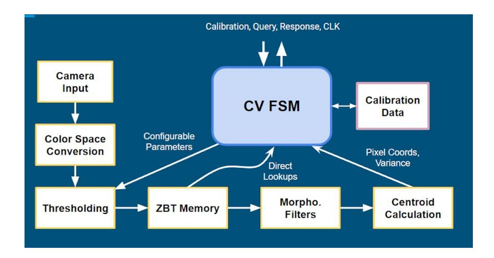
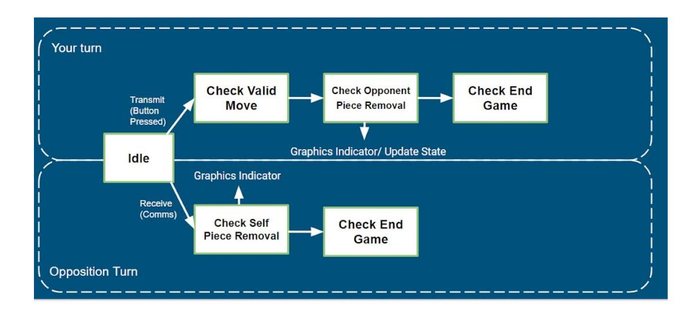

## 6.111 Final Project Proposal: Check Yourself Suzanne O'Meara, Elijah Stanger-Jones, August Trollbäck

## Introduction

We are implementing a multiplayer game of checkers that has a hybrid between physical and virtual gameplay. The game will allow two players in different locations to play a game of checkers by moving physical checker pieces on different game boards. The two game boards will each consist of a computer monitor laid down on a table. Each player will have a set of physical checkers pieces which they will be able to move around the monitor as they play. The other player's pieces will be displayed on the virtual game-board by the FPGA. The FPGA will detect the moves of each of the players through a camera that will run computer vision on the board and the physical checkers to determine their current locations. The FPGA will store the game state and check that all of the moves made by each player are rules-compliant. Once the player has finished their turn the FPGA will send over a communications protocol the current game state of the system. The other FPGA will then determine whether any pieces need to be removed from that players board and indicate such to the player. This process will continue until a winner has been declared.

### Architecture

There will be four major components/modules of the project:

- Game Logic (Elijah)
- Computer Vision (August)
- Graphics (Suzy)
- Communication (Suzy)

### Block Diagram

# Computer Vision

A computer vision (CV) module will be implemented to detect the location of physical checker pieces placed on the screen. The module interacts with inputs from the NTSC camera and the central game logic module. The CV module will operate in two main modes: calibration and detection.

Calibration mode will involve the CV module and graphics module, orchestrated by the game logic. The purpose of calibration is to map the physical location of the checkerboard to pixel coordinates received by the camera so subsequent object detection operations are easier. To calibrate, a marker will be displayed on the screen in the center of each grid square briefly. The CV module finds each marker and stores the pixel center of the marker at the appropriate grid location in memory. It may also be useful during this stage to calibrate for lighting by sampling the color of a player's checker piece that has a known location and color.

In detection mode, an X/Y grid coordinate is received from the game logic module and the CV module responds with what color checker piece (if any) is at that grid location. During detection mode, a couple markers (e.g. white circles in the corners) are constantly tracked. If all the markers are lost for some duration of time, calibration mode is entered again to localize the checkerboard. As an extension, it may be possible to implement calibration with only four or so markers in each corner, rather than a marker for each grid square. This would require implementing matrix projection math to get the centers of the grid squares.

## Game Logic

The game logic module will contain several checks at the end of each players turn.

- Valid movement:
- This test will happen directly after the completion of a players turn and will check that a single piece has been moved to a valid location and inform the player if they have moved illegally.
- Piece removal:
- Detect if one or multiple of the opponents pieces have been removed, if so inform the graphics module to remove the virtual piece and the communication module to inform the opponent to remove the physical piece.
- Game over:
- Detect if all of one players pieces have been removed and if so declare that the game is over to the graphics module.
- No valid moves
- Detect if there are no valid moves and inform the player.

If all these checks are passed the logic module will then transmit the new game state to the communication and graphics module.

The game logic will also deal with the beginning state of the system, starting a new game and choosing who goes first. This information is sent to the graphics for presenting to the player.

# Graphics

The graphics module will be responsible for displaying the game board, the opponent's checkers pieces, and any necessary game messages on both of the monitors.

The game board will consist of alternating brown and white squares arranged in a checkerboard design. This design will have 8 rows and 8 columns. There will be a border around the edge of the checkerboard, where pieces that are "out" will be displayed, to show the players how many pieces they have lost or taken from the other person. As an add-on, we could add an interesting texture or design to each of the squares on the checkerboard.

Each of the players' pieces will be displayed as red or black circle within a given square on the game board. When one player moves a physical checkers piece, the representation of that piece on their opponent's game board will make the same move. Once a piece has been kinged, it will turn a different color. As an add-on, we could render pictures for the checker pieces.

The monitor will also be able to show several different messages that will direct and propel gameplay. The critical messages are:

- Tell a player if they have made an illegal move
- Tell a player if one of their pieces should be removed from the board (because the other player "jumped" it)
- Tell a player when it is their turn to move
- Tell a player when the game is over, and if they have won or lost

Once we have implemented this basic functionality in the graphics, we can add on many animated bells and whistles to make the game more fun to watch. This can include animations of the pieces moving from square to square, animated notifications, or even sound effects.

In order to display information, the graphics module will need to receive several pieces of information from the Game Logic module. In the most basic version of the game, it will need only the following:

- The arrangement of each players' pieces on the game board
- Which message (if any) to display to the user.

This particular configuration will give the Game Logic module exact control over the timing of the graphics display. Once we implement more complex graphics such as animations, we will need to process more information and perform timing operations within the Graphics Module.

## Communication

The communication module will be responsible for relaying data from one player's FPGA to the other. The data will be relayed using UART.

Each FPGA will be running a program that contains a UART module that we will build. This module will have an RX buffer and TX buffer. This "transmit" part of this module will be responsible for gleaning data from the data structures used by the Game Logic module and formatting it into 8 or 16-bit sections that will then be sent as UART packets. It will then send the information to an output pin at 9600 baud. While the Communication module is reformatting and sending a particular piece of information from the Game Logic module, it will send a busy signal back to the Game Logic module.

The "receive" part of this module will work very similarly to the module in Lab 5. It will also be clocked at 9600 baud. There will be an RX buffer that stores the raw received data. The module will then decode the contents of this buffer and reformat it into a data structure that can be interpreted by the Game Logic module.

### Hardware

We do not predict any hardware limitations in regards to memory and speed.

We will be using two of the NTSC cameras for each of the checker boards.

#### Timeline

11/3:
- Finished block diagram with clear links between modules 11/10
- Architecture and FSM written for each module 11/17
- Verilog drafted out and being completed. 11/24
- Lowest level system integrated together and functioning. 12/1
- All main functionality implemented, tested and functioning. 12/8
- Stretch goals.

## Stretch Goals

Possible stretch goals:

- Piece animations
- Indicator to remove a piece from the board
- Implement king pieces
- Detect when a stalemate has occurred
- Implement a scoreboard with play again functionality
- Wireless communication (with ESP32 adapter)
- Replay previous game's moves
- Move suggestions