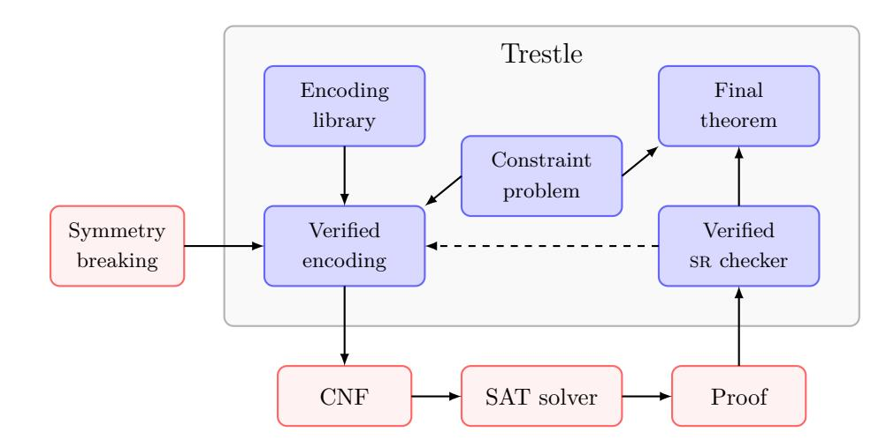

# Thesis Proposal: Building a Verified SAT Toolchain in Trestle

Cayden Codel # Carnegie Mellon University, Pittsburgh, Pennsylvania, United States Committee: Marijn J. H. Heule (chair), Jeremy Avigad, Bryan Parno; CMU External Member: Benjamin Kiesl-Reiter, AWS

#### Abstract

Automated reasoning (AR) tools are versatile and practically efficient pieces of software that can solve a wide variety of problems in industry and academia. One of their strengths is their ability to generate proofs checkable by verified software. Even if the AR tools themselves contain bugs (and they often do), we can still have a high degree of confidence in the correctness of their answers.

However, this verified toolchain can be extended further. Usually, AR tools solve problems that have been encoded into a form that they can understand. This process of encoding can introduce bugs, meaning that the encoded form of the problem no longer accurately represents the original. Bugs are more likely to appear when the encoding is more complicated, such as when auxiliary logical objects are introduced in order to make the encoding smaller or easier for the AR tool to manipulate. Unfortunately, complicated encodings are becoming increasingly necessary in order to push the boundaries of what problems AR tools can solve. As a result, we argue that the standard AR toolchain should now include verified encodings by default.

Previously, complicated encodings mostly received pen-and-paper proofs, and it was rare for an encoding to receive a full end-to-end verification in a theorem prover. But with encoded formulas growing larger, encoding techniques growing more sophisticated, and theorem provers developing more proof automation dependent on and complementary to AR tools, the time is ripe for an end-to-end verified AR toolchain.

In this thesis, we will develop an end-to-end verified toolchain for the boolean satisfiability problem (SAT) in the Trestle project using the Lean 4 theorem prover. Currently, Trestle has a mature SAT proof library, tools for writing verified encodings, and features for coordinating with SAT solvers and proof checkers. However, the encoding tools are complicated to use, there is little to no support for verified symmetry breaking (which is often necessary for making encoded formulas tractable to solve), and the various components of Trestle are largely independent, which makes an end-to-end proof of correctness of a mathematical result challenging to achieve.

To address these problems, this thesis will contribute the following features to Trestle: (1) a mature library of verified encodings, (2) an updated encodings framework, to make it easier to encode mathematical statements at a higher level of abstraction, (3) new support for verified symmetry breaking, and (4) a cohesive framework for doing end-to-end verified SAT solving.

#### Contents

|36 |  |  |
|---- | ------------------------------------------------------------------- | ---- |
|37 | 1 Introduction | 3 |
|38 | 2 Background and Preliminaries | 4 |
|39 | 2.1 SAT encodings | 5 |
|40 | 2.2 SAT proof checking | 6 |
|41 | 3 Research Problem 1: Verifying Encodings | 7 |
|42 | 3.1 Completed Work: Verified Encodings in Trestle | 7 |
|43 | 3.2 Inspiration from PySAT | 11 |
|44 | 3.3 Proposed Work: Updating the Encoding Tooling | 12 |
|45 | 3.4 Proposed Work: Supporting Other Formula Representations | 14 |
|46 | 4 Research Problem 2: Integrating Symmetry-breaking into Encoding | 16 |
|47 | 4.1 Proposed Work: Substitution Redundancy for Symmetry Breaking | 16 |
|48 | 4.2 Proposed Work: Native Symmetry-breaking Reasoning | 18 |
|49 | 4.3 Proposed Work: Symmetry-breaking Proof Reconstruction | 18 |
|50 | 5 Research Problem 3: Verified End-to-end SAT Solving | 19 |
|51 | 6 Conclusion | 20 |
|52 | 7 Timeline | 20 |
|53 | References | 21 |

## 1 Introduction

Automated reasoning (AR) tools are increasingly being used to solve open problems in math- ematics and computer science, such as in number theory [[16]](#page-21-0), computational geometry [[18]](#page-21-1), cryptography [[22]](#page-21-2), and planning. AR tools are also popular black boxes in industry. Most notably, they are used at Amazon Web Services to power services such as Zelkova, which manages security policies for files and user logins, and CodeGuru, which catches security vulnerabilities in code. The use of AR at AWS has reached massive scale: In 2022, AWS services made one billion queries a day to AR tools,1 and the use of these tools has only increased since then.

One of the key selling points of AR tools over other decision- and search procedures is that they can produce proofs of correctness checkable by verified software. In other words, if an AR tool produces an answer after thousands of CPU hours of computation, we can check that that answer is correct with a high degree of certainty.

Arguably the most fundamental AR tool is the boolean satisfiability (SAT) solver. Today's SAT solvers are incredibly sophisticated pieces of software with refined heuristics that can efficiently solve a wide variety of problems. While there is still plenty of research left to do in SAT solver development, modern SAT solving is, in some sense, a solved problem—to the point where it is far more effective to (1) adjust how a problem is encoded into SAT, (2) break symmetries in that encoding, and (3) increase the power and expressivity of SAT proof systems; rather than adjusting solver heuristics.

Unfortunately, there are fewer tools for strategies (1) and (2) than there are for basic SAT solving and proof checking. In particular, SAT encodings are often trusted, meaning that the user of the SAT solver assumes that her encoding accurately represents the original problem she is trying to solve. In most cases, the encoding is straightforward and is obviously correct, but many hard and novel problems require bespoke encodings that exploit the problem's structure and the heuristics of the SAT solver, which makes them a key place where errors can sneak in. Pen-and-paper proofs dispel some of these worries, but sufficiently complicated encodings require formal verification using tools such as interactive theorem provers. For example, the encodings for the Pythagorean triples problem [[10]](#page-20-0) and the empty hexagon problem [[29]](#page-22-0) were verified using theorem provers.

A similar story exists for symmetry breaking (strategy (2)). While some automated certifying symmetry-breaking tools exist for SAT, such as satsuma [[1]](#page-20-1) or BreakID [[12]](#page-20-2), it is often more effective to break symmetries by hand using problem-specific reasoning. But like for encodings, the correctness of this kind of symmetry breaking usually rests on pen-and-paper proofs, and not on a theorem prover.

Part of reason why SAT encodings and symmetry breaking are not verified by default is that there is no standard framework for doing verified SAT solving. As of today, each verified encoding, symmetry breaking argument, or proof checker appears in a new framework, proof library, or theorem prover, which leads to repeated work and a higher barrier to entry. To the best of our knowledge, no such standard framework exists, although there exist several verified encodings [6, 13, [29]](#page-22-0) and proof checkers [7, 9, [31]](#page-22-1), and the SAT symmetry-breaking tools are certifying with machine-checkable proofs.

To address these problems, we will combine strategies (1) and (2) into a single framework called Trestle,2 written in the Lean 4 theorem prover [[11]](#page-20-7). Significant pieces of this framework

<https://www.amazon.science/blog/a-billion-smt-queries-a-day>

 <https://github.com/FormalSAT/Trestle>

Figure 1 A high-level overview of the proposed Trestle framework. A user-supplied constraint problem is represented by a verified encoding using Trestle's library of verified sub-encodings, and potentially made more tractable with symmetry-breaking, supplied by an external symmetry-breaking tool. The generated CNF is solved with a SAT solver, and the proof is checked by the verified sr checker. The result is then used to prove a final theorem. Anything outside of the Trestle box is considered a (non-Lean) trusted component.

already exist (due to work largely by James Gallicchio, myself, Wojciech Nawrocki, and Mario Carneiro), including a theory of SAT formulas, machinery for writing encodings, and a verified substitution redundancy (sr) checker [[7]](#page-20-5). See Figure 1 for an overview of the proposed various pieces of Trestle.

102 This thesis will focus on three main areas:

1. (Section 3) To develop a library of verified encodings, with utilities for writing and verifying encodings and connecting them to abstract mathematical specifications. 2. (Section 4) To develop utilities for doing verified symmetry breaking, with options to receive input from both users and symmetry-breaking tools. 3. (Section 5) To make Trestle a cohesive library for doing end-to-end verified SAT solving, including verified cube-and-conquer.

## 109 2 Background and Preliminaries

110 We assume that the reader is somewhat familiar with concepts from SAT solving. For the 111 definitive reference on SAT and SMT solving, refer to the Handbook of Satisfiability [[3]](#page-20-8).

Throughout, we consider propositional formulas F on boolean variables in conjunctive normal form (CNF), meaning that they are conjunctions of disjunctive clauses C (i.e., an AND of ORs). Each clause contains boolean literals ℓ which are either positive (x) or negated (x) variables. Let Var(F) and Lit(F) be the set of variables and literals, respectively, in a formula F, and define the same for clauses as well.

The goal of a SAT solver is to find a satisfying truth assignment τ for a formula F, written as τ ⊨ F or τ (F) = ⊤, or to determine that there are no satisfying truth assignments. A formula F is satisfiable if there exists such a τ; otherwise, F is unsatisfiable. Two formulas F1 and F2 are equisatisfiable if one is satisfiable iff the other is, i.e., ∃ τ1, τ1 ⊨ F1 ⇔ ∃ τ2, τ2 ⊨ F2.

121 Often, truth assignments τ are only defined over a subset of the variables of a formula F. 122 These are called partial assignments. Depending on the surrounding context, we might

treat (partial) assignments as functions τ: L → {⊤, ⊥}, as sets or ordered lists of literals {ℓ1,..., ℓk}, as a conjunction of literals Vn i=1 ℓi, or as a negated clause ¬C. Let Lit(τ) and Var(τ) be the set of literals and variables, respectively, that τ is defined over. When Lit(τ) ⊇ Lit(F), we call τ a full assignment (for F).

#### 2.1 SAT encodings

Nearly all state-of-the-art SAT solvers expect their input formulas to be in CNF, but since most problems are not naturally expressed in propositional logic, we must first transform the problem's constraints into CNF. This process of transformation is called encoding.

Almost always, there are several possible choices for how to encode a set of constraints. Perhaps the quintessential example of this are cardinality constraints, which specify that a certain fixed number k of a set of boolean literals L must be true or false in any satisfying assignment. For example, the at-most-one constraint (AMO) specifies that at most one literal in L can be true. The straightforward encoding is to add a binary clause for each pair of literals, disallowing any truth assignment that sets any pair of literals to true:

amo(L) = ^ ≤i<j≤n (ℓi ∨ ℓj).

However, there are several other equivalent ways to encode the AMO constraint, such as the sequential counter encoding [[27]](#page-21-3), the order encoding [[30]](#page-22-2), or the totalizer [[2]](#page-20-9). (See also work by Nguyen et al [[23]](#page-21-4).) For example, in the sequential counter encoding, new auxiliary variables si are used to signal to later literals whether a prior literal has been set to true:

amoSC (L) = n^−1 i=1 (ℓi ∨ si) ∧ (si ∨ si+1) ∧ (si ∨ ℓi+1) ≡ n^−1 i=1 (ℓi → si) ∧ (si → si+1) ∧ (si → ℓi+1).

In other words, whenever an ℓi is assigned to true, its corresponding signal variable si is also set to true, which propagates that information to all later signal variables and ℓj.

As it turns out, the performance of the SAT solver heavily depends on the choice of encoding.3 For example, Subercaseaux et al. used SAT solvers to determine that the so-called packing chromatic number of the infinite square grid is 15 [[28]](#page-21-5). The result only became practically feasible once the right encoding was chosen. Section 3 of their paper describes the tradeoffs of the various encodings of the problem, and the authors ultimately conclude that the right encoding saved two orders of magnitude of runtime. Clearly, having a library of logically-equivalent encodings will speed up this kind of experimentation.

Since this thesis will focus on verified encodings, we need a formal definition of what an encoding is. We will expand on the technical details in Section 3, but the following intuition will suffice for now.

When we want to encode an n-ary boolean function f, such as amo, we might want the encoded formula F to evaluate to true under the same set of truth assignments τ that cause f to evaluate to true:

∀τ, f(τ (ℓ1),..., τ (ℓn)) = ⊤ ⇐⇒ τ ⊨ F.

In fact, Marijn Heule is on sabbatical this semester to write a book on exactly this topic.

However, this definition is too restrictive: what about auxiliary variables? Roughly, the semantic meaning of the auxiliary variables depends on the input variables ℓi, so we could relate f and F via a truth assignment τ ′ that extends τ, i.e., where τ ′ ⊇ τ when the assignments are viewed as sets of literals. So then we might write:

∀τ, f(τ (ℓ1),..., τ (ℓn)) = ⊤ ⇐⇒ ∃ τ ′, τ ′ ⊇ τ ∧ τ ′ ⊨ F.

As long as we're careful about how we define the auxiliary variables in F (i.e., in order to avoid name clashes), then this approach will suffice. (In fact, this was the definition we used in our work on verified encodings at FMCAD 2023 [[8]](#page-20-10).)

But this definition is still too restrictive: what if the constraint function f isn't an n-ary boolean function? Suppose we want to encode a graph coloring problem. Then the input objects to f are a graph and a vertex coloring on that graph, which are not immediately represented in terms of boolean literals. Thus, there's an intermediate step where we interpret the mathematical objects of f in terms of boolean literals, and then the encoded formula F is free to introduce auxiliary variables after interpretation. So intuitively, encodings on arbitrary constraint functions f look something like this:

∀ι, f(ι(O1),..., ι(On)) = ⊤ ⇐⇒ ∃ τ, τ ⊇ interp(ι) ∧ τ ⊨ F.

This definition summarizes the technical problems that we will address in Section 3:

1. How to lower mathematical objects to boolean literals (i.e., interp), 2. How to express F in terms of those lowered literals, and 3. How to define auxiliary variables on different sets of lowered literals, so as not to clash with them or with each other.

### 2.2 SAT proof checking

One of the key selling points of SAT solving is that SAT solvers provide certificates that their results are correct. In the satisfiable case, the solver provides a truth assignment τ, and it is trivial to check whether τ ⊨ F. The more complicated case is the unsatisfiable one. Here, state-of-the-art (cdcl) SAT solvers provide a proof of unsatisfiability, expressed in a formal proof system that is checkable with verified software. While there is a hierarchy of proof systems of varying expressive power [[5]](#page-20-11), the de facto standard proof system is rat (reverse asymmetric tautology) [[20]](#page-21-6), with corresponding proof formats drat (deletion rat) [[32]](#page-22-3) and lrat (linear rat) [[9]](#page-20-6).

The rat proof system is an example of a clausal proof system. In clausal proof systems, clauses are added to or deleted from a formula F. Added clauses C are shown to be redundant, meaning that F and F ∧ C are equisatisfiable. If the proof concludes by adding the empty clause ⊥, then the chain of redundancies shows that the original formula F is unsatisfiable. Alternatively, if the proof consists of only clause additions and does not add ⊥, then the proof is a proof of equisatisfiability; these proofs can be used to show that certain symmetry-breaking clauses are valid.

In my prior work with Marijn Heule and Jeremy Avigad [[7]](#page-20-5), we wrote a verified proof checker for the substitution redundancy (sr) proof system [5, [25]](#page-21-7). sr uses substitutions σ: Var(F) → Lit(F)∪ {⊤, ⊥} as witnesses, rather than partial assignments (used in propagation redundancy [pr] [[15]](#page-20-12)) or partial assignments on a single literal (used in rat). As a result, sr is a generalization of pr and rat. We showed that our proof checker is practically efficient, with similar runtime performance to cake_lpr [[31]](#page-22-1), the verified proof checker used in the SAT Competitions.

Because we wrote our verified checker in the Trestle framework, we consider lrat/lpr/lsr proof checking to be a solved problem for this thesis. Instead, the challenge will be how to incorporate verified proof checking into the rest of the Trestle framework, in order to work well with Trestle's encoding and symmetry-breaking tools. See Section 4 and Section 5 for more details.

## 3 Research Problem 1: Verifying Encodings

A major contribution of this thesis will be to verify a large set of SAT encodings, and to generate easy-to-use abstractions along the way. The good news is that we aren't starting from scratch (see Section 3.1): James Gallicchio and I have already verified a few encodings in Trestle, such as the sequential counter encoding for the at-most-k cardinality constraint and the Tseitin transformation,4 but there are many other kinds of encoding techniques that Trestle still needs to support, such as recursive encodings, tree-like encodings, and encodings involving binary and bitwise representations.

In a sense, the goal of this portion of my thesis will be to implement much of the functionality of the PySAT Python package [[19]](#page-21-8) into Trestle, but with the added guarantees of proofs of correctness. We will see in Section 3.2 how PySAT's functionality and design might influence future design decisions in Trestle.

We are also not starting from scratch when it comes to lowering nontrivial mathematical objects into propositional logic. James has done some great work so that Trestle can automatically quantify over finite types, introduce clauses only if certain conditions hold on the input objects, and manage auxiliary variables. However, as we will see in Section 3.1, this tooling is somewhat complicated to use. A more elegant approach to defining and scoping auxiliary variables will streamline how we define and verify SAT encodings. We propose some ideas for this in Section 3.3.

We end this section with some lower-priority proposed work. In Section 3.4, we discuss how Trestle can support other formula representations, such as KNF and weighted CNF, and pseudo-boolean formulas.

## 3.1 Completed Work: Verified Encodings in Trestle

Even though Trestle is still under active development, it has a lot of content already.6 For example, James used Trestle to complete an end-to-end verification of Keller's Conjecture [4, [6]](#page-20-3), including dispatching generated CNF formulas to SAT solvers and proof checkers. The result of this work is that Trestle has a relatively mature library of lemmas about SAT theory, and Trestle's encoding features are versatile but need some updating (see Section 3.3).

Before we can discuss how we will improve Trestle, let's cover some key definitions. Trestle definitions tend to fall under three umbrellas:

1. Concrete representations of literals, clauses, and formulas (ILit, IClause, ICnf). 2. Abstract representations of propositional formulas (PropForm, PropFun, and PropPred). 3. Encodings, with machinery to manage auxiliary variables (EncCNF and VEncCNF).

 Also, from personal correspondence, I know that a research group out of Georgia Tech is using Trestle to verify Ramsey encodings, and the group has expressed interest in verifying the totalizer [[2]](#page-20-9).

 <https://pysathq.github.io/>

 Much of Trestle's content was developed to support my lab's work on verifying the empty hexagon problem [[29]](#page-22-0), but Trestle was ultimately not used.

Item (1) is the most straightforward: the types are based on (lists of) integers in the natural way. (The I of ICnf etc. indicate these are "implementation" types.)

def ILit:= { i: Int // i ̸= 0 } -- The type of integers not equal to 0 def IClause:= Array ILit def ICnf:= Array IClause 248

We also wrote functions to parse and emit DIMACS-formatted CNF formulas. Combined with Lean's built-in IO.asTask module to dispatch commands to new subprocesses, Trestle can write an encoded CNF to a new file and then invoke a SAT solver on it.

Item (2) views SAT formulas through a more abstract lens. Initially, propositional formulas were represented in Trestle with the PropForm datatype, which was an AST-like representation of formulas. As long as a formula contained only top-level conjunctions and bottom-level disjunctions on variables, then the formula could easily be converted to ICnf.

inductive PropForm (ν: Type u) | var (x: ν) | tr | fls | neg (φ: PropForm ν) | conj (φ1 φ2: PropForm ν) | disj (φ1 φ2: PropForm ν) |... -- Other propositional connectives 263

However, it was difficult to write proofs on PropForms because equivalent formulas might have different representations but behave identically under a given truth assignment (e.g., F1 ∧ F2 ≡ F2 ∧ F1), and proofs by induction on such a large datatype were cumbersome. As a result, we developed the PropFun type. Basically, a PropFun is the set of PropForms that are equivalent under all truth assignments τ.

def PropFun ν:= Quotient (PropFun.setoid ν) 271

But PropFun still didn't have the right properties for writing encodings. In particular, we couldn't use Lean quantifiers when constructing a PropFun, and for technical reasons, we were still using PropForms to construct PropFuns. So to address these problems, we developed the most abstract of the formula types, the PropPred, which is a function from truth assignments to Lean's built-in type of propositions.

def PropAssignment (ν: Type u):= ν → Bool def PropPred ν:= PropAssignment ν → Prop 280

Despite not having inherent structure like PropForms, PropPreds are more amenable to Lean's proof automation, since they are boolean algebras, and thus they inherit all the lemmas in Mathlib that have previously been proven about boolean algebras. In addition, PropPreds match our definition for the boolean constraint function f that we made in Section 2.1.

With those definitions in mind, we can now discuss item (3), Trestle encodings. Unfortu- nately, the definition for the CNF encoding type, EncCNF, is complicated. (This is something we want to address: see Section 3.3.)

def EncCNF ν α:= { sa: StateM (EncCNF.LawfulState ν) α // ∀ s, s.nextVar ≤ (sa s).nextVar } 291

Don't worry about understanding this definition, as it is quite technical. But basically, encodings use Lean's monadic style of programming to manage how variables in the variable type ν get assigned to concrete ILits. As long as the set of variable names obeys certain rules (i.e., the state is Lawful), and as long as the next concrete IVar monotonically increases

in a certain way (i.e., s.nextVar ≤ (sa s).nextVar), then the encoding can use a provided variable map vMap: ν → IVar to convert the encoded formula into a concrete ICnf.

Much of the complexity of the definition comes from using monads to manage how variables get assigned to ILits, but the choice to use monads comes with certain benefits as well. Most of these benefits derive from using the state monad, which hides a stateful value from the user when using monadic operations. Thus, when using EncCNF, encodings can focus on the constraints and not on how new variable names get generated.

For example, consider the withTemps function, which allows an encoding to introduce temporary variables tied to a new type ι. In practice, ι = Fin n, but in theory it can be any finite type that is in bijection with Fin n (i.e., an IndexType).

def withTemps (ι) [IndexType ι] (e: EncCNF (ν ⊕ ι) α): EncCNF ν α:=...

Basically, constraints may be added using variables from a base variable type ν or from the disjoint new type ι. Under the hood, by using various functions in the EncCNF state, the encoding on two types is then transformed into an encoding on just ν by "making room" for the variables in ι. Then, at the end, a final mapping using vMap converts variables in terms of ν into ILits to generate a final CNF.

Finally, we get to the star of the show, the verified encoding type VEncCNF. Instances of this type are pairs of an encoding e and a proof that e encodes a boolean predicate P.

def VEncCNF (ν) (α: Type u) (P: PropPred ν):= { e: EncCNF ν α // e.encodesProp P } 319

The definition of encodesProp is complicated, but cleaned up, it looks something like this:

def encodesProp (e: EncCNF ν α) (P: PropPred ν): Prop:= ∀ s, let s':= e s; ∀ (ι: PropAssignment ν), s'.interp ι ↔ (s.interp ι ∧ ι |= P) 325

In other words, given a state s that carries a function to map variables ν to ILits, we can use the encoding e to produce a new state s' containing the encoded CNF formula. Then for all assignments ι, the interpretation of the objects in s' into propositional form contains an extending truth assignment τ (not pictured) iff ι satisfies the predicate P. (The constraint that s.interp ι holds is required when s is an intermediate state formed in the middle of an encoding, but when considering an encoding as a whole, s starts with the empty formula, and thus s.interp ι is trivially satisfied.)

If you squint, this definition looks very similar to the one at the end of Section 2.1. The inclusion of the state monad muddies things a bit, but the key ingredients are all there: the truth assignment ι should satisfy some predicate P, and the variables ν get interpreted into propositional form when considering the encoded formula.

For reference, here's the interp function:

def interp (s: State ν): PropPred ν:= fun (ι: PropAssignment ν) => ∃ (τ: PropAssignment IVar), ι = PropAssignment.map s.vMap τ ∧ τ |= s.CNF 341

In other words, for all truth assignments ι on the variable type ν, there exists a truth assignment τ on concrete IVars that is equivalent to ι in terms of ν, and τ satisfies the CNF formula in the state s.

All this machinery may seem convoluted, but it composes together nicely. For example, here's the definition of for_all, which conjunctively encodes an entire array when given a function to encode any element of that array:

def for_all (arr: Array α) {P: α → PropPred ν} (f: a → VEncCNF ν Unit (P a)): VEncCNF ν Unit (fun τ => ∀ a ∈ arr, P a τ):= ⟨ arr.foldlM (fun _ x => f x) (), by... ⟩

By using for_all, the encoding automatically proves that it satisfies the predicate P for every element of the array. In particular, notice how the use of PropPred in the VEncCNF type allows for_all to directly use the universal quantifier ∀ in the predicate. This is just one example of how PropPred is more versatile than PropFun.

Now let's put it all together. We end this subsection by showing the verified encoding of the pigeonhole principle in Trestle. Assuming an encoding for Cardinality.amoPairwise already exists, we can write the following:

structure PigeonVar (n: Nat) where pigeon: Fin (n+1) hole: Fin n def pigeonsInHole (h: Fin n): List (Literal (PigeonVar n)):= List.finRange (n+1) |>.map (PigeonVar.mk · h) def holesWithPigeon (p: Fin (n+1)): List (Literal (PigeonVar n)):= List.finRange n |>.map (PigeonVar.mk p ·) def encoding (n): VEncCNF (Var n) Unit (fun τ => (∀ p, ∃ h, τ (PigeonVar.mk p h)) ∧ ∀ h, Cardinality.atMost 1 (pigeonsInHole h) τ):= seq[ for_all (List.finRange (n+1)) fun p =>:
- For all pigeons addClause (holesWithPigeon p) -
- the pigeon is in a hole, for_all (List.finRange n) fun h => -
- For all holes, Cardinality.amoPairwise (pigeonsInHole h) -
- the hole has AMO pigeon ] |>.mapProp (by ext τ simp [holesWithPigeon, Clause.satisfies_iff, LitVar.satisfies_iff]) 384

After setting up some boilerplate code to identify the variables corresponding to the set of pigeons in each hole and the set of holes available to each pigeon, we can write the encoding with a few lines. The proof that the encoding obeys the PHP constraints (i.e., that every pigeon is in a hole and that every hole has at most one pigeon) is even shorter, and its proof is largely automated away with the lemmas in Trestle's proof library.

In my opinion, the encoding workflow has too much boilerplate, and it doesn't operate at the right level of abstraction. Rather than expressing constraints in terms of literals, it would be better to express constraints in terms of general mathematical objects, as with Lean propositions. For example, instead of Cardinality.amoPairwise taking a list of literals, it could take a list of variables of a general variable type ν. Then any valid encoding for the amo constraint can be swapped in without changing the overall definition. But what is currently present in Trestle is a great starting point for my work, and is a good proof of concept that proofs of verified encodings can be automated.

#### 3.2 Inspiration from PySAT

As we work on Trestle, we might take inspiration from the PySAT Python library, or at least treat PySAT as a standard to compare my work against. In particular, PySAT's framework addresses three problems that we also want to solve in Trestle:

1. PySAT has a library of around 10 cardinality constraints, as well as support for some formula primitives, such as if-then-else and xor constraints, to help users build encodings. 2. PySAT manages (auxiliary) variables through explicit IDPool objects. 3. PySAT directly coordinates with solvers and natively understands SAT proofs.

We can achieve item (1) in Trestle simply by devoting time to it. The various cardinality constraints are not that hard to understand, and they in fact serve as great motivation to develop the tooling that Trestle needs to handle recursive, tree-like, and binary-representation encodings. We don't expect to run into any problems here.

Item (2) is likely the biggest roadblock we will face in the initial stages of the project. As discussed in the subsections on either side of this one, it is unclear what the best way in Lean is for generating auxiliary variables in a methodical way. But since PySAT doesn't require proofs of correctness for any of its encodings, it can be a bit looser with the rules when it comes to managing variable numberings.

For example, consider the IDPool object in PySAT. In general, an IDPool pairs strings to unique variable ID numbers. If a new string s appears, then the pool's internal counter is assigned to s, and the counter is incremented by 1. If a previously used string s appears again, then the previous variable number for s is returned.

By default, a new IDPool starts its counter at 1, but a different start value and a set of "occupied" intervals of IDs can be specified for the pool to avoid.

To see how this works, consider the following snippet of Python code:

pool = IDPool(occupied=[[3, 10], [12, 18]]) for i in range(5): print(pool.id("v{0}".format(i + 1))) # prints 1, 2, 11, 19, 20 print(pool.id("v5")) # prints 20

All together, IDPools provide a flexible but manual approach for defining the variables in a formula. As long as only a single pool is used, and as long as the strings are appropriately distinct, then the pool will generate the correct variable numbers. But users must be careful not to use clashing strings across an encoding. The scope of variables in a pool can also be a problem: the variables are either global, or their scope must be managed manually, perhaps by using multiple pools. Otherwise, even if a sub-encoding doesn't use certain variables, it still has access to them in principle through the pool. Access to these variables causes problems when we try to prove an encoding correct in Lean; ideally, we would only have the exact set of variables available to us that we need for the encoding.

However, I admit that IDPools are an intuitive solution to the problem of variable management. I'd be interested in seeing if I can incorporate some of the ideas of IDPools into Trestle, such as by passing sub-encodings certain scoped sets of variables, on top of the already-present ability to define new local auxiliary variables.

Item (3) can also be achieved in Trestle with some engineering. Already, Trestle can write CNFs to a file and call a SAT solver, and Trestle has a verified lsr proof checker. This means that we have the necessary components to replicate a similar user experience to what exists in PySAT, as illustrated by this example code:

formula.append([-1, 2]) formula.append([1, -2]) #... with Lingeling(bootstrap_with=formula.clauses, with_proof=True) as l: if l.solve() == False: print(l.get_proof())

However, Trestle's various components don't currently talk to each other. Today, the checker runs independently of the rest of Trestle, meaning that a compiled binary of the checker checks proofs from external files. Thus, the active Lean session has no knowledge of whether certain lsr proofs are valid or not. (And in fact, certain nefarious things could happen between writing down the proof and checking it.)

As a result, we will explore how to incorporate everything in Trestle into an end-to-end framework while minimizing the trusted code base. For example, since the lsr checker is a Lean function, we can keep the CNF and LSR proof in memory and pass them to the Lean function directly. This bypasses the need to write the formula and proof to disk and the need to compile Lean code to an executable binary. PySAT's model will be informative as we explore these options.

#### 3.3 Proposed Work: Updating the Encoding Tooling

Before we can develop a mature library of verified encodings, we first need to update how encodings are defined in Trestle. As we saw in Section 3.1, the VEncCNF type wears many hats: it uses a state monad to accumulate constraints, it encodes them into a CNF by managing how variables ν are assigned to concrete ILit values, and it proves that the constraints agree with the encoded CNF. All of this machinery is intertwined and is overly concerned with the management of auxiliary variables, leading to an overly fussy interface. For example, to verify the sequential counter exactly-one cardinality encoding, two specs were written: one referencing the auxiliary signal variables, and one without:

def scExactlyOne.spec (lits: List (Literal ν)): PropPred (ν ⊕ Fin lits.size):= fun τ => let lit (i: Nat): Bool:= τ (.inl lits[i]) let tmp (i: Nat): Bool:= τ (.inr i):
- tmp i true iff there is exactly 1 true literal among lits[j] for j ≤ i (∀ (i) (_: i+1 < lits.size), tmp i → tmp (i+1)) ∧ (lit 0 ↔ tmp 0) ∧ (∀ (i) (_: i+1 < lits.size), lit (i+1) ↔ (¬tmp i ∧ tmp (i+1))) ∧ tmp (lits.size
- 1) theorem sinzExactlyOne.correct (lits: List (Literal ν)): ∀ τ: PropAssignment ν, (∃ σ, τ = σ.map Sum.inl ∧ spec lits pos σ) ↔ exactly 1 lits τ:= by...

Ideally, only one spec would need to be written, but an additional spec is needed whenever auxiliary variables are introduced using the verified version of the withTemps function:

def withTemps (ι) [IndexType ι] {P: PropAssignment (ν ⊕ ι) → Prop} (e: VEncCNF (ν ⊕ ι) α P): VEncCNF ν α (fun τ => ∃ σ, τ = σ.map Sum.inl ∧ P σ):=...

In other words, VEncCNF requires a spec-like predicate that references the temporary variables directly. While the reasoning about temporary variables needs to exist somewhere, in the VEncCNF predicate seems to be the wrong level of abstraction: auxiliary variables are artifacts of CNF formulas, not the constraint functions we are trying to encode.

Thus, we propose refactoring the types EncCNF and VEncCNF and updating how Trestle users write encodings in the following ways:

1. Define a custom encoding monad that is not the state monad. Determine the correct monadic primitives to provide to the Trestle user. 2. Develop good ways of reasoning about encoded (auxiliary) variables. 3. Experiment with automation for writing encodings, such as metaprogrammatically gener-ating predicates from the contents of an encoding.

Let's first consider item (1), a new EncCNF/VEncCNF type. The core idea of the type should remain in place: a state accumulates the encoded constraints into a CNF while maintaining some kind of mapping from variables ν to ILits. However, the Trestle user should not be able to access this state directly when writing an encoding. This is similar to how the Reader monad only allows the user to read from the environment and not modify it.

(In fact, Trestle currently encourages this kind of restricted monadic thinking by support- ing a custom syntax seq, which ANDs together a list of sub-encodings. The astute reader will recall its appearance in the encoding of the pigeonhole principle at the end of Section 3.1. By using seq, the Trestle user can't access the state monad's get and set functions.)

In this light, many of the current functions for writing encodings, which are currently defined on top of the state monad, become the new monadic operations. For example, addClause, withTemps, and ite (if-then-else) are the primitives, while for_all and seq can be implemented in terms of these primitives.

We also suspect that EncCNF can be simplified by removing the lawfulness conditions on the variable mapping machinery; instead, these conditions belong in VEncCNF. Moving these conditions to VEncCNF will simplify the definitions of these new monadic operations.

For context: Recall that when we want to generate a CNF formula from an encoding, we need to assign concrete ILit values to each variable of type ν and each temporary variable introduced via withTemps. The state in EncCNF manages this, but currently the state needs to be a LawfulState, and the nextVar value needs to monotonically increase:

structure LawfulState ν extends State ν where cnfVarsLt: ∀ c ∈ cnf.toICnf, ∀ l ∈ c, (LitVar.toVar l) < nextVar vMapLt: ∀ v, vMap v < nextVar vMapInj: vMap.Injective 529

When running an encoding, we don't need to know that this variable mapping is well behaved; we only need to know that fact when proving that the encoding is correct. Moving these conditions out of EncCNF and into a type class will generally simplify things.

Another benefit of using a custom monad is that variable name management will feel closer to how PySAT does it. By using withTemps, the temporary variables are scoped in a sub-encoding under a binder (similar to a lambda function). The responsibility is then on the Trestle user to use distinct binder names in order to avoid variable shadowing, which Lean users have to do by default anyways.

Now consider item (2), developing ways of reasoning about encoded variables. This item covers two related problems: how to reason about different interpretations of variables of type ν into ILit form, and how to reason about auxiliary variables.

Currently, Trestle heavily assumes that variables of type ν get encoded into ILits in a one-to-one manner. This assumption is baked into the type of propositional assignments:

def PropAssignment (ν: Type u):= ν → Bool 545

As a result, the variable type is forced to be in a form amenable to CNF encoding. Trestle users must choose this representation from the start, but once that choice is made, EncCNF assigns variable names appropriately. For example, in the pigeonhole example from Section 3.1, the PigeonVar structure identified variables for pairs of pigeons and holes.

However, this assumption forces the Trestle user to potentially relate a natural version of a constraint problem into a less-natural one that is more amenable to encoding. For example, the pigeonhole principle can be phrased as the problem of determining whether there exists an injective function fn: [n + 1] → [n], yet in Trestle, it is phrased as:

fun (τ: PropAssignment (PigeonVar n) => (∀ p, ∃ h, τ (PigeonVar.mk p h)) ∧ (∀ h, Cardinality.atMost 1 (pigeonsInHole h) τ)) 558

The Trestle user would then have to prove a lemma relating the injective-function version of the problem to the encoding version.

If Trestle could support assignments on abstract "answer types," then perhaps this translation could be done automatically, and the Trestle user could use "natural" predicates instead of "encoding" predicates in VEncCNF. But to accomplish this, we would need to add support for the interp function from Section 2.1, which is its own encoding problem. Perhaps a solution can reuse some of the same machinery as for CNF encodings. But since most encodings can be represented in the current manner, this line of work is lower priority.

The second problem to solve is how to reason about the variables ν once they are interpreted into this one-to-one form, particularly when they are auxiliary variables introduced via withTemps. As discussed above, one of our goals is to avoid talking about temporary variables in the VEncCNF predicates. But we need to reason about the temporary variables somewhere, so Trestle should provide good lemmas to make this reasoning easier.

One idea is to provide lots of little sub-encodings, such as for the typical logical connectives (∧, ∨, →, ↔) or for the Tseitin/Plaisted-Greenbaum transformation. Then the proofs can work directly with the logical connectives, rather than with the underlying CNF clauses.

Finally, consider item (3), automation for encoding writing. Currently, Trestle users need to specify both how a set of constraints get encoded into CNF and what the verification predicate is. This leads to a fair bit of duplication. For example, any time an encoding for_all function appears, its corresponding predicate will have a ∀ quantifier.

A time-saving utility could be a tactic that automatically generates a Lean predicate term from an encoding, or vice-versa (although this would be far more challenging, given how expressive Lean's type system is). Another nice tactic might be one that recursively unfolds the constraints in a VEncCNF into proof goals, similar to Lean tactics such as split_ifs.

## 3.4 Proposed Work: Supporting Other Formula Representations

Right now, Trestle encodes only propositional logic formulas into CNF, but it's not too much of a stretch to support other formula representations. The closer the representation is to SAT/CNF, the easier the work will be, so this part of the thesis will proceed in stages. This work is lower priority than e.g. developing a rich library of verified encodings, but we will keep this work in mind so we can build the right abstractions into Trestle from the start.

There are several similar formula representations to CNF that Trestle could easily support. The most similar of these is KNF [[26]](#page-21-9), a cousin of CNF developed by Joseph Reeves, Marijn

Heule, and Randy Bryant. A KNF formula is just like a CNF formula, except cardinality constraints are represented as klauses, rather than encoded into many disjunctive clauses. These klauses are indicated in the KNF file with a leading k character, followed by the (strictly positive) integer bound and the list of literals involved in the constraint:

k 2 1 2 3 -4 0 Representing 2 ≤ x1 + x2 + x3 + x4

Because KNFs are CNFs with a single new line type, supporting KNF in Trestle will be straightforward. We could define IKnf with any of the following definitions:

def IKlause:= Nat × IClause def IKnf:= Array (IClause ⊕ IKlause) def IKnf:= Array IKlause def IKnf:= ICnf × Array IKlause 603

In the first definition, a single array holds all of the constraints, and each constraint is tagged as being either a clause or a klause. In the second, constraints are interpreted as being a clause or a klause based on whether the Nat is 0 (since the integer bound must be strictly positive). In the third, the two types of constraints are in two separate arrays. It remains to be seen which is the easiest to work with.

Because KNFs are so similar to CNFs, the choice of whether to encode into CNF or KNF could be controlled with a top-level flag. Whenever the formula generator encounters a cardinality sub-encoding (perhaps identified by being an instance of a Lean type class CardinalityEncoding), the flag determines whether to use the underlying encoding (for CNF) or to express the constraint as a klause (for KNF).

Once KNF is supported in encodings, the next step would be to build a verified proof checker for it. Currently, no proof checker or format exists for KNF, although cardinality reasoning can be expressed with cutting planes proofs [[14]](#page-20-14), and recent work by the VeriPB team has developed the frat-xor-bnn format [[33]](#page-22-4) to handle reasoning slightly stronger than cardinality reasoning. Perhaps we could collaborate with Joseph on a KNF proof checker.

Another format closely related to CNF is weighted CNF, and by extension, (weighted) MaxSAT [[3]](#page-20-8). Weighted CNF formulas tag each clause with a weight, and then MaxSAT solvers try to satisfy the set of clauses with maximum weight. Often, the clauses are divided into hard and soft constraints, where the hard constraints must be solved and the soft constraints are optional. This is accomplished in the weighted CNF formula by setting the weight of each hard clause to be |S|+ 1, where S is the set of soft clauses. Thus, the MaxSAT solver is always incentivized to satisfy all the hard clauses over any of the soft ones.

Like for KNF, we could define a type for weighted CNF formulas:

def IWClause:= Nat × IClause def IWCnf:= Array IWClause 630

We could then write functions that help encode weighted clauses, such as addWClause, addHardConstraint, and addSoftConstraint.

It is less clear what the verified encoding type would be for weighted CNF. In addition, some MaxSAT solvers use an iterative, binary-search-like algorithm to determine their answer. Perhaps the verification condition would come from the correctness of this algorithm, rather than from the formula itself.

 In fact, Joseph is defending his thesis on this very topic on the same day as my proposal.

After weighted CNF, there is the pseudo-boolean (PB) format,8 where boolean literals are treated as evaluating to either 0 or 1, and the constraints are linear inequalities of (products of) literals. For example:

1 x1 +4 x1 ~x2 -2 x5 >= 2; Representing x1 + 4x1x2 − 2x5 ≥ 2 -1 x1 +4 x2 -2 x5 >= 3; Representing − x1 + 4x2 − 2x5 ≥ 3.

The abstract model of a PB formula is still a PropPred, so the SAT theory present in Trestle will mostly transfer over. But the encoding utilities would need expanding.

Then we arrive at SMT and first-order logic formulas. These are much more complex, and can probably be considered out of scope for this thesis. However, with the development of Lean automation tools such as lean-smt9, there is growing excitement and support for using SMT in Lean. If Trestle ever wants to support SMT formulas, it would be worth seeing if techniques can be borrowed from or integrated into these other Lean automation tools.

## 4 Research Problem 2: Integrating Symmetry-breaking into Encoding

Once a problem has been encoded into a CNF formula, a common next step is to perform symmetry breaking on it to make the formula easier to solve. In practice, this means either adding additional clauses to the formula in order to eliminate symmetric solutions (i.e., static symmetry breaking), or adding symmetry-breaking constraints on the fly during solving (i.e., dynamic symmetry breaking). Many static symmetry-breaking tools exist for SAT, such as satsuma [[1]](#page-20-1) and BreakID [[12]](#page-20-2). These tools produce both a symmetry-broken CNF and an optional proof certifying that the symmetry-breaking clauses were valid to add. A popular proof format for these kinds of proofs is VeriPB [[14]](#page-20-14).

Symmetry breaking is most impactful when the formula is intractable, and domain- specific symmetry breaking is often more effective than general static symmetry breaking. For example, Keller's Conjecture [[4]](#page-20-13) and the packing chromatic number [[28]](#page-21-5) were only solved after problem-specific symmetry-breaking clauses were added to their encoded SAT formulas. However, problem-specific symmetry breaking is often subtle, which leads to the possibility of bugs (much like for SAT encodings).

Thus, because symmetry breaking has a similar trust story to SAT encodings, we propose adding features to Trestle to enable verified symmetry breaking for encodings. Our planned features will proceed in three stages of increasing difficulty. First, we will incorporate sr symmetry-breaking proofs into the encoding workflow. Second, we will enable symmetry- breaking reasoning at a level closer to the mathematical definition of the problem being encoded, potentially removing the need to write down sr proofs at all. Third (and most ambitiously), we will experiment with proof reconstruction in Lean from sr proof files.

## 4.1 Proposed Work: Substitution Redundancy for Symmetry Breaking

As remarked in Section 2.2, clausal proof systems like rat and sr can be used for more than just proofs of unsatisfiability. If the proof only adds clauses and doesn't delete any clauses (or carefully deletes only subsumed clauses), then it is a proof of equisatisfiability, which can be used to show that a series of symmetry-breaking clauses added to a formula are valid.

In recent work with Markus Anders, we showed that substitution redundancy (sr)

 <https://www.cril.univ-artois.fr/PB24/OPBgeneral.pdf>

 <https://github.com/ufmg-smite/lean-smt>

Markus Anders, CC, Marijn J. H. Heule. Orbitopal Fixing in SAT. Submitted to TACAS 2026.

clauses are effective at breaking common symmetries in SAT formulas. Markus implemented these new symmetry-breaking techniques in a branch of the satsuma tool [[1]](#page-20-1).11 Importantly, satsuma generates an sr proof for any symmetries it finds, which means the clauses it adds can be checked for validity by a (verified) sr proof checker.

To bring this kind of reasoning to Trestle, we propose supporting sr symmetry-breaking proofs when writing encodings. This support will have two main features:

1. The ability to specify sr clauses and witnesses in Lean at the level of abstract variable types ν, and then writing the sr proof to a file, and 2. The ability to run the verified sr checker on sr proofs to certify the claimed equisatisfia-bility of the two formulas in Lean.

Let's consider item (1). sr proofs are not designed to be human readable, and thus they shouldn't be written by humans in Trestle either. For example, here's a line of an sr proof from the pigeonhole principle on five holes:

-26 -26 21 -26 22 27 27 22 23 28 28 23 24 29 29 24 25 30 30 25 0

Clearly, no human using Trestle should have to write an sr proof directly.

Instead, sr clauses and witnesses should be written at the level of Lean variable types. The above example is more clear when written in terms of pigeon variables:

- Pigeon 6 is NOT in hole 1 def C: Clause (Literal (PigeonVar 5)):= #[Literal.neg <| PigeonVar.mk 6 1] -
- The witness swaps pigeons 5 and 6 def wit: PigeonVar 5 → (Literal (PigeonVar 5) ⊕ Bool):= fun v => match v with |.mk 6 1 => false |.mk 5 1 => true |.mk 6 h => PigeonVar.mk 5 h |.mk 5 h => PigeonVar.mk 6 h | _ => v 704

We then incorporate sr symmetry-breaking reasoning into the state managed by the encoding. Given an encoding e: EncCNF ν α, an sr clause C: Clause ν, and an sr witness ω: ν → (Literal ν ⊕ Bool), a new encoding carrying the sr clause can be constructed. Then, when e is written to a CNF file, a corresponding sr file and symmetry-broken CNF are written to disk as well. If a series of sr clauses are added, e accumulates them all and produces a single sr proof with the clauses in the order they were added. The SAT solver would then be given the symmetry-broken formula.

Fortunately, the engineering to accomplish this will not be challenging. The translation of the witness ω from variable types ν to concrete variable numbers ILit is already handled for encodings, and so we can use the machinery that has already been developed.

For Item (2), we plan to have Trestle users pick between two options. The first option is to add a Lean axiom that the original formula is equisatisfiable to the symmetry-broken one. (Note that the discussion above used EncCNF and not VEncCNF.) It then becomes the responsibility of the user to run the sr checker on a specified sr proof file. While adding the axiom keyword to a Lean proof is considered distasteful by the formalization community, doing so in this instance is on about the same level of trust as the pipeline pictured in Figure 1: Since the sr checker is verified, we only need to trust the file system, I/O, and Lean's compiler. The formalization community is broadly accepting of this level of trust.

<https://github.com/markusa4/satsuma>

One benefit of this option is that a Lean sr argument doesn't need to be supplied in the first place. Instead, satsuma could be run on the original formula, and then the Trestle user can run the sr checker on satsuma's sr proof.

The second option would be to do everything in Lean. Assuming the CNF formula and the sr proof are not too large, Trestle can parse the CNF and sr files and invoke the sr checker directly in the active Lean session. The equisatisfiability proof thus follows from the proof that our checker is correct:

def run_checker (e: VEncCNF ν α P) (Cs: List (Clause ν)) (ws: List (...)): VEncCNF ν α (P ∧ Cs):=...:
- invoke the SR checker directly, and match on the result -
- panic if the checker fails to pass -
- (could also be made into a theorem if given concrete values) 736

#### 4.2 Proposed Work: Native Symmetry-breaking Reasoning

Lean power users might prefer to do the symmetry-breaking equisatisfiability proof entirely in Lean. The goal of this work would be to add the appropriate lemmas and features to make this process as easy as possible.

One approach is to focus on the kinds of symmetry-breaking that appear in our TACAS paper. For example, we showed that if a matrix of CNF variables exhibits so-called row symmetry, meaning that there are symmetries that swap the rows of the matrix, then we can fix all of the literals in a triangular portion of the matrix. We could prove in Lean that when a set of variables exhibits row symmetry, a verified encoding can be transformed to a symmetry-broken one with these literals fixed. But to keep things at the level of the abstract variable type ν, the challenge would be to prove these lemmas without an actual matrix of variables on hand. If this proves to be too difficult, we could prove this lemma in terms of the generated CNF, but then we would need to have good methods in Lean of referencing sub-structures that would appear in the generated CNF without actually generating it.

Alternatively, we could approach things more top-down and algorithmically. The Trestle user could show that a certain symmetry exists among a set of constraints. Then, depending on the choice of encodings used for those constraints, Trestle would add certain symmetry- breaking clauses as appropriate. However, this would probably have to be done at the meta-programming level, since an updated VEncCNF type would have to be generated with the symmetry-broken predicates added. This would have a similar user experience to a tactic that fills in a proof term for the Lean user, but specialized to symmetries and SAT encodings.

## 4.3 Proposed Work: Symmetry-breaking Proof Reconstruction

A final feature that would automate this workflow would be to add symmetry-breaking proof reconstruction to Trestle. Instead of the symmetry-breaking constraints being specified in Trestle and then checked externally by the sr checker, we could use a tool like satsuma to generate the constraints for the generated CNF, and then Trestle would parse the sr proof and reconstruct the verified encoding terms in Lean.

In some sense, this feature is unnecessary, since we could just check the proof with the sr checker and call it a day. But having the symmetry-breaking arguments in Lean, as opposed to a separate file, increases the trust story, and the Trestle user would benefit from any proof automation we developed for symmetry-breaking as mentioned in the previous subsections. Plus, this kind of proof reconstruction is somewhat common (although the proofs being reconstructed are closer to the core logical language of the theorem provers; see, for example,

reconstruction for sledgehammer in Isabelle [[21]](#page-21-10).), so the formalization community clearly sees some value in having this feature.

The engineering for reconstructing the terms will be less challenging than it might seem. As long as the generated CNF formula is unchanged, then the encoding can use its variable mapping to map ILits back into variables ν. Reconstruction of witness function terms might be more challenging, but as long as the types involved are all finite, the functions can probably be synthesized without too much trouble. To learn how to do this kind of reconstruction, we can refer to various tactics for Lean, such as simp?, aesop, or canonical [[24]](#page-21-11).

If the previous subsection was successful and we develop good support for abstract symmetry-breaking, then the additional challenge will be to reconstruct proofs in the abstract level when the broken symmetries are expressed at the CNF level. This would be the ideal case: not only would a Trestle user not need to prove in Lean that the symmetries are valid, but she would not even need to write down what symmetries to break in the first place. We suspect that this goal is too ambitious, but we might be able to achieve part of it with a carefully curated set of allowable symmetries.

## 5 Research Problem 3: Verified End-to-end SAT Solving

Finally, we will develop the engineering needed to make Trestle an end-to-end framework for doing verified SAT solving. Essentially, this means making the different components of Trestle talk to one another and minimizing the trusted code base when using SAT to discharge a Lean theorem. Since there is little hope of getting a verified SAT solver in Lean, we will have to trust the file system and I/O to correctly write down an encoded CNF formula, invoke a SAT solver, and read an lrat proof. Perhaps the best way to trust a result proven in this way is to use the axiom keyword (or to allow the axiom only if the lrat proof is successfully checked).

Since the relevant Trestle components (as pictured in Figure 1) are well understood and the engineering to connect them will likely be straightforward, we will only discuss one new feature to add to Trestle: verified cube-and-conquer.

Cube-and-conquer [[17]](#page-21-12) is a widely-used SAT-solving technique for dividing a hard CNF formula into many disjoint formulas in order to guide the SAT solver or to massively parallelize solving. Trivially, a formula can be divided into 2 k disjoint formulas by fixing every possible combination of k boolean variables, but more complicated splits might be more effective. In these cases, it is important that the disjoint formulas are a full split of the original.

One way to prove the correctness of a split is to use a verified proof checker. The cake_lpr verified lpr proof checker [[31]](#page-22-1) uses a proof format very similar to drat to check that a set of cubes is valid. We could implement such a checker in Trestle.

Alternatively, we could develop features similar to the ones for encoding to allow Trestle users to dictate the set of cubes from Lean. Then only when the set of cubes is proven valid in Lean can the set of CNF formulas be generated and given to a SAT solver. We suspect that these features will have lots of overlap with VEncCNF.

Our ultimate goal for this section of work is to develop a push-button way of running the pipeline in the bottom half of Figure 1: Once an encoding has been verified, the Trestle user can run a Lean program to generate the set of formulas, run SAT solvers, check the proofs of unsatisfiability, and add the appropriate axioms to a Lean file.

<https://github.com/leanprover-community/aesop>

## 813 6 Conclusion

In this proposal, we discussed the various features we plan to add to the Trestle project in order to create a mature, versatile, and easy-to-use framework for doing end-to-end verified SAT solving. By the end of this thesis, we hope to have verified a good set of common encodings, developed good abstractions for writing encodings and customizing how constraints are encoded into CNF, and developed techniques for doing verified symmetry-breaking and SAT solving.

A qualitative goal that we want to achieve by the end of the thesis is to get the lab's students to use this project for their SAT encoding projects. Their feedback will be valuable to see how easy it is to use. After all, if they would prefer to use PySAT or a custom C program instead of this project, then we have failed in our goal of being easy to use.

More broadly, we hope that the Trestle project will update the standard by which SAT- assisted mathematical results are created and published. The trend for these kinds of results is usually to resolve the mathematical conjecture with SAT or SAT-related technology, and then later verify the encoding and the translation from math problem to SAT encoding. But with Trestle's tools and an ever-increasing number of proofs in Mathlib, we hope that Trestle bridges the gaps and makes end-to-end verification the starting point.

## 830 7 Timeline

|Dates |  |  |  |  | Proposed | research | plan |  |  |  |
|------------------- | ----------- | ------------- | ----------------- | ------------------- | ----------------- | -------------- | ------ | ----------- | -------------- | ------------------ |
|Dec 2025 Feb 2026 | Redesign |  | Trestle’s |  | encoding | framework. | This |  | includes (1) | reinventing |
| | machinery |  | for | handling | variable | scoping and |  | naming, | (2) | separating that |
| | machinery |  | from | how | encodings are | written, | and | (3) | moving | away from |
|a |  | monadic | approach. | If | the work | goes well, |  | submit | a | conference paper |
| | with | James | Gallicchio |  | on Trestle | to ITP 2026. |  |  |  |  |
|Mar May 2026 | Verify | lots | of | encodings. | Develop | good | Lean |  | type classes | to group |
| | encodings |  | according | to | the constraints | they |  | encode. |  |  |
|Jun Aug 2026 |  | Incorporate |  | symmetry-breaking |  | support into |  | Trestle. |  | Update/optimize |
|the | sr | checker, | and | make | proof-checking | part | of | the | end-to-end | story. |
|Sep Nov 2026 | Develop |  | end-to-end |  | verification | features, |  | including | verified | cube-and |
|Dec 2026 Feb 2027 | Tackle |  | remaining |  | lower-priority | work, such | as |  | supporting | alternate for |
| | mula |  | representations | or | developing | automation |  |  | tactics in | Lean. |
|Mar Apr 2027 | Write | the | thesis. | Document | future | work for |  | Trestle. |  |  |
|May 2027 | Defend | the | thesis. |  |  |  |  |  |  |  |

#### References

 1 Markus Anders, Sofia Brenner, and Gaurav Rattan. Satsuma: Structure-based symmetry breaking in SAT. In 27th International Conference on Theory and Applications of Satisfiability Testing, SAT 2024, August 21-24, 2024, Pune, India, volume 305 of LIPIcs, pages 4:1–4:23. Schloss Dagstuhl:
- Leibniz-Zentrum für Informatik, 2024. 2 Olivier Bailleux and Yacine Boufkhad. Efficient CNF encoding of boolean cardinality constraints. In Francesca Rossi, editor, Principles and Practice of Constraint Programming – CP 2003, pages 108–122, Berlin, Heidelberg, 2003. Springer Berlin Heidelberg. 3 Armin Biere, Marijn Heule, Hans van Maaren, and Toby Walsh, editors. Handbook of Satisfiability
- Second Edition, volume 336 of Frontiers in Artificial Intelligence and Applications. IOS Press, 2021. 4 Joshua Brakensiek, Marijn Heule, John Mackey, and David Narváez. The resolution of Keller's Conjecture. In Nicolas Peltier and Viorica Sofronie-Stokkermans, editors, Automated Reasoning, pages 48–65, Cham, 2020. Springer International Publishing. 5 Sam Buss and Neil Thapen. DRAT and propagation redundancy proofs without new variables. Logical Methods in Computer Science, Volume 17, Issue 2, Apr 2021. 6 Joshua Clune. A formalized reduction of Keller's Conjecture. In Proceedings of the 12th ACM SIGPLAN International Conference on Certified Programs and Proofs, CPP 2023, pages 90–101, New York, NY, USA, 2023. Association for Computing Machinery. 7 Cayden R. Codel, Jeremy Avigad, and Marijn J. H. Heule. Verified substitution redun
- dancy checking. In Formal Methods in Computer-Aided Design, FMCAD 2024, Prague, Czech Republic, October 15-18, 2024, pages 186–196. IEEE, 2024. 8 Cayden R. Codel, Marijn J. H. Heule, and Jeremy Avigad. Verfied encodings for SAT solving. In Formal Methods in Computer-Aided Design
- FMCAD, pages 141–151, 2023. 9 Luís Cruz-Filipe, Marijn J. H. Heule, Warren A. Hunt, Matt Kaufmann, and Peter Schneider-Kamp. Efficient certified RAT verification. In Leonardo De Moura, editor, Automated Deduction – CADE 26, volume 10395, pages 220–236. Springer International Publishing, Cham, 2017. 10 Luís Cruz-Filipe, João Marques-Silva, and Peter Schneider-Kamp. Formally verifying the solution to the Boolean Pythagorean triples problem. J. Autom. Reason., 63(3):695–722, 2019. 11 Leonardo de Moura and Sebastian Ullrich. The Lean 4 theorem prover and programming language. In 28th International Conference on Automated Deduction, pages 625–635. Springer International Publishing, 2021. 12 Jo Devriendt, Bart Bogaerts, Maurice Bruynooghe, and Marc Denecker. Improved static symmetry breaking for SAT. In Theory and Applications of Satisfiability Testing
- SAT 2016
- 19th International Conference, Bordeaux, France, July 5-8, 2016, Proceedings, volume 9710 of Lecture Notes in Computer Science, pages 104–122. Springer, 2016. 13 Sofia Giljegård and Johan Wennerbreck. Puzzle solving with proof. Master's thesis, Chalmers University of Technology, University of Gothenburg, 2021. 14 Stephan Gocht, Ciaran McCreesh, and Jakob Nordström. Subgraph isomorphism meets cutting planes: Solving with certified solutions. In Christian Bessiere, editor, Proceedings of the Twenty-Ninth International Joint Conference on Artificial Intelligence, IJCAI-20, pages 1134–1140. International Joint Conferences on Artificial Intelligence Organization, 7 2020. 15 Marijn J. H. Heule, Benjamin Kiesl, and Armin Biere. Strong extension-free proof systems. Journal of Automated Reasoning, 64(3):533–554, 2020.

 16 Marijn J. H. Heule, Oliver Kullmann, and Victor W. Marek. Solving and verifying the Boolean Pythagorean triples problem via cube-and-conquer. In Nadia Creignou and Daniel Le Berre, editors, Theory and Applications of Satisfiability Testing – SAT 2016, pages 228–245, Cham, 2016. Springer International Publishing. 17 Marijn J. H. Heule, Oliver Kullmann, and Victor W. Marek. Solving very hard problems: Cube-and-conquer, a hybrid SAT solving method. In Proceedings of the 26th International Joint Conference on Artificial Intelligence, IJCAI'17, pages 4864–4868. AAAI Press, 2017. 18 Marijn J. H. Heule and Manfred Scheucher. Happy ending: An empty hexagon in every set of 30 points. In Tools and Algorithms for the Construction and Analysis of Systems: 30th International Conference, TACAS 2024, pages 61–80, Berlin, Heidelberg, 2024. Springer-Verlag. 19 Alexey Ignatiev, Antonio Morgado, and Joao Marques-Silva. PySAT: A Python toolkit for prototyping with SAT oracles. In SAT, pages 428–437, 2018. 20 Matti Järvisalo, Marijn J. H. Heule, and Armin Biere. Inprocessing rules. In Automated Reasoning, pages 355–370, 2012. 21 Hanna Lachnitt, Mathias Fleury, Haniel Barbosa, Jibiana Jakpor, Bruno Andreotti, Andrew Reynolds, Hans-Jörg Schurr, Clark Barrett, and Cesare Tinelli. Improving the SMT Proof Reconstruction Pipeline in Isabelle/HOL. In Yannick Forster and Chantal Keller, editors, 16th International Conference on Interactive Theorem Proving (ITP 2025), volume 352 of Leibniz International Proceedings in Informatics (LIPIcs), pages 26:1–26:22, Dagstuhl, Germany, 2025. Schloss Dagstuhl – Leibniz-Zentrum für Informatik. 22 Saeed Nejati and Vijay Ganesh. Cdcl(crypto) sat solvers for cryptanalysis. In Proceed:
- ings of the 29th Annual International Conference on Computer Science and Software Engineering, CASCON '19, pages 311–316, USA, 2019. IBM Corp. 23 Van-Hau Nguyen, Van-Quyet Nguyen, Kyungbaek Kim, and Pedro Barahona. Empirical study on SAT-encodings of the at-most-one constraint. In The 9th International Confer
- ence on Smart Media and Applications, SMA 2020, pages 470–475, New York, NY, USA, 2021. Association for Computing Machinery. 24 Chase Norman and Jeremy Avigad. Canonical for Automated Theorem Proving in Lean. In Yannick Forster and Chantal Keller, editors, 16th International Conference on Interactive Theorem Proving (ITP 2025), volume 352 of Leibniz International Proceedings in Informatics (LIPIcs), pages 14:1–14:20, Dagstuhl, Germany, 2025. Schloss Dagstuhl – Leibniz-Zentrum für Informatik. 25 Adrián Rebola-Pardo. Even shorter proofs without new variables. In Meena Mahajan and Friedrich Slivovsky, editors, 26th International Conference on Theory and Applications of Satisfiability Testing (SAT 2023), volume 271 of Leibniz International Proceedings in Informatics (LIPIcs), pages 22:1–22:20, Dagstuhl, Germany, 2023. Schloss Dagstuhl – Leibniz-Zentrum für Informatik. 26 Joseph E. Reeves, Marijn J. H. Heule, and Randal E. Bryant. From clauses to klauses. In Arie Gurfinkel and Vijay Ganesh, editors, Computer Aided Verification, volume 14681, pages 110–132. Springer Nature Switzerland, Cham, 2024. 27 Carsten Sinz. Towards an optimal CNF encoding of Boolean cardinality constraints. In Peter van Beek, editor, Principles and Practice of Constraint Programming
- CP 2005, 11th International Conference, CP 2005, Sitges, Spain, October 1-5, 2005, Proceedings, volume 3709 of LNCS, pages 827–831. Springer, 2005. 28 Bernardo Subercaseaux and Marijn J. H. Heule. The packing chromatic number of the infinite square grid is 15. In Sriram Sankaranarayanan and Natasha Sharygina, editors,

 Tools and Algorithms for the Construction and Analysis of Systems (TACAS), pages 389–406, Cham, 2023. Springer Nature Switzerland. 29 Bernardo Subercaseaux, Wojciech Nawrocki, James Gallicchio, Cayden Codel, Mario Carneiro, and Marijn J. H. Heule. Formal Verification of the Empty Hexagon Number. In 15th International Conference on Interactive Theorem Proving (ITP 2024), volume 309 of Leibniz International Proceedings in Informatics (LIPIcs), pages 35:1–35:19, 2024. 30 Naoyuki Tamura, Akiko Taga, Satoshi Kitagawa, and Mutsunori Banbara. Compiling finite linear csp into sat. In Frédéric Benhamou, editor, Principles and Practice of Constraint Programming:
- CP 2006, pages 590–603, Berlin, Heidelberg, 2006. Springer Berlin Heidelberg. 31 Yong Kiam Tan, Marijn J. H. Heule, and Magnus O. Myreen. Verified propagation redundancy and compositional UNSAT checking in CakeML. International Journal on Software Tools for Technology Transfer, 25(2):167–184, 2023. 32 Nathan Wetzler, Marijn J. H. Heule, and Warren A. Hunt. DRAT-trim: Efficient checking and trimming using expressive clausal proofs. In Carsten Sinz and Uwe Egly, editors, Theory and Applications of Satisfiability Testing
- SAT 2014, volume 8561, pages 422–429. Springer International Publishing, 2014. 33 Jiong Yang, Yong Kiam Tan, Mate Soos, Magnus O. Myreen, and Kuldeep S. Meel. Efficient certified reasoning for binarized neural networks. LIPIcs, Volume 341, SAT 2025, 341:32:1–32:22, 2025.