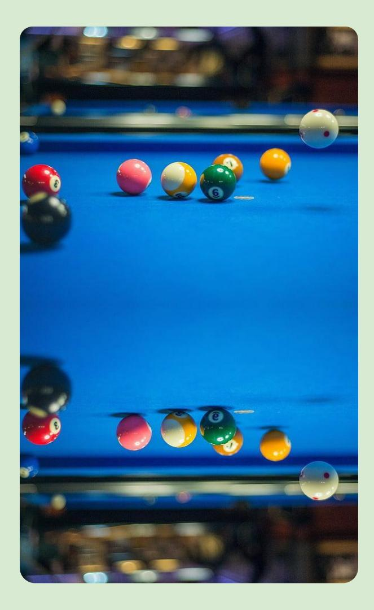
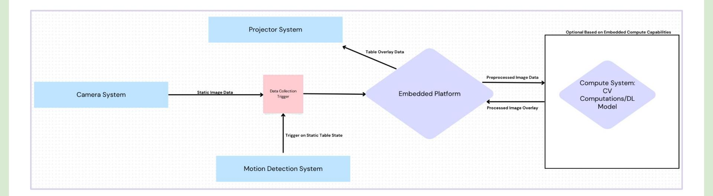

Luke Han (lhhan), Kevin Kyi (kwkyi), Samuel Telanoff (stelanof)

# F1 - DeepCue

ECE Capstone Project Proposal

Our system addresses this problem by detecting all balls on the table and providing real-time shot recommendations, helping players plan both their current shot and set up future shots.

Beginner pool players often struggle to figure out where and how to hit the cue ball because they must account for angle, power, and where the ball will end up after the shot.

### Problem Areas Solution

Software - Computer vision, shot simulation/algorithm

Hardware - Embedded System (Raspberry Pi vs Nvidia Jetson), Camera System

Signals and Systems - Communication between camera, processing unit, and display/projector

# Use Case

# Use Case Requirements

|Component Quantitative Requirement Justification |  |  |  |  |  |
|--------------------------------------------------------------- | ------------ | ----------- | ------------ | ------- | ---------- |
|Latency Data Exchange (camera -> |  |  |  |  |  |
|processing unit -> display) |  |  |  |  |  |
|should happen within 3 seconds |  |  |  |  |  |
|A player |  | normally | takes | a | couple |
|seconds | to | figure | out | what | their |
|next | shot | should | be so | we | want to |
|have | our | system | calculate |  | in that |
|amount | of | time. | 1 |  |  |
|Motion Detection (non-MVP) Be able to identify that all balls |  |  |  |  |  |
|have stopped moving within 100 |  |  |  |  |  |
|Allows | the | system | to | pause | or |
|delay | processing |  | until | the | table is |
|stable, | preventing |  | inaccurate |  | or |
|unnecessary |  | analyses. |  |  |  |
|Ball Detection Be able to detect pool balls within |  |  |  |  |  |
|0.5 in |  |  |  |  |  |
|Detect | ball | positions | in | order | to |
|accurately |  | simulate | and | find | best |
|Simulation Complete physics-based shot |  |  |  |  |  |
|simulation and selection within 2 |  |  |  |  |  |
|Ensure | timely | results, |  | keeps | up |
|the | pace | of the | gameplay, |  | and |
|better | shot | accuracy |  |  |  |

- 1. Quickly detecting the position of each ball using CV as soon as no motion is being detected.
- a. We will need to deal with camera issues including different lighting, image distortion, and if the camera has been or is being moved
- 2. Accounting for extraneous factors in our physics simulation
- a. There can be cases where something outside of our control affects a users shot
- b. Different people hit the cue ball with different strengths and with different spin, hard to account
- 3. Communication and computation latency of our system
- a. Simulation latency can be high depending on the complexity of it (how many moves ahead do we look, factoring in spin, how many bounces do we allow)
- b. Communication latency can be tough as we will need to transport large amounts of data (ball position, shot selection, shot display)

# What are the key technical challenges to meeting these requirements?

The most challenging issue we are facing is finding a balance between accuracy vs timing of our system. This ties into our algorithmic complexity.

To mitigate risks involving compute vs latency, we will be implementing a multi-tiered approach:

- 1. Optimizing our algorithms to reduce computational overhead while maintaining precision
- 2. Adapting our system to allow for dynamic trade-offs between speed and accuracy based on real-time constraints
- 3. Conducting extensive performance testing to identify bottlenecks and continuously refine our system.

# What risk mitigation plans do you have in place for the most challenging of the issues?

# Solution Approach - Block Diagram of Hardware + Software Interaction

# Solution Approach - Computer Vision

- ● Hardware of CV System
- 1080p Camera: Good tradeoff between high resolution and bandwidth/latency of data transfer/processing
- Raspberry Pi/Jetson Nano: Strong compute power for CV algorithm and ball categorization
- ● Software of CV System
- Edge detection to figure out boundary of the pool table used in physics simulation
- Use frameworks like OpenCV for image processing and ball detection
- Ball categorization using color detection for placement in 3 categories(Solid, Stripe, Cue)
- (If Needed) TensorFlow/Pytorch for training a neural network for ball classification.

# Solution Approach - Physics Simulation

- ● Algorithmic portion of physics system
- The backend algorithm will be written in python using outside libraries such as numpy, scipy, etc.
- Implement the physics engine (including spin) based on previous research papers1,2
- ● Software support for developing physics system
- Use framework libraries such as PyBullet or Unity for physics based simulations
- Use MatPlotLib or other libraries to create the display overlay

### Solution Approach - Communication and Peripheral Hardware

### Communication:

- ● We will use WIFI as our protocol for transferring information between different parts of our system such as the camera, embedded platform, and projector (tradeoffs between WIFI, UART, I2C, etc.)

### Peripheral Hardware:

- 1080p camera for static table image capture
- Projector to accurately and quickly displays our best–shot selection in real time
- LIDAR as a motion detector (Post process our image stream to use SW to detect motion.)
- Embedded hardware to satisfy the compute capabilities of our system due to the intensive/complex nature of our project, with potential to offload processes to external compute environment.
- Two options based on tradeoffs between cost and performance: NVIDIA Jetson Nano (built in GPU for CV tasks but high power consumption/cost) vs Raspberry Pi 4 w/ TPU (Low Cost, capable of running light NN's but struggle with more complex computations)

- 1. Computer Vision
- a. Criteria (Be able to do all of this within 100 ms):
- i. Accurately pinpoint position of every ball on pool table (within 0.5 inches)
- ii. Be able to distinguish ball between cue, stripes, solids
- iii. Accurately pinpoint position of holes and walls of pool table (within 0.5 inches)
- b. How?
- i. Placing cue ball/pool balls in random positions and identifying them with our CV algorithm
- ii. Compare CV outputted coordinates with real-world coordinates of balls
- 2. Physics Simulation
- a. Criteria (Be able to to do all of this within 2 seconds):
- i. Successfully simulates a particular shot
- ii. Finds all shots we can take to pot a ball
- iii. Finds the best possible shot
- b. How?
- i. Unit tests
- ii. Output all shots or best shot as an image and verify that this would work

# Testing, Verification, and Metrics

- 3. Projector Display
- a. Criteria:
- i. Displays best shot data accurately on board (within 5 degrees)
- b. How?
- i. Project best shot data and compare with the image generated from physics simulation test cases
- ii. Ensure overlay properly scales to the board
- 4. Latency
- a. Criteria:
- i. Computes everything within 3 seconds
- b. How?
- i. Measure time between when balls stop moving and when display is projected

# Testing, Verification, and Metrics

# Schedule, Tasks, and Division of Labor