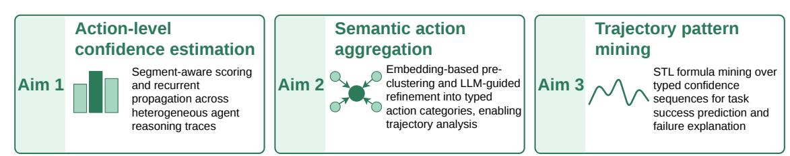
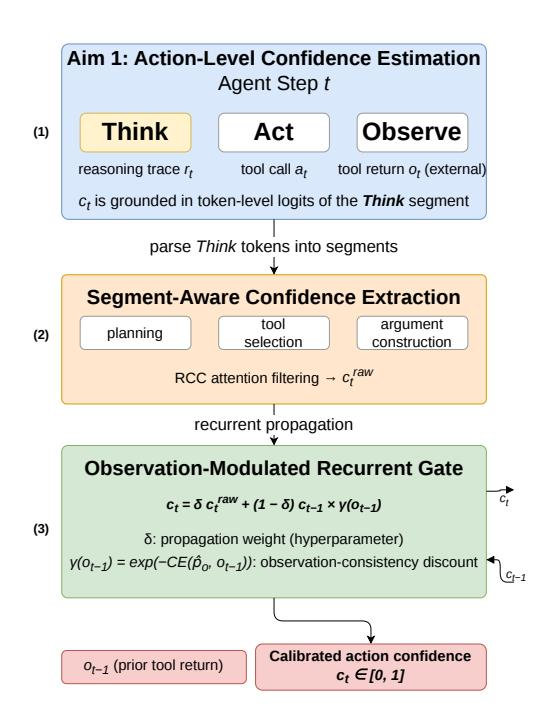
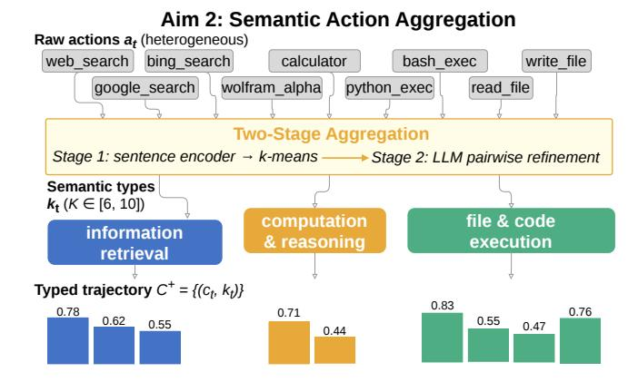
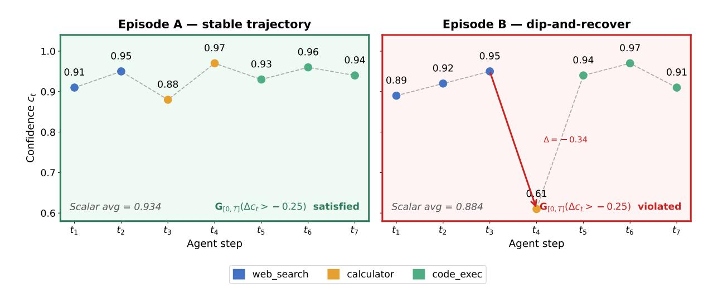
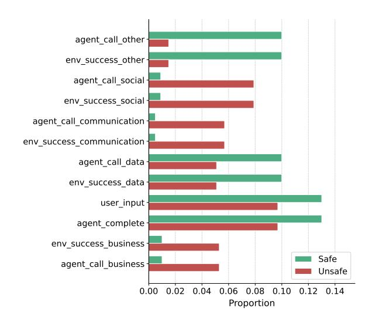

## Thesis Proposal: When Does an Agent Know It Is Lost? Confidence Trajectory Analysis for Tool-Using LLMs

Zhenjiang Mao University of Florida

## Abstract

Large language model (LLM) agents that invoke external tools must make sequences of interdependent decisions, yet existing uncertainty quantification (UQ) methods treat each step in isolation, ignoring how confidence evolves and compounds across a full task trajectory. We propose a framework for trajectory-level confidence analysis in the tool-use agent setting. The thesis pursues three aims: (1) estimating action-level confidence by adapting step-wise UQ to the heterogeneous think-act-observe cycles of tool-using agents; (2) aggregating the diverse action space into semantically coherent action types to enable meaningful trajectorylevel analysis; and (3) discovering temporal patterns in the resulting confidence trajectories that reliably predict task success or failure. We ground the work in standard tool-use benchmarks and expect the framework to expose early warning signals for agent failure and offer interpretable diagnostic tools for understanding when and why LLM agents lose confidence, with improved calibration of multi-step agentic pipelines as a secondary benefit.

## 1 Introduction

LLM agents that use external tools (searching the web, querying databases, executing code) are now routinely deployed on complex, multi-step tasks (Yao et al., 2023; Qin et al., 2024). A tool-use episode unfolds as a sequence of heterogeneous actions: the agent thinks (produces a reasoning trace), acts (selects and invokes a tool), and observes (incorporates the tool's return into its next reasoning step). Errors cascade: a hallucinated API argument produces a misleading observation that corrupts all subsequent decisions (Cemri et al., 2025), yet the agent receives no external signal until the task terminates. Detecting mounting uncertainty within a trajectory, before failure is irreversible, is therefore both practically urgent and theoretically underexplored.

Uncertainty quantification (UQ) has advanced considerably for single-turn generation (Kuhn et al., 2023; Duan et al., 2024) and step-level chain-ofthought reasoning (Zhang and Zhang, 2025; Li et al., 2025). Recent work introduced recurrent confidence chains (RCC) that propagate calibrated confidence scores across CoT steps via inter-step attention (Mao and Venkat, 2026), and showed that STL-based temporal pattern mining over these signals provides discriminative temporal features that separate correct from incorrect reasoning trajectories (Mao et al., 2025a, 2026). Recent agentic extensions (Zhao et al., 2025; Duan et al., 2025; Zhang et al., 2026) have begun propagating uncertainty across agent steps, yet all treat the action space as monolithic, computing one uncertainty signal per step regardless of whether that step involves tool selection, argument construction, or observation interpretation. In tool-use settings, these action types carry fundamentally different uncertainty profiles and failure modes, a distinction that flat trajectory approaches cannot capture.

This proposal addresses the gap through three research aims, illustrated in Figure 1. The primary thesis claim is that typed confidence trajectories, where each step is annotated with its semantic action type, yield more predictive and more interpretable failure signals than flat (untyped) uncertainty estimates that ignore action semantics. Aim 1 adapts the RCC framework to the think-actobserve cycle of tool-using agents, estimating a calibrated, segment-wise confidence score ct for each step of a tool-use episode. Aim 2 maps raw agent actions to a compact set of semantic types kt, combining embedding-based clustering and LLMguided categorization, so that confidence signals can be compared within and across action categories and form a typed trajectory C + = {(ct, kt)}. Aim 3 mines Signal Temporal Logic (STL) formulae over C + to predict task success and expose interpretable failure-mode patterns, extending STL-

# Confidence Trajectory Analysis for LLM Tool-Use Agents

Figure 1: Overview of the proposed three-aim framework.

based reasoning analysis (Mao et al., 2026) to the agentic setting. Together, the three aims form a unified pipeline that exposes early warning signals for agent failure and provides interpretable diagnostics for understanding when and why LLM agents lose confidence in complex tasks.

While each aim draws on prior techniques, the contributions are not merely integrative. Aim 1 introduces an observation-consistency discount γ(ot−1) that modulates recurrent confidence propagation based on the agreement between predicted and actual tool returns, a mechanism with no analogue in existing CoT-focused UQ methods, which lack structured external observations entirely. Aim 2 produces a typed trajectory C + that pairs each confidence score with a semantic action label, a representation that prior agentic UQ work (Zhao et al., 2025; Duan et al., 2025; Zhang et al., 2026) does not construct. Aim 3 extends the STL grammar with typed atomic propositions pk,θ and typetransition predicates qk1,k2, enabling temporal patterns that are both portable across episodes and grounded in action semantics, a qualitative advance over position-based or flat-signal pattern mining.

The remainder of this proposal is organized as follows. Section 2 surveys related work. Section 3 details the three aims. Section 4 presents preliminary results. Section 5 outlines the research timeline.

## 2 Related Work

#### 2.1 Uncertainty Quantification in LLM Reasoning

Confidence estimation for LLMs has evolved from token-level probability aggregation to semantically grounded methods. Semantic entropy (Kuhn et al., 2023) showed that meaningful UQ must cluster equivalent meanings rather than raw tokens, and subsequent work addressed step-level confidence in chain-of-thought reasoning via attention reweighting (Duan et al., 2024; Li et al., 2025; Zhang and Zhang, 2025). RCC (Mao and Venkat, 2026) introduced recurrent confidence propagation with inter-step attention, substantially improving calibration on multi-step reasoning benchmarks; building on RCC, Mao et al. (2025a) and Mao et al. (2026) applied Signal Temporal Logic (STL) to the resulting confidence trajectories to discover discriminative temporal patterns. The present proposal extends these ideas to the richer, tool-augmented action sequences of LLM agents.

## 2.2 LLM Agents and Tool Use

ReAct (Yao et al., 2023) established the canonical think-act-observe paradigm, and subsequent work scaled tool use to thousands of real-world APIs (Qin et al., 2024; Schick et al., 2023; Patil et al., 2024). Failure analyses (Cemri et al., 2025) identify error propagation, where a single misstep cascades through subsequent decisions, as the dominant failure mode, motivating trajectorylevel confidence monitoring. Benchmarks such as AgentBench (Liu et al., 2024) and API-Bank (Li et al., 2023) provide standardized evaluation environments for the planned experiments. Beyond raw capability evaluation, Cemri et al. (2025) provide a systematic failure taxonomy, identifying five recurring error modes across multi-agent pipelines: task decomposition errors, tool selection mistakes, argument hallucinations, observation misinterpretations, and synthesis failures. Critically, these error types map onto distinct segments of the thinkact-observe cycle: tool selection and argument errors originate in the Think step's reasoning trace, while observation errors arise at the boundary between the tool return and subsequent reasoning. This structural correspondence directly motivates Aim 1's segment-wise confidence extraction: by computing separate confidence estimates for the planning, tool selection, and argument construc- tion sub-parts of each Think step, the framework produces diagnostic signals aligned with the empirically observed failure taxonomy, rather than conflating all uncertainty sources into a single perstep scalar.

#### 2.3 Confidence Calibration for Agentic Systems

Extending calibration to sequential LLM outputs introduces new challenges: distribution shifts from tool returns, compounding errors, and the mismatch between local and global task success. Conformal prediction offers distribution-free coverage guarantees for sequential settings (Gibbs and Candès, 2021; Xu and Xie, 2023) and has been adapted to LLM generation (Quach et al., 2024); the present work complements this line by targeting interpretable temporal patterns rather than coverage sets. SAUP (Zhao et al., 2025) propagates uncertainty via Hidden Markov Models; UProp (Duan et al., 2025) decomposes trajectory uncertainty into intrinsic and inherited components; and HTC (Zhang et al., 2026) extracts cross-step dynamics to train interpretable calibrators across eight benchmarks. Despite this progress, no existing work models how confidence trajectories vary by action type within tool-use episodes, nor applies temporal logic-based pattern mining to typed confidence sequences. Concurrent surveys and position papers have further highlighted the foundational gaps in agentic UQ (Oh et al., 2026; Kirchhof et al., 2025), and recent work has explored uncertainty-guided clarification as a complementary strategy for reducing agent errors (Suri et al., 2026). The importance of well-calibrated confidence in safety-critical decision-making has also been demonstrated in autonomous systems, where miscalibrated predictions directly translate to unsafe actions (Mao et al., 2024, 2025b); our work pursues the analogous reliability goal for LLM agents. p̂o

### 2.4 Action Aggregation and Abstraction

The heterogeneous action space of tool-using agents must be reduced to interpretable categories before trajectory-level analysis becomes tractable. ClusterLLM (Zhang et al., 2023) leverages instruction-tuned models for semantic clustering, Clio (Tamkin et al., 2024) scales this to millions of interactions, and AgentLens (Lu et al., 2025) constructs hierarchical behavioral models from raw agent logs. The action aggregation mod-

Figure 2: Aim 1 framework for action-level confidence estimation. The LLM's Think segment logits are parsed into functional sub-segments and filtered via RCC attention weighting to produce a raw score c raw t, which is then propagated recurrently across steps with an observation-consistency discount γ(ot−1) that suppresses confidence when prior tool returns contradict the agent's expectation.

ule proposed here draws on these techniques to group tool-use steps into coherent types, bridging raw token-level uncertainty and task-level outcome prediction.

#### 3 Confidence Trajectory Analysis for Tool-Using Agents

#### 3.1 Aim 1: Action-Level Confidence Estimation

Aim 1 How can we estimate calibrated, segment-wise confidence scores for the heterogeneous think-act-observe cycles of tool-using agents?

Motivation. Tool-use agents generate qualitatively different traces from standard CoT: reasoning steps are interleaved with structured API invocations, partial observations from prior tool returns are embedded mid-trace, and a single step may span decomposing a query, selecting a tool, and constructing its arguments. Naively applying single-step UQ methods conflates uncertainty from

different sources and misses the structural regularities that carry the most diagnostic signal. Furthermore, step-level uncertainty does not evolve independently: a confidently wrong action at step t produces a misleading tool observation that can inflate apparent certainty at step t+1, masking the true compounding error. Recurrent propagation is therefore essential to track how uncertainty accumulates across the episode rather than treating each step in isolation.

Approach. We adapt the training-free Recurrent Confidence Chain (RCC) (Mao and Venkat, 2026) to the tool-use setting via two extensions, illustrated in Figure 2.

(1) Segment-wise confidence extraction. At each step t, the LLM autoregressively generates both the reasoning trace rt and the tool-call action at as a single token sequence. The confidence ct is grounded in the token-level logits of the Think segment, reflecting the LLM's certainty over the reasoning that precedes the action decision. We parse this segment into three functional sub-parts (planning, tool selection, and argument construction) and apply the RCC procedure to each: build an inter-segment attention matrix, normalize with softmax, filter low-weight tokens via the Heaviside step function, and compute a segment-level confidence score as the weighted average of non-zero token logits. The three segment scores are combined into a step-level raw score c raw t. Note that the tool return ot is produced by an external tool, not the LLM, and therefore carries no token-level logits; it enters the framework only as a modulating signal in step (2).

(2) Observation-modulated recurrent propagation. Following the RCC recurrent update, confidence propagates across steps as:

ct = δ craw t + (1 − δ) ct−1 × γ(ot−1), (1)

Challenges. The current formulation uses coarse return categories for tractability; richer structured observation scoring (e.g., embedding-based similarity between predicted and actual returns) is left for future work. Agent reasoning traces can span hundreds of tokens per step, whereas the original RCC targets CoT traces of 50–100 tokens; we will investigate sliding-window attention within each segment and sentence-level compression. For black-box APIs without logit access, we fall back to consistency-based confidence estimation via multiple samples (Wang et al., 2023), incurring roughly N× inference cost (where N is the number of samples, typically 5–10) in exchange for losing segment-level granularity. Adapting gracefully to out-of-distribution observations is a recurring challenge across agent settings; analogous robustness strategies have been explored for visual control under input corruption (Sobolewski et al., 2025).

Evaluation. Step-level calibration is assessed using episode outcome as a weak supervision signal: across held-out tool-use episodes with known success/failure labels, we aggregate per-step ct scores (via mean and minimum pooling) and compute ECE and NLL against the binary episode outcome. We compare against SAUP (Zhao et al., 2025) and consistency-based baselines on ToolBench and AgentBench.

Figure 3: Aim 2 aggregates heterogeneous raw tool calls (grey, top) into semantically coherent action types via two-stage clustering, producing the typed confidence trajectory C + = {(ct, kt)} (colored bars, bottom) that enables semantically grounded STL pattern mining in Aim 3.

## 3.2 Aim 2: Semantic Action Typing

Aim 2 How can the heterogeneous action space of tool-using agents be typed into semantically coherent categories to enable meaningful trajectory-level confidence analysis?

Motivation. Aim 1 produces a per-step confidence score ct, but a flat sequence (c1, c2,..., cT) alone is insufficient for the temporal pattern mining of Aim 3. An STL formula mined from raw step indices (e.g., "confidence is low at step 3") is position-specific and cannot generalize across episodes where step 3 may correspond to entirely different operations. What we need instead are semantically grounded patterns: "confidence is systematically low during retrieval steps," or "confidence drops whenever the agent transitions from retrieval to synthesis." Such patterns are portable across episodes and benchmarks, and they yield actionable diagnostics that pinpoint which class of operation drives agent failure. We therefore seek a mapping α: at 7→ kt ∈ {1,..., K} so that Aim 3 can mine STL formulae over the typed trajectory C + = {(ct, kt)} T t=1 rather than over raw step positions, as illustrated in Figure 3.

Approach. We propose a two-stage pipeline. Stage 1 encodes each action as a triple (tool name, argument string, API documentation) via a sentence encoder and clusters the resulting embeddings with k-means. Stage 2 follows Cluster-LLM (Zhang et al., 2023): an LLM refines clusters via pairwise comparisons and generates humaninterpretable type labels (e.g., information retrieval, arithmetic reasoning, result synthesis), yielding

K ∈ [6, 10] stable types. The target range for K is empirically motivated by the SVD rank analysis in Section 4.3, where effective ranks of 3–7 captured dominant behavioral structure; while SVD rank and semantic cluster count measure different quantities, the former provides a reasonable heuristic starting point for the latter. We plan ablation over K as part of the Aim 2 evaluation, and will assess taxonomy stability across random seeds, clustering hyperparameters, and benchmarks using cluster agreement metrics and downstream prediction variance.

Typed trajectory. The output C + = {(ct, kt)} T t=1 feeds directly into Aim 3, enabling STL formulae grounded in action semantics rather than step position.

Evaluation. Taxonomy quality is assessed via inter-annotator agreement: three NLP researchers independently assign 200 held-out actions per benchmark to the LLM-generated type labels, with Krippendorff's α ≥ 0.6 as the acceptance threshold. Downstream impact is measured by comparing an Aim 3 STL classifier trained on typed trajectories C + against one trained on flat, untyped trajectories C (confidence scores only), directly quantifying the added predictive value of action-type annotation.

#### 3.3 Aim 3: Temporal Pattern Mining for Failure Prediction

Aim 3 What temporal patterns in typed confidence trajectories reliably predict task success or failure, and can they support early-exit failure warnings before a task is complete?

Motivation. A trajectory where confidence steadily declines across retrieval steps before a synthesis step is more failure-prone than one that is high and stable. Prior work (Mao et al., 2026) showed that STL formulae can capture exactly such patterns in CoT reasoning; Aim 3 extends this to the typed, tool-augmented trajectory C +.

Approach. We define typed atomic propositions pk,θ:= (ct ≥ θ) ∧ (kt = k) and type-transition predicates qk1,k2:= (kt−1=k1) ∧ (kt=k2), and build composite formulae using the STL Always (G) and Eventually (F) operators, following the grammar of Mao et al. (2026). Example discriminative formulae:

φ1 = G[0,5] (pret, 0.6), φ2 = F[0,T] (qret,syn ⇒ G psyn, 0.5).

We extend the discriminative STL mining procedure of Mao et al. (2026) to the typed grammar, using a branch-and-bound search over typed atomic propositions and type-transition predicates, and augmenting each mined formula with an LLMgenerated natural-language description to support human interpretability. The typed grammar introduces O(K2 · |Θ|) candidate atomic propositions per formula depth level; we constrain search by limiting formula depth to D ≤ 3 and exploiting robustness-score monotonicity for pruning, which kept mining tractable in prior work on trajectories of comparable length (Mao et al., 2026). Robustness scores {ρ(φi, C +)} serve as features for a lightweight classifier (logistic regression or gradient-boosted trees) predicting binary task success. Because STL robustness is defined over trajectory prefixes, the classifier can issue earlyexit failure warnings mid-episode, before the agent commits to an irrecoverable path.

Evaluation. We evaluate on ToolBench (Qin et al., 2024), AgentBench (Liu et al., 2024), and API-Bank (Li et al., 2023) against SAUP (Zhao et al., 2025) and HTC (Zhang et al., 2026) baselines, measuring AUROC, ECE, and early-exit accuracy as a function of prefix length (against scalar confidence thresholding and SAUP prefix predictions as early-exit baselines). Critically, we include an internal ablation comparing the full typed trajectory C + against a flat, untyped variant C (same confidence scores, no action-type annotations) under identical STL mining, to directly test the thesis claim that typing improves predictive power

Table 1: RCC confidence estimation results on multistep reasoning benchmarks (Qwen3-8B). Lower is better for both metrics.

|Method | NLL ↓ | GAOKAO-Math ECE% | ↓ NLL ↓ | CLadder ECE% ↓ |
|------------------ | ------- | ------------------ | --------- | ---------------- |
|Logits (Final) | 4.369 | 18.95 | 5.722 | 21.21 |
|Logits (Average) | 0.558 | 14.04 | 0.552 | 12.57 |
|Self-Evaluation | 3.533 | 16.93 | 4.957 | 17.59 |
|Self-Consistency | 1.573 | 12.19 | 3.763 | 11.42 |
|SAR | 0.932 | 13.87 | 1.008 | 8.19 |
|UQAC | 0.729 | 10.07 | 2.271 | 6.36 |
|RCC | 0.445 | 3.63 | 0.549 | 5.13 |

and interpretability. Human-rated interpretability of mined formula descriptions is assessed via a 5 point Likert scale by three NLP researchers selecting from a predefined set of action-type labels, reporting mean score and inter-annotator agreement via Krippendorff's α.

### 4 Preliminary Results

We report preliminary results from two lines of work: (1) completed prior studies on confidence estimation and temporal pattern mining for multistep LLM reasoning (Sections 4.1–4.2), and (2) a pilot study on semantic action aggregation for tooluse agent trajectories that motivates Aim 2 (Section 4.3).

#### 4.1 Aim 1 Foundation: Recurrent Confidence Chains

The RCC framework (Mao and Venkat, 2026) has been evaluated on two multi-step reasoning benchmarks (GAOKAO-Math and CLadder) using Qwen3-8B and Gemma3-12B as base models. Table 1 reports NLL and ECE against five baselines. On Qwen3-8B, RCC achieves an ECE of 3.63% on GAOKAO-Math and 5.13% on CLadder, substantially outperforming all baselines (the best competitor, UQAC, obtains 10.07% and 6.36%, respectively). NLL follows a similar pattern (0.445 vs. 0.729 for UQAC on GAOKAO-Math). These results demonstrate that the inter-step attention and recurrent propagation mechanisms at the core of RCC produce well-calibrated, temporally coherent confidence estimates for multi-step reasoning, the same signal quality that Aim 1 seeks to extend to tool-use agent traces.

Figure 4: Case study on ToolBench comparing scalar confidence and STL-based estimation. Left (Episode A, task succeeded): confidence remains high and stable throughout; the STL formula G0,T is satisfied. Right (Episode B, task failed): a sharp confidence drop at t4 (∆ = −0.34) is followed by recovery, leaving the scalar average (0.888) deceptively high; the same STL formula is violated, correctly flagging the failure.

#### 4.2 Aim 3 Foundation: STL-Based Confidence Pattern Mining

Building on RCC, the STL-based temporal pattern mining approach (Mao et al., 2026) has been evaluated on four reasoning benchmarks (SciQ, CLadder, GAOKAO-Math, BBH) across three base models (Qwen3, Gemma3, Llama). The method mines discriminative STL formulae from per-step confidence trajectories and uses their robustness scores to calibrate uncertainty estimates via a lightweight hypernetwork. On CLadder with Qwen3, this approach achieves ECE = 0.035 and Brier = 0.172, compared to 0.057 and 0.178 for the best ablation variant (indomain STL without adaptive parameterization), and 0.200 and 0.230 for the AveLogit baseline. Across all 12 model–dataset combinations, the full method achieves the best or second-best ECE in 10 out of 12 settings. These results validate that STLbased temporal pattern mining over confidence trajectories is a powerful mechanism for capturing failure-predictive dynamics, a capability that Aim 3 will extend from single-chain reasoning to typed, tool-augmented agent trajectories.

#### 4.3 Pilot Study: Semantic Action Aggregation for Tool-Use Trajectories

To motivate Aim 2, we conducted a pilot study demonstrating that the heterogeneous action space of tool-use agents harbors compressible, behaviorally meaningful structure, a prerequisite for any aggregation method, including the embeddingbased approach proposed in Aim 2.

Table 2: Tool-use trajectory dataset statistics after discretization.

|Dataset | Trajs | Avg. len | p | Tokens |
|------------ | ------- | ---------- | ---- | -------- |
|ATBench | 500 | 9.0 | 26 | 4,486 |
|ALFWorld | 2,420 | 13.3 | 70 | 32,247 |
|Tool-movie | 215 | 3.9 | 17 | 844 |

Datasets and discretization. We collected agent trajectories from three benchmarks spanning different tool-use paradigms: ATBench (Liu et al., 2026) (500 trajectories, 250 safe / 250 unsafe, p=26 discrete states), ALFWorld (Shridhar et al., 2021) (2,420 trajectories, ReAct format, p=70), and Toolmovie, a movie-domain subset of ToolBench (Qin et al., 2024) (215 trajectories, 15 tools, p=17). Each trajectory was discretized into a sequence of semantic states via dataset-specific rules: for AT-Bench, a triple of (role, action type, tool category); for ALFWorld, (action verb, object group, observation result); for Tool-movie, (tool name, return status). Table 2 summarizes the dataset statistics.

State aggregation via SVD. We construct an empirical transition matrix Pˆ ∈ R p×p from the discretized trajectories and apply Singular Value Decomposition to identify a low-rank structure. Following the Successive Projection Algorithm (SPA), we select r anchor states and compute a soft assignment matrix Uˆ ∈ R p×r that maps the p original states into r meta-states. The aggregated meta-transition matrix Tmeta ∈ R r×r captures the dominant behavioral patterns while compressing

Figure 5: ATBench: the 12 discrete states with the largest proportional difference between safe (n=250) and unsafe (n=250) trajectories. Unsafe trajectories disproportionately use social and communication tools, while safe trajectories favor data queries and miscellaneous utilities.

the state space. We then score each trajectory by its log-likelihood under the meta-model and use these scores for downstream anomaly detection and safety classification.

Safe vs. unsafe behavioral signatures. On AT-Bench, where ground-truth safety labels are available, we observe clear structural differences between safe and unsafe trajectories at the state level. Figure 5 shows the 12 states with the largest distributional divergence: unsafe trajectories are significantly skewed toward social and communication tool categories (7.9% vs. 0.9% and 5.7% vs. 0.5%, respectively), while safe trajectories make greater use of data (10.0% vs. 5.1%) and other (10.0% vs. 1.5%) tools. These distributional differences confirm that the discrete state representation preserves behaviorally meaningful structure.

Anomaly detection results. Table 3 reports AU-ROC for binary safety classification (ATBench) and failure detection (ALFWorld) using SVD-based state aggregation at the best rank r, compared against four baselines. On ATBench, the top-3 SVD components achieve AUROC = 0.935, outperforming all baselines including the strongest competitor, Frequency (0.911). On ALFWorld, SVD-based aggregation achieves AUROC = 0.879 at r=7, surpassing Frequency (0.860) and Raw-Transition (0.843).

Table 3: Anomaly detection AUROC for SVD-based state aggregation vs. baselines. ATBench: safe/unsafe classification (mean over top-3 SVD ranks r ∈ {1, 2, 3}); ALFWorld: failure detection (best rank r).

|Method | ATBench | ALFWorld |
|--------------- | --------- | ---------- |
|KMeans | 0.639 | 0.603 |
|NMF | 0.617 | 0.737 |
|RawTransition | 0.847 | 0.843 |
|Frequency | 0.911 | 0.860 |
|SVD Agg. | 0.935 | 0.879 |

Connection to Aim 2. The SVD results establish that tool-use trajectory state spaces exhibit lowrank, compressible structure, a necessary condition for any aggregation approach to succeed. The embedding-based method proposed in Aim 2 targets the same compression goal but operates in a continuous semantic space rather than a discrete transition space, enabling generalization to unseen tools and action formats not present in training data. The SVD analysis also provides a heuristic reference for K: the effective ranks of 3–7 that captured dominant structure across the three benchmarks suggest a plausible order of magnitude for the number of semantic action types, though the correspondence between dynamical modes and semantic clusters is indirect and will be validated empirically.

Summary and implications. These preliminary results establish three findings that support the proposed thesis: (i) the RCC confidence estimator produces well-calibrated step-level signals (ECE as low as 3.63%), providing the input quality needed for Aim 1's extension to agent traces; (ii) the action space of tool-use agents contains low-rank, discriminative behavioral structure (AUROC up to 0.935 with SVD aggregation), motivating the semantic clustering approach of Aim 2; and (iii) STLbased temporal pattern mining over confidence trajectories achieves strong calibration across diverse reasoning tasks, motivating its extension to typed agent trajectories in Aim 3.

## 5 Research Plan

Table 4 outlines the three-semester plan. The central challenge is transitioning from closed-form reasoning traces to the richer, tool-augmented trajectories of LLM agents. Semester 1 validates that RCC signal quality transfers to agent traces (Aim 1). Semester 2 develops the action aggregation module (Aim 2) and prototypes STL mining for Aim 3. Aim 2 can proceed in parallel with Aim 1 since clustering requires only action metadata; Aim 3 can be prototyped with proxy confidence scores from existing UQ baselines to reduce schedule risk. Primary benchmarks are AgentBench, API-Bank, and ToolBench, with extension to WebArena (Zhou et al., 2024) planned for Semester 3. To address the complexity gap noted by reviewers, Semester 3 will also incorporate SWE-rebench (Trofimova et al., 2025), comprising 67,074 real-world software engineering trajectories from GitHub issues with complete think-act-observe traces, and AgentReward-Bench (Lù et al., 2025), a 1,302-trajectory benchmark with expert annotations spanning task success, side effects, and repetition cycles, collectively providing a substantially more challenging evaluation surface than the ALFWorld pilot.

Each aim has an independent evaluation criterion: Aim 1 on step-level ECE and NLL; Aim 2 on inter-annotator agreement between LLMderived and human action-type labels (three NLP researchers select from the LLM-generated label set on 200 actions per benchmark; Krippendorff's α ≥ 0.6 required); Aim 3 on AUROC for task success prediction and early-exit lead time. Fallback strategies: if Aim 1 yields weak calibration on agent traces, Aim 3 can operate on flat (untyped) confidence sequences; if Aim 2's taxonomy proves benchmark-specific, we fall back to toolname grouping.

Hyperparameter tuning strategy. The framework introduces several hyperparameters: δ ∈ (0, 1) (recurrent propagation weight in Aim 1), K ∈ [6, 10] (number of action types in Aim 2), formula depth D ≤ 3 and threshold set Θ (Aim 3 mining). All hyperparameters are tuned on a heldout validation split of each benchmark (20% of trajectories), with the test set withheld until final evaluation. We report sensitivity analyses for δ and K across their full candidate ranges; D and |Θ| are fixed by computational budget and monotonicitybased pruning as in prior work (Mao et al., 2026).

### 6 Conclusion

This thesis proposal presents a framework for trajectory-level confidence analysis in tool-using LLM agents through three coordinated aims: action-level confidence estimation (Aim 1), semantic action typing (Aim 2), and discriminative STL pattern mining over typed confidence trajectories

Table 4: Planned research timeline.

|Sem. | Milestone |  |  |  |  |
|------- | ----------- | ----------------------- | ------------ | -------------- | -------------- |
|1 Aim | 1: | RCC → | agent | trace | segmentation |
|+ |  | observation-modulated |  | propagation; | cali |
| | bration | eval. & | paper |  |  |
|2 Aim | 2: |  | two-stage | action | aggregation |
| | pipeline; |  | taxonomy | validation | & paper; |
|Aim | 3: | STL | grammar | extension | & mining |
|3 Aim | 3: | typed | trajectory | mining, | early |
|exit | eval., | broader |  | benchmarks | (e.g., We |
| | bArena), | paper; | thesis | writing & | defense |

for task success prediction and early failure detection (Aim 3). Supported by preliminary results on multi-step reasoning benchmarks and tool-use trajectory datasets, the framework addresses a gap that existing UQ methods leave open: understanding when and why LLM agents lose confidence in complex, multi-step tasks.

## 7 Limitations

The proposed framework has several limitations. First, Aim 1 requires token-level log-probabilities, restricting the full segment-wise method to openweight models; closed-source APIs (e.g., GPT-4o, Claude) fall back to the noisier consistency-based estimator at additional inference cost. Second, Aim 2's taxonomy quality is sensitive to K; a principled stopping criterion for semantic clustering remains open, and taxonomy instability could propagate to the STL patterns in Aim 3. Third, the observation-consistency discount γ relies on handcrafted keyword sets for tool-return categorization, which may be noisy for domain-specific outputs; embedding-based similarity is left as future work.

## Ethics Statement

This work studies confidence estimation for LLM agents and does not involve human subjects or sensitive data. All benchmarks (AgentBench, Tool-Bench, API-Bank) are publicly available. Deploying confidence-aware agent systems in high-stakes settings requires validation beyond the controlled benchmarks studied here; miscalibrated confidence signals could create false assurances of reliability.

## References

Mert Cemri, Melissa Z. Pan, Shuyi Yang, Lakshya A. Agrawal, Bhavya Chopra, Rishabh Tiwari, Kurt Keutzer, Aditya Parameswaran, Dan Klein, Kannan

Ramchandran, Matei Zaharia, Joseph E. Gonzalez, and Ion Stoica. 2025. Why do multi-agent LLM systems fail? arXiv preprint arXiv:2503.13657. Jinhao Duan, Hao Cheng, Shiqi Wang, Alexander Zavalny, Chenan Wang, Renjing Xu, Bhavya Kailkhura, and Kaidi Xu. 2024. SAR: Shifting attention to relevance—towards the predictive uncertainty quantification of free-form large language models. In Proceedings of the 62nd Annual Meeting of the Association for Computational Linguistics (Volume 1: Long Papers), pages 5050–5063. Jinhao Duan, James Diffenderfer, Sandeep Madireddy, Tianlong Chen, Bhavya Kailkhura, and Kaidi Xu. 2025. UProp: Investigating the uncertainty propagation of LLMs in multi-step agentic decision-making. arXiv preprint arXiv:2506.17419. Isaac Gibbs and Emmanuel Candès. 2021. Adaptive conformal inference under distribution shift. In Advances in Neural Information Processing Systems (NeurIPS). Michael Kirchhof, Gjergji Kasneci, and Enkelejda Kasneci. 2025. Position: Uncertainty quantification needs reassessment for large-language model agents. In Proceedings of the 42nd International Conference on Machine Learning (ICML). Lorenz Kuhn, Yarin Gal, and Sebastian Farquhar. 2023. Semantic uncertainty: Linguistic invariances for uncertainty estimation in natural language generation. In The Eleventh International Conference on Learning Representations (ICLR). Minghao Li, Yingxiu Zhao, Bowen Yu, Feifan Song, Hangyu Li, Haiyang Yu, Zhoujun Li, Fei Huang, and Yongbin Li. 2023. API-Bank: A comprehensive benchmark for tool-augmented LLMs. In Proceedings of the 2023 Conference on Empirical Methods in Natural Language Processing (EMNLP). Yinghao Li and 1 others. 2025. Language model uncertainty quantification with attention chain. arXiv preprint arXiv:2503.19168. Dongrui Liu, Qihan Ren, Chen Qian, Shuai Shao, Yuejin Xie, Yu Li, Zhonghao Yang, Haoyu Luo, Peng Wang, Qingyu Liu, and 1 others. 2026. AgentDoG: A diagnostic guardrail framework for AI agent safety and security. arXiv preprint arXiv:2601.18491. Xiao Liu, Hao Yu, Hanchen Zhang, Yifan Xu, Xuanyu Lei, Hanyu Lai, Yu Gu, Hangliang Ding, Kaiwen Men, Kejuan Yang, and 1 others. 2024. AgentBench: Evaluating LLMs as agents. In The Twelfth International Conference on Learning Representations (ICLR). Jiaying Lu, Bo Pan, Jieyi Chen, Yingchaojie Feng, Jingyuan Hu, Yuchen Peng, and Wei Chen. 2025. AgentLens: Visual analysis for agent behaviors in LLM-based autonomous systems. IEEE Transactions on Visualization and Computer Graphics, 31:4182–4194. Xing Han Lù, Amirhossein Kazemnejad, Nicholas Meade, Arkil Patel, Dongchan Shin, Alejandra Zambrano, Karolina Stanczak, Peter Shaw, Christopher J. ´ Pal, and Siva Reddy. 2025. AgentRewardBench: Evaluating automatic evaluations of web agent trajectories. arXiv preprint arXiv:2504.08942. Zhenjiang Mao, Artem Bisliouk, Rakesh Ravi Nama, and Ivan Ruchkin. 2025a. Temporalizing confidence: Evaluation of chain-of-thought reasoning with signal temporal logic. In Proceedings of the 20th Workshop on Innovative Use of NLP for Building Educational Applications. Zhenjiang Mao, Mrinall Eashaan Umasudhan, and Ivan Ruchkin. 2024. How safe Am I given what I see? Calibrated prediction of safety chances for imagecontrolled autonomy. In Proceedings of the 6th Annual Learning for Dynamics and Control Conference (L4DC). Zhenjiang Mao, Mrinall Eashaan Umasudhan, and Ivan Ruchkin. 2025b. How safe will I be given what I saw? Calibrated prediction of safety chances for image-controlled autonomy. arXiv preprint arXiv:2508.09346. Zhenjiang Mao and Anirudhh Venkat. 2026. Recurrent confidence chain: Temporal-aware uncertainty quantification in large language models. arXiv preprint arXiv:2601.13368. Zhenjiang Mao, Anirudhh Venkat, Artem Bisliouk, Akshat Kothiyal, Sindhura Kumbakonam Subramanian, Saithej Singhu, and Ivan Ruchkin. 2026. Confidence over time: Confidence calibration with temporal logic for large language model reasoning. arXiv preprint arXiv:2601.13387. Changdae Oh, Seongheon Park, To Eun Kim, Jiatong Li, Wendi Li, Samuel Yeh, Xuefeng Du, Hamed Hassani, Paul Bogdan, Dawn Song, and Sharon Li. 2026. Uncertainty quantification in LLM agents: Foundations, emerging challenges, and opportunities. Preprint, arXiv:2602.05073. Shishir G. Patil, Tianjun Zhang, Xin Wang, and Joseph E. Gonzalez. 2024. Gorilla: Large language model connected with massive APIs. In Advances in Neural Information Processing Systems (NeurIPS). Yujia Qin, Shihao Liang, Yining Ye, Kunlun Zhu, Lan Yan, Yaxi Lu, Yankai Lin, Xin Cong, Xiangru Tang, Bill Qian, and 1 others. 2024. ToolLLM: Facilitating large language models to master 16000+ real-world APIs. In The Twelfth International Conference on Learning Representations (ICLR). Victor Quach, Adam Fisch, Tal Schuster, Adam Yala, Jae Ho Sohn, Tommi Jaakkola, and Regina Barzilay. 2024. Conformal language modeling. In The Twelfth International Conference on Learning Representations (ICLR). Timo Schick, Jane Dwivedi-Yu, Roberto Dessì, Roberta Raileanu, Maria Lomeli, Luke Zettlemoyer, Nicola

Cancedda, and Thomas Scialom. 2023. Toolformer: Language models can teach themselves to use tools. In Advances in Neural Information Processing Systems (NeurIPS). Mohit Shridhar, Xingdi Yuan, Marc-Alexandre Côté, Yonatan Bisk, Adam Trischler, and Matthew Hausknecht. 2021. ALFWorld: Aligning text and embodied environments for interactive learning. In Proceedings of the International Conference on Learning Representations (ICLR). Caleb Sobolewski, Zhenjiang Mao, Kasper Vejre, and Ivan Ruchkin. 2025. Generalizable image repair for robust visual control. In 2025 IEEE/RSJ International Conference on Intelligent Robots and Systems (IROS). Manan Suri, Puneet Mathur, Nedim Lipka, Franck Dernoncourt, Ryan A. Rossi, and Dinesh Manocha. 2026. Structured uncertainty guided clarification for LLM agents. Preprint, arXiv:2511.08798. Alex Tamkin and 1 others. 2024. Clio: Privacypreserving insights into real-world AI use. arXiv preprint arXiv:2412.13678. Maria Trofimova, Anton Shevtsov, Ibragim Badertdinov, Konstantin Pyaev, Simon Karasik, and Alexander Golubev. 2025. SWE-rebench Open-Hands trajectories. Hugging Face Datasets, https://huggingface.co/datasets/nebius/ SWE-rebench-openhands-trajectories. Xuezhi Wang, Jason Wei, Dale Schuurmans, Quoc V. Le, Ed H. Chi, Sharan Narang, Aakanksha Chowdhery, and Denny Zhou. 2023. Self-consistency improves chain of thought reasoning in language models. In The Eleventh International Conference on Learning Representations (ICLR). Chen Xu and Yao Xie. 2023. Sequential predictive conformal inference for time series. In Proceedings of the 40th International Conference on Machine Learning (ICML). Shunyu Yao, Jeffrey Zhao, Dian Yu, Nan Du, Izhak Shafran, Karthik R. Narasimhan, and Yuan Cao. 2023. ReAct: Synergizing reasoning and acting in language models. In The Eleventh International Conference on Learning Representations (ICLR). Boxuan Zhang and Ruqi Zhang. 2025. CoT-UQ: Improving response-wise uncertainty quantification in LLMs with chain-of-thought. In Findings of the Association for Computational Linguistics: ACL 2025. Jiaxin Zhang, Caiming Xiong, and Chien-Sheng Wu. 2026. Agentic confidence calibration. arXiv preprint arXiv:2601.15778. Yuwei Zhang, Zihan Wang, and Jingbo Shang. 2023. ClusterLLM: Large language models as a guide for text clustering. In Proceedings of the 2023 Conference on Empirical Methods in Natural Language Processing (EMNLP). Qiwei Zhao, Dong Li, Yanchi Liu, Wei Cheng, Yiyou Sun, Mika Oishi, Takao Osaki, Katsushi Matsuda, Huaxiu Yao, Chen Zhao, Haifeng Chen, and Xujiang Zhao. 2025. Uncertainty propagation on LLM agent. In Proceedings of the 63rd Annual Meeting of the Association for Computational Linguistics (Volume 1: Long Papers), pages 6064–6073. Shuyan Zhou, Frank F. Xu, Hao Zhu, Xuhui Zhou, Robert Lo, Abishek Sridhar, Xianyi Cheng, Yonatan Bisk, Daniel Fried, Uri Alon, and Graham Neubig. 2024. WebArena: A realistic web environment for building autonomous agents. In The Twelfth International Conference on Learning Representations (ICLR).