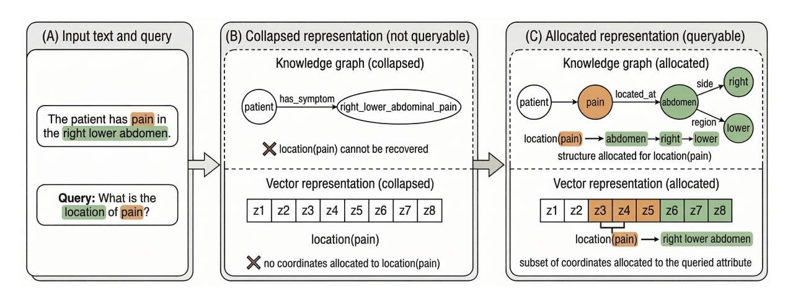

# Thesis Proposal: On the Granularity-Robustness Trade-off in Text-Derived Knowledge Graphs

Surawat Pralomram

Department of Computer Engineering

Faculty of Engineering

Mahidol University

Thailand

surawat.pra@student.mahidol.ac.th

## Abstract

Retrieval-augmented generation (RAG) based on dense embeddings has become a dominant paradigm for text retrieval. However, many real-world applications require attributespecific querying, where explicit values or properties must be extracted from text (e.g., symptoms in clinical notes or dosage values in medical reports). Dense retrieval handles paraphrastic variation well but often entangles multiple attributes within a single embedding, making value extraction difficult. Knowledge graphs (KGs), in contrast, support explicit attribute access but are brittle under linguistic and structural variation, leading to low recall. This thesis proposal aims to investigate the representational trade-off underlying these approaches. We study knowledge graph representations from an information-theoretic and optimal coding perspective, focusing on the tension between fine-grained factorization and compact canonicalization of concepts. Building on this perspective, we propose a query-driven framework for constructing and retrieving knowledge graphs from text, aiming to combine the robustness of dense retrieval with the explicit queryability of symbolic representations.

# 1 Introduction

Retrieval-augmented generation (RAG) has emerged as a prominent paradigm for extending large language models with external knowledge sources (Lewis et al., 2021). In typical RAG systems, documents are embedded into dense vector representations and retrieved using approximate nearest neighbor (ANN) search methods such as HNSW (Malkov and Yashunin, 2016) or IVF-PQ (Jégou et al., 2011). Dense retrieval is effective at handling lexical variation and paraphrases, allowing semantically similar passages to be retrieved even when their wording differs substantially. (Karpukhin et al., 2020)

However, many real-world applications require

attribute-specific querying, where explicit values or properties must be extracted from text rather than simply retrieving relevant passages. Examples include extracting symptoms from clinical notes, retrieving drug dosage information from medical reports, or identifying specific experimental parameters in scientific literature (Du et al., 2019; Mahajan et al., 2023; Farnsworth et al., 2022). In such settings, downstream tasks such as statistical analysis or cohort selection depend on reliably retrieving particular attributes rather than general semantic similarity.

Dense retrieval-based RAG systems may not well suited for attribute-specific querying because a single embedding often compresses multiple semantic aspects of a document, as demonstrated by Zhang et al. (2022), such single-vector representations may fail to match different query "views" of the same document. As an illustrating example, a query for "headache" may fail to retrieve a sentence such as "the patient has headache, stomachache, and toothache" if the embedding reflects the broader symptom context. One workaround is to retrieve broader passages and rely on a downstream extractor or LLM to isolate the attribute (Zhu et al., 2021). However, this shifts the burden of attribute localization to a later stage, increasing computational cost and making performance sensitive to retrieval granularity such as chunk size.

An alternative approach is to represent information using knowledge graphs (KGs), where attributes and relations are explicitly encoded as nodes and edges, allowing queries to target specific concepts directly (e.g., (patient, has_symptom, headache)). In this sense, KGs can be viewed as a symbolic analogue of disentangled representations: Hou et al. (2021), for example, learn attribute-specific subspaces for fashion retrieval so that properties such as color or sleeve type can be queried independently; similarly, KG extraction separates textual attributes

(e.g., symptoms, locations, quantities) into explicit nodes and relations so that each factor can be addressed directly during querying.

However, retrieval based on exact subgraph matching is brittle under linguistic or structural variation: paraphrases, synonymy, or extraction noise may produce graphs that fail to match exactly. A central issue is therefore canonicalization—merging semantically equivalent entities and relations—which has been identified as a key challenge in OpenKG construction (Dash et al., 2020; Zhang and Soh, 2024). Graph-embedding approaches improve robustness but partially reintroduce the entanglement and interpretability problems that explicit graph structure seeks to avoid (Zhang et al., 2021; DeLong et al., 2025).

These observations reveal a representational tension in KG construction: information may be factorized to support fine-grained queryability or coalesced into compact concepts that improve robustness to variation. For example, in a healthcare domain, "A patient arrives at the hospital at 6:00 pm" may be encoded compactly as (patient, arrived_at_hospital_time, 6:00 pm) when arrival time is the primary attribute and the destination is almost always the hospital. In contrast, a logistics domain may require a more factorized representation such as (vehicle, arrived_at, warehouse) and (vehicle, arrival_time, 6:00 pm) because queries may independently target locations, routes, or delivery times. This observation suggests that KG construction may need to be query-aware rather than purely corpus-driven. Peng and Wang (2023) make a related point in a query-driven KG completion framework, where incomplete triples serve as queries and evidence gathering is guided by current information needs. Although narrower than our setting, this work illustrates the broader idea that what should be extracted, normalized, or prioritized may depend on the query itself.

This tension between factorization and aggregation appears across many knowledge representation systems. In database design, normalization separates attributes to support flexible querying, while denormalized schemas collapse frequently co-occurring fields for efficiency in common workloads (Sanders and Shin, 2001). A similar contrast appears in clinical terminologies: SNOMED CT preserves fine-grained compositional structure for precise clinical querying, whereas ICD-10 aggregates conditions into coarser categories for statistical reporting (Vikström et al., 2010). These systems illustrate the same principle: representation design balances queryability against robust aggregation according to anticipated use.

This paper investigates this representational trade-off through an information-theoretic perspective on representation design. We draw connections between knowledge graph construction, representation granularity, and principles from optimal coding, viewing the selective coalescing of graph structures as analogous to allocating representational capacity to frequently queried attributes.

In particular, this thesis proposal addresses the following research questions:

- 1. RQ1: How does representation granularity affect the robustness and accuracy of attributespecific querying?
- 2. RQ2: How can knowledge graphs be constructed from text in a query-driven manner that aligns the representation with anticipated query workloads?
- 3. RQ3: How can queries be matched against such representations efficiently and robustly under structural and linguistic variation?

By studying the interaction between representation design, knowledge graph construction, and retrieval algorithms, this work aims to bridge the robustness of dense retrieval with the explicit queryability of symbolic representations.

## 2 Background

#### 2.1 Knowledge Graphs, Ontologies, and Queryability

Knowledge graphs represent information as structured relational data. Formally, a knowledge graph may be written as

G = (V, E),

where V denotes a set of entities or concepts and E ⊆ V × R × V is a set of typed relations r ∈ R. In practice, graphs are typically stored as triples (h, r, t) (Sardina et al., 2024). What distinguishes KGs from dense representations is that semantic factors are explicitly externalized as graph structure, allowing queries to directly address particular entities, relations, or attributes.

The structure of such graphs is determined by an ontology O, which defines the conceptual vocabulary and permissible relations of the representation.

Figure 1: Value extractability requires representational allocation. Collapsed representations may encode complex concepts such as "right_lower_abdominal_pain" but do not explicitly represent the attribute location(pain), making attribute-specific queries not readily accessible and requiring additional decoding. Representations that allocate explicit structure for the queried attribute (such as a location node in a knowledge graph or a subset of coordinates in a dense vector, i.e., disentangled representations) allow the value to be readily accessed.

If Gd denotes the graph constructed from a document d, then Gd is an instantiation constrained by O. Operationally, the ontology acts as the schema governing how textual statements are decomposed into nodes and relations (Feng et al., 2024; Hogan et al., 2021).

In ontology-based knowledge graph systems, schema design is commonly informed by the kinds of queries the system is expected to support. Because queries can only target semantic factors that are explicitly represented, the ontology influences both how knowledge is encoded and what can be retrieved efficiently (Ortiz, 2013). We observed that frequently queried attributes are often represented using dedicated node types, relations, or canonical concepts.

A recurring design decision concerns the granularity of representation. As illustrated in Figure 1, consider the phrase "The patient has pain in the right lower abdomen." One ontology may represent it compositionally,

(patient, has_symptom, pain) (pain, located_at, abdomen) (abdomen, side, right) (abdomen, region, lower)

while another may introduce a canonical concept corresponding to the symptom complex itself: (patient, has_symptom, right_lower_abdominal_pain). Attributespecific queries contain both a predicate part to be matched and a variable part whose value

should be returned (e.g., in "Which side of the abdomen does the patient have pain?", the predicate part is "...the abdomen does the patient have pain", corresponding to (patient, has_symptom, pain) and (pain, located_at, abdomen), while the variable part "side" is expected to capture the value "right" of (abdomen, side, right)). When the predicate "the abdomen does the patient have pain" is frequent in the query workload, indicating domain importance, it may be useful to encode this motif as a compact shared concept to make predicate matching more efficient and robust. When the attribute "side" is frequent, however, the representation should keep it explicitly accessible rather than folding it into that motif.

In another workload, if queries such as "Who has pain in the right lower abdomen?" are frequent, the full symptom concept "pain in the right lower abdomen" may instead benefit from a compact atomic representation such as right_lower_abdominal_pain, because it is part of the predicate to be matched rather than the variable to be returned. These examples illustrate that query workloads can impose competing representational pressures: one workload may favor separating an attribute such as "side" for value extraction, while another may favor collapsing the same attribute into a compact symptom concept for robust predicate matching. This motivates different representational views that are adapted to anticipated query workloads.

In our view, ontology design allocates representation according to the query workload p(q): factors frequently queried as variable parts should remain explicit for value extraction, while patterns frequently used as predicate parts may be compacted for efficient and robust matching. Prior work similarly shows that schema design often adapts to query requirements: Ahmetaj et al. (2021) observe that ontology-based query answering relies on identifying query-relevant ontology fragments, while Yin et al. (2023) introduce project-specific concepts to support natural-language queries. This issue becomes especially important when KGs are constructed automatically from text, where overly fine-grained schemas produce structurally inconsistent graphs that make subgraph matching brittle, while overly compact representations obscure compositional structure.

#### 2.2 Knowledge Graph Construction as a Coding Problem

We view knowledge graph construction as coding semantic information. Let X denote the semantic content of a document d, and Gd the graph constructed using ontology O. In this view, O acts as a codebook of representational symbols, and constructing Gd amounts to encoding X using those symbols. If the semantics decompose into factors Z = {z1,..., zk}, graph construction corresponds to selecting an encoding c(Z) ⊆ O.

This perspective appears in everyday ontology design decisions. As illustrated earlier, a concept such as RIGHT_LOWER_ABDOMINAL_PAIN may be represented either through a factorized set of triples describing pain in the right lower abdomen or as a single canonical node, two encodings of the same semantic pattern. When such motifs appear frequently, introducing a dedicated concept yields a compact symbolic representation reminiscent of Huffman coding, where frequent patterns receive shorter codes (Huffman, 1952).

Ontology structure can be viewed as reflecting the query distribution p(q): patterns frequently targeted by queries tend to acquire explicit symbols, while others remain compositional. The number of KG nodes used to represent information can therefore be interpreted as a proxy for coding rate: highly factorized representations require more nodes, whereas compact canonical concepts collapse recurring attributes into fewer symbols. We formalize this intuition through maximal coding rate reduction (MCR2) (Yu et al., 2020)

(Buchanan et al., 2025, p. 159):

max Π Rϵ(Z) − R c ϵ (Z | Π).

where Z denotes semantic factors extracted from text and Π partitions the data into subdomains. The term R(Z) corresponds to a general-domain encoding where factors are represented independently, while R(Z | Π) captures the reduced coding cost when domain structure allows certain factors to be collapsed.

Symbolically, we interpret coding rate reduction in knowledge graphs as follows: Consider the sentence "Alice bought a red sports car," with semantic factors {Alice,buy,car,sports,red}. In a general-domain ontology, these may be encoded compositionally as (Alice, bought, car), (car, type, sports), and (car, color, red), corresponding to R(Z). In an automotive analysis domain (Π1), the ontology may instead use (Alice, bought, sports_car) and (sports_car, color, red). In a dealership domain (Π2) where red sports car is treated as a single product category (SKU), the event may be encoded simply as (Alice, bought, red_sports_car). In this symbolic view, collapsing motifs into an atomic concept is analogous to compacting a higher-dimensional distribution into a lowerdimensional subspace. A semi-symbolic version of this idea can be implemented by combining KG structure with embeddings: node embeddings associated with a recurring motif can be compressed into a lower-dimensional subspace, yielding a compact representation while retaining a to the underlying graph structure.

## 2.3 Robustness-Value Extractability Tradeoff

Consolidating domain-specific knowledge graph motifs helps reduce storage requirements and can enable the use of techniques (e.g., node embedding similarity matching) to improve robustness to linguistic and structural variation beyond pure structural matching. In practice, systems mitigate this brittleness using techniques such as graph embeddings, relaxed matching, or query expansion (Roy et al., 2022), which treat multiple graph structures as equivalent and can be viewed as performing implicit graph structure consolidation. However, inappropriate consolidation can weaken access to individual attributes, making fine-grained queries more difficult, or in other words, reduce value extractability. This creates a tension between factorization and consolidation (aggregation). Ratedistortion theory (Shannon, 1959) can provide a formal framework for understanding this trade-off: the less representation capacity allocated to a particular attribute, the less extractability (i.e., higher distortion) for that specific attribute. Conversely, allocating more capacity (e.g., through explicit nodes or embedding dimensions) increases queryability (i.e., lower distortion).

Why do we not simply make the knowledge graph maximally fine-grained, to satisfy both value extractability and domain-generality? Apart from excessive storage requirements, making KGs maximally fine-grained often decreases matching robustness, especially in naive exact graph matching. We view this tension geometrically as follows: let Kc denote the set of representations corresponding to a concept c. A query q may be realized as a noisy observation qˆ ∼ p(ˆq | q) (e.g., due to linguistic variation or extraction noise). Retrieval succeeds when this realization falls within an ϵ-neighborhood of Kc, with covering complexity Nϵ(Kc) = min{n: Kc ⊆ Sn i=1 Bϵ(pi)} (Buchanan et al., 2025, p. 507). When a concept is distributed across many independent factors, its realizations tend to occupy a larger region of representation space, increasing Nϵ(Kc). Aggregation reduces this dispersion but simultaneously weakens access to individual attributes (i.e., making attributes non-orthogonal), suggesting an inherent trade-off between robustness and fine-grained queryability in knowledge graph representations. These observations suggest that neither maximal factorization nor maximal aggregation is optimal.

## 3 Problem Formulation

#### 3.1 Value Extraction Querying

We study value extraction querying, where a system retrieves a structured value v from a document d given a query q, modeled as p(v | d, q). Answering such queries typically requires aligning parts of the document with the query structure; let z denote a latent extraction plan (e.g., a subgraph alignment or transformation of the document representation). The likelihood can therefore be written as

p(v | d, q) = Z p(v | z, d, q) p(z | d, q) dz.

Here p(z | d, q) models how the system selects document substructures relevant to the query; concretely, it may be instantiated by brute-force

KG matching, approximate subgraph matching, embedding-based candidate retrieval followed by symbolic filtering, or query rewriting into graph patterns. The term p(v | z, d, q) then extracts the value from the selected structure, e.g., by returning a matched node, attribute, or span. Let u denote a latent view variable representing a domain-conditioned representation. The likelihood can then be written as p(v | d, q) = RR p(v | z, u, d, q) p(z | u, d, q) p(u | d, q) dz du, where p(u | d, q) selects the appropriate representational view, and p(v | z, u, d, q) denotes value extraction given an extraction plan z under view u, while p(z | u, d, q) denotes the selection of candidate document structures relevant to query q under that view.

### 3.2 Knowledge Graph Construction

We assume textual inputs are converted into knowledge graph (KG) representations. Let x ∈ X denote a text instance from a corpus, and let Zθ(x) = fθ(x) denote the constructed graph representation. Domain-conditioned views operate on this representation through operators gi(·), producing transformed representations Zi = gi(Zθ(x)).

In the simplest case, a view operator may be realized as a linear projection gi(Z) = WiZ, where Z is a node embedding matrix and Wi selects or compresses the semantic subspace relevant to domain i; when the rows of Wi sum to one, semantic information is redistributed across nodes while preserving total mass, enabling continuous aggregation rather than discrete node collapse. More generally, gi may perform (non-linear) structured transformations such as motif coalescence, schema-specific aggregation, or re-verbalization of extracted structures, allowing related expressions (e.g., different surface forms of the same clinical condition) to contribute to a shared concept. In this view, aggregation need not be binary but may emerge through gradual redistribution of semantic information across related nodes.

## 3.3 Conceptual Objective

Combining value extraction with representational parsimony, we propose the following conceptual objective:

max θ,Π X (d,q,v)∈S log p(v | d, q) + λ 1 |X | X x∈X ∆R(Zθ(x)).

Here S denotes the supervised query–value corpus and X the set of constructed document representations, such as knowledge graphs. As mentioned earlier, domain structure may induce coding rate reduction, where recurring semantic motifs corresponding to domain-specific query workloads can be represented more compactly. The first term promotes accurate value extraction, while the second encourages representations that admit domainconditioned compression, which may support more robust predicate matching and, in turn, more reliable value extraction.

# 4 Preliminary Experiments

## 4.1 System implementation

To obtain initial empirical evidence for the proposed framework, we constructed a prototype system for value extraction querying over text-derived knowledge graphs (KGs). The system consists of an index phase, in which each document d is converted offline into a graph representation Gd = (Vd, Ed), and a query phase, in which a natural-language query q is converted into a query graph matched against indexed document graphs. Following Section 4, the task is to estimate

p(v | d, q) = Z Z p(v | z, u, d, q) p(z | u, d, q) × p(u | d, q) dz du

where u denotes a latent representational view and z a latent extraction plan. The current prototype should be understood as a simplified instantiation of this formulation: these distributions are not learned explicitly, but are approximated by a fixed graph construction pipeline together with bruteforce aggregation and matching.

During indexing, document text is converted into relational triples (h, r, t) using prompt-based extraction with off-the-shelf LLMs including gemini-2.5-pro, gemini-2.5-flash-lite, Qwen2.5-14B-Instruct (Team, 2024), and Mistral-Small-3.2-24B-Instruct-2506 (Mistral AI, 2025). The prompt used is provided in Appendix C. In the normalization step, the same LLMs are then asked to propose 3 synonyms for each node, and those synonyms are in turn embedded to obtain base node representations using multi-qa-MiniLM-L6-cos-v1 from the SentenceTransformers library (Reimers and Gurevych, 2019). The prompt is provided in Appendix B

#### Algorithm 1 Re-verbalization-based Aggregation

Require: Document graph G = (V, E)

1: for each node v ∈ V do 2: initialize representation set E˜(v) with base embeddings 3: M(v) ← motifs around v: {(v, r, u)}, {(v, r1, u1),(v, r2, u2)}, {(v, r1, u),(u, r2, w)} 4: for each motif M ∈ M(v) do 5: P ← RE-VERBALIZE(M) 6: for each phrase t ∈ P do 7: E˜(v) ← E˜(v) ∪ {EMBED(t)} 8: end for 9: end for 10: end for 11: return {E˜(v)}v∈V

To mitigate brittleness of the resulting factorized graph, we introduce an aggregation step that augments each node with additional semantic views derived from local graph motifs. Small neighborhoods are re-verbalized into short phrases (e.g., converting (pain, located_at, abdomen) into "abdominal pain"), using the same LLMs, and embedded as alternative representations. Aggregation is applied in a brute-force manner over a fixed set of motif patterns. Let v be the anchor node. We consider the following motifs: (1) 1-hop edges: (v, r, u); (2) 1-hop edge pairs: {(v, r1, u1),(v, r2, u2)} sharing the same anchor node; and (3) 2-hop paths: {(v, r1, u),(u, r2, w)}. The procedure is summarized in Algorithm 1. This step can be interpreted as constructing alternative representational views of the same local graph at different granularity levels, where different views may better support different query workloads. We have not yet implemented learned selection or switching among these views conditioned on the query.

At query time, the same graph construction procedure produces a query graph Gq with a designated value node, whose matched counterpart is returned as the answer. For example, "What symptom does the patient have?" may yield (patient, has_symptom, v⋆) and "When did the patient arrive at the hospital?" may yield (patient, arrived_at_time, v⋆), where v ⋆ denotes the value node. Candidate subgraphs are aligned using the recursive procedure MATCH(q, d) (Algorithm 2), which verifies that each query triple

#### Algorithm 2 MATCH(q, d): Recursive Subgraph Matching with Aggregation

Require: Query node q, document node d 1: for each query variant q ′ ∈ {q} ∪ AGGREGATE(q) do 2: if NODESIMILAR(q ′, d) then 3: for each query triple (q ′, rq, uq) do 4: For each document node variant d ′ ∈ {d} ∪ AGGREGATE(d), find a document triple (d ′, rd, ud) such that RELATIONSIMILAR(rq, rd) and MATCH(uq, ud) succeeds 5: if no such triple exists then 6: reject this q ′ 7: end if 8: end for 9: return success 10: end if 11: end for 12: return failure

(hq, rq, tq) can be matched with a document triple (hd, rd, td) whose nodes and relations are semantically similar. Node similarity (NODESIMILAR) and relation similarity (RELATIONSIMILAR) are computed using cosine similarity over their embedding sets. If direct matching fails, MATCH retries using aggregated query variants derived from reverbalized graph motifs, and subsequently using aggregated document variants, allowing structurally different but semantically equivalent configurations to align. Once a full alignment is found, the document node corresponding to v ⋆ is returned as the extracted value.

In the probabilistic interpretation, aggregation approximates the latent view distribution p(u | d, q), structural matching approximates the extraction-plan term p(z | u, d, q), and the final value readout corresponds to p(v | z, u, d, q). The resulting prototype therefore provides a concrete testbed for the factorization–aggregation tradeoff: the base graph is compact but brittle, while bruteforce aggregation improves robustness by adding compressed local semantic views at the cost of increased representation size.

## 4.2 Dataset and Task Setup

Following the line of work on natural-language attribute-specific querying systems such as NeuralDB (Thorne et al., 2021) and VKGFR (Son et al., 2024), we evaluate on the WikiNLDB dataset, which consists of document collections paired with natural-language queries that target specific attributes in the documents. Because the present study focuses on the effect of representation aggregation on value extraction, we restrict evaluation to the set extraction task, where the system returns all values satisfying a query condition; this is analogous to a SQL SELECT query over a collection of documents, where a single query is applied to multiple records and the output is a list of matching values. In the current prototype, each document is converted into its own graph and queried independently; the final answer set is the union of values returned across documents, without crossdocument graph traversal or corpus-level reasoning. We therefore use queries labeled as set. Because of limited computational budget, we conduct experiments on a randomly sampled subset of 40 out of 621 document-query sets (approximately 6.4%) in the v2.4_25 test set. This subset contains 999 source fact documents, with an average document length of 116.4 characters (20.5 words) and 3.7 parsed KG triples per document.

### 4.3 Experimental Results

We evaluate the effect of aggregation strategies on value extraction performance and representation size by studying how progressively larger aggregation neighborhoods affect query robustness and storage cost. Performance is measured using macro-averaged precision, recall, and F1 across queries, while representation cost is measured by the average number of stored embeddings per node and per document.

Table 1 reports results under different aggregation configurations. The baseline system ("No agg") uses only base node embeddings, while subsequent configurations progressively enable larger aggregation motifs. Aggregation consistently improves recall across all models; for example, gemini-2.5-pro reaches 0.42 recall, a 100% increase from the baseline, indicating improved robustness to lexical and structural variation. Precision remains largely stable, suggesting aggregation mainly improves recall rather than introducing substantial noise. However, gains saturate with depth: the largest improvement occurs when moving from no aggregation to 1-hop aggregation, while deeper aggregation yields smaller gains or slight degradations. Aggregation also increases representation size, growing from roughly 55–66 to 290–425 embeddings per document, indicating a tradeoff be-

|Model Metric | No agg | 1-hop edge | Edge + Pair | Full motifs |
|-------------------------- | -------- | ------------ | ------------- | ------------- |
|Prec | 0.44 | 0.42 | 0.44 | 0.41 |
|Rec | 0.21 | 0.32 | 0.42 | 0.42 |
|F1 gemini-2.5-pro | 0.28 | 0.36 | 0.43 | 0.41 |
|Emb/doc | 58.15 | 141.60 | 236.24 | 293.39 |
|Prec | 0.38 | 0.38 | 0.41 | 0.40 |
|Rec | 0.12 | 0.20 | 0.36 | 0.38 |
|F1 gemini-2.5-flash-lite | 0.18 | 0.27 | 0.39 | 0.39 |
|Emb/doc | 60.58 | 144.17 | 240.05 | 289.74 |
|Prec | 0.38 | 0.42 | 0.44 | 0.42 |
|Rec | 0.15 | 0.26 | 0.38 | 0.39 |
|F1 Qwen2.5-14B-Instruct | 0.21 | 0.32 | 0.41 | 0.40 |
|Emb/doc | 54.31 | 133.77 | 241.14 | 299.90 |
|Prec | 0.41 | 0.44 | 0.39 | 0.37 |
|Rec | 0.14 | 0.27 | 0.40 | 0.38 |
|F1 | 0.20 | 0.34 | 0.39 | 0.37 |
|Emb/doc | 66.33 | 170.00 | 331.62 | 424.63 |

Table 1: Effect of aggregation depth on value extraction performance across models. Columns correspond to progressively larger motif sets: no aggregation (factorized), 1-hop edges, edge pairs, and the full motif set (edge + pair + 2-hop path).

tween improved query robustness and representational cost. As additional context, Appendix A reports vanilla dense and hybrid RAG baselines on the same sampled queries, while the main analysis focuses on how aggregation changes behavior within text-derived KG representations.

## 5 Discussion and Future Directions

The preliminary experiments illustrate the central tension described earlier in this paper: highly factorized knowledge graph (KG) representations support precise attribute access but are brittle under linguistic and structural variation, while aggregated representations improve retrieval robustness but increase representational cost. Our prototype system addresses this brittleness by augmenting each node with embeddings derived from re-verbalized local graph motifs. Empirically, this brute-force aggregation improves value extraction performance, suggesting that alternative representational views help reconcile structural variation between query and document graphs. However, the resulting increase in representation size indicates that indiscriminate motif enumeration is an inefficient mechanism for achieving robustness.

Viewed through the probabilistic formulation of Section 3, the current prototype approximates the latent view variable u in

by explicitly generating many candidate representational variants and relying on the matching procedure to find one that aligns with the query. In effect, brute-force motif aggregation behaves like a crude Monte Carlo approximation of the space of useful representational views. While this strategy improves recall, it expands the representation indiscriminately and does not explicitly model how representational capacity should be allocated across different contexts.

In future work, to answer RQ1 (How does representation granularity affect the robustness and accuracy of attribute-specific querying?), future work will investigate the factorization–aggregation trade-off in knowledge graph representations. The current precision/recall/F1 metrics measure endto-end extractive QA success, which depends on both successful predicate matching and successful value extraction. The performance of these two components is not yet clearly separated individually. Thus, the hypothesized value-extractability– robustness trade-off is not directly isolated in the present results. A more systematic study will therefore examine how different levels of aggregation influence attribute separability, value recoverability, and retrieval robustness under structural and lexical variation, guided by the proposed optimal coding and coding rate reduction framework, to elucidate the hypothesized factorization-aggregation tradeoff. Rate-distortion theory is a candidate formalism here.

To answer RQ2 (How can knowledge graphs be constructed from text in a query-driven manner that aligns the representation with anticipated query workloads?), future work will explore how knowledge graphs can be constructed in a queryaware manner rather than relying on fixed ontology structures or exhaustive motif enumeration. One possible direction is to introduce learned, domainconditioned aggregation operators. Let gi denote a view operator associated with representational regime i. Instead of explicitly enumerating motifs, the system may learn a family of operators {gi} that transform a base representation Z into alternative aggregated views,

Zi = gi(Z),

where Z denotes the knowledge graph representation (for example a node embedding matrix). In this framework, aggregation redistributes semantic information across nodes or motifs rather than collapsing them discretely. In the simplest case this redistribution can be expressed as a linear transformation Z ′ = W Z, while more expressive operators may be implemented using neural transformations over graph structure or text-based reformulations that capture recurring domain-specific patterns.

To answer RQ3 (How can queries be matched against such representations efficiently and robustly under structural and linguistic variation?), future work will study matching mechanisms that reconcile different structural realizations of the same semantic pattern. Even when two documents express equivalent semantics, their extracted graphs may differ due to linguistic variation, extraction noise, or different levels of aggregation. Possible directions include learning a query-conditioned selector for the representational view u, using coarse-to-fine matching across aggregation levels induced by the operators gi, and aligning motiflevel graph structures with embedding similarity or learned graph matching scores when they encode the same semantic pattern under different representations.

## 6 Conclusion

This thesis proposal proposes a research program on query-driven knowledge graph representations for attribute-specific retrieval from text. We frame KG construction as a coding problem in which representation granularity reflects anticipated query workloads, creating a fundamental trade-off between factorized queryability and robust aggregation. Preliminary experiments with motif-based aggregation suggest that multiple representational views can improve retrieval robustness while increasing representation cost. Future work will investigate learned, domain-conditioned aggregation

operators and query-induced partitions to allocate representational structure according to query demand.

## 7 Limitations

First, the empirical evaluation is small in scope and is intended primarily to illustrate the feasibility of the proposed framework rather than to provide a comprehensive assessment. The experiments are conducted on a limited set of document graphs and queries, and therefore do not yet establish the behavior of the approach across larger corpora or broader query distributions.

Second, although the background section emphasizes a trade-off between factorization and aggregation on value extractability, the current experiments do not fully stress this tension. In particular, the evaluation focuses on retrieval performance under increasing aggregation depth, but does not systematically measure how aggregation affects the recoverability of attribute-specific values. As a result, the empirical evidence for the queryability–robustness trade-off remains incomplete.

Third, although Appendix A includes simple RAG baselines for calibration, the evaluation does not include a comprehensive comparison to strong published systems that implement alternative approaches to attribute retrieval or subgraph matching. Consequently, the current results should be interpreted as exploratory rather than comparative.

Finally, the aggregation procedure considered in this work is restricted to a small set of local graph motifs (1-hop edges, 1-hop edge pairs, and 2-hop paths). While these motifs provide a simple and interpretable starting point, they represent only a limited subset of possible structural patterns, and the experiments do not explore how performance varies with richer or more complex motifs.

## References

Shqiponja Ahmetaj, Vasilis Efthymiou, Ronald Fagin, Phokion G. Kolaitis, Chuan Lei, Fatma Özcan, and Lucian Popa. 2021. Ontology-enriched query answering on relational databases. Proceedings of the AAAI Conference on Artificial Intelligence, 35(17):15247– 15254. Sam Buchanan, Druv Pai, Peng Wang, and Yi Ma. 2025. Principles and Practice of Deep Representation Learning. Online. https://ma-lab-berkeley.github.io/ deep-representation-learning-book/.

- Sarthak Dash, Gaetano Rossiello, Nandana Mihindukulasooriya, Sugato Bagchi, and Alfio Gliozzo. 2020. Joint entity and relation canonicalization in open knowledge graphs using variational autoencoders. CoRR, abs/2012.04780. Lauren Nicole DeLong, Ramon Fernández Mir, and Jacques D. Fleuriot. 2025. Neurosymbolic ai for reasoning over knowledge graphs: A survey. IEEE Transactions on Neural Networks and Learning Systems, 36(5):7822–7842. Nan Du, Kai Chen, Anjuli Kannan, Linh Tran, Yuhui Chen, and Izhak Shafran. 2019. Extracting symptoms and their status from clinical conversations. In Proceedings of the 57th Annual Meeting of the Association for Computational Linguistics, pages 915– 925, Florence, Italy. Association for Computational Linguistics. Steele Farnsworth, Gabrielle Gurdin, Jorge Vargas, Andriy Mulyar, Nastassja Lewinski, and Bridget T. McInnes. 2022. Extracting experimental parameter entities from scientific articles. Journal of Biomedical Informatics, 126:103970. Xiaohan Feng, Xixin Wu, and Helen Meng. 2024. Ontology-grounded automatic knowledge graph construction by llm under wikidata schema. Preprint, arXiv:2412.20942. Aidan Hogan, Eva Blomqvist, Michael Cochez, Claudia d'Amato, Gerard de Melo, Claudio Gutierrez, Sabrina Kirrane, José Emilio Labra Gayo, Roberto Navigli, Sebastian Neumaier, Axel-Cyrille Ngonga Ngomo, Axel Polleres, Sabbir M. Rashid, Anisa Rula, Lukas Schmelzeisen, Juan F. Sequeda, Steffen Staab, and Antoine Zimmermann. 2021. Knowledge graphs. ACM Computing Surveys, 54(4):1–37. Yuxin Hou, Eleonora Vig, Michael Donoser, and Loris Bazzani. 2021. Learning attribute-driven disentangled representations for interactive fashion retrieval. In Proceedings of the IEEE/CVF International Conference on Computer Vision (ICCV), pages 12147– 12157. David A. Huffman. 1952. A method for the construction of minimum-redundancy codes. Proceedings of the IRE, 40(9):1098–1101. Herve Jégou, Matthijs Douze, and Cordelia Schmid. 2011. Product quantization for nearest neighbor search. IEEE Transactions on Pattern Analysis and Machine Intelligence, 33(1):117–128. Vladimir Karpukhin, Barlas Oguz, Sewon Min, Patrick Lewis, Ledell Wu, Sergey Edunov, Danqi Chen, and Wen-tau Yih. 2020. Dense passage retrieval for opendomain question answering. In Proceedings of the 2020 Conference on Empirical Methods in Natural Language Processing (EMNLP), pages 6769–6781, Online. Association for Computational Linguistics. Patrick Lewis, Ethan Perez, Aleksandra Piktus, Fabio Petroni, Vladimir Karpukhin, Naman Goyal, Heinrich Küttler, Mike Lewis, Wen tau Yih, Tim Rocktäschel, Sebastian Riedel, and Douwe Kiela. 2021. Retrieval-augmented generation for knowledgeintensive nlp tasks. Preprint, arXiv:2005.11401. Divya Mahajan, Jeffrey J. Liang, Chun-Hao Tsou, and Özlem Uzuner. 2023. Overview of the 2022 n2c2 shared task on contextualized medication event extraction in clinical notes. Journal of Biomedical Informatics, 144:104432. Yury A. Malkov and Dmitry A. Yashunin. 2016. Efficient and robust approximate nearest neighbor search using hierarchical navigable small world graphs. CoRR, abs/1603.09320. Mistral AI. 2025. Mistral-small-3.2-24b-instruct-2506. https://huggingface.co/mistralai/ Mistral-Small-3.2-24B-Instruct-2506. Large language model. Magdalena Ortiz. 2013. Ontology based query answering: The story so far. In Alberto Mendelzon Workshop on Foundations of Data Management. Yang Peng and Daisy Zhe Wang. 2023. Query-driven knowledge base completion using multimodal path fusion over multimodal knowledge graph. Preprint, arXiv:2212.01923. Nils Reimers and Iryna Gurevych. 2019. Sentence-bert: Sentence embeddings using siamese bert-networks. In Proceedings of the 2019 Conference on Empirical Methods in Natural Language Processing. Association for Computational Linguistics. Indradyumna Roy, Venkata Sai Baba Reddy Velugoti, Soumen Chakrabarti, and Abir De. 2022. Interpretable neural subgraph matching for graph retrieval. Proceedings of the AAAI Conference on Artificial Intelligence, 36(7):8115–8123.
- G. Sanders and S. Shin. 2001. Denormalization effects on performance of rdbms. In Proceedings of the 34th Annual Hawaii International Conference on System Sciences (HICSS-34)-Volume 3 - Volume 3, HICSS '01, page 3013, USA. IEEE Computer Society. Jeffrey Sardina, John D. Kelleher, and Declan O'Sullivan. 2024. A survey on knowledge graph structure and knowledge graph embeddings. Preprint, arXiv:2412.10092. Claude E. Shannon. 1959. Coding theorems for a discrete source with a fidelity criterion. In IRE National Convention Record, volume 7, pages 142–163. Juhee Son, Yeon Seonwoo, Seunghyun Yoon, James Thorne, and Alice Oh. 2024. Multi-hop database reasoning with virtual knowledge graph. In Proceedings of the 1st Workshop on Knowledge Graphs and Large Language Models (KaLLM 2024), pages 1–11, Bangkok, Thailand. Association for Computational Linguistics.

Qwen Team. 2024. Qwen2.5: A party of foundation models. James Thorne, Majid Yazdani, Marzieh Saeidi, Fabrizio Silvestri, Sebastian Riedel, and Alon Halevy. 2021. Database reasoning over text. In Proceedings of the 59th Annual Meeting of the Association for Computational Linguistics and the 11th International Joint Conference on Natural Language Processing (Volume 1: Long Papers), pages 3091–3104, Online. Association for Computational Linguistics. Anna Vikström, Mikael Nyström, Hans Ahlfeldt, Lars-Erik Strender, and Gunnar H. Nilsson. 2010. Views of diagnosis distribution in primary care in 2.5 million encounters in stockholm: a comparison between icd-10 and snomed ct. Informatics in Primary Care, 18(1):17–29. Mengtian Yin, Llewellyn Tang, Chris Webster, Shen Xu, Xiongyi Li, and Huaquan Ying. 2023. An ontologyaided, natural language-based approach for multiconstraint bim model querying. Journal of Building Engineering, 76:107066. Yaodong Yu, Kwan Ho Ryan Chan, Chong You, Chaobing Song, and Yi Ma. 2020. Learning diverse and discriminative representations via the principle of maximal coding rate reduction. In Advances in Neural Information Processing Systems, volume 33, pages 9422–9434. Curran Associates, Inc. Bowen Zhang and Harold Soh. 2024. Extract, define, canonicalize: An llm-based framework for knowledge graph construction. In Proceedings of the 2024 Conference on Empirical Methods in Natural Language Processing (EMNLP), pages 9820–9836. Association for Computational Linguistics. Jing Zhang, Bo Chen, Lingxi Zhang, Xirui Ke, and Haipeng Ding. 2021. Neural, symbolic and neuralsymbolic reasoning on knowledge graphs. AI Open, 2:14–35. Shunyu Zhang, Yaobo Liang, Ming Gong, Daxin Jiang, and Nan Duan. 2022. Multi-view document representation learning for open-domain dense retrieval. In Proceedings of the 60th Annual Meeting of the Association for Computational Linguistics (Volume 1: Long Papers), pages 5990–6000, Dublin, Ireland. Association for Computational Linguistics. Fengbin Zhu, Wenqiang Lei, Chao Wang, Jianming Zheng, Soujanya Poria, and Tat-Seng Chua. 2021. Retrieving and reading: A comprehensive survey on open-domain question answering. Preprint, arXiv:2101.00774.

## A Contextual RAG Baselines

To contextualize the preliminary KG results, we also evaluate two simple retrieval-augmented generation baselines on the same sampled set queries. The dense RAG baseline retrieves the top 5 chunks using multi-qa-MiniLM-L6-cos-v1 embeddings, while the hybrid RAG baseline combines dense retrieval with BM25 using reciprocal rank fusion. In both cases, the retrieved facts are passed to the same LLM family for answer extraction.

|Model | Baseline |  | Prec | Rec | F1 |
|------------------------------------- | ---------- | ----- | ------ | ------ | ------ |
|gemini-2.5-pro | Dense | RAG | 0.61 | 0.70 | 0.66 |
|gemini-2.5-pro | Hybrid | RAG | 0.63 | 0.69 | 0.66 |
|gemini-2.5-flash-lite | Dense | RAG | 0.59 | 0.62 | 0.61 |
|gemini-2.5-flash-lite | Hybrid | RAG | 0.63 | 0.64 | 0.64 |
|Qwen2.5-14B-Instruct | Dense | RAG | 0.63 | 0.64 | 0.63 |
|Qwen2.5-14B-Instruct | Hybrid | RAG | 0.60 | 0.59 | 0.59 |
|Mistral-Small-3.2-24B-Instruct-2506 | Dense | RAG | 0.58 | 0.66 | 0.62 |
|Mistral-Small-3.2-24B-Instruct-2506 | Hybrid | RAG | 0.59 | 0.65 | 0.62 |

Table A1: Vanilla RAG baselines on the same sampled WikiNLDB set queries.

## B Prompt Template for Entity Normalization

|Entity | Normalization Prompt Template |
|-------------- | ------------------------------------------------------------------- |
|You | are a skillful information normalizer. Today you are helping with |
|information | normalization. Your task is to normalize or standardize |
|entities | from documents in various domains so that they can be |
|processed | further by non-AI computer programs. |
|Input | Format |
|Text: | <text> |
|1. <token1> |  |
|2. | <token2> |
|3. | <token3> |
|1. (<start | token index 1> to <end token index 1>) <text1> |
|2. | (<start token index 2> to <end token index 2>) <text2> |
|3. | (<start token index 3> to <end token index 3>) <text3> |
|Entity | Types and Normalization Rules |
|Different | token types require different normalization schemas. |
|The | output must always be in JSON format. |
|1. Term |  |
|Generic | terms (such as findings, procedures, locations, etc.) |
|Output | schema: |
|"type": | "term", |
|"norms": | ["<normalized term>", ...], |
|"hypernyms": | ["<hypernyms>", ...] |
|Normalized | terms should be translations or standardizations |
|of | the original expression. |
|Always | normalize to standard English. |
|Provide | at least 2--3 synonyms for normalized terms. |
|Avoid | overly broad synonyms and avoid abbreviations. |
|Provide | 2--3 context-aware hypernyms. |
|Hypernyms | should reflect the semantic context |
|(e.g., | "place" in an educational context -> "educational institution"). |
|2. | Any |
|For | interrogative or indeterminate expressions such as: |
|something, | what, value |
|Output | schema: |
|{"type": | "any"} |
|The | word "who" must be treated as a term corresponding to |
|"person" | or "human being". |
|Output | Format |
|Each | entity must be output on a separate line: |
|(<start | token> to <end token>) <JSON output> |
|(3 to | 4) { |
|"type": | "term", |
|"norms": | ["abdominal pain", "pain in abdomen"], |
|"hypernyms": | ["symptom", "pain finding"] |

### Entity Normalization Prompt Template

Additional Notes

- Always output valid JSON.
- Do not include explanations outside the JSON output.
- Maintain consistent formatting because the output will be consumed by non-AI software.
- Some entries may appear as (#? to #?).
- Always consider the surrounding context when normalizing entities.

# C Prompt Template for Open Knowledge Graph Extraction

|You Today or For | Open Information Extraction Prompt Template Instruction are a skillful open information extractor (OpenIE). you are helping extract structured information from documents transform questions into triples for querying. each input, you will receive the full text along with a list of |
|------------------ | ------------------------------------------------------------------------------------------------------------------------------------------------------------------------------------------------------------------------------------------------------------------------------------------ |
|tokens | numbered 1, 2, 3, |
|Your | task is: |
|1. Group | contiguous tokens into meaningful entities. |
|2. | Link meaningful pairs of entities using a relation. |
|Input | Format |
|Text: | <text> Tokens: |
|1. <token1> |  |
|2. | <token2> |
|3. | <token3> |
|Output | Format |
|(<head | entity start token> to <head entity end token>) |
|→ <relation | type, 3 synonyms> |
|→ (<tail | entity start token> to <tail entity end token>) |
|Each | relation must be separated by a newline. |
|Entities | Without Relations |
|If | an entity has no relations, output it as: |
|(<entity | start token> to <entity end token>) |
|If | the entity already appears in a relation, do not output it alone. |
|Entity | Granularity |
|Entities | must be sufficiently fine-grained. Avoid marking an entire |
|phrase | as a single entity when smaller meaningful entities exist. |
|Quantity | Expressions |
|If | a comparison phrase appears together with a quantity |
|(e.g., | greater than XX, less than YY, ZZ or more), |
|include | the comparison phrase together with the quantity. |
|Relation | Types |
|You | may propose relation types that are appropriate. |
|Avoid | using the exact wording or verb from the text as the relation |
|label. | Each relation must include 2–3 synonyms. |
|Avoid | overly generic labels such as "description" or "quality". |
|Prefer | specific semantic relations. |

#### Open Information Extraction Prompt Template

The relation label "modality" is reserved for linguistic modality markers such as:

cannot, not, may, might, etc.

Use the exact label "modality" for such cases.

Implicit Relationships

Some entities may imply relationships that are not explicitly stated.

Common cases include demographic attributes such as sex or age.

Example:

female patient, age 50 years

In such cases, include relationships such as:

age → value → (token range)

You may add other implicit attributes where appropriate, such as:

sex age occupation nationality

Relative Pronouns

Relative pronouns such as:

which who what

should be treated as meaningful entities. They will later be interpreted as questions or quantifiers.

Logical Disjunction

For disjunction (or), treat the disjunction as the head and its alternatives as tails.

Example relation label must include the word "choice".

Example structure:

(or) → choice → (option1) (or) → choice → (option2)

Logical Conjunction

For conjunction (and), output separate triples as usual.

Verb Root Selection

If a verb appears (except the verb "is"), treat the verb as the root of the relation.

Avoid promoting actors or subjects as the root.

Coreference Resolution

If a pronoun appears (e.g., he, she, they) or a definite noun

phrase referring to a previously mentioned entity (e.g., "the school"), resolve the reference automatically. Attach relations directly to the antecedent entity rather

than to the pronoun or definite noun phrase.