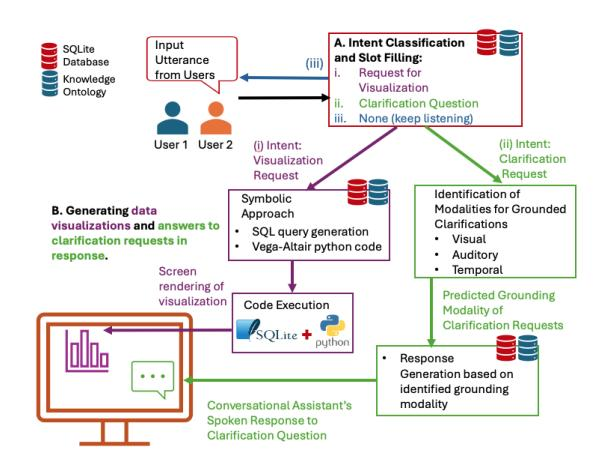

# Collaborative Data Exploration through Visualization: A Thesis Proposal Analyzing Impact of Conversational Assistants

Abari Bhattacharya University of Illinois Chicago abhatt62@uic.edu

Barbara Di Eugenio University of Illinois Chicago bdieugen@uic.edu

#### Abstract

Data visualization is integral to any Exploratory Data Analysis (EDA) task. However, generating visualization requires expertise, presenting a steep learning curve and a significant cognitive load. Natural language interfaces for EDA aim to lower this barrier by allowing users to generate visualizations through natural language queries. However, complexity remains when EDA is performed collaboratively, requiring an environment to support multi-user interaction. In this thesis proposal, we discuss challenges in user-system interaction in a collaborative multi-user setup, such as errors in visualization generation due to misinterpretation of user requests. We hypothesize that a Conversational Assistant (CA) capable of understanding user-initiated clarification requests and generating accurate responses can improve user experience and support collaborative EDA tasks. To this end, we propose to develop such a CA (Figure 1) and evaluate it through a user study, thus examining its impact on user experience in a collaborative environment for EDA.

#### 1 Introduction

EDA is a method for analyzing data that predominantly uses graphical techniques such as bar charts, heatmaps etc., to uncover patterns, outliers, and insights (National Institute of Standards and Technology (NIST), 2023) from the data. Originating from John Tukey's Exploratory Data Analysis (Tukey, 1977), over the years, EDA has evolved (Mosteller and Tukey, 1977; McNeil, 1977; Velleman and Hoaglin, 1981) to become a vital tool across domains like healthcare, finance, and education (Sarker, 2021). While visualization generation plays a crucial role in EDA, the steep learning curve associated with traditional tools often excludes non-technical users, who face challenges in adopting these techniques for decision-making (Sarker, 2021). To address these challenges, Sarker suggests developing user-friendly tools catering

Figure 1: The workflow diagram of the proposed conversational assistant for collaborative data visualization (detail in Section 3.3). We focus on (A) understanding the user's intent, that is, data visualization requests and clarification requests, and (B) generating data visualizations (i) and answers to clarification requests(ii) in response.

to non-technical users to foster a more inclusive and accessible data-driven work culture. Oftentimes, EDA is done in multi-user collaborative settings that leverage users' diverse perspectives to enhance sense-making. However, existing visualization tools such as Tableau, MS Excel, and Plotly cater primarily to single users, limiting multi-user collaboration (Isenberg et al., 2011; Willett et al., 2011; Jeong et al., 2015). This underscores a need for extending tools to support data exploration in collaborative environments, also keeping in mind the need to make such systems accessible to nontechnical users. The best approach for modeling such a tool would be a natural language interface, with which users can perform EDA by generating data visualizations in a collaborative multi-user environment. Further, users should be able to tell the system what they want in an accessible setup. This entails a CA with which users can engage using natural language, and the system should mediate

between the user and the visualization generator. However, human conversations are often characterized by incomplete queries, ambiguous utterances and coreferences. This necessitates the CA to accommodate the characteristics of human conversation and respond meaningfully to ensure a positive experience for the users.

Recently Bhattacharya et al. (2024) conducted a thorough analysis by comparing an extension of the CA Articulate2 (Kumar et al., 2016; Bhattacharya et al., 2023) with Articulate+ (Tabalba et al., 2022, 2023) through user studies and listed extensive insight from their findings (discussed in Section 3.1). We use these insights to motivate our research objectives and start by systematically investigating user experiences with conversational interfaces for collaborative multi-user data visualization (Section 3). First, we look at challenges impacting the user's interaction with the CA in this user study. Specifically, we examine how clarification requests initiated by the users during their interaction with the CA might help improve the user's experience in a multi-user, collaborative EDA task scenario. Through this work, our goal is not only to contribute a CA framework, but also an understanding of how clarification behavior affects the interaction quality in multi-user collaborating conversational interfaces.

## 2 Related Work

Natural Language Interfaces for Data Visualization: Early work on Data Visualization natural language interfaces, such as Cox et al. (2001), used on structured grammar-based queries. Later, with Articulate (Sun et al., 2010), free-form interactions evolved, following which tools like IBM Watson Analytics (Hoyt et al., 2016), Tableau Ask Data (Tableau), and Datatone (Gao et al., 2015) enhanced natural language understanding (NLU). Eviza (Setlur et al., 2016) and Evizeon (Hoque et al., 2018) introduced interactive dialogue-based exploration; however, these were without support for visualization modification. In parallel, Shen et al. (2022) extended Card et al. (1999)'s natural language interface pipeline by integrating NLU and dialogue management (McNabb and Laramee, 2017), laying a foundation for NLIs in visualization. Later, systems like NL4DV (Narechania et al., 2021) and AUDiaL (Murillo-Morales and Miesenberger, 2020) integrated natural language interfaces into visualization pipelines, while Wrangler

(Kandel et al., 2011) and Voder (Srinivasan et al., 2019) automated fact generation from data along with visualization generation. Articulate2 (Kumar et al., 2016) introduced multimodal inputs regarding speech and gesture and coreference resolution (Bhattacharya et al., 2023), but it lacked support for multi-user data analysis. Recently, transformerbased systems like ncNet (Luo et al., 2022) mapped natural language to visualizations using nvBench dataset(Luo et al., 2021), but it lacked conversational capabilities. LLM-based tools like JarviX (Liu et al., 2023) and VIST5 (Voigt et al., 2023) automated visualization generation, but deployment costs were high, and the system suffered from hallucinations. Chat2Vis (Maddigan and Susnjak, 2023) leveraged multiple LLMs but lacked interactivity and relied on complex prompts, defeating the purpose of "natural language" queries. Furthermore, most systems were evaluated using datasets like nvBench rather than real-time studies with users, thus leaving gaps in understanding how real users collaborate with such systems in EDA in multi-user settings. Shen et al. (2023) provides a comprehensive survey of natural language interfaces for data visualization, identifying challenges and shortcomings, including lack of domain knowledge, need for advanced Natural Language Processing power to support free-form queries, lack of leveraging user's conversational history and lack of datasets specifically for visualization natural language interface frameworks. While tools like LIDA (Dibia, 2023), targeted towards non-technical users, simplify visualization generation using large language models (LLMs), they lack support for collaborative and interactive exploration.

Clarification Requests: Clarification Requests (CRs) play a crucial role in grounding—the process of establishing mutual understanding in dialogue (Clark, 1996; Clark and Schaefer, 1989). When humans engage in a conversation, a speaker requests clarification when they do not understand the form or content of the utterance of the other speaker. While grounding seems natural in humanhuman conversation, in human-system dialogue, it is not trivial, and so is identification and generation of clarification by the conversational system. Early foundational work by Ginzburg and Sag (2001) categorized clarification requests (CRs) into reprise interrogatives—including echo and reference questions—and elliptical forms like reprise sluices. Purver et al. (2001) expanded this with non- reprise clarifications, gaps, and gap fillers, while Gabsdil (2003) and Schlangen (2004) introduced finer-grained categories such as partial repetitions, reformulations, semantic clarifications, and acoustic misunderstandings. Much of the existing research on CR has focused on those initiated by the system, typically triggered by ambiguous user input, speech recognition errors, or underspecified intent. A comprehensive overview of these can be found in the work of Rahmani et al. (2023). In contrast, in this thesis, the focus is on user-initiated clarification requests. One notable effort in this direction is the work by Madureira and Schlangen (2023), who annotated user-initiated CRs in the CoDraw dataset (Kim et al., 2019), a multi-modal, goal-oriented collaborative dialogue corpus. Their study highlights how instruction followers request clarification when facing ambiguous instructions, underscoring the importance of modeling such interactions in collaborative settings.

## 3 Proposed Research

Effective collaboration in an EDA task requires a CA to enable users to interact naturally, as with a human collaborator. This effectiveness also depends on its ability to respond correctly to user inputs. After a closer inspection of user interactions from Bhattacharya et al. (2024)'s work, we found some challenges that impact the system's usability and overall user experience. We put forward these challenges next and discuss how they lead us to the research question of this proposal.

#### 3.1 Motivation and Research Question

An analysis of user study transcripts from Bhattacharya et al. (2024) uncovered key limitations in system behavior that impact user experience, listed in Table 1. In the user study, the users were exploring a COVID-19 dataset for all counties in the United States (U.S.)(Tiwari et al., 2021) to complete two timed EDA tasks. The dataset has attributes like COVID vulnerability rank, Poverty rate, Diabetes rate, and County types, among others. The system generated data visualizations like bar charts, line charts, choropleth maps and heat maps based on requests for visualization from the users.

A promising solution to these challenges can be found in the concept of grounded clarifications, introduced by Benotti and Blackburn (2021). Grounded clarifications are clarification requests

tied to specific real-world contexts or modalities (e.g., visual, auditory), ensuring mutual understanding between participants in a conversation. According to the paper, for an utterance U, a subsequent turn is considered a grounded clarification in modality m if there is a lack of positive evidence of understanding in that modality. Returning to the observations in Table 1, we can see how grounded clarifications appear in those scenarios. These examples show how answering clarification requests would allow the system to effectively address user's confusion or lack of understanding of an earlier response by the system. Moreover, in multi-user natural language interface settings for data visualization, clarification needs to extend beyond linguistic content, encompassing visual and contextual references. For instance, users can ask for a clarification request grounded in visual modality based on a chart they are currently exploring on the workspace of the natural language interface. As noted by Benotti and Blackburn (2021), grounded clarifications extend to the physical and contextual environment, reinforcing the necessity for accurate identification and response by the CA. Therefore, by focusing on user-initiated clarification requests, the conversational system can leverage these clarifications as opportunities to provide correct responses to the user. At the same time, these responses must also be accurately grounded in context and aligned with the user's intent.

#### This leads us to our research question:

#### RQ: How do user-initiated clarification requests impact user experience concerning system functionality, interpretability, and overall usability?

These three key terms capture complementary dimensions of user experience with a conversational assistant: functionality, referring to the system's ability to respond appropriately to user input; interpretability, denoting how well users can understand the system's behavior; and usability, which reflects users' overall ease and effectiveness of interaction. We return to these definitions in detail in Section 3.4.

We aim to answer the research question by proposing three contributions. First, we plan to create an annotated corpus of multi-user dialogue interactions with a CA for data visualization, detailed in Section 3.2. Second, we propose a CA framework with components leveraging our custom dataset described in Section 3.3. Finally, we plan to conduct a user study with participants inter-

Table 1: Common system challenges observed during user interaction and their corresponding clarification grounding modality

|# Issue and Description Example |  |  | Modality |
|-------------------------------------------------- | -------------- | ---------------- | ---------------------------------------- |
|1 No Response: System fails to |  |  |  |
|respond due to TTS errors or |  |  |  |
|misclassified dialogue acts. |  |  |  |
|User 1: "Can we look at all the rural areas in | the | United | States?" |
|System: Generates a map based on an earlier | utterance. |  |  |
|User 1: "Are those the rural areas in the United |  | States?" | (Expecting clarification) |
|User 2: "Louder." |  |  |  |
|User 1: "No, it cannot be louder... I mean, | I’m | pretty sure | there’s no probable |
|generation for this. " |  |  |  |
| |  |  | Auditory: Users rephrase or adjust |
| |  |  | their requests when the system fails |
| |  |  | to respond, demonstrating reliance |
| |  |  | on auditory clarification. |
|2 Incorrect Visuals: System |  |  |  |
|generates charts that do not |  |  |  |
|match user queries. |  |  |  |
|User: "Show me the poverty data by county | type." |  |  |
|System: Generates a map of poverty rates for | all | counties. |  |
|User: "Is this the most recent map?" (Seeking |  | clarification) |  |
| |  |  | Visual: Users seek clarification |
| |  |  | on unintended or redundant visual |
| |  |  | izations, indicating a need for re |
| |  |  | sponses grounded in visual informa |
|3 Redundant Charts: System |  |  |  |
|generates repetitive charts that |  |  |  |
|do not add value. |  |  |  |
|User: "Show me a map of diabetes." |  |  |  |
|System: Generates a map of diabetes risk for | all | counties. |  |
|User: "Can I see a map of diabetes risk for | Midwest | and | Northeast?" |
|System: Generates the same map again | (redundant). |  |  |
|User: "Does it respond to multiple parameters?" |  |  |  |
| |  |  | Visual: Users seek clarification |
| |  |  | on unintended or redundant visual |
| |  |  | izations, indicating a need for re |
| |  |  | sponses grounded in visual informa |
|4 Misinterpreted References: |  |  |  |
|Ambiguous references lead to |  |  |  |
|incorrect responses. |  |  |  |
|User 1: "I want uninsured rate for different | counties." |  |  |
|System: Generates a grouped bar chart for | uninsured | rate | by county type. |
|User 1: "I don’t understand what these bar | charts | are for..." |  |
|User 2: "Is it grouping them by county type?" |  |  |  |
|System: Generates a U.S. map of county types | instead | of | clarifying. |
| |  |  | Temporal: Users reference pre |
| |  |  | vious visualizations or utterances |
| |  |  | for clarification, requiring responses |
| |  |  | grounded in a temporal context. |

acting with the CA (Section 3.4). This study will help us examine the user experience with the CA, which can generate data visualization and natural language responses to user-initiated clarification questions.

## 3.2 Dataset

We discussed how identifying and handling userinitiated clarification requests (CRs) can be critical to task-oriented and collaborative dialogue systems. While there is research on the generation of CRs by CAs, the identification of CRs remains mostly unexplored. Recent efforts, such as Madureira and Schlangen (2023), have addressed this gap by annotating datasets like CoDraw with instructional CRs. However, a general understanding and categorization of user-initiated CRs are still evolving. Moreover, multi-user dialogue corpora remain scarce, despite growing interest in modeling collaborative interactions in task-oriented settings (Jo et al., 2023). To address this gap, we propose creating a custom dataset based on the COVID(T) corpus from Bhattacharya et al. (2023, 2024), which includes 8,440 utterances from a user study setup where two users collaborate on an EDA task. The CA in this setup generates data visualizations only based on the users' requests. We conducted preliminary annotation of 541 utterances(a random significant sample with a ±4.1% margin of error at 95% confidence) by two annotators (Cohen's Kappa: 0.88), where 5.54% of utterances were user-initiated clarification requests and 30.3% were visualization

requests. Here, we define clarification requests as utterances where a user explicitly or implicitly asks for additional information to understand prior system or user input during the collaborative EDA task. Please note that this is a three-way interaction between human-human and human-system. Therefore, our initial annotation includes CRs directed to both the system and the other user, capturing the full range of clarification behavior during the exploratory tasks. Next, following Bhattacharya et al. (2024), we define Visualization requests as utterances where the user asks the system to generate a specific data visualization or refine a previous one. Although CRs appear less frequently (Madureira and Schlangen (2023) also reported that 11.36% of instructional dialogues included user-initiated CRs), their importance in human-system interaction has been discussed by researchers (Rahmani et al., 2023). Thus, we hypothesize that explicitly supporting CRs can potentially encourage users to seek clarity and improve interaction quality. Inspired by Benotti and Blackburn (2021), we propose annotating CRs in our dataset based on their grounding modalities as discussed in Section 3.1 and Table 1. While Benotti and Blackburn also included Socioperception and Kinesthetic modalities, these are irrelevant to our setup. Instead, the Temporal Modality is particularly important for addressing references to prior user interactions or visualizations.

For training and evaluating the system's ability to generate responses to CRs, annotations will also include the ideal responses for each clarification request. Additionally, we will identify whether the required information comes from internal sources (e.g., dialogue history, knowledge base) or external sources (e.g., CDC, Wikipedia). While this work focuses on generating responses using internal sources, annotations for external sources will support future research on broader response generation tasks. Further, the transcripts mentioned above for the proposed dataset were collected in the context of COVID-19-related EDA. However, task design and user interactions can be generalized for collaborative data exploration in any domain (Bhattacharya et al., 2024), making the findings applicable to other domains. Unlike existing datasets like CoDraw(Madureira and Schlangen, 2023; Kim et al., 2019) which has scene reconstruction tasks or MultiWOZ (Budzianowski et al., 2018) or its multi-user variant (Jo et al., 2023), which focuses on IC/SF tasks in service-oriented dialogues, through the proposed dataset we plan to capture open-ended, multi-user dialogue on exploratory analysis of data. Overall, this dataset and annotation framework will enable the development of a conversational assistant capable of addressing user-initiated clarification requests effectively, improving user-system interaction in task-oriented dialogue systems.

## 3.3 Proposed Workflow

The proposed workflow of the CA shown in Figure 1 begins with speech-to-text transcription using Whisper (Radford et al., 2023), followed by Intent Classification and Slot Filling (IC/SF), which classifies an input utterance as either a Visualization Request, a Clarification Request, or None (here the system keeps listening for the next utterance). For SF, the system extracts relevant slots using the Knowledge Ontology of the dataset being explored by the users of the CA. If the user requests for a visualization generation, the system formulates an SQL query, retrieves data from an SQLite database (containing the data being explored), and generates Vega-Altair Python code 1. Unlike Bhattacharya et al. (2023, 2024), we plan to generate the python code instead of Vega-Lite Grammar(Satyanarayan et al., 2017), enabling evaluation with the nvBench dataset(Luo et al., 2021). The Python code can be easily converted to Vega-Lite later for screen ren-

dering. We plan to implement SQLite query and Vega-Altair code generation using symbolic reasoning, as done by Bhattacharya et al. (2023, 2024). Even though LLMs can generate satisfactory SQL Queries and Python codes, we choose this approach for its simplicity and reliability, avoiding any latency or hallucination that might come with using LLMs. For CRs, generated responses are informed by the dialogue History, which tracks user utterances, predicted intents, identified slots, and prior responses to user-initiated CRs. The final response output is displayed on the system interface for visualizations and via speech and display for natural language responses to clarifications, ensuring an interactive experience. Now, we focus on the proposed implementation of two core components: (1) IC/SF and(2) CR Response Generation.

IC and SF are essential for systems performing spoken language understanding (SLU). IC predicts the user's intent yintent from an input sequence X, which includes the current utterance Ut and previous turns. SF extracts slot labels yi for each token xiand verifies them against a knowledge base K to ensure domain-specific standardization. In this proposal, we discuss two approaches for IC/SF. The first approach extends BERT-SLU (Zhang et al., 2019) by incorporating dialogue history, allowing it to process both the current utterance Ut and preceding turns. To enhance domain adaptation, we propose integrating AdapterFusion (Pfeiffer et al., 2021), combining an SLU-specific adapter (e.g.trained using the ATIS dataset (Hemphill et al., 1990)) with another adapter fine-tuned on our custom dataset, mitigating catastrophic forgetting. The second approach builds on ILLUMINER (Mirza et al., 2024), which involves adapting instructiontuned LLMs with PEFT adapters to improve contextual awareness in a task-oriented conversational assistant. Mirza et al. (2024) experimented with LLMs specifically fined-tuned for instruction following like FLAN-T5(google/flan-t5-xxl), Vicuna (lmsys/vicuna-13b-v1.5, from Llama2) etc., and we plan to start by experimenting with the same LLMs. We also propose incorporating dialogue history into structured prompts. For example, "Given the <dialogue_history>, identify the intent and slots for: 'Can I see COVID risk in the midwestern US?'". Finally, we plan to perform knowledge base verification with both the proposed approaches to ensure slot labels align with domain terminology.

To evaluate IC, we plan to use metrics like accuracy, precision, recall, and F1-score, as well as a

1 <https://altair-viz.github.io/> (a Python library built on top of Vega-Lite grammar for generating visualizations)

confusion matrix to analyze errors. For measuring the correctness of slot labeling, we propose using metrics like slot F1 score, exact match ratio, and slot error rate.

CR Response Generation: CRs arise when users refine their queries to seek a better understanding of the visualizations or to explore data. Please recall that we plan to classify CRs into three modalities: visual (users clarify based on interface data), auditory (users repeat or rephrase due to system non-responsiveness), and temporal (users reference prior utterances or visualizations). We hypothesize that incorporating modality labels can enhance response accuracy. Thus, to develop a robust CR-handling approach, we must first annotate the dataset to classify CRs by modality as well as annotate the ideal responses for each of these CRs in order to train the models.

This component can be evaluated on two aspects—predicted modality and generated response. Accuracy can be used for modality, while objective response evaluation will be performed using ROUGE, BLEU, and BERTScore. While these metrics are not exhaustive, they provide a useful approximation of the quality of the generated responses. Additionally, we plan to employ human annotators to assess Relevance, Fluency, Informativeness, and Factual Correctness on a 5 point Likert scale.

## 3.4 User Study for CA Evaluation:

One of the primary goals of this thesis is to evaluate the CA by recruiting participants who would interact with the system and thoroughly investigate their experience with it. Please recall, in our RQ, we mention system functionality, interpretability and overall usability. Bhattacharya et al. (2024) discuss these three features and how they impact the design consideration of the CA. Regarding functionality, they highlight that the CA, as an interactive system, generates visualizations in response to user utterances. The number of utterances processed, types and numbers of visualizations produced etc., are thus artifacts of the user-system interaction, shaping the user's experience with the system. The authors analyze these components and conclude that an optimal latency in processing utterances and generating visualizations is critical for avoiding overwhelming users or causing frustrating delays. Next, they point out that a CA must be interpretable; that is, the users should be able to comprehend and understand why the system produces specific visualizations and responses or, in other words, post-hoc interpretability (Gilpin et al., 2018). They measure the understanding of system output through the conclusions drawn by the users at the end of each open-ended EDA task. The authors suggested that the interpretability of the system can impact the take-aways of data analysis tasks by the users of the CA. Finally, the authors discuss usability of the system and how it affects the user's perception of the CA. They quantified usability through the post-study ratings given by the users for the usefulness of generated visualizations and ease of using the natural language interface. Therefore, to answer the RQ, we plan to start with replicating the study setup by Bhattacharya et al. (2024) and quantifying the user's experience through the quantities discussed above. Additionally, we plan to perform a qualitative evaluation of the responses generated by the CA to user-initiated CRs. However, we must remember that COVID-19 was still more relevant in 2022 when Bhattacharya et al. (2024) conducted their study, compared to 2025, when we plan to perform ours. As a result, we will primarily focus on the qualitative evaluation of CR responses and user experience measures rather than directly comparing them with the results of the past user study.

## 4 Conclusion

Overall, this thesis proposal emphasizes the importance of designing a CA for EDA and evaluating it in real-time with users. Beyond EDA, developing such a user-centric CA framework has broader implications for data-driven decision-making. With 77% of U.S. organizations relying on such datadriven strategies 2, an interactive CA can help non-technical users make data-informed decisions. Recent studies (Szukits and Móricz, 2024; Tawil et al., 2024) further highlight the role of data-driven methodologies in organizations of all sizes. By enabling intuitive, context-aware interactions, such a CA framework can enhance collaborative data exploration and make data visualization more accessible, thereby improving decision-making across diverse domains.

2 <https://www.statista.com/>

- References Luciana Benotti and Patrick Blackburn. 2021. A recipe for annotating grounded clarifications. In Proceedings of the 2021 Conference of the North American Chapter of the Association for Computational Linguistics: Human Language Technologies, pages 4065–4077, Online. Association for Computational Linguistics. Abari Bhattacharya, Barbara Di Eugenio, Veronica Grosso, Andrew Johnson, Roderick Tabalba, Nurit Kirshenbaum, Jason Leigh, and Moira Zellner. 2024. A conversational assistant for democratization of data visualization: A comparative study of two approaches of interaction. Stat. Anal. Data Min., 17(6). Abari Bhattacharya, Abhinav Kumar, Barbara Di Eugenio, Roderick Tabalba, Jillian Aurisano, Veronica Grosso, Andrew Johnson, Jason Leigh, and Moira Zellner. 2023. Reference resolution and new entities in exploratory data visualization: From controlled to unconstrained interactions with a conversational assistant. In Proceedings of the 24th Annual Meeting of the Special Interest Group on Discourse and Dialogue, pages 370–380, Prague, Czechia. Association for Computational Linguistics. Paweł Budzianowski, Tsung-Hsien Wen, Bo-Hsiang Tseng, Iñigo Casanueva, Stefan Ultes, Osman Ramadan, and Milica Gašic. 2018. ´ MultiWOZ - a largescale multi-domain Wizard-of-Oz dataset for taskoriented dialogue modelling. In Proceedings of the 2018 Conference on Empirical Methods in Natural Language Processing, pages 5016–5026, Brussels, Belgium. Association for Computational Linguistics. Stuart Card, Jock Mackinlay, and Ben Shneiderman. 1999. Readings in Information Visualization: Using Vision To Think. Herbert H. Clark. 1996. Using Language. Cambridge University Press, Cambridge, UK. Herbert H. Clark and Edward F. Schaefer. 1989. Contributing to discourse. Cognitive Science, 13(2):259–
- 294. Kenneth Cox, Rebecca Grinter, Stacie Hibino, Lalita Jagadeesan, and David Mantilla. 2001. A multi-modal natural language interface to an information visualization environment. International Journal of Speech Technology, 4:297–314. Victor Dibia. 2023. LIDA: A tool for automatic generation of grammar-agnostic visualizations and infographics using large language models. In Proceedings of the 61st Annual Meeting of the Association for Computational Linguistics (Volume 3: System Demonstrations), pages 113–126, Toronto, Canada. Association for Computational Linguistics. Malte Gabsdil. 2003. Clarification in spoken dialogue systems. In Proceedings of the 2003 AAAI Spring Symposium. Workshop on Natural Language Generation in Spoken and Written Dialogue, pages 28–35. Tong Gao, Mira Dontcheva, Eytan Adar, Zhicheng Liu, and Karrie G. Karahalios. 2015. Datatone: Managing ambiguity in natural language interfaces for data visualization. In Proceedings of the 28th Annual ACM Symposium on User Interface Software amp; Technology, UIST '15, page 489–500, New York, NY, USA. Association for Computing Machinery. Leilani H. Gilpin, David Bau, Ben Z. Yuan, Ayesha Bajwa, Michael Specter, and Lalana Kagal. 2018. Explaining explanations: An overview of interpretability of machine learning. In 2018 IEEE 5th International Conference on Data Science and Advanced Analytics (DSAA), pages 80–89. Jonathan Ginzburg and Ivan A Sag. 2001. Interrogative investigations: the form, meaning, and use of English interrogatives. Chicago University Press. Charles T. Hemphill, John J. Godfrey, and George R. Doddington. 1990. The ATIS spoken language systems pilot corpus. In Speech and Natural Language: Proceedings of a Workshop Held at Hidden Valley, Pennsylvania, USA, June 24-27, 1990. Morgan Kaufmann. Enamul Hoque, Vidya Setlur, Melanie Tory, and Isaac Dykeman. 2018. Applying pragmatics principles for interaction with visual analytics. IEEE Transactions on Visualization and Computer Graphics, 24(1):309–
- 318. Robert E. Hoyt, Derek Snider, Christian Thompson, and Sripriya Mantravadi. 2016. Ibm watson analytics: Automating visualization, descriptive, and predictive statistics. JMIR Public Health and Surveillance, 2(2):e157. Petra Isenberg, Niklas Elmqvist, Jean Scholtz, Daniel Cernea, Kwan-Liu Ma, and Hans Hagen. 2011. Collaborative visualization: Definition, challenges, and research agenda. Information Visualization, 10(4):310–326. Do-Hyung Jeong, Soo-Young Ji, Evan A. Suma, et al. 2015. Designing a collaborative visual analytics system to support users' continuous analytical processes. Human-centric Computing and Information Sciences, 5(1):5. Yohan Jo, Xinyan Zhao, Arijit Biswas, Nikoletta Basiou, Vincent Auvray, Nikolaos Malandrakis, Angeliki Metallinou, and Alexandros Potamianos. 2023. Multi-user MultiWOZ: Task-oriented dialogues among multiple users. In Findings of the Association for Computational Linguistics: EMNLP 2023, pages 3237–3269, Singapore. Association for Computational Linguistics. Sean Kandel, Andreas Paepcke, Joseph Hellerstein, and Jeffrey Heer. 2011. Wrangler: Interactive visual specification of data transformation scripts. In Proceedings of the Extended Abstracts on Human Factors in Computing Systems (CHI), pages 3363–3372.

- Jin-Hwa Kim, Nikita Kitaev, Xinlei Chen, Marcus Rohrbach, Byoung-Tak Zhang, Yuandong Tian, Dhruv Batra, and Devi Parikh. 2019. CoDraw: Collaborative drawing as a testbed for grounded goaldriven communication. In Proceedings of the 57th Annual Meeting of the Association for Computational Linguistics, pages 6495–6513, Florence, Italy. Association for Computational Linguistics. Abhinav Kumar, Jillian Aurisano, Barbara Di Eugenio, Andrew Johnson, Alberto Gonzalez, and Jason Leigh. 2016. Towards a dialogue system that supports rich visualizations of data. Proceedings of the 17th Annual Meeting of the Special Interest Group on Discourse and Dialogue, pages 304–309. Shang-Ching Liu, ShengKun Wang, Tsungyao Chang, Wenqi Lin, Chung-Wei Hsiung, Yi-Chen Hsieh, Yu-Ping Cheng, Sian-Hong Luo, and Jianwei Zhang. 2023. JarviX: A LLM no code platform for tabular data analysis and optimization. In Proceedings of the 2023 Conference on Empirical Methods in Natural Language Processing: Industry Track, pages 622–630, Singapore. Association for Computational Linguistics. Yuyu Luo, Nan Tang, Guoliang Li, Chengliang Chai, Wenbo Li, and Xuedi Qin. 2021. Synthesizing natural language to visualization (nl2vis) benchmarks from nl2sql benchmarks. In Proceedings of the 2021 International Conference on Management of Data, SIGMOD '21, page 1235–1247, New York, NY, USA. Association for Computing Machinery. Yuyu Luo, Nan Tang, Guoliang Li, Jiawei Tang, Chengliang Chai, and Xuedi Qin. 2022. Natural language to visualization by neural machine translation. IEEE Transactions on Visualization and Computer Graphics, 28(1):217–226. Paula Maddigan and Teo Susnjak. 2023. Chat2vis: Generating data visualizations via natural language using chatgpt, codex and gpt-3 large language models. IEEE Access, 11:45181–45193. Brielen Madureira and David Schlangen. 2023. Instruction clarification requests in multimodal collaborative dialogue games: Tasks, and an analysis of the Co-Draw dataset. In Proceedings of the 17th Conference of the European Chapter of the Association for Computational Linguistics, pages 2303–2319, Dubrovnik, Croatia. Association for Computational Linguistics. Laura McNabb and Robert S. Laramee. 2017. Survey of surveys (sos) - mapping the landscape of survey papers in information visualization. Computer Graphics Forum, 36(3):589–617. Donald McNeil. 1977. Interactive Data Analysis. John Wiley and Sons, New York. Paramita Mirza, Viju Sudhi, Soumya Ranjan Sahoo, and Sinchana Ramakanth Bhat. 2024. ILLUMINER: Instruction-tuned large language models as few-shot intent classifier and slot filler. In Proceedings of the 2024 Joint International Conference on Computational Linguistics, Language Resources and Evaluation (LREC-COLING 2024), pages 8639–8651, Torino, Italia. ELRA and ICCL. Frederick Mosteller and John Tukey. 1977. Data Analysis and Regression. Addison-Wesley, Reading, Mass. Tobias Murillo-Morales and Klaus Miesenberger. 2020. AUDiaL: A natural language interface to make statistical charts accessible to blind persons. In Proceedings of the International Conference on Computers Helping People with Special Needs, pages 373–384. Springer. Arpit Narechania, Arjun Srinivasan, and John T. Stasko. 2021. Nl4dv: A toolkit for generating analytic specifications for data visualization from natural language queries. IEEE Transactions on Visualization and Computer Graphics, 27:369–379. National Institute of Standards and Technology (NIST). 2023. Exploratory data analysis: Section 1. Accessed: 2023-11-10. Jonas Pfeiffer, Aishwarya Kamath, Andreas Rücklé, Kyunghyun Cho, and Iryna Gurevych. 2021. AdapterFusion: Non-destructive task composition for transfer learning. In Proceedings of the 16th Conference of the European Chapter of the Association for Computational Linguistics: Main Volume, pages 487–503, Online. Association for Computational Linguistics. Matthew Purver, Jonathan Ginzburg, and Patrick Healey. 2001. On the means for clarification in dialogue. In Proceedings of the Second SIGdial Workshop on Discourse and Dialogue. Alec Radford, Jong Wook Kim, Tao Xu, Greg Brockman, Christine McLeavey, and Ilya Sutskever. 2023. Robust speech recognition via large-scale weak supervision. In Proceedings of the 40th International Conference on Machine Learning, ICML'23. JMLR.org. Hossein A. Rahmani, Xi Wang, Yue Feng, Qiang Zhang, Emine Yilmaz, and Aldo Lipani. 2023. A survey on asking clarification questions datasets in conversational systems. In Proceedings of the 61st Annual Meeting of the Association for Computational Linguistics (Volume 1: Long Papers), pages 2698–2716, Toronto, Canada. Association for Computational Linguistics. Iqbal H. Sarker. 2021. Data science and analytics: An overview from data-driven smart computing, decision-making and applications perspective. SN Computer Science, 2(5):377. Arvind Satyanarayan, Dominik Moritz, Kanit Wongsuphasawat, and Jeffrey Heer. 2017. Vega-lite: A grammar of interactive graphics. IEEE Transactions on Visualization and Computer Graphics, 23(1):341–
- 350.

David Schlangen. 2004. Causes and strategies for requesting clarification in dialogue. In Proceedings of the 5th SIGdial Workshop on Discourse and Dialogue at HLT-NAACL 2004, pages 136–143, Cambridge, Massachusetts, USA. Association for Computational Linguistics. Vidya Setlur, Sarah E. Battersby, Melanie Tory, Rich Gossweiler, and Angel X. Chang. 2016. Eviza: A natural language interface for visual analysis. In Proceedings of the 29th Annual Symposium on User Interface Software and Technology, UIST '16, page 365–377, New York, NY, USA. Association for Computing Machinery. Leixian Shen, Enya Shen, Yuyu Luo, Xiaocong Yang, Xuming Hu, Xiongshuai Zhang, Zhiwei Tai, and Jianmin Wang. 2022. Towards natural language interfaces for data visualization: A survey. IEEE Transactions on Visualization and Computer Graphics, PP:1–1. Leixian Shen, Enya Shen, Yuyu Luo, Xiaocong Yang, Xuming Hu, Xiongshuai Zhang, Zhiwei Tai, and Jianmin Wang. 2023. Towards natural language interfaces for data visualization: A survey. IEEE Transactions on Visualization and Computer Graphics, 29(6):3121–3144. Arjun Srinivasan, Steven M. Drucker, Alex Endert, and John Stasko. 2019. Augmenting visualizations with interactive data facts to facilitate interpretation and communication. IEEE Transactions on Visualization and Computer Graphics, 25(1):672–681. Yiwen Sun, Jason Leigh, Andrew Johnson, and Sangyoon Lee. 2010. Articulate: A semi-automated model for translating natural language queries into meaningful visualizations. In International Symposium on Smart Graphics, pages 184–195. Springer. Ádám Szukits and Péter Móricz. 2024. Towards datadriven decision making: the role of analytical culture and centralization efforts. Review of Managerial Science, 18:2849–2887. Roderick Tabalba, Nurit Kirshenbaum, Jason Leigh, Abari Bhatacharya, Andrew Johnson, Veronica Grosso, Barbara Di Eugenio, and Moira Zellner. 2022. Articulate+: An always-listening natural language interface for creating data visualizations. In Proceedings of the 4th Conference on Conversational User Interfaces, CUI '22, New York, NY, USA. Association for Computing Machinery. Roderick S Tabalba, Nurit Kirshenbaum, Jason Leigh, Abari Bhattacharya, Veronica Grosso, Barbara Di Eugenio, Andrew E Johnson, and Moira Zellner. 2023. An investigation into an always listening interface to support data exploration. In Proceedings of the 28th International Conference on Intelligent User Interfaces, IUI '23, page 128–141, New York, NY, USA. Association for Computing Machinery. Abdel-Rahman H. Tawil, Muhidin Mohamed, Xavier Schmoor, Konstantinos Vlachos, and Diana Haidar. 2024. Trends and challenges towards effective datadriven decision making in uk small and mediumsized enterprises: Case studies and lessons learnt from the analysis of 85 small and medium-sized enterprises. Big Data and Cognitive Computing, 8(7). Anuj Tiwari, Arya Dadhania, Vijay Avin, and Edson Oliveira. 2021. Using machine learning to develop a novel covid-19 vulnerability index (c19vi). Science of The Total Environment, 773:145650. John W. Tukey. 1977. Exploratory Data Analysis, volume 2. Addison-Wesley, Reading, Mass. Paul Velleman and David Hoaglin. 1981. The ABC's of EDA: Applications, Basics, and Computing of Exploratory Data Analysis. Duxbury, Boston. Henrik Voigt, Nuno Carvalhais, Monique Meuschke, Markus Reichstein, Sina Zarrie, and Kai Lawonn. 2023. VIST5: An adaptive, retrieval-augmented language model for visualization-oriented dialog. In Proceedings of the 2023 Conference on Empirical Methods in Natural Language Processing: System Demonstrations, pages 70–81, Singapore. Association for Computational Linguistics. Wesley Willett, Jeffrey Heer, Joseph Hellerstein, and Maneesh Agrawala. 2011. Commentspace: structured support for collaborative visual analysis. In Proceedings of the SIGCHI Conference on Human Factors in Computing Systems, CHI '11, page 3131–3140, New York, NY, USA. Association for Computing Machinery. Zhichang Zhang, Zhenwen Zhang, Haoyuan Chen, and Zhiman Zhang. 2019. A joint learning framework with bert for spoken language understanding. IEEE Access, 7:168849–168858.