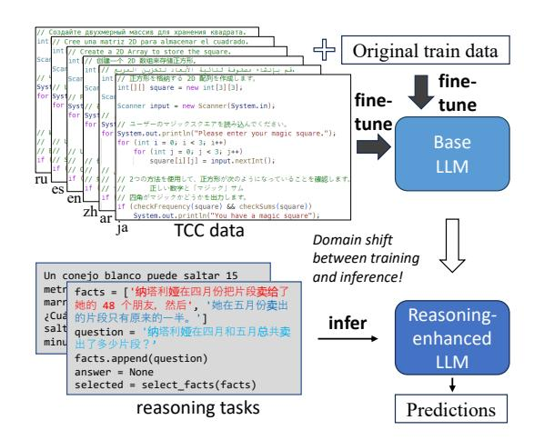
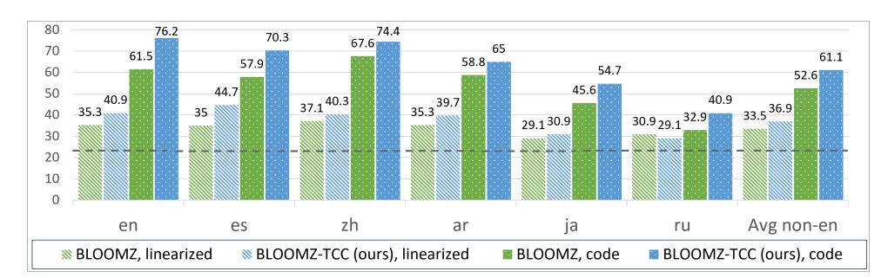
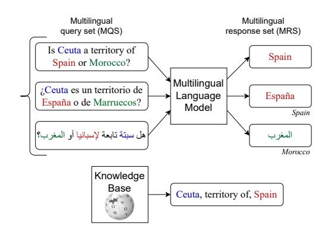
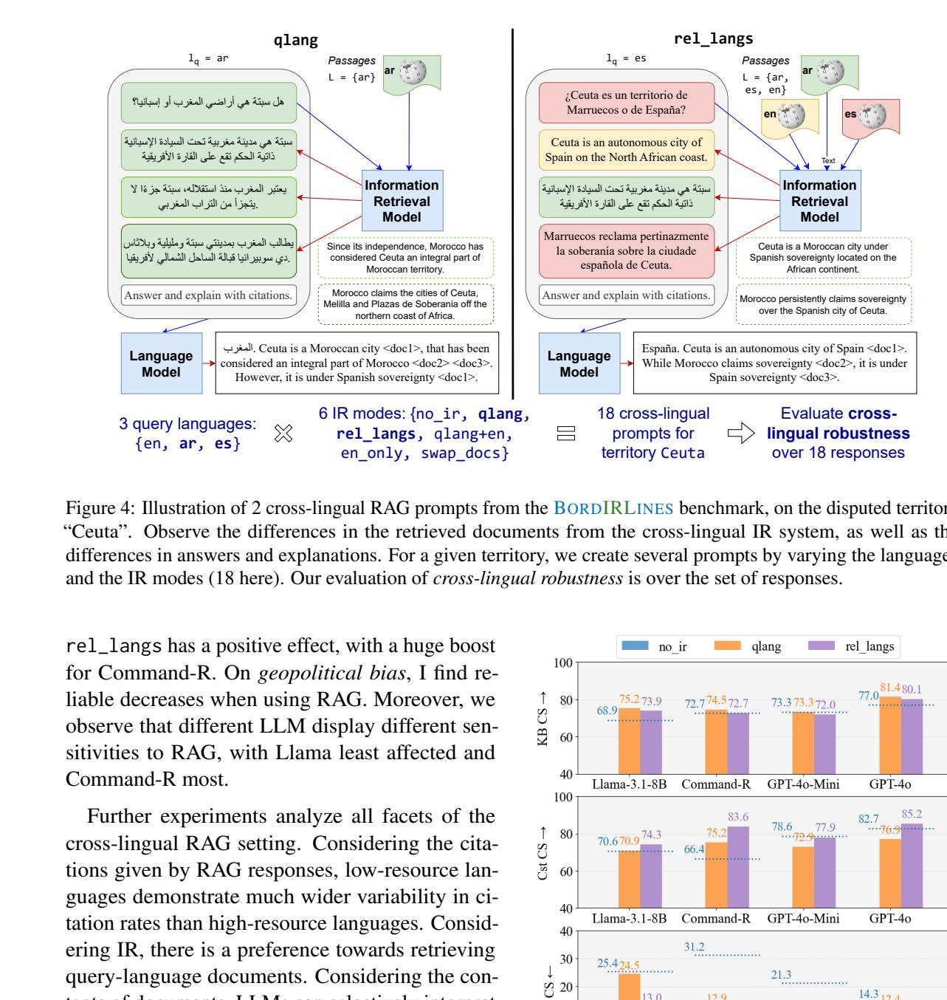
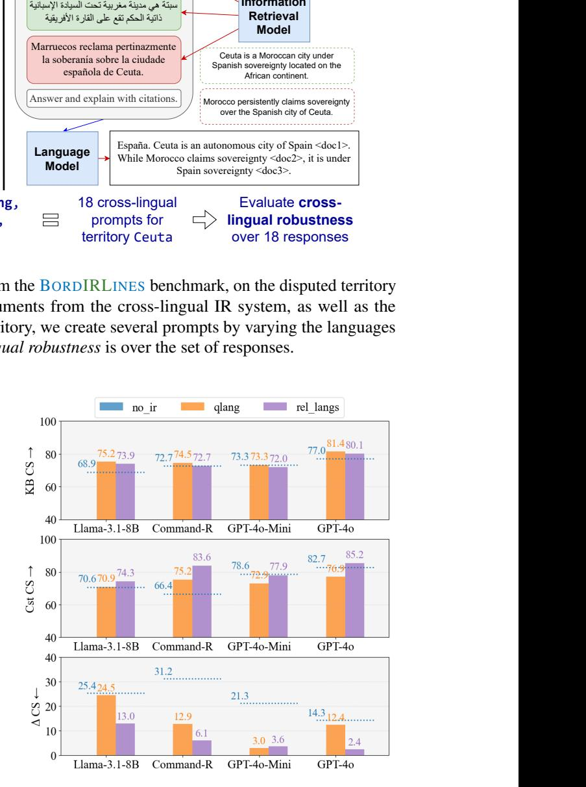
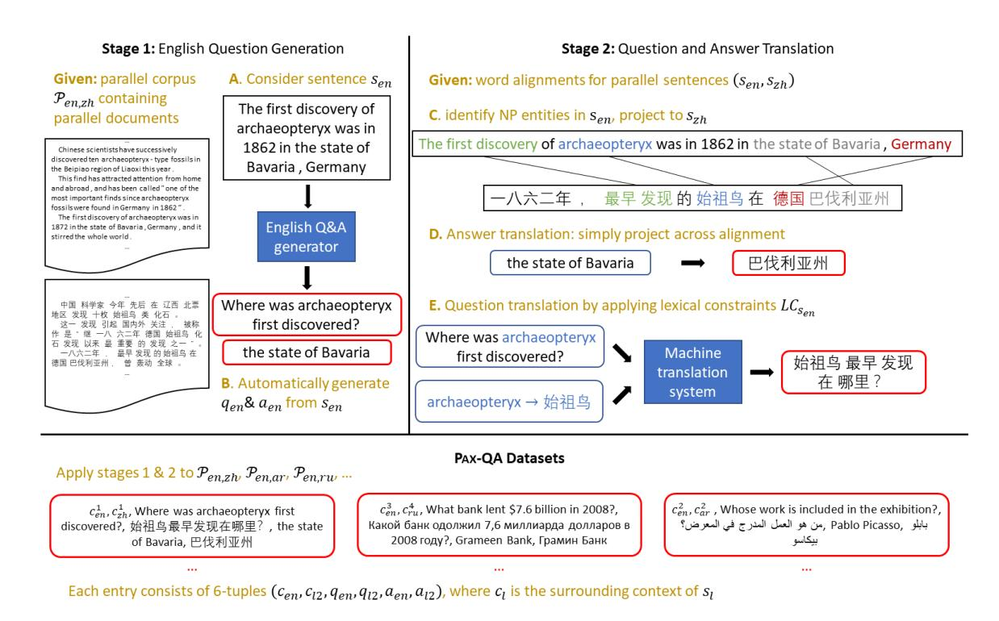
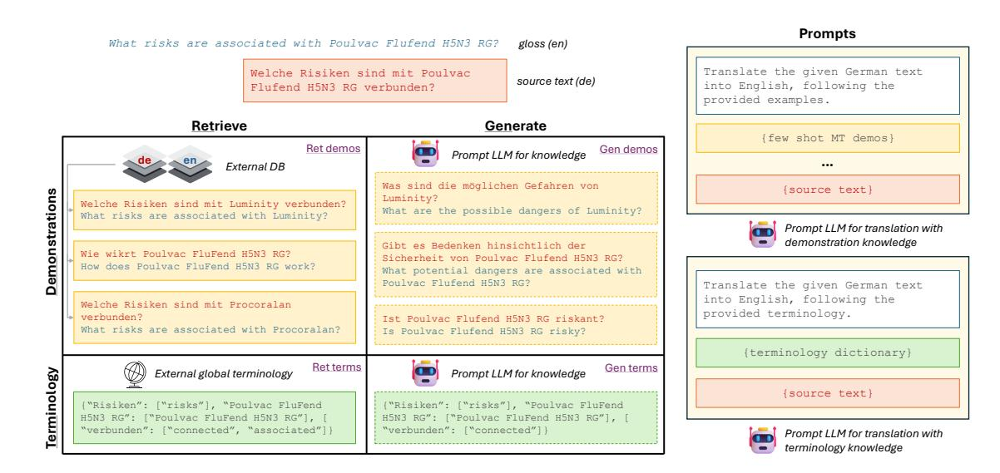
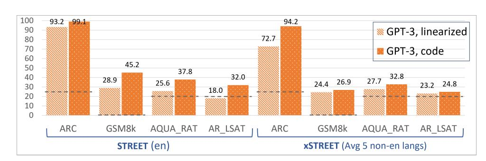
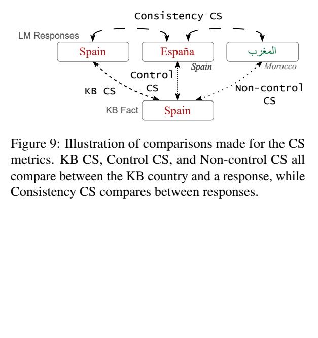

# Towards Practical and Knowledgeable LLMs for a Multilingual World: A Thesis Proposal

Bryan Li

University of Pennsylvania Philadelphia, PA, USA bryanli@seas.upenn.edu

### Abstract

The frontier of large language model (LLM) development has largely been substantiated by knowledge-intensive tasks specified in English. In this proposed thesis, I argue for the key role that multilinguality occupies in the development of practical and knowledgeable LLMs.

First, I consider practical methods to improve LLM's performance on standard natural language processing (NLP) tasks by leveraging their existing multilingual knowledge. Then, I investigate the underlying multilingual knowledge of LLMs with two benchmarks: on complex reasoning, and on territorial disputes. These benchmarks reveal LLMs' inconsistent performance across languages. I then design efficient techniques, both at inference-time and training-time, to address these discrepancies. Finally, I extend the territorial disputes benchmark to retrieval-augmented generation (RAG) setting, comparing the effects of different retrieval settings on cross-lingual robustness. My proposal shows that informed use of multilinguality enhances LLMs' capabilities, and our understanding thereof.

## 1 Introduction

The vast diversity of languages is both a contemporary and historical reality, with more than 7000 languages spoken throughout the world today (Eberhard et al., 2015). Each language is strikingly different at a surface level, with its own vocabulary, syntax, grammar. However, to quote Akmajian et al. (2017), "all known languages are at a similar level of complexity and detail." All languages build meaning in recursive units, from words, to sentences, to discourses. And anything can be expressed as validly in one language as in another.

Thus, multilinguality serves as a dual lens into human intelligence. First, any human possesses the capacity to, with enough practice and exposure, acquire fluency in any one or more language. Second, any language can be used to enable communication in a society. That is, multilinguality demonstrates how knowledgeable individual humans are and serves a practical purpose for societies.

If multilinguality comes so naturally to humans, then in our quest to develop machines that possess artificial intelligence (AI) capabilities, then it is also natural that these machines should be able to think in different languages. Developers of an advanced AI chatbot would like to adapt their system for different linguistic communities. And users within them would like to access information about current events in their language and preferences.

Indeed, many of the major advancements in NLP have been substantiated by multilingual concerns. Of particular note is machine translation (MT), the task of translating text from one language to another language. MT is a well-defined task with clear use-cases and a lot of data. Key to neural language models, has been the introduction of the attention mechanism (Bahdanau et al., 2015), and the Transformer model (Vaswani et al., 2017); these were first developed with MT as an illustrative task, before researchers soon found that the strong language representations learned here lead to effective models for all NLP tasks. This has led to our current era of large language models (LLMs), which are large in both their size – over 1 billion parameters – and their datasets – over 1 trillion tokens.

Despite this, there has been a widespread public sentiment that the current brisk pace of NLP development is leaving behind most of the world's languages, and the people that speak them. From the New York Times (Ruberg, 2024) to the World Economic Forum (Chhabria, 2024), articles abound about the phenomenon of the 'linguistic gap.'

How do we feel about the state of multilinguality in our field of NLP? Certainly, multilinguality has been and remains a primary area of research. Taking inventory of conferences run by the Association for Computational Linguistics from 2020-2025, we

see that of the 16 conferences that have Theme Tracks of special interest, 4 directly concern multilinguality1 – not to mention workshops and other events. Still, sentiment on the state of multilinguality among NLP researchers remains mixed.

We can thus say that multilinguality has become a primary but parallel concern. The frontier of LLM development has largely been substantiated by knowledge-intensive tasks specified in English. Only in parallel are multilingual efforts. One approach to building frontier LLMs is to start by training an English model, then adding multilingual support later. Such is the case with the open-weight LLMs Llama-3 (Dubey et al., 2024), Mistral (Jiang et al., 2023), and Gemma (Team, 2024), and their multilingual follow-ups Llama 3.1, Mistral 2, and Gemma 2. A second approach is to pursue LLM development where multilinguality is considered from the ground up, such as Aya (Üstün et al., 2024) and Bloom (Le Scao et al., 2022). These work well but have been largely relegated to non-English or multilingual use cases. This is because of the popular view is that supporting more languages decreases LLM ability in any one of them. In this proposal, I will show that this need not be the case.

Thesis Statement Multilinguality does and should continue to occupy a key role in the development of practical and knowledgeable LLMs. Informed use of multilinguality enhances these capabilities of LLMs, and our understanding thereof.

In this proposed thesis, I first consider practical methods for several standard NLP tasks, improving performance by leveraging the innate multilingual knowledge of LLMs. Next, I study how multilinguality can be used to make LLMs that are more knowledgeable. I introduce two benchmarks, on complex reasoning, and on geopolitical knowledge. These calls into question the consistency of LLMs' knowledge representations across languages. I then introduce informed and efficient techniques that again leverage multilinguality to boost performance across all languages.

# 2 Practical Applications of LLMs

I consider two characteristics of practicality: realworld utility concerns performing useful tasks, and ease of development concerns being easy to use

|Training Data | cross-l (6 pairs) | mono-l (3 pairs) | Avg (9 pairs) |
|-------------------------- | ------------------- | ------------------ | --------------- |
|SQuAD | 61.9 | 73.3 | 65.7 |
|+ Riabi et al. (2021) | 69.4 | 72.7 | 70.5 |
|+ P AX QA human GT | 69.5 | 73.6 | 70.8 |
|+ P AX QA human lex cons | 70.7 | 74.3 | 71.9 |
|+ P AX QA auto lex cons | 69.4 | 73.9 | 70.9 |

Table 1: F1 scores on MLQA test set (Lewis et al., 2020a), for all 9 pairs involving {ar, zh, en}. The base model is XLM-RoBERTa (Conneau et al., 2020); all models are fine-tuned on SQuAD (Rajpurkar et al., 2016); the rows with + additionally use on generated Q&A pairs from their respective methods.

and easy to extend. These are precisely why LLMs have become popular – users can converse with them in natural language, and developers can easily access their internal knowledge, and extend their functionality through techniques such as finetuning and prompting. The section covers two papers studying both characteristics.

### 2.1 Cross-lingual Question Answering

QA is an intuitive way to interact with a system. It can empower information access in a cross-lingual setting, where a user may want to ask a question in their native language, but wish to access information stored in another language. We are thus motivated to develop a system that can perform cross-lingual QA. But where do we get the data to train such a system? Prior studies trained systems to perform synthetic data generation, requiring the existence of some labeled Q&A data.

I instead propose a training-free generation method which leverages indirect supervision from existing parallel corpora (Li and Callison-Burch, 2023). Our method termed PAXQA (Projecting annotations for cross-lingual (x) QA) decomposes cross-lingual QA into two stages, as illustrated in Appendix Figure 6. First, a question generation (QG) model is applied to the English side of the corpora. Second, we word alignment-informed translation is applied to the translate both questions and answers. Answers can be directly projected across the alignments. To better translate questions, I utilize lexically-constrained MT, in which constrained entities are extracted from the parallel bitexts. We show the quality of our generations by finetuning models to perform QA. As shown in Table 1, using PAXQA achieves the best results; furthermore, our method is also robust to alignment noise, given the small drop (-1.0 F1) using

1These are "Language Diversity: from Low-Resource to Endangered Languages" (ACL 2022), "Large Language Models and Regional/Low-Resource Languages" (AACL 2023), "Languages of Latin America" (NAACL 2024), "NLP in a Multicultural World" (NAACL 2025).

Table 2: Results for domain-adapted MT, comparing the zero-shot baseline with 4 settings for prompting with knowledge, reported on the COMET22 metric (Rei et al., 2022) and the Gemma-2 27B model (Team, 2024).

automated word alignments.

#### 2.2 Domain-Adapted MT

How can we improve MT in specialist domains such as law or medicine? These domains pose the challenges of specialized terminologies and styles, which may not have been seen at trainingtime. With LLMs comes the promise of inferencetime adaptation through prompting. Prior work has found some success by retrieving domain knowledge from external resources, then including it in the prompt (Agrawal et al., 2023; Moslem et al., 2023). Recent efforts have further shown that this knowledge can be instead generated from an LLM's own parametric memory, and this intermediate step followed by the translation step can be effective for general-domain MT (Briakou et al., 2024; He et al., 2024).

I thus perform an analytical study into approaches for domain-adapted MT with LLMs (Li et al., 2025b). A careful prompting setup compares MT under four settings – two knowledge strategies and knowledge sources, as illustrated in Appendix Figure 7. The strategies are demonstrations of translation pairs, and bilingual terminologies of key terms. The sources are external retrieval, and internal generation from an LLM's own knowledge.

The results are shown in Table 2, and our findings are threefold. First, demonstrations outperform terminology, and that this effect is magnified for larger LLMs over smaller ones. Second, retrieval outperforms generation as expected. This leads to the third finding, that generation is an efficient way to boost MT performance, especially weaker ones. Notably, for a smaller LLM, translating with demonstrations generated from its own parametric memory matches zero-shot MT with a much larger LLM, Gemini. Our further analyses suggest that a) few-shot exemplars are especially effective due to their assistance with translation style, rather than terminology; and b) domain-specificity is key, and can equally derive from generated de-

Figure 1: An overview of the methods used to improve multilingual structured reasoning. Top: during training, I create a multilingually commented code dataset, and use it in a finetuning setup. Bottom: during inference, I apply several prompting formats, finding most success with our code prompts format.

mos, or static retrieved demos.

## 3 Evaluations of LLMs' Knowledge

I consider three characteristics of knowledgeability: factuality concerns utilization of factual information, complex reasoning concerns using logic and analytical abilities, and consistency concerns giving similar responses to similar queries.

I thus introduce two benchmarks which by design evaluate factuality and complex reasoning. These benchmarks highlight the issues LLMs have with consistent responses across languages, by eliciting responses for the same underlying queries, but specified in different languages.2

### 3.1 Consistency of Complex Reasoning

While a human learns a new language one at a time, a multilingual LLM can learn multiple languages at once in its pretraining stage by simply including multilingual data and following the standard self-supervised LM objective. On one hand, this imbues an LLM to super-human polyglot abilities – mT5 and Aya, for example, support over 100+ languages (Xue et al., 2021; Üstün et al., 2024). On the other hand, for each language, the performance is inconsistently distributed, dropping steeply from English, to lower-resource languages.

2Note that my focus on tasks where responses should be consistent cross-lingually. This contrasts with the morestudied tasks of cultural concerns, wherein the language used can indicate a user's preferences, and thus the responses should accordingly vary cross-lingually.

Figure 2: Results on xSTREET for the ARC subtask of scientific reasoning, with BLOOMZ-based models. The random baseline is 25%. 'Avg' bars are across the 5 non-English languages.

I thus introduce xSTREET, a multilingual structured reasoning and explanation dataset that covers four tasks across six diverse languages (Li et al., 2024a). xSTREET exposes a gap in base LLM performance between English and non-English reasoning tasks. To remedy the gap, I propose two methods, as illustrated in Figure 1. which follow from the insight that LLMs trained on code are better reasoners. For training-time, I augment a code dataset with multilingual comments using MT, while keeping program code as-is. Parameterefficient finetuning of a base LLM is then applied on the dataset. This leads to a model with improved complex reasoning performance, while maintaining performance on other language benchmarks. For inference-time, I bridge the gap between training and inference by employing a prompt structure that incorporates step-by-step code primitives to derive new facts and find a solution. سبتة تابعة إلسبانيا أو المغرب؟

Our code and multilinguality-informed methods are individually effective and can be used in tandem to achieve the best performance (Table 2 and Appendix Table 8). Notably, despite adding only non-English data, the largest gains occur for English, suggesting that the model leverages multilingual formulations of a problem, then generalizes reasoning improvements across languages. Our findings further underscore the role of code for enhancing LLM's reasoning capabilities.

### 3.2 Consistency of Geopolitical Knowledge

Information in the real world comes from various sources, mediums, and perspectives. It is very natural that information can be conflicting, yet a human encountering all of this has little issue synthesizing it together into a consistent set of personal beliefs; this holds across the languages they speak. Yet given the discrete nature of LLM's pretraining on texts from different languages, how consistent can LLMs be in their responses on factual queries? هل

المغرب To answer this question, I introduce BORDER-LINES, a dataset of territorial disputes which covers 251 territories, each associated with a set of queries in the languages of each claimant country (Li et al., 2024b). The dataset has 720 queries in 49 languages. Figure 3 provides an illustration of the task. In this context, I study the phenomenon of geopolitical bias, which is the tendency to report geopolitical knowledge differently depending on the language of interaction. I then propose a suite of evaluation metrics to quantify differences in responses across languages. These metrics, as detailed in Appendix B, are based on a simple accuracy metric termed Concurrence Score (CS).

Figure 3: Illustration of a disputed territory task, which considers a single territory with queries presented in different languages. The KB says "Ceuta" belongs to "Spain". The LLM responds inconsistently: in Spanish and English "Spain", while in Arabic "Morocco", demonstrating geopolitical bias.

I benchmark several LLMs on BORDERLINES, as shown in Table 3, and arrive at several findings. I find that instruction-tuned models are less knowledgeable about these disputes than their base LLM counterparts. I also find that the most knowledgeable LLMs in English tend to be more geopolitically biased. I further find that models are less consistent with responses for territories with un-

| | Model |  | Strategy | KB CS | Con ↑ CS | Non ↑ CS | ∆ CS ↑ ↓ | Cst (unk) | CS Cst CS ↑ (all) ↑ |
|---- | --------- | ------ | ---------------- | ------- | ---------- | ---------- | ---------- | ----------- | --------------------- |
| | R ANDOM |  | — | 43.5 | 43.5 | 43.5 | 0 | 43.5 | 43.5 |
|1 | BLOOM | 560M | — | 60.5 | 66.7 | 29.9 | 123.3 | 57.3 | 49.5 |
|2 | BLOOM | 7.1B | — | 57.4 | 71.9 | 39.2 | 83.2 | 50.4 | 55.1 |
|3 | BLOOMZ | 560M | — | 46.9 | 65.4 | 36.1 | 81.0 | 48.0 | 51.1 |
|4 | BLOOMZ | 7.1B | — | 45.1 | 57.5 | 43.8 | 31.5 | 39.2 | 53.6 |
|6 | GPT-3 | DV | — | 60.5 | 60.0 | 51.3 | 17.0 | 63.1 | 63.3 |
|7 | GPT-4 |  | Vanilla | 79.5 | 76.9 | 63.2 | 21.6 | 65.6 | 70.8 |
|8 | GPT-4 |  | UN Peacekeeper | 80.1 | 74.6 | 67.7 | 10.2 | 56.3 | 72.3 |
|9 | GPT-4 |  | Nationalist | – | 80.6 | 60.3 | 33.8 | 52.8 | 63.7 |
|10 | GPT-4 |  | Demographic |  |  |  |  |  |  |
| |  |  | reasoning | 70.8 | 74.8 | 61.6 | 21.5 | 70.5 | 76.3 |

Table 3: Results on BORDERLINES for different models. We report the first 4 CS metrics for only the subset of territories with defined controllers. Greyed rows are for instruction tuned models.

known controllers vs. known ones.

Finally, I explore several prompt modification strategies, aiming to either amplify or mitigate geopolitical bias. This highlights how brittle LLM's knowledge is to cues from the interaction context. I explore 4 prompting strategies: a vanilla baseline; a nationalist persona, a UN peacekeeper persona; and a demographic reasoning approach, which asks the model to reason by considering the religion and language of the territory, as well as each claimant country.

As the status of each individual disputed territory is complex, let us consider a notable case study. Taiwan is an island in East Asia with a population of 23.9 million. It is controlled by the Republic of China (ROC), but also claimed by the People's Republic of China (PRC). For vanilla and demographic reasoning, querying in Traditional Chinese (zht, used in ROC) and Simplified Chinese (zhs, used in PRC) both return 'ROC'. Adopting nationalist and UN prompts results in differing responses: PRC in zhs, and ROC in zht.

#### 3.3 Robustness of Multilingual Retrieval Augmented Generation

Despite the impressive knowledgeability of LLMs, a major limitation is that their knowledge is frozen in time to their training data. The paradigm of retrieval augmented generation (RAG) was developed to address these issues, by grounding LLM responses in relevant passages retrieved from an external datastore (Lewis et al., 2020b). The external datastore can be updated with new information, or swapped out entirely for different needs. In the multilingual setting, RAG can empower LLMs to access information which is inequitably distributed across languages, thereby improving

responses (Asai et al., 2022).

While several recent studies have investigated RAG in small-scale multilingual settings, they consider artificially construed scenarios and documents (Sharma et al., 2024; Wu et al., 2024). Also related is the field of open-retrieval multilingual QA (Clark et al., 2020); however these focus on simple fact-seeking questions where right answers are easily memorized by LLMs.

Our previously introduced BORDERLINES benchmark on territorial disputes provides an factseeking yet culturally-sensitive setting, which can serve as a challenge to the RAG setting. Given documents from different languages may espouse different viewpoints, many questions arise: How does the linguistic composition of the set of documents impact responses? Does sourcing information from different languages increase or decrease consistency? And is presenting conflicting information to LLM's base preferences better expressed in certain languages?

In this work, I introduce BORDIRLINES, a benchmark consisting of 720 territorial dispute queries paired with 14k Wikipedia documents across 49 languages (Li et al., 2025a). To evaluate LLMs' cross-lingual robustness for this task, I formalize several modes for multilingual retrieval, as depicted in Figure 4, each of which reflects a real-world information access need.

I use BORDIRLINES and the IR modes to systematically evaluate the cross-lingual robustness of various LLMs. The main results are shown in Figure 5. As expected, factuality generally increases when using RAG compared to the no_ir baseline. As for consistency, we find that qlang has mixed effects, depending on the model – negative for GPT, positive for Command-R. Meanwhile,

يطالب المغرب بمدينتي سبتة ومليلية وبالثاس.دي سوبيرانيا قبالة الساحل الشمالي ألفريقيا المغرب. Ceuta is a Moroccan city <doc1>, that has been Further experiments analyze all facets of the cross-lingual RAG setting. Considering the citations given by RAG responses, low-resource languages demonstrate much wider variability in citation rates than high-resource languages. Considering IR, there is a preference towards retrieving query-language documents. Considering the contents of documents, LLMs can selectively interpret the same documents to fit their own viewpoints.

Figure 4: Illustration of 2 cross-lingual RAG prompts from the BORDIRLINES benchmark, on the disputed territory "Ceuta". Observe the differences in the retrieved documents from the cross-lingual IR system, as well as the differences in answers and explanations. For a given territory, we create several prompts by varying the languages and the IR modes (18 here). Our evaluation of cross-lingual robustness is over the set of responses.

rel_langs has a positive effect, with a huge boost for Command-R. On geopolitical bias, I find reliable decreases when using RAG. Moreover, we observe that different LLM display different sensitivities to RAG, with Llama least affected and Command-R most.

## Acknowledgements

Reflecting on my PhD studies up until now, I have many people to thank: my doctoral adviser, Prof. Chris Callison-Burch, the PennNLP community, my many research collaborators, my friends, and my family. And looking a bit ahead, I am thankful for my thesis committee members Prof. Lyle Ungar, Prof. Duncan Watts, Prof. Dan Roth, Dr. Mohammad Sadegh Rasooli, and Dr. Colin Cherry.

Figure 5: Results for the concurrence score (CS) metrics, which measure attributes of cross-lingual robustness: KB CS for factuality, Cst CS for consistency, and ∆ CS for geopolitical bias. Within each subplot, we display the results for the no_ir baseline compared to 2 RAG settings: qlang, with in-language documents, and rel_langs with all relevant language documents.

# References

Sweta Agrawal, Chunting Zhou, Mike Lewis, Luke Zettlemoyer, and Marjan Ghazvininejad. 2023. Incontext examples selection for machine translation.

In Findings of the Association for Computational Linguistics: ACL 2023, pages 8857–8873. Adrian Akmajian, Ann K Farmer, Lee Bickmore, Richard A Demers, and Robert M Harnish. 2017. What is linguistics? In Linguistics: An introduction to language and communication, chapter 1, pages 5–9. MIT Press. Akari Asai, Shayne Longpre, Jungo Kasai, Chia-Hsuan Lee, Rui Zhang, Junjie Hu, Ikuya Yamada, Jonathan H Clark, and Eunsol Choi. 2022. Mia 2022 shared task: Evaluating cross-lingual open-retrieval question answering for 16 diverse languages. In Proceedings of the Workshop on Multilingual Information Access (MIA), pages 108–120. Dzmitry Bahdanau, Kyung Hyun Cho, and Yoshua Bengio. 2015. Neural machine translation by jointly learning to align and translate. In 3rd International Conference on Learning Representations, ICLR 2015. Eleftheria Briakou, Jiaming Luo, Colin Cherry, and Markus Freitag. 2024. Translating step-by-step: Decomposing the translation process for improved translation quality of long-form texts. In Proceedings of the Ninth Conference on Machine Translation, pages 1301–1317. Pooja Chhabria. 2024. The "missed opportunity" with ai's linguistic diversity gap. World Economic Forum. Jonathan H. Clark, Eunsol Choi, Michael Collins, Dan Garrette, Tom Kwiatkowski, Vitaly Nikolaev, and Jennimaria Palomaki. 2020. Tydi qa: A benchmark for information-seeking question answering in typologically diverse languages. Transactions of the Association for Computational Linguistics, 8:454–470. Alexis Conneau, Kartikay Khandelwal, Naman Goyal, Vishrav Chaudhary, Guillaume Wenzek, Francisco Guzmán, Édouard Grave, Myle Ott, Luke Zettlemoyer, and Veselin Stoyanov. 2020. Unsupervised cross-lingual representation learning at scale. In Proceedings of the 58th Annual Meeting of the Association for Computational Linguistics, pages 8440– 8451. Abhimanyu Dubey, Abhinav Jauhri, Abhinav Pandey, Abhishek Kadian, Ahmad Al-Dahle, Aiesha Letman, Akhil Mathur, Alan Schelten, Amy Yang, Angela Fan, et al. 2024. The llama 3 herd of models. arXiv preprint arXiv:2407.21783. David M Eberhard, Gary Francis Simons, and Charles D Fenning. 2015. Ethnologue: Languages of the world. Zhiwei He, Tian Liang, Wenxiang Jiao, Zhuosheng Zhang, Yujiu Yang, Rui Wang, Zhaopeng Tu, Shuming Shi, and Xing Wang. 2024. Exploring humanlike translation strategy with large language models. Transactions of the Association for Computational Linguistics, 12:229–246. Albert Q. Jiang, Alexandre Sablayrolles, Arthur Mensch, Chris Bamford, Devendra Singh Chaplot, Diego de las Casas, Florian Bressand, Gianna Lengyel, Guillaume Lample, Lucile Saulnier, Lélio Renard Lavaud, Marie-Anne Lachaux, Pierre Stock, Teven Le Scao, Thibaut Lavril, Thomas Wang, Timothée Lacroix, and William El Sayed. 2023. Mistral 7b. Preprint, arXiv:2310.06825. Teven Le Scao, Angela Fan, Christopher Akiki, Ellie Pavlick, Suzana Ilic, Daniel Hesslow, Roman ´ Castagné, Alexandra Sasha Luccioni, François Yvon, Matthias Gallé, et al. 2022. Bloom: A 176bparameter open-access multilingual language model. arXiv preprint arXiv:2211.05100. Patrick Lewis, Barlas Oguz, Ruty Rinott, Sebastian Riedel, and Holger Schwenk. 2020a. Mlqa: Evaluating cross-lingual extractive question answering. In Proceedings of the 58th Annual Meeting of the Association for Computational Linguistics, pages 7315– 7330. Patrick Lewis, Ethan Perez, Aleksandra Piktus, Fabio Petroni, Vladimir Karpukhin, Naman Goyal, Heinrich Küttler, Mike Lewis, Wen-tau Yih, Tim Rocktäschel, et al. 2020b. Retrieval-augmented generation for knowledge-intensive nlp tasks. Advances in Neural Information Processing Systems, 33:9459–9474. Bryan Li, Tamer Alkhouli, Daniele Bonadiman, Nikolaos Pappas, and Saab Mansour. 2024a. Eliciting better multilingual structured reasoning from llms through code. 62nd Annual Meeting of the Association for Computational Linguistics (ACL). Bryan Li and Chris Callison-Burch. 2023. PAXQA: Generating cross-lingual question answering examples at training scale. Findings of the Association for Computational Linguistics: EMNLP 2023. Bryan Li, Samar Haider, and Chris Callison-Burch. 2024b. This land is {Your, My} land: Evaluating geopolitical biases in language models through territorial disputes. 2024 Annual Conference of the North American Chapter of the Association for Computational Linguistics (NAACL). Bryan Li, Fiona Luo, Samar Haider, Adwait Agashe, Miranda Miao, Shriya Ramakrishnan, Tammy Li, Vickie Liu, Yuan Yuan, and Chris Callison-Burch. 2025a. Multilingual retrieval augmented generation for culturally-sensitive tasks: A benchmark for crosslingual robustness. Bryan Li, Jiaming Luo, Eleftheria Briakou, and Colin Cherry. 2025b. Leveraging domain knowledge for llm translation: The cases of retrieval vs. generation. in review at ACL Rolling Review, February 2025. Yasmin Moslem, Rejwanul Haque, John D Kelleher, and Andy Way. 2023. Adaptive machine translation with large language models. In 24th Annual Conference of the European Association for Machine Translation, page 227.

Pranav Rajpurkar, Jian Zhang, Konstantin Lopyrev, and Percy Liang. 2016. Squad: 100,000+ questions for machine comprehension of text. In Proceedings of the 2016 Conference on Empirical Methods in Natural Language Processing, pages 2383–2392. Ricardo Rei, José GC De Souza, Duarte Alves, Chrysoula Zerva, Ana C Farinha, Taisiya Glushkova, Alon Lavie, Luisa Coheur, and André FT Martins. 2022. Comet-22: Unbabel-ist 2022 submission for the metrics shared task. In Proceedings of the Seventh Conference on Machine Translation (WMT), pages 578–585. Arij Riabi, Thomas Scialom, Rachel Keraron, Benoît Sagot, Djamé Seddah, and Jacopo Staiano. 2021. Synthetic data augmentation for zero-shot crosslingual question answering. In Proceedings of the 2021 Conference on Empirical Methods in Natural Language Processing, pages 7016–7030. Sara Ruberg. 2024. When a.i. fails the language test, who is left out of the conversation? The New York Times. Nikhil Sharma, Kenton Murray, and Ziang Xiao. 2024. Faux polyglot: A study on information disparity in multilingual large language models. arXiv preprint arXiv:2407.05502. Gemma Team. 2024. Gemma: Open models based on gemini research and technology. Preprint, arXiv:2403.08295. Ahmet Üstün, Viraat Aryabumi, Zheng Yong, Wei-Yin Ko, Daniel D'souza, Gbemileke Onilude, Neel Bhandari, Shivalika Singh, Hui-Lee Ooi, Amr Kayid, Freddie Vargus, Phil Blunsom, Shayne Longpre, Niklas Muennighoff, Marzieh Fadaee, Julia Kreutzer, and Sara Hooker. 2024. Aya model: An instruction finetuned open-access multilingual language model. In Proceedings of the 62nd Annual Meeting of the Association for Computational Linguistics (Volume 1: Long Papers), pages 15894–15939, Bangkok, Thailand. Association for Computational Linguistics. Ashish Vaswani, Noam M. Shazeer, Niki Parmar, Jakob Uszkoreit, Llion Jones, Aidan N. Gomez, Lukasz Kaiser, and Illia Polosukhin. 2017. Attention is all you need. In Neural Information Processing Systems. Suhang Wu, Jialong Tang, Baosong Yang, Ante Wang, Kaidi Jia, Jiawei Yu, Junfeng Yao, and Jinsong Su. 2024. Not all languages are equal: Insights into multilingual retrieval-augmented generation. arXiv preprint arXiv:2410.21970. Linting Xue, Noah Constant, Adam Roberts, Mihir Kale, Rami Al-Rfou, Aditya Siddhant, Aditya Barua, and Colin Raffel. 2021. mT5: A massively multilingual pre-trained text-to-text transformer. In Proceedings of the 2021 Conference of the North American Chapter of the Association for Computational Linguistics: Human Language Technologies, pages 483–498, Online. Association for Computational Linguistics.

## A Supplementary Figures and Tables

Figure 6 depicts the PAXQA pipeline. Figure 7 depicts the prompting setup for domain-adapted MT. Figure 8 presents the results of GPT-3 on the xSTREET benchmark.

# B Details on Metrics for BORDERLINES

Figure 9 illustrates the comparisons made for each CS metric, and Table 4 shows the formulas.

Figure 6: The PAXQA method generates a cross-lingual question-answering (QA) dataset given a word-aligned and parallel corpus. The two stages are English question generation (left), and Q&A translation (right). We run the pipeline on {ar-en}, {zh-en}, and {ru-en} datasets (bottom), resulting in 662K cross-lingual QA examples.

Figure 7: Illustration of the main MT settings, for an example source text in German. Left: we compare the knowledge strategies (rows) and the knowledge sources (columns). Right: the prompt templates used.

Figure 8: Results on GSM8k, AQUA_RAT, AR_LSAT tasks of STREET (left) and xSTREET (right), with GPT-3 (text-davinci-003). xSTREET results are averaged over 5 languages.

Figure 9: Illustration of comparisons made for the CS metrics. KB CS, Control CS, and Non-control CS all compare between the KB country and a response, while Consistency CS compares between responses.

CS(ci, cj) = 100 ∗ (1 if ci = cj, 0 otherwise Con CS(t) = CS(cKB, ci) Non CS(t) = 1 n X c∈Cnon CS(cKB, c) ∆ CS(t) = Con CS − Non CS Non CS Cst CS(t) = 1 n(n − 1) Xn i=1 Xn j=1,j̸=i CS(ci, cj)

Table 4: Formulas for concurrence score (CS) metrics. We denote all claimants of a territory t as C = c1,..., cn, a controller as ccon, the set of non-controllers as C non.