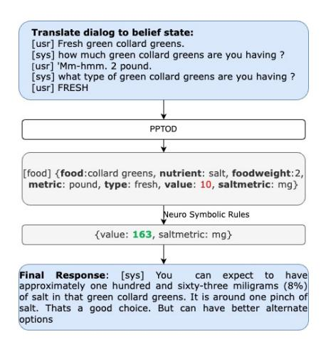
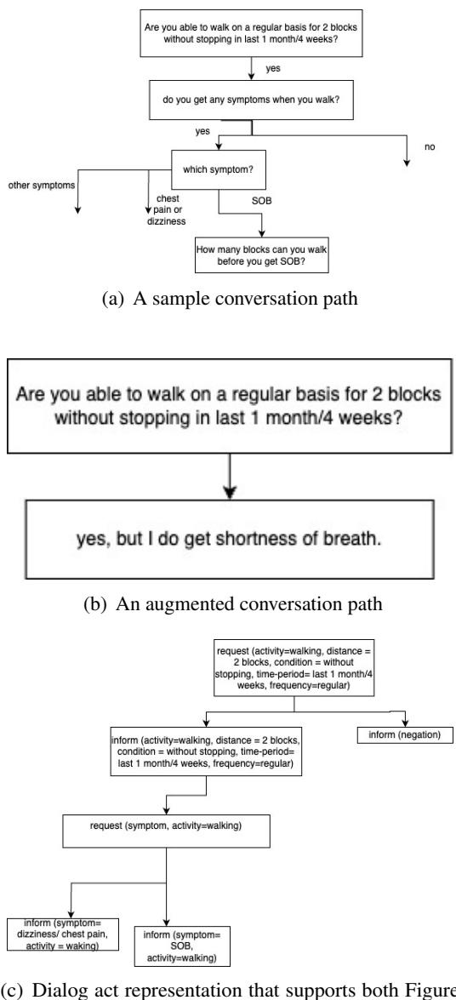

# Thesis Proposal: A Neuro-Symbolic Approach to Control Task-Oriented Dialog Systems

Anuja Tayal University of Illinois Chicago atayal4@uic.edu

Barbara Di Eugenio University of Illinois Chicago bdieugen@uic.edu

### Abstract

Developing effective healthcare dialog systems requires controlling conversations to offer clear insight into the system's understanding and to address the lack of patient-oriented conversational datasets. Moreover, evaluating these systems is equally challenging and requires user studies for robust evaluation. These challenges are even more pronounced when addressing the needs of minority populations with low health literacy and numeracy. This thesis proposal focuses on designing conversational architectures that deliver self-care information to African American patients with heart failure.

Neuro-symbolic approaches provide a promising direction by integrating symbolic reasoning with the generative capabilities of Large Language Models (LLMs). In this proposal, we explore various approaches to creating a hybrid dialog model by combining the strengths of taskoriented dialog systems with the integration of neuro-symbolic rules into a Language Model (LM)/LLM-based dialog system, thereby controlling the dialog system. We propose a hybrid conversational system that uses schema graphs to control the flow of dialogue, while leveraging LLMs to generate responses grounded in these schemas. We will also conduct a user study to evaluate the system's effectiveness.

## 1 Introduction

Heart Failure (HF) predominantly affects individuals aged 65 and older (Lewsey and Breathett, 2021). Apart from regular visits to the doctor, patients with HF need to self-care. Self-care (Barlow et al., 2002) encompasses managing symptoms, treatments, emotions, and lifestyle changes. Traditionally, the design of self-care technologies has been medically focused, using an approach that prioritizes medical measurements while neglecting patients' lived experiences of their illness (Habibi et al., 2019).

Individuals from minority communities (African American (AA) and Hispanic/Latino (H/L)) often face worse outcomes due to genetic variations, healthcare access disparities, socioeconomic conditions, and lower health literacy and numeracy levels (Nayak et al., 2020). Moreover, most selfcare materials lack the cultural nuances (Barrett et al., 2019), which leads to poor self-care practices (Dickson and Riegel, 2009). Providing patients with education that respects and incorporates cultural backgrounds can enhance their understanding of self-care requirements and lead to better health outcomes (Habibi et al., 2019).

While significant progress has been made in areas like clinical documentation (Wang et al., 2019b), using Natural Language Processing (NLP) for self-care, patient education is not much explored (Cunha et al., 2024; Gupta et al., 2020). Moreover, evaluation remains challenging due to the lack of standardized metrics tailored to medical text (Chowdhury et al., 2023).

To understand how patient educators (PE) convey self-care strategies, (Gupta et al., 2020) recorded PE sessions. These sessions revealed that patients spoke very little and did not contribute much to the conversation. The key topics discussed during these sessions included salt intake, exercise, fluid intake, symptom management, sleep, weight management, and familial aspects. An excerpt of the conversation collected from one of the PE sessions is shown in Table 1.

Drawing motivation from this dataset, we aim to explore conversational architectures that deliver self-care information to African American heart failure patients. Unlike traditional dialog agents or question-answering systems, we propose a conversational model that supports multi-turn interactions in which the patient takes initiative, and the agent asks clarification questions (Walker and Whittaker, 1990).

Conversational assistants in the healthcare do-

| | Speaker |  | Utterance |  |  |  |  |  |  |  |  |  |  |  |  |  |  |
|--------- | ----------- | ------- | ----------- | --------- | --------- | --------- | ----------- | ---------- | ------------ | --------- | -------- | -------- | -------- | ---------- | ------- | -------- | -------- |
|Patient | Educator: | You | have | to | ask. | Um, | exercise, |  | regularly. | You | know, | it | sounds | with | this | one | to two |
| |  | miles |  | you’re |  | walking | on a | daily | basis, | we’re | going | to get | you | back | up to | that. |  |
| | Patient: |  | Okay. |  |  |  |  |  |  |  |  |  |  |  |  |  |  |
|Patient | Educator: |  | That’s | a great |  | way to | keep | that | going. | There’s | no | reason |  | to stop, | once |  | we get |
| |  | you |  | feeling | better. | Um, | it | used to | be back | in the | day, |  | maybe | 20 | years | ago, | people |
| |  |  | would | say, | “Well, | you | know, | I’ve got | to | take it | easy.” | That’s | not | the | case | with | heart |
| |  |  | failure. | We | want | you | to get | up | where you | can | do | it. We | don’t | want | you | to | push |
| | Patient: |  | Right. |  |  |  |  |  |  |  |  |  |  |  |  |  |  |
|Patient | Educator: | If | you’re | short | of | breath, | but. | and | then, | we | want | you to | check | your |  | weight | every |
| |  | day. | Do | you | own | a | scale? |  |  |  |  |  |  |  |  |  |  |

Figure 1: Excerpt of Patient-educator conversation

main are as old as NLP, since in 1966 ELIZA was already playing the role of a psychiatrist (Weizenbaum, 1966). More recently, models such as T5 (Raffel et al., 2020), BERT (Devlin et al., 2019), and LLMs like GPT-4 (OpenAI et al., 2024) have revolutionized healthcare NLP by significantly enhancing the ability to process and understand complex medical data. LLMs offer unique advantages, including contextual understanding and scalability across diverse datasets. Additionally, LLMs have shown strong potential in generating synthetic datasets (Wang et al., 2024).

Given the lack of real-world patient-oriented conversational data from AA HF patients, (Tayal et al., 2025b) explored the potential of ChatGPT to generate simulated conversations (section 3). The findings indicate that prompting alone is insufficient to control or personalize conversations, leaving such models unsuitable for direct deployment in patientcentric settings.

As we aim to develop a conversational system tailored to the healthcare domain, relying solely on LMs or LLMs is insufficient. To ensure accurate and reliable information, a provision of control is needed that addresses these limitations. Integrating neuro-symbolic approaches offers a solution by combining the inference capabilities of symbolic systems with the robustness of neural networks, creating a composite AI framework adept at reasoning, learning, and cognitive modeling (Garcez and Lamb, 2023). This blend addresses the inherent weaknesses of each system, promising enhanced performance and robustness (Mehri and Eskenazi, 2021; Zhou et al., 2020; Tayal et al., 2024, 2025a).

By modeling a neuro-symbolic task-oriented dialogue system (TODS), (Tayal et al., 2024) demon-

strated that training a language model (T5) alone is insufficient for building a conversational system that requires numerical reasoning. This limitation can be addressed by incorporating neurosymbolic rules externally to control the system's output (Section 3, Table 3). Moreover, a comparison with an LLM-based system involving African American heart failure patients (Tayal et al., 2025a) revealed that the two systems complement each other (Table 1), underscoring the promise of a hybrid approach that combines the strengths of both LLMs and neuro-symbolic methods. Building on these findings, our goal is to design a hybrid taskoriented dialogue model that unifies the advantages of task-oriented systems and language models (LMs/LLMs).

## 2 Related Work

This section provides an overview of the background literature that contextualizes our work on conversational assistants. We begin with a review of healthcare dialogue systems, followed by a discussion of the limitations of existing evaluation metrics—particularly in the healthcare domain and the importance of conducting a user study. Finally, we introduce neuro-symbolic systems, which draw inspiration from dual-process theory by combining neural intuition with symbolic reasoning, and highlight prior dialogue systems that have successfully integrated neuro-symbolic methods.

Healthcare Dialog Systems Medical dialogue systems have been developed for a wide range of medical conditions, including heart failure (Moulik, 2019; Gupta et al., 2020), cancer (Belfin et al., 2019), mental health disorders (Ali et al., 2020), and public anxiety (Wang et al., 2020). Their applications span disease diagnosis (Wei et al., 2018), patient education (Cai et al., 2023; Gupta et al., 2020), and health coaching (Zhou et al., 2022), among others. A comprehensive survey in (Valizadeh and Parde, 2022) analyzes these systems from a computational perspective and highlights their diverse user groups. The authors analyzed these systems based on various objectives, including language, application, audience, architecture, modality, and evaluation metrics.

Healthcare dialogue systems have generally followed the same timeline and developments as dialogue systems, though with a delayed adoption. One of the major constraints is the International Review Board (IRB), due to which most healthcare dialogue datasets are often not publicly available. As these systems interact with real stakeholders—such as clinicians and patients—the need for models to be explainable and interpretable has become critically important.

Dialog System Evaluation Evaluating the true conversational capabilities of TODS is inherently challenging. Evaluation methods typically fall into two categories: automated metrics and human evaluation.

Automated metrics can assess both individual components and the overall system. For Natural Language Understanding (NLU), intent classification accuracy (i.e., the percentage of user utterances where the predicted intent matches the true intent) and entity F1 score (based on precision and recall) are commonly used. Dialog State Tracking (DST) is evaluated using joint goal accuracy, which checks if the predicted belief states exactly match the ground truth for a given user turn. Natural Language Generation (NLG) is assessed using BLEU (Papineni et al., 2002), ROUGE (Lin, 2004), and METEOR (Banerjee and Lavie, 2005) scores, which measure overlap between the generated output and the reference, but these metrics do not capture the meaning of responses.

End-to-end metrics include Inform (whether the system provides an appropriate entity that meets the user's constraints) and Success Rate (whether the system both provides a correct entity and fulfills all requested information, such as address or price).

However, task performance is just one dimension of dialogue system evaluation. As demonstrated by the PARADISE framework (Walker et al., 1998), user satisfaction is influenced by both task success and interaction cost. Consequently, human evalua-

tion remains the gold standard, especially for medical dialogue systems (Yeh et al., 2021; Deriu et al., 2021). Human evaluators can provide insights into subjective qualities such as coherence, informativeness, and user satisfaction—factors that are difficult to capture with automated metrics alone. The evaluation of medical dialog systems also follows a similar structure (Chowdhury et al., 2023) to TODS, but often requires comprehensive user studies for robust assessments. As conducting a user study is costly, researchers have explored alternative approaches, such as simulating users for evaluation (Yun et al., 2025; Park et al., 2023). With the rise of LLMs, there is growing interest in using them as automated judges (Zheng et al., 2023); however, their reliability remains under scrutiny. Despite these advancements, no current method fully captures the complex and multifaceted nature of dialogue system evaluation.

Neuro-Symbolic Methods The foundation of Neuro-Symbolic Systems (Nye et al., 2021) is inspired by the "dual process" theory from cognitive science, which distinguishes between two types of reasoning: System 1, which is fast, intuitive, and associative (akin to large language models), and System 2, which is slower, more deliberate, and logical—representing the symbolic reasoning component.

Neuro-Symbolic methods combine the generalization strengths of neural networks with the structure and interpretability of symbolic reasoning. For instance, (Romero et al., 2021) introduced symbolic representations into GPT-2 outputs to enhance structural awareness. DILOG (Zhou et al., 2020) leveraged inductive logic programming to learn dialogue policies from limited data, enabling zeroshot transfer. Similarly, (Arabshahi et al., 2021) showcased how multi-hop and commonsense reasoning can be incorporated into dialogue systems using neuro-symbolic techniques.

Lately, Symbol-LLM (Xu et al., 2024) discusses the challenges of integrating symbolic knowledge into LLMs and posits that since LLMs are pretrained on general text without symbolic structure, using a symbolic interface is difficult. To address this, the authors explore the possibility of treating symbols in a unified manner by compiling 34 text-to-symbol generation tasks covering around 20 symbolic forms (Xu et al., 2024).

Figure 2: HFFood-NS Model interaction with the patient

## 3 Motivation and Research Questions

To model a conversational system for heart failure self-care domains, training data is required. However, a notable challenge remains: the lack of realworld, patient-driven conversational data from AA HF patients. With the advent of ChatGPT (OpenAI et al., 2024) and other LLMs, which have demonstrated strong capabilities in synthetic data generation, (Salunke et al., 2023; Tayal et al., 2025b) investigated their effectiveness in generating selfcare conversations between patients and PEs. Chat-GPT was used to generate simulated conversations using five distinct approaches of Race, Domain, African American Vernacular English (AAVE), Social Determinants of Health (SDOH), and SDOHinformed Reasoning. For each approach, conversations were generated with varying numbers of conversation rounds {5, 10, 15} and across different domains of food, water, exercise, which was a topic of discussion in the patient educator conversations. The conversational dataset is publicly available 1.

The findings suggested that prompting alone is insufficient to control or personalize conversations. The model struggled to follow even basic instructions, such as adhering to a set number of dialogue rounds, limiting word count, or asking appropriate follow-up questions. While it can incorporate SDOH features and improve dialogue quality through reasoning prior to generation, it remains unsuitable for direct deployment in patient-centric settings due to the lack of controllability.

Moreover, as salt consumption was a central topic in patient–educator conversations, (Tayal

et al., 2024) designed a task-oriented dialogue system in which the users initiate the conversation by asking about the salt content of food. The system then posed clarification questions (cook, type, foodweight) to determine sodium values accurately. A template-based conversational system was constructed using the USFDC dataset (USFDC, 2022), a publicly available resource from the U.S. Department of Agriculture (USDA) that ensures cultural diversity and provides extensive food descriptions and nutritional values.

However, even after fine-tuning a T5-based language model (PPTOD) (Su et al., 2022), the system struggled to predict correct salt values—achieving only a 2% success rate—despite correctly identifying slot values (Table 3). These findings were consistent with Wei et al. (2022), which noted that large pre-trained language models (PLMs) such as GPT-3 and T5 (Brown et al., 2020; Raffel et al., 2020) are proficient at complex arithmetic reasoning but still make calculation errors. By integrating neuro-symbolic rules, a 20% improvement was observed in joint accuracy compared to the fine-tuned model, highlighting the necessity of incorporating neuro-symbolic rules to control system outputs (as shown in Table 3).

To further examine the practical implications of these improvements, Tayal et al. (2025a) conducted a within-group user study comparing the neuro-symbolic-based TODS system (HFFood-NS) with an LLM-based system (HFFood-GPT), involving 20 African American patients hospitalized with heart failure. Figure 2 shows an interaction with HFFood-NS while Table 4 shows an excerpt of the interaction with HFFood-GPT. The evaluation combined intrinsic measures of task performance with extrinsic analyses (Sparck Jones and Galliers, 1995) based on pre- and post-interaction surveys. Table 1 summarizes the two systems by comparing performance, design, usability, reliability, and flexibility. The two systems complement each other, highlighting the potential of a hybrid approach that leverages the strengths of both LLMs and neuro-symbolic systems. The neuro-symbolic TODS system is more accurate, completes more tasks, and produces concise responses, whereas the LLM-based system makes fewer speech errors, requires fewer clarifications, and handles complex queries more effectively. This direction is particularly promising for healthcare dialogue systems and motivates our research question:

1 https://github.com/anujatayal/HF-Dataset

- RQ1: How can we effectively combine the strengths of TODS and LMs/LLMs to create a hybrid dialog model?
- RQ2: How do users/patients/older adults perceive such a system?

| | HFFood-NS HFFood-GPT |
|------------------------------ | ---------------------- |
|Task completion | ✓ ✗ |
|Accuracy | ✓ ✗ |
|Slot Accuracy | ✗ ✓ |
|Fewer Speech Error | ✗ ✓ |
|Less Processing Time | ✓ ✗ |
|Error Analysis | ✓ ✗ |
|Controlled | ✓ ✗ |
|Reliable | ✓ ✗ |
|Predictable | ✓ ✗ |
|Complex query | ✗ ✓ |
|Gave Options | ✗ ✓ |
|Fluent | ✗ ✓ |
|Concise | ✓ ✗ |
|Create easily with less time | ✗ ✓ |

Table 1: Pros and Cons of HFFood-NS and HFFood-GPT comparing on performance, design usability, reliability, and flexibility.

Although HFFood-NS relied on template-based sentences, the resulting conversations were more controllable but lacked flexibility. While ChatGPTgenerated conversations were diverse and more natural-sounding, they lacked predictability and controllability, raising questions such as whether the system would mention the salt amount, which questions it would ask, or whether follow-up questions would remain relevant. This unpredictability made the dialogue less explainable.

Moreover, the neuro-symbolic rules were applied externally to control the model's output, for correcting the salt value. While this approach improved accuracy, it kept symbolic reasoning separate from the neural model. An alternative strategy involves embedding symbolic rules directly into a language model through fine-tuning, enabling the model to internalize and apply these patterns during generation. In the context of TODS, dialog acts function as symbolic representations of user intent. By incorporating dialog acts as symbols during training, we aim to integrate these rules more seamlessly into the model's reasoning process.

We hypothesize that training models using schema graphs, rather than solely on dialog responses, will lead to better performance and improved generalization. Schemas (Mehri and Eskenazi, 2021; Zhao et al., 2023), originally known as frames (Fillmore, 1976), have a longstanding presence in the literature (Baker et al., 1998; Booij, 2010) and have recently regained attention as a

structured approach for guiding the flow of taskoriented dialogues. They can be integrated either into the DST component or within end-to-end dialogue modeling. However, the definition and implementation of "schema" vary across the literature. A summary of different models—highlighting their associated tasks, schema types, and training strategies—is provided in Table 2.

Imrattanatrai and Fukuda (2023) adopts a lightweight approach, interpreting schemas primarily as slot descriptions, without modeling the full conversational trajectory. Similarly, T5DST (Lin et al., 2021) enhances zero-shot cross-domain DST by providing slot descriptions, while IC-DST (Hu et al., 2022) uses schema prompting with slot names and value examples. Schema graphs introduced in (Mehri and Eskenazi, 2021) abstract task representations to facilitate domain transfer.

SAM (Mehri and Eskenazi, 2021) employs schema-based reasoning to guide conversation flow in task-oriented dialogue systems. While effective in zero-shot settings, SAM relies on template-based generation, which can limit the naturalness and flexibility of responses. In contrast, our approach envisions schema graphs similar to SAM but utilizes dialog acts instead of templates. By integrating dialog acts and employing prompting techniques, the system aims to generate more dynamic and contextually appropriate responses. This method seeks to combine the structured control offered by schema-based reasoning with the adaptability of LLMs.

When models are trained on dialog responses, they must learn the underlying logic and structure of conversations implicitly from datasets. This requires significant data, and the learned logic may not always be consistent or transferable across domains. In contrast, schema-graphs explicitly encode the structure and flow of a conversation and possible user paths. By training on these structured representations, the model does not need to infer the logic on its own. As a result, models trained with schema-graphs are likely to be more robust.

## 4 Proposed Work

This thesis will focus on the exercise domain of self-care strategies and examine how users perceive and interact with such a system. Regular exercise plays a significant role in reducing hospitalizations for heart failure patients (Morris and Chen, 2019). The Physical Activity Guidelines

|Model | Task | Schema Type | Training | Strat |
|-------------------------------- | ------------ | ----------------------------- | ------------- | -------- |
|T5DST (Lin et al., 2021) | DST | slot names/descriptions | Fine-tuning |  |
|IC-DST (Hu et al., 2022) | DST | slot names/value examples | Prompting |  |
|SAM (Mehri and Eskenazi, 2021) | E2E dialog | user-aware policy skeletons | Fine-tuning |  |
|ANYTOD (Zhao et al., 2023) | E2E dialog | policy programs, slot |  |  |
| |  | names/value examples, slot |  |  |
| |  | descriptions, user action |  |  |
| |  |  | Fine-tuning | and |
|SGP-TOD (Zhang et al., 2023) | E2E dialog | policy programs,slot |  |  |
| |  | names/value examples |  |  |

Table 2: Schema-type distinction along with their associated tasks, and training strategies as taken from (Zhang et al., 2023)

for Americans recommend at least 150 minutes of moderate-intensity exercise per week (Piercy et al., 2018). New York Heart Association (NYHA) (Committee, 1979) classified heart failure patients based on their physical activity limitations due to HF symptoms:

- Class I: No limitation of physical activity. Ordinary activity does not cause symptoms.
- Class II: Slight limitation. Comfortable at rest, but ordinary activity causes symptoms.
- Class III: Marked limitation. Comfortable at rest, but less than ordinary activity causes symptoms.
- Class IV: Unable to carry on any physical activity without discomfort; symptoms present even at rest.

Designing a dialog system for exercise is very complex. There is no pre-existing ontology for exercise-related dialogs. Moreover, exercise is a routine activity that demands constant motivation, a gradual build-up, and personalized guidance (Marcus and Pekmezi, 2024). Individual differences in physical abilities and fitness levels further heighten the complexity.

To establish a starting point, we consulted healthcare professionals to gain insights into how the conversation should be initiated. Initially, we (along with the healthcare professionals) decided to focus on class I and class II patients, as they can engage in exercise without direct supervision from a doctor. In contrast, class III and IV patients require a doctor's intervention while exercising.

The initial dialog paths were created to better understand how PE navigate exercise-related conversations, with the goal of using these insights to construct a synthetic dataset. The conversation begins with a patient-initiated question, such as, "Can I exercise with heart failure?" and alternates between the PE and the user, where the PE poses follow-up questions. The PE aims to establish a baseline understanding of the patient's condition and physical capabilities in order to provide actionable guidance. The resulting dialog graph consists of 16 unique paths, each corresponding to a leaf node. While this provides a solid foundation, the limited number of paths is inadequate for training a robust conversational system, highlighting the need for data augmentation.

Since these were simulated conversations, user responses were constrained to simple "yes" or "no" answers (see Figure 3(a)). However, real-world conversations are rarely so constrained. Patients often provide more nuanced responses, such as "I used to exercise but not anymore," or "I can walk short distances but need breaks because I get shortness of breath" (see Figure 3(b)). In such cases, predefined follow-up questions may become redundant, as users have already provided the required information.

To address this limitation, we structured these interactions as rule-based dialog graphs and converted each dialog path into a structured sequence of dialog acts (see Figure 3(c)), or symbolic representations/schema graphs (Section 2). This abstraction enabled systematic augmentation by generating all possible subsequences of each dialog path. Through this method, the number of distinct dialog states expanded from 16 to 1,078, significantly enriching the dataset. As a result, the system is now better equipped to accommodate the more

(c) Dialog act representation that supports both Figure 3(a) and Figure 3(b)

Figure 3: An example of a conversation flow, an augmented conversation, along with the dialog act representation that accommodates both conversation flows

varied and complex conversational flows observed in real-world interactions (Figure 3(b)).

Two key challenges arise when modeling an exercise-domain dialog system: dialog management and response generation. As we plan to effectively combine the strengths of TODS and LMs/LLMs to create a hybrid dialog model, we propose to decouple the dialog management and response generation and ask the following questions:

- How can we integrate dialog acts to control the flow of the conversation?
- How can different persuasion strategies be

integrated to enhance the generation of patient education responses?

For dialog management, we will approach the problem by training a model (T5 or symbol-llm (Xu et al., 2024) on the schemas to predict the next dialog act rather than generating full responses directly. For pretraining, we will use the patienteducator (Gupta et al., 2020) dialogues (Section 1), the dataset generated in (Tayal et al., 2025b), and the health coaching dialog datasets (Gupta et al., 2021). Response generation will then be handled using LLMs. Using schema models will provide more control over the conversation flow, be more aligned, and make the system more reliable, while using LLM to generate responses will make the responses more diverse.

We will compare our schema approach with other schema approaches (Zhang et al., 2023; Zhao et al., 2023). We will try different models to train schema-graphs, including T5-based PPTOD (Su et al., 2022) and Symbol-LLM (Xu et al., 2024). Symbol-LLM may work better than T5 as it is trained on symbols. We believe that the dialog schema alone may be sufficient to effectively train dialog models, making additional data augmentation techniques unnecessary. To validate this hypothesis, we will conduct experiments comparing various augmentation strategies (Gritta et al., 2021), demonstrating that schema-based training provides strong generalization and performance.

For response generation, we will examine patient-educator conversations (Section 1) for the presence of persuasive communication strategies (Cialdini, 2001; Cialdini and Goldstein, 2004; Gass and Seiter, 2022; Knapp and Daly, 2011; Goffman, 1974). For example, in Figure 1, the PE attempts to persuade the patient to exercise regularly, and by doing so, reaffirms that the patient can return to previous activity levels. Upon identifying persuasive intent, we will analyze the specific strategies used (Gollapalli and Ng, 2025; Zeng et al., 2024; Wang et al., 2019a) by the PE.

PIRsuader (Gollapalli and Ng, 2025) offers a relevant framework, introducing dialog act categories such as logical_appeal and emotional_appeal, specifically designed to persuade diabetes patients to manage insulin resistance. A more detailed list of the dialog acts used can be found in Table 10 of (Gollapalli and Ng, 2025). We will start from this and if needed, we will also draw upon the taxonomy presented in Table 1 of (Zeng et al.,

2024), which organizes 13 categories of ethical strategies—including information-based, emotionbased, and credibility-based methods—grounded in research across disciplines such as Social Science (Goffman, 1974), Psychology (Cialdini, 2001; Cialdini and Goldstein, 2004), Marketing (Gass and Seiter, 2022), and Communication Studies (Knapp and Daly, 2011). Although these strategies were proposed for different use cases, we will adapt them to the patient-educator conversations. Building on this analysis, we will explore how such strategies can be integrated for the generation of responses for the exercise domain.

Additionally, we will incorporate a readability parameter during LLM response generation, enabling the model to adjust its language complexity according to the patient's reading grade level. Our core hypothesis is that an exercise dialog system can be effective for patients when it is both actionable and can adapt to both communication strategies and reading level (Burns, 1991).

Evaluation To evaluate our dialog agent, we will follow a three-step process. First, we will use automatic metrics of joint goal accuracy, inform, and success rate (Budzianowski et al., 2018)). Secondly, we will assess model performance using simulated users (Yun et al., 2025; Park et al., 2023). This will allow us to efficiently test multiple model variants and observe their behavior across a range of interaction styles. Based on this evaluation, the top two performing models will then be selected for testing with real users.

In the final phase, we will conduct a user study with older adults, as recruiting patients from a hospital setting poses logistical constraints. However, our study is still valid for two reasons. First, heart failure predominantly affects individuals aged 65 and older. Second, the system is intended for use in post-hospital environments, where older adults are expected to engage with it independently. This three-stage evaluation—starting with automatic metrics, evaluating using synthetic users, and progressing to real users—offers a more robust and scalable way to refine the dialog agent.

Our core hypothesis is that an exercise dialog system can be effective for patients when it is actionable and can adapt to both communication strategies and reading level.

## 5 Conclusion

We aim to develop a task-oriented dialogue system specifically designed to support the self-care needs of African-American patients with heart failure. The widespread use of large language models (LLMs) often lacks scrutiny, raising concerns in healthcare settings. Greater control is needed, as relying solely on prompting is not enough. Neuro-symbolic methods, which offer greater transparency, reliability, and explainability, should be further explored and integrated into future systems. In this thesis, we propose to develop hybrid conversational systems that combine the strengths of both systems. The conversational system will use schema graphs to control the flow of dialogue and leverage LLMs to generate responses grounded in these schemas. We will also conduct a user study to evaluate the system's effectiveness and to determine how older adults perceive such a system.

## 6 Limitations

We recognize that large language models (LLMs) are continually evolving, and improvements in future architectures may address some of the limitations observed in our study. Moreover, while we attempt to evaluate the systems comprehensively—our evaluation is not exhaustive and cannot capture all the aspects of interactions. Human evaluation remains the gold standard for assessing dialogue quality and patient-centered outcomes; however, conducting user studies is costly, timeintensive, and limited in scale, which constrains the generalizability of our findings.

## References

Mohammad Rafayet Ali, Seyedeh Zahra Razavi, Raina Langevin, Abdullah Al Mamun, Benjamin Kane, Reza Rawassizadeh, Lenhart K Schubert, and Ehsan Hoque. 2020. A virtual conversational agent for teens with autism spectrum disorder: Experimental results and design lessons. In Proceedings of the 20th ACM international conference on intelligent virtual agents, pages 1–8. Forough Arabshahi, Jennifer Lee, Mikayla Gawarecki, Kathryn Mazaitis, Amos Azaria, and Tom Mitchell. 2021. Conversational neuro-symbolic commonsense reasoning. In Proceedings of the AAAI Conference on Artificial Intelligence, volume 35, pages 4902–4911. Collin F Baker, Charles J Fillmore, and John B Lowe. 1998. The berkeley framenet project. In COLING 1998 Volume 1: The 17th International Conference on Computational Linguistics.

- Satanjeev Banerjee and Alon Lavie. 2005. Meteor: An automatic metric for mt evaluation with improved correlation with human judgments. In Proceedings of the acl workshop on intrinsic and extrinsic evaluation measures for machine translation and/or summarization, pages 65–72.
- J. Barlow, C. Wright, J. Sheasby, A. Turner, and
- J. Hainsworth. 2002. Self-management approaches for people with chronic conditions: a review. Patient Education and Counseling, 48(2):177–187. Matthew Barrett, Josiane Boyne, Julia Brandts, Hans-Peter Brunner-La Rocca, Lieven De Maesschalck, Kurt De Wit, Lana Dixon, Casper Eurlings, Donna Fitzsimons, Olga Golubnitschaja, et al. 2019. Artificial intelligence supported patient self-care in chronic heart failure: a paradigm shift from reactive to predictive, preventive and personalised care. Epma Journal, 10:445–464. RV Belfin, AJ Shobana, Megha Manilal, Ashly Ann Mathew, and Blessy Babu. 2019. A graph based chatbot for cancer patients. In 2019 5th international conference on advanced computing & communication systems (ICACCS), pages 717–721. IEEE. Geert Booij. 2010. Construction morphology. Language and linguistics compass, 4(7):543–555. Tom Brown, Benjamin Mann, Nick Ryder, Melanie Subbiah, Jared D Kaplan, Prafulla Dhariwal, Arvind Neelakantan, Pranav Shyam, Girish Sastry, Amanda Askell, Sandhini Agarwal, Ariel Herbert-Voss, Gretchen Krueger, Tom Henighan, Rewon Child, Aditya Ramesh, Daniel Ziegler, Jeffrey Wu, Clemens Winter, Chris Hesse, Mark Chen, Eric Sigler, Mateusz Litwin, Scott Gray, Benjamin Chess, Jack Clark, Christopher Berner, Sam McCandlish, Alec Radford, Ilya Sutskever, and Dario Amodei. 2020. Language models are few-shot learners. In Advances in Neural Information Processing Systems, volume 33, pages 1877–1901. Curran Associates, Inc. Paweł Budzianowski, Tsung-Hsien Wen, Bo-Hsiang Tseng, Iñigo Casanueva, Stefan Ultes, Osman Ramadan, and Milica Gašic. 2018. MultiWOZ - a large- ´ scale multi-domain Wizard-of-Oz dataset for taskoriented dialogue modelling. In Proceedings of the 2018 Conference on Empirical Methods in Natural Language Processing, pages 5016–5026, Brussels, Belgium. Association for Computational Linguistics. Robert B Burns. 1991. Persuasion by communication. Essential Psychology: For Students and Professionals in the Health and Social Services, pages 236–254. Pengshan Cai, Zonghai Yao, Fei Liu, Dakuo Wang, Meghan Reilly, Huixue Zhou, Lingxi Li, Yi Cao, Alok Kapoor, Adarsha Bajracharya, Dan Berlowitz, and Hong Yu. 2023. PaniniQA: Enhancing Patient Education Through Interactive Question Answering. Transactions of the Association for Computational Linguistics, 11:1518–1536. Mohita Chowdhury, Ernest Lim, Aisling Higham, Rory McKinnon, Nikoletta Ventoura, Yajie He, and Nick De Pennington. 2023. Can large language models safely address patient questions following cataract surgery? In Proceedings of the 5th Clinical Natural Language Processing Workshop, pages 131–137, Toronto, Canada. Association for Computational Linguistics. Robert B Cialdini. 2001. The science of persuasion. Scientific American, 284(2):76–81. Robert B Cialdini and Noah J Goldstein. 2004. Social influence: Compliance and conformity. Annu. Rev. Psychol., 55(1):591–621. New York Heart Association. Criteria Committee. 1979. Nomenclature and criteria for diagnosis of diseases of the heart and great vessels. Little, Brown Medical Division. Rossana Cunha, Thiago Castro Ferreira, Adriana Pagano, and Fabio Alves. 2024. A persona-based corpus in the diabetes self-care domain - applying a human-centered approach to a low-resource context. In Proceedings of the 2024 Joint International Conference on Computational Linguistics, Language Resources and Evaluation (LREC-COLING 2024), pages 1353–1369, Torino, Italia. ELRA and ICCL. Jan Deriu, Alvaro Rodrigo, Arantxa Otegi, Guillermo Echegoyen, Sophie Rosset, Eneko Agirre, and Mark Cieliebak. 2021. Survey on evaluation methods for dialogue systems. Artificial Intelligence Review, 54:755–810. Jacob Devlin, Ming-Wei Chang, Kenton Lee, and Kristina Toutanova. 2019. BERT: Pre-training of deep bidirectional transformers for language understanding. In Proceedings of the 2019 Conference of the North American Chapter of the Association for Computational Linguistics: Human Language Technologies, Volume 1 (Long and Short Papers), pages 4171–4186, Minneapolis, Minnesota. Association for Computational Linguistics. Victoria Vaughan Dickson and Barbara Riegel. 2009. Are we teaching what patients need to know? building skills in heart failure self-care. Heart & Lung, 38(3):253–261. Charles J Fillmore. 1976. Frame semantics and the nature of language. Annals of the New York Academy of Sciences, 280(1):20–32. Artur d'Avila Garcez and Luis C Lamb. 2023. Neurosymbolic ai: The 3 rd wave. Artificial Intelligence Review, pages 1–20. Robert H Gass and John S Seiter. 2022. Persuasion: Social influence and compliance gaining. Routledge. Erving Goffman. 1974. Frame analysis: An essay on the organization of experience. Harvard University Press.

- Sujatha Das Gollapalli and See-Kiong Ng. 2025. PIRsuader: A persuasive chatbot for mitigating psychological insulin resistance in type-2 diabetic patients. In Proceedings of the 31st International Conference on Computational Linguistics, pages 5997–6013, Abu Dhabi, UAE. Association for Computational Linguistics. Milan Gritta, Gerasimos Lampouras, and Ignacio Iacobacci. 2021. Conversation graph: Data augmentation, training, and evaluation for non-deterministic dialogue management. Transactions of the Association for Computational Linguistics, 9. Itika Gupta, Barbara Di Eugenio, Devika Salunke, Andrew Boyd, Paula Allen-Meares, Carolyn Dickens, and Olga Garcia. 2020. Heart failure education of African American and Hispanic/Latino patients: Data collection and analysis. In Proceedings of the First Workshop on Natural Language Processing for Medical Conversations, pages 41–46, Online. Association for Computational Linguistics. Itika Gupta, Barbara Di Eugenio, Brian D. Ziebart, Bing Liu, Ben S. Gerber, and Lisa K. Sharp. 2021. Summarizing behavioral change goals from SMS exchanges to support health coaches. In Proceedings of the 22nd Annual Meeting of the Special Interest Group on Discourse and Dialogue, pages 276–289, Singapore and Online. Association for Computational Linguistics. Pantea Habibi, Sabita Acharya, Barbara Di Eugenio, Richard Cameron, Andrew Boyd, Karen Lopez, Pamela Martyn-Nemeth, Carolyn Dickens, Amer Ardati, and Debaleena Chattopadhyay. 2019. Designing self-care technologies for hf patients: a conceptual model. In Conference on Human Factors in Computing Systems, pages 12–16. Yushi Hu, Chia-Hsuan Lee, Tianbao Xie, Tao Yu, Noah A. Smith, and Mari Ostendorf. 2022. Incontext learning for few-shot dialogue state tracking. In Findings of the Association for Computational Linguistics: EMNLP 2022, pages 2627–2643, Abu Dhabi, United Arab Emirates. Association for Computational Linguistics. Wiradee Imrattanatrai and Ken Fukuda. 2023. End-toend task-oriented dialogue systems based on schema. In Findings of the Association for Computational Linguistics: ACL 2023, pages 10148–10161, Toronto, Canada. Association for Computational Linguistics. Mark L Knapp and John A Daly. 2011. The SAGE handbook of interpersonal communication. Sage Publications.
- S. C. Lewsey and K. Breathett. 2021. Racial and ethnic disparities in heart failure: Current state and future directions. Current Opinion in Cardiology, 36(3):320–
- 328. Chin-Yew Lin. 2004. ROUGE: A package for automatic evaluation of summaries. In Text Summarization Branches Out, pages 74–81, Barcelona, Spain. Association for Computational Linguistics. Zhaojiang Lin, Bing Liu, Seungwhan Moon, Paul Crook, Zhenpeng Zhou, Zhiguang Wang, Zhou Yu, Andrea Madotto, Eunjoon Cho, and Rajen Subba. 2021. Leveraging slot descriptions for zero-shot cross-domain dialogue StateTracking. In Proceedings of the 2021 Conference of the North American Chapter of the Association for Computational Linguistics: Human Language Technologies, pages 5640–5648, Online. Association for Computational Linguistics. Bess H Marcus and Dori Pekmezi. 2024. Motivating people to be physically active. Human Kinetics. Shikib Mehri and Maxine Eskenazi. 2021. Schemaguided paradigm for zero-shot dialog. In Proceedings of the 22nd Annual Meeting of the Special Interest Group on Discourse and Dialogue, pages 499– 508, Singapore and Online. Association for Computational Linguistics. JH Morris and L Chen. 2019. Exercise training and heart failure: A review of the literature. Cardiac Failure Review, 5(1):57–61. Sanjoy Moulik. 2019. DIL-A Conversational Agent for Heart Failure Patients. Ph.D. thesis, The Claremont Graduate University. A Nayak, AJ Hicks, and AA Morris. 2020. Understanding the complexity of heart failure risk and treatment in black patients. Circulation: Heart Failure, 13(8):e007264. Maxwell Nye, Michael Tessler, Josh Tenenbaum, and Brenden M Lake. 2021. Improving coherence and consistency in neural sequence models with dualsystem, neuro-symbolic reasoning. Advances in Neural Information Processing Systems, 34:25192– 25204. OpenAI, Josh Achiam, Steven Adler, Sandhini Agarwal, Lama Ahmad, Ilge Akkaya, Florencia Leoni Aleman, Diogo Almeida, Janko Altenschmidt, Sam Altman, Shyamal Anadkat, Red Avila, Igor Babuschkin, Suchir Balaji, Valerie Balcom, Paul Baltescu, Haiming Bao, Mohammad Bavarian, Jeff Belgum, Irwan Bello, Jake Berdine, Gabriel Bernadett-Shapiro, Christopher Berner, Lenny Bogdonoff, Oleg Boiko, Madelaine Boyd, Anna-Luisa Brakman, Greg Brockman, Tim Brooks, Miles Brundage, Kevin Button, Trevor Cai, Rosie Campbell, Andrew Cann, Brittany Carey, Chelsea Carlson, Rory Carmichael, Brooke Chan, Che Chang, Fotis Chantzis, Derek Chen, Sully Chen, Ruby Chen, Jason Chen, Mark Chen, Ben Chess, Chester Cho, Casey Chu, Hyung Won Chung, Dave Cummings, Jeremiah Currier, Yunxing Dai, Cory Decareaux, Thomas Degry, Noah Deutsch, Damien Deville, Arka Dhar, David Dohan, Steve Dowling, Sheila Dunning, Adrien Ecoffet, Atty Eleti, Tyna Eloundou, David Farhi, Liam Fedus, Niko Felix, Simón Posada Fishman, Juston Forte, Isabella Fulford, Leo Gao, Elie Georges, Christian Gibson, Vik Goel, Tarun Gogineni, Gabriel Goh, Rapha Gontijo-Lopes, Jonathan Gordon, Morgan Grafstein, Scott

- Gray, Ryan Greene, Joshua Gross, Shixiang Shane Gu, Yufei Guo, Chris Hallacy, Jesse Han, Jeff Harris, Yuchen He, Mike Heaton, Johannes Heidecke, Chris Hesse, Alan Hickey, Wade Hickey, Peter Hoeschele, Brandon Houghton, Kenny Hsu, Shengli Hu, Xin Hu, Joost Huizinga, Shantanu Jain, Shawn Jain, Joanne Jang, Angela Jiang, Roger Jiang, Haozhun Jin, Denny Jin, Shino Jomoto, Billie Jonn, Heewoo Jun, Tomer Kaftan, Łukasz Kaiser, Ali Kamali, Ingmar Kanitscheider, Nitish Shirish Keskar, Tabarak Khan, Logan Kilpatrick, Jong Wook Kim, Christina Kim, Yongjik Kim, Jan Hendrik Kirchner, Jamie Kiros, Matt Knight, Daniel Kokotajlo, Łukasz Kondraciuk, Andrew Kondrich, Aris Konstantinidis, Kyle Kosic, Gretchen Krueger, Vishal Kuo, Michael Lampe, Ikai Lan, Teddy Lee, Jan Leike, Jade Leung, Daniel Levy, Chak Ming Li, Rachel Lim, Molly Lin, Stephanie Lin, Mateusz Litwin, Theresa Lopez, Ryan Lowe, Patricia Lue, Anna Makanju, Kim Malfacini, Sam Manning, Todor Markov, Yaniv Markovski, Bianca Martin, Katie Mayer, Andrew Mayne, Bob McGrew, Scott Mayer McKinney, Christine McLeavey, Paul McMillan, Jake McNeil, David Medina, Aalok Mehta, Jacob Menick, Luke Metz, Andrey Mishchenko, Pamela Mishkin, Vinnie Monaco, Evan Morikawa, Daniel Mossing, Tong Mu, Mira Murati, Oleg Murk, David Mély, Ashvin Nair, Reiichiro Nakano, Rajeev Nayak, Arvind Neelakantan, Richard Ngo, Hyeonwoo Noh, Long Ouyang, Cullen O'Keefe, Jakub Pachocki, Alex Paino, Joe Palermo, Ashley Pantuliano, Giambattista Parascandolo, Joel Parish, Emy Parparita, Alex Passos, Mikhail Pavlov, Andrew Peng, Adam Perelman, Filipe de Avila Belbute Peres, Michael Petrov, Henrique Ponde de Oliveira Pinto, Michael, Pokorny, Michelle Pokrass, Vitchyr H. Pong, Tolly Powell, Alethea Power, Boris Power, Elizabeth Proehl, Raul Puri, Alec Radford, Jack Rae, Aditya Ramesh, Cameron Raymond, Francis Real, Kendra Rimbach, Carl Ross, Bob Rotsted, Henri Roussez, Nick Ryder, Mario Saltarelli, Ted Sanders, Shibani Santurkar, Girish Sastry, Heather Schmidt, David Schnurr, John Schulman, Daniel Selsam, Kyla Sheppard, Toki Sherbakov, Jessica Shieh, Sarah Shoker, Pranav Shyam, Szymon Sidor, Eric Sigler, Maddie Simens, Jordan Sitkin, Katarina Slama, Ian Sohl, Benjamin Sokolowsky, Yang Song, Natalie Staudacher, Felipe Petroski Such, Natalie Summers, Ilya Sutskever, Jie Tang, Nikolas Tezak, Madeleine B. Thompson, Phil Tillet, Amin Tootoonchian, Elizabeth Tseng, Preston Tuggle, Nick Turley, Jerry Tworek, Juan Felipe Cerón Uribe, Andrea Vallone, Arun Vijayvergiya, Chelsea Voss, Carroll Wainwright, Justin Jay Wang, Alvin Wang, Ben Wang, Jonathan Ward, Jason Wei, CJ Weinmann, Akila Welihinda, Peter Welinder, Jiayi Weng, Lilian Weng, Matt Wiethoff, Dave Willner, Clemens Winter, Samuel Wolrich, Hannah Wong, Lauren Workman, Sherwin Wu, Jeff Wu, Michael Wu, Kai Xiao, Tao Xu, Sarah Yoo, Kevin Yu, Qiming Yuan, Wojciech Zaremba, Rowan Zellers, Chong Zhang, Marvin Zhang, Shengjia Zhao, Tianhao Zheng, Juntang Zhuang, William Zhuk, and Barret Zoph. 2024. Gpt-4 technical report. Preprint, arXiv:2303.08774. Kishore Papineni, Salim Roukos, Todd Ward, and Wei-Jing Zhu. 2002. Bleu: a method for automatic evaluation of machine translation. In Proceedings of the 40th Annual Meeting of the Association for Computational Linguistics, Philadelphia, Pennsylvania, USA. Association for Computational Linguistics. Joon Sung Park, Joseph C. O'Brien, Carrie J. Cai, Meredith Ringel Morris, Percy Liang, and Michael S. Bernstein. 2023. Generative agents: Interactive simulacra of human behavior. Preprint, arXiv:2304.03442. Katrina L. Piercy, Richard P. Troiano, Rachel M. Ballard, Susan A. Carlson, Janet E. Fulton, Deborah A. Galuska, Stephanie M. George, and Richard D. Olson. 2018. The physical activity guidelines for americans. JAMA, 320(19):2020–2028. Colin Raffel, Noam Shazeer, Adam Roberts, Katherine Lee, Sharan Narang, Michael Matena, Yanqi Zhou, Wei Li, and Peter J. Liu. 2020. Exploring the limits of transfer learning with a unified text-to-text transformer. Journal of Machine Learning Research, 21(140):1–67. Oscar J. Romero, Antian Wang, John Zimmerman, Aaron Steinfeld, and Anthony Tomasic. 2021. A taskoriented dialogue architecture via transformer neural language models and symbolic injection. In Proceedings of the 22nd Annual Meeting of the Special Interest Group on Discourse and Dialogue, pages 438– 444, Singapore and Online. Association for Computational Linguistics.
- D. Salunke, A. Tayal, B. Di Eugenio, P. G. Allen-Meares, C. Dickens, O. Garcia, E. P. Abril, and A. D. Boyd. 2023. Assessing bias in chatgpt's simulated clinical responses. In AMIA Annual Symposium, New Orleans, LA, USA. Karen Sparck Jones and Julia R Galliers. 1995. Evaluating natural language processing systems: An analysis and review. Springer Science & Business Media. Yixuan Su, Lei Shu, Elman Mansimov, Arshit Gupta, Deng Cai, Yi-An Lai, and Yi Zhang. 2022. Multi-task pre-training for plug-and-play task-oriented dialogue system. In Proceedings of the 60th Annual Meeting of the Association for Computational Linguistics (Volume 1: Long Papers), pages 4661–4676, Dublin, Ireland. Association for Computational Linguistics. Anuja Tayal, Barbara Di Eugenio, Devika Salunke, Andrew D. Boyd, Carolyn A. Dickens, Eulalia P. Abril, Olga Garcia-Bedoya, and Paula G. Allen-Meares. 2024. A neuro-symbolic approach to monitoring salt content in food. In Proceedings of the First Workshop on Patient-Oriented Language Processing (CL4Health) @ LREC-COLING 2024, pages 93–103, Torino, Italia. ELRA and ICCL. Anuja Tayal, Devika Salunke, Barbara Di Eugenio, Paula Allen-Meares, Eulalia Puig Abril, Olga Garcia, Carolyn Dickens, and Andrew Boyd. 2025a. Conversational assistants to support heart failure patients:

comparing a neurosymbolic architecture with chatgpt. Preprint, arXiv:2504.17753. Anuja Tayal, Devika Salunke, Barbara Di Eugenio, Paula G Allen-Meares, Eulalia P Abril, Olga Garcia-Bedoya, Carolyn A Dickens, and Andrew D. Boyd. 2025b. Towards conversational assistants for health applications: using chatgpt to generate conversations about heart failure. Preprint, arXiv:2505.03675. USFDC. 2022. Us food data central. Mina Valizadeh and Natalie Parde. 2022. The AI doctor is in: A survey of task-oriented dialogue systems for healthcare applications. In Proceedings of the 60th Annual Meeting of the Association for Computational Linguistics (Volume 1: Long Papers), pages 6638– 6660, Dublin, Ireland. Association for Computational Linguistics. Marilyn Walker and Steve Whittaker. 1990. Mixed initiative in dialogue: An investigation into discourse segmentation. In 28th Annual Meeting of the Association for Computational Linguistics, pages 70–78, Pittsburgh, Pennsylvania, USA. Association for Computational Linguistics. Marilyn A Walker, Diane J Litman, Candace A Kamm, and Alicia Abella. 1998. Evaluating spoken dialogue agents with paradise: Two case studies. Computer Speech & Language, 12(4):317–347. Jinping Wang, Hyun Yang, Ruosi Shao, Saeed Abdullah, and S. Shyam Sundar. 2020. Alexa as coach: Leveraging smart speakers to build social agents that reduce public speaking anxiety. In Proceedings of the 2020 CHI Conference on Human Factors in Computing Systems, CHI '20, page 1–13, New York, NY, USA. Association for Computing Machinery. Junda Wang, Zonghai Yao, Zhichao Yang, Huixue Zhou, Rumeng Li, Xun Wang, Yucheng Xu, and Hong Yu. 2024. Notechat: a dataset of synthetic patientphysician conversations conditioned on clinical notes. In Findings of the Association for Computational Linguistics ACL 2024, pages 15183–15201. Xuewei Wang, Weiyan Shi, Richard Kim, Yoojung Oh, Sijia Yang, Jingwen Zhang, and Zhou Yu. 2019a. Persuasion for good: Towards a personalized persuasive dialogue system for social good. In Proceedings of the 57th Annual Meeting of the Association for Computational Linguistics, pages 5635–5649, Florence, Italy. Association for Computational Linguistics. Yanshan Wang, Ahmad Tafti, Sunghwan Sohn, and Rui Zhang. 2019b. Applications of natural language processing in clinical research and practice. In Proceedings of the 2019 Conference of the North American Chapter of the Association for Computational Linguistics: Tutorials, pages 22–25, Minneapolis, Minnesota. Association for Computational Linguistics. Jason Wei, Xuezhi Wang, Dale Schuurmans, Maarten Bosma, Fei Xia, Ed Chi, Quoc V Le, Denny Zhou, et al. 2022. Chain-of-thought prompting elicits reasoning in large language models. Advances in Neural Information Processing Systems, 35:24824–24837. Zhongyu Wei, Qianlong Liu, Baolin Peng, Huaixiao Tou, Ting Chen, Xuanjing Huang, Kam-fai Wong, and Xiangying Dai. 2018. Task-oriented dialogue system for automatic diagnosis. In Proceedings of the 56th Annual Meeting of the Association for Computational Linguistics (Volume 2: Short Papers), pages 201–207, Melbourne, Australia. Association for Computational Linguistics. Joseph Weizenbaum. 1966. Eliza—a computer program for the study of natural language communication between man and machine. Commun. ACM, 9(1):36–45. Fangzhi Xu, Zhiyong Wu, Qiushi Sun, Siyu Ren, Fei Yuan, Shuai Yuan, Qika Lin, Yu Qiao, and Jun Liu. 2024. Symbol-LLM: Towards foundational symbolcentric interface for large language models. In Proceedings of the 62nd Annual Meeting of the Association for Computational Linguistics (Volume 1: Long Papers), pages 13091–13116, Bangkok, Thailand. Association for Computational Linguistics. Yi-Ting Yeh, Maxine Eskenazi, and Shikib Mehri. 2021. A comprehensive assessment of dialog evaluation metrics. In The First Workshop on Evaluations and Assessments of Neural Conversation Systems, pages 15–33, Online. Association for Computational Linguistics. Taedong Yun, Eric Yang, Mustafa Safdari, Jong Ha Lee, Vaishnavi Vinod Kumar, S. Sara Mahdavi, Jonathan Amar, Derek Peyton, Reut Aharony, Andreas Michaelides, Logan Schneider, Isaac Galatzer-Levy, Yugang Jia, John Canny, Arthur Gretton, and Maja Mataric. 2025. ´ Sleepless nights, sugary days: Creating synthetic users with health conditions for realistic coaching agent interactions. Preprint, arXiv:2502.13135. Yi Zeng, Hongpeng Lin, Jingwen Zhang, Diyi Yang, Ruoxi Jia, and Weiyan Shi. 2024. How johnny can persuade LLMs to jailbreak them: Rethinking persuasion to challenge AI safety by humanizing LLMs. In Proceedings of the 62nd Annual Meeting of the Association for Computational Linguistics (Volume 1: Long Papers), pages 14322–14350, Bangkok, Thailand. Association for Computational Linguistics. Xiaoying Zhang, Baolin Peng, Kun Li, Jingyan Zhou, and Helen Meng. 2023. SGP-TOD: Building task bots effortlessly via schema-guided LLM prompting. In Findings of the Association for Computational Linguistics: EMNLP 2023, pages 13348–13369, Singapore. Association for Computational Linguistics. Jeffrey Zhao, Yuan Cao, Raghav Gupta, Harrison Lee, Abhinav Rastogi, Mingqiu Wang, Hagen Soltau, Izhak Shafran, and Yonghui Wu. 2023. AnyTOD:

A programmable task-oriented dialog system. In Proceedings of the 2023 Conference on Empirical Methods in Natural Language Processing, pages 16189– 16204, Singapore. Association for Computational

Linguistics. Lianmin Zheng, Wei-Lin Chiang, Ying Sheng, Siyuan Zhuang, Zhanghao Wu, Yonghao Zhuang, Zi Lin, Zhuohan Li, Dacheng Li, Eric Xing, et al. 2023. Judging llm-as-a-judge with mt-bench and chatbot arena. Advances in Neural Information Processing Systems, 36:46595–46623. Yue Zhou, Barbara Di Eugenio, Brian Ziebart, Lisa Sharp, Bing Liu, Ben Gerber, Nikolaos Agadakos, and Shweta Yadav. 2022. Towards enhancing health coaching dialogue in low-resource settings. In Proceedings of the 29th International Conference on Computational Linguistics, pages 694–706, Gyeongju, Republic of Korea. International Committee on Computational Linguistics. Zhenpeng Zhou, Ahmad Beirami, Paul Crook, Pararth Shah, Rajen Subba, and Alborz Geramifard. 2020. Resource constrained dialog policy learning via differentiable inductive logic programming. In Proceedings of the 28th International Conference on Computational Linguistics, pages 6775–6787, Barcelona, Spain (Online). International Committee on Computational Linguistics.

## A Appendix

|Train Size | Epochs | PPTOD | Joint Accuracy NS-PPTOD |
|------------ | -------- | ------- | ------------------------- |
|100 | 6 | 55.56 | 73.08 |
|300 | 4 | 51.92 | 72.8 |
|500 | 6 | 58.75 | 83.2 |
|1000 | 6 | 58.53 | 85.2 |

Table 3: Increase in Joint Accuracy when using the neuro-symbolic model (NS-PPTOD) compared to the fine-tuned model (PPTOD) across different training sizes.

|Speaker | Turn |  |  |  |  |  |  |  |  |  |
|----------- | ------------ | ------------- | ------------ | ------------ | ------------ | ------------------ | -------------- | -------------- | --------- | --------------- |
|System | Thank | you for |  | specifying | the | preparation |  | method. | Now, | could you |
| | please | tell me | the | portion | size | of the | grilled | turkey |  | sausage in |
|User 5 |  | milligrams. |  |  |  |  |  |  |  |  |
|System It | seems | there | might | be | a | misunderstanding |  | with the |  | portion size. |
| | Typically, | food | portion |  | sizes | are | measured in | grams | (g) and | would |
|be | much | larger | than | 5 | milligrams | (mg). | Could | you | please | provide |
| | the | portion | size again | in | grams? | For | reference, | a | common | serving |
| | size for | sausage |  | might | be | around 50 | to 150 | grams. |  |  |
|User | 100 | milligrams |  |  |  |  |  |  |  |  |
|System It | looks | like | we’re | still | not | quite | accurate | on the | portion | size. |
| | When | we’re | talking | about | turkey |  | sausage, the | realistic |  | portion size |
|is | usually |  | around | 100 | grams | (g), not | milligrams | (mg). | One | gram |
|is | equal | to | 1000 | milligrams |  | , so a | portion | size of | turkey | sausage |
| | might | be 100 | grams |  | (which | is 100,000 |  | milligrams), | for | instance. |
| | Could | you | clarify | the | portion | size in | grams | for the | turkey | sausage? |

Figure 4: Excerpt of an HFFood-GPT Conversation