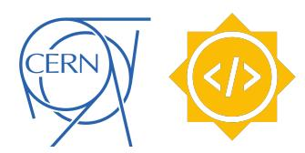
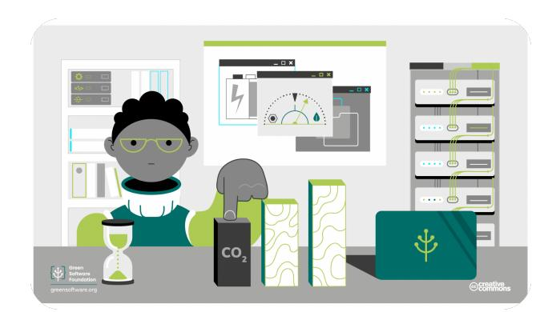
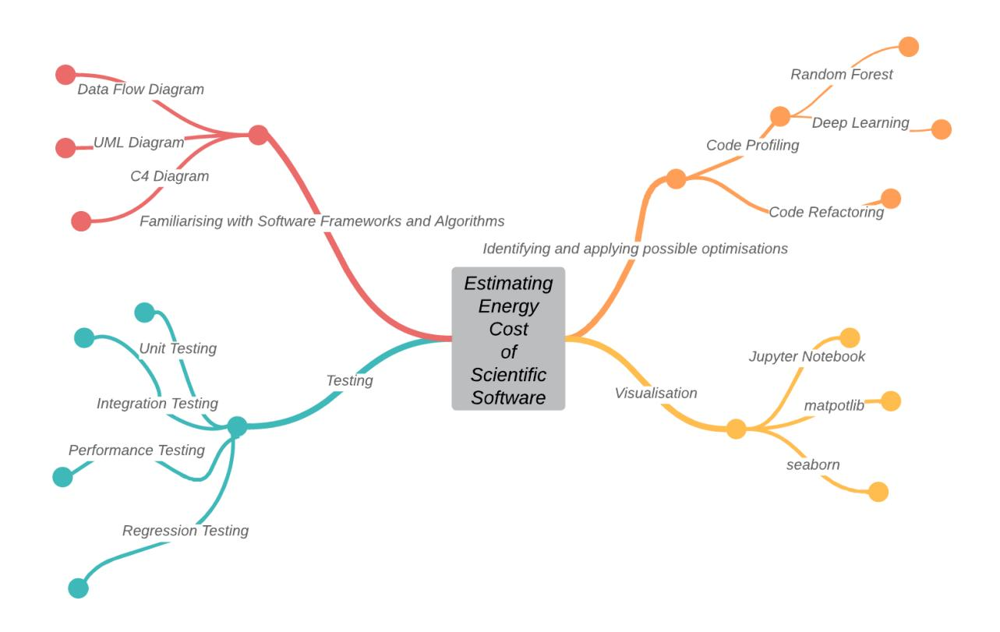
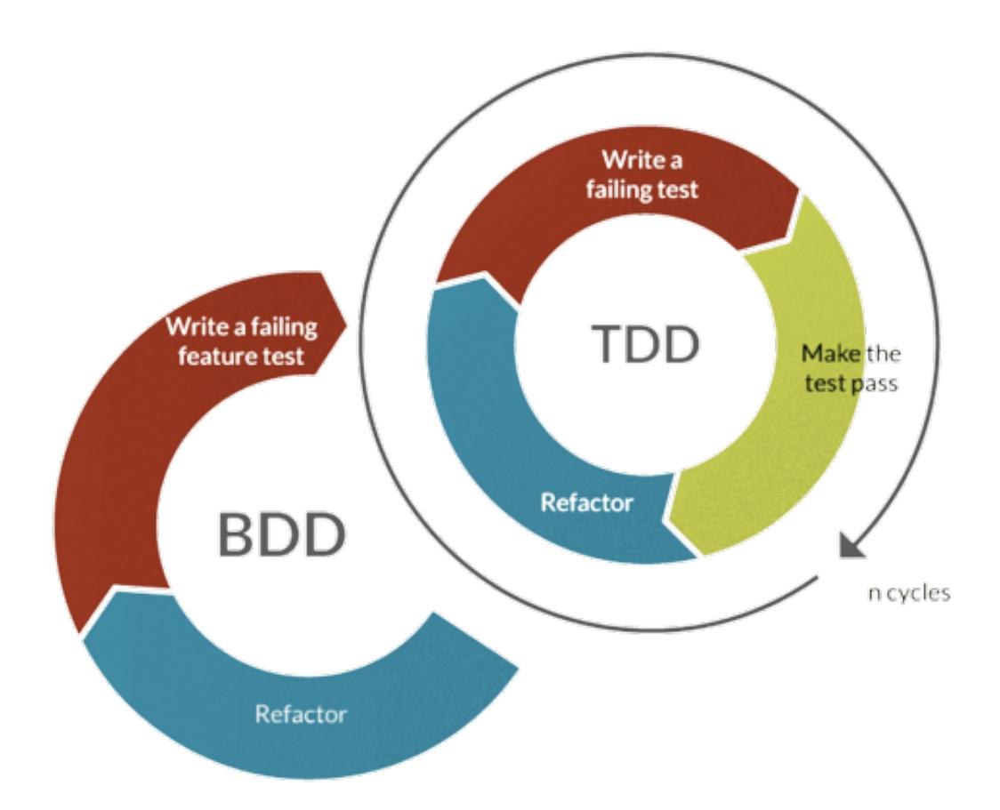
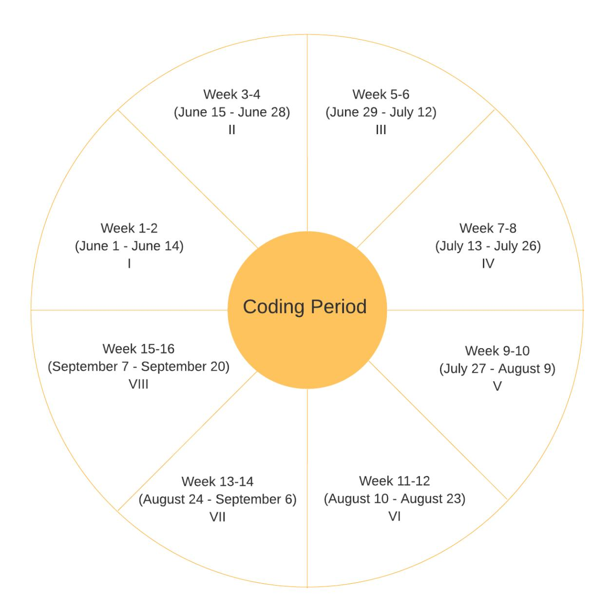

2 April 2023 manaspb2405@gmail.com

# Estimating the Energy Cost of Scientific Software

Manas Pratim Biswas

Mentor: Caterina Doglioni

Keywords: High Throughput Computing, Scientific Software Profiling, Software Metrics, Estimating Energy Efficiency, Green Software Foundation

#### Abstract

The Large Hadron Collider (LHC) experiments generate massive datasets composed of billions of proton-proton collisions. The analysis of this data requires high-throughput scientific computing that relies on efficient software algorithms. In this project, I aim to investigate whether small efficiency improvements in the LHC software can have a large energetic impact, given the sheer volume of data involved. Additionally, I aim to explore the impact of different computing architectures and job submission systems on energy efficiency. To achieve these goals, I will use metrics from the Green Software Foundation[[1]](#page-16-0) and other resources to estimate energy efficiency. I will then evaluate whether to make small changes to the code to improve efficiency and evaluate the potential savings. I will also test the software on different platforms and job submission systems. My expected results include a summary of metrics for software energy consumption, visualisation of test results, and identification of possible improvements to software algorithms. The project will provide valuable insights into the energy efficiency of scientific software, with potential applications beyond the LHC experiments.

Figure 1: Increasing the Carbon Efficiency of Scientific Softwares [[1]](#page-16-0)

# Contents

|1 About 1.1 The 1.2 The 1.3 1.4 My 1.5 My 2 Research 2.1 Energy 2.2 2.3 Deep 3 The 3.1 3.2 3.3 3.4 3.5 Vary 4 The | Me Student Institute Experience Motivation Projects Random Learning Project Metrics for Familiarisation Testing and Identify and Road-Map | in Methodology Efficiency Forests Platforms | Research across Based Based Software with Visualisation Apply and | and Software Energy Software Possible Job | Software Programming Software Submission | Development and Coding Inspirations Languages Consumption Profiling Consumption Profiling Consumption Frameworks and Algorithms Improvements Systems | 3 3 3 3 4 4 5 5 5 6 6 7 7 8 8 11 11 |
|------------------------------------------------------------------------------------------------------------------- | ------------------------------------------------------------------------------------------------------------------------------------------- | --------------------------------------------- | ------------------------------------------------------------------- | ------------------------------------------- | ------------------------------------------ | ------------------------------------------------------------------------------------------------------------------------------------------------------ | ------------------------------------- |
|4.1 | Deliverables |  |  |  |  |  | 11 |
|4.2 | Expected | Impact | of | the | Project |  | 12 |
|4.3 | Community |  | Bonding | Period |  |  | 12 |
|4.4 Coding |  | Period |  |  |  |  | 13 |
|4.4.1 | Week | 1-2 | (June | 1 | June | 14) | 13 |
|4.4.2 | Week | 3-4 | (June | 15 | June | 28) | 14 |
|4.4.3 | Week | 5-6 | (June | 29 | July | 12) | 14 |
|4.4.4 | Week | 7-8 | (July | 13 | July | 26) | 14 |
|4.4.5 | Week | 9-10 | (July | 27 | August | 9) | 14 |
|4.4.6 | Week |  | 11-12 | (August | 10 | August 23) | 14 |
|4.4.7 | Week |  | 13-14 | (August | 24 | September 6) | 14 |
|4.4.8 | Week |  | 15-16 | (September | 7 | September 20) | 14 |
|4.5 Post | GSoC |  |  |  |  |  | 15 |
|5 Conclusion |  |  |  |  |  |  | 15 |
|6 Appendix |  |  |  |  |  |  | 16 |
|6.1 Legacy |  | Software | Profiling |  | Tools |  | 16 |
|6.2 | Modelling |  | Time-Series | of | Software | Energy Consumption | 16 |
|6.3 Code |  | Refactoring |  |  |  |  | 16 |

## 1 About Me

#### 1.1 The Student

Name Manas Pratim Biswas

e-mail manaspb2405@gmail.com

GitHub <https://github.com/sanam2405>

Website <https://manaspratimbiswas.com>

Time Zone IST (GMT +05:30 Hours)

## 1.2 The Institute

University Jadavpur University

Major Information Technology

Year Junior

Degree Bachelor of Engineering

## 1.3 Experience in Research Software Development and Coding

I have been coding in C++ since the last five years and in Python for the last two years. Apart from these two primary languages, I am familiar with C, Java and JavaScript. I work on mac-OS and Ubuntu which is a Debian based Linux distribution. I primarily code in Visual Studio Code for projects in C++ and I use Jupyter Notebook and PyCharm for projects related to Machine Learning and Data Science where I primarily code in Python. I possess a decent understanding of Machine Learning and Deep Learning. I have completed all the fundamental courses related to Machine Learning offered by Stanford University and deeplearning.ai from Coursera. Additionally, I have gained practical experience by working on basic Machine Learning projects, specifically in the areas of Convolutional Neural Networks, Recommendation Systems, and Time Series Analysis. Furthermore, I am proficient in Data Structures and Algorithms, and enjoy tackling complex algorithmic problems and puzzles. I have an in-depth knowledge of Object-Oriented Programming and am comfortable with computer fundamentals. I also have a strong background in mathematics and a fair understanding of statistics.

I've been fortunate enough to intern as an Undergraduate Researcher at some of the top institutions in India, including IIT Bombay, IIT Kharagpur, ISI Kolkata, DRDO, Jadavpur University, and Calcutta University. These experiences have given me a strong foundation in Machine Learning, Deep Learning, Image Processing, and Water Informatics. I've also honed my Software Development and Testing skills while interning at Ansys which gave me valuable insight into maintaining large code bases and working with Version Control Systems like git. At Amazon, I attended workshops and boot-camps led by Amazon scientists on Machine Learning. Previously I have participated in Open-Source programs such as Hacktoberfest and Hacksquad where I led a team of 5 which eventually ranked in the top 30s out of 750+ teams globally. Suffice it to say, my journey has been a thrilling one!

#### 1.4 My Motivation

As a software developer, I have always been concerned about the environmental impact of software and the need to develop more sustainable solutions. Therefore, this project proposal immediately caught my attention, as it aligns perfectly with my values and aspirations as a developer.

In today's world, where energy crisis and environmental issues are becoming more pressing concerns, it is crucial that we start taking action to develop sustainable software solutions. As scientific software is being used more and more in high-throughput computing, there is a growing need to optimize its energy efficiency and reduce its carbon footprint. This project proposal addresses these issues by providing an opportunity to firstly evaluation of the energy efficiency of scientific software used in LHC experiments, and attempts to identify where this efficiency can be improved.

Through this project, I hope to gain a deeper understanding of the metrics for software energy consumption and how they can be applied to scientific software. I am excited to learn about and work with the selected software frameworks and algorithms, as well as set up tests and visualizations for applying metrics to them. I look forward to the challenge of identifying possible improvements, applying them, and running tests again to measure their impact on energy efficiency. Furthermore, I believe that this project has the potential to make a significant impact in the field of scientific computing and beyond. By developing energy-efficient software solutions, we can reduce the environmental impact of high-throughput computing and help mitigate the effects of climate change. This is a crucial task, and I am eager to contribute my skills and knowledge towards this goal.

#### 1.5 My Projects

Software Energy Cost [[2]](#page-16-1):
- Evaluation Task
- A Software Performance Estimation tool developed as an assessment to this project using profiling tools such as TensorBoard[[3]](#page-16-2), cProfile[[4]](#page-16-3), SnakeViz [[5]](#page-16-4) and memory-profiler [[6]](#page-16-5).

IPL Winner Predictor [[7]](#page-16-6) - A winner predictor that uses Logistic Regression and predicts the winning chances after each ball in the second innings of an IPL cricket match.

Diabetes Prediction System [[8]](#page-16-7) - A diabetes predictor that uses Support Vector Machine to predict if a person is diabetic based on various parameters.

Visual Sudoku Solver [[9]](#page-16-8) - A Sudoku soving application build using the Pygame library and backtracking algorithm to solve a given Sudoku board while slowing down the rendering time of the board to create a better visualisation of the backtracking algorithm

All of my projects (including others) can be found on my GitHub page. A more comprehensive presentation about my experiences can be found in my Curriculum Vitae.

## 2 Research Methodology and Inspirations

#### 2.1 Energy Efficiency across Programming Languages

Rui Pereira et al. in their work[[10]](#page-16-9) revealed that there is a common misconception that reducing the execution time of a program will always lead to a proportional reduction in energy consumption. However, the Energy equation Energy (J) = Power (W) x Time (s) shows that energy is also affected by the power variable, which is not constant. Therefore, there are conflicting conclusions on the relationship between energy and time in software. Some studies[[11]](#page-16-10) support the idea that energy and time are directly related, while others[[12]](#page-16-11) have observed the opposite. In short, the relationship between energy consumption and execution time in software is more complex than commonly thought. In their next paper[[13]](#page-16-12), the authors discussed a study on the energy efficiency of different programming languages based on the solutions to 10 programming problems from the Computer Language Benchmark Game (CLBG) repository[[14]](#page-16-13). They developed a framework to systematically run, measure, and compare the energy, time, and memory efficiency of the solutions to establish rankings based on single and multiple criteria. The results revealed that slower/faster languages can consume less/more energy, and memory usage significantly influences energy consumption. The CLBG is an initiative that provides a framework for running, testing, and comparing implemented solutions for a set of well-known, diverse programming problems. Overall, the CLBG provides a valuable resource for comparing the performance and energy efficiency of different programming languages.

Simon Portegies Zwart in his paper[[15]](#page-17-0) opined that the popularity of using computing in research has led to increased carbon emissions, particularly in computationally-oriented astrophysical research. Despite the ecological impact of inefficient code, Python's rapid prototyping abilities and the availability of desktop workstations have made it the most popular language among astronomers. To reduce the carbon footprint, running code on GPUs or porting it to a supercomputer are alternatives. Alternatively, abandoning Python for more environmentally friendly languages such as Julia, Rust, or Swift, which offer the flexibility of Python with the performance of compiled C++, can improve run-time and reduce CO2 emissions.

## 2.2 Random Forests Based Software Consumption Profiling

Mohamed Amine Beghoura et al. proposed in their paper[[16]](#page-17-1), a new software quality called green efficiency to promote energy optimization techniques. The goal was to reduce energy consumption caused by computation, storage, and communication workloads. An approach to establish an energy profiling tool was also proposed to locate energy-consuming portions of code and estimate energy usage on different hardware configurations and devices. The approach used Random Decision Forests to develop a model of energy consumption, which eliminated noise from other running applications and was adaptable to different platforms. The authors also suggested that a green in-use quality model could enhance sustainability issues during the final usage stage of the software.

## 2.3 Deep Learning Based Software Consumption Profiling

Muhammed Maruf proposed in his paper[[17]](#page-17-2) a SEC (Software Energy Consumption) profiling method based on DNN (Deep Neural Networks) and tested it on 14 open-source projects along with Random Forest. The results showed that DNN had higher accuracy than Random Forest, and the number of hidden layers in DNN was found to be crucial for creating reliable models. The accuracy of the profiling was not directly proportional to the number of hidden layers and depended on the type and scale of the datasets. The author suggested that tuning methods could be investigated to further increase the success of the profiling.

I plan to utilise the Computer Language Benchmark Game[[14]](#page-16-13) repository to systematically run, measure, and compare the energy, time, and memory efficiency of the software. Further, I plan to estimate the software efficiency using various Machine Learning techniques. In particular, at first I wish to profile the software using a Random Forest Based Consumption Profiling (section 2.2) and observe the results. Thereafter, I wish to experiment with the Deep Learning Based Software Consumption Profiling (section 2.3) to have a comparative study of energy consumption and attempt to identify where this efficiency can be improved.

# 3 The Project

Figure 2: Mind Map of the Project

#### 3.1 Metrics for Software Energy Consumption

The first step of the project will be to understand and summarise the metrics for software energy consumption. This will involve researching the different metrics used by the Green Software Foundation and other selected resources to estimate the energy consumption of software. The focus will be on metrics that are relevant to computing resources at CERN. The metrics will be used to establish a baseline for the energy consumption of the LHC software and the selected machine learning algorithms for data compression. The core metrics that the Green Software Foundation follows are: Carbon Efficiency, Energy Efficiency, Carbon Awareness,Hardware Efficiency, Measurement, Climate Commitments. We can relate the software efficiency to these metrics as:

- 1. Carbon Efficiency: By optimizing code, reducing computations, and minimizing resource usage, software can reduce carbon emissions.
- 2. Energy Efficiency: By optimizing code, reducing resource usage, and minimizing idle time, software can reduce energy consumption.
- 3. Carbon Awareness: With tools like ML CO2 Impact[[18]](#page-17-3) to measure carbon footprint, we can take steps to reduce carbon emissions.
- 4. Hardware Efficiency: By measuring the hardware efficiency using the tool Green Algorithms[[19]](#page-17-4), we can optimize software to work efficiently on different hardware thereby reducing the energy consumption.
- 5. Measurement: Along with energy consumption and carbon emissions, we can measure the Software Carbon Intensity[[20]](#page-17-5) (SCI) Specification to identify areas where software can be made more efficient.
- 6. Climate Commitments: By setting goals to reduce carbon emissions and implementing

sustainability practices, we can reduce the environmental impact of software.

## 3.2 Familiarisation with Software Frameworks and Algorithms

To estimate the energy consumption of the LHC software and the selected machine learning algorithms for data compression, it is essential to be familiar with the software frameworks and algorithms. Therefore, the next step will be to become familiar with running and debugging the selected software frameworks and algorithms. This will involve setting up the necessary software tools and resources, going through the software codebase and the underlying technologies to develop an in-depth understanding of the scientific software. Primarily, I plan to work on the software xAODAnaHelpers[[21]](#page-17-6). I have read through its documentation[[22]](#page-17-7) and I feel comfortable with the codebase that is written in C++. Thereafter, I plan to delve deeper into understanding the machine learning algorithm used in the software Baler[[23]](#page-17-8) for data compression and try to further optimize it after brainstorming the Python codebase.

#### 3.3 Testing and Visualisation

After familiarising with the software frameworks and algorithms, the next step will be to set up tests and visualisation for applying metrics to the selected software. This will involve selecting a representative subset of data and running it through the software while recording energy consumption and other relevant metrics. The results will be visualised using Jupyter Notebooks using tools such as numpy, pandas, matplotlib, seaborn and other popular visualisation libraries, making it easier to understand and communicate the results to stakeholders.

To test the software and relate the results with the metrics of the Green Software Foundation, I need to measure the energy consumption and carbon emissions of the software. This can be done using tools that measure the energy consumption of the CPU, memory, and disk, and then calculating the carbon emissions based on the energy source used to power the hardware. I can then analyze the results and identify areas where the software can be made more efficient, and relate those results to the metrics of the Green Software Foundation.To set up tests and visualization for applying metrics to the software, I will follow these steps:

1. Select the metrics that are relevant to the software under evaluation. These will include code complexity, code coverage, performance, memory usage, and more.

2. Define the test cases that will be used to evaluate the software system. These will include unit tests, integration tests, performance tests, and regression tests.

3. Implement the test cases and execute them against the software system. This will generate data that can be used to evaluate the metrics.

4. Analyze the results of the tests and the metrics to identify areas where the software can be improved. This will include identifying performance bottlenecks, areas of the code that are complex and difficult to maintain, and more.

5. Visualize the results of the tests and the metrics to communicate the findings to stakeholders. This will include creating charts, graphs, and other visualizations.

Overall, setting up tests and visualization will help identify areas for improvement and provide insights for estimation regarding the energy cost of the scientific software.

## 3.4 Identify and Apply Possible Improvements

Based on the results from the previous subsection, I will identify possible improvements to the software algorithms. Moreover, I will apply Software Profiling techniques in particular the Random Forest Model and the Deep Learning Model, as discussed in the Research Methodology and Inspirations section, to profile the software. On successfully profiling the software, I will have the chance to make small changes to the code to make it more efficient and evaluate the possible savings. This will involve optimising the code to reduce unnecessary computations and reduce energy consumption.

As a software developer, I understand the importance of continuous testing and monitoring the performance of my application after small tweaks and changes. To achieve this, I will follow the TDD (Test Driven Development) and BDD (Behavior Driven Development) approach. Here is a detailed workflow of my approach:

1. Identify the requirements: I will start by identifying the requirements of the software and the machine learning algorithm, which will help me to determine what features and functionality to test.

2. Create test cases: Based on the requirements, I will create a set of test cases using the TDD approach. These test cases will be ideally failing tests, designed to test each functionality of the software and the ML algorithms.

3. Run the test cases: Once the test cases are created, I will run the tests to ensure that the everything is functioning as expected.

4. Visualize the outputs: I will use various visualization tools to analyze the test results and identify any errors or issues. This will help me to pinpoint any possible bottlenecks.

5. Monitor the software stack: I will continuously monitor the software stack, (i.e. the software and the machine learning algorithm) to ensure that the application is running smoothly.

6. Monitor the hardware stack: I will also monitor the hardware stack to ensure that the application is running optimally. This will include checking for any hardware issues or performance bottlenecks.

7. Monitor the run-time of the software: I will continuously monitor the run-time of the application to identify any issues with its performance. This will include tracking the software's response time, memory usage, and CPU utilization.

8. Perform experiments on data compression: I will perform experiments on the machine learning algorithms for data compression to identify any possible optimizations that can be made to the algorithm in particular or the software in general.

9. Prepare system statistics: To help me identify any possible bottlenecks, I will prepare a set of system statistics using a combination of tabulated and diagrammatic representations.

10. Analyze the statistics: I will analyze the statistics to identify any performance issues or bottlenecks that need to be addressed.

11. Address any issues: Based on the analysis of the statistics, I will address any issues or bottlenecks that have been identified. This may involve making changes to the software stack, hardware stack, or the application itself.

12. Repeat the process: I will continue to repeat this process, making any necessary changes and optimizations until the software is performing optimally.

Summarising the above points, to ensure the optimal performance of the software, I will follow a continuous testing and monitoring approach. First, I will identify the software and machine learning algorithm requirements. Then, I shall create test cases using the Test Driven Development (TDD) approach and run them to detect any errors or issues. The TDD approach in simpler terms, is designing test cases, preferably failing tests and then make relevant modifications to make the tests pass by refactoring the code and repeating this step in a loop. Essentially, TDD ensures that the software behaves as intended, and any unexpected behavior is identified and corrected in due time. It is similar to the scientific method, where experiments are conducted to test hypotheses and verify results. Next, I shall visualize the outputs in a Jupyter Notebook and monitor both the software and hardware stack to ensure smooth performance. I will keep an eye on the run-time and perform experiments on data compression to optimize the algorithm. Eventually, I will prepare a system statistics to identify performance issues, analyze them, and make necessary changes until the software is performing optimally.

Figure 3: TDD and BDD Testing Methodologies

#### 3.5 Vary Platforms and Job Submission Systems

Finally, I will vary platforms and job submission systems to investigate the impact of different computing architectures and job submission systems on energy efficiency. This will involve testing the software on different platforms, such as CPU and GPU and evaluating their energy consumption under different job submission systems, such as batch processing and interactive mode.

The purpose of varying the platforms is to identify the most energy-efficient architecture for running the software. For instance, GPUs are known to be highly efficient for running certain types of computational tasks compared to CPUs. By testing the software on both platforms, I can determine which architecture offers the best balance between performance and energy efficiency.

Additionally, I will also investigate the impact of different job submission systems on energy efficiency. Batch processing, for instance, allows users to submit multiple jobs at once, while interactive mode allows for real-time monitoring of job progress. By evaluating the energy consumption of the software under different job submission systems, I can identify the most energy-efficient way of submitting jobs.

Overall, the variation of platforms and job submission systems will help me identify the best combination of hardware and software configurations to achieve the highest level of energy efficiency.

# 4 The Road-Map

I am fully committed to dedicating 30 hours a week for 16 weeks starting on June 1st, 2023, with no major commitments during that time. My timezone is Indian Standard Time (IST) which is +05:30 hours from Greenwich Mean Time (GMT). My working hours are expected to overlap with that of my mentor any time post 2:30 PM GMT. My preferred working schedule is during the evenings and late nights when I can work undisturbed. This will provide ample time for me to research, estimate, experiment, and optimize the software and machine learning algorithms selected for the project. I am fully committed to achieving all the milestones and deliverables on time, and I am excited about making a significant impact on the project's success.

## 4.1 Deliverables

Below is an exhaustive list of the deliverables from my end:

- 1. A short report summarizing the metrics for software energy consumption, with a focus on computing resources at CERN.
- 2. A documented process for running and debugging the selected software frameworks and algorithms.
- 3. A set of tests and visualizations for applying metrics to the selected software, implemented in a Jupyter Notebook.

- 4. A report summarizing the results of running tests and visualizing metrics.
- 5. Identify possible improvements and create a documented process for applying them to the software, followed by a report on the results of the improved software in terms of energy.
- 6. Variations of the software tested on different platforms, architectures and job submission systems, with a report summarizing the results of each test.

## 4.2 Expected Impact of the Project

The expected impact of the project will be significant in several ways:

1. The project will provide valuable insights into the software energy consumption of the selected frameworks and algorithms, particularly in the computing resources at CERN. This will help researchers and developers to optimize their code and reduce energy consumption, leading to cost savings and a more sustainable computing environment.

2. It will contribute to the development of effective software energy consumption metrics, which can be applied to a wide range of software applications beyond the selected frameworks and algorithms. This will advance the field of software engineering and energy efficiency, providing a better understanding of how software development practices can impact energy consumption.

3. The project will demonstrate the importance of considering energy consumption as a critical performance metric in software development. By applying metrics and visualization techniques to evaluate software energy consumption, the project will provide a practical and accessible approach for developers and scientists to optimize their code and reduce energy consumption.

Overall, the expected impact of the project will be to raise awareness of the importance of energy efficiency in software development, contribute to the development of effective energy consumption metrics, and provide practical solutions for optimizing code and reducing energy consumption in computing environments.

## 4.3 Community Bonding Period

Being part of a community and contributing to it is something I value highly. I plan to:

- 1. Reading and familiarizing myself with the project documentation, codebase and machine learning algorithms used.
- 2. Discussing, investigating and reading related works and literature in greater depth.
- 3. Writing blog posts and documenting my progress to share with the community.

## 4.4 Coding Period

Figure 4: Distribution of Time

#### 4.4.1 Week 1-2 (June 1 - June 14)

- 1. Read and understand the documentation related to software energy consumption metrics and computing resources at CERN.
- 2. Research and gather information about the selected software frameworks and algorithms.

#### 4.4.2 Week 3-4 (June 15 - June 28)

- 1. Become familiar with running and debugging the selected software frameworks and algorithms.
- 2. Set up the environment for the selected software frameworks and algorithms.

#### 4.4.3 Week 5-6 (June 29 - July 12)

- 1. Identify and select the appropriate metrics for software energy consumption.
- 2. Set up tests and visualization for applying metrics to the selected software.

#### 4.4.4 Week 7-8 (July 13 - July 26)

- 1. Run tests on the selected software.
- 2. Visualize results and generate reports using Jupyter Notebooks.
- 3. Analyze the results and identify areas for improvement.

## 4.4.5 Week 9-10 (July 27 - August 9)

- 1. Implement improvements and optimizations to the software and algorithms.
- 2. Run tests again and compare the results with the previous ones.

#### 4.4.6 Week 11-12 (August 10 - August 23)

- 1. Vary platforms and job submission systems to analyze the impact on software energy consumption.
- 2. Analyze and compare the results obtained from varying platforms and job submission systems.

## 4.4.7 Week 13-14 (August 24 - September 6)

- 1. Finalize the project and prepare the documentation and report.

## 4.4.8 Week 15-16 (September 7 - September 20)

- 1. Buffer week for unforeseen situations or delays.

#### 4.5 Post GSoC

As someone who is deeply passionate about the work that the organisation is doing, I cannot imagine simply walking away once the GSoC project is over. Instead, I am committed to staying in touch with my mentors and fellow contributors, and to actively participating in any way that I can. Whether that means continuing to contribute to the project, sharing my experiences with other students who are considering participating in GSoC, or simply staying engaged with the organisation's work, I am eager to remain a part of this community long after the summer comes to a close. I truly believe that the work that we are doing has the potential to change the world, and I am excited to be a part of that mission for many years to come.

# 5 Conclusion

Since my high school days, I've been captivated by the mysterious and awe-inspiring world of physics. There's just something about the way the universe works that never ceases to amaze me, from the fundamental principles of Newtonian Mechanics to the mind-bending concepts of Thermodynamics and Modern Physics. And there's no place on Earth where this fascination is more alive and tangible than at CERN.

Working at CERN has been my ultimate dream and aspiration for as long as I can remember. The opportunity to be a part of a team of brilliant minds from all around the world, all working towards answering some of the most fundamental existential questions that humanity has ever asked - it's the stuff of dreams.

But what really drives me is the sheer enormity of the task at hand. To even begin to scratch the surface of understanding how the universe originated is a monumental feat that will require the best and brightest minds from every corner of the globe. And that's where I want to come in - I want to be a part of that effort, no matter how small my contribution may be.

I strongly believe that the research and methodology presented in my proposal have the potential to make a real impact on high throughput scientific software making them more sustainable and energy efficient. I am eager to see where this work will take us. But this is not just about research, coding or software development. This is about taking responsibility for the impact that our technology has on the environment, and doing everything we can to reduce that impact. I believe that together, we can develop scientific software that is not only efficient and effective, but also environmentally sustainable. I believe we can build a future where technology and the environment can coexist in harmony, and where we can all thrive.

So as I embark on this journey towards CERN, I am filled with a sense of gratitude for having come this far and this close. But most of all, I am filled with an unquenchable passion and hunger to be a part of something truly special - something that has the potential to change the world as we know it.

## 6 Appendix

#### 6.1 Legacy Software Profiling Tools

Daniele D'Agostino et al. summerised in their literature[[24]](#page-17-9) many tools for profiling and analyzing software performance and energy consumption, such as PAPI[[25]](#page-17-10), PowerPack[[26]](#page-17-11), Score-P[[27]](#page-17-12), Extrae[[28]](#page-18-0), Paraver[[29]](#page-18-1), and EACOF[[30]](#page-18-2). These tools allow developers to gather performance related data, including energy and power values, to understand the relationship between software performance and processor events. Some tools, like EProf[[31]](#page-18-3), even offer fine-grained attributions of energy consumption to specific functions or software segments. However, most of these tools are not actively maintained, which makes them difficult to find and run. MuMMI[[32]](#page-18-4) was a project that aimed to integrate existing tools like PAPI and PowerPack for facilitating software measurement, modeling, and prediction for multicore systems, but it suffered the same fate of being abandoned.

David Abdurachmanov et al. in their paper[[33]](#page-18-5) presented techniques and tools that gave insight into energy consumption at different levels. It introduced IgProf[[34]](#page-18-6), an open source profiling tool that provides function-level energy profiling capabilities. A comparison of the energy performance of x86-64 and ARMv7 processors confirmed the potential of ARMv7 for building efficient HTC High Throughput Computing systems should server grade systems be developed based on these chips. Moreover the authors added a statistical sampling energy profiling module which provides function level energy cost distribution[[35]](#page-18-7).

## 6.2 Modelling Time-Series of Software Energy Consumption

Stephen Romansky et al, in their paper[[36]](#page-18-8) examined the effectiveness of time series regression models in predicting software energy consumption. On comparative study, they found that along with deep learning models, simpler linear regression models were equally effective in many cases. The time series-based models were accurate both per step and cumulatively across the entire test run. They also observed that stateful time series models, like LSTMs, which maintained state/memory about the past, predicted energy consumption better than stateless models like Support Vector Regression (SVR).

## 6.3 Code Refactoring

Cagri Sahin et al. in their empirical study[[37]](#page-18-9), investigated the impact of applying refactorings on energy usage in 9 real Java programs of varying sizes and characteristics. They considered 197 instances of 6 commonly used refactorings and generated over 350 gigabytes of data from 10,300 executions across two separate platforms. Their findings showed that all of the considered refactorings can statistically significantly impact the energy usage of an application, and that they have the potential to both increase and decrease energy usage.

# References

[1] Green Software Foundation <https://learn.greensoftware.foundation/> [2] Manas Pratim Biswas, Software Energy Cost <https://github.com/sanam2405/SoftwareEnergyCost> [3] TensorBoard <https://www.tensorflow.org/tensorboard> [4] cProfile <https://docs.python.org/3/library/profile.html> [5] SnakeViz <https://jiffyclub.github.io/snakeviz/> [6] memory-profiler <https://pypi.org/project/memory-profiler/> [7] Manas Pratim Biswas, IPL Winner Predictor <https://github.com/sanam2405/IPLWinnerPredictor> [8] Manas Pratim Biswas, Diabetes Prediction System <https://github.com/sanam2405/DiabetesPredictionSystem> [9] Manas Pratim Biswas, Visual Sudoku Solver <https://github.com/sanam2405/VisualSudokuSolver> [10] Rui Pereira, Marco Couto, Francisco Ribeiro, Rui Rua, J´acome Cunha, Jo˜ao Paulo Fernandes, Jo˜ao Saraiva, Energy Efficiency across Programming Languages How Do Energy, Time, and Memory Relate? <https://greenlab.di.uminho.pt/wp-content/uploads/2017/10/sleFinal.pdf> [11] Tomofumi Yuki, Sanjay Rajopadhye, Languages and Compilers for Parallel Computing <https://.springer.com/book/10.1007/978-3-030-35225-7> [12] Lu´ıs Gabriel Lima, Gilberto Melfe, Francisco Soares-Neto, Paulo Lieuthier, Jo˜ao Paulo Fernandes, Fernando Castor, Haskell in Green Land: Analyzing the Energy Behavior of a Purely Functional Language <https://greenlab.di.uminho.pt/wp-content/uploads/2016/06/saner2016.pdf> [13] Rui Pereira, Marco Couto, Francisco Ribeiro, Rui Rua, J´acome Cunha, Jo˜ao Paulo Fernandes, Jo˜ao Saraiva, Ranking Programming Languages by Energy Efficiency <https://haslab.github.io/SAFER/scp21.pdf> [14] Computer Language Benchmark Game <https://github.com/greensoftwarelab/Energy-Languages>

[15] Simon Portegies Zwart, The Ecological Impact of High-performance Computing in Astrophysics <https://arxiv.org/pdf/2009.11295.pdf> [16] Mohamed Amine Beghoura, Green software requirements and measurement: random decision forests-based software energy consumption profiling <https://.springer.com/article/10.1007/s00766-015-0234-2> [17] Muhammed Maruf, Abdelhak Boubetra, Abdallah Boukerram, Deep learning-based software energy consumption profiling https://.springer.com/chapter/10.1007/978-3-030-36178-5_7 [18] ML CO2 Impact <https://mlco2.github.io/impact/> [19] Green Algorithms <http://calculator.green-algorithms.org/> [20] Software Carbon Intensity <https://github.com/Green-Software-Foundation/sci> [21] xAODAnaHelpers https://zenodo.org/record/7335128#.ZCe_LS8Rq3U [22] xAODAnaHelpers Documentation <https://xaodanahelpers.readthedocs.io/en/latest/> [23] Baler <https://github.com/baler-collaboration/baler> [24] Daniele D'Agostino, Ivan Merelli, Marco Aldinucci, Daniele Cesini, Hardware and Software Solutions for Energy-Efficient Computing in Scientific Programming <https://www.hindawi.com/journals/sp/2021/5514284/> [25] Dan Terpstra1, Heike Jagode1, Haihang You, Jack Dongarra, Collecting Performance Data with PAPI-C https://citeseerx.ist.psu.edu/document?repid=rep1&type=pdf&doi= f4134d5ef9e712a77b1401abbdd6e520dd74e215 [26] Rong Ge, Xizhou Feng, Shuaiwen Song, Hung-Ching Chang, Dong Li, Kirk W. Cameron, PowerPack: Energy Profiling and Analysis of High-Performance Systems and Applications <https://ieeexplore.ieee.org/document/4906989> [27] Dieter an Mey, Scott Biersdorff, Kai Diethelm, Dominic Eschweiler, Score-P: A Joint Performance Measurement Run-Time Infrastructure for Periscope, Scalasca, TAU, and Vampir https://.springer.com/chapter/10.1007/978-3-642-31476-6_7

[28] Filippo Mantovani, Enrico Calore, Performance and Power Analysis of HPC Workloads on Heterogeneous Multi-Node Clusters <https://www.mdpi.com/2079-9268/8/2/13> [29] Adrian Munera, Sara Royuela, Germ´an Llort, Estanislao Mercadal, Franck Wartel, Eduardo Qui˜nones, Experiences on the characterization of parallel applications in embedded systems with Extrae/Paraver <https://dl.acm.org/doi/abs/10.1145/3404397.3404440> [30] Hayden Field, Glen Anderson, Kerstin Eder, EACOF: a framework for providing energy transparency to enable energy-aware software development <https://dl.acm.org/doi/abs/10.1145/2554850.2554920> [31] Simon Schubert, Dejan Kostic, Willy Zwaenepoel, Kang G. Shin, Profiling Software for Energy Consumption <https://ieeexplore.ieee.org/abstract/document/6468359> [32] Xingfu Wu, Charles Lively, Valerie Taylor, Hung-Ching Chang, MuMMI: Multiple Metrics Modeling Infrastructure <https://ieeexplore.ieee.org/abstract/document/6598479> [33] David Abdurachmanov1, Peter Elmer, Giulio Eulisse, Techniques and tools for measuring energy efficiency of scientific software applications <https://iopscience.iop.org/article/10.1088/1742-6596/608/1/012032/pdf> [34] Lassi Tuura, Giulio Eulisse, IgProf <https://igprof.org/> [35] Vincent M. Weaver, Matt Johnson, Kiran Kasichayanula, James Ralph, Piotr Luszczek, Dan Terpstra, Shirley Moore, Measuring Energy and Power with PAPI <https://ieeexplore.ieee.org/abstract/document/6337489> [36] Stephen Romansky, Neil C. Borle, Shaiful Chowdhury, Deep Green: Modelling Time-Series of Software Energy Consumption <https://ieeexplore.ieee.org/abstract/document/8094428> [37] Cagri Sahin, Lori Pollock, James Clause, How Do Code Refactorings Affect Energy Usage? <https://dl.acm.org/doi/abs/10.1145/2652524.2652538>