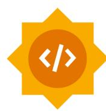
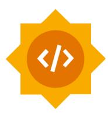
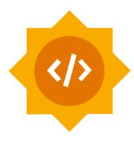
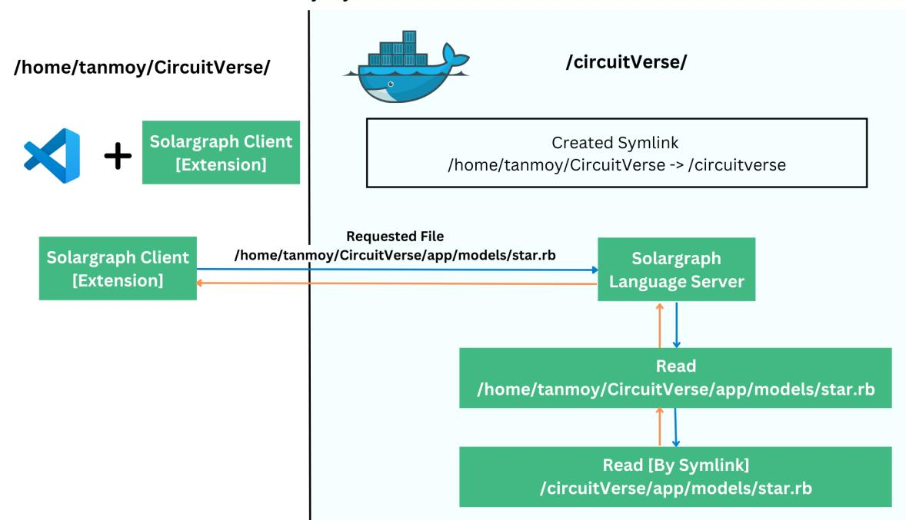
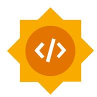

# GSoC'23 Proposal - CircuitVerse

# Project 4 : Improve the development experience

# Personal Details

Name: Tanmoy Sarkar

Email:

Github: <https://github.com/Tanmoy741127/>

LinkedIn: <https://www.linkedin.com/in/tanmoy741127/>

Phone:

Current Country: India

to Resume: <https://tinyurl.com/tanmoysresume>

# About Myself

# Introduction ?

I am Tanmoy Sarkar, a 3rd year undergraduate student pursuing Bachelor's of Engineering degree in Computer Science from Jadavpur University, Jadavpur, West Bengal, India.

In my class 10, I became familiar with programming languages, where I got to know about C++ and PHP and built some small IoT projects with Arduino / ESP8266 hardwares.

In my first year of college during the covid era, I learnt about python (Django) and Javascript (NodeJS, NextJS) based full stack development. Also learnt Android development in flutter. From various hackathons and freelancing, I have learnt about user focused product development.

I am passionate about full stack development and I have experience in Full Stack development and also have adequate understanding in DevOps. In 2022 I got interested in contributing to open source projects. From that time I have created some open source interesting projects/libraries and contributed to some projects.

# Why am I interested in the CircuitVerse project that I stated above ?

I got to know about CircuitVerse in my second year during Digital Logic Design Lab. Last year I was searching about some good-first-issues to start contributing to some good projects, there I found CircuitVerse has some great open issues. From that point I started to contribute to CircuitVerse.

I always like to make any process very smooth and streamlined. My maximum projects focused on building/creating something that makes other's life easier. That is the specific reason to choose this topic "Improve the development experience"

# My Open Source Projects before CircuitVerse

In terms of contribution before CircuitVerse,

|Project | Contributions |  | Link |
|------------ | --------------- | ---- | ----------------- |
|Notebook | Coding | PR | #1 (Merged) |
|Metaxa CLI | Coding | PR | #8 #10 (Merged) |

I am adding some of my interesting open source projects, you may like to checkout

|Project | Tech Stack | Link |
|--------------------------------- | ------------ | ------ |
|Portio : platform to create and |  |  |
|manage developer portfolio |  |  |
| | Express JS |  |
|Lumi : Micro api framework for |  |  |
|Pyaadhaar : Python library to |  |  |
|decode secure aadhaar QR |  |  |

# My Commitments towards CircuitVerse in GSOC'23

1. Are you planning any vacations during the GSoC period?

Ans: No, I have no plan for any vacation during GSoC period

2. How many classes are you taking during the GSoC period?

Ans: During May ~ June ~ July I have no classes. After that I may need to attend 2 classes a week. [Usually 2 hr per class].

3. Do you have any other employment during the GSoC period?

Ans: No, I haven't any other employment

4. How many hours per week do you expect to work on the project and what hours do you tend to work?

Ans: I can do a minimum 40 hours of coding per week. After July mid, I can commit at least 35 hours of coding weekly.

# Contributions so far

|PRs merged and |  |  |
|--------------------- | ------------------- | ----------------------------------------------- |
|Issues, bugs found | CircuitVerse#3381 |  |
|Till | now I | have not contributed toward documentation |
|Other contributions | Mentored | in Fosshack ‘23 and helped to onboard new |
|Issues |  | Created in `mobile-app` repo For Fosshack ‘23 |
|#259 | #260 | #261 #263 #264 #265 #266 #267 |
|PR | Review |  |
|#270 | #271 | #273 |
|GSOC | 2023 | Tasks |
|#1 | Integrate | Ruby Debugger [With Docker Support] |
|#3 | Integrate | Solargraph [With Docker Support] |

# Proposal

# Overview

This project aims to improve the overall development experience of CircuitVerse Software to make the path easy for first time contributors and also for other contributors. This project is focused on streamlining the development experience,and making it easier for developers to set up, contribute and test quickly.

#### Goals of the project :

- 1. Integrate ruby debugger
- 2. Integrate language server protocol with solargraph (Ruby Language Server)
- 3. Migrate assets to vite-rails
- 4. Introduce static typing rbs
- 5. Improve development experience with docker
- 6. Make unit test coverage 90%
- 7. Cover all important workflows in integration tests
- 8. Improve remote development environment (Gitpod, Github Codespaces, Coder, Jetbrains Space etc)
- 9. Integrate undercover

# Detailed

# 1. Integrate ruby debugger

# Synopsis

Currently in the CircuitVerse, for code debugging purposes, byebug has been used. In Rails 7, default debugger has been replaced with ruby/debug. Also ruby/debug has nice compatibility with different IDE.

Both the gems have keyword based debugging support. But, ruby/debug can be configured with VSCode debugger and Chrome as well. We can use the debugger of IDE to set the breakpoint directly and debug the code. Which is relatively easier than placing keywords ['byebug', 'debug'] in code.

So migrating the debugger from byebug to ruby/debug can enhance the experience by debugging the code more easily.

#### Steps

We will complete this work in 3 steps

- 1. Replace byebug with ruby/debug and add support for VS Code IDE
- 2. Add support for debug from chrome
- 3. Add support to debug from VSCode with docker based installation.

#### Implementation

# Replace byebug with ruby/debug and add support for VS Code IDE :

Install debug gem

gem "debug", ">= 1.0.0"

We need to configure foreman to run the debugger alongside the web application. For this we need to modify web service in Procfile.dev to

web: bundle exec rdbg -O -n --command -- bundle exec rails server -p 3000

> Now whenever we start the application with /bin/dev, it will run the debugging service alongside the app.

Ruby debugger has nice integration with VSCode. We need to install this extension: Click here

But in the IDE, we will not have default configuration for ruby debugger.

For this we need to specify a configuration, it can be also automatically generated by VSCode also. But it can fail sometimes.

So, we can add this configuration in repository directly in.vscode/launch.json

{ "version": "0.2.0", "configurations": [ { "type": "rdbg", "name": "Attach debugger", "request": "attach" }

] }

After this configuration, we can have options in the VSCode Debugger Section.

We can now add breakpoints from VSCode directly.

Checkout this video for a demo of the integration.

<https://www.youtube.com/watch?v=hlSbnCQIW7Y>

As proof of work, checkout this PR Tanmoy741127/CircuitVerse#1

#### Add support for debugging from chrome as well :

If the user can't use VSCode, we can use chrome as an alternative to set the breakpoint and access the call stack and local and global variables.

For this behaviour, we need special configuration in Procfile.dev

web: bundle exec rdbg --open=chrome --command -- bundle exec rails server -p 3000

But here is a problem, that to work with chrome and VSCode, we need separate configuration.

To solve this problem, we can have another Procfile.chrome.dev with content

web: bundle exec rdbg --open=chrome --command -- bundle exec rails server -p 3000 js: yarn build --watch worker: bundle exec sidekiq

And we can update the /bin/dev script file to check for arguments.

If the user runs /bin/dev then it will start debugger for VSCode and if run /bin/dev chrome_debug then it will start the process with debugger in chrome

#### Updated /bin/dev

#!/usr/bin/env bash if! command -v foreman &> /dev/null then echo "Installing foreman..." gem install foreman fi if [[ "\$1" == "chrome_debug" ]]; then echo "Starting foreman with Procfile.chrome.dev..." foreman start -f Procfile.chrome.dev else echo "Starting foreman with Procfile.dev..." foreman start -f Procfile.dev fi

#### As proof of work , checkout this PR Tanmoy741127/CircuitVerse#1

# Add support to debug from IDE with docker based installation :

In this step, we will add support to attach with the debugger from VSCode itself. For this we can utilise the feature remote debugging of debug gem.

> We will start the debugger at port 3001 and with docker configuration will bind that port to host.

In the /bin/docker_run file we have modified to run the ruby debugger at port 3001

bundle exec rdbg --nonstop --open --host 0.0.0.0 --port 3001 -c -- bundle exec rails s -p 3000 -b '0.0.0.0'

In the docker-compose.yml file, port 3001 has been exposed by

…… ports:
- "3000:3000"
- "3001:3001" ……

> Configure VSCode to attach with remote debugger.

In.vscode/launch.json we need to add this configuration to let VSCode know about the listening port information of debugger

{ "version": "0.2.0", "configurations": [ { "type": "rdbg", "name": "(Docker) Attach debugger", "request": "attach", "debugPort": "localhost:3001", "showProtocolLog": true, "localfsMap": "/circuitverse:\${workspaceFolder}" } ] }

After this we will get option in vscode to attach with the debugger directly.

But there is an issue, that the puma server runs multiple threads by default, due to some reason the debugger got run twice and threw errors.

To fix the issue, we need to set the environment variable WEB_CONCURRENCY: 0 to force puma server not to run multiple instances of web server and debugger.

Checkout this video for a demo of the integration.

<https://www.youtube.com/watch?v=57rBMsEOT2c>

As proof of work, checkout this PR Tanmoy741127/CircuitVerse#1

# Key Deliverables

Ruby debugger integration with all available choices [IDE/Chrome based] and with docker support.

# 2. Integrate language server protocol with solargraph

# Synopsis

As per current scenario, there is not any default language server for ruby. During development, we get very little autocomplete while developing ruby based applications. This slows down the process of overall development life-cycle.

We are going to integrate Microsoft Intellisense compatible Ruby Language Server - Solargraph.

To enable the VSCode, we need to install this extension Ruby Solargraph. This will enable autocomplete support for ruby codes.

Now, Solargaph protocol works by scanning yard docs.

But in Rails, there are a lot of abstractions, so it is not possible for Solargraph to provide suggestions.

We need additional gems support, which can convert the ActiveRecords to Solargraph Supported definitions.

We can use solargraph-rails gem to generate the definitions of ActiveRecord from a specified table schema for Solargraph.

#### Steps

- 1. Setup Solargraph and Solargraph Rails gem in project and setup with VSCode
- 2. Add support to use solargraph language server within docker container
- 3. Write YARD docs for the codebase
- a. ActiveRecord
- b. Utility Functions
- c. Controller
- 4. Add support for other IDE's

# Implementation

Setup Solargraph and Solargraph Rails gem and setup with VSCode: We will install solargraph-rails gem instead of solargraph gem as it will install compatible version of solagraph for later solargraph-rails

gem 'solargraph-rails', '~> 0.3.1'

Next we need to create the solargraph config by running solargraph config and add solargraph-rails in config file [.solargraph.yml]

plugins: - solargraph-rails

After installing, we need to generate YARD docs for available gems, as by default the maximum package of Rails has RDoc and little to no YARD docs.

Generate YARD docs by running

yard gems

Now we can install the VSCode extension - Ruby Solargraph to enable auto completion support.

But, for the high level abstraction in Rails framework, Solargraph can't autocomplete ActiveRecord or ActionPack or ActionController related functions. Also fail to resolve inheritance based autocomplete.

As per official solargraph docs, this definitions.rb[Gist ] is enough. But it seems not to be working in all cases.

So I searched and found another definitions.rb and made some changes to provide good autocompletion.

Latest definitions.rb [Gist ] that's working fine now!

# Write YARD docs for the codebase :

- For ActiveRecord: We can specify the schema of the table at the top of each model.

If we write the schema docs for app/models/star.rb, that will be looks like this # # == Schema Information # # Table name: stars # # id:bigint not null, primary key # user_id:bigint # project_id:bigint # created_at:datetime not null # updated_at:datetime not null # # Indexes # # index_stars_on_project_id (project_id) # index_stars_on_user_id (user_id) # index_stars_on_user_id_and_project_id (user_id,project_id) UNIQUE

So now if we reference an object of Star, we can have autocompletion of all the parameters it has.

- For Other classes and functions [e.g Controllers, helper functions], we need to write the YARD docs as per this documentations.

Docs: to official solargraph yard docs to official yard docs Cheatsheet: to an summarised docs

- As example, the below function accept array of string and return also array of string

def self.parse_mails(mails) mails.split(/[\s,]/).select do |email| email.present? && Devise.email_regexp.match?(email) end.uniq.map(&:downcase) end

- The YARD docs of this function will look like

# @param [Array<String>] mails string of emails entered # @return [Array<String>] array of valid emails def self.parse_mails(mails) mails.split(/[\s,]/).select do |email| email.present? && Devise.email_regexp.match?(email) end.uniq.map(&:downcase) end

- In the same way, we need to write the docs for whole database
- If it is not possible to add yard docs for a specific class, we can use the override annotations as per the docs.

#### As a proof of work, I have written yard docs for

- models/user.rb
- models/project.rb
- models/star.rb
- helper/utils.rb
- controllers/api/v/1/authentication_controller.rb

### PR : Tanmoy741127/CircuitVerse#3

For a demo checkout this video

<https://www.youtube.com/watch?v=fmHbVy4JFk4>

# Add support to use solargraph language server within docker container :

To allow users to run the project in docker-compose and get autocompletion in local VSCode, we can utilise the remote server feature of solargraph.

We can create a TCP socket of solargraph by running this command

solargraph socket --host=0.0.0.0 --port=8787

Now, in the VSCode, we need to change the settings of Ruby Solargraph extension to use this specific port for solargraph.

That settings in json format will look like

"solargraph.transport": "external", "solargraph.useBundler": true, "solargraph.externalServer": { "host": "127.0.0.1", "port": 8787 }

Now, we have Solargraph socket running and VSCode properly configured, so if we want we can connect to solargraph now.

For docker there is one more step. We need to bind the port of container:8787 to the host machine, so that the extension at the host machine can connect to that port.

In the docker-compose.yml we can define the port binding rule for web container

ports: - "8787:8787"

Now, we can run the application in docker and solargraph extension can connect with solargraph server.

But, the autocompletion system will not work. The extension is sending the full path of the file over the socket, when we request for autocompletion. But the current directory on client [Ruby Solargraph Extension on host] and current directory on server [Inside docker-compose] are completely different.

Client directory e.g /home/tanmoy/CircuitVerse/

Server directory e.g. /circuitverse/

We will solve this issue by symlink. Take a look at the below figure to understand how we can solve this issue by symlink.

To work on this, we need to provide the host current directory path to the container, we are going to do this by setting an environment variable in docker-compose.yml file for web service.

We will modify the /bin/docker_run to create the symlink on starting of the container and start solargraph language protocol.

echo "Starting webserver at 127.0.0.1:3000 and solargraph server at 127.0.0.1:8787" bundle exec rails s -p 3000 -b '0.0.0.0' --daemon echo "Creating symlink" cd /home && mkdir -p \${HOST_CURRENT_DIRECTORY%/*} ln -s -T /circuitverse \$HOST_CURRENT_DIRECTORY solargraph socket --host=0.0.0.0 --port=8787

Now, the solargraph protocol can run easily within the docker and client host.

Checkout this video for a demo. (Tanmoy741127/CircuitVerse#3)

<https://www.youtube.com/watch?v=fmHbVy4JFk4>

# Add support for other IDE's :

In the docs of solargraph gem, it has listed all the links of extensions for other editors as well (Atom, Vim, Emacs, Sublime, Eclipse).

We need to test those and write the proper documentation to configure solargraph for both local and docker based installation.

As a proof of work, checkout this PR: Tanmoy741127/CircuitVerse#3

Solargraph Language Server integration with VSCode and other IDEs and also with docker containers as well. We also need to write yard docs for a complete codebase.

# 3. Migrate assets to vite-rails

# Synopsis

Currently in CircuitVerse, sprockets have been used for asset delivery. We want to switch to vite-ruby for asset delivery specifically for the Simulator part. We will get two advantages by migrating the asset pipeline to vite-ruby.

- During development, vite will not precompile the assets to serve, it will deliver the assets on demand. So the process will be faster. On the other side, in production it will pack the assets and deliver on demand, so that no performance issue exists.
- During development, we can have the feature of live-reload / full reload on any file changes with vite. so it will enhance the development experience

# Steps

- 1. Install vite-ruby
- 2. Configure to serve assets of simulator's through vite

# Implementation

#### 1. Install vite-ruby :

For Rails to work with vite-ruby, we can prefer to install vite-rails

gem 'vite_rails'

After installation, we need to run specific command to generate some configuration files

bundle exec vite install

# 2. Configure to serve assets of simulator's through vite :

In the config/vite.json set sourceCodeDir and entrypoint for javascript file of simulator.

Then we can use the entrypoint script to include other scss and other js files

import './jquery'; import '../../simulator/src/app'; import './src/sass/simulator.scss'; import './src/sass/color_theme.scss'; import './src/sass/tutorials.scss'; import '../../simulator/src/css/main.stylesheet.css';

And we can use the vite_javascript_tag to load the initial scripts.

I have tried out to serve some of js and css files with vite

<https://github.com/Tanmoy741127/CircuitVerse/pull/4>

# Key Deliverables

Migration of the asset pipeline of simulator from sprockets to vite

# 4. Introduce static typing rbs

# Synopsis

As per current scenario, there is not any static type checking configured in Rails project. Last year Ruby Community brought official static type checking library rbs. By adding rbs support in the project, we can increase the integrity of code.

However there are some already existing type checking libraries as well. RBS is the best choice because for rbs, we need not change anything in the original files.

# Steps

- 1. Install RBS
- 2. Write rbs annotation files against original files

# Implementation

# 1. Install RBS :

To install rbs, we can add this line in Gemfile

gem "rbs"

#### 2. Write rbs annotation files against original files :

For each ruby file, we need to write corresponding.rbs files for all class and method definitions.

It will help to optimise the autocomplete & also help to prevent type checking related issue,

This docs and blog found to be good as guide

- rbs/rbs_by_example.md at master · ruby/rbs · GitHub
- Understanding RBS, Ruby's new Type Annotation System Honeybadger Developer Blog

As per latest version of Solargraph, it does not have support for rbs.

However, as per the message in github from the author of solargraph, the support is coming in the next release.

So for that time being, we can use other alternatives.

For verify type checking, we can use the steep gem. After installing this gem, we can run steep check and get a full report about all issues regarding type checking violations.

# Key Deliverables

CircuitVerse project with static typing enabled with RBS and also a tool integrated to verify type checking.

# 5. Improve development experience with docker

# Synopsis

Currently, there are already Dockerfile and docker-compose files in the project. And they are working fine. Also reload on file changes is a working file.

But there is much scope of improvement

- 1) CLI tool to setup CircuitVerse project
- a) Native Installation

- i) Install all dependencies and software required for that specific OS
- b) Docker based
- i) Install docker/docker-compose if not currently available in system
- ii) Provide menu to execute specific task
- (1) Start/Stop/Delete Container
- (2) Some special predefined function for
- (a) db migration
- (b) gem installation
- (3) Check logs of that container
- (4) Attach directly to execute some scripts in container
- 2) Docker support for Ruby Debugger
- 3) Docker support for solargraph, so that contributors enjoy autocompletion in their preferred IDE, even when using a Docker-based installation.

# Steps

- 1. CLI required Scripts for native installation
- 2. CLI required Scripts for docker based installation
- 3. CLI Tool
- 4. CLI required Scripts for windows
- 5. Docker support for Ruby Debugger
- 6. Docker support for Solargraph

# Implementation

#### 1. CLI required Scripts for native installation :

This script will be responsible for installing all required dependencies. Support - any linux/unix based operating systems

If any package has been installed previously in the system, will generate a report on that. Users will have an option to upgrade or downgrade the specific dependency to match project requirements.

# 2. CLI required Scripts for docker based installation :

This script will be responsible for installing docker on the system [if not available in the host system] and also manage rebuilding the image, start container, see logs of container or execute any function inside the container.

# 3. CLI Tool :

It will provide user and terminal based applications to manage local development of CircuitVerse for both native and docker based installations. It will provide a nice terminal interface for users and invoke methods from the previous CLI Scripts.

It will have an.cliconfig which will store some important information, like - a) Whether user has already setup the project, b) method of installation for that project,

Possible UI Flow for the CLI tool [subject to change as per later discussion] [Figma ]

#### 4. CLI Tool for windows :

For this purpose, we need to convert the scripts available in /bin folder to windows compatible batch/powershell script. All other things will remain the same.

#### 5. Docker support for Ruby Debugger : It is already covered in (1) Integrate Ruby Debugger

# 6. Docker support for Solargraph : It is already covered in (2) Integrate Solargraph Language Protocol

An fully featured CLI, which will make the installation and setup process more easier for first time contributors as well as other contributors

# 6. Make unit test coverage 90%

# Synopsis

As per current scenario, CircuitVerse main repo has almost 88% code coverage. We need to find the methods with no test coverage.

We can get a report by generating a simplecov report and work on the unit testcase.

There are many controllers.methods, lacking unit test cases.

Except those, there exists some code, which has low test coverage

- app/helpers/forum_helper.rb
- app/helpers/lti_helper.rb
- app/helpers/utils.rb
- app/jobs/assignment_deadline_submission_job.rb
- app/services/notify_user.rb
- app/notifications/star_notification.rb
- app/notifications/fork_notification.rb
- app/services/lti_score_submission.rb

Codebase with at least 90% unit test coverage

# 7. Cover all important workflows in integration tests

# Synopsis

As per current scenario, there are some workflows that have been already done in the project.

So below is a table where it will have information about already existing workflows and tests and new workflows that will be created.

Orange - Going to be created

Green - Already existing in project

|Main workflow |  |  |  | Checks |  |  |
|------------------------- | -------------- | -------------- | --------------- | --------------- | ------------- | ---------------- |
|Sign In | sign-ins | when | valid | credentials |  |  |
|does | not | sign-in | when | no |  | credentials |
|does | not | sign-in | when |  | password | is empty |
|does | not | sign-in | when | email | is | empty |
|Sign up does |  | sign-up | when | valid | credentials |  |
|does | not |  | sign-up | when no |  | credentials |
|does | not |  | sign-up | when | password | is empty |
|does | not |  | sign-up | when | email is | empty |
|does | not |  | sign-up | when | password | is less than 6 |
|does | not | signup | with | special |  | symbols |
|Profile management edit | name |  |  |  |  |  |
|edit |  | country |  |  |  |  |
|edit |  | educational |  | institute |  |  |
|Notification | initiate | notification |  |  |  |  |
| | notification |  | page |  |  |  |
| | render | all | notifications |  |  |  |
| | render | all | unread | notifications |  |  |
|mark | all |  | notifications | as | read |  |
|mark |  | notification | as | read |  |  |

|Group Management | creates | a | group |  |  |
|------------------------- | --------- | ------------- | ------------ | ---------------- | ------------------------------- |
| | does | not | create a | group | when name is blank |
| | add | secondary |  | mentor |  |
| | remove |  | secondary |  | mentor |
| | adds | a member | to | the | group |
| | removes | a | member |  | from the group |
| | convert | member |  | to | mentor |
| | convert | mentor | to |  | member |
| | changes | the | group |  | name |
|Assignment Management | when | user is |  | primary_mentor |  |
| | creates |  | assignment |  |  |
| | does | not | create |  | assignment when name is blank |
| | is | able to | edit | assignment |  |
| | when | user is | mentor |  |  |
| | delete |  | assignment |  |  |
| | close |  | assignment |  |  |
| | re-open |  | assignment |  |  |
| | able | to edit |  | assignment | when it’s open |
| | not | able to | edit |  | assignment when it’s closed |
| | when | user is | a | member |  |
| | is | able to | make |  | assignment project |
|Project management edit |  | name |  |  |  |
|not | able | to set | empty |  | name |
|edit | tag | list |  |  |  |
|edit |  | project | access | type | to public |
|edit |  | project | access | type | to private |
|edit |  | project | access | type | to limited access |
| | create | copy |  |  |  |
| | delete | project |  |  |  |
|star |  | project and |  | check | in “Favourite Project” list |

Delivery project with all important workflows covered

# 8. Improve remote development environment (Gitpod, Github Codespaces, Coder, Jetbrains Space etc)

In terms of remote development, in CircuitVerseonly has configuration to run in GitPod. There are some popular remote development IDEs like Github Codespaces, Coder, Jetbrains Space.

We will write the configurations for specific remote development platforms as well as improve the current setup for GitPod.

After we will add support for ruby debugger and solargraph, we need to modify the configurations so that any contributors using GitPod can avail those features.

#### Steps

- 1. Improve existing setup of GitPod due to addition of new toolkits [Debugger, Solargraph, Rbs]
- 2. Add configurations for Github Codespaces
- 3. Add configurations for Jetbrains Space
- 4. Add configurations for Coder
- 5. Documentation update

# Implementation

- 1. As per the previous topics, there are going to be various updates.We need to update the GitPod configurations.

We need to enable some plugins by default in the environment.

- Ruby Debugger
- Ruby Solargraph

We can provide this details in.gitpod.yml like,

- vscode: extensions:
- castwide.solargraph
- KoichiSasada.vscode-rdbg

We also need to change the specified vscode settings.json and.vscode/launch.json while creating the container for enable Solargraph Language Server Socket External Server and Ruby Debugger Remote Debugging

- 2. Github Codespaces containers support docker-compose based deployment. We can follow these two official guides to create the devcontainer.json to create the container from Dockerfile and docker-compose.yml.

We can use this example devcontainer.json to create the configuration for CircuitVerse

Example: vscode-dev-containers/devcontainer.json at main

For this also, we need to specify the extension id in the extensions section.

- 3. For Jetbrains Space, here we got a detailed blog on how we can use docker files to create the remote development space. A Deep Dive Into Space Dev Environments | The Space Blog
- 4. At the end, we need to update the Documentation for Remote Development Guidance.

# Key Deliverables

Properly working and tested configuration for mentioned remote development platform with updated Documentation

# 9. Integrate undercover

# Synopsis

Undercover can detect untested code blocks in recent commits and let the contributors know.

By this addition, it will help both the contributors and reviewers to analyse whether for new changes, any new test cases need to be added or not.

# Steps

- 1. Install Undercover Gem
- 2. Set up LCOV Reporting
- 3. Setup UndercoverCI

# Implementation

#### 1. Install Undercover Gem :

We need to install an undercover gem in the project first.

gem 'undercover'

# 2. Set up LCOV Reporting :

For LCOV reporting, we need to add two gems in the test group.

group:test do gem 'simplecov' gem 'simplecov-lcov' end

To generate initial lcov files, we need to add this configuration for rspec files in spec_helper.rb

require 'simplecov' require 'simplecov-lcov' SimpleCov::Formatter::LcovFormatter.config.report_with_single_ file = true SimpleCov.formatter = SimpleCov::Formatter::LcovFormatter SimpleCov.start do add_filter(/^\/spec\//) enable_coverage(:branch) end require 'undercover'

We now need to run the default tests, to generate lcov files

bundle exec rspec

Now the LCOV reporting setup has been completed

# 3. Setup UndercoverCI :

The next step will be to configure UndercoverCI bot to analyse all PR's and show the report.

This doc has full guidance on editing the CircleCI workflow to work with UndercoverCI bot. [Docs ]

In the circleci/config.yml file, we can add a new step to push the changes to CircleCI for analysing

- run: name: UndercoverCI check code coverage command: |

ruby -e "\$(curl -s https://undercover-ci.com/uploader.rb)" -- \ --repo CircuitVerse/CircuitVerse \ --commit \$CIRCLE_SHA1 \ --lcov coverage/lcov/CircuitVerse.lcov

# Key Deliverables

Fully configured Undercover gem and working CI workflow for CircuitVerse repo.

# Project Plan

In the pre-GSOC phase, I will focus on learning more on rails and best practices for docker based development setup to deliver best-structured code.

In the 1st phase, I will integrate the Ruby Debugger and Solargraph Language Server. This stuff will enable auto completion better. As a result the next tasks can be completed a bit quicker. After that, I will integrate rbs. Then, will add undercover to check test coverage and create test cases for uncovered code to increase the code coverage.

In the 2nd phase, I will focus on first to complete almost all test cases for important workflows. Then will focus on docker related experience improvement. This includes - Remote Development Setup improvement, creation of CLI tools, as well as converting linux bash scripts available in project to windows compatible scripts [batch or powershell scripts].

I will report about the progress to the mentors on a weekly basis and discuss if any doubts have arrived. Also will update my specified docs to track everyday's progress.

# Project Plan - Preliminary Plan :

#### May 4 - May 28 (Community Bonding Period)

This community bonding period will last for around 3 weeks [as per gsoc official timeline].

During this time, I will gather more requirements about the topics and if there is need of any changes at any particular topic, will incorporate that. Also will create a detailed notion docs to note down all changes and plannings.

In the meantime, I will explore the codebase in more detail and will clear any doubts beforehand.

The detailed timeline is shown below,

|Week No Start Date End Date Tasks | to be | completed |
|----------------------------------- | -------------- | --------------------------------------- |
|Phase 1 May 29 July 10 |  |  |
|Week 1 May 29 June 04 Add | Ruby | Debugger [Docker included] |
|Add |  | Solargraph [Docker included] |
|Write | yard | docs for solargraph for |
| | ActiveRecord | models |
|Week 2 June 05 June 11 Write | yard | docs for solargraph for Controllers |
|and | helper | function |
|Create | final | PR |
|Do | any | changes (If requested) |
| | Publish the | blog |
|Week 3 June 12 June 18 | Migrate | simulator’s assets to vite rails |
|Create | final | PR on vite-rails |
|Do | any | changes (If requested) |
|Setup | rbs |  |
|Write | rbs | annotation files |
|Week 4 June 19 June 25 Write | rbs | annotation files |
|Test | static | type checking with other gems [e.g |
|Create | final | PR |
| | Publish the | blog |
|Week 5 June 26 July 02 | Integrate | Undercover |
|Create | final | PR |
|Do | any | changes (If requested) |
|Write | unit | test cases to increase code |
|Week 6 July 03 July 09 Write | unit | test cases to increase code |
|Major |  | improvement before midterm evaluation |
| | Publish | blog |
|Midterm July 10 July 14 Key |  | Deliverables |

|Week No Start Date End Date Tasks | to be completed |
|------------------------------------ | --------------------------------------- |
|Evaluation Integrate | Ruby Debugger |
|Integrate | language server protocol with |
|Complete | codebase with rbs annotation |
|Integrate | undercover [local tool & CI] |
|More | unit test cases to reach at least 90% |
|code | coverage |
|Phase 2 July 14 August 21 |  |
|Week 1 July 14 July 20 Write | workflow test for Profile Management |
|Create | PR & Do any Changes [If requested] |
|Write | workflow test for Group Management |
|Create | PR & Do any Changes [If requested] |
|Write | workflow test for Assignment |
|Create | PR & Do any Changes [If requested] |
|Publish | blog |
|Week 2 July 21 July 27 Write | workflow test for Project Management |
|Create | PR & Do any Changes [If requested] |
|Improve | GitPod setup for previous docker |
|updates | [Due to Ruby Debugger and |
|Create | PR & Do any Changes [If requested] |
|Publish | Blog |
|Week 3 July 28 August 03 Create | configurations for Github Codespaces, |
|Jetbrains | Gateway & Coder |
|Write | Documentation |
|Create | final PR |
|Publish | Blog |
|Week 4 August 04 August 10 Improve | docker setup [If required] |
|Create | the CLI tool [Linux/Unix] for easy |
|installation | and management |
|Create | final PR |
|Publish | Blog |

|Week No Start Date End Date Tasks | to be |  | completed |  |
|------------------------------------ | -------------- | -------------- | ------------- | ---------------------- |
|Week 5 August 10 August 16 Convert | the | linux | bash | scripts [/bin/*] to |
|windows |  | powershell | scripts |  |
|Create | PR |  |  |  |
|Rewrite | the | CLI | for windows |  |
|Create | final | PR |  |  |
|Do | any | changes | [If | requested] |
|Week 6 August 17 August 23 Major |  | Improvements | before | final evaluation. |
|Publish | Blog |  |  |  |
|August 28 September 4 Key | Deliverables |  |  |  |
|Cover | all | important |  | workflows |
|Improve |  | support | for Remote | Development |
| | Improved | Docker | setup | with CLI |
|Addition | of | windows |  | supported powershell |

# Major Milestones

- Completion of integration of solargraph and complete support for Ruby Static Type Checking [rbs]
- All important workflows test covered and Remote development setup improvement
- Docker development environment with Custom CLI [alongside windows support]

# Additional Information

I believe I am the perfect candidate for the chosen project. As I have previously contributed to the main project as well as other parts of CircuitVerse. I am familiar with the main codebase and structures. Also I have knowledge and experience with devops stuff. So I believe I can make the development experience of other contributors smooth.

I have done my research on each topic of the particular project and discussed all about those topics before. Also I have integrated some stuff in my local system and also attached a demo of those and draft PRs on the specific topics.

After HacktoberFest, CircuitVerse was the first organisation from which I started contributions, other fellow contributors and mentors helped a lot till now. I am interested in working with CircuitVerse in future.

# What to expect from me

- Will create a notion docs and maintain status of each topic and every day's log about progress in the app.
- At the EOD, I will report to my mentor about the progress of the project.
- Proper documentation updates for each change.
- Submission of proper evaluations as per GSOC Timeline.
- Try my best to ensure zero communication gap between me and mentors.
- Additionally, I can help others contributors also, if someone needs.

# Mentors

Aboobacker MK, Vedant Jain