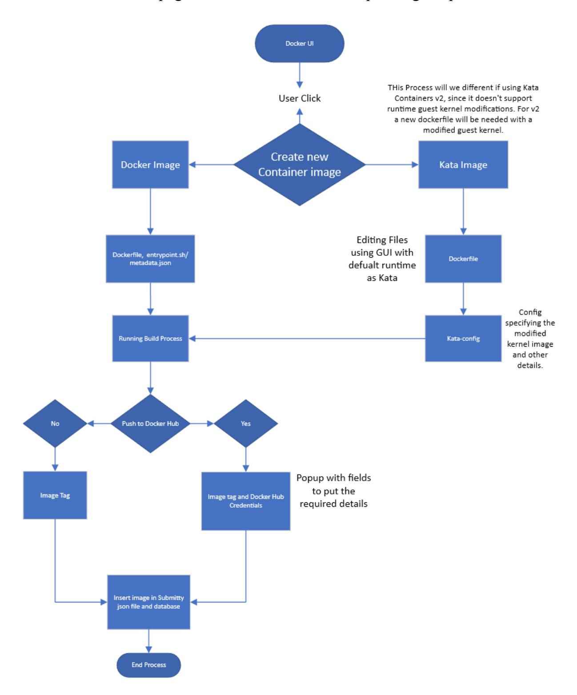
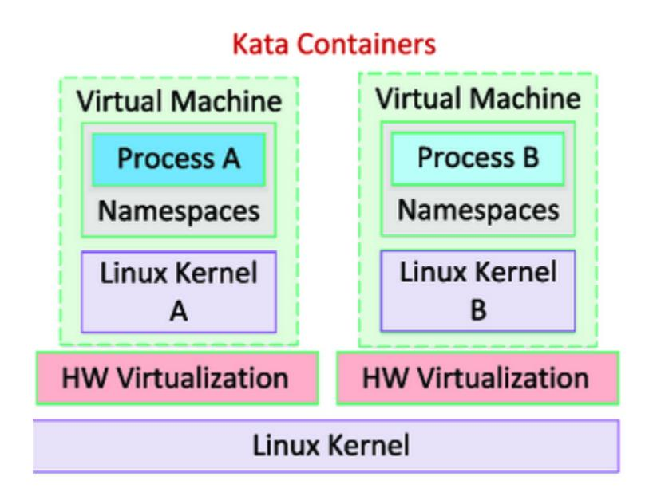

# Containers for Automated Grading with Kata Containers and Live Container Preview

Name: - Suryansh Pathak

Email: - suryanshpathak5545@gmail.com

GitHub Username: - Suryansh5545

GitHub - https://github.com/Suryansh5545

Slack Username: - @suryanshpathak5545

### Synopsis: -

We want to allow instructors to make their own Container images, to make a container image in docker we must make a Dockerfile. To facilitate that a Frontend Interface with multiple options to add required packages and a custom column to define any other command not specified in the fields given is required.

Advanced Idea: - Furthermore we want to run containers which require modifications to the OS Kernel, docker doesn't support this unless in privileged mode which can cause a major security issue to the host/worker. So the way to tackle this issue will be the use of a Container run time which supports a Guest Kernel, which supports modifications and is at the same time have lightweight resource footprint.

Kata Containers fits all our requirements, and it supports CRIO. We can implement kata runtime within our already existing docker container system and build a frontend UI for editing of the guest kernel. Isolation provided by the kata guest kernel will shield the host and provide the option for kernel modification.

# Project Details: -

To enable instructors to make their own container images, we will provide a GUI within the Docker UI page, below is the flowchart explaining the process.

In Summary, we have to create a new page which can be accessed from the docker ui page and the new page will contain UI elements/fields using which the instructor can make the new image.

Note: - Implementation for the Kata Container will vary with v1 or v2 selection (as stated in the flowchart) and will require a more through discussion on the topic.

# Kata Containers: -

Kata Containers unlike other Hypervisor solution doesn't have a very big resource footprint. It is very lightweight, and it have a additional layer of isolation which will allow us to have our kernel modifications without compromising out host security. Below is a image showing how kata containers work.

# UI Changes: -

The new UI page named "Dockerfile Editor" for this use case will include the following fields.

#### Dockerfile Editor

- 1. Base Image: start with a 'FROM' keyword and specifies which base image new image will be built upon.
- 2. Working Directory: Sets the working directory.
- 3. Environment Variables: if the container needs predefined ENV variables.

- 4. Packages: This field will allow the user/instructor to put the name of the package which needs to be installed.
- 5. File Copy: 'COPY' if the image needs to copy any files from the worker machine while being build.
- 6. Ports: 'EXPOSE' field will container ports that container listens to. These can be put either separated by comma or in a series with a dash.
- 7. ENTRYPOINT: Defines the entry point of the container.
- 8. Custom Fields: Can be place anywhere in the file in between two fields.

# Kata Editor

This page will be similar to the dockerfile editor with some changes which will depend on wheather we choose to go with Kata Containers v1 or v2.

For v1:- Since this version supports modification of guest kernel in runtime, we only need to have a default runtime change in the dockerfile and a path change to specify the modified guest kernel file.

For v2: - This version doesn't support modification of guest kernel in runtime, so we have to create a entirely new docker image with the modified Kernel and changing it with runtime is not possible. But we can use the then build base image with kernel modifications to make further docker images.

Since Kata Containers support OCI runtime, we don't need to change our docker creation process unless we don't want to specify the runtime during the Dockerfile creation process.

# API: -

container = client.containers.create(image,runtime=runtime, Other args)

In case we don't specify the runtime

client.login(username="your-username", password="your-password") To store the credentials of the instructor or user temporarily

image = client.images.get(image_id) image.tag(f"{new_image_name}:{new_image_tag}") To tag the image when we have it id.

client.images.push(f"{new_image_name}:{new_image_tag}")

#### Pushing the tagged image to Docker Hub

Furthermore, we can also have a default template or a repo with such templates which can be read and its data feed to the fields mentioned in the Dockerfile Editor this way the instructor doesn't need to start from scratch in case he only wants to make small changes.

## Extended Idea: -

Aside from the Advance and Basic idea. I want to implement a list to show the currently running docker container and the amount of resource the container is using in terms of CPU, ram, storage. This can also be expanded to include the worker machine stats too. These changes will be done in Docker UI. The UI will look like this:-

Source: - Pterodactyl Panel Container List

## API: -

container = client.containers.get(container_id) stats = container.stats(stream=False)

Get the container's resource usage statistics.

# Deliverables: -

- 1. Create a Dockerfile Editor interface.
- Design a system design for the Dockerfile Editor.
- Create the UI with the mentioned fields.
- Add a Preview feature with ability to add custom fields from the preview page.
- Add popup/page field to collect docker hub credentials and tag.
- Documentation and tutorial creation to help user get stated with Dockerfile Editor.
- 2. Create a Kata config editor.
- Change Dockerfile Editor to support kata runtime by default.
- Add a Kernel Editing interface.
- 3. Add API changes for the new Kata Container runtime.
- Implement changes within the Autograding execution environment.
- API to retrieve and load template data into Dockerfile Editor.
- 4. Implement frontend change to Docker UI
- Add a table to display the containers.
- Add API to retrieve the continuously changing resource usage information.
- 5. Add relevant test cases to the new interface and modified files.
- Php and Cypress test for Dockerfile Editor, Kata config editor.
- Modify test cases for Docker UI.

# Education: -

Degree: - BTech CSE

Current Year: - 2 nd

### Non-Course experience: -

I am running a side hussle of managing and running a game server hosting service called bruhhost.com and use pterodactyl which use docker containers to isolate and run the game servers inside. Since opening this service in 2021 I have made several dockerfiles/images for various games and learned about the working of docker.

I also worked with CloudCV during GCI 2019 and was selected as Runner Up and in that process I learned AngularJs, Angular 7,Django, TypeScript and docker. They run their entire development branch in a network of containers.

Goal: - My interest has always been in Containerization technologies. Docker being my favorite. I have also worked with Kubernetes container briefly. But want to pursue deeper into this line of work. That's why I chose to work on this idea as it fits with my current and future goals.

#### Submitty Contribtions: -

Submitty#8845:
- [Feature:Autograding] Added GUI to cleanup docker images Submitty#8927:
- [Feature:TAGrading] Option to show all version on TA page Submitty#8958:
- [Testing:TAGrading] Added Test case for simple-grading Submitty#8830:
- [Feature:Submission] Added a Warning text for bulk upload Submitty#8832:
- [Feature:Submission] Fixed Thread Field not being mandatory Submitty#8991:
- [Bugfix:CourseMaterials] Fixes Folders don't close properly Submitty#9078:
- [Feature:Autograding] Added auto pulling for docker image

# Project Schedule: -

# Official Coding Period

- 28th May to 4 th June Week 1: - Building a System Design and Creation of DockerFile Editor Frontend PR.
- 4 th June to 18th June Week 2-3: - Create php Controller and Model for DockerFile with File Writing support.
- 18th June to 25th June Week 4: Add Preview and Custom Field feature to DockerFile editor UI. And creation of Docker tag and credential page.
- 25th June to 9 th July Week 5-6: - Implementation of API to push Docker image to hub, Creation of Kata Config Editor and its backend Php Controller and Model.
- Mid Term Evaluation.
- 9 th July to 16th July Week 7: - Modifications to the Docker UI frontend to display the table resource usage data retrieved by the API.

- 16th July to 23rd July Week 8: Implementing Function to export and import Dockerfile template created by the editor.
- 23rd July to 30th July Week 9: Adding PhP and Cypress Test case for Kata and Dockerfile Editor.
- 30th July to 6 th August Week 10: - Updating the Documentation and creation of a template repository.
- 6 th August to 21st August Week 11-12: - Finishing up the rest of the work.

### Commitment: -

I will have my End Term exam from 9 th to 12th after which, I will be on break till 1 August. So, I will be able to dedicate more than 40 Hour a week. Furthermore, I would like to start the work on my PR before 28th May. So, I can have extra time for all the unforeseen issues that might arise during the implementation of these features.

# Motivation: -

My motivation to participate in GSOC has been since the time I completed GCI 2019 which gave me a lot of experience and a expose into how OSS works.

Furthermore, I have a desire to prove myself and to become beyond ordinary.