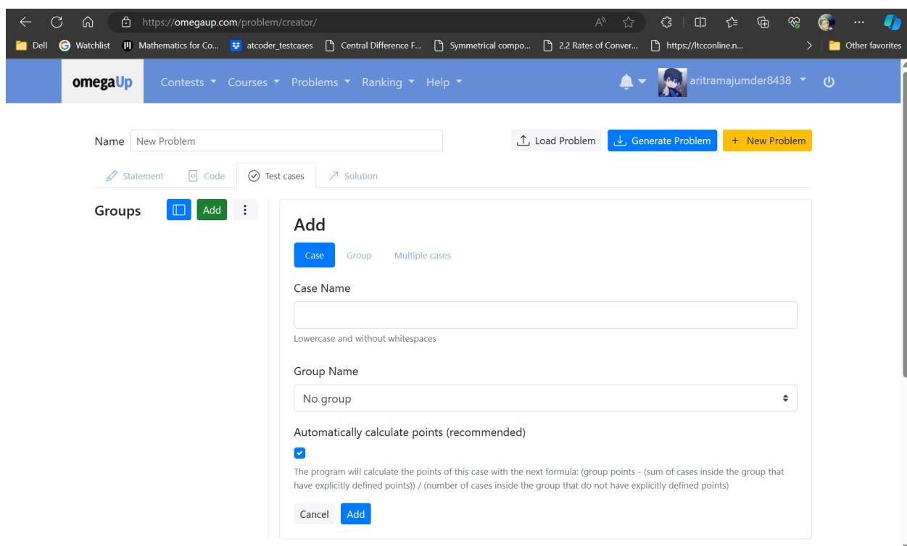
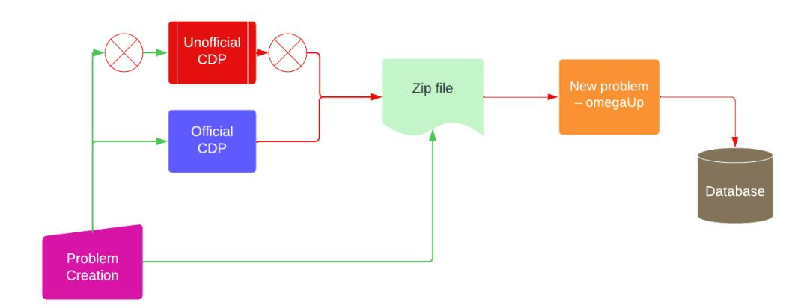
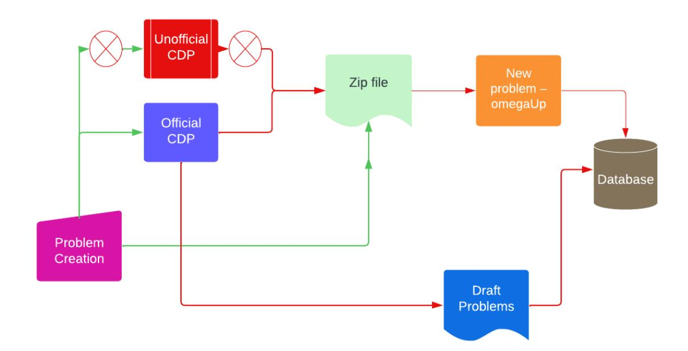
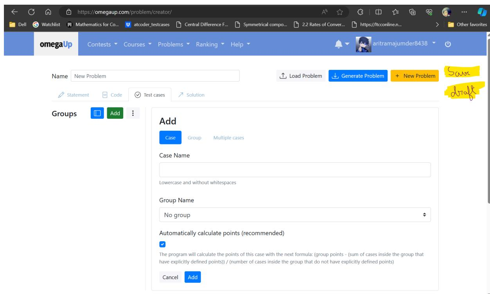

# Migrate Problem Creator to Vue.js + Typescript

### ARITRA

aritramajumder8438@gmail.com

https://github.com/aritra8438

omegaUp account: aritramajumder8438

## Technical skills

I am currently a computer science sophomore pursuing a Master's degree in Science at Chennai Mathematical Institute. I completed my Bachelor's degree in Engineering from Jadavpur University.

The previous year, I participated in GSoC, '23 with Mathesar and it was a wonderful experience learning from them. The project was successful and can be accessed here (and a short extension for known bugs introduced by the PRs). I used to maintain bi-weekly blogs for my progress which you can find here. I have also participated in HacktoberFest, '23.

I am an open-source developer and contributed to many repositories. I have listed below my experiences and skills. Besides, I'm also (at least used to be) a competitive programmer who loves Maths:3 I'm an expert on Codeforces.

|Time Organization Role Skills |  |
|----------------------------------------------------------- | --------------------- |
|2023, May. Mathesar (GSoC, ‘23) Student Developer Python, | Django, TypeScript, |
|SvelteJS, | PostgreSQL |
|2022, June PricewaterhouseCoopers Data Analytics Python, | Azure Data Factory |
|Meshery Developer Intern Go, | JavaScript |
|Shiksha Sopan IIT |  |
|Backend Developer |  |
|Python, | Django. |
|2022-2023 Numerous projects NA JavaScript, | VueJS, Python, |

You can find out more about me on LinkedIn, Github and my portfolio.

#### Link to omegaUp merged PRs:

- 1. Modify the problem edit page.
- 2. Modify the contest edit page.
- 3. Render initial tab based on anchor.
- 4. Modify error message in case of invalid parameter exception.

This might get updated, so here you can find the updated list of merged prs.

### Education

- Chennai Mathematical Institute
- Computer Science
- August 2023
- May 2025

### Motivation

One of the main components of the OmegaUp platform is the competitive programming online judge. An online judge has 3 main components: problem, code and the verdict of the code on that problem. Currently, to create a problem on OmegaUp, we have to rely on the zip file that can be created through the expertise of the problem creators (which makes it difficult for the new users) or via an external website. The Github repo that deployed the site is public and now a Public Archive. So, it can't be an official tool for OmegaUp. Moreover,

- If a user finds a bug on the website, as it's a public archive, it's not possible to make a pull request.
- No newer feature can be added to the website.
- The fate of the site largely depends on the author's availability.

Currently, after a problem is created, if we need to modify the same, we need to again upload the zip file to the CDP, modify it and upload the modified zip file on the problem-edit page on OmegaUp.

Enabling users to directly generate a problem (without generating the intermediate zip file) may help a lot of users and make the edit problem action much easier and intuitive.

So, the motivation behind this project is migrating the whole CDP to the OmegaUp website. This project aims to make the OmegaUp problem creation easier, more intuitive and more versatile as well as backwards-compatible.

### Detailed project description

Currently, we have two ways to create a problem for OmegaUp:

- Using OmegaUp CDP, where we can write problems, solution code and test cases, and then the CDP generates a Zip file.
- We can manually create a Zip file for a problem (requires a lot of expertise).

Subsequently, here we can upload the Zip file and fill in the necessary info to create a problem.

The project aims to implement an official CDP by migrating the unofficial CDP to OmegaUp. The migration was already started by Mau and the implemented page can be viewed here.

#### I would like to divide the project into two halves:

- 1. For the first half of the project, I would like to complete the migration of the CDP which will mimic the unofficial CDP and then generate a Zip file. Then the user will follow the same process to upload the file along with filling in the other info to generate a problem.

For this half, we can follow the structure of the unofficial CDP, as most of the users are used to that. The unofficial CDP is written in TypeScript and React, Redux is used to implement the store and tests are written in Cypress. To migrate, we have to use the VueJS framework that will replace React and Vuex will replace Redux.

- 2. For the second half, I would like to integrate the CDP directly with the problem generation (i.e. optionally remove the dependence on the intermediate process that creates a zip file). As some users are accustomed to problem generation by creating a zip file, we would keep the process backwards-compatible.

Currently, there is no persistence in the CDP page (i.e. no way to store an incomplete problem, we have to download the zip and again upload to continue uploading). The new functionality should be able to store draft problems (incomplete problems) and create problems directly, as we want to make the problem creation part independent of the intermediate zip file. If we plan on removing the intermediate zip file, the reason behind saving draft problems becomes necessary, as if a user wants to create a problem in steps, he /she might need to store the incomplete problem as a draft and again start modifying it from where he/she has left off. (Currently, the same can be done by downloading the zip file for the incomplete problem and then again uploading it to modify.)

### Progress and my plans:

Here is the list of PRs Mau initiated as part of the migration. The components for the Test Cases tab are implemented. Mau also added tests for the same.

Subsequently, we would like to add the remaining tabs in the order problem statement, solution code and editorial and add tests for them. Once the CDP can completely handle writing a problem, we can start working on the Generate problem button.

Once the CDP is completely migrated, we will move to phase 2.

### Frontend

The first part (i.e. the migration) needs no to very little changes in the server and no changes in the database.

For the second part,

We would like to modify the problems table so that it can store both the completed and draft problems. They can be distinguished by modifying the visibility column, which might then take 3 draft. The reason behind the draft option is that we are allowing users to save incomplete problems as draft problems.

Subsequently, there will be a similar change in abstract class Problems here. This may lead to a number of changes to the code executed on the server.

#### User experience

Let's look at the unofficial CDP and the current (incomplete) CDP:

- Unofficial CDP:

- Official CDP:

After the successful completion of the project, the official CDP should work like the unofficial CDP (i.e. create a zip file by clicking generate problem). Currently, on the official CDP page, only the Test Cases tab is implemented, the remaining task will be to complete the other 3 tabs (statement, code, solution) and add functions to the buttons. At the end of phase 1, we will also include a button on the problem/new/ page that will point to the newly created official CDP.

Once the CDP is completely migrated to the official CDP page, the implementation of the second part will need a few UI changes. One tentative change might be the introduction of the Save and the Save draft button on the problem creator (CDP) page. Both the buttons need other necessary info (like, problem name, alias, source, tags etc.) to be filled out first on some modal.

Save button: Saving a problem will require validating the problem and then saving the problem to the database.

Save draft button: This doesn't require validating the problem. The sole purpose of this button is to save incomplete problems so that users don't have to start over and they can continue editing the problem from where they left off. Currently, we need to save the zip file of the incomplete problem from the CDP and upload it again to modify it.

Another tentative UI change might be the introduction of the process to directly edit a problem from the edit problem page so that users can continue editing without requiring a zip file.

### Alternatives considered

Previously, I considered migrating the official CDP by getting rid of the zip file creation. In that case, problem creation might be temporarily unstable and NOT intuitive to use (Many users may not be accustomed to new functionalities). But, as already mentioned, we want to keep the process backwards-compatible, so we will keep the provision of creating problems through zip files even when OmegaUp has the new functionality of direct problem creation and editing.

There were a few alternatives in my mind (like using Redux etc.) but almost all of them are not as suitable for omegaUp as the current proposal is.

## Security impact

This project has no impact on security. After the completion of the project, there will be some client-side changes, a few database and server side changes which merely incorporate new security issues.

## Deployment plan

#### Normal deployment

## Testing plan

Like other components, the problem creator component will have 'cypress' e2e tests and '@vue/test-utils' test.

# Schedule

|May | 2 | Proposal | accepted | or |  |  |  |  |  |  |  |  |
|------ | -------- | ----------- | -------------- | --------------- | ------------- | ------------ | -------------- | ------------ | --------------- | ----------- | ----------------- | --------------------- |
| |  |  |  | ● | Community | Bonding | Period |  | Discussing |  | the | project with |
| |  |  |  | mentors | and | finalizing | the | project |  |  | implementation. |  |
| |  |  |  | ● Familiarize |  | myself | with the |  | codebase | and | Mau’s | official CDP. |
|May | 27 | Pre-work | complete | Coding | Officially |  | begins! |  |  |  |  |  |
|Jun | 6 | Milestone | #1 | ● Implement | the |  | statement | tab | and | write | tests | for it |
|June | 13 | Milestone | #2 | ● Implement | the | code | tab and |  | write | tests for | it. |  |
|June | 20 | Milestone | #3 | ● Implement | the | solution | tab | and | write | tests | for | it. |
|June | 27 | Milestone | #4 | ● Make | all the | buttons | of the | official |  | CDP | page | functioning. |
| |  |  |  | ● Write | a blog | to cover | all the |  | modifications |  | we | have done so far |
| |  |  |  | to the | CDP | page. |  |  |  |  |  |  |
|July | 8 July | 12 Phase | 1 Evaluation | ● During | this | period, I | need to |  | submit | a report | to | my mentors on |
| |  |  |  | the | performance | of | the official |  | CDP | page. |  |  |
| |  |  |  | ● Start | working | on the | process | of |  | removal | of the | Zip file. |
|July | 19 |  |  |  |  |  |  |  |  |  |  |  |
|July | 26 |  |  |  |  |  |  |  |  |  |  |  |
| |  | Milestone | #5 | ● Modify | the | database | and | abstract |  | class for |  | problems to include |
| |  |  |  | the | provision | for draft |  | problems |  |  |  |  |
| |  |  |  | ● This | may need | a lot | of | subsequent |  | changes. |  |  |

|August | 2 Milestone #6 ● Modify the problem creator UI to add save and save draft |
|----------- | ------------------------------------------------------------------------------- |
|August | 9 Milestone #7 ● Modify the problem edit page to allow users to modify |
| | problems without creating a zip file. |
| | ● Write a second blog to cover all the features we added to the |
| | problem creator page. |
|August | 19 |
|August | 26 |
| | Milestone #8 ● During this period, I need to submit the final report to my |
| | mentors on the performance of the official CDP page. |
| | ● Write documentations on how to create a problem using new |
|September | 3 |
|November | 11 |
| | Milestone #7 ● As this is a long project, we might need to extend the project |
| | beyond the initial coding phase. |
| | ● In this period, all the uncompleted and blocked works will be |
| | ● Need to extensively check if the new functionality is working |

This timeline is tentative and adjustable based on the mentors' feedback, advice and current progress.