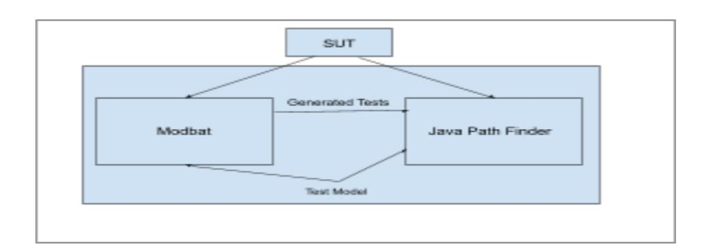

# Google Summer of Code 2024 Model-based Testing with Modbat for JPF

Harshvardhan Parmar

#### 1. Abstract

Testing software is super important when we're making software. We need to be sure our programs work well! But sometimes, the usual ways of testing don't catch everything. This can mean there are still problems in our software that we don't know about. At this point, we can think about Modbat and Java Path Finder(JPF). They're like super tools that can automatically find more concerns in our software, especially if it's written in Java.

Modbat is a model-based testing framework that utilizes finite state machines (FSMs) to generate tests systematically, exploring various execution paths based on predefined models. Java Pathfinder (JPF) is a powerful model checking tool that verifies Java programs by exhaustively exploring their state space.

The primary objective of this project is to integrate Modbat with JPF to improve the effectiveness and efficiency of test generation for Java applications. By combining the model-based approach of Modbat with the exhaustive verification capabilities of JPF, we aim to achieve comprehensive test coverage while minimizing redundant test cases.

#### Project Size

I am applying for a large project (~350 hours).

#### Key components of this project include:

- 1. Integration of Modbat and JPF: Develop mechanisms to seamlessly integrate Modbat with JPF, allowing for the generation of test cases based on Modbat models and their verification using JPF.
- 2. Making Better Tests: We'll create smarter ways to make tests using Modbat and JPF. This means we'll focus on important parts of the code and try out tricky paths to catch more problems.
- 3. Automated Test Execution and Analysis: Develop tools for automated test execution and analysis, including identifying and prioritizing potential issues

uncovered during testing, such as unreachable code, deadlock situations, and resource leaks.

- 4. Documentation and Community Engagement: Provide comprehensive documentation for the integrated Modbat-JPF framework, including usage guidelines, tutorials, and examples.

#### 2. Self Introduction

My name is Harshvardhan Parmar, and I am a final-year student at Government Engineering College, Bhavnagar, majoring in Computer Engineering.

At the very beginning of my tech journey, I learned Java, and since then, I have been delving deep into the world of Java. During my bachelor's, I have developed several projects using Java, Spring Boot, and other related frameworks to learn things like CRUD operations, authentication, authorization etc. Also made some projects while learning about microservice architecture.

#### My Experience With Open-source :

Upon discovering open-source, my perspective on projects changed drastically. I began contemplating how my projects could benefit the tech community, or how I could contribute to our community through my efforts. Since then, I have been actively contributing to open-source projects. Below are some of my significant contributions:

#### Jedis :

<https://github.com/redis/jedis/pull/3680>

<https://github.com/redis/jedis/pull/3644>

<https://github.com/redis/jedis/pull/3641>

#### JakartaEE-tutorial :

<https://github.com/jakartaee/jakartaee-tutorial/pull/95>

<https://github.com/jakartaee/jakartaee-tutorial/pull/103> (not merged yet)

<https://github.com/jakartaee/jakartaee-tutorial/pull/102> (not merged yet)

#### Edgechains :

Last summer, I participated in GSSOC (Girl Script Summer of Code), an open-source program. Through this program, I was introduced to Arakoo.ai, an organization developing an open-source library for building AI-based applications using Java with minimal setup. I began contributing to this project, and after three months, they offered me an internship.

While contributing to Edgechain, I engaged in various activities such as creating documentation, developing examples, writing test cases, and coding. I am still a part of

the core team of Edgechain but have been unable to contribute further due to academic commitments.

All my merged PRs for edgechains

In addition to these endeavors, I have a keen interest in cloud-native technologies. As a Java enthusiast, I am aware of Java's capabilities and believe that Java can have a significant impact on the cloud-native world with tools like GraalVM. Currently, I am exploring ways to make this a reality.

#### Jpf-nhanlder :

Raised this PR in jpf-nhandler which is extension of jpf-core project to support native method for JDK. This PR is for resolving the issue of unit test failure for JDK 11 while running the build command in jpf-nhandler.

<https://github.com/javapathfinder/jpf-nhandler/pull/7>

A complete list of my all PRs can be found here.

#### Why JavaPathFinder(JPF) and Model-based Testing with Modbat for JPF ?

I am keen to engage in these projects due to my background in Java and unit testing. Delving into projects that operate at the JVM level will deepen my understanding of Java's inner workings, specifically the JVM's internal mechanisms. This opportunity not only allows me to apply my existing skills but also presents a valuable learning experience in a domain critical to Java development.

#### Contact info and timezone(s) :

Primary Email: harshparmar4902@gmail.com

Secondary Email: harshwardhansinhparmar4902@gmail.com

Contact Number: +91 9510884102

GitHub: Harsh4902

Discord: HP4902#9295

Twitter: Harsh_4902

Time Zone: Kolkata, India (GMT+5:30)

Preferred mode of Communication: Email, Google meet, Discord.

#### 3. Essential Prerequisites

- I've managed to duplicate and download the jpf-core repository, and I've compiled a jar file from it on my personal computer.

- Additionally, I've also executed the HelloWorld example to verify its functionality.

- I've effectively duplicated the modbat repository and compiled a jar file from it on my local machine.

- Also successfully executed modbat using scala.

- I have also successfully ran Modbat without Scala wrapper on the JVM.

- I have successfully executed Modbat inside the JPF with the help of.jpf properties file and RunJPF.jar.

# 4. Time Commitment

As per the timeline on GSOC's official page, 27th May - 26th August is a time period for the contribution. This time period contains total 91 days.

Currently, I am doing an internship which is part of my final year evaluation which is going to be ended around 15th June. During this time I will be able to devote ~2hr/day which can increase as per the free time. After 15th June, I will be able to devote ~6hr/day.

|(Total | Days) |
|--------- | ------------------------- |
| | Work Days Total Working |
|1. 27th | May |
|15th | June |
| | Mon Sun 20 ~2hr/day 40 |
|2. 16th | June |
|26th | Aug |
| | Mon Fri 51 ~6hr/day 306 |

As per my schedule, we can clearly see that I have more than 350 hours to work during the time period of coding. And that's why I am thinking that we can complete the project before the timeline, and we will also have spare time to tackle issues which will come during building the project. Also, we will have time for making and enhancing effective documentation for this project.

#### Any possible conflicts of interest

As I have mentioned earlier, currently I am pursuing internship. There is a possibility to get the PPO from that company and I have to join full-time job. In this situation, I will be able to devote ~2hr/day to the project. This thing can be happened in first week of July for this thing I have alternative plan.

|(Total | Days) |
|--------- | ------------------------- |
| | Work Days Total Working |
|1. 27th | May |
|15th | June |
| | Mon Sun 20 ~2hr/day 40 |
|2. 16th | June |
|30th | June |
| | Mon Sun 15 ~6hr/day 90 |
|3. 1st | July |
|26th | Aug |
| | Mon Sun 47 ~2hr/day 94 |

I this scenario I have total 224 hours to work so here we can use extended time period of 3rd Sep - 4th Nov for documentation and other work apart from coding.

Note: The second option is totally based on the PPO/offer. If I will be selected for GSOC, I will try to avoid joining the job during the GSOC time period. In any situation, I will definitely complete the project.

#### 5. Goals

Note: I have listed all goals in descending order of importance, starting with the highest priority.

#### 1. Integration of Modbat and JPF :

Objective: Develop a seamless integration between Modbat and JPF to ensure compatibility and smooth communication between the two tools.

#### Activities :

- Study the APIs and functionalities of Modbat and JPF to identify integration points.
- Design and implement adapter modules or interfaces to facilitate communication between Modbat and JPF.
- Test the integration thoroughly to verify that test models generated by Modbat are correctly interpreted and executed by JPF.

#### 2. Documentation and Support

Objective: Provide comprehensive documentation and support resources to facilitate the adoption and usage of the integrated Modbat-JPF framework by developers.

#### Activities :

- Write detailed user guides, tutorials, and API documentation covering the setup, configuration, and usage of Modbat and JPF integration.
- Create examples and sample projects demonstrating best practices for test generation and execution using the integrated framework.
- Collaborate with the open-source community to address user feedback, resolve issues, and incorporate new features or enhancements into the framework.

#### 3. Improved Test Generation :

Objective: Enhance the test generation process by leveraging the combined capabilities of Modbat and JPF, focusing on prioritizing test cases based on code coverage metrics and exploring complex execution paths.

#### Activities :

- Develop algorithms to prioritize test cases based on code coverage metrics, such as statement, branch, and path coverage.
- Implement strategies to explore complex execution paths, including loops, conditionals, and exception handling.
- Evaluate the effectiveness of these strategies through experimentation and comparison with traditional test generation approaches.
- Fine-tune the test generation process based on feedback and performance analysis.

#### 4. Automation of Testing :

Objective: Automate the testing process to streamline test execution and analysis, reducing manual effort and increasing efficiency.

#### Activities :

- Design and implement scripts or tools for automated test execution using Modbat and JPF.
- Integrate continuous integration (CI) and continuous deployment (CD) pipelines with the automated testing framework to enable automated testing as part of the development workflow.
- Develop mechanisms for automated analysis of test results, including identifying and prioritizing detected issues for resolution.
- Ensure compatibility with popular development environments and version control systems to facilitate adoption by developers.

#### 5. Evaluation and Feedback:

Objective: Continuously evaluate the effectiveness and performance of the integrated Modbat-JPF framework and gather feedback from users to guide further improvements.

#### 6. Implementation Plan

#### What we want to achieve?

We want to integrate Modbat with JPF for generating test cased based on Modbat models and running tests using JPF and find concurrency problem.

#### Summary of existing system

- Modbat is a model-based testing framework that utilizes finite state machines (FSMs) to generate tests systematically, exploring various execution paths based on predefined models.
- Java Pathfinder (JPF) is a powerful model checking tool that verifies Java programs by exhaustively exploring their state space.

#### Overview of Integrated Modbat-JPF system

- JPF requires test cases as a starting point to explore a system. It is therefore suitable to use test case generation to create test cases automatically. Here, we can use Modbat to generated test cases. For testing concurrent software, an obvious choice would be to combine Modbat (to generate tests) with JPF (to execute tests and find concurrency problems).
- In this integrated system, we are going to use Modbat to generate tests for JPF which can be executed by JPF and can find concurrency issues.
- Architecture for this system:

#### Initial Steps I have taken

- As per the guidance from Cyrille Artho I have firstly tried to run modbat without using the Scala wrapper. As we know, basic models of modbat is written in Scala, but we can also run modbat with the Java command instead of Scala command.
- To run modbat using Java command, we have to provide some jar files of Scala to the JVM's classpath. I have tried with provide scala-library.jar to the classpath with the modbat.jar. This is how I have successfully executed modbat using Java.
- Command for running modbat using Java:

#### Java -cp \$SCALA_HOME/lib/scala-library.jar : modbat.jar modbat.mbt.Main

- This step helped me to run Modbat inside the JPF. To run modbat inside JPF, I have provided required libraries to the classpath and written Modbat.jpf properties file, which will be used by JPF to execute modbat inside it.

#### Modbat.jpf

- Then I have run modbat inside JPF using this file with following command Java -jar jpf-core/build/RunJPF.jar Modbat.jpf

### Tentative Timeline & Work Planning

|Milestone |  | Goal |  | Task(s) | Week(s) |
|----------- | --------------- | ----------------- | --------- | --------- | --------- |
|1 | Integration | of Modbat | and JPF | 1-4 | 6 |
|2 | Documentation | and | Support | 5-6 | 3 |
|3 | Improved | Test Generation |  | N/A | N/A |
|4 | Automation | of | Testing | N/A | N/A |

Task 1

#### Task :

Making our system capable to handle native methods with the help of JPF-nhandler

#### Time Period :

1st week (27th May - 2nd June)

#### What we will do :

- In the first week of our contribution period, we will commence with the issue of jpf-nhandler, which is required to handle native methods of the JVM for our system.
- This task is expected to take only a couple of days, but we allocate a full week to accommodate any additional issues that may arise after resolving the first one.
- Following this, we will utilize jpf-nhandler to address file I/O requirements for our system.

#### Target Date for PR :

2nd June

#### Task 2

#### Task :

Identify integration points and design the integration architecture.

#### Time Period :

2nd:
- 3rd week (3rd June
- 16th June)

#### What we will do :

- In the following two weeks, the focus will shift to identifying the specific points of integration between Modbat and JPF and designing the architecture for seamless communication.

This task will include:

- Analyzing the functionalities of Modbat and JPF to determine where integration is needed, such as test generation, execution, and verification stages.
- Considering factors such as data exchange formats, communication protocols, and compatibility requirements between Modbat and JPF.
- Designing an integration architecture that outlines how Modbat and JPF will interact, including the flow of data and control between the two systems.
- Documenting the integration architecture, including diagrams and descriptions, to ensure clarity and understanding among stakeholders.

#### Target Date for PR :

N/A

#### Task 3

#### Task :

Create models or.jpf file which can run Modbat inside JPF

#### Time Period :

4th week (17th June - 23rd June)

#### What we will do :

- As mentioned earlier, Modbat and JPF are two different systems. Our goal is to find a way to run Modbat inside JPF.
- As an initial step, I attempted to run Modbat inside JPF using a.jpf file. In this.jpf file, I specified the target class as modbat.mbt.Main and included Scala and Modbat libraries in the classpath argument.
- Additionally, we can write a Runner class that directly executes the Modbat's main class and can also accept command flags, which can then be passed to the Main class of Modbat.

#### Target Date for PR :

23rd June

#### Task 4

#### Task :

Test the integration thoroughly, ensuring that Modbat-generated test models are correctly interpreted and executed by JPF.

#### Time Period :

5th-6th week (24th June - 7th July)

#### What we will do :

- In the final two weeks of this phase, the focus will be on testing the integration between Modbat and JPF to ensure its reliability and effectiveness.

This task will include:

- Developing test cases specifically designed to validate the integration between Modbat and JPF, covering various scenarios and edge cases.
- Executing the test cases to verify that Modbat-generated test models are correctly interpreted and executed by JPF.
- Analyzing the test results to identify any discrepancies or issues in the integration and troubleshooting them as necessary.
- Iteratively refining and improving the integration based on the test results and feedback received.

#### Target Date for PR :

N/A

#### Task 5

#### Task :

Write detailed user guides, tutorials, and API documentation for Modbat and JPF integration.

#### Time Period :

7th-8th week (8th July - 21st July)

#### What we will do :

- During these two weeks, the focus will be on creating comprehensive documentation to aid users in understanding and effectively utilizing the integration of Modbat and JPF.

This documentation will include:

- User Guides: Detailed guides that provide step-by-step instructions on setting up, configuring, and using the integrated Modbat-JPF framework. These guides will cover topics such as installation procedures, configuration options, and common usage scenarios.
- Tutorials: Practical tutorials that walk users through specific use cases or workflows using the integrated framework. These tutorials will demonstrate how to perform tasks such as test generation, execution, and verification, using real-world examples and scenarios.
- API Documentation: Detailed documentation of the APIs exposed by Modbat and JPF for integration purposes. This documentation will include descriptions of classes, methods, parameters, and return types, along with usage examples and explanations.

#### Target Date for PR :

21st July

#### Task 6

#### Task :

Create examples and sample projects demonstrating best practices for test generation and execution.

#### Time Period :

9th week (22nd July - 28th July)

#### What we will do :

- During this week, the focus will be on creating examples and sample projects that illustrate best practices for test generation and execution using the integrated Modbat-JPF framework

- Sample Projects: Complete projects that demonstrate how to integrate Modbat and JPF into a Java-based application for test generation and execution. These projects will showcase best practices in project structure, configuration, and usage of Modbat and JPF.
- Example Test Cases: Pre-defined test cases that cover various scenarios and use cases, demonstrating how to effectively utilize Modbat and JPF for test generation and execution. These examples will cover different aspects of testing, such as functional testing, edge case testing, and concurrency testing.

#### Target Date for PR :

28th July

Note: Here I am considering Milestone 1&2 so important. After achieving these milestones, if we have spare time, then we will try to achieve remaining milestones.

# 7. Foreseen major challenges

- Currently, supporting native methods in JPF is the most challenge full task to achieve. To achieve this task, thankfully we have JPF's extension JPF-Nhandler which can help us to support native methods in JPF.

## 8. Plans for future improvement and involvement

- After completing GSOC, I will be joining the JPF team and this project. My aim will be to actively engage in activities such as fixing errors, raising issues, and providing community support for this project as well as other projects within the JPF team.
- In the future, I will endeavor to accomplish all the remaining milestones that were not completed during the contribution period. Additionally, I will strive to enhance the project based on user feedback.