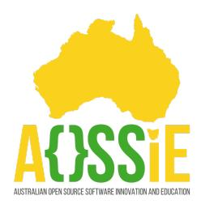

# Google Summer of Code Project Proposal for AOSSIE

# Project Summary

Project: PictoPy

Idea: My idea involves an all-round improvement to PictoPy. I want to make PictoPy end-user-ready by the end of GSoC. The focus is on improvements to the frontend, backend, and packaging. I am proposing to redesign the frontend UI because the current UI is cluttered and not up to today's standards. In the backend, I am proposing model and design improvements. The summary of changes in my proposed idea is on this page. All the details are explained later in the proposal.

# Project Size:

Small (90 hours) Medium (175 hours) Large (350 hours)

#### Project Length:

12 weeks 14 weeks 16 weeks 18 weeks 20 weeks 22 weeks

# Project Vision and Motivation

# Vision

My vision is to make PictoPy a go-to choice for smart and offline photo management and outperform any other apps in accuracy, efficiency and UI/UX. The face sorting feature is this app's main highlight, and I plan to complete this feature by adding the face collections update. All of my proposed changes to the app align with PictoPy's vision of a privacy-focused, AI-powered face and image-sorting gallery.

# Motivation

I have been interested in software development since I was in school. I learnt basic web development during my 10th grade, and since then, I have been actively coding. I really love problem-solving, especially competitive programming. I am a specialist on CodeForces (max rating is 1505) and a Knight on LeetCode (max rating is 1930). I have been aware of the GSoC program since my first year of college, and 5 months back, I decided to apply.

While searching for projects, I looked up various organisations and their projects, but no other project caught my attention as much as PictoPy. I loved everything about this project: the idea, the tech stack and the community. I have been contributing to this project for the past 4 months, and the amount of new things I learned from this project can't be described in a few words.

I have a good amount of knowledge related to the current codebase. This is because of my contributions to this project and my engagement with all the people who are part of it. Since I have been a part of this project for a long time, I want to do something that will make this project even more successful. The changes I have proposed are not just on paper; I have made several Python notebooks to test my approaches, linked research papers to back my findings, and made a working prototype of the Frontend UI, which took five whole days to complete.

Moreover, I love open-source projects and have been familiar with Github and Git version control systems for the past six years. For a long time, I have used open-sourced libraries and frameworks to do my personal projects, and I felt the urge to give back to the open-source community. PictoPy is the best way for me to do so.

# Contact Information

Name: Rahul B Harpal

Email: rahulharpal91@gmail.com

Discord Username: rahulharpal

Github Profile URL: <https://github.com/rahulharpal1603>

Phone: +91 63540 65347

Address: Jetpur Road, Opposite Janana Hospital Ground, Dhoraji, Gujarat, India -360410

# Education

Degree: Bachelor of Technology (B.Tech) in Computer Science and Engineering

Expected Graduation Date: May 2026

# Past Experience in Software Development

- ● CodeForces Extension (CF TopHacker):
- An open-source Chrome Extension to add the 'Hacks Standings' button to the Codeforces contest standings page. Currently, there are 220+ active users on the Chrome Web Store. CodeForces Blog about this extension received a lot of recognition (120+ upvotes)
- This project took part in HacktoberFest 2024, and I reviewed and merged 6 Pull requests from new contributors.
- Tech Stack: Manifest V3, JavaScript
- ○ WebStore GitHub
- ● Open Source Contributions other than PictoPy:
- WordPress: Contributed to the front end of WordPress's Gutenberg Plugin (10,000+ stars on GitHub). It involved rewriting code for the input component for the plugin and code cleanup. Merged PR after rigorous reviews. PR
- Activist.org: Contributed to this project during HacktoberFest 2024 and made a modal using VueJS PR
- React Tooltip: Solved a Good First Issue PR
- ○ Tech Stack: React, Vue.js
- ● Study Resource Management and Sharing Platform:
- Developed a full-stack platform with my team for students to share study resources with admin approval, categorised by department and semester.
- Admins can manage courses and YouTube tutorials for better concept understanding.
- Students can calculate CGPA/SGPA automatically without manual course entry.
- Containerised the application using Docker Compose to set up the development environment by contributors.
- Built with ReactJS, ExpressJS, MongoDB, NodeJS, JWT, and Cloudinary, it was recognised as one of the best projects in the SWE lab.
- ○ Tech Stack: MongoDB, ExpressJS, React, NodeJS, Docker
- ○ GitHub

# Contributions to PictoPy [Pull Requests]

- 1. Pull Request #271: CI/CD Pipelines for generating executables for PictoPy: PR This PR automates GitHub releases with app-build.yml, generating platform-specific installers for Windows, macOS, and Linux. It ensures the FastAPI backend runs seamlessly without requiring Python to be installed on the system and adds a logging system using Loguru. Key improvements include better frontend-backend integration and self-contained app installers. Project Executables
- 2. Pull Request #159: Improve frontend performance by generating thumbnails. PR This PR optimises image rendering, reducing RAM usage from 3.5 GB to ~500 MB by displaying thumbnails instead of full images. Thumbnail functionality is added across multiple pages.
- 3. Pull Request #340: Added multiple folder support: PR This PR introduced a change that would allow users to add images from multiple folders to the gallery. Also, properly handled folder removal by deleting the thumbnails.
- 4. Pull Request #337: Added PR checks for testing the Tauri build on all platforms: PR This PR introduced three new checks (using Github Actions) per pull request, which would check for any errors related to the Tauri build and any TypeScript errors. This is to ensure that faulty code doesn't get merged into the codebase and that executables are able to generate without any errors.
- 5. Pull Request #364: Accessing images directly from the selected folder for AI Tagging: PR Previously, the images for AI tagging were copied into a separate folder of the app; this led to unnecessary redundancy and storage usage. I introduced the changes to access images directly from the selected folder.
- 6. Pull Request #114: UI/UX Revamp: PR This PR improved the overall UI of PictoPy.
- 7. Pull Request #380: Upgraded the Tauri version from 2.0 beta to 2.3.1: PR This PR updated the package files and made other necessary changes to migrate the project from Tauri's beta version to a more stable and secure version.

- 8. Pull Request #344: Simplified backend setup instructions: PR New contributors faced issues while setting up the backend. I simplified the process by removing the need for shell scripts to start the backend.
- 9. Pull Request #421: Introduced Video Tutorials for project setup and simplified setup guide: PR Recorded the videos on fresh machines without prior installed packages. These machines were VMs created in Google Cloud's compute engine.
- 10. Pull Request #115: Improve error handling in album routes: PR This PR modified the album route to return meaningful error codes and handled exceptions properly to display error messages to the front end.
- 11. Pull Request #285: Minor bug fix for the executables workflow: PR

# Contributions to PictoPy [Issues Opened and Code Reviews]:

- 1. Issue #112: BUG: Proper reporting of duplicate album error: Issue
- 2. Issue #113: Feat: UI/UX Revamp: Issue
- 3. Issue #120: BUG: RAM and CPU overload for higher quality images: Issue
- 4. Issue #138: Feat: Workflow for packaging PictoPy for Win, Linux and Mac as executables: Issue
- 5. Issue #161: Feat: Support for adding multiple folders to display images on the home page: Issue
- 6. Issue #209: Feat: Accessing Images directly from the selected folder for AI Tagging: Issue
- 7. Issue #345: Bump Tauri version from 2.0 beta to the latest Tauri version: Issue
- 8. Issue #357: Good First Issue: Change FastAPI docs to match the current state of the repository: Issue

- 9. Issue #358: Good First Issue: Change Tauri/Rust docs to match the current state of the repository: Issue
- 10. Reviewed 3 Pull Requests for errors and gave suggestions: PR #150, PR #268, PR #371

# Contributions Graph for AOSSIE:

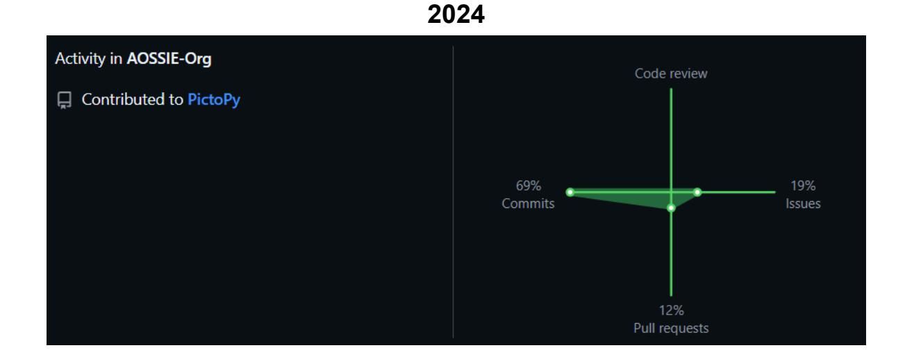

# 2025

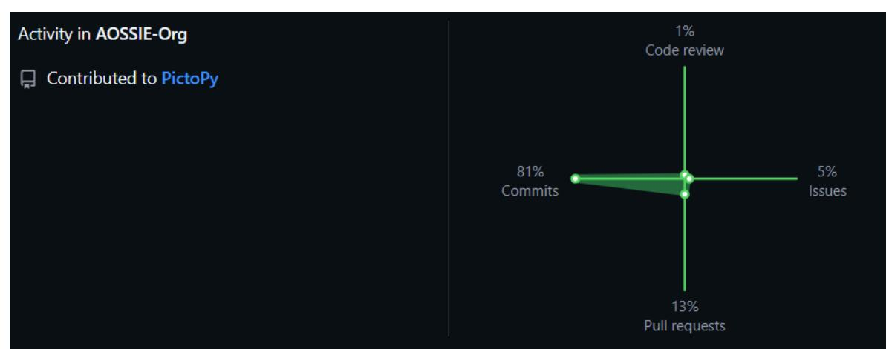

# Overview of Changes Proposed According to My Idea:

# Backend:

- 1. Implement face collections: Similar to Google Photos, but with the added advantage of privacy and open-source. Give users the ability to name the face clusters.
- 2. Face Clustering Improvements: Modifying DBSCAN clustering of face embeddings to perform dimensionality reduction. Also, changing the FaceNet model to generate 128 dimensional embeddings instead of 512. This will improve accuracy and performance.
- 3. YOLO Model Updates: Currently, we are using YOLOv8n and YOLOv8n-face for object detection and face detection. These models will be updated to the latest YOLO version, i.e. YOLOv11, for faster inference and better accuracy. And give users the option to choose the model size (nano, small, and medium).
- 4. GPU-Accelerated Inference: Run the models using any GPU which is available on the user's computer (Apple's Neural Engine, AMD GPUs, Nvidia GPUs). Currently, support is only available for Nvidia GPUs.
- 5. Improve SQLite Database Design: Some of the DB Schemas are not designed while keeping in mind the efficiency and standard practices (like Albums Schema). Improving the design is really crucial.

# Frontend:

- 1. UI Redesign: I am proposing a completely new UI for PictoPy. This UI looks elegant and makes the product stand out. I have made a working UI prototype using Radix UI components. Prototype
- 2. Unifying folder selection: Currently, there are two places where the user needs to pick folders, one for the normal gallery home page and the other for the AI Tagging page. I am proposing a better option: having one folder selection panel in the settings menu.
- 3. Search Bar: Implementing a global search bar with which we will be able to search in a variety of ways. User can search for images with their file names, with names of objects present in the images. Also, the search-by-face feature, which is already present on the AI Tagging page, will be integrated with this.

- 4. Displaying Object Bounding Boxes: When we open a tagged image, an option should be given to draw the bounding boxes for the detected objects. This will also involve DB Schema changes.
- 5. Notifications and AutoStart: Users will be notified of various events in the app, like the completion of AI Tagging for a folder, a new memory for the day, app updates, etc. Also, in the settings tab, there will be an option to enable the autostart feature of the app to run the app on startup.

Packaging and Deployment: Since the main idea of my proposal is to make the PictoPy application end-user-ready, it would be essential to have this app published on various channels like Ubuntu Snap Store, Microsoft Store and Apple Store. This will allow for pushing updates to the users seamlessly. Refer to this page for the packaging approach for PictoPy.

Documentation for publishing to each store:

- 1. Ubuntu Snap Store
- 2. Microsoft Store
- 3. MacOS Store

# Outcomes:

- Increased contributions from new developers by simplifying the setup process and providing detailed documentation like contributing guides, code comments, API docs, and project setup videos.
- Refactor and enhance the backend for better growth and scalability.
- Design improvements to the backend for smoother development and future expansions.

# Detailed Proposal Description [Backend]

# 1. Implement face collections

1.1 Introduction: Currently, in the backend part, there is support for generating clusters from the available faces, but we are not assigning names to each of the clusters. So, I introduce the face collections, which lets you see all the images of a person and lets you assign a name to that person. See Figures 1.1.1 and 1.1.2 to get an idea of the feature. These screenshots were taken from the new UI prototype (I will describe this prototype later in the proposal).

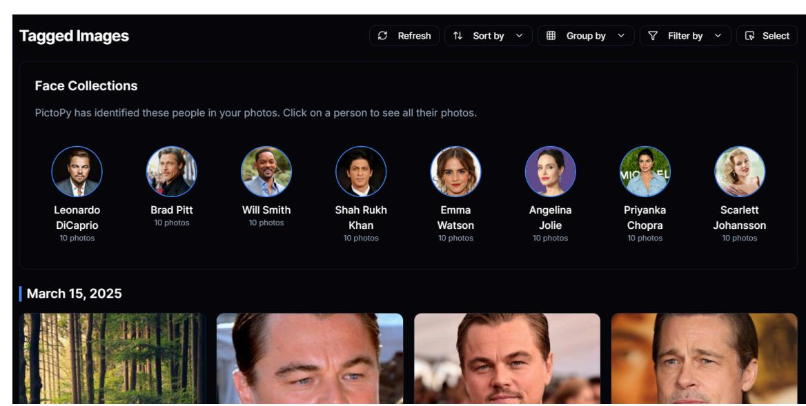

Figure 1.1.1

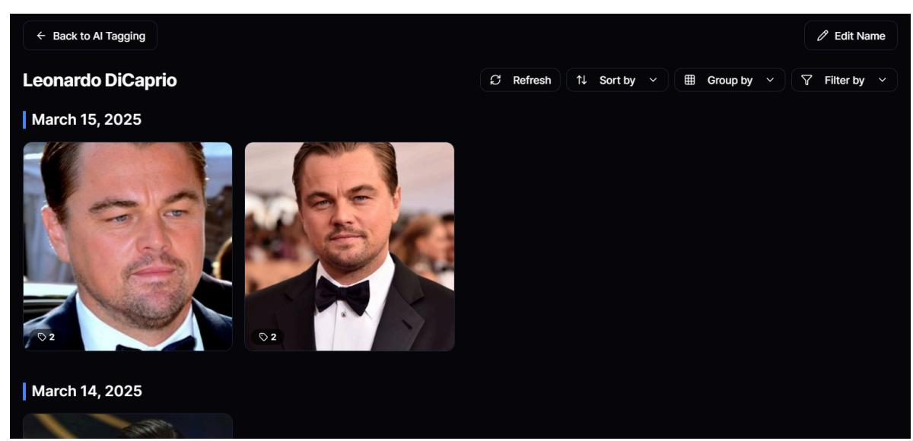

Figure 1.1.2

#### 1.2 Step-by-Step Approach

### Step 1: Database Schema Modifications:

- Restructure the Faces Table
- Modify the current schema to store one embedding per row instead of multiple embeddings per image.
- Add a unique face_id as the primary key for each embedding
- Include cluster_id as a foreign key to faces to their clusters
- Maintain image_id to preserve the connection to source images ●Create a New Clusters Table
- Implement a clusters table with cluster_id as the primary key
- Add a cluster_name column for user-defined names (with default system-generated names)
- Include representative_face_id to store the face that best represents the cluster

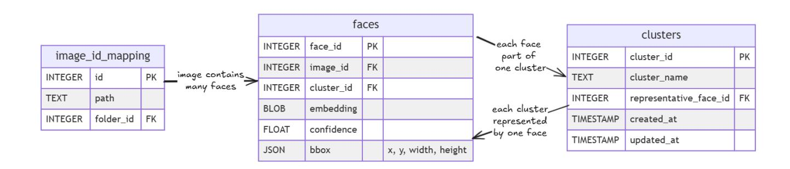

Figure 1.2.1 Schema Diagram for new tables

#### Step 2: Clustering Implementation

- Initial Clustering
- Implement DBSCAN-based clustering similar to the existing approach
- Assign system-generated names to clusters (e.g., "Person 1", "Person 2")
- ○ Select the face closest to the cluster centroid as the representative face
- Store cluster information in the database. See Figure 1.2.2 for more details. ●Re-clustering Logic (Done after a set threshold of new images)
- Implement logic to preserve cluster names during re-clustering
- ○ If a cluster's representative face is assigned to a new cluster, transfer the name
- When representative faces from multiple named clusters merge, flag for user review. See Figure 1.2.3 for more details. ●Incremental Clustering
- Develop a mechanism to add new faces to existing clusters
- ○ Calculate distances between new face embeddings and existing clusters
- Assign faces to the closest clusters if the distance is below the threshold
- Create new clusters for faces that don't match existing ones

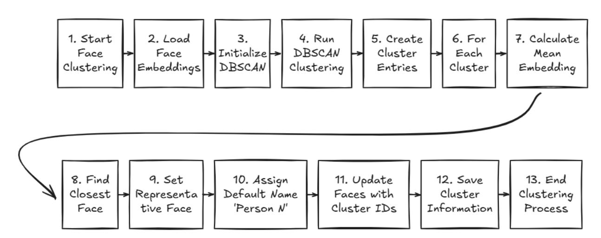

Figure 1.2.2 Initial Clustering Approach

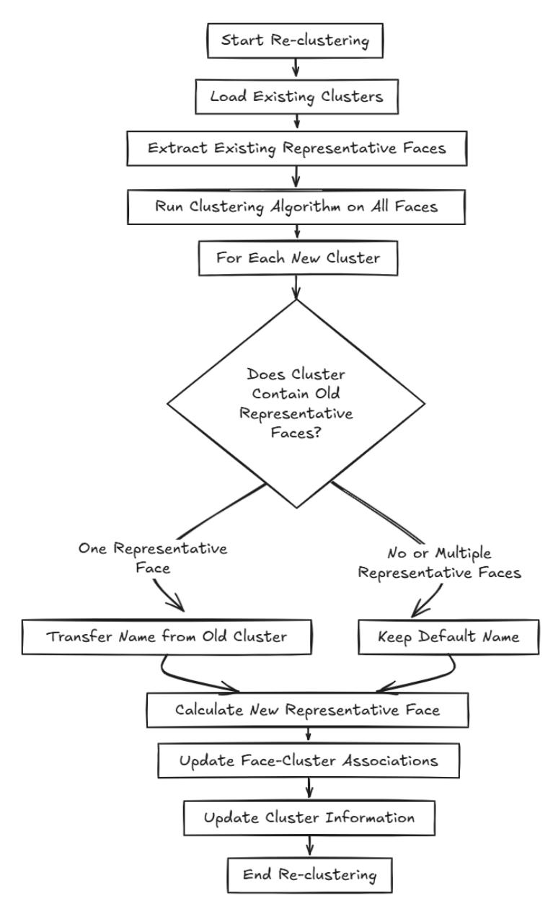

Figure 1.2.3 Re-Clustering Approach

# Step 3: FaceCollection Management APIs

# ●Rename Cluster API

- Create a new API endpoint(PUT) /face-collections/rename to update cluster names.
- Accept cluster_id and new_name as parameters
- Validate input and update the clusters table

#### ●Get FaceCollections API

- Create a new API endpoint(GET) /face-collections/fetchAll to get all the face collections that are present from the cluster database.
- Returns an array of clusters with relevant data, such as image count.

#### ●Endpoint for getting all images of a face

- Create a new API endpoint(GET) /face-collections/cluster_id to get all the face collections that are present from the cluster database.
- Returns all the image paths which belong to that cluster.

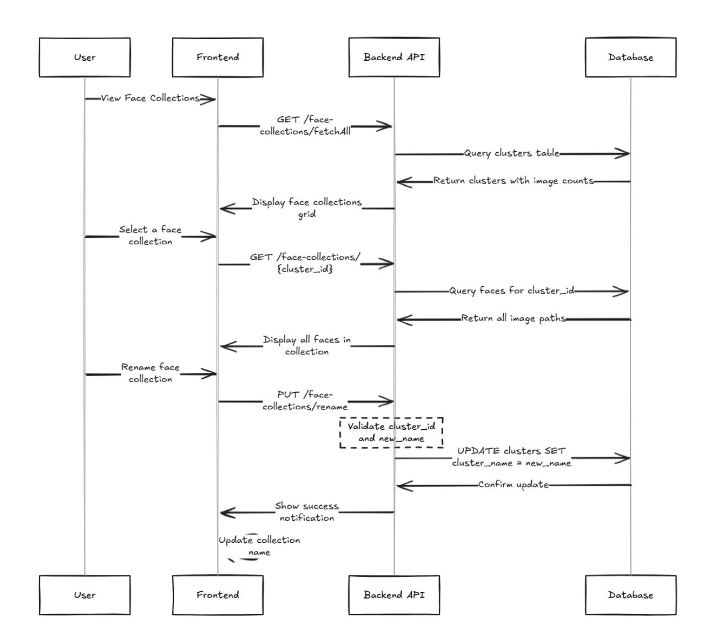

Figure 1.2.4 Cluster Management Sequence Diagram

# 2. Face Clustering Improvements:

2.1 Introduction: This aims to enhance the current implementation by optimising the face embedding pipeline and clustering algorithm to achieve better accuracy and performance. Specifically, I will implement reduced-dimension FaceNet embeddings combined with PCA preprocessing to make face clustering faster and more accurate.

# 2.2 Step-by-Step Approach:

# Colab Notebook in which I experimented: facenet_download.ipynb

# Step 1: FaceNet Model Optimization (128D Embeddings)

- The original FaceNet implementation by Schroff et al. (2015) demonstrated that lower-dimensional embeddings can maintain comparable accuracy while providing significant performance benefits. Their ablation studies showed that 128-dimensional embeddings achieve similar or even better recognition performance to higher dimensional vectors while requiring less computational resources. (See Table No. 5 on Page No. 7 of the FaceNet Paper)
- To achieve this, I will modify the InceptionResnetV1 architecture from facenet_pytorch by replacing the final linear layer to output 128 dimensions instead of 512
- Export the optimised model to ONNX format for cross-platform compatibility and faster inference.

# Step 2: Dimensionality Reduction

- Principal Component Analysis (PCA) can further reduce computational requirements while preserving the discriminative power of embeddings, but there is an issue with performing PCA on embeddings:
- PCA performs axis rotation to get the principal components, so this leads to the loss of meaning from the face embeddings(See the output in the provided notebook)
- Exploring any other dimensionality reduction technique is the way. Even if we don't find any other technique, we are already reducing the dimensions to 128.

- Benefits of this approach:
- Decreases storage requirements for face collections
- Speeds up similarity calculations and clustering operations. When using spatial indexing, DBSCAN has an average time complexity of O(n log n). In the worst case (without spatial indexing), the complexity is O(n²). Reducing dimensionality through PCA significantly decreases the constant factor in both cases.

# 3. Upgrading YOLO model versions:

3.1 Introduction: Currently, we are using YOLOv8n and YOLOv8n-face for object detection and face detection. These models will be updated to the latest YOLO version, i.e. YOLOv11, for faster inference and better accuracy (See Figure 3.1.1). And giving users the option to choose model size (nano, small and medium)

Reference: Ultralytics Docs

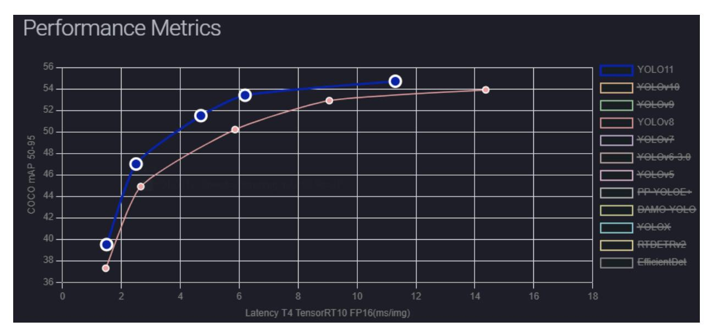

Figure 3.1.1

Performance comparison of YOLOv8 and YOLOv11 for different model sizes (nano, small, medium, large and XL)

# 3.2 Step-by-Step approach:

# Colab notebook used for experiments: YOLO model export.ipynb

## Step 1: Model Preparation and Export

- Create a script to download and export YOLOv11 models in ONNX format
- Export all variants (nano, small, medium) for both object and face detection
- Use consistent 480x640 resolution for all models to maintain compatibility

# Step 2: Database Schema Updates

- Create a user_preferences table in the SQLite database:

Figure 3.2.1 User Preferences Schema

- Add functions to initialise default preferences and retrieve/update user selections.

# Step 3: Core Model Implementation Changes

- Refactor YOLOv8.py to create a version-agnostic YOLOModel.py
- Implement a model factory to load the correct model size based on preferences
- Update inference methods to account for any changes in YOLOv11's architecture

# Step 4: Detection Pipeline Integration

- Modify facenet.py to use the new model factory system
- Update face detection processing to handle YOLOv11's improved detection results

# Step 5: API Endpoints for User Control

- Add /model-preferences endpoint (GET/PUT) for viewing and updating model choices
- The user will be prompted to choose from these models on the onboarding page. Also, add the option to change the model type in the settings menu.
- ● This approach ensures a smooth transition to YOLOv11 while giving users control over the accuracy-performance tradeoff based on their hardware capabilities and specific needs.

# 4. GPU-Accelerated Inference:

4.1 Introduction: Run the models using any GPU which is available on the user's computer during the ONNX Session (Apple's Neural Engine, AMD ROCm, Nvidia CUDA-enabled GPUs). Currently, support is only available for Nvidia GPUs in this project.

Reference: ONNX Docs for Execution Environment, ONNX Nvidia CUDA, ONNX AMD-ROCm, ONNX Apple-CoreML

Running inference on GPUs significantly improves performance. For example, running inference on Nvidia T4 GPU is up to 40 times faster than CPU inference (See the table in figure 4.1.1 taken from Ultralytics)

Figure 4.1.1 Comparing CPU and GPU performance

# 4.2 Step-by-Step approach:

# Step 1: Prerequisites

- Hardware-specific libraries:
- NVIDIA CUDA: CUDA Toolkit 11.x+, cuDNN 8.x+
- AMD ROCm: ROCm 5.x+
- Apple CoreML: Core ML Tools
- Updated ONNX Runtime
- onnxruntime 1.21.0+ with proper build configurations for all providers

# Step 2: Enhanced ONNX Provider Management

- Create a dedicated provider manager that dynamically selects optimal hardware. Sample Code

# Step 3: Refactor Model Initialization

- In app/facenet/facenet.py, replace direct session creation with provider manager.

## Step 4: Performance Benchmarking Implementation

- Create app/benchmark/providers.py:
- Implement LFW dataset-based benchmarking.
- Add comparison testing between CPU and GPU providers.
- Create visualisation of performance differences.
- I will use cloud providers like Google to benchmark and test Nvidia and AMD GPUs. I will access a Mac online for Mac-based testing using "Rent a Mac Services".

# 5. Improve SQLite Database Design:

5.1 Introduction: Some of the DB Schemas are not designed while keeping in mind the efficiency and standard practices (like Albums Schema). Improving the design is really crucial.

There are several issues with the current design(See Figure 5.1.1):

- Inefficient JSON Storage: Image IDs are stored as JSON-encoded strings, requiring serialisation/deserialisation with every operation.
- Scalability Concerns: As albums grow larger, JSON operations become increasingly expensive.
- Data Integrity Risks: No database-level foreign key constraints on the image IDs in the JSON array.
- Inefficient Image Removal: Removing an image from all albums requires loading and parsing all albums.

Figure 5.1.1 Current Albums Structure

# 5.2 Step-by-Step approach:

# Step 1: Create a Proper Junction Table

- Replace the JSON-based implementation with a proper junction table to represent the many-to-many relationship. (See Figure 5.2.1)

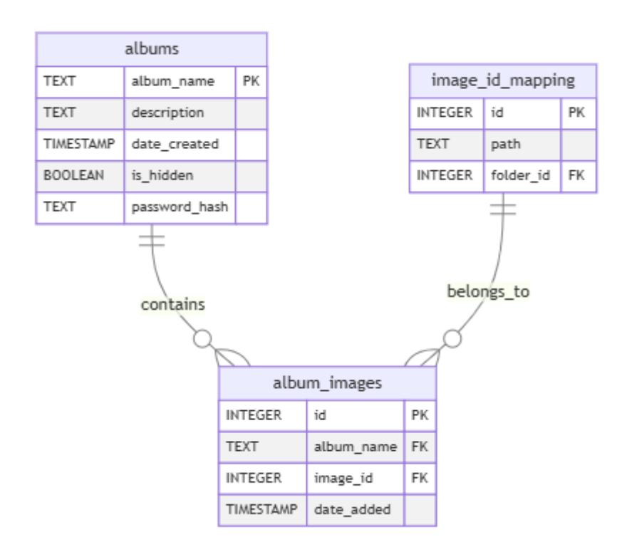

Figure 5.2.1 New Schema with proper handling of the many-to-many relationship

# Step 2: API Updates

- Update database functions to use the new schema. (See Figure 5.2.2)

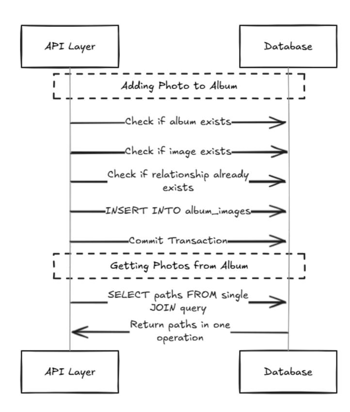

Figure 5.2.2

# Change in the flow of album data modification.

# Implementation Benefits:

- Performance: Significantly faster album operations, especially for large albums
- Scalability: Proper database structure supporting thousands of album-image relationships
- Data Integrity: Database-enforced referential integrity
- Query Capabilities: Enhanced query options for complex album operations

# Detailed Proposal Description [Frontend]:

# 1. Frontend UI Redesign:

1.1 Introduction: I am proposing a completely new UI for PictoPy. This UI looks elegant and makes the product stand out. I have made a working UI prototype using Radix UI components.

Here are the comparison videos between the two UIs:

# Current UI: Video

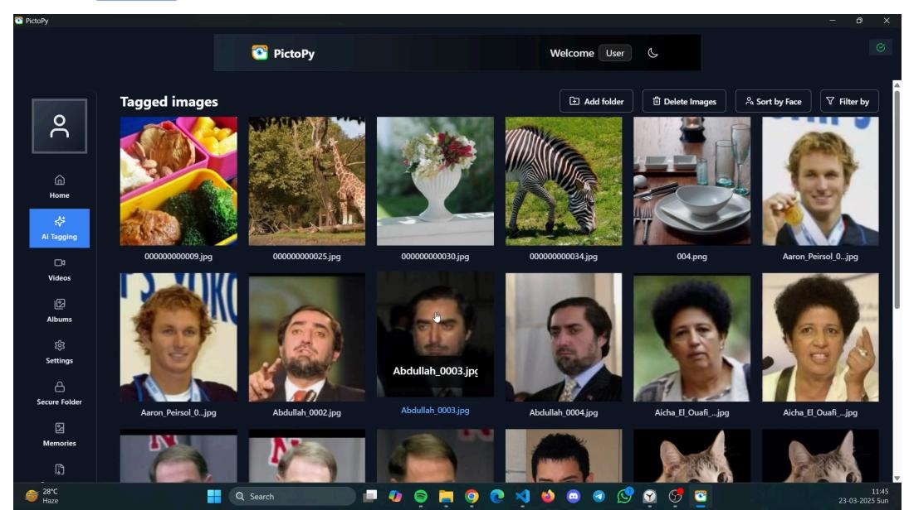

Figure 1.1.1 AI Tagging Page of Current UI

# New UI Prototype: Video, Prototype Link

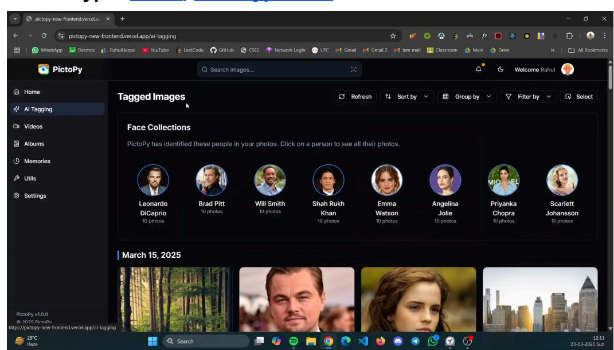

Figure 1.1.2 AI Tagging Page of New UI

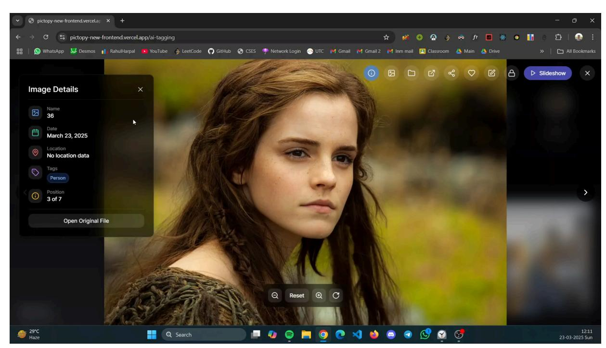

Figure 1.1.3 Media Viewer of the New UI

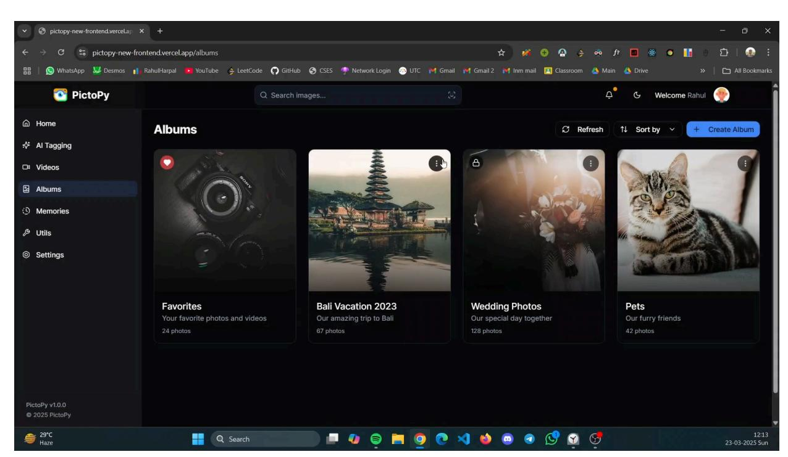

Figure 1.1.4 Albums Page of the New UI

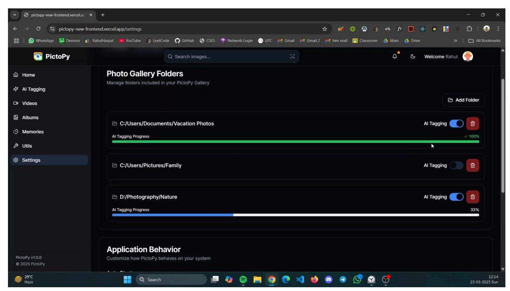

Figure 1.1.5 Settings Page of the New UI

# 1.2 Step-by-Step approach:

Step 1: Create new components based on the design mentioned in the prototype and integrate existing API calls with these new components.

Step 2: Most of the functionality of the current frontend is good. The UI needs to be changed. Some features, such as the image compressor and the secure folder, have not yet been implemented in the new UI prototype. These can be implemented quickly.

# 2. Unifying folder selection

2.1 Introduction: Currently, there are two places where the user needs to pick folders, one for the normal gallery home page and the other for the AI Tagging page. I propose a better option: having one folder selection panel in the settings menu. (See Figure 1.1.5 on the previous page)

Demo Video:

As we can see, there is a toggle beside each folder to turn off and turn on AI Tagging. If AI tagging is turned off for a folder, the images inside that folder will only be displayed on the home page, i.e. without tags.

If we turn on AI Tagging, the folder will be marked again for AI tagging, and the backend's app/scheduler.py will consider it for generating tags for new images added to an existing folder regularly.

# 2.2 Approach:

- As we saw in the demo video, each folder has separate progress bars. In the current implementation of progress loaders, only total progress is shown (See app/routes/images.py)
- This approach will be changed to maintain separate records for each folder. Also, the progress status is stored in memory, i.e. when the backend is busy with some other tasks like tagging the images, the /images/add-folder-progress API Endpoint doesn't get served due to lack of resources. Therefore, we need to make a database schema to store the progress status, and we need to run at least two workers for the backend so that the API endpoint is able to get served.

# 3. Search Bar:

3.1 Introduction: Implementing a global search bar with which we will be able to search in a variety of ways. User can search for images with their file names, with names of objects present in the images. Also, the search-by-face feature, which is already present on the AI Tagging page, will be integrated with this. (See the search bar in Figure 3.1.1)

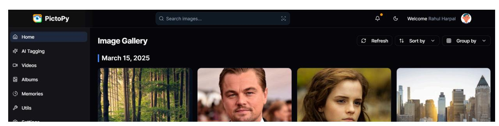

Figure 3.1.1 Global Search Bar (Present in the Navbar of the App)

When we click the scanning icon present on the right end of the search bar, the following dialogue pops up. This dialog is already present in the app(on the AI Tagging Page). I am just integrating it with the new global search bar.

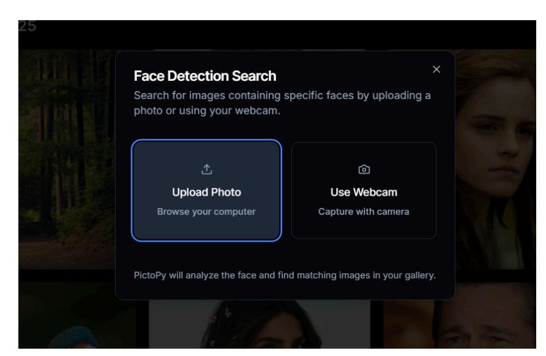

Figure 3.1.2 Face Detection Dialog

# 3.2 Step-by-Step approach:

# Step 1: Backend API Integration

- Create a unified search endpoint that aggregates multiple search types:
- GET /search
- Query params:
- - q: search query text
- - type: "text", "object", "face"
- - face_image_id: optional ID for face-based search

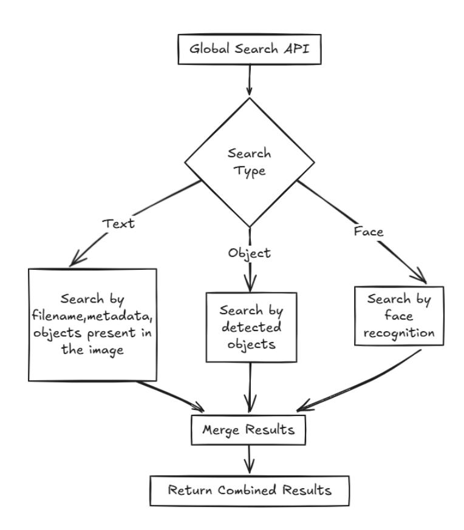

Figure 3.2.1 Flow diagram of the global search API

#### Step 2: Detailed Backend Changes:

- Create a Unified Search Controller:
- Path: backend/app/routes/search.py
- Implement a new endpoint /search with query parameters for the search type
- Integrate with existing search functionalities

### Step 3: Frontend Implementation:

- Global Search Component:
- Create a new SearchBar.tsx component
- Integrate existing face search dialog
- Add search mode selector (All, Text, Object, Face)
- Search Results Display:
- Enhance result visualisation with categorised results
- Add filter options for search results
- API Integration:
- Add new endpoints to apiEndpoints.ts

# 4. Displaying Object Bounding Boxes:

4.1 Introduction: When we open a tagged image, an option would be given to draw the bounding boxes for the detected objects. This will also involve DB Schema changes.

# 4.2 Step-by-Step approach:

Step 1: Database Schema Changes: The current images table stores class IDs but doesn't include position information for bounding boxes. We need to modify this schema:

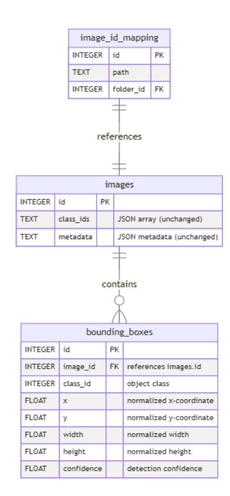

Figure 4.2.1 Database schema for bounding boxes

Step 2: Update Object Detection Pipeline: Modify the object detection process to store bounding box data:

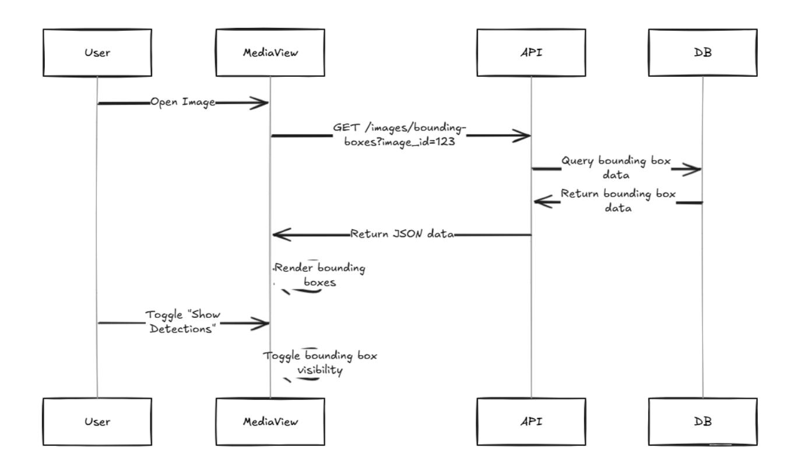

Figure 4.2.2 Sequence diagram for bounding boxes

# 5. Notifications and Auto-Start:

5.1 Introduction: Users will be notified of various events in the app, like the completion of AI Tagging for a folder, a new memory for the day, app updates, etc. Also, in the settings tab, there will be an option to enable the autostart feature of the app to run the app on startup. Both these things would be done using Tauri plugins: Notifications and AutoStart

# 5.2 Step-by-Step approach:

Step 1: Install the Notification Plugin: done using the command: npm run tauri add notification

Step 2: Notification Permission: Ask for this during the onboarding and give the option in the settings tab to change this preference. All these preferences will be stored in the database's user preferences schema.

# Step 3: Send Notifications for Events:

- AI Tagging Completion: Notify the user when AI Tagging is finished for a folder.
- New Daily Memory: Send a notification when a new memory is generated for the day.
- App Updates: Inform the user when a new update is available.

Step 4: Install the Autostart Plugin: done using the command npm run tauri add autostart

Step 5: Configure Permissions: Modify the capabilities/default.json file to allow autostart management.

# Step 6: Add Autostart Toggle in Settings:

- Provide an option in the settings UI to enable or disable autostart.

# Detailed Proposal Description [Packaging, Publishing and App Updates]:

Introduction: Since the main idea of my proposal is to make the PictoPy application end-user-ready, it would be essential to have this app published on various channels like Ubuntu Snap Store, Microsoft Store and Apple Store. Also, this will involve setting up an auto-updater plugin for the Tauri app, which will automatically update the app without manually downloading the app's package from the GitHub releases.

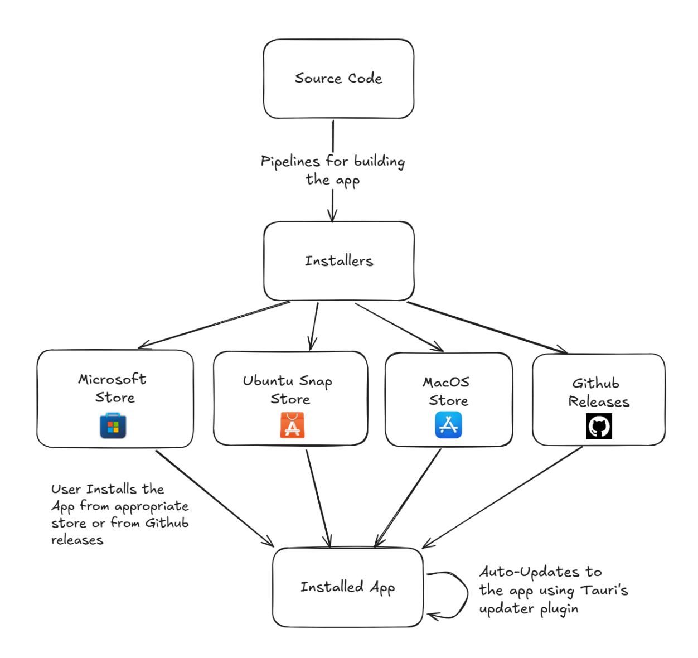

# Packaging:

Currently, pipelines are already set up to generate the app's installers (See Figure below for the approach). However, some minor issues need to be solved, like digitally signing the installers so that the target OS doesn't classify our app as untrusted and potentially dangerous. A private key will be generated and stored as a GitHub Secret so that no one can access it. Then, the pipelines will access these keys to generate trusted executables.

# Relevant Documentation: Tauri Signing Docs

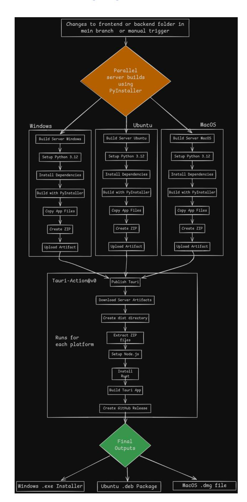

# Publishing:

We must adhere to the guidelines to publish the app on each platform's app store. Also, for the Microsoft Store, a one-time fee of 19 USD to create a publisher account will be charged. On the MacOS store, there will be a 99 USD annual charge for the publisher account. On Snap Store, the publishing is free. If we cannot create the paid account, then we always have the option to download the installer from the GitHub releases. The advantage of publishing to stores would be getting user reviews and ratings.

# Relevant Documentation:

- 1) Ubuntu Snap Store
- 2) Microsoft Store
- 3) MacOS Store

# Auto-Updates (Step-by-Step approach):

# Step 1: Install the Updater Plugin

- Use your package manager to add the Tauri updater plugin to your project. This ensures your app can check for and apply updates automatically.

## Step 2: Configure the Updater in Tauri

- Update the tauri.conf.json file to enable update artifact creation and specify update endpoints.
- Set createUpdaterArtifacts to true to generate update packages.
- Define update endpoints where your app will check for new versions (e.g., a static JSON file on GitHub or a dynamic update server).

# Step 3: Build and Sign Update Artifacts

- Ensure the private key is set in environment variables.
- Run the build process, which generates update bundles (e.g.,.AppImage,.tar.gz,.exe,.msi) and their corresponding signature files.

#### Step 4: Host Update Files

- Static JSON (Preferred Approach): A hosted JSON file (e.g., on GitHub Releases) listing available updates.
- Dynamic Update Server: A backend that responds to update requests dynamically, determining if an update is needed.

### Step 5: Handle Updates in the App

- Check for updates when the app starts or at a scheduled interval.
- Download and install updates automatically or prompt the user.
- Restart the app after installation if necessary.

#### Step 6: Test the Updater

- Ensure the app correctly detects updates from the configured source.
- Validate that signed updates are accepted and installed securely.
- Check the app updates UI/flow to ensure a smooth user experience.

# Timeline:

# Community Bonding Period

Research PictoPy's architecture and proposed backend changes. Finalise the architecture and flow, updating documentation accordingly. Engage with the mentor and community.

#### Week 1: Implement Face Collections (Backend Part)

Modify the database schema to support face collections. Develop API endpoints to create, rename, and fetch face collections.

#### Week 2: Implement Face Collections (Frontend Part)

Creating components using RadixUI for Face Collections Ensure UI integration for user interaction with face collections.

### Week 3: Face Clustering Improvements

Optimise the FaceNet model to generate 128D embeddings instead of 512D. Update clustering logic for better accuracy. Benchmark the performance of the new model.

### Week 4: YOLO Model Updates

Upgrade from YOLOv8 to YOLOv11 for better accuracy and performance. Implement support for selecting different model sizes (nano, small, medium). Update inference pipeline and model selection API.

#### Week 5: GPU-Accelerated Inference [Nvidia and AMD]

Modify ONNX runtime to support Nvidia CUDA AMD ROCm. Implement dynamic GPU provider selection. Benchmark performance improvements.

#### Week 6: GPU-Accelerated Inference [Apple support and testing]

Add support for using Apple's Neural Engine using Apple CoreML. Test and benchmark the performance improvement on a Mac.

### Week 7: Improve SQLite Database Design

Refactor albums schema to replace JSON-based storage with a junction table. Implement efficient queries for faster access. Update API to support new schema.

Create the Onboarding page, NavBar, SideBar, and Home Page. Implement the timeline scroll bar, sorting and group-by features on the home page. Integrate the API endpoints with the front end.

#### Week 9: UI Redesign Integration [Part 2]

Create the AI Tagging page, Videos Page, and Memories Page. Create a vertical story feature for the memories page. Integrate the API endpoints with the front end.

#### Week 10: UI Redesign Integration [Part 3]

Create the Albums page, Utils Page, Settings page and rest of the pages. Check for the app's responsiveness and make changes accordingly. Integrate the appropriate API endpoints with the front end.

#### Mid-Term Evaluation (Date: 2025-08-11)

### Week 11: Unifying Folder Selection [Backend]

Define SQLite Schemas for progress tracking with folder-wise details. Configure the server to run multiple workers. Modify progress-tracking API.

#### Week 12: Unifying Folder Selection [Frontend]

Modify the folder selection component on the settings page to display the progress. Use appropriate APIs to update the progress status. Test using a big test sample of folders.

### Week 13: Global Search Feature

Implement a unified search API that allows searching by text, object, and face. Develop frontend UI for search results with categorisation. Integrate face-search functionality into the global search bar.

#### Week 14: Displaying Bounding Boxes Feature for Images

Modify the object detection pipeline to store bounding box data. Update the database schema to include bounding box coordinates. Implement frontend UI to toggle bounding box visibility.

#### Week 15: Notifications and Auto-Start

Install Tauri's notifications and autostart plugins Define plugin configurations in tauri.conf.json Implement the notification and autostart frontend components.

Writing unit tests for the new components and APIs. Identify security loopholes and bottlenecks.

#### Week 17: Fixing Issues discovered in the testing phase

Create patches for any loophole or security vulnerabilities Finally, verify all the functional requirements of the given proposal

#### Week 18: Setup Packaging and Auto-Update for the app

Resolve the digital signing issue in pipelines. Set up auto-updater for the app using the Tauri plugin.

#### Week 19: Publishing to Stores

Prepare PictoPy for distribution on Ubuntu Snap Store, Microsoft Store, and Apple Store. Document the deployment process for each platform.

#### Week 20 (Final Week): Finalizing & Documentation

Fix any remaining issues. Write detailed documentation of all changes and contributions. Submit the final project evaluation.

# Final Evaluation (Date: 2025-10-20)

# Any Other Relevant Information:

The outcomes after the successful completion of this proposed idea would be:

- End-user-friendly UI and improved backend performance.
- Increased contributions from new developers by simplifying the setup process.
- Refactored and enhanced the backend for better growth and scalability.

Post GSoC, I plan to continue contributing to this amazing project, welcoming new contributors and helping them understand the project's architecture, guiding them to follow the established guidelines for writing code and resolving any issues which may arise.