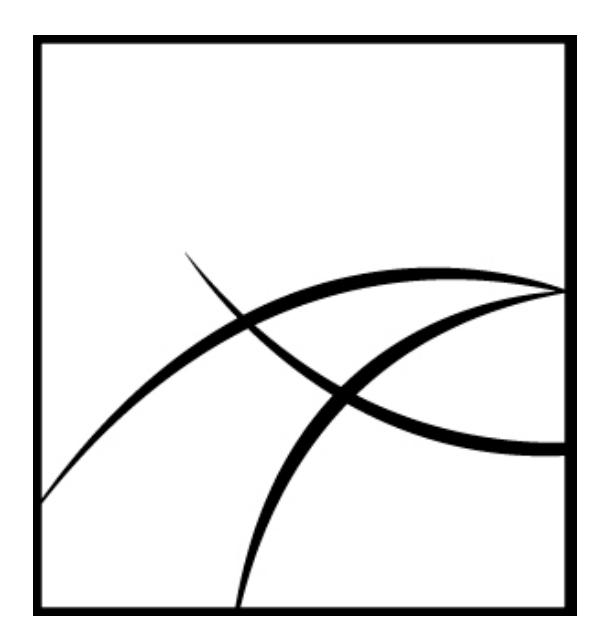
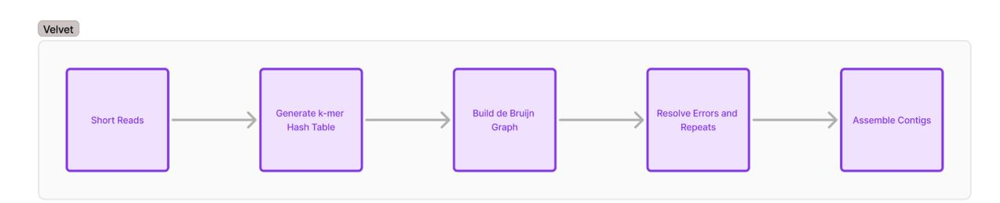
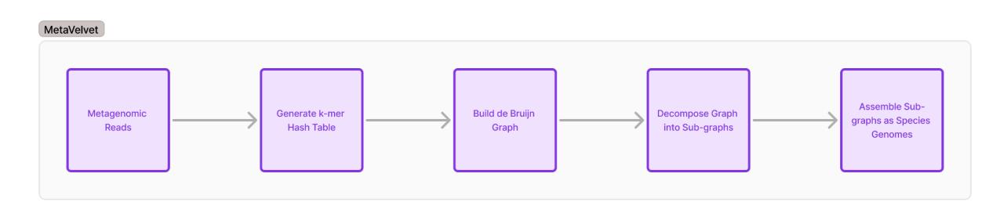

# Developing Distributed Algorithm for Metagenomic Error Correction and Assembly

Contributor Name: Gauri Ket

Contributor Email: gauriket@gmail.com

Contributor GitHub: <https://github.com/gauriket>

Contributor LinkedIn:

<https://www.linkedin.com/in/gauri-ket-877296220/>

Potential Mentors: Arghya Kusum Das (akdas -at-

alaska.edu) and Yali Wang (ywang35 -at- alaska.edu

# SYNOPSIS

# Abstract

Metagenomic assembly plays a crucial role in understanding microbial communities but is often constrained by data complexity and volume. This project proposes the development of a distributed algorithm for error correction and assembly for metagenomics. By developing distributed algorithms, we aim to handle large-scale datasets efficiently while ensuring accurate contig and scaffold generation for downstream analysis. The project also explores the potential of AI/ML techniques to enhance error correction and taxonomic classification. The outcome will be a scalable and high-performance solution tailored to the demands of modern metagenomics research.

# Problem

Reconstructing genomes from mixed microbial communities is a complex task, primarily due to:

- 1. Fragmentation: Short shotgun sequencing reads often lead to incomplete assemblies, with millions of contigs in diverse datasets.
- 2. Error Misclassification: Low-abundance species in a dataset are frequently misidentified as sequencing errors by existing tools.
- 3. Scalability: Most assemblers are optimized for single-node systems, making them inefficient for terabyte-scale datasets. They can't handle large scale data due to memory constraints.
- 4. Long Processing Times: Current algorithms struggle with large datasets, leading to excessive runtimes and computational inefficiency.

These issues demand a scalable solution that maintains accuracy while accommodating the complexity of metagenomic datasets.

# Background

Metagenomics has transformed how we study microbial ecosystems, especially in extreme environments like Alaska. These discoveries have far-reaching impacts on climate science, healthcare, and even mineral extraction. However, assembling metagenomic data is a major computational challenge due to the sheer volume of data, repetitive sequences, and high strain variability.

Strains are genetic variants of microorganisms like bacteria, viruses, or fungi, and even within the same species, they can have significant genetic differences. These variations influence traits such as antibiotic resistance and environmental adaptability. Identifying strains in metagenomic data is particularly tricky because their genomes often overlap, and horizontal gene transfer further complicates the reconstruction process.

# Comparison with Existing Tools

### Velvet

Velvet (Zerbino & Birney, 2008) employs de Bruijn graphs for short-read genome assembly, including steps such as graph construction, error correction, simplification (removing tips and resolving bubbles), and contig extraction. However, it assumes a single genome, making it ineffective for metagenomic samples.

# MetaVelvet

MetaVelvet (Namiki et al., 2012) extends Velvet by using coverage-based binning, iterative graph partitioning, and contig refinement to improve species separation, though it struggles with scalability. De novo genome assembly with de Bruijn graphs remains challenging for mixed genomic content, as tools like SPAdes (Bankevich et al., 2012) have difficulty distinguishing species-specific reads. MetaSPAdes (Nurk et al., 2017) addresses this by decomposing graphs into species-specific subgraphs, further refined through coverage- and GC content-based clustering (Peng et al., 2010). Paired-end sequencing, as in Ray (Boisvert et al., 2012), improves assembly accuracy. MEGAHIT (Li et al., 2015) leverages parallel computing with frameworks like Dask for scalability. Error correction techniques from Velvet (Zerbino & Birney, 2008) and SPAdes, such as tip removal and bubble resolution, enhance genome reconstruction.

## Solutions

This project focuses on developing a distributed algorithm to improve metagenomic error correction and assembly. The key features include:

#### 1. Distributed Computing:

- Utilize frameworks like Dask or Spark to distribute computations across multiple nodes, overcoming memory and processing limitations.
- Ensure scalability to handle terabyte-scale datasets efficiently.

#### 2. Improved Error Correction:

- Design robust statistical methods to retain low-abundance species and avoid misclassification of critical data.

#### 3. Optimized Assembly:

- Develop algorithms to generate accurate and biologically meaningful contigs and scaffolds.
- Minimize fragmentation while improving the quality of sequencing that will in turn improve taxonomic and functional annotations.

#### 4. Optional Enhancements:

- Explore GPU acceleration for computationally intensive tasks like sequence alignment and graph traversal.
- Investigate the use of machine learning models to refine error detection as well as identify patterns.

#### 5. Validation:

- Benchmark the performance of the new algorithm against existing tools using real and synthetic datasets.
- Evaluate its accuracy, runtime, and scalability, ensuring meaningful contributions to the field of metagenomics.

This solution directly addresses the challenges of fragmented assemblies, scalability, and computational efficiency, providing a practical tool for metagenomic researchers.

# BENEFITS TO COMMUNITY

### 1. Develop a High-Performance, Scalable Solution:

Build a cutting-edge metagenomic assembly tool that leverages distributed computing and is fully optimized for HPC environments. The tool will be designed to efficiently

process massive datasets, overcoming the limitations of existing single-node assemblers and enabling global adoption in high-volume research settings.

#### 2. Implement Novel Approaches to Error Correction:

Introduce innovative error correction techniques that account for low-abundance species and complex strain variability. These methods will ensure retention of critical genomic information often lost in traditional pipelines, while minimizing false-positive corrections in diverse metagenomic datasets.

### 3. Streamline Data Processing with AI and GPUs:

While optional, this project will explore the integration of machine learning for adaptive error detection and GPU acceleration for computationally heavy tasks, such as sequence alignment and graph assembly. These enhancements aim to future-proof the tool by incorporating emerging technologies.

### 4. Promote Open Science and Accessibility:

Release the tool as open-source software with thorough documentation, making it accessible to researchers from diverse disciplines and resource settings. By emphasizing modularity and user-friendliness, the project will encourage widespread adoption and customization to suit unique research needs.

### 5. Drive Impact in Microbiome Research and Beyond:

Equip researchers to analyze large-scale datasets efficiently, facilitating groundbreaking discoveries in fields like climate change, healthcare, sustainable agriculture, and environmental monitoring. The tool will also serve as a foundational framework for future innovations in metagenomic analysis.

# DELIVERABLES

### Distributed Error Correction Module:

- Develop a robust algorithm for error correction, specifically designed for the complexities of metagenomic datasets.
- Address key challenges such as retaining low-abundance species, managing high strain variability, and reducing false-positive corrections.
- Validate the algorithm's performance using both synthetic and real-world datasets.

### Comprehensive Assembly Pipeline:

- Implement an end-to-end pipeline that integrates the error correction module with metagenomic assembly.

- Construct de Bruijn graphs tailored for high-complexity datasets, with species-level separation to minimize cross-contamination.
- Generate biologically meaningful contigs and scaffolds suitable for downstream taxonomic classification and functional analysis.

### Scalability and Performance Optimization:

- Optimize the entire workflow for distributed and parallel computing environments, ensuring compatibility with HPC clusters and cloud-based platforms.
- Leverage frameworks such as Dask, Apache Spark for efficient task distribution.
- Benchmark the solution's scalability, runtime, and resource efficiency across diverse hardware configurations.

### GPU/AI-Enabled Enhancements (Optional):

- Explore GPU acceleration for computational bottlenecks like sequence alignment and graph traversal.
- Investigate the use of machine learning to dynamically identify patterns in genomic errors, improving correction accuracy.

### Comprehensive Documentation and Testing Suite:

- Provide detailed documentation, including setup guides, algorithm design explanations, and performance benchmarking.
- Create user-friendly tutorials with step-by-step examples using sample datasets.
- Develop a robust testing suite with unit tests, integration tests, and scalability tests to ensure reliability in diverse use cases.

# TIMELINE

### Community Bonding Period (Pre-Coding Phase)

- Duration: 3 Weeks
- Goals:
- Build a strong understanding of the project goals by engaging with mentors, reviewing relevant literature, and exploring existing workflows and tools within the organization.
- Identify key integration points for the deliverables to ensure seamless alignment with the broader ecosystem.

- Participate in community discussions, gather feedback, and finalize the approach to error correction and assembly.
- Familiarize myself with sample datasets.

### Phase 1: Distributed Error Correction Module

- Duration: Weeks 1–5
- Weeks 1–2:
- Design and implement a distributed k-mer counting algorithm optimized for metagenomic datasets.
- Address challenges like managing memory usage across distributed systems and handling low-abundance species.
- Weeks 3–4:
- Develop error correction algorithms that account for metagenomic complexity (e.g., strain variability, repeats).
- Test the module using synthetic datasets to ensure accuracy and scalability.
- Week 5:
- Integrate error correction into the pipeline and validate performance using benchmark datasets.
- Document initial results and gather feedback from mentors and the community.

### Phase 2: Metagenomic Assembly Pipeline

- Duration: Weeks 6–10
- Weeks 6–7:
- Implement species-specific graph decomposition algorithms using distributed frameworks.
- Optimize graph construction for scalability while maintaining assembly accuracy.
- Weeks 8–9:
- Develop algorithms to generate contigs and scaffolds from the graphs.

- Test assembly quality using real-world metagenomic datasets and evaluate biological significance.
- Week 10:
- Conduct comprehensive scalability tests on HPC clusters and cloud platforms to benchmark performance.
- Refine the pipeline based on test outcomes and mentor feedback.

### Phase 3: Validation, Documentation, and Final Submission

- Duration: Weeks 11–12
- Validation:
- Compare the performance (accuracy, scalability, and runtime) of the developed solution against existing tools.
- Validate biological relevance using taxonomic classification and functional annotation metrics.
- Documentation:
- Write comprehensive user and developer documentation, including setup guides and tutorials.
- Prepare an FAQ section and troubleshooting guide for potential challenges users might face.
- Community Engagement:
- Share results and insights with the community via presentations or blog posts.
- Incorporate final feedback from mentors and peers.
- Submission:
- Submit the final project deliverables, including source code, datasets, test cases, and all documentation.

# RELATED PRE-PROPOSAL WORK

I have contributed to the repository of the Metagenomics Error Correction and Assembly project by University of Alaska Fairbanks (UAF). The project focuses on utilizing graph-based methods to improve the assembly of metagenomic data by addressing errors, repeats, and separating mixed-species genomes.

### Algorithm Overview

The primary algorithm I have worked on involves constructing a De Bruijn graph from k-mers derived from metagenomic reads. The steps for decomposing the graph into species-specific sub-graphs are outlined in the diagram below:

|Aspect My Code Velvet | MetaVelvet |
|--------------------------------- | ----------------- |
|Purpose Distributed de Bruijn |  |
|graph-based assembly for |  |
|metagenomic error correction |  |
|and assembly. |  |
|assembly for |  |
|bacteria and small |  |
|assembly | for mixed |
|genomic | reads. |
|Resolving sequencing errors, |  |
|handling metagenomic |  |
|diversity, and improving contig |  |
|sequencing errors |  |
|and repeats in |  |
|Avoids | chimeric |
|contigs | caused by |
|conserved | or |
|repetitive | regions |
|shared | across species. |
|Constructs de Bruijn graph |  |
|from k-mers, annotates nodes |  |
|with coverage, GC content, |  |
|and paired-end data, and |  |
|clusters kmers based on these |  |
|De Bruijn graph of |  |
|k-mer overlaps in |  |
|a single genome. |  |
|metagenomic | graph |
|into | subgraphs per |
|species | using |
|coverage | binning. |
|Uses clustering (coverage, GC |  |
|content, paired-end) to resolve |  |
|repeats and ambiguous nodes |  |
|before contig generation. |  |
|Uses paired-read |  |
|information to |  |
|resolve repeats. |  |
|Handles | cross-species |
|repeats | by separating |
|reads | into |

| | species-specific graphs. |
|------------------------------------------ | ----------------------------------------- |
|Output Contigs for metagenomic |  |
|datasets, refined using error |  |
|correction and clustering. |  |
|Contigs for |  |
|Contigs individual genomes. | for mixed-species metagenomic datasets. |
|Applications High-throughput metagenomic |  |
|assembly, error correction, and |  |
|taxonomic classification. |  |
|(bacteria, yeast, |  |
|Metagenomic Single-genome assembly | analysis, taxonomic |
|classification, | and |
|gene eukaryotes). | prediction. |
|Handles large-scale, |  |
|error-prone, and highly diverse |  |
|datasets efficiently using |  |
|distributed computation. |  |
|Issues with |  |
|repeats larger |  |
|than k-mer size |  |
|paired-end data. |  |
|Resolves Assembly | challenges in |
|separating Challenges | genomes |
|from without | mixed-species datasets. |
|Performance Optimized for distributed |  |
|computing, leveraging Dask |  |
|for parallelism and clustering |  |
|techniques for refinement. |  |
|Highly efficient for |  |
|datasets with high |  |
|Optimized | for |
|unevenly single-genome | distributed, |
|diverse coverage. | metagenomic datasets. |

# Graph Decomposition and Contig Formation Pipeline

### Step 1: Parse Reads from FASTQ

- Input: A FASTQ file containing sequencing reads.
- Process: Extract raw nucleotide sequences from the file.
- Output: A list of DNA sequences.
- Example: ["ATGCGTAC", "TACGTGCA", "GCGTACGT"]

### Step 2: Construct de Bruijn Graph

- Input: Reads and k-mer size (k).

- Split each read into overlapping k-mers (length k).
- Each k-mer becomes a node, and directed edges connect consecutive k-mers.
- Output: A directed graph with k-mers as nodes and overlaps as edges.
- Example (k=4): "ATGC" → "TGCG" → "GCGT" → "CGTA" → "GTAC"

### Step 3: Annotate Nodes with Coverage

- Input: Reads and k-mer size (k).
- Count occurrences of each k-mer in all reads.
- Higher counts suggest a k-mer appears frequently, indicating possible high-abundance sequences.
- Output: A coverage table mapping each k-mer to its frequency.

|K-mer | Coverage |
|------- | ---------- |
|ATGC | 1 |
|TGCG | 1 |
|GCGT | 2 |
|CGTA | 2 |
|GTAC | 2 |
|TAGC | 1 |

#### Step 4: Cluster Nodes by Coverage

- Input: Coverage table from Step 3.
- Use K-Means clustering to group k-mers based on coverage (read depth).
- Separates k-mers into different clusters, potentially distinguishing species or genomic regions.
- Output: K-mer clusters grouped by coverage.

- Cluster 0 (low coverage): ["ATGC", "TGCG"]
- Cluster 1 (high coverage): ["GCGT", "CGTA", "GTAC"]

#### Step 5: Refine Clusters Using GC Content

- Input: K-mer clusters from Step 4.
- Further divide clusters based on GC content to improve species separation.
- Output: More refined clusters.
- Cluster 0 (low GC): ["ATGC", "TGCG"]
- Cluster 0 (high GC): ["GCGT"]
- Cluster 1 (low GC): ["GTAC", "TACG"]
- Cluster 1 (high GC): ["CGTA"]

### Step 6: Leverage Paired-End Reads

- Input: Clustered k-mers, paired-end reads.
- Ensure that reads from the same DNA fragment remain in the same cluster.
- Output: Corrected clusters with consistent paired-end read assignments.
- Example: If "ATGC" is in Cluster 0, then "CGTA" (from its paired read) should also be placed in Cluster 0.

#### Step 7: Handle Ambiguous Nodes

- Input: Clustered k-mers.
- Identify k-mers appearing in multiple clusters and resolve conflicts.
- Remove ambiguous k-mers or assign them based on adjacency.
- Output: Cleaner clusters with minimal overlap.
- Example: If "GCGT" appears in both clusters, it is either reassigned or removed from ambiguous positions.

#### Step 8: Extract Sub-Graphs

- Input: Refined clusters.
- Generate subgraphs by keeping only k-mers within the same cluster.
- Output: Smaller, species-specific subgraphs.
- Example: Cluster 0:
- "ATGC" → "TGCG" → "GCGT"
- Cluster 1:
- "CGTA" → "GTAC" → "TACG"

#### Step 9: Remove Tips

- Input: de Bruijn graph.
- Step 9a: Identify dead-end nodes (tips) with low coverage.
- Step 9b: Remove tips shorter than a threshold (e.g., < 3 k-mers).
- Output: Graph with fewer dead-end sequences.
- Example: ATGC → TGCG → GCGT CGTA → GTAC → TACG (TACG is a tip and gets removed)

#### Step 10: Remove Bubbles

- Input: de Bruijn graph.
- Step 10a: Detect diverging paths that lead to the same k-mer.
- Step 10b: Collapse bubbles based on sequence similarity and coverage thresholds.
- Output: Graph with collapsed alternative paths.
- Example: Original graph:

ATGC → TGCG ↘ ↘ CGTA → GTAC

- After bubble removal:
- ATGC → TGCG → GTAC

#### Step 11: Build Contigs

- Input: Cleaned de Bruijn graph.
- Traverse the graph to form the longest contiguous sequences.
- Identify paths that can be merged into larger contigs.
- Repeat Steps 8-11 iteratively until no further changes occur.
- Output: Final contigs representing assembled genome sequences.

ATGC → TGCG → GCGT → CGTA → GTAC

Contig: "ATGCGTAC"

#### Step 12: Output Results

- Subgraphs: Saved as subgraphs_output.txt.
- Contigs: Saved as output/cluster_0_contigs.txt.

## RELATED WORK

Existing assemblers, such as SPAdes (Bankevich et al., 2012) and MEGAHIT (Li et al., 2015), struggle with large-scale metagenomic datasets. SPAdes uses a multi-k-mer approach and iterative error correction, making it effective for bacterial genomes but inefficient for large datasets due to single-node constraints. MEGAHIT, designed for scalability, employs a succinct de Bruijn graph (SdBG) to reduce memory usage and leverages parallelization but remains limited to single-machine execution. Other tools like MetaSPAdes (Nurk et al., 2017), Ray Meta (Boisvert

et al., 2012), and IDBA-UD (Peng et al., 2012) introduce improvements but face challenges such as high communication overhead and limited parallelization.

# BIOGRAPHICAL INFORMATION

## Educational Background

I am currently pursuing a BTech in Computer Science and Engineering at MIT World Peace University, Pune, with a CGPA of 9.28. Throughout my academic journey, I have developed a strong foundation in various technical domains, particularly in machine learning, computer vision, and natural language processing.

# Technical Interests: Skills and Relevant Projects

My technical expertise spans several programming languages such as C, C++, Java, Python, and JavaScript, as well as key frameworks and libraries like FastAPI, ReactJS, TensorFlow, PyTorch, and Keras. I am proficient in working with databases like MySQL, MongoDB, and JsonPowerDB, and have experience with tools such as Docker, MLFlow, Apache JMeter, and Tableau. My interests lie in MLOps, Gen AI, Large Language Models (LLMs), computer vision, CNN, RNN, GANs, and NLP. Additionally, I am adept at data visualization and prototyping, and my work often includes testing with frameworks like JUnit5.

Notable projects include my ongoing Metagenomics project with the University of Alaska Fairbanks, where I am using distributed computing techniques to enhance metagenomic sequence construction. I have also worked on various machine learning and computer vision projects such as Basket Trajectory Prediction and Facial Emotion Recognition.

# Communication: Preferred Hours Are Flexible

I value effective communication and am always open to collaboration, feedback, and idea-sharing. I am adaptable to flexible hours, ensuring I can accommodate diverse schedules and be available for the 35 hours a week requirement for this project.

# More About Me

In addition to my technical expertise, I have demonstrated leadership as the President of the Numerates Club at MIT-WPU, where I successfully organized events that engaged over 500 participants and managed a team of 20+ members. My experiences also include participating in hackathons such as AI4ALL and Hack-Commerce, where I received recognition for my innovative projects. Outside of work and academics, I enjoy exploring new technologies, contributing to impactful research, and collaborating with teams to solve complex problems.

# POST GSOC PLANS

After completing GSoC, I plan to leverage the experience and knowledge I gain to continue contributing to open-source projects regularly. Although I've been working on public projects for about a year, I only recently became aware of the vibrant and vast community behind many of the tools I use. I look forward to showcasing my work, encouraging others to join the mission, and contributing to more projects to broaden my expertise.

Furthermore, I am excited to help my juniors prepare for next year's GSoC. I plan to introduce them to the world of open source, assist them in getting started with relevant projects, and guide them in collaborating with the community. This way, I can help others build their journey while continuing to contribute to the broader open-source ecosystem.