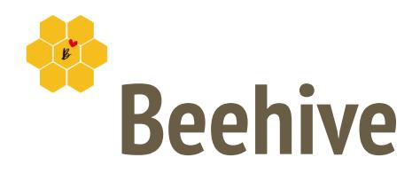
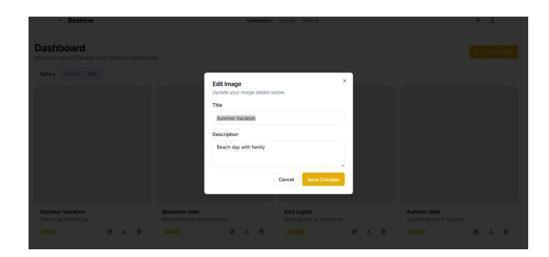
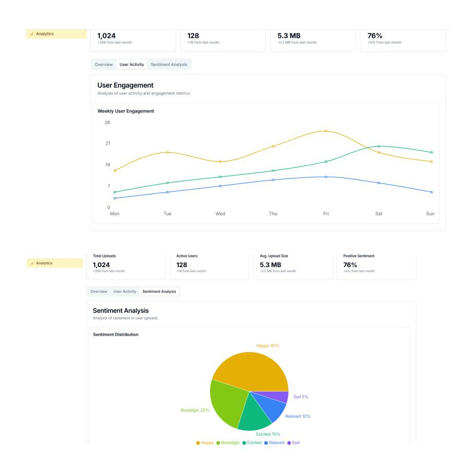

Google Summer of Code'25 Proposal

# Overview

I am Ishaan Gupta an active contributor to the Project idea #6 for Beehive - A Data Federation Approach to Analyze Behavioral Health and Supplement Healthcare Practice with Community Health Metrics in Alaska.

# Project Summary:

This project, a collaboration between the University of Alaska Anchorage Departments of Computer Science and Human Services, seeks to create a digital approach to translating the digitalization of art and photographic images into a digital database that stores in retrievable formats those images for use in advancing the delivery of human services and health care to people who experience considerable vulnerability and marginalization within the community. One of the project goals is to create a digital repository of these images, many of which reflect Outsider Art since the people who produce them are not formally trained as artists and experience considerable discrimination.

# Contributor Email and GitHub ID:

Email ID:- ishaankone@gmail.com and ishaan.gupta.ug22@nsut.ac.in

Github ID:- ishaanxgupta

# Mentor(s):

- 1. David Moxley
- 2. Pradeeban Kathiravelu

# Contributions:-

Total PRs: 34 (31 Merged)

Total issues:- 30

|Pull | Request | and | Issue Links | Small Description Status |
|------ | --------------- | ---------------- | ------------- | ------------------------------------------ |
|1. | Issue :- | Add Docker | Support |  |
|PR | :- | Containerize | the | application |
| | using | Docker |  |  |
| |  |  |  | Added Docker support to containerize |
| |  |  |  | the application, making it easier to |
| |  |  |  | deploy and manage dependencies. |
|2. | Issue:- Fix | Responsiveness |  | issue |
|PR:- | Add | Responsiveness | & | Add |
| | Responsivness | 2 |  |  |
| |  |  |  | Enhanced the responsiveness of various |
| |  |  |  | pages to ensure a better user |
| |  |  |  | experience on different screen sizes. |
|3. | Issue:- Add | Voice | memos | for Art |
|PR:- | Enable | Voice | Narratives | for |
| |  |  |  | Implemented a feature to allow users to |
| |  |  |  | add voice memos alongside their art |
|4. | Issue:- | Sentiment | Tagging |  |
|PR:- | Add | Sentiment | as | Metadata |
| |  |  |  | Introduced sentiment tagging to analyze |
| |  |  |  | and store the emotional tone of uploaded |
|5. | Issue:- | Automate | Code | Linting & |
|PR:- | Enforce | Code | Quality | with |
| | Pre-commit | Hooks |  |  |
| |  |  |  | Automating code linting and formatting |
| |  |  |  | using Flake8 and Black. This also sets |
| |  |  |  | up pre-commit hooks to enforce code |
| |  |  |  | quality before commits. |
|6. | Issue:- | Forgot | Password | Feature |
|PR:- | Add | Forgot | Password |  |
| | mechanism | & Refine | the |  |
| |  |  |  | Added a forgot password mechanism |
| |  |  |  | with necessary security improvements. |
|7. | Issue:- | Feature | suggested | by |
|PR:- | Enable | Admin | Manual |  |
| | Password | Reset |  |  |
| |  |  |  | Provided admins with the ability to |
| |  |  |  | manually reset user passwords when |
|8. | Issue:- | Download | Image | option |
|PR:- |  | Download Image | button | for |
| | Users and | Admins |  |  |
| |  |  |  | Implemented a button allowing users |
| |  |  |  | and admins to download uploaded |
|9. | Issue:- | Preview for | PDFs |  |
|PR:- | Preview | for PDFs | in |  |
| |  |  |  | Added a feature to preview PDFs in |
| |  |  |  | thumbnail form before opening them. |

| | thumbnail | form |  |
|---------- | ----------- | -------------- | -------------------------------------------------------------- |
|10. | Issue:- | Footer | Design |
|PR:- |  | Designed a | Responsive |
| |  |  | Designed and implemented a responsive |
| |  |  | footer for all pages. |
|11. | Issue:- | Logo | suggestions |
|PR:- | Design | Beehive | Logo |
| |  |  | Crafted and brain-stormed the Logo. |
| |  |  | Added logo in svg and png formats in |
| |  |  | different sizes that can be used across |
| |  |  | the application. |
|12. | Issue:- | Update | User Credentials |
|PR:- | Enable | In | session update |
|email | and | password | feature |
| |  |  | Allowed users to update their email and |
| |  |  | password within an active session. |
|13. | Issue:- | Improve | Admin Table UI |
|PR:- | Modify | card | version to admin |
|table | & | Responsive | Design |
| |  |  | Refactored the admin table and card |
| |  |  | layouts for improved readability and |
|14. PR:- |  | Download | Button for admins |
|to | download | users | details in .csv |
| |  |  | Enabled admins to download user |
| |  |  | details as a CSV file for easier data |
|15. PR:- | Filtering |  | options to admins Introduced filtering options for admins to |
| |  |  | efficiently manage users and content. |
|16. | Issue:- | Crafter | the Loader |
|PR:- | Loader | on | the Upload button |
|for | client | side | validation |
| |  |  | Added a loading indicator to the upload |
| |  |  | button for better client-side validation. |
|17. PR:- | Add | workflow | diagram for |
|new |  | developers |  |
| |  |  | Created a workflow diagram to help new |
| |  |  | developers understand the project's |
| |  |  | structure and contribution process. |
|18. PR:- | Bug | Notification | persist on |
| | Home | page |  |
| |  |  | Fixed an issue where notifications would |
| |  |  | persist incorrectly on the home page. |
|19. PR:- | Add | /login | Test Unit test to check proper rendering for |
| |  |  | /login button |
|20. PR:- | Add | Auth | Tests Integration tests for checking auth routes Merged |
|21. PR:- |  | Enhance | Logout Button Craft a Logout Button for better UI/UX Merged |
|22. PR:- | Fixes | minor | bug on profile |
| | image | upload |  |
| |  |  | Minor Bug fixes Merged |
|23. PR:- | Add | Route | Tests Removed the index_test file and added a |
| |  |  | Route testing file, which will have all the |

| | tests for | routes. |  |  |  |
|-------------------------------------- | -------------- | --------------- | -------------- | ---------- | --------------- |
|24. PR:- Add Testing Documentation | Added | documentation |  | for | new |
| | contributors | so | that | they can | run the test |
|25. Issue:- Add github workflows for |  |  |  |  |  |
|PR:- Add a Greetings bot |  |  |  |  |  |
|The | bot | displays | a | greeting | message to |
|new |  | first-time | contributors |  | on issues and |
|26. PR:- Add Code review bot , |  |  |  |  |  |
|Modifications in the Bot |  |  |  |  |  |
| | Code | review bot | using | gemini | for |
| | complete | PR | summaries, |  | code reviews |
|and | issue |  | assistance |  |  |

### Unplanned Issues/Suggestions :

|SR No. Issue Link Status |  |  |  |  |  |
|----------------------------------------------------- | ---- | ----------- | ---------- | --------- | -------- |
|1. AI/ML-based checker for flagging |  |  |  |  |  |
|inappropriate images |  |  |  |  |  |
|Closed | as | not | Planned, | may | be |
|needed |  | for large | user | base |  |
|2. Multi-lingual Support for Alaskan Natives Closed | as | not | Planned |  |  |
|3. Enhance Image Gallery for users Closed | as | not | Planned |  |  |
|4. Unit and Integration Testing Closed | to | implement |  | in GSOC | period |
|5. Github Actions CI/CD pipeline Closed | to | implement |  | in GSOC | period |
|6. Better Approach for storing Image |  |  |  |  |  |
|Metadata in MongoDB |  |  |  |  |  |
|Closed | to | implement |  | in GSOC | period |
|7. Add edit modals for image uploads Open | to | implement | in | GSOC | period |
|8. Add Custom questions according to image |  |  |  |  |  |
|Open | to | implement | in | GSOC | period |

#### Discussions:

| | Discussions |  |  | Description |  |  |
|---- | --------------- | ----------- | ------------------------ | -------------- | ---------------------- | ------------------------- |
|1. | Migration | of UI | from flask to React.js | Proposed | a transition | to React or Next.js |
| |  |  |  | would | give us better | UI control, improved |
| |  |  |  | performance, | and | long-term scalability. |
|2. | Deployment |  |  | Future | Enhancement | Ideas |
|3. | Developing | a | Mobile App for Beehive | Proposed | a need | to develop a Mobile App |
|4. | Auth | Migration | and Discussion | Suggestions | for | better Authentication |
|5. | #15 sentiment |  | analysis Model | & Model |  |  |
| |  |  |  | Workflow | for Sentiment | Analysis Model |
|6. | Improve | Storage | Implementation | Storage | Enhancement | Ideas |
|7. | Deployement |  | Plans | Cloud | Provider Suggestions |  |

Apart from my contributions to Beehive, I also found Project #14 very interesting and completed Code Challenges #1, #2 and #3.

Here is the for the code challenges: Code Challenges

# Project Goals:-

My vision for Beehive is to develop a make it a fully scalable web application with a robust and responsive UI, ensuring seamless user experience across all devices. The platform will be powered by a fully automated flask backend with high security, scalability, and efficiency.

Additionally, a mobile application will be developed to enhance accessibility, allowing users to capture and upload photos on the go for a more streamlined and convenient experience. This will ensure Beehive remains versatile and user-friendly across both web and mobile platforms.

## 1. Change Logic for storing image Metadata in MongoDB

<https://github.com/KathiraveluLab/Beehive/issues/137>

As advised by Mentor Pradeeban, we have to map each image metadata with the MongoDB's generated UserID.

Here is a snippet of how this can be implemented:-

## 2. Revamping the User Interface

- ➔ The existing UI is not fully responsive or scalable, limiting user experience across different devices. Migration to a better tech stack and making the UI more robust. ➔ Proposed solution
- i. Tech Stack: React.js or Next.js
- ii. Styling: Tailwind CSS with shadcn for better UI consistency and component reusability ➔ Tried to Present with a proposed UI Design for Beehive at Page 6 of this proposal.

## 3. Implementing a More Efficient Authentication System

➔ Migrating to a well-established authentication provider will enhance security and simplify user management.

### Potential Solutions:

|authentication, making it |  |  |
|--------------------------------- | ------ | ------------------------------------ |
|easy to integrate. |  |  |
|Built-in user management |  |  |
|Supports |  | social logins, build |
|in | user | management |
|dashboard |  | etc. |
| |  | Supports social logins, |
| |  | password-based, OTP, and |
| |  | magic links, Reset password |
|Limited backend control Limited |  | Control Native PostgreSQL database |
| |  | for fine-grained access |
|Supports 10k Users Supports |  | 50k Users Supports 50k Users |

From my perspective Supabase is much cheaper for scale and allows more fine grained access Control and supports more Users. So it will be the best option for us.

Supabase can be easily used as a serverless option, API based system.

## 4. Modularizing the Backend

```text
➔ Currently, the backend logic is **monolithic and lacks modularization**, making it harder to maintain and scale. Breaking it down into **smaller, independent modules** will improve efficiency, readability, and extensibility. ➔ Issue assigned:- [Issue](https://github.com/KathiraveluLab/Beehive/issues/93) #93 /Beehive │── /static │── /templates │── /uploads │── /routes # Route files (organized per feature) │ │── __init__.py │ │── image_routes.py # Routes for image uploads and management │ │── user_routes.py # User-related routes │ │── auth_routes.py # Authentication routes │ │── admin_routes.py # Admin Routes │── config.py │── app.py # Main application file │── requirements.txt │── Dockerfile │── docker-compose.yml
│── .github/workflows # GitHub Actions CI/CD workflows │── README.md
```

## 5. Unit and Integration Tests

➔ To ensure the stability and reliability of Beehive, we will implement a robust testing strategy using Pytest-Flask for the backend and Jest/React Testing Library for the frontend. ➔ Test individual functions, API endpoints, and database operations. ➔ Test how different components interact (e.g., React UI ↔ Flask API ↔ MongoDB). ➔ Goal is to achieve atleast 50% coverage on Unit test and 60% on integration Tests. ➔ If time permits, Will definitely increase the coverage percentage

#### Database Interaction and Validation tests:-

## 6. Deployment

➔ Develop CI/CD pipelines (example shown below) ➔ Docker Setup again for the new UI- As done before will have to setup docker for new frontend. ➔ Testing on Cloud Platforms(AWS):-

We can use AWS EC2 and AWS Lambda for backend testing. The testing environment will be similar to production.

Instance: t3.micro (free-tier)

➔ Deployment Strategy:-

|Component | Deployement | Platform |
|--------------------- | ------------- | ---------- |
|React or Next.js UI | Vercel |  |
|Flask Backend | Render |  |
|MongoDB | MongoDB | Atlas |

### CI/CD pipeline Examples:-

Automated Testing Pipeline Code Quality and Formatting Pipeline

#### Outcome:

- If someone pushes unformatted code, the pipeline fails before merging.
- If any test fails, the PR won't be merged.

For deployment, we will be using the free-tier services only, but the CI/CD pipeline can be built for the future when we want to deploy on cloud platforms. Testing can be done for cloud-platform compatibility if time permits.

## 7. Ideas from Project 15 make beehive store Time-order-related (If time Permits)

When storing images, we have two options for timestamps:

- Upload Time: The time when the image was uploaded.
- Captured Time: The actual time when the photo was taken (from metadata).

For sentiment analysis over time, the best choice is captured time, as it reflects real events rather than upload delays.

Most images contain EXIF metadata, which includes the captured timestamp.

## 8. Perform sentiment analysis (if time Permits)

With reference to my plan on issue:-

<https://github.com/KathiraveluLab/DREAMS/issues/1>

## 9. Setup Mobile App (if time Permits)

#### Discussion Link : Suggestion by Pradeeban

Transitioning Beehive into a mobile application would significantly enhance user experience. A mobile app would allow users to click and upload photos directly from their phones on the go, making it more efficient and convenient to operate. By leveraging smartphone capabilities, users can quickly document and submit images, ensuring real-time data collection without needing to transfer files manually.

#### Offline Mode with Auto-Sync :

Users can capture and store images offline, and the app will auto-upload them once connected to the internet.

#### Proposed tech stack:

Frontend: React Native (cross-platform support for Android & iOS)

Backend: Flask (existing Beehive backend)

Database: MongoDB/Supabase for seamless data storage and authentication

#### Authentication Pages UI

#### User profile dashboard



#### Re s p o n s i v e D e s i g n


#### A d m i n D a s h b o a r d : -



# Project Timeline

This is the timeline that I think is suitable. If, for any reason, a task is taking too long or cannot be completed, I will contact the mentor and after discussing the reason and explanation, suitable action will be taken (i.e. it will be decided whether it is fruitful to continue to work on that subproject or it would be more beneficial to take on next task and complete the former later). Hopefully, there will be no need to abandon any task. Also if any task needs to be rescheduled(due to its importance), that can done after proper discussion from the mentor.

## I. Community Bonding Period [8 May to 1 June]

➔ Engage with mentors and further familiarize myself with the codebase. ➔ Discuss the preferred UI tech stack and authentication provider to ensure alignment with project goals. ➔ Discuss Development Plans and execution strategy.

➔ Since I am already a past contributor, this phase will be relatively brief, allowing me to focus on project discussions and planning.

## Phase 1: UI/UX Design & Authentication Setup

## II. Week 1 [2 June to 8 June]

- Craft The UI/UX designs for web app.Have a Look for the proposed Design on Page Number 6 of this proposal
- Gather feedback from the mentor and refine the designs accordingly
- Ensure the designs are fully responsive across different screen sizes.
- Start implementing the authentication UI in the selected tech stack.

## III. Week 2 [9 June to 15 June]

- Set up authentication for both users and administrators using the chosen provider
- Implement the UI for authentication pages (Login, Signup, Forgot Password, etc.).
- Integrate features such as Google authentication, password reset, and email verification
- Ensure Responsiveness and Conduct thorough testing of authentication workflows.

## Phase 2: User & Admin Dashboards

## IV. Week 3 [16 June to 22 June]

- Develop the User Profile Dashboard with necessary UI components.
- Setup Upload Image Modal with proper metadata requirements
- Integrate these features with the database for seamless data storage and retrieval.

- Ensure Responsiveness and Perform comprehensive testing to identify and fix potential issues.

## V. Week 4 [23 June to 29 June]

- Set up the Admin Dashboard with role-based access.
- Implement admin user management functionalities.
- Ensure Responsiveness and Conduct extensive testing to verify functionality and security.

## VI. Week 5 [ 30 June to 6 July]

- Conduct a final round of UI testing to ensure smooth integration with the backend and authentication systems.
- Change Backend Logic to map MongoDB's userID with each uploaded Photo
- Perform end-to-end testing to identify and resolve any remaining issues.

MidTerm: Till this time Complete UI setup for Admin and User Side with proper Auth Setup and Responsive Design. Proper integration with Database and fully working Site

## Phase 3: Testing and Automation

## VII. Week 6 [7 July to 13 July]

- Implement unit testing for critical features.
- Implement integration testing for API calls and database integrations
- Achieve a decent coverage for both Unit and integration testing

## VIII. Week 7 [14 July to 20 July]

- Modularize app.py by breaking it down into separate, maintainable modules.
- Ensure proper code structure, readability, and scalability.
- Perform comprehensive testing using already setup Unit and Integration tests

## Phase 4: Deployment

## IX. Week 8 [21 July to 27 July]

- Setup CI/CD pipelines using Github Actions.
- This will automate the process of testing, formatting etc before merge.
- Document the CI/CD setup and provide contributors with guidelines for smooth integration.

## X. Week 9 [28 July to 3 August]

- Deploy the developed software to various platforms as per the decided strategy.
- Perform extensive testing to ensure functionality, performance, and security post-deployment.
- Fix any deployment-related issues or optimisations
- Document the Deployement strategy and guidelines

## XI. Week 10 [4 August to 10 August]

- Act as a buffer period to complete any pending work or resolve unexpected challenges.

- Conduct additional testing, debugging, and optimization for a stable and polished release.
- Finalize documentation
- If ahead of schedule, start working on the mobile app UI or integrate sentiment analysis in Project #15.

I would like to work on the project even after the GSoC season and plan to:-

➔Complete the Mobile app development ➔Develop Data Mining approach for Sentiment as well as Time Ordering analysis. ➔Stay Connected with the Open Source Community

# Planned GSoC work hours:

To achieve the above outcomes it will take 350 hrs (35 hrs per week for 10 weeks)

# Planned absence/vacation days and other commitments during the GSoC period (including the community bonding period):

No other commitments during GSoC period.

# More about ME:

I am a pre-final year student at Netaji Subhas University of Technology, New Delhi, majoring in Computer Science with a minor in Data Science. My strong academic background, including excellent grades in Distributed Computing, Data Mining, and Probability & Statistics, Data Structures and Algorithms, Data Handling and visualization Tools makes me a strong candidate for contributing to this project.

I am an active open-source contributor, with over 100+ commits, 50+ pull requests and 60+ issues & discussions across various projects.

My experience in collaborating with diverse teams, reviewing code, and implementing scalable solutions has strengthened my ability to contribute effectively to open-source communities.

Additionally, I interned at Protean E-Gov during the summer of 2024, where I worked on unit testing for a government project, ensuring reliability and robustness in mission-critical applications. Also built scalable solutions for different projects.

Please find enclosed my CV and Letter of Recommendation from previous internship at Protean.

CV:
- Resume
- Ishaan Gupta
- Software Developer.pdf

LOR:- Ishaan Letter of Recommendation.pdf

# Describe other open source development experience:

Aossie.org has been one of the organisations in which I have contributed, apart from Alaska.

My contributions spanned UI/UX design, backend integration, and AI-powered functionalities.

### 1) BabyNest

Description:- This is a React Native app integrated with an AI-powered assistant. This intelligent assistant acts as a personal pregnancy planner and guide, ensuring that expecting parents stay informed, organised, and stress-free.

#### Contribution:-

- 1. BrainStorm the UI/UX design for the app on Canva and Figma and translated it into a functional interface.
- 2. Set up SQLite as the local database and integrated the frontend with the backend.
- 3. Optimised an LLM model to run offline, achieving a 450MB model size while maintaining high accuracy for on-device AI assistance.

#### Reference PRs:

➔ PR #2 Merged ➔ PR #31 Merged ➔ PR #35 Merged

### 2) InpactAI

Description:- Inpact is an AI-powered creator collaboration and sponsorship matchmaking platform designed to connect content creators, brands, and agencies through data-driven insights.

#### Contribution:-

- 1. Designed and developed the complete UI for the influencer-facing side, ensuring an intuitive and engaging user experience.

#### Reference PRs:

➔ PR #14 Merged ➔ PR #35 Merged ➔ PR #43 Merged

### 3) DebateAI

Description:- DebateAI is an interactive, AI-enhanced debate game platform designed to improve users communication skills through structured competitive debates.

#### Contribution:-

- 1. Designed and implemented the User vs AI debate interface, ensuring seamless interaction.
- 2. Developed the backend logic for real-time communication using WebSockets in GoLang to support interactive AI-driven debates.

#### Reference PRs:

➔ PR #40 ➔ PR #44

# Skill Set:

Programming Languages: C, C++(Data Structures and Algorithm)

Frameworks: JavaScript, Typescript, React.js, Node.js, WebSockets, Redis, Tailwind CSS, Bootstrap, MUI, React Native

Programming Libraries: Numpy, Pandas, Matplotlib, Sci-kit Learn, Streamlit

Python Web Frameworks: Flask, FastAPI, Django

Database Management Systems: MySQL, MongoDB

Academic Coursework: OOPs, Operating Systems, Database Management Systems, Computer Networks, Big Data Analytics, Distrbuted Computing, Data Mining, Probability and stochastic Processes

Unit Testing Frameworks: Jest.js, React testing Library

Version Control: Git,Github

I started contributing to open source in Dec'24 and made my first contribution in Alaska. I have been actively contributing since then. It has been a great experience to work with such a great community and incredible mentors. I have learned a lot about the importance of writing clear commit messages, maintaining a clean commit structure, writing clean maintainable code, working with version control, properly addressing feedback on pull requests, and explaining my ideas clearly to other people. Since I started contributing to Alaska, I have always admired its well-structured codebases and research element in projects that directly affect the masses. I have always loved building large projects and solving the obstacles that come while implementing features in these large projects.