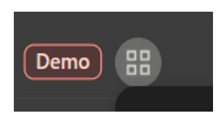
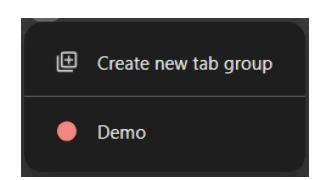
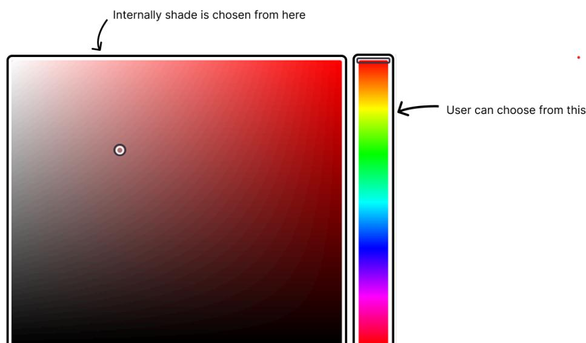
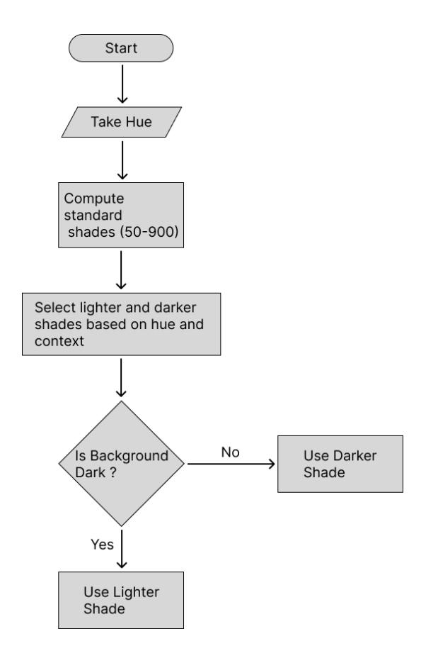
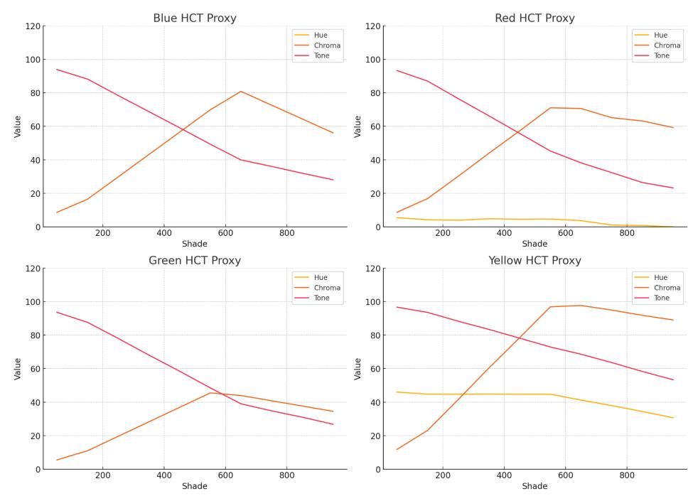

# Chromium GSoC Contributor Proposal Template

Summary self

GSoC proposal - Jay Kapadia

The main goal of this project is to add third-party theme support for Tab Group colors in Chromium. Currently, Tab Groups are limited to nine predefined colors. This project aims to extend the theme API to allow third-party extensions to define custom color palettes for Tab Groups.

Owner: jaykapadia389@gmail.com Contributors: Jay Kapadia

Approver:

dpenning@google.com

agale@google.com

Created: 23/03/25

## Project Abstract

Chrome allows users to personalize their browsing experience through extensions and themes. While themes can change the look and feel of the browser, Tab Groups currently offer only a fixed set of nine color options with no support for customization.

This project focuses on improving that by expanding the theme API to support Tab Group color customization. The idea is to give theme developers the ability to define their own set of colors for Tab Groups, making the browser's interface more flexible and expressive. Importantly, this change will not aim to support customizing the number of tab group colors.

By opening up Tab Group styling to third-party themes, this project aims to make Chrome more adaptable to different visual preferences, offering users a deeper level of customization without changing core behavior. This project will also improve user productivity by allowing them to set tab group colors in a more meaningful way.

## Background

Chrome allows customization of the browser through Chrome extensions, which can modify both functionality and appearance. The Get Started guide on "Chrome for Developers" explains the various components that make up an extension. However, extensions that specifically change the browser's

appearance—known as theme extensions—only require a manifest.json file and/or some images.

The What are Themes? page details how theme extensions are created. Theme customization is controlled through the theme key in the manifest.json file. When the extension is loaded, Chrome's theme system parses the manifest.json and applies the defined theme. However, the API only supports a limited set of predefined keys and values to customize the browser's appearance, such as the "colors", "tints", "images" and "properties".

Currently, this API does not support customization of Tab Group colors. The Tab Group color palette offers only nine predefined colors that users can choose from, without the ability to define custom colors. This project aims to enhance the theme API by introducing support for third-party customization of Tab Group colors, giving users greater flexibility and control over their browsing experience.

## Design Ideas

## Understanding the tab group colors

Each color in the color palette is used at many different places in the browser, and all have different representations.

As seen in the images, the same color has different representations. Somewhere it is lighter and somewhere it is darker.

## Why is that?:

Depending on the location the colors need more or less contrast. In the tab strip, the goal is to create high contrast. So, they try to create a greater difference in the darkness between the tab group header and the background. In the bookmark bar, the goal is to create less contrast, So, they choose a shade that has less difference in the darkness with the background.

According to the picture above, a user chooses from the area on the right and leaves it to the system to choose shades from the area at the left.

#### How does it do it?:

There are pre-defined shade-constants for a limited number of colors. For instance, these are the shade-constants for the color - red:

The different representations of red tab group color are chosen from these limited shade-constants. The recipe for choosing a color is as below:

As seen in the image, the function takes two hand-picked shades - one is lighter shade and the other is a darker shade. The function also takes the background-color. Based on whether the background color is dark, it chooses from the lighter and darker shade. Example,

## Extending the idea

Currently, there are only 9 colors that one can choose from the area at right (Color space image). We need to provide support such that we can choose any color from that area and the shades are generated programmatically as we do not have shade constants for every single color.

In technical terms, the area at right is called Hue. However, hue is not a complete color. It is just one component of the color. In order to make it complete we need Chroma and Tone (considering the HCT color space).

### High level solution:

So, the idea is to let the theme developer provide a hue to define the color instead of a complete color, like RGB. And using this hue we can generate the standard shades (50,100, …, 900). Then pass two appropriate shades to a similar transform that selects the shade based on the background color/mode.

## Designing the API

As discussed already, we want to take hue from the theme developer. Hue is defined from 0 to 360. Where 0 and 360 represent the same color, i.e. red. So, the theme developer can choose from 0 to 359 for defining a color. However, if the theme-dev wants to choose grey/black, it is not possible as grey/black is the absence of hue. So, we can use -1 to indicate grey/black. Using this the theme-dev can choose any color using [-1, 359].

### Justification of the structure:

- Partial customization: A JSON format makes it easier to override specific colors. For example, if a theme developer wants to change only the last color, they don't have to specify placeholders for all the previous colors like they would in a list format.
- Logical grouping: Defining hues in a JSON format helps keep the tab group color settings grouped together in a clean and structured way.
- ● Backward compatibility: The existing "colors" key expects RGB/RGBA values. Placing the new structure inside "colors" would break themes on older versions of the browser. Keeping it separate avoids this issue.
- Scalability: If more color options are added in the future, the JSON format can easily accommodate them without breaking the structure or requiring major changes.

## Implementation

#### 1) Parsing/Validating

First the manifest.json is parsed and the "theme" section is stored in the manifest object as is, without any validation. Only when the Parse() function of theme_handler.cc is called the individual sections ("colors", "tints", "images" and "properties") of the theme are validated and the themeInfo object is created. We need to add support for validating the new key "tab_group_color_palette" that we just placed inside "theme".

#### ● Updating the Parse() function:

We will add a function call to LoadTabGroupColorPalette() inside the Parse function:

#### ● LoadTabGroupColorPalette() function definition:

This function takes the theme_dict Dict, and populates the

theme_tab_group_color_palette_ member of theme_info if all the values inside the "tab_group_color_palette" section are valid and populates the error message otherwise.

#### ● Add the new "tab_group_color_palette" key and error message in manifest_constants.h:

To maintain consistency with other Load* functions, which reference key names and error messages from manifest_constants.h, the new key and its corresponding error message will also be defined there.

- Add new member - theme_tab_group_color_palette_ Dict in ThemeInfo class: To store the tab group color palette defined in the manifest, a new member theme_tab_group_color_palette_ of type Dict will be added to the ThemeInfo class.

#### 2) theme_info -> themepack

ThemeInfo stores the theme data, but it is still not ready to be used to apply a theme. The theme_tab_group_color_palette_ dictionary member in ThemeInfo should be used to generate the shades, and these shades will be stored in the theme pack so they can actually be used. This final version is also what gets written to disk when saving the theme.

#### ● Design the data-structure:

There is a data-structure corresponding to every key in "theme". This data structure stores the theme to be applied. A similar data-structure should also be defined for the new key "tab_group_color_palette".

We have to generate 11 shades for the following 9 ColorIds:

- kColorTabGroupTabStripFrameActive[color] 1
- kColorTabGroupTabStripFrameInActive[color] 1
- kColorTabGroupDialog[color] 2 for dark and light modes
- kColorTabGroupContextMenu[color] 2 for dark and light modes
- kColorSavedTabGroupForeground[color] 1
- kColorSavedTabGroupOutline[color] 1
- kColorTabGroupBookmarkBar[color] 1
- kColorThumbnailTabStripTabGroupFrameActive[color] 1
- kColorThumbnailTabStripTabGroupFrameInactive[color] 1

To store all these ColorIds and corresponding shades to the theme pack, the proposed data-structure is the following struct:

We will use a vector of such a struct to store the shades of all the hues defined in the manifest. This vector will be named tab_group_color_palette_ for consistency and declared as a member of BrowserThemePack.

#### ● Translation (hue -> tab_group_color_palette_ member):

#### ○ Compute Standard Shades (50-900):

Each predefined shade constant (ranging from 050 to 900) represents a specific level of darkness for a color. When these RGB values are converted to the HCT color space, they follow a characteristic curve in terms of Chroma (C) and Tone (T).

To efficiently reproduce these standard shades for any hue, we can extract and store the corresponding Chroma and Tone values in a map. This map can then be used to generate a full shade palette by combining the target hue with the predefined chroma and tone values.

#### ○ Generate TabGroup Specific Shades From Hue:

Once we have the standard shades for a hue, we can use these shades to specify the tab group specific shades (11 shades as mentioned earlier).

For that we will use a function called GenerateTabGroupShadesFromHue() which internally calls ComputeStandardShadesFromHue(), then for each of the 11 shades we define a recipe. These shades are then returned as a map.

The standard shades that we use as lighter shade and darker shade in the Transform depends on the hue and the context. So, a helper function is used to decide the shade which is to be used as lighter shade and for the darker shade.

### ○ SetTabGroupColorPaletteFromJSON() function definition:

Other keys in the theme use a function to translate their theme_info Dict and fill their theme pack data structures, for example SetColorsFromJSON(). We will create a similar function to fill the new tab_group_color_palette_ member of BrowserThemePack.

This function iterates over the key-value pairs in

tab_group_color_palette_value dictionary, where the key is identification of the slot in the color palette (e.g. "palette_color_3") and the value is a hue. The hue is used to generate all the required shades using

GenerateTabGroupShadesFromHue(). The

GenerateTabGroupShadesFromHue() function takes in a hue and returns a map of 11 shades. Then we create an instance of the data-structure we just created (TabGroupShades struct) and populate it with appropriate ColorIds and shades.

### ● Calling the translation function.

The translation functions for the current keys are called in BrowserThemePack::BuildFromExtension(). So, we need to call the new SetTabGroupColorPaletteFromJSON() translation function too.

#### 3) Appling the colors

All the colors have been computed and stored in the tab_group_color_palette_ member of BrowserThemePack. Now, these colors need to reach the ColorProvider so that the UI elements can request their respective colors from the ColorProvider.

Whenever the render process is initiated AddChromeColorMixers() is called. This function first adds the default color mixer and then one-by-one adds the other mixers. Finally, it adds a mixer corresponding to the custom theme. For that it uses

BrowserThemePack::AddColorMixers().

We will update the same AddColorMixers() and add the new recipes for the ColorIds that are customized by the hue.

## 4) Storing the theme pack

When the theme pack is created using BuildFromExtension(), it is stored on the disc so that it can later be used. This is done to avoid processing the theme data again and again. We need to update the BrowserThemePack::WriteToDisk() function to enable storing the new tab_group_color_palette_ data structure.

## 5) Retrieve theme pack from the disk

We also need to update the BrowserThemePack::BuildFromDataPack() to create the theme pack from the data stored on the disk.

## Properties of Design

- ● Scalable -The design is inherently extensible. In case the number of colors in the tab group color palette changes in the future, or if the displayed colors become customizable (e.g., allowing users to choose 10 out of 12), the system can handle it gracefully without requiring any changes.

- ● Partial Update -If the theme developer wants to modify only a few colors, the system supports it in a simple and convenient way without needing to redefine the entire palette.
- ● Old browser support Themes using this new API are backward-compatible. When applied in older versions of the browser, unsupported fields will be ignored gracefully, and the rest of the theme will continue to work without any issues.
- ● Abstraction The shade generation algorithm is built with clear abstraction layers, making it easier to maintain or update individual components. If a better algorithm is introduced in the future, it can be easily integrated without affecting other parts of the system. This also allows for experimentation with different color generation strategies without needing to refactor the entire pipeline.

## Code Affected

- ● extensions/common/manifest_constants.h
- ● chrome/common/extensions/manifest_handlers/theme_handler.h
- ● chrome/common/extensions/manifest_handlers/theme_handler.cc
- ● chrome/browser/themes/browser_theme_pack.h
- ● chrome/browser/themes/browser_theme_pack.cc
- ● New or existing test files

## Alternatives Considered (Optional)

There are three high-level approaches to this problem. One has been discussed in detail as the main solution. The remaining two alternatives are described below:

## 1) Taking one color from the theme developer

We could allow the theme developer to provide a single color, which would then be applied across all relevant UI components. However, this solution falls short because different UI elements (like the tab strip, dialog, context menu, etc.) often require subtle visual distinctions. Using the same color everywhere can lead to a flat, unbalanced appearance that lacks depth and fails to provide appropriate visual hierarchy.

### 2) Taking all shades from the theme developer

Another option is to require the theme developer to define all the shades explicitly. While this provides full control, it places a heavy burden on the developer to carefully design and manage 11 different shades. This is neither user-friendly nor scalable. A better approach is a hybrid model, where the system generates the shades automatically, but the developer has the option to override specific ones if needed. This balances automation with customization and is more practical in most scenarios.

## Related Work

Most modern browsers today, like Chrome, Brave, and Edge, offer some form of tab grouping with a limited set of predefined colors. Firefox has a similar feature hidden behind a feature flag, but none of these browsers currently let users fully customize tab group colors. There's no option to define your own colors or generate adaptive palettes that fit the rest of the UI.

This project aims to take Chromium a step ahead by allowing users to not only set custom tab group colors but also have the browser automatically generate consistent, harmonious shades from those colors.

| |  | Feature | Chrome / Edge / Brave Firefox | This Project |
|---------- | ---------- | ------------------------------ | ------------------------------- | -------------- |
|Tab | grouping |  | ✅ ✅ | ✅ |
|Fixed | color | palette | ✅ ✅ | ✅ |
|Full | color | customization | ❌ ❌ | ✅ |
|Dynamic |  | shade generation | ❌ ❌ | ✅ |
|UI-aware |  | adaptive colors (light/dark) | ❌ ❌ | ✅ |

When it comes to generating dynamic colors, systems like Material You on Android 12+ do create themes based on things like wallpaper, but those are meant for broad UI theming and not specific to browser elements like tab groups. Other methods—like using dominant colors from images or procedural algorithms—aren't really optimized for usability or accessibility in a browser setting.

The approach in this project is more targeted. It uses the HCT (Hue-Chroma-Tone) color model to generate a full set of shades from a single hue, and then chooses shades intelligently based on the UI context (like light or dark mode). This gives us greater control over contrast, visual hierarchy, and overall user experience—something no other browser currently offers.

## Pre proposal Work

- ● Starter Bugs Completed:
- 1) Implement character/size limit for tab group header title (Reviewed)
- 2) Add support for closing tab groups via middle mouse click (Reviewed)
- 3) Create a cool 3rd party theme (Reviewed)

#### ● Understanding of GSoC project

Through these starter bugs and detailed research, I've built a strong understanding of the project. I focused on completing as many starter bugs as possible and managed to finish 3 out of 4. These tasks helped me gain experience with writing production-level code and tests. I'm now confident in writing tests and navigating large parts of the Chromium codebase.

I also explored how the project handles themes in detail. This includes how the manifest.json is parsed, how the theme data is extracted, and how it's eventually applied. I dug deep into the Color Pipeline and learned how different components like ColorProvider, ColorMixers, ColorRecipe, and Transforms work. I explored how the different shades for tab group colors are generated and understood the logic behind it. I also studied how colors work in general so I can design an effective and modern color generation algorithm for this project.

### ● Pre-GSoC period

Even before the GSoC projects were announced, I had been contributing to Chromium for a few months. This helped me understand what it's like to work in a large open-source project. During this time, I learned:

- C++ development.
- Using the version control system(git) effectively.
- I Learned about cross platform development.
- I Learned about build-systems.

List of Contributions So Far (9 Total):

- 1) Implement character/size limit for tab group header title (Reviewed, GSoC starter bug)
- 2) Add support for closing tab groups via middle mouse click (Reviewed, GSoC starter bug)
- 3) Create a cool 3rd party theme (Reviewed, GSoC starter bug)
- 4) Fix FATAL crash on creating new tab group (Merged)
- 5) Override UpdateAccessiblecheckedState in ColorPickerElementView (Merged)
- 6) Remove "chrome::" namespace (set 1) (Merged)
- 7) Remove "chrome::" namespace (set 2) (Merged)
- 8) Remove "chrome::" namespace (set 3) (Merged)
- 9) Remove "chrome::" namespace (set 4) (Merged)

## Schedule of Deliverables (timeline)

This is a small size project (~90 hours) and the time period for small size projects is 8-12 weeks. I will plan the deliverables according to the 12 week period.

## May 8 - June 1 (Community Bonding Period)

As I have already been contributing to Chromium, I am familiar with the community and its coding practices. I will use this time to plan ahead and ensure the project progresses smoothly during the coding period.

### ● Week 1 - 2 :

#### ● Week 3:

Identify potential edge cases and plan strategies to handle them effectively..

## June 2 - July 18 (Phase I)

- ● Week 1:
- ○ Write the validation function (LoadTabGroupColorPalette) to validate the new key "tab_group_color_palette", and write its corresponding tests.
- Update manifest_constants.h with the new key and error message
- ● Week 2:
- Finalize the data structure (tab_group_color_palette_) that will represent the tab group shades inside the theme pack. The structure will be designed to ensure it can be easily iterated, stored to disk, and retrieved efficiently. A clean separation between single-variant and double-variant colors will be maintained for better organization and maintainability.
- ● Week 3:
- Decide the fixed values of the CTmap, which maps shade levels to chroma–tone pairs. These values will be carefully selected to replicate the behaviour of current shade constants.
- Then, implement the ComputeStandardShadesFromHue() function, which uses this map to generate standard shades for a given hue.
- ● Week 4-5:
- Write GenerateTabGroupShadesFromHue() function.
- Refine the implementation for PickDarkness() function.
- ● Week 6:
- Modify AddColorMixers() to include color recipes for the tab group color IDs from tab_group_color_palette_, so that these custom colors are applied properly throughout the UI.
- By this point, the core functionality should be in place, so I'll also start testing to ensure everything works as expected.

## July 19 - Sept 1 (Phase II)

- ● Week 1:
- Update the WriteToDisk() and BuildFromDisk() functions to support storing and retrieving the updated theme pack, including the new tab group color palette.
- ● Week 2:
- Address accessibility considerations to ensure the feature is inclusive and compatible with assistive technologies.
- ● Week 3-4:

- Write tests to cover all newly added functionalities and ensure stability.
- ● Week 5:
- Document all the work clearly so that future contributors and maintainers can easily understand the implementation and build upon it if needed.
- ● Week 6 (Final week):
- Buffer period to handle any delays or last-minute adjustments.

## Sept 1 - November 9 (For Extended Timelines)

For small size projects there are no extended timelines.

## Communications

I am comfortable with any communication channel. For text communication, I prefer Slack, Discord, and Email. For video calls, I prefer using Google Meet.

During the summer, as I will have no academic commitments, I will be dedicating 40-50 hours per week (approximately 7-8 hours on weekdays and 5-6 hours on weekends). In case of any delays, I will promptly communicate with my mentors to discuss the issue and find a solution. I am also willing to work overtime if necessary to meet the project goals. I have also set aside the final week of the timeline as a buffer to accommodate any unforeseen delays or adjustments.

- Timezone: GMT +5:30 (Indian Standard Time
- Working Hours:7:30 AM 3:30 PM PST (Pacific Standard Time
- Email: jaykapadia389@gmail.
- Phone: +91 8401112097
- Slack: jaykapadia389@gmail.
- Discord: jay.k17

## About Me

My name is Jay Kapadia, and I am a third-year Computer Engineering student at Vishwakarma Government Engineering College, India — a reputed government institution. Throughout my academic journey, I have consistently engaged in projects and activities aimed at enhancing my skills and applying my knowledge in real-world scenarios.

## Personal Projects

In my first year of college, I took the initiative to learn full-stack web development. I built a feature-rich article publishing web application using the MERN stack (MongoDB, Express.js, React.js, Node.js). The platform allows users to post articles, add comments, like, and save their favorite posts. Through this project, I gained hands-on experience with REST APIs, database management, and UI

design, further strengthening my web development skills.

GitHub Repository: BlogSpot

## Hackathons

I actively participate in hackathons to challenge myself and collaborate with peers. During the Smart India Hackathon, my team and I developed a Deepfake detection system using Deep Learning. The project utilized Convolutional Neural Networks (CNNs) to detect manipulated facial features in video frames, achieving high accuracy in identifying deepfakes. Our project qualified at the institute and university levels.

GitHub Repository: Deep Fake detector

## Experience with C++

I have been practicing Data Structures and Algorithms (DSA) in C++ for the past three years, honing my problem-solving and optimization skills. This experience enables me to write efficient and scalable code, which is essential when contributing to large-scale projects like Chromium.

Additionally, I have been actively contributing to Chromium, working on C++ codebases related to UI components, theming, and bug fixes. Through these contributions, I have gained practical experience in collaborating on large open-source projects, adhering to code review standards, and making meaningful improvements to the Chromium ecosystem.

#### Key Qualities

I am highly consistent and possess a dedicated mindset. I take ownership of my work and am committed to delivering results within the given timeframe. You can rely on me to stay focused and ensure the successful and timely completion of the project.

Resume

## Prior Experience with open source

Chromium is my first open-source organization. Over the past five months, I have actively contributed code to the Chromium project and supported beginner contributors through the chromium-dev mailing list. My consistent involvement has led to nominations for try-job access and bug edit access—both of which I now hold.

List of Contributions. So Far (9 Total):

Currently, I am working on this bug:
- Creating new tab or copying url on unfocused window doesn't refocus the new window [[369422246]](https://issues.chromium.org/issues/369422246)
- Chromium

## Why Chromium?

I chose Chromium for my Google Summer of Code project because I wanted to work on something that has a real-world impact. Chromium powers Google Chrome and many other leading browsers, reaching billions of users worldwide. The idea that my contributions could directly improve the experience of so many people is what drew me to it.

Another reason is that I wanted to move away from high-level development like web apps and dive into low-level programming. I've been practicing C++ for several years, mainly for data structures and algorithms, and I was eager to use it for actual development. Chromium's large-scale C++ codebase seemed like the perfect fit to apply and expand my skills in a more meaningful way.

Finally, I was looking for a challenging project—something that would push me beyond my comfort zone. Chromium's complexity, performance-critical features, and the need to understand intricate systems made it exactly what I was looking for. Through this project, I hope to become a better problem solver, learn how large-scale open-source projects operate, and contribute to something that truly makes a difference.

## Feedback from Chromium

If you read this document please provide your short general feedback in the section below. Please also feel free to make comments above.