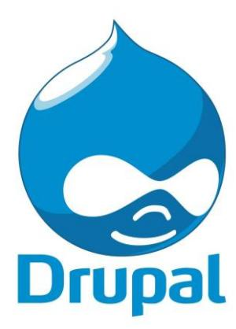

#### Google Summer of Code 2025 Proposal Drupal - Assisting Modules in Drupal 11 Compatibility.

## Personal Information

- Name: Rajas Samse
- Email: samserajas@gmail.com
- School/University: Symbiosis Institute of Technology
- Graduation Date: June 2026
- Major/Focus: Artificial intelligence and machine learning
- Which country do you live in? India
- What timezone is that in? IST (Indian Standard Time, UTC+5:30)
- to your Drupal.org profile: Rajas-samse
- What is your Drupal Slack ID? U04LCSGL47R
- Preferred time of day for virtual/video interview: Afternoon 12.00pm to 6.00pm IST

#### GSOC Information

- Have you participated in Google Summer of Code previously? Yes, I attempted Google Summer of Code 2024 with Drupal but missed the slot. I actively contributed to the Drupal community during my previous attempt and participated in discussions.

- Are you applying to any other organizations this year? If so, please explain. No, I am only applying to Drupal this year, as I have built a strong foundation within the community. My main goal is to become a Drupal developer.
- How many hours will you devote to your GSoC project each week? What are your other summer plans? I plan to dedicate approximately 35-40 hours per week to my GSoC project. My summer will primarily be focused on GSoC.
- Have you registered an account at Drupal.org and joined groups.drupal.org/googlesummer-code? to your account please! Yes, my Drupal.org profile: My-account.
- Have you ever worked with Git? Yes, I have extensive experience with Git for version control. •

#### Question based on knowledge of Git:

You just committed some code (and not pushed yet), but you realized there is a typo in the commit message. How would you change it (please explain each step of the solution)?

To modify the commit message before pushing:

1.Use the command: git commit --amend -m "Corrected commit message" 2.The commit message editor opens, modify the message and save it. 3.Push the commit using git push --force if it has already been pushed. • Have you ever contributed code to Drupal? If you have, tell us about it. Yes, I have contributed code to Drupal. I've attached some of my contributions to Drupal. My contributions also can be found on my Drupal profile.

|# | Contribution Type | Description | Status | Link |
|--- | ---------------------- | --------------------------------------- | ----------- | ------------ |
|1 | Bug Fix | Fixed the incorrect FontAwesome class |  |  |
| |  |  | Merged | Issue Link |
|2 | Documentation Update | Updated the README.md file for the |  |  |
| |  | to align with the official Drupal |  |  |
| |  |  | Merged | Issue Link |
|3 | Blog Post | Wrote a detailed guide on building a |  |  |
| |  |  | Published | Blog Post |
|4 | Community Engagement | Assisted newcomers in understanding |  |  |
| |  | Drupal development and resolving |  |  |

Table 1: Drupal Contributions

- Do you plan to continue contributing to the Drupal project after GSoC is finished?

Yes, I plan to continue contributing to Drupal even after GSoC. My main goal is to become a Drupal developer, and I also plan to acquire the Acquia certification for Drupal.

- Have you ever built a Drupal site or helped on a Drupal project? Yes, I have worked on Drupal projects. And helped many to set up the Drupal core and Drupal development.
- If you have not previously contributed to any open source projects, can you provide example code from school? Not applicable, as I have contributed to open-source projects.
- Question based on given 'almighty function' Given the PHP function:

function almighty_function(\$x, \$y, \$z) { if (\$y!= \$z && \$x == \$y && \$x == \$z) { return "Success!"; } return "FAIL!"; }

The function returns "Success!" if:

- – x == y and x == z (which implies y == z).
- – However, there is a contradictory condition: y ̸= z.

Since y ̸= z and x must be equal to both y and z, there is no possible set of values that satisfy these conditions simultaneously. Thus, the function will always return "FAIL!".

- Describe 5 conceptual layers in a Drupal system.
- 1. Presentation Layer: Handles theming and front-end rendering.
- 2. Business Logic Layer: Contains modules and custom logics.
- 3. Configuration Layer: Stores site settings.
- 4. Data Layer: Manages database.
- 5. Services Layer: Provides APIs for integration.

## 1 Which Project Idea Sparks Your Interest and Why?

Drupal is evolving rapidly, with Drupal 11 introducing new features and deprecations. However, many widely used modules are still not fully compatible. This project aims to upgrade and ensure the compatibility of essential modules. For example Node View Permissions module and Search Autocomplete module, for Drupal 11.

This is a direct-impact project because it benefits a large number of Drupal users and site maintainers. Rather than implementing a new feature in isolation, this project actively contributes to the ecosystem by keeping core functionality intact.

# 2 Implementation Plan

Our project will follow a structured and iterative approach to ensure smooth execution and timely completion. Below is an enhanced breakdown of the implementation plan:

Figure 1: System Flowchart for Drupal Module Upgrade

#### 2.1 Development Methodology

- Agile Development: We will divide the project into iterative sprints with continuous feedback.
- Test-Driven Development (TDD): Writing unit and functional tests before implementation ensures stability.
- Version Control & Issue Tracking: Using GitLab/GitHub and Drupal's issue queue for version tracking.

#### 2.2 Implementation Steps

- Module Selection & Analysis
- – Identify modules that require an upgrade.
- – Analyze dependencies, usage, and upgrade feasibility.
- Development Environment Setup
- – Clone module repositories.
- – Configure DDEV for local Drupal development.
- – Install Drupal 10 and 11 for cross-version testing.
- Upgrade Planning for Each Module
- – Identify deprecated APIs and replacements.
- – Update module dependencies and YAML configurations.
- Code Upgrades and Refactoring
- – Replace deprecated hooks, APIs, and functions.
- – Refactor object-oriented structures for better maintainability.
- Automated Testing (Unit & Functional)
- – Write PHPUnit-based unit tests for module functionality.
- – Use Drupal's Kernel & Functional Testing Framework.
- Documentation and Upgrade Guides
- – Update README and upgrade guides for maintainers.
- Final Submission and Review
- – Submit patches/MRs for community review.

- – Address feedback and finalize contributions.

#### 3 Weekly Timeline

- Community Bonding Period
- – Engaging with maintainers and finalize module selection.
- – Set up local environments.
- Weeks 1-2: Initial Research & Setup
- – Analyze module dependencies and compatibility issues.
- – Plan upgrade strategies for each selected module.
- Weeks 3-4: Code Upgrade - Phase 1
- – Upgrade first batch of modules.
- – Run initial tests and fix API compatibility issues.
- Weeks 5-6: Code Upgrade - Phase 2
- – Upgrade additional modules.
- – Enhance test coverage.
- – Get feedback from maintainers.
- Weeks 7-8: Debugging & Documentation
- – Final debugging and bug fixes.
- – Update documentation.
- Weeks 9-10: Community Review & Submission
- – Submit patches for review.
- – Address community feedback.
- Weeks 11-12: Finalization & Wrap-Up
- – Ensure full compatibility with Drupal 11.
- – Submit final report and documentation.

# 4 Expected Deliverables

- Upgraded Drupal modules compatible with Drupal 11.
- Complete unit and functional test coverage.

- Detailed upgrade guides for maintainers.
- Final contribution reports.

# 5 Who are your mentors?

Pooja Sharma

# 6 Which aspect of the project idea do you see as the most difficult?

The most challenging aspects of this project include:

- Handling Deprecated APIs and Major Core Changes
- – Drupal 11 introduces several deprecations and API changes that require careful replacement.
- – Identifying the right replacement functions/hooks without breaking backward compatibility is complex.
- Module Interdependencies
- – Some modules rely on others, requiring careful coordination of updates.
- – Unexpected conflicts may arise when upgrading modules simultaneously.

# 7 Which aspect of the project idea do you see as the easiest?

The easiest aspects of the project include:

- Setting Up the Local Development Environment
- – Using DDEV simplifies local development setup for Drupal.
- – Installing necessary modules and dependencies is straightforward.
- Identifying Modules for Upgrade
- – Since the focus is on modules, researching and selecting modules based on community demand is relatively easy.
- Initial Code Refactoring
- – Minor code changes like updating deprecated function calls, YAML file adjustments, and simple replacements are easier tasks.
- Documentation Updates

- – Once upgrades are implemented, updating README files and upgrade guides is relatively simple.

# 8 Which portion of the project idea will you start with?

The project will start with:

- Module Selection and Compatibility Analysis
- – Research which modules need upgrades and their dependencies.
- – Check for any existing issues or discussions in the Drupal community.
- Setting Up Development and Testing Environments
- – Install Drupal 10 and 11 in a DDEV-based local setup.
- – Configure testing frameworks for unit and functional tests.
- Iterative Upgrade of Remaining Modules
- – Proceed with complex modules after understanding the upgrade process from the first one.

# 9 How will you deal with project, task, and time management? Will you utilize any software?

For effective project management, I will use:

- Trello: For tracking progress and managing tasks.
- GitHub Projects: For issue tracking and collaboration.
- Google Calendar: For scheduling mentor meetings and deadlines.
- Slack: For real-time communication with mentors and the Drupal community.

By following this structured approach, I will ensure smooth execution of the project and timely delivery of the final product.

# 10 TL;DR

This project focuses on upgrading 5 high-impact Drupal modules to ensure compatibility with Drupal 11. The modules were selected based on their community usage, value. The work includes identifying deprecated APIs, implementing replacements, writing automated tests, and ensuring backward compatibility. Additional modules may be upgraded if time permits. This effort aims to reduce technical debt, support the ecosystem ahead of Drupal 11's release, and serve as a reliable foundation for continued community contribution.

#### 11 Selected Modules for Upgrade

Based on discussions and a detailed analysis of impact, the following modules have been selected for the initial phase of the project:

- 1. Node View Permissions (drupal.org/project/node view permissions) This module will allow site administrators to set detailed viewing permissions for individual content types.
- 2. Search Autocomplete (drupal.org/project/search autocomplete) Enhances the search experience by providing real-time autocomplete suggestions as users type into search fields.
- 3. Insert View (drupal.org/project/insert view) Enables embedding of Views-generated content lists directly into node bodies and blocks using simple tag syntax.
- 4. File Entity Browser (drupal.org/project/file browser) Provides a user-friendly interface for browsing and selecting files, featuring a mobileready design and integration with DropzoneJS.
- 5. Localization Client (l10n client) (drupal.org/project/l10n client) Assists in translating site interfaces by offering an on-page editor, allowing users to add translations directly on the website.

#### Optional Modules (Bandwidth Permitting)

If time and resources permit during the coding period, the following modules may also be considered:

- Colorbox Inline
- Migrate Upgrade
- Content Browser
- Lightning Core

These optional modules will be prioritized based on available bandwidth and compatibility status with Drupal 11 at the time of development. The final goal is to deliver high-quality, fully tested, and merge-ready module upgrades that adhere to Drupal community standards, regardless of their final merge status within the GSoC timeframe.

## 12 Biography/About Me

Hello, I'm Rajas, a passionate developer with a strong background in web development. Over the past year, I have gained valuable experience, significantly strengthening my skills. My academic background in Artificial Intelligence and Machine Learning further complements my technical expertise.

I have actively contributed to Drupal and p5.js, working on real-world projects and collaborating with developers worldwide. To deepen my knowledge, I developed a Drupal-based portfolio website, exploring advanced module development and API integrations. This project provided me with hands-on experience relevant to this proposal. View Project

In addition, I contributed to p5.js by improving its WebGL renderer, fixing critical bugs, and enhancing vertex property handling. My pull requests have been successfully merged into the core library, reinforcing my expertise in JavaScript and rendering optimization. View My Merged PR in p5.js

I am also passionate about sharing knowledge. I wrote a beginner-friendly guide on p5.js to help newcomers get started with creative coding. Read My Blog