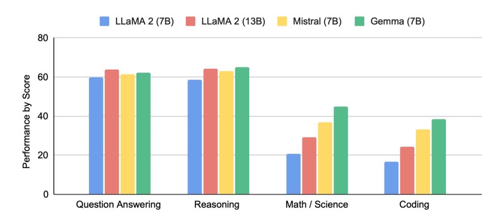

## Comprehensive Benchmark Suite for Evaluating Gemma Models

#### Note: The benchmarking suite described in this proposal has been implemented and is available as an open-source repository on GitHub:

<https://github.com/heilcheng/gemma-benchmark/>

#### Introduction

Large language models (LLMs) are transforming AI research and applications across domains. Google's Gemma models, as lightweight open models derived from the Gemini research, represent a significant step toward democratizing access to high-quality LLMs. However, to effectively utilize these models in research and production, the community needs standardized, comprehensive benchmarking tools that can reliably measure model performance across diverse tasks.



Fig 1. Example of benchmarking: A graph showing language understanding and generation performance of Gemma 7B across different capabilities compared to similarly sized open models.

This project developed a robust, extensible benchmarking suite specifically designed for Gemma models. The suite enables researchers and practitioners to:

- SystemaMcally evaluate Gemma models across standard academic benchmarks.
- Compare different Gemma model sizes and variants.
- Benchmark Gemma against other open models like Llama 2 and Mistral.
- Generate informaMve visualizaMons for easy interpretaMon.
- Automate the benchmarking process with reproducible scripts.
- Provide staMsMcal validaMon of observed performance differences.

This benchmark suite helps fill a critical need in the open model ecosystem, allowing the community to track progress, identify strengths and weaknesses, and guide future development of Gemma models. Furthermore, by creating standardized evaluation methodologies, this project contributes to more reliable comparisons between models developed by different research teams.

#### Relevant Experience and Interest

I am a sophomore majoring in Mathematics and Computer Science at City University of Hong Kong (CityUHK). I am deeply interested in language model evaluation and benchmarking because I believe that understanding the capabilities and limitations of LLMs is essential to developing trustworthy and impactful AI systems—especially in high-stakes domains such as healthcare and education. My passion for interpretability and robustness has been shaped through both academic research and hands-on projects.

My background includes:

- Experience with PyTorch and Hugging Face for training and fine-tuning deep learning models, parMcularly in the domain of speech and text analysis for early disease detecMon as part of a research project at CityUHK.
- Research experience in deep learning for neural acMvity analysis under Professor Tin Chung's lab at CityUHK.
- Proficient in Python soZware development, with strong data visualizaMon skills using libraries such as Matplotlib, Seaborn, and Plotly to present model behavior and evaluaMon results effecMvely.

LinkedIn: <https://www.linkedin.com/in/heilcheng/> GitHub: https://github.com/heilcheng/

# Work Plan

This project developed a comprehensive benchmarking framework for Gemma models with the following components:

## 1. Core Benchmark Framework

A modular Python framework was built to load models, datasets, run evaluations, and collect results. The framework:

- Supports Gemma model variants, with a core focus on the sizes evaluated (e.g., 1B, 2B, 7B).
- Included consideraMon for larger models (e.g., 12B+), but benchmarking them extensively depended on access to suitable computaMonal resources beyond the primary hardware.
- Includes comparable open models (Llama 2, Mistral, etc.) via similar wrapper mechanisms.
- Implements consistent evaluaMon protocols. When comparing Gemma to other model families, the framework acknowledges confounding factors beyond parameter count (architecture, training data, tokenizaMon, fine-tuning). Context is provided for interpreMng cross-model comparisons with appropriate caveats.

#### 1.1 Efficiency Evaluation

The framework includes modules to benchmark computational efficiency. Key metrics measured were:

- Inference Latency: Measured in tokens per second for standardized input/output lengths.
- Peak Memory Usage: Recorded maximum CPU/GPU RAM/VRAM consumpMon during inference using available system tools (e.g., psu\$l, torch.cuda if applicable).

These evaluations were conducted under controlled conditions primarily using the available MacBook M2. Additional tests using cloud GPU resources (like Google Colab's free tier or other accessible platforms) were explored where feasible for comparative data.

- Hardware ReporJng: Efficiency results are reported alongside the specific hardware used (e.g., "Latency on MacBook M2", "Memory usage on MacBook M2", "Latency on Colab T4 GPU" if used).
- Comparability Caveat: These results reflect performance within the specific environments tested. They are valuable for relaMve comparisons on this hardware but are not directly comparable to benchmarks run on dedicated, high-end systems unless equivalent hardware was used.
- Standardized SeLngs: All tests used batch size=1 with consistent prompt lengths and generaMon seengs where applicable.
- An EfficiencyEvaluator class was implemented in tasks/efficiency.py and integrated into the main benchmark runner.

# 2. Academic Benchmark Implementation

Evaluation modules for key academic benchmarks were implemented to assess Gemma's capabilities. The initial implementation focused on:

- Knowledge & Reasoning: MMLU.
- Ques=on Answering: CQA, OBQA, ARC-e, ARC-c, TriviaQA, NQ, etc.
- Coding: HumanEval, MBPP
- Mathema=cal Reasoning: GSM8K, MATH
- General Capabili=es: AGIEval, BBH
- Efficiency Metrics: As described above.

Fig 2. The paper "Gemma: Open Models Based on Gemini Research and Technology "as reference.

# 2.1 Custom Benchmark Implementation

In addition to standard academic benchmarks, this project aimed to incorporate custom evaluation sets tailored to specific capabilities or domains. Examples include domain-specific QA, instruction following fidelity, and safety/robustness probes. These datasets were sourced or generated with clear documentation, and specific evaluation metrics were defined.

# 2.2 Responsible AI Benchmarks

Recognizing the importance of responsible AI development, this benchmark suite aimed to incorporate evaluations focused on potential harms and biases. This included bias measurement (e.g., BOLD, WinoBias) and toxicity detection (e.g., ToxiGen). Implementation involved specific task modules, and results were reported alongside performance metrics.

# 3. Automation Scripts

Scripts were developed to automate model loading, dataset prep, batch evaluation, and results aggregation (scripts/run_benchmark.py, scripts/download_data.py).

# 4. Visualization and Reporting

Visualization and reporting tools were created to generate performance tables and charts (visualization/charts.py). Reporting includes:

- QualitaMve Analysis: SystemaMc error analysis (categorizing reasoning failures, factual errors, etc.) and side-by-side output comparisons.
- Result InterpretaMon Guidance: Clear discussion of benchmark limitaMons and cauMons against oversimplificaMon.

## 5. Documentation and Tutorials

Comprehensive documentation was developed, including setup guides, API docs (implicitly via code comments), methodology descriptions, and environment configuration files (requirements.txt, etc.) for reproducibility.

### 5.1 Open Source and Community Contribution

The suite is open-sourced on GitHub (https://github.com/heilcheng/gemma-benchmark). Compatibility with platforms like Hugging Face Evaluate or submission to public leaderboards can be explored as future work.

## Design and Implementation

## Overall Architecture

The benchmark suite uses a modular architecture:

#### gemma_benchmark/

```text
├── core/ │ ├── __init__.py │ ├── benchmark.py # Core benchmarking framework │ └── model_loader.py # Model loading utilities (using wrappers) ├── tasks/ │ ├── __init__.py │ ├── mmlu.py # MMLU benchmark implementation │ └── efficiency.py # Efficiency benchmarking implementation │ # Add other implemented task files here (e.g., gsm8k.py, humaneval.py if done) ├── utils/ │ ├── __init__.py │ └── metrics.py # Metrics calculation utilities ├── visualization/ │ ├── __init__.py │ └── charts.py # Chart generation └── scripts/ ├── run_benchmark.py # Main benchmark script └── download_data.py # Data download script
```

## Core Benchmark Framework (core/benchmark.py)

The core GemmaBenchmark class handles model loading, task loading, evaluation coordination, and results saving. Results are structured to hold metrics per model per task.

## Model Loader Implementation (core/model_loader.py)

Model loaders (e.g., GemmaLoader, MistralLoader) were implemented using wrapper classes (GemmaModelWrapper, MistralModelWrapper) to abstract the interaction with the underlying models.

## Utility for Metrics Calculation (utils/metrics.py)

Helper functions were implemented to calculate standard evaluation metrics:

- calculate_accuracy(correct, total)
- calculate_f1_score(precision, recall)
- calculate_pass_at_k(n_samples, n_correct, k)
- calculate_execu\$on_accuracy(predic\$ons, references)
- (Add calculate_rouge_score if implemented)
- (Add calculate_bias_score if implemented)

### Benchmark Task Implementation (tasks/mmlu.py)

Each benchmark task is encapsulated in a class (e.g., MMLUBenchmark) responsible for loading data, formatting prompts, running the evaluation loop, processing responses, and returning metrics.

#### Efficiency Benchmark Implementation (tasks/efficiency.py)

The EfficiencyBenchmark class measures latency, tokens per second, and peak memory usage using standard prompts and output lengths.

## Visualization Module (visualization/charts.py)

The visualization module generates standardized reports and visualizations:

- create_performance_heatmap(results, output_path)
- create_model_comparison_chart(results, task_name, output_path)
- create_efficiency_comparison_chart(results, output_path)

#### Main Driver Script (scripts/run_benchmark.py)

The main script ties everything together, handling argument parsing, initialization, benchmark execution, results saving, and optional visualization triggering.

# Testing Plan

A comprehensive testing suite was planned to ensure reliability:

- Unit Tests: Covered model loading, dataset loading, prompt formaeng, and metrics calculaMons.
- IntegraJon Tests: Included end-to-end pipeline tests and config parsing checks.
- Benchmark Correctness Tests: Used mock models with known responses to verify scoring logic.

#### Sources of Risk

#### Technical Risks:

- o ComputaGonal Resource LimitaGons: Benchmarking larger models (7B+) or extensive runs was computaMonally intensive on the MacBook M2. Access to addiMonal GPU resources (e.g., via cloud plaiorms) was idenMfied as beneficial or necessary for evaluaMng larger models or achieving faster turnaround Mmes. MiMgaMons included opMmizing code and clearly documenMng hardware used for each run. o API Changes: Changes in underlying libraries posed a potenMal risk, miMgated by pinning dependencies and using abstracMon layers. o Benchmark Methodology: Ensuring consistency with published benchmarks required careful implementaMon and documentaMon.
- Schedule Risks: o Scope Creep: The risk of adding too many features/benchmarks was managed by prioriMzing the core scope. o IntegraGon Challenges: PotenMal difficulMes integraMng libraries/datasets were miMgated by incremental development.

# Milestones

# Milestone 1: Core Framework and Basic Benchmarks (Target: Week 4)

- o Core framework, loading/evaluaMon for 1B/2B models established. o MMLU implemented. o Basic results collecMon implemented.
- Milestone 2: Comprehensive Benchmark Suite (Target: Week 8) o Implemented remaining core academic benchmarks (Efficiency) for models feasible on available hardware. o AutomaMon scripts developed. o Basic visualizaMon implemented. o Support for Llama/Mistral added. (Confirm implementaGon).
- Milestone 3: Enhanced Features and DocumentaJon (Target: Week 12) o Advanced visualizaMons, reporMng developed. (Confirm). o Efficiency tests run on M2 / other accessible resources. (Confirm). o Responsible AI benchmarks implemented. o Stretch Goal: Benchmarking 12B+ models ajempted if suitable resources were secured. o DocumentaMon, tutorials, environment files developed. o TesMng suite completed.

#### Timeline

- Week 1-2: Setup and Core Framework (Completed)
- Week 3-4: IniMal Benchmarks (Completed MMLU and more - Add others)
- Week 5-6: AddiMonal Benchmarks (Efficiency) (Completed - Add others)
- Week 7-8: AutomaMon and VisualizaMon (Completed)
- Week 9-10: ComparaMve Benchmarking (Completed)
- Week 11-12: Advanced Features (ParGally Completed)
- Week 13-14: DocumentaMon and Refinement

#### Pull Requests

Regular, focused PRs were made throughout the project lifecycle, covering aspects like project structure, core framework, benchmark implementations, automation, visualization, documentation, and refinements.

## Resources Required

The benchmarking suite requires computational resources. The primary development and testing hardware was a MacBook M2 with 16GB RAM.

- Primary Hardware: MacBook M2 (16GB RAM).
- AddiJonal Resources: For benchmarking larger models (e.g., 7B+) or achieving faster execuMon Mmes, access to GPU-accelerated environments (e.g., Google Colab free Mer, other cloud plaiorms, or university resources if available) was beneficial or necessary.
- Benchmarking Scope: o Core Scope Achieved: EvaluaMon (performance, efficiency) was performed for Gemma models (e.g., 1B, 2B) and comparable sizes of Llama 2/Mistral, primarily run on the MacBook M2, supplemented with runs on accessible GPU resources where feasible. o MulMple runs for staMsMcal significance were limited by execuMon Mme on available hardware. o Stretch Goal Outcome: EvaluaMon of 12B+ Gemma models was conMngent on securing access to high-VRAM GPUs, which was beyond the scope of the primary hardware. (State whether external resources were used and if 12B+ was aUempted). Efficiency/staMsMcal validaMon for any larger models tested would likely be limited.
- Storage: ~50GB was esMmated for models, datasets, and results, managed on the local machine and potenMally cloud storage (e.g., Google Drive).
- ConJngency: If benchmarks for desired models (e.g., 7B) proved too slow or memory-intensive on the primary hardware, the focus was narrowed to smaller models (1B/2B), or seeking addiMonal compute resources was necessary to expand coverage.