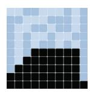
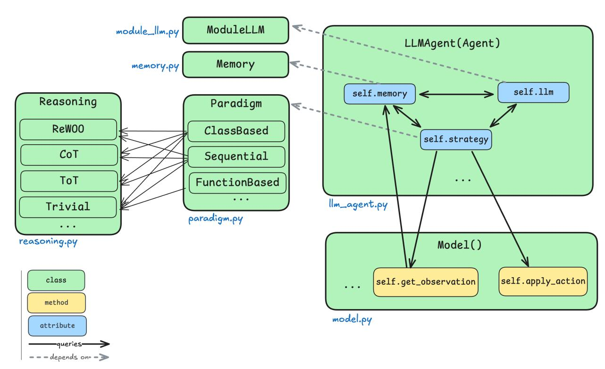
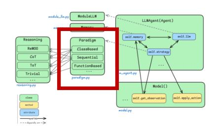
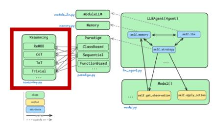
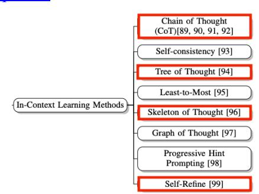
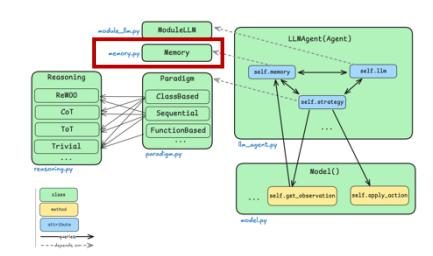
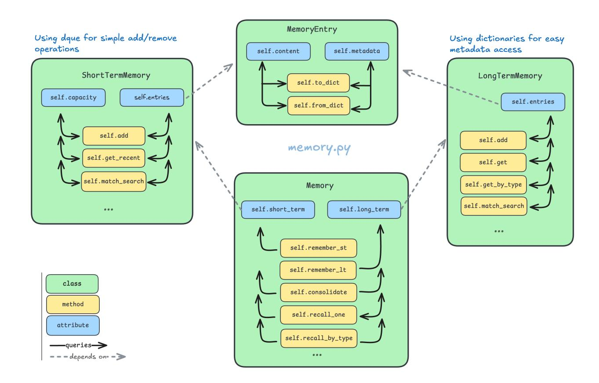
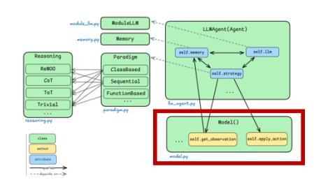
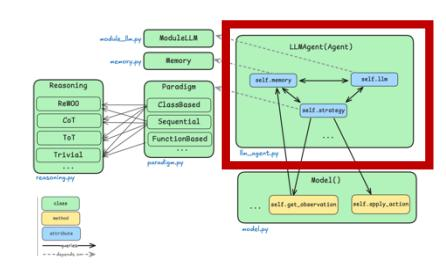
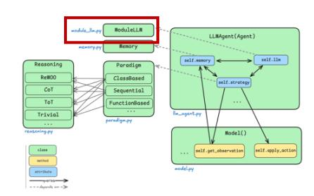

# Mesa-LLM

GSoC 2025 Proposal – Colin FRISCH

Email Id: colin.frisch@gmail.com

Country of Residence: France

University: CentraleSupélec, ESSEC - Paris, France

https://github.com/colinfrisch/abm-mesa-experimentations/tree/main/experimentations/mesa_llm MORE DETAILS AT:

|1. | Project overview | ..........................................................................................................................3 |
|------ | ------------------------------------- | --------------------------------------------------------------------------------------------------------------------------------------- |
|1.1. | Introduction and motivation | ........................................................................................................3 |
|1.2. | Benefits to the Mesa community | ...................................................................................................3 |
|1.3. | Scope and philosophy | .................................................................................................................4 |
|2. | Technical Approach | .....................................................................................................................5 |
|2.1. | Architecture API Design | .............................................................................................................5 |
|2.2. | Testing and evaluation | 14 |
|2.3. | Deliverables and outcomes | 15 |
|3. | Timeline | ...................................................................................................................................16 |
|3.1. | Community bonding phase | 16 |
|3.2. | First coding phase | 17 |
|3.3. | Second coding phase | 18 |
|4. | Background and experience | ........................................................................................................19 |
|4.1. | About me | 19 |
|4.2. | Professional | 19 |
|4.3. | Contributions to the Mesa community | 20 |
|4.4. | Long-Term Vision | 21 |
|5. | Appendix | ..................................................................................................................................23 |
|5.1. | Reasoning methods | 23 |
|5.2. | LLM integration | 26 |
|5.3. | References | 27 |

# 1. Project overview

#### 1.1. Introduction and motivation

As an agent-based modeling framework, Mesa is easy to use and applicable for a wide range of simulations. But traditional ABM agents rely on simple rules and patterns that are chosen by the users themselves, which can limit their adaptability. The objective of this project is to go further by developing an extension of Mesa that give agents access to LLMs for reasoning, decision-making, and communication, that can be used not only for simulations, but also as part of a scientific approach to study the impact of different paradigms and reasoning modules in ABM. As such, the work involves designing a very modular LLM-agent API (with memory, reasoning, and tool-use components), that integrate with Mesa's existing architecture (Model, Agent, Scheduler), as well as studying and solving LLM-related problems like memory management, consistency and computing-related challenges.

# 1.2. Benefits to the Mesa community

Being a new, very modular and simple to use feature, which is using the reasoning capabilities of LLMs, this project will mean:

- 1. … opening a new range of possible simulations. This will allow the user to model culture, communication, persuasion, and other complex characteristics, which were hard to model until now with Mesa.
- 2. … that it can be useful as much for recreational users that are just trying to experiment, and advanced researchers looking to compare specific paradigms and reasoning methods (CoT, ReWOO, etc.)/
- 3. … that it can be used to test a wide variety of LLMs: the design will support both online API-based LLMs and local open-source models (starting with one of each but building all modules to be scalable).
- 4. … giving Mesa a competitive advantage compared to other ABM libraries because it would combine LLM technology with already well-structured and easy to use framework.
- 5. … making the Mesa community grow by inviting new people interested in AI behavior to make models for various scenarios that couldn't exist before.

#### 1.3. Scope and philosophy

Based on my experience in AI R&D and contributing to large-scale projects, the goal is to ensure that each step results in something functional and effective. Adding LLM to an ABM framework can quickly become complicated, so if a component is not complete, it should not prevent the rest of the project from working: functionality and fluid integration are my absolute priorities. That is why I will try to stay concrete, realistic and very user-oriented during the proposal and always discuss the options with the mentors while maintaining autonomy in my research and development. Still in this R&D optic, I will implement in this proposal core features, which are a priority, then other nice-to-have features to do if the project works well. Thus, I intend to fit this project for three specific types of users:

Ø The LLM-scientist who likes to compare differences in a simulation in function of its parameters (LLM type, paradigm, reasoning type, etc.). They need a very efficient and modular API. Ø The non-tech researcher that wants to observe patterns on a field not directly AI-related (sociology, geography, physics, etc.). They don't necessarily have great coding skills but know basic python. Ø The everyday coder, that needs a simple and ready-to-work interface to experiment on various topics.

To efficiently align with Mesa's core API, the extension should feel natural: users initialize a Mesa model, add LLM-based agents to the grid or space, and call model.step() as usual. They also should still be able to use Mesa's DataCollector to record metrics (reflections of agents, messages, number of steps to reach agreement, etc.).

I will only focus on LLM-based agents and not on RL agents. LLM agents allow more modularity (they are pre-trained and as such, reduce dependency for training and are made to be easy to infer with) and thus fit more into Mesa's design that focuses on ease of use for the users. In addition to this, computational power is a big issue when a simulation can contain hundreds of agents, so this would be complicated to do both RL and LLM, dealing with different memory and computing-related problems.

# 2.Technical Approach

# 2.1. Architecture API Design

I think that the best way to implement the LLM-based agent is to implement it as a child of the class Agent (LLMAgent(Agent)). This approach has not been done before for another type of agent, but since we will need specific features related to the LLM (and be able to add great modularity for different paradigms and reasoning methods), adding methods to the Agent class would make the code unnecessarily heavy and reduce structure clarity. This approach also prevents excessive feature addition to other Mesa modules.

Also, I launched a discussion (#2736) regarding the possible future for Mesa agent-behavior features and its to LLM-based agents. After feedback, it seems a better idea to avoid building a complete general behavioral framework that the LLMAgent can use like any other agent, as it would be too complex to make links between regular agents and LLM-based agents. Thus, I will build a mostly standalone module. Considering this, an architecture for this project could look something like this:

Figure 1: possible architecture for Mesa-LLM

#### paradigm.py

Paradigms for LLM in ABM are the different ways in which we can use the LLM. This class will define how the employed LLM processes data, interacts with other agents and impacts decision making for each agent in the simulation. Since the objective here is to make a module with which the user can experiment different paradigms (and reasoning methods) and compare them, it needs to be very modular but also consider the fact that not every reasoning method is compatible with every paradigm. Thus, the Paradigm class is made to be the parent class of the precise paradigms. It is also responsible to send a self.action() to the LLMAgent class, which will be able to execute it during step() through the Model.

- Ø self.action() needs to ensure output consistency and parsing in function of the paradigm, because LLM outputs might be unpredictable. The goal is to extract the actions required by the LLM and translate it to the tools that the paradigms allow. Finally, the 'translated action' is passed down to the apply_llm_action() method, that efficiently changes environment (or agent characteristics) with minimum loss of information. apply_llm_action() depends on Model this time – cf. Model.py To ensure a good process, we can:
- 1. Use few-shots examples in prompt + regex or robust parsing to extract the action and if parsing fails, have a default course of action (like ignoring the output or treating it as a message only). It's a good first step as its simple to implement.
- 2. Use Hugging Face's 'smolagent' framework, which accepts a wide variety of models (API based and local) and works very well with function calling.

The general Paradigm class (and child classes) could look something like this:

class Paradigm(ABC): def init(self, model: Model, memory: Memory, reasoning: Reasoning, tools: List[Callable]): self.model = model self.memory = memory self.reasoning = reasoning self.tools = tools self.check_reasoning_compatibility(self,self.reasoning): def check_reasoning_compatibility(self,paradigm, reasoning): @abstractmethod def action(self, input: str) -> Callable: Process the input using the agent's reasoning, memory, and model, and return a callable that will be transmitted to LLMAgent class class ClassBasedParadigm(Paradigm): class FunctionBasedParadigm(Paradigm): """Implements a functional approach where state is not modified but returned.""" @staticmethod # No 'self' = meaning no internal state def act(agent_data: Dict[str, Any]) -> Dict[str, Any]:

The first paradigms that I want to implement are class-based and Function-based: both as objects to ensure modularity but with a @staticmethod tag inside the Function-based class to remove internal state considerations.

#### reasoning.py

A [paper exploring LLM based agents[3]](#page-26-0) explains the sources of reasoning and planning capabilities, and the most adequate one here seems to be in context-learning (or reasoning). The reasoning patterns that I have selected (in red in Figure 2) offer the best compromise between compute efficiency and diversity in the methods chosen. More can be added in the future, but it would be interesting to simply make one or two of these work at first like trivial reasoning and CoT at least before implementing more complex patterns like ReAct or ReWOO that could use the previously built classes. More implementation regarding a few of these reflection methods in the Appendix.

Figure 2: Selected ICL methods

The reasoning module could be built in a way similar to the Paradigm module:

class Reasoning(ABC): def init(self, strategy: str): @abstractmethod def generate_plan(self, input_text: str) -> str: """Generate a reasoning plan based on the input.""" class ChainOfThought(Reasoning): class ReAct(Reasoning): class ReWoo(Reasoning):

At first, I would like to implement the reasoning methods as very simple classes based mostly on promptengineering (example for a method in class ReAct):

def generate_plan(self, input_text: str, memory) -> str: observations = self.model.observe(input_text) reflections = self.process_observation(observations) plan = (f"ReAct Plan:\n" f"Observations: {observations}\n" f"Memories {self.process_memories()}" f"Reflections: {reflections}\n" f"What can I decide from here?" self.last_plan = plan return plan

If this works well with the general integration of the LLM-based Agent, I would like, as possible future/extra work, to discuss with the mentors the option of making a more general Reasoning parent class with features allowing a graph-like pathways for the reasoning method. Having used LangGraph in a recent project, the state-based graph-building of this library should be very compatible with the Memory module that I suggest in next paragraph and could make for an interesting addition. I detailed one possible example of code using LangGraph that integrates the Memory module in the Appendix.

#### memory.py

The Memory module will leverage the evolution of my previous contributions on memory management (PR#2735 for first version, then PR#2744). The objective of this memory module is to be very flexible, easy to navigate, and be able to store and retried different types of information (for LLMAgent, it will be goals, personalities, priorities, conversations, positions, etc.). The memory of the LLM-based agent could be split into two parts: short-term and long-term memory.

Ø ShortTermMemory, a more memory-efficient and reactive class using a deque as storage. It would hold fixed number of recent MemoryEntry objects that are automatically removed by order of memorizing if the capacity is exceeded. It would be optimized for quick retrieval of recent interactions like get_last()or get_recent(limit = 5).

Ø LongTermMemory, a more computational-efficient class with Hash map storage for better organization. Can be searched more in depth with get_by_type(type = "discussion"), get_by_id(id), etc.

Code examples for all these features are available in PR#2744.

After searching and experimenting to find the most optimized way to store textual inputs, it seems that the basic string has a clear advantage in terms of memory used compared to embeddings (as showed in this paper [on memory efficiency of embeddings[4])](#page-26-0), so I will stay with the basic method as implementing RAG methods is not the priority if the memory storage structure is efficient. Indeed, non-embedding retrieval methods can be implemented at first, and should this method prove not to be sufficient, it is possible to create another feature in charge of the encoding and overall RAG part.

Figure 3: Possible Memory architecture (more methods will be added)

With simulations that can carry dozens of agents through hundreds of steps, the memory module must be quite storage efficient. By separating different types of memory, we can make a feature that summarizes memory before storing it into long term (typically in the self.consolidate() method, which is designed to move memory from short term to long term).

#### About agent communication :

As I've discussed in my memory PR, I currently think that it's able to implement communication by make a memory of something (like a sentence) and transmitting it to another being. It's a nonconventional way of approaching things, but if the memory module's memory-exchange system works well, it could mean opening agent communication without building any other complex modules. I'm very open to new ideas and would love to dive in deeper on that subject with the instructors during the community bonding period!

#### model.py

To ensure the correct integration of the LLMAgent class to the model, I will add methods that will be directly implemented in the Model class and regularly verify that the environment state and agent state are well integrated with the preexisting features (Grid, DataCollector, etc.) so existing Mesa analysis tools would work. The methods I thought of are the following:

Ø get_observation(), which will allow LLMAgent to get information directly from the model class, which already has access to useful information (positions, number of agents, etc.). Ø apply_llm_action(agent, action) to formalize how an agent interacts with the environment based on the output of the action method from the chosen Paradigm class. It would be used in LLMAgent like this: self.model.apply_llm_action(agent, action).

Also, an interesting idea for later that I found in an [MIT paper[2]](#page-26-0) would be to make use of LLM archetypes: a general Mesa-LLM module could allow grouping similar agents to share a single LLM call. This might be an advanced optimization beyond the scope I defined, but I'll design the system such that it's possible to add in an optimization like this later. For now, a simpler approach would be using concurrency or batching, like if multiple agents act at once, batch their prompts through a vectorized call.

#### llm_agent.py

The LLMAgent class is a subclass of the Agent class and should be integrated as such to maintain ease of use for the user and modularity for the class. The main features for LLMAgent will be self.memory, self.llm and self.strategy.

Ø self.memory will be the integration of the Memory module to the LLM-based agent. Ø self.llm: The objective being making this feature a simplifier for the user, this method will be a wrapper that calls an external model API (only for OpenAI at first, then add more in function of the time left) or a local inference of the user's choice through HuggingFace (like ministral3B). To keep it modular, I will build a ModuleLLM object in the module_llm.py document with a standard generate() method with a few frequently used providers. I can use some pre-built code that I did for a previous project on LLM benchmarking. ModuleLLM will also incorporate quantization settings for local models (none by default) to save RAM. I detailed a possible architecture implementation for ModuleLLM in the Appendix. Ø self.reasoning will be depending directly on the Paradigm class that orchestrates interactions between memory, and LLM in function of the chosen Reasoning strategy.

class LLMAgent(Agent): def init(self, paradigm: str, reasoning: str, model: Model, memory: Memory, tools = None): self.paradigm_types = { "class_based": ClassBasedParadigm, "function_based": FunctionBasedParadigm self.reasoning_types = { "chain_of_thought": ChainOfThought, "ReAct": ReAct, "rewoo": ReWoo self.paradigm = self.paradigm_typesparadigm self.reasoning = self.reasoning_typesreasoning self.model = model self.memory = memory self.tools = tools myLLMAgent = LLMAgent(reasoning = "chain_of_thought", paradigm = "class_based", model = model, tools = [give_money(), ask_for_money()],

As it's very important to integrate it well in the Mesa architecture, I'll discuss the implementation and architecture details regularly with the mentors and other main contributors.

# 2.2. Testing and evaluation

#### Testing :

There is a risk of overfitting this module to certain scenarios. In a general manner, I'll frequently test the LLM agent on different types of tasks by progressively building models. Also, the big diversity in Mesa's examples will help me with that. Some of the tests that I would like to implement include:

- 1. Unit Tests for Functions like formatting the prompt, parsing outputs, memory recall, etc., (controlled inputs/outputs). I will do this for each main component and try to implement quickly in the beginning of the project as a reusable CI/CD test pipeline
- 2. Integration Test for a Single Agent by Running a single-agent simulation with a simple local model (very small model like Ministral or even a deterministic logic in place of LLM) and assert simulation progresses.
- 3. Performance verifications by making stats and making sure they are coherent (how much time and power is used for 10 steps with 1 agent vs 5 agents vs 20 agents take with a specific model on my hardware, (and maybe the mentor's to have more representative results).
- 4. Human evaluation by will logging transcripts from example runs and manually verifying that they make sense (fastidious but worth it, in my experience).
- 5. Next steps here would be to make a small evaluation program that uses a strong LLM to quickly evaluate a series of interactions (good next steps)
- 6. Even further next steps are to use Mesa's existing examples as a comparison (like Wolf-Sheep) but inserting a naive LLM agent to see if it can mimic a predator-prey decision. It's likely overkill, but it is a funny test to see if the LLM agent can figure out to chase sheep given appropriate prompts. In my opinion, this kind of testing method might still be an interesting way to illustrate differences between rule-based and LLM-based agents.

#### Evaluation/benchmarking :

- 1. Measure how the size of self.memory (number of memory entries) affects performance or token count. It could justify any need for summarization: memory grows = prompt grows = more expensive if using an API.
- 2. LLM Comparison: run the same scenario with a small vs large model to note differences (not a traditional benchmark but interesting from a research perspective, I think).
- 3. Latency and computational measures (in function of parameters like the number of agents, number of steps, etc.).

## 2.3. Deliverables and outcomes

#### The deliverables that I can suggest are :

- 1. A set of very modular and scalable modules for experimentations with LLM-based agents (Memory, Paradigm and Reasoning modules).
- 2. A LLMAgent Module fully integrated with the other components previously stated.
- 3. A ModuleLLM backend support with behind-the-scenes interfaces for at least API one and local model support. This includes configuration management (API keys, model names, etc.) and defaults values.
- 4. One fully implemented Mesa model demonstrating Mesa-LLM: I'd be very interested to build a climate migration model in which each LLM agent being able to do decision-making based on reallife inspired environmental, economic, and geopolitical conditions. Agents would assess climate stress, predict future risks, and generate migration strategies through reasoning and communication with other agents. It's a quite complicated task, but it would be very rewarding (and be a perfect proof of concept).

- 5. A full documentation on: Ø How to install any extra requirements (like transformers or openai). Ø A Tutorial Notebook (step by step building for an LLM-based ABM model). Ø Each class and method (explanations to add to mesa.readthedocs.io). Ø How to use different models, adjust parameters like temperature or max tokens for generation. Ø Extra tips found along the way.
- 6. A 3-part blog shared on LinkedIn (one article after each main GSoC phase): I would love to document what I am exploring and give to others the opportunity to discover Mesa and talk about it, plus it could be used as a contribution to the Mesa research article on the subject!
- 7. A full testing set and benchmarking/evaluation Report (cf. testing and evaluation).

# 3.Timeline

### 3.1. Community bonding phase

During this phase, I want to focus on discussing with the mentors to implement feedback loops and refine the timeline and the architecture based on their suggestions and feedback. This will allow me to do even deeper research on the specific features that are going to be implemented and share my finding with the mentors to hear their approach on the subject. I will make sure to have ready API access to all models to be tested and make experimentations with local models to ensure the smoothest start possible. During this period, I would also like to implement on my own a very basic LLMAgent (maybe just with a fixed prompt for example) to avoid any integration issue. I will also write the first LinkedIn article to introduce mesa, explain the projects, the expected timeline and the defined timeline.

# 3.2. First coding phase

|Week 1 (June 1 – June 7) Ø | Build the | ModuleLLM |  | class (starting with only the OpenAI API at first) |
|------------------------------ | ----------- | ---------------------------- | -------------------------------------------------------- | --------------------------------------------------------------------- |
|Ø |  | Build and raffine | Memory module | (starting from my code in the PR) |
|Week 2 (June 8 – June 21) Ø | Build | LLMAgent | class | using simple reasoning (not complex patterns) |
|Ø |  |  |  | Write unit tests for Memory and make a single-LLMAgent simple model |
|Ø | Integrate | Memory | module to LLMAgent |  |
|Week 3 (June 22 – June 28) Ø |  | Integration of the | LLMAgent | to the environment : add get_observation() and |
| |  | apply_action() | features to the Mesa | Model class |
|Ø | Build the | Paradigm |  | module (at first with a single paradigm) |
|Ø |  | Ensure integration to Mesa | features ( | DataCollector, Grid etc.) |
|Week 4 (June 29 – Jul 5) Ø |  | Implement the | Reasoning module | (at first with a single reasoning method and |
| |  | prompt engineering – | not graphs) |  |
|Ø |  |  | Implement Multi-Agent Communication through the | Memory Module |
|Week 5 (Jul 6 – Jul 12) Ø |  |  | Refactor the code and improve modularity |  |
|Ø |  |  | Test and evaluate the current performances of | LLMAgent |
|Week 6 (Jul 13 – Jul 18) Ø |  |  | Build a demo with a small quantity of LLM-based agents | as a proof of concept |
|Ø |  | Publish LinkedIn article 2 |  |  |
|Ø |  | Submission for midterm | evaluation |  |

è Midterm evaluation

# 3.3. Second coding phase

|Week 7 (Jul 19 – Jul 26) Ø | Work on plan and timeline based on mentor evaluation |
|----------------------------- | ---------------------------------------------------------------------------------- |
|Ø | Refine reasoning (add in-context learning methods) and communication |
|Ø | Manually test reasoning and communication (build a small automatic LLM |
|Week 8 (Jul 27 – Aug 2) Ø | Refine paradigms (add one or two more options depending on timing) |
|Ø | Add hooks for more integration in DataCollector (prompts, chats, etc.) |
|Ø | Add local LLM support with HuggingFace framework |
|Week 9 (Aug 3 – Aug 9) Ø | Organize community feedback (article or video) to gather insights |
|Ø | Write extensive tests for all features of LLMAgent (final tests for deliverable) |
|Ø | If time allows, switch to a LangGraph-based Reasoning module |
|Week 10 (Aug 10 – Aug 16) Ø | Work based on community feedback |
|Ø | Write tests for all other added modules (in Model and DataCollector ) |
|Ø | Write documentation and tutorials + final model |
|Week 11 (Aug 17 – Aug 23) Ø | Final demo preparation and finish doc and tutorial writing |
|Ø | Stretch goals if everything is finished (implement LLM Archetype and test |
| | LLMAgent on Wolf/Sheep) |
|Week 12 (Aug 24 – Sept 1) Ø | Clean-up repository and complete last PRs |
|Ø | Submit code and final evaluation |
|Ø | Discuss post-GSoC plans with mentors |
|Ø | Publish LinkedIn article 3 |

è Final evaluation

# 4.Background and experience

#### 4.1. About me

I am a double-degree student at

Ø CentraleSupélec (ranked 2nd in Engineering in France): I studied programs, algorithms, ML and data science. Ø ESSEC (ranked 2nd in Management in France), where I made the dean's list: I studied entrepreneurship and product development.

My experience in both engineering and product development/management make me always focused on creating impactful, user-oriented solutions, which would mean here making generative AI agents accessible to Mesa's community. I'm very curious, hardworking and I love to do things well, weather it means researching, programming or interacting with people and get feedback. I have strong Python skills, but I also have some experience with HTML, CSS, SQL and JavaScript (React, Angular, etc.).

GSoC period:

Ø June: I have a very light schedule and no final exams. I will be able to work 5-6 hours on weekdays and even more on weekend. Ø July and August: I will be able to work 7-8 hours a day.

I am particularly motivated to work with Mesa as I find it not only a great professional opportunity, but an incredible dive-in into subjects that have fascinated me during my whole life.

### 4.2. Professional

I have a few external experiences that should be useful for this project (from most recent to oldest):

Research assistant with a ML and finance researcher from ESSEC (Jan 2025 – May 2025)

Ø Vector embeddings and RAG Ø Modular library design (to experiment different embedding techniques, splitting methods, models, etc.) Ø LangChain, LLM API (OpenAI, Mistral, and Grok) Ø GitHub and Nuvolos

Building an autonomous AI-agent powered learning project (personal project - ongoing)

Ø OpenAI, Anthropic APIs Ø Hugging Face Transformers library (smolagents) Ø SQL, Docker

AI engineering internship at Lucca Software (Jul 2024 – Dec 2024)

Ø Fine-tuning models like Pixtral12B and Donut Transformer (improved precision by 30%) Ø Model optimization (quantization, hyper parameter tuning, etc.) Ø Preparing a production pipeline to integrate an API to the core modules Ø Writing a company research paper on methods explored

#### AI on-the-edge Hackathon (October 2024)

Ø Real time API with a Mistral multimodal model, local OpenAI whisper model inference Ø Basic implementation for a memory module in LLM Ø Flask and Raspberry PI

6-month school project, on risk and resilience addressing with LLM

Ø Construction of specialized dataset for risk and resilience Ø LLM performance evaluation (trough a pipeline designed for this purpose) Ø Designed and tested inference processes, including batching, and quantization

#### 4.3. Contributions to the Mesa community

Ø Built a working guerilla warfare model inspired by a modeling research paper that I wrote as a school project (to verify how the theoretical hold in practice). Ø Created a working memory feature, (PR#2735) and built a foraging ants model using it as an example of how it could function. Following the feedback, made an improved architecture for this memory module (in PR#2744). Currently building another model to compare the overhead of the memory structure proposed in the second PR to a build without it (virus vs antibody model).

Ø Opened issue #2745 for a debugging problem in visualization in mesa. After searching and working on it for some time, I opened the solving PR (#2747-MERGED) Ø Contributions to the mesa matrix chat discussions and created a discussion for a roadmap proposal for LLM decision making - #2736,.

Overall, I read a lot of Issues, PRs, Discussion, documentation and attended the video conferences to understand Mesa's codebase and collaborative development to the fullest extent. As a beginner in opensource contribution, I really enjoyed discovering Mesa, which matched particularly well with my center of interests and experience. That is why this proposal is the only one I submitted for GSoC. I hope that it will fully reflect my determination and work capacity.

# 4.4. Long-Term Vision

I don't want this GSoC project to be a simple summer job, I want this to be the base for a long-term involvement with Mesa.

Even if this project is only 3-months long, I am determined to work for Mesa beyond the summer: I intend to implement Mesa-LLM into the Mesa project (if the community agrees). Maybe merging into Mesa core or maintaining it as an official add-on. I will continue to be involved after GSoC to fix bugs, respond to user questions, and refine the implemented features. Given my academic schedule, I can reserve time each week for this, as it also aligns with my personal interest in AI simulations.

Post-GSoC, I would love to write a Medium article about Mesa-LLM in addition to the LinkedIn posts that I will have done during the different phases. This will help attract users and possibly other contributors (maybe someone wants to add a new memory technique or integrate a new model). I'll also present it in the AI association that I have co-founded in one university from my double degree via a conference or a workshop (Utopia ESSEC, we already organized a dozen conferences with people from Mistral, OpenAI, Snowflake, etc., workshops and internal AI projects).

As said in the Mesa GSoC page, if Mesa-LLM opens opportunities to publish or present academically, I would love to write an article with different Mesa contributors around the framework (and maybe its LLM part). In general, I would love to collaborate with my mentor or others on turning interesting simulation results into a publication.

In addition to that, I have a few ideas of what could be implemented in the future, like for example:

Ø Integrating image or audio modalities, meaning making Mesa-LLM multimodal! Mesa could simulate a world with images: an agent "sees" an image and the LLM interprets it. This would expand use cases (like agents describing their environment in words) – someone has done this by implementing LLMbased agents in Minecraft and the results are fascinating[5]. Ø Integrate with frameworks like LangChain to allow agents to use tools/internet. This would make LLM agents even more interesting (but needs a big work of sandboxing). Ø Right now, LLMs are mostly static (aside from memory). We could develop a more general behavior module (like the one proposed for the GSoC project) and make sure that it integrates LLM-based agents well.

# 5. Appendix

#### 5.1. Reasoning methods

#### Chain-of-Thought

(+self-consistency for the most complex situations, as a parameter chosen by the user – not a priority)

Like ReAct's "thought" phase. Even if not explicitly using ReAct format, we can implement it by "few-shot prompting" the LLM. CoT is theoretically a prompt technique, so it could be part of how we construct prompts for any of the reasoning modes.

class ChainOfThought(Reasoning): def init(self, memory): super().init(memory) def self_consistency(self, iterations: int): def generate_plan(self, selfconsistency = False, input_text: str) -> str: steps = [ f"Step 1: Analyze the input: '{input_text}'.", "Step 2: Identify key elements and challenges.", "Step 3: Break down the problem into sequential steps.", "Step 4: Formulate and detail the thought process." return "\n".join(steps)

And with a LangGraph graph that integrates the Memory module as a next step:

class GraphCoT(): def init(self, model): self.model = model self.memory = Memory(agent=self, model=model) self.graph = self._build_graph() def _cot_node(self, state: dict) -> dict: thought = f"Let's think step by step to answer: {state['input']}" self.memory.remember_short_term(model=self, entry_content=thought, entry_type="reasoning" answer = self.get_answer_from_llm(thought) self.memory.remember_short_term(model=self, entry_content=answer, entry_type="final_answer" state["output"] = answer return state def _build_graph(self): builder = StateGraph(dict) builder.add_node("cot", self._cot_node) builder.set_entry_point("cot") builder.set_finish_point("cot") return builder.compile() def run(self, query: str) -> dict: return self.graph.invoke({"input": query})

#### ReAct (Reason + Act)

The agent's LLM prompt encourages a chain-of-thought followed by a distinct action output This allows the LLM to split complex decisions. LLMAgent will parse the LLM's output (with its action method) to separate the "Thought" (which could be logged or even fed into memory) from the executed "Action":

class ReAct(Reasoning): def init(self, memory): super().init(memory) def generate_plan(self, input_text: str, memory) -> str: observations = self.model.observe(input_text) reflections = self.process_observation(observations) plan = (f"ReAct Plan:\n" f"Observations: {observations}\n" f"Memories {self.process_memories()}" f"Reflections: {reflections}\n" f"What can I decide from here?" self.last_plan = plan return plan def process_memories(self): def process_observation(self, observations: str) -> str:

#### ReWOO (Reasoning Without Observation)

The agent first plans several steps internally without needing new observations at every intermediate step. We can use this for efficiency – the agent asks itself "What is my long-term plan?" then executes it step by step. This reduces repetitive LLM calls. I will design the API to allow an agent to either act every tick or to produce a multi-step plan (which is stored and executed over multiple model steps).

class ReWoo(Reasoning): def init(self, memory): super().init(memory) def generate_plan(self, input_text: str) -> str: initial_analysis = f"Initial analysis of '{input_text}'." refined_steps = [ initial_analysis, "Evaluate multiple interpretations and options.", "Reweight options based on context and priorities.", "Refine and finalize the reasoning plan." return "\n".join(refined_steps)

# 5.2. LLM integration

#### module_llm.py

The main advantage here is the modularity and scalability of the structure. Apart from the HuggingFace library for local models, it doesn't depend on external frameworks, which makes it easier to maintain.

class ModuleLLM: def init(self, provider="huggingface", model_name=None, api_key=None, quantization=None): """ Initializes the LLM modulation object. Args: provider: str, The provider of the LLM service ('huggingface', 'openai', and more later). model_name: str, The specific model name (for Hugging Face or custom providers). api_key: str, API key (if required for external models). """ def generate(self, prompt, max_length=200): # Redirection to the good generation method def _generate_huggingface(self, prompt, max_length, quantization): """Handles text generation using a Hugging Face model.""" self.check_validity(provider, model_name, api_key) output = self.pipeline(prompt, max_length=max_length, do_sample=True, quantization = return output[0]['generated_text'] def _generate_openai(self, prompt, max_length): """Handles text generation using OpenAI's API.""" self.check_validity(provider, model_name, api_key) headers = {"Authorization": f"Bearer {self.api_key}", "Content-Type": "application/json"} data = {... response = requests.post(url, json=data, headers=headers) return response.json()["choices"][0]["text"]. strip()

# 5.3. References

[1] Gao C., Lan X., Li N. et al. Large language models empowered agent-based modeling and simulation: a survey and perspectives. Humanit Soc Sci Commun 11, 1259 (2024). <https://doi.org/10.1057/s41599-024-03611-3> [2] Chopra, A., Kumar, S., Giray Kuru, N., Raskar, R., & Quera-Bofarull, A. (2024). On the limits of agency in agent-based models. arXiv preprint arXiv:2409.10568.<https://arxiv.org/pdf/2409.10568> [3] Cheng, Y., Zhang, C., Zhang, Z., Meng, X., Hong, S., Li, W., Wang, Z., Wang, Z., Yin, F., Zhao, J., & He, X. (2024). Exploring Large Language Model based Intelligent Agents: Definitions, Methods, and Prospects. arXiv preprint arXiv:2401.03428. <https://arxiv.org/pdf/2401.03428> [4] Johannes Jurgovsky, Michael Granitzer, and Christin Seifert. "Evaluating Memory Efficiency and Robustness of Word Embeddings." Media Computer Science, Universität Passau, Germany. <https://mgrani.github.io/media/papers/16jur.gra.sei-Evaluating-Memory-Efficiency.pdf> [5] Altera. AL, Ahn, A., Becker, N., Carroll, S., Christie, N., Cortes, M., Demirci, A., Du, M., Li, F., Luo, S., Wang, P. Y., Willows, M., Yang, F., & Yang, G. R. (2024). Project Sid: Many-agent simulations toward AI civilization. arXiv preprint arXiv:2411.00114. <https://arxiv.org/abs/2411.00114>