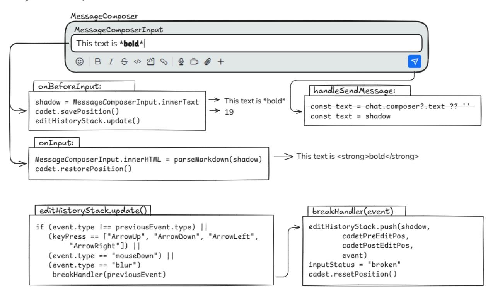
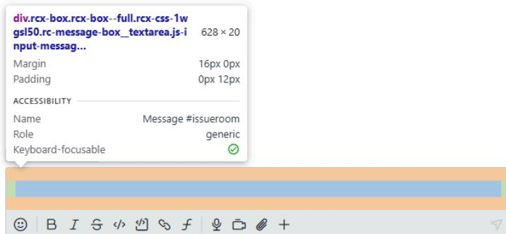
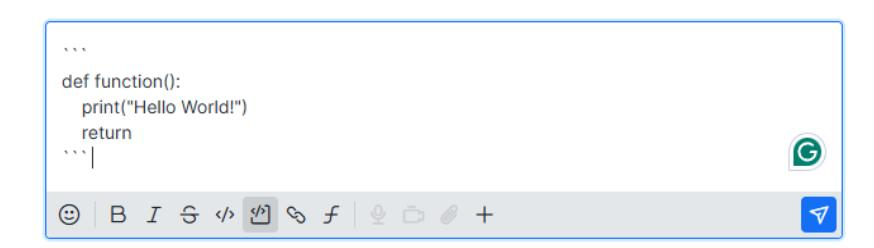
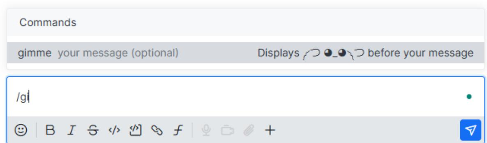
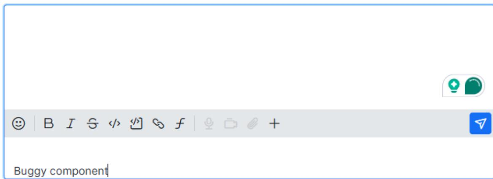

Google Summer Of Code 2025 - Proposal

# Real-Time Message Rendering in Message Composer

### Ishan Mitra

Rocket.Chat: ishan.mitra

Email: iamishan1996@gmail.com

GitHub: <https://github.com/ishanmitra>

LinkedIn: <https://linkedin.com/in/ishan-mitra>

### Martin Schoeler

Rocket.Chat Mentor

24th March, 2025

### Synopsis

Rocket.Chat's Message Composer does not currently support real-time rendering of Markdown or emojis while composing messages. Users only see raw syntax (e.g., bold,:fire:) until they send the message, which impacts readability and user experience. This project will enable real-time rendering of Markdown formatting and native emojis. This will ensure that users see rich-text as they type.

### Project Overview

The current implementation of the Message Composer in Rocket.Chat does not provide live previews for Markdown or emoji inputs. Users typing messages with rich text formatting must rely on syntax rather than seeing the actual styled text. For example, bold remains as is until the message is sent, and:fire: renders as an emoji only after submission. Rocket.Chat's current emoji system relies on a third-party pack, which it plans to replace with native emoji support.

This project aims to upgrade the Message Composer to:

- 1. Render Markdown formatting in real-time as users type, rather than displaying raw syntax.
- 2. Ensure native emoji support, replacing the existing third-party emoji system.
- 3. Provide a proof of concept for migrating to native emojis, identifying technical challenges and solutions.

By implementing real-time rendering, this project will improve usability, accessibility, and user experience within Rocket.Chat.

### About Me

I am a Graphic Designer with a Bachelor's in Computer Science from the University of Calcutta, India. While my professional background is in design, I have been programming web applications since middle school, developing a strong understanding of modern frameworks. My experience in machine learning, LLMs, and NLP has deepened my interest in open-source software. GSoC 2025 presents an opportunity to contribute meaningfully to Rocket.Chat's user interface while gaining my first hands-on experience in open-source development within the tech industry. I eagerly look forward to collaborating with the open-source community, expanding my technical expertise, and contributing to a project that enhances communication tools for users worldwide.

### Benefits to the Community

This project will bring significant improvements to Rocket.Chat's Message Composer user experience, benefiting both end users and developers:

#### For Users:

- Real-time Markdown rendering will improve readability while composing messages, reducing confusion caused by raw syntax.
- Native emoji support will eliminate dependency on a third-party emoji pack, ensuring consistent emoji display across platforms.
- Custom emojis will be visible to the user installed on a Rocket.Chat server instance.
- A more intuitive message composition experience will allow users to see messages as they will appear when sent, reducing formatting mistakes.

#### For Developers & Rocket.Chat Ecosystem:

- Improved maintainability will result from removing the third-party emoji pack, reducing dependencies and technical debt.
- Standardized emoji rendering will provide a proof-of-concept study to guide a future migration to native emoji support.
- Enhanced accessibility will benefit users who rely on visual feedback for formatting.
- A more polished and modern Message Composer will increase Rocket.Chat's competitiveness with other chat platforms.

By implementing real-time formatting, this project will not only align Rocket.Chat's composer with modern messaging platforms but also expand its usability beyond casual chat. With improved rich text support, users can compose longer, well-structured messages – making it suitable for writing detailed documentation, collaborative notes, and formatted discussions. This enhancement will improve accessibility, usability, and developer efficiency, positioning Rocket.Chat as a more versatile communication tool.

### Goals

The project aims to bridge the gap between a WYSIWYG editor and a Markdown-based rich text formatter. Both novice and experienced users can compose messages effortlessly, ranging from simple text to complex, well-organized content.

### Deliverables

This project will introduce real-time rich text rendering in Rocket.Chat's Message Composer. The final submission will include the following components:

#### Features to be Implemented

- MVP implementation of real-time Markdown rendering in the Message Composer.
- Native emoji support by replacing the existing third-party emoji pack, allowing standard emojis to render consistently across platforms.
- Support for mentions with a defined style, ensuring that tagged users are visually distinguished within the composer.
- Text sanitization and security measures to ensure that content entered in the composer is web-safe, preventing unintended behavior or rendering issues.
- Help tooltip for beginners who are not well-versed in the Markdown syntax.

### Technical Details

### Current Implementation

Rocket.Chat's Message Composer UI is designed using the Fuselage Design System.

Storybook highlights the code that renders the Message Composer (as shown above)

() => <MessageComposer> <MessageComposerInput placeholder='Text' /> <MessageComposerToolbar> <MessageToolbarActions /> </MessageComposerToolbar> </MessageComposer>

Checking the definition inside MessageComposer.stories.tsx, gives the following

<Box is='label' width='full' fontSize={0}> <Box className={[messageComposerInputStyle, 'rc-message-box__textarea js-input-message']} color='default' width='full' minHeight='20px' maxHeight='155px' rows={1} fontScale='p2'ref={ref} pi={12} mb={16} borderWidth={0} is='textarea' {...props} /> </Box>

The Box is a Fuselage component that renders as the HTML tag specified in the is prop. In this case, the outer Box becomes a <label> whereas the inner Box becomes a <textarea>.

MDN defines <textarea> as an HTML element representing a multi-line plain-text editing control, allowing users to enter free-form text, such as comments on reviews or feedback forms. The limitation of <textarea> supporting only plaintext explains why adding styles to the Composer results in the rendering of Markdown syntax.

In MessageComposerNew, the inner Box will have the is prop set to div with additional props, contentEditable and suppressContentEditableWarning.

Some nuances in the Composer component are present inside Rocket.Chat's monorepo, which will be illustrated with the help of the props declared in MessageComposerInput in MessageBox.tsx.

<MessageComposerInput ref={mergedRefs} aria-label={composerPlaceholder} name='msg' disabled={isRecording ||!canSend} onChange={setTyping} style={textAreaStyle} placeholder={composerPlaceholder} onPaste={handlePaste} aria-activedescendant={popup.focused? popup-item-\${popup.focused._id}: undefined} /> 

All of the props are optional and can be omitted without crashing the application, however, it would remove the interactivity of the Message Composer. Each of the props handles the component in the following ways:

- 1. mergedRefs combines multiple references (popup handling, text input, keyboard events, and autofocus) into a single ref, ensuring seamless interaction with the message composer input.
- 2. placeholder holds the value of the text to be displayed inside the currently implemented textarea in the following text format: Message #{roomID}. The placeholder has to be re-implemented when creating the updated component.
- 3. style is responsible for updating the height by cloning the plaintext value into the shadowRef div, allowing it to expand with the text. The input's height then matches shadowRef, preventing scrollbars and enabling growth of the textarea. This hook may not be necessary in the updated component, but the shadowRef would be handy.

- 4. handlePaste intercepts paste events, prevents pasting non-text content, extracts image files from the clipboard, renames them, and triggers the upload function if images are detected.

The current implementation of Rocket.Chat's Message Composer relies on a <textarea>, where the text content is easily accessible via its value property. However, in the updated rich text version using a 
, the text must be retrieved differently—either through innerText for plain text or innerHTML for formatted content.

While the MVP focuses on developing the real-time text editor, it is crucial to ensure that existing functions and event hooks continue to work, the minimum requirement being the ability to send a message. Other functionalities, while critical, can be considered stretch goals for the main GSoC coding period. The main focus of this proposal is to present a working Proof of Concept.

#### Proposed Implementation

The flowchart explains the implementation above using React-like events and JavaScript-like pseudocode, with outputs of the result. As of this draft, I have yet to implement this inside the Rocket.Chat monorepo. When the user inputs text inside the 
, the innerText value will be cloned into the shadowRef div. This shadowRef div will then send the text value to the Markdown parser to render inside MessageComposerInput.

The cadet or the text cursor position has to be constantly tracked because whenever the innerHTML is updated inside the 
, the cadet shifts to the beginning of the editor.

The parseMarkdown function employs a series of regex replace calls to convert the Markdown formatters into their corresponding rich-format HTML representations. It is straightforward but highly inefficient. The function will be replaced by Rocket.Chat's markdown parser.

Upon interacting with the Send Message button, the handleSendMessage function hypothetically requires a single change. This alone can prevent XSS attacks since the shadowRef will be immune to Inspect Element changes. However, I would not like to take any chances and research further about this.

The editHistoryStack is considered a stretch goal, as casual typists could do without Undo/Redo events. Moreover, my implementation completely broke after implementing the parseMarkdown function. It also cannot accept multiline text either.

#### Emoji Update

While my current implementation can handle system emojis, my Markdown parser does not account for the rendition of custom emojis. I have a solution for this:

- 1. The emoji picker remains as it is. However, the first category of emojis will be custom-uploaded emojis.
- 2. If a user types the text code for an emoji that is present in the system, the parser must immediately convert that text into the corresponding emoji. (Replace:fire: with ��)
- 3. If a user types the text code for a custom uploaded emoji, the parser first checks if the customemojitext.png (or.gif) exists, and if it does, it will replace it the way Rocket.Chat does it after the message is submitted.
- 4. Removing EmojiOne classes to allow Rocket.Chat to render system native emojis.

### Related Work Done

- Started documenting my findings in my forked Rocket.Chat repo wiki.
- Raised an issue related to a Composer glitch and made three PRs showing different approaches to resolving that issue: 35653, 35655, and 35656.
- Created a JavaScript implementation of real-time Markdown rendition.

#### Source Code

<https://github.com/ishanmitra/richtext.js/blob/main/index.html>

#### Executing the Code

Download the file, and it can run directly without any server. It can also be deployed using a server to tunnel the localhost through ngrok to test on other platforms such as iOS and Android.

⚠️ POTENTIAL ISSUES: The Proof of Concept works with Chromium-based browsers only. Firefox is unable to handle multiple lines of text. This can be seen below:

Chrome Firefox

#### Prototype Implementations

The following are definitions of functions and global variables implemented in JavaScript, used to study and outline the roadmap for migrating to the new Composer. By isolating the problem in a standalone app, identifying the core logic and key event listeners required for the migration becomes streamlined. JavaScript was chosen for rapid prototyping and will be maintained in parallel with the TypeScript implementation to enable faster debugging and iteration.

// Core Logic function formatMarkdown(text) function setCursorPosition(el, position) function getCursorOrSelectionOffsets(element) function getTextLengthWithBreaks(range) // Cursor and Edit Tracking function updateCursorOnInteraction() function breakHandler() // Text Manipulation function insertText(text, pos) function deleteText(start, end) // Debugger functions function showMirror() function showDelMirr()

function showHistory() function showEdit() function showEditStatus() function showCursor() function showTextCursor() // Undo / Redo function applyAction(action) function reverseAction(action) function handleUndo() function handleRedo()

It is to be noted that updating to the native emoji rendering inside Rocket.Chat needs to be solved inside the Rocket.Chat code itself.

The following event listeners are responsible for capturing keyboard and mouse inputs:

editor.addEventListener("focus", () => {}) editor.addEventListener("blur", () => {}) editor.addEventListener("mousedown", () => {}) editor.addEventListener("keydown", () => {}) editor.addEventListener("beforeinput", () => {}) editor.addEventListener("input", () => {}) document.addEventListener("selectionchange", () => {}) document.addEventListener("mouseup", () => {})

### Timeline

#### Interacting with Rocket.Chat Community

- Interacting with GSoC Mentors, Engineers, and other GSoC applicants frequently
- Proposing the project idea of an AI-powered agent that will answer frequently asked questions by first-time contributors and newcomers.
- Creating an issue (35650) and developing PRs 35653, 35655, and 35656 for a Composer editing-related bug.
- Increasing familiarity with the codebase, linting, and commit guidelines mentioned in the developer documentation and suggestions from Rocket.Chat engineers.

### Proposal Drafting Period

- Create a branch and implement a working Proof of Concept, replacing the textarea with a div contenteditable.

- Change the handleSendMessage to use shadowRef instead of the text editor's value to prevent the first barrier of XSS execution.

#### Week 1

- Create a fresh branch from the latest develop commit.
- Implement a new MessageComposerInput class, which replaces the textarea to div.

#### Week 2

- Create React hooks for onBeforeInput and onInput.
- Incorporate Rocket.Chat's parser inside the renderer.

#### Week 3

- Reintroduce the props implemented in the original MessageComposerInput class.
- Update React hooks if functionality breaks.

#### Week 4

- Study how custom emojis (GIFs and static images) can be rendered dynamically.
- Implement how Rocket.Chat's parser resolves them.

#### Week 5

- Rewrite the renderer to account for the retrieval of text code from the custom emoji.
- Research on security practices to avoid other attack vectors.

#### Week 6

- Work on stretch goal features: Incorporate Undo and Redo history.

#### Week 7

- Finish pending work.
- Finalize changelogs.

#### Status of the current commit:

feat/realtime-markdown commit

#1 Replace the Box that generates HTMLTextAreaElement with HTMLDivElement #2 Pass contenteditable and suppressContentEditableWarning as props to this HTMLDivElement #3 Getter and setter functions to emulate HTMLTextAreaElement's selectionStart and selectionEnd property inside the contenteditable component #4 Testing emojis, style formatter buttons, attachments, and send button activation

#5 Fix pop-up interactions (emojis and commands) not working properly #6 Fix contenteditable component interfering with the layout of the formatter toolbar #7 Change the getter and setter functions in #3 to allow proper support of rich-text format selection #8 Implement Rocket.Chat's existing Markdown parsers and functions to implement the MVP

#### Screenshots of the current status:

#1 Replace the Box that generates HTMLTextAreaElement with HTMLDivElement

#3 Getter and setter functions to emulate HTMLTextAreaElement's selectionStart and selectionEnd property inside the contenteditable component to enable #4 #4 Testing emojis, style formatter buttons, attachments, and send button activation

### Potential Issues

#### Rocket.Chat:

#5 Fix pop-up interactions (emojis and commands) not working properly

Pressing the Enter key, accepts the command but also sends the message soon after. Mouse click also does not work while selecting an option.

#6 Fix contenteditable component interfering with the layout of the formatter toolbar

#### Emojis:

- Chromium-based browsers on Windows add double emojis inside the contenteditable
- Firefox does not have this emoji issue on Windows.
- Android: Chrome and Brave did not have this emoji issue.

- Need to test iOS Safari, Mac. Ubuntu does not have any built-in emoji keyboard/picker.

### Proof of Concept (JavaScript):

- The PoC works well in Chromium-based browsers on both desktop and smartphones.
- The PoC breaks in Firefox, when text is inserted after a linebreak. (Windows Ubuntu).
- Testing for Safari (iOS and Mac) to check for any code breakage required.

### Post GSoC Stretch Goals

- Explore real-time rendering of Asian languages and RTL languages.
- Check the integrity of the new Composer with Rocket.Chat Apps Engine (slash commands).
- Check the integrity of AI Enhanced Message Composer Component with the new editor.
- Work on pending documentations.

# Why Me?

What might have been a beginner's oversight for many new FOSS contributors turned out to be a major advantage for me. On my very first day exploring Rocket.Chat, I immediately noticed the absence of a rich-text editor. When I later discovered that real-time Markdown rendering was a proposed GSoC project, I knew right away that this was the perfect challenge for me. It aligns perfectly with my interests, and I am eager to contribute to a project that enhances both usability and functionality for Rocket.Chat users.

I have a strong foundation in JavaScript, which helps me effectively use React for dynamic UI development. My experience in front-end development and UI/UX improvements makes me well-suited for implementing real-time Markdown rendering in Rocket.Chat. I've also been researching how other chat apps handle text formatting to enhance user experience. To prepare for this project, I've explored Rocket.Chat's message composer and Markdown pipeline to identify key areas for improvement.

I have enjoyed engaging with the Rocket.Chat community, where members are friendly, helpful, and insightful. Their support has encouraged me to pursue open-source contributions, and I am excited to take my first step with a project I am truly passionate about.

# Time Availability

How much time do you expect to dedicate to this project?

I would dedicate at least 35 hours per week to this project.

Please list jobs, summer classes, and/or vacations that you'll need to work around.

I am a full-time professional working remotely with flexible hours. I plan to dedicate at least five uninterrupted hours daily to my GSoC project. If I anticipate any scheduling conflicts, I will communicate them at least a couple of days in advance. In case of unexpected emergencies, I will notify promptly and ensure that any lost time is accounted for. However, I expect such interruptions to be minimal. I am based in the IST timezone (GMT+5:30) and will be available for communication from 12 PM to 12 AM IST on both weekdays and weekends.