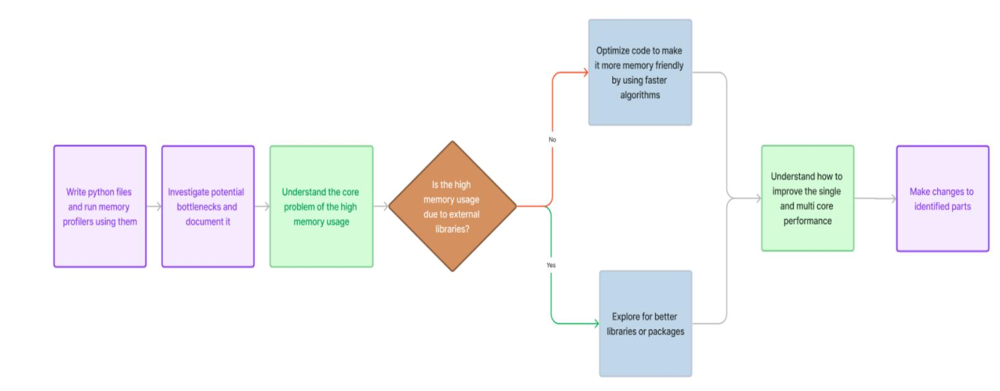

# GSoC'24 Proposal - Tardis

#### TARDIS Benchmarking and Performance Improvement

# Personal Details

Name: Asish Kumar

Email:

Github: officialasishkumar

LinkedIn: <https://www.linkedin.com/in/asish-kr/>

Current Country: India

Time zone: GMT + 5:30

#### About Yourself

I'm Asish Kumar, a student from India currently pursuing a Bachelor's in Information Technology. I am actively contributing to open source repositories and my major contributions are in keploy which is an API testing project part of GSoC and LFX landscape. I have experience working with python, C++ and golang. I read the documentation and understand the main flow of the project. I have great interest in working with tardis this summer because of the project idea which aligns with my goals. I love solving algorithmic or coding problems. This project will help me to showcase my skills by optimizing the codebase to make it more efficient in terms of time and space complexity. Also it will give me an opportunity to learn more about how development is done in a large codebase which will definitely help in my professional career.

Apart from this, I have been solving lots of problems on websites like codeforces and leetcode. I think my problem solving skills will greatly help in the success of this project.

#### Commitment

- 1. Are you planning any vacations during the GSoC period? No
- 2. Do you have any other employment during the GSoC period? No
- 3. How many hours per week do you expect to work on the project and what hours do you tend to work?

I would like to work for 350 hours and 40 hours per week.

# Proposal

The first part of the project will involve writing benchmarks that covers most of the part of the tardis codebase. I will be adding teardown functions which will free up memory that is taken up by method calls in the setup function (for example: downloading atomic data). Additional improvement would be to cache repeating setup statements that consume some memory to make the benchmarking process fast.

For example:

For benchmarking SDECplotter, I can use the following code with setup_cache function because the process is repeating for every benchmark and will consume some time and memory:

path = os.path.join(dir_path, "data", filename) config = Configuration.from_yaml(path)

def time_sdec_plot_mpl(self): plotter = SDECPlotter.from_simulation(self.sim) plotter.generate_plot_mpl()

Whereas teardown function can be useful when we did some changes on the file system and we want to revert back. In plasma graph generator we can use teardown function as:

with open('plasma_graph_default.tex', 'w') as fp: pass with open("plasma_graph_default.tex", "r") as file: print(file.read())

In order to better understand the benchmarks results I will be running profilers on top of asv.

I have also made a pull request that benchmarks the read_stella_model function. You can find that on <https://github.com/tardis-sn/tardis/pull/2548>.

In order to make the Airspeed Velocity page to better represent the existing benchmark, I will store more than 5 commits that can be done by tweaking this line of code in github actions. In order to make it faster, I will use --skip-existing-commits to make it skip the commits which are already benchmarked in the previous commits. To make it work even faster, I will use ccache library. Here is a demo snippet of how I will use it in github actions:

- name: Setup some dependencies pip install asv sudo apt-get update -y && sudo apt-get install -y ccache

echo "timestamp=\$(date +%Y%m%d-%H%M%S)" >> \$GITHUB_OUTPUT path:.ccache key: ccache-\${{ secrets.CACHE_VERSION }}-\${{ steps.prepare-ccache.outputs.key }}-\${{ steps.prepare-ccache.outputs.timestamp }}

In order to improve the website, I will be adding the commit hash and the associated PR which caused the highest regression using asv find command in the displayed range of commits. This will be shown after the commit range. Additional improvement will be to add links to the associated PRs of every commit in the graph. This can be done using the search api.

The second part of the project which mainly involves improving the codebase in order to improve performance. I will do this by using tools like memray, scalene etc. The major difference between memray and scalene is memray is a function level profiler and scalene is a line and function level profiler (helpful for understanding bottlenecks in large functions or functions that use numpy). I will use my algorithmic knowledge to improve the space and time complexity of functions, basically adopting faster algorithms from cp-algorithms.com. Some of the well known algorithms and tools that I will be using are sliding window, binary search, C/C++ libraries or functions using cpython, dynamic programming etc. Tools like Yolk and Snakefold will help me in analyzing package dependencies across the project and avoid unnecessary import.

I have made a pull request that profiles the run_tardis method. You can find that on <https://github.com/tardis-sn/tardis/pull/2531>

Strategy that I will follow to benchmark internal/core functions/classes are:

- Run on multiple data sets to know how the code behaves when a large amount of data is exposed.
- When trying to benchmark a particular function or class that is dependent on a different function, I will push the implementation of the parent function in the setup function which will allow me to benchmark in isolation.
- Compare the benchmark of isolated and complete function/classes using compare and inspect more about the behavior of code with and without that function/class.
- Use Unit tests as a starting point to benchmark most of the codebase.

In order to improve the multicore performance of the codebase, I will adopt the following strategies:

- Using multi threads over processes. This will be useful when an operation releases GIL. Most of these operations can be linked with Numpy. In order to achieve this I will use multiprocessing library.
- Parallelism will always be hard to achieve in python as mentioned in PEP 703. Using Polar instead of Pandas (while working with data sets) can be a good approach since it uses internal thread pools.
- While dealing with large data, I will use mpi4py which spawns independent processes. They communicate with slim dictionaries, and all large data transfers are done via files on the disk.

Here is a flowchart to better understand my workflow for the second part of the project: <https://www.figma.com/file/e6OXSyJhUAo4cuSmLwk40m/tardis-benchmarking-flowchart?type=whiteboard&node-id=0%3A1&t=FQLGi3N4K4Xf2d7f-1>

#### Tools and Technologies to be used: (can change/update as I proceed with the project)

- 1. Memray & Scalene for memory profiling
- 2. Polar Replacement of Pandas
- 3. Airspeed velocity for creating benchmarks
- 4. Cpython use with asv
- 5. Yolk & Snakefold package dependency in the codebase.
- 6. Cpython Write functions in C and import it in python.

### Key Deliverables:

- 1. Weekly project updates through meetings/IRC/matrix.
- 2. Document my workflow and share it with mentors.
- 3. Multiple blog posts during the course of my project.
- 4. A guide to understand the major changes and the difference in the benchmarks.

These deliverables will help new contributors to better understand the challenges and the adopted solutions in order to make TARDIS better in terms of performance. This will help them in writing efficient code and tackle any performance issue.

## Project Plan:

#### (Community Bonding Period)

- Understand Existing Codebase.

- Discuss with the mentor the best way to go about the implementation.

|Start Date End Date Tasks | to be completed |  |  |  |  |  |  |
|---------------------------- | ------------------- | ------------------- | ------------- | -------------- | ------------ | ------------ | ------------------ |
|May 27 June 16 Add | Benchmarks | using | air speed | velocity |  | and also | create |
|memory | usage | profile and | update | the | benchmark |  | page of tardis |
|June 17 June 22 Document | the | results and | find ways |  | on how | to improve | the |
|benchmark | result, | something | that | will | make | the | run_tardis |
|function | faster. |  |  |  |  |  |  |
|June 23 June 30 Improve | asv | page to store | more | than | 5 commits |  | and display |
|commit | hash | which has | the highest | regression |  | from | the range of |
|commits. | This | will also involve | using |  | the ccache |  | library in the |
|github | actions. |  |  |  |  |  |  |
|July 1 July 22 Go through | the | results and | improve | the | tardis | codebase | (also |
|involves | taking | continuous | feedback |  | from | mentors) | on single core |
|performance |  | using various | algorithms |  | mentioned |  | above. |
|July 23 August 11 Improve | multicore | performance |  | of tardis | using | tools | and libraries |
|like | multiprocessing, | mpi4py, | polar | etc | and | document | the |
|improvement |  | by comparing | previous |  | benchmarks |  | with the current |
|August 12 August 25 Tackle | any bugs | and write | blogs | (github | pages) |  | This period will |
|also | include providing | all | the key | deliverables |  | mentioned | above. |

# What to expect from GSoC at Tardis

- Opportunity to learn new things.
- Learn more about the project and its future goals.
- Connect with mentors on a weekly/biweekly basis.
- Community meeting with other mentees of GSoC.
- Feedback loop
- Active review on PRs.
- Suggestions on how to tackle any hard challenge that I may end up on.