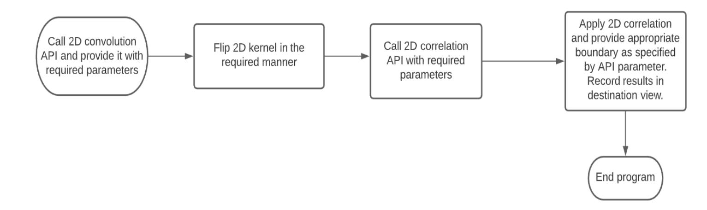
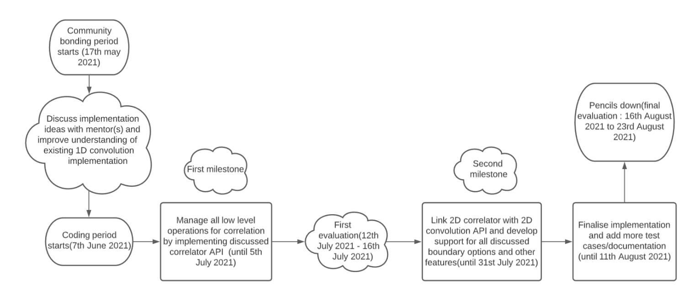

# Boost.Gil(Generic Image Library)

Project name:2D Convolution and Correlation

Student name: Prathamesh Tagore

College: Veermata Jijabai Technological Institute(VJTI), Mumbai, India

Degree program: Bachelor of Technology (B.Tech)

Course: Electronics and Telecommunication

Currently in: 4th semester(Second year)

Graduation year: 2023

Time zone: IST(UTC + 0530)

Email: prathameshtagore@gmail.com

Profile: Github, LinkedIn

# Availability

#### How much time do you plan to spend on your GSoC?

I intend to spend around 18-24 hours every week(3.5-4 hours every day for 6 days). I do not have any strict commitments to fulfill during this summer and can easily spend around 36 hours every week(6 hours every day for 6 days) if required. My typical working hours will be 1800-2000 and 2200-2400 in evening. However, I am flexible with this and can adjust it as per the time zone of my mentor(s) if need arises.

### What are your intended start and end dates?

My college exams will end around 17th may 2021, after that I will be able to start my work. I intend to finish the project around 11th August 2021.

## What other factors affect your availability ?

I do not have any other strict commitments to fulfill during this summer.

# Background Information

I am a 2nd year undergraduate student with Electronics and Telecommunication as my major in Veermata Jijabai Technological Institute(VJTI), Mumbai, India. I have successfully completed 3 out of 8 semesters for my major and will give the final exam for my fourth semester in may 2021.

### Academic performance :

CGPA (for first three semesters): 9.75 / 10

#### Some technical courses which I have completed until my 3rd semester are :

- Introduction to signals and systems
- Network analysis and synthesis
- Introduction to digital communication
- Introduction to analog communication
- C++ programming

#### Completed Internships/Jobs/Courses : -

- I have worked as an intern with munga innovations pvt. ltd. during July 2020 to January 2021. Me and my colleagues developed a flutter based android application which can be used for home automation with the help of Esp 8266 microcontroller.
- I have successfully completed the Algorithmic Toolbox course offered by University of San Diego on Coursera.
- I have also completed an introductory course on Neural Networks and Deep Learning offered by DeepLearning.AI on Coursera.

#### Programming Background :

I started writing code during my freshman year with C++ as my first language. I have worked on some small open source projects in the past(some of which are mentioned in a later section of the proposal). I have a decent amount of experience working with standard data structures and algorithms in C++(for the purpose of competitive programming). Besides C++, I can write code in other languages such as Python, Dart, Java and C.

## Reason for contributing to Boost C++ libraries :

In the past few years, modern C++ APIs have proven themselves as a blessing for C++ programmers all around the world. The fact that many of these amazing features are a brainchild of the boost library ecosystem motivated me to explore the world of boost libraries. I am sure that the knowledgeable and friendly boost community will ensure the continuation of this tradition. I would like to be a part of this amazing group of people and contribute useful and meaningful code available for everyone around the globe.

I have spent quite some time working with boost libraries such as Boost Gil, Boost Asio etc. for some of my personal projects as well as for contributing in development of official APIs. During this time, I have learnt/explored many amazing things, I would like to continue this stream and keep learning from the awesome boost community. Open source projects provide an opportunity for beginners to analyze and learn best coding practices followed by experts and bring themselves at par with industry standards while contributing useful code for everyone, this is my motivation behind working for open source projects in general.

#### My interest in project :

Since image processing algorithms are expected to process data almost spontaneously for analyzing real time situations, speed is one of the most important parameters used for determining an algorithm's effectiveness. Convolution can be regarded as the backbone for several image processing algorithms. Improving its implementation will provide a major performance improvement for all these related algorithms. This is a major factor of interest for me in this project.

#### Previous work done in this area :

I have worked on several open source projects involving various image processing algorithms.

Details of some of these projects are stated as follows:

### 1. Basic Image processing algorithms :

A small repository containing implementations of basic image processing algorithms such as

- Image rotation by an arbitrary angle
- Image masking
- Sobel edge detection
- Canny edge detection
- Basic Morphological processing

Working on this project helped me learn important concepts of image processing and computer vision in general. My motive behind working on this project was to gain intuition about the complex processes happening behind the scenes when an API for applying an image processing algorithm is called.

## 2. Object tracking algorithms :

This repository contains custom implementations of popular object tracking algorithms such as Boosting tracker, Mosse tracker etc. The purpose of this project is to understand existing object tracking algorithms and then develop a custom robust object tracker.

## 3. Person detection using histogram of oriented gradients :

This project serves as a computer vision solution for a catch practice bot. It detects a person using feature vectors provided by histogram of oriented gradients algorithm and helps identify a target point for the projectile to be used by extracting 3D coordinates of a person using data obtained from a lidar sensor and 2D image.

## My plans beyond the Google summer of code time frame :

I will continue adding more image processing algorithms in Boost Gil after the duration of GSoC 2021. I will also try to add useful and efficient features to the already developed

Experience and efficiency rating for related technologies:

- C++ 98/03 (traditional C++): 4/5
- C++ 11/14 (modern C++): 4/5
- C++ Standard Library: 4/5
- Boost C++ Libraries: 3.5/5
- Git: 3.5/5

#### Software development environment I am most familiar with :

Visual studio code(I have a decent amount of experience with other editors such as sublime and atom as well).

Software documentation tool I am most familiar with:

Doxygen

# Project proposal

Following is the list of intended modifications in higher level APIs for 2D convolution. Please note that this list is made only on the basis of my initial ideas and it may change/improve after discussing these ideas with my mentor(s):

### 1. Separate 2D convolution and correlation :

The existing implementation performs two dimensional convolution by directly accessing flipped elements of the kernel and multiplying them with corresponding source image pixels. This approach does not provide a layer of separation between 2D convolution and correlation which restricts the user from using correlation separately without writing a custom designed function for it. I would like to add this layer and provide separate APIs for 2D convolution and correlation which will increase feature completeness of the library.

Intended higher level API to incorporate this modification is:

boost::gil::convolve_2d(src_view, kernel, dst_view, boundary_option) Parameter specifications are: src_view: Gil image view of source image.

### 2. Improve pixel accessing method :

Current implementation of 2D convolution uses the overloaded '()' operator of Gil image views for accessing individual pixels from a two dimensional image. This method is costly from the point of view of performance and cache management.

As explained by Mr. Lubomir Bourdev in Gil tutorial, individual pixel indexing for two dimensional image views can be improved by using iterators/locators instead of typical 2 dimensional indexing with overloaded '()' operator because use of iterators/locators enables the program to access next pixel by using the position of previous one instead of performing separate multiplicative and additive calculations for each new pixel.

I intend to modify the 2D convolution API in a manner which will allow it to access individual pixels using iterators/locators(depending on what my mentor(s) suggests) instead of the '()' operator used on top of a Gil image view.

kernel: Kernel matrix which is to be used during convolution dst_view: Gil image view of destination image. boundary_option: Enum variable specifying the way in which boundary line pixels should be handled. boost::gil::correlate_2d<PixelAccum>(src_view, kernel, dst_view, boundary_option) Parameter specifications are: PixelAccum: Provides information about the type of variable which is to be used for accumulating pixel values during correlation. All other parameters used in 2D correlation have similar specifications to parameters used in 2D convolution.

Following code snippets assign the sum of all vertical and horizontal neighbouring pixel colour intensities to the considered pixel.

The purpose of these examples is to demonstrate competency in the process of improving performance using iterators and locators instead of '()' operator on top of gil views:

Suboptimal implementation:

An efficient alternative using pixel iterators:

gil::gray8_image_t img(10, 10); gil::read_image("image.png", img, gil::png_tag{}); for (std::ptrdiff_t row = 1; row < view(img).height():
- 1; ++row) { for (std::ptrdiff_t col = 1; col < view(img).width()
- 1; ++col) { view(img)(col, row)[0] = view(img)(col
- 1, row)[0] + view(img)(col + 1,row)[0]+ view(img)(col, row
- 1)[0] + view(img)(col, row + 1)[0]; } }

gil::gray8_image_t img(10, 10); gil::read_image("image.png", img, gil::png_tag{}); for (std::ptrdiff_t row = 1; row < view(img).height():
- 1; ++row) { gil::gray8_view_t::x_iterator up = ++view(img).row_begin(row
- 1); gil::gray8_view_t::x_iterator center = ++view(img).row_begin(row); gil::gray8_view_t::x_iterator down = ++view(img).row_begin(row + 1); gil::gray8_view_t::x_iterator left = center
- 1, right = center + 1; for (std::ptrdiff_t col = 1; col < view(img).width()
- 1; ++col) { center = left + right + down + *up; ++center, ++left, ++right, ++down, ++up; } }

An efficient alternative using pixel locators:

For all above examples, consider namespace gil = boost::gil.

### 3.Provide more boundary options :

The current 2D convolution API provides only one way for handling boundary line pixels of an image. I intend to provide more options to the user for handling boundary line pixels similar to the ones already provided with original 1D convolution such as

- 1. boundary_option::output_ignore
- 2. boundary_option::output_zero
- 3. boundary_option::extend_padded
- 4. boundary_option::extend_zero
- 5. boundary_option::extend_constant

These different boundary options could be specified by the user using an enum variable(similar to the existing implementation of 1D convolution).

gil::gray8_view_t::xy_locator loc_center = view(img).xy_at(1, 1); gil::gray8_view_t::xy_locator::cached_location_t loc_up = loc_center.cache_location(0, -1); gil::gray8_view_t::xy_locator::cached_location_t loc_down = loc_center.cache_location(0, 1); gil::gray8_view_t::xy_locator::cached_location_t loc_left = loc_center.cache_location(-1, 0); gil::gray8_view_t::xy_locator::cached_location_t loc_right = loc_center.cache_location(1, 0); for (std::ptrdiff_t row = 1; row < view(img).height():
- 1; ++row) { gil::gray8_view_t::x_iterator center = ++view(img).row_begin(row); for (std::ptrdiff_t col = 1; col < view(img).width()
- 1; ++col) { *center = loc_center[loc_up] + loc_center[loc_down] + loc_center[loc_left] + loc_center[loc_right]; ++center, ++loc_center.x(); } loc_center += gil::point2<std::ptrdiff_t>(-view(img).width() + 2, 1); }

### 4. Separable 2D convolution :

As explained on this page, we can define each two dimensional kernel as a matrix product of two different one dimensional kernels. Since convolution is commutative as well as associative, we can apply two successive 1D convolutions in any order with required kernels and obtain a similar result as to applying 2D convolution with our original 2D kernel. The major advantage of this process is the improvement in performance as mentioned in the second last paragraph of the above given page.

I would like to discuss the above idea of providing a separable 2D convolution implementation with my mentor(s) for improving performance of the algorithm.

A visual representation of the intended workflow for 2D convolution API is attached here for the convenience of reader:

All changes/improvements made during GSoC 2021 will be supported by tests and well written documentation/tutorial(s).

#### Miscellaneous work :

In the event that my work is finished before planned deadline, I will invest my time in completing tasks mentioned below:

- Build support for varying thickness of curves drawn by applying rasterization algorithms.
- Add functionality for rotating an ellipse.
- Create API for drawing circular and elliptical arcs using rasterization.
- Implement ImageJ's algorithm for triangle thresholding using histograms.
- Solve issues and improve existing functionality of the codebase.
- Improve documentation of existing codebase.

## How my work will benefit the community and Boost Gil in general :

- A faster and more efficient implementation of 2D convolution/correlation will improve performance and effectiveness of all convolution/correlation related algorithms in Boost Gil.
- Having separately usable APIs for 2D correlation/convolution will increase feature completeness of Boost Gil.
- Easy to use API aligned with 1D convolution/correlation and supported with well written documentation/tutorials will help users to quickly familiarize themself with provided API and grasp the logic used behind the process.

# Proposed milestones and schedule

# Competency test

Following pull request is the solution to my competency test:

- Add rasterizer support for ellipse #585 (merged):

This pull request added rasterization functionality for drawing horizontal and vertical elliptical curves. Mid-point algorithm was used for constructing the rasterizer trajectory in the first quadrant. Rest of the ellipse was drawn by shifting origin to the provided center and using reflection for obtaining rasterizer trajectory in 2nd, 3rd and 4th quadrants.

Apart from this, I am actively contributing to boost Gil repository since the month of January 2021. Owing to this, I have a good understanding of the code base and development practices followed. Following are the details of my earlier contributions:

- Added all standard morphological transformations #541 (merged):

This pull request added standard morphological transformations such as dilation, erosion, opening, closing, morphological gradient, top hat and black hat in Gil. Test cases were provided and output images were compared with opencv's output.

- Add higher order kernel support for Sobel operator #562 (open):

Its purpose is to automate the process of obtaining higher order kernels for Sobel operator. Discrete convolution was performed between lower order kernels for obtaining higher order kernels. Obtained kernels were compared with opencv's kernels which are used for applying Sobel operator.

- Port TuttleOFX extension: pattern #581 (open):

Ports pattern extension from TuttleOFX repository into Boost Gil as mentioned in issue #449.

- Port TuttleOFX extension: shrink #582 (open):

Ports shrink extension from TuttleOFX repository into Boost Gil as mentioned in issue #449.

- Port TuttleOFX extension: aligned #583 (open):

Ports aligned extension from TuttleOFX repository into Boost Gil as mentioned in issue #449.

- Fix sphinx installation in docs readme #560 (merged):

Fixed a broken in readme file of docs.

- https://github.com/boostorg/gil/blob/develop/include/boost/gil/ex tension/numeric/convolve.hpp
- https://github.com/boostorg/gil/blob/develop/include/boost/gil/ex tension/numeric/algorithm.hpp
- <https://www.youtube.com/watch?v=sR8Wjg0pceE&t=344s>
- https://www.boost.org/doc/libs/1_68_0/libs/gil/doc/html/tutorial. html#example-computing-the-image-gradient
- http://www.songho.ca/dsp/convolution/convolution.html#convolutio n_2d
- <https://www.lucidchart.com/pages/>