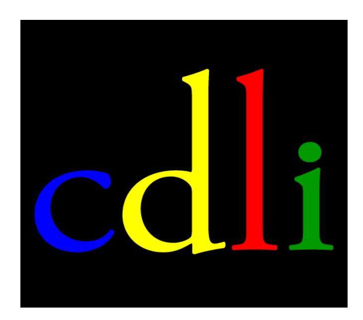
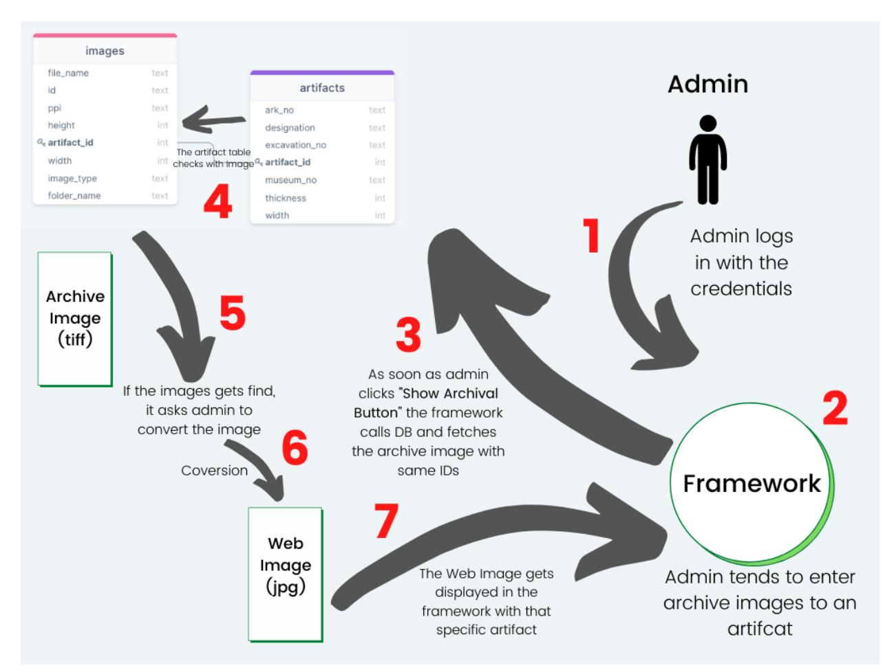
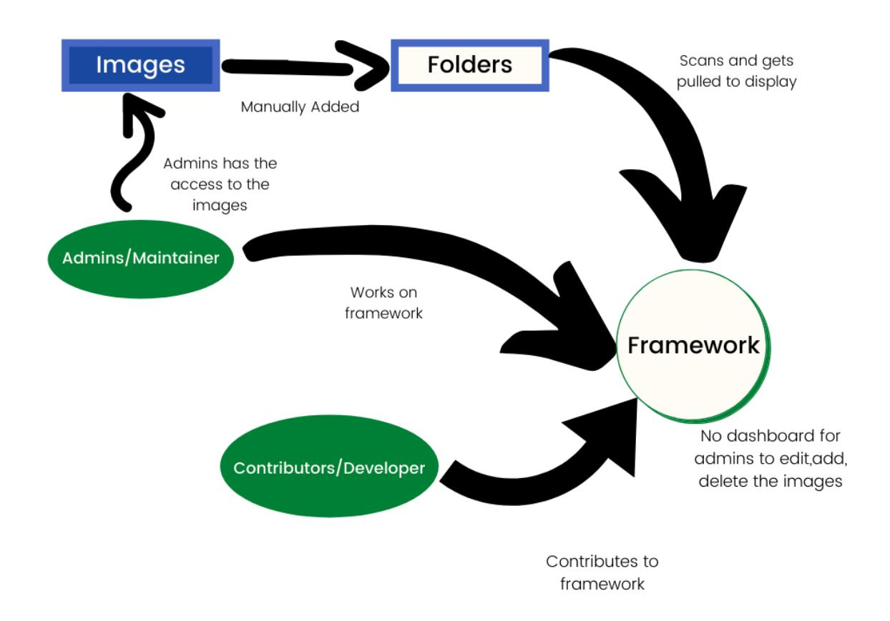
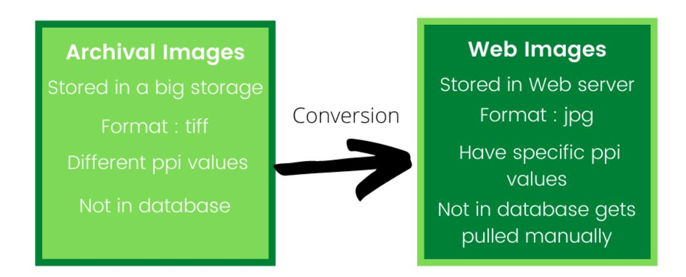
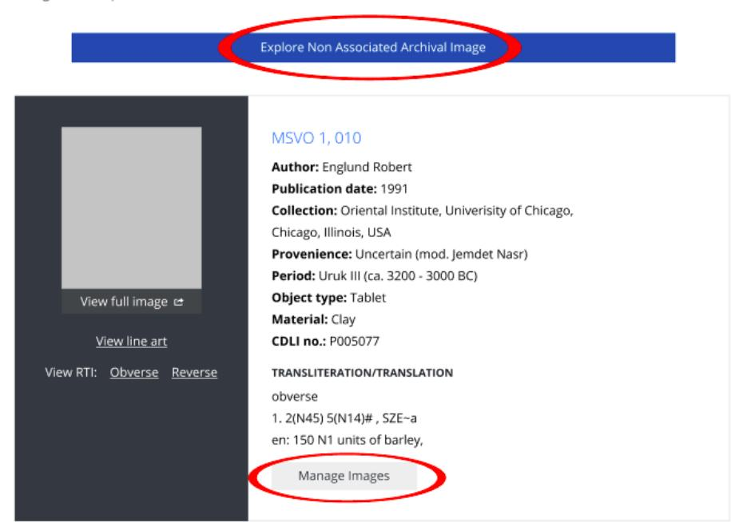
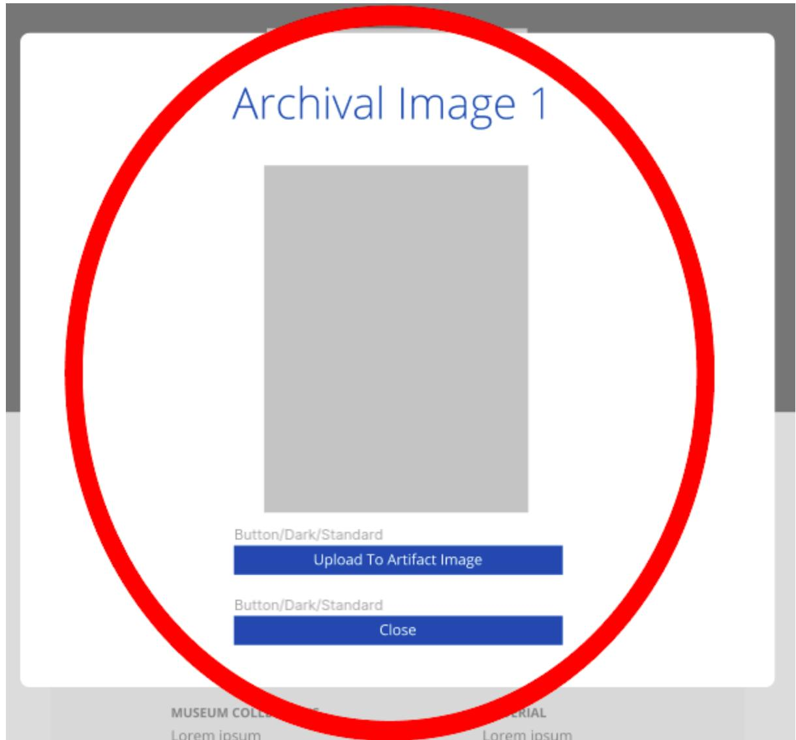
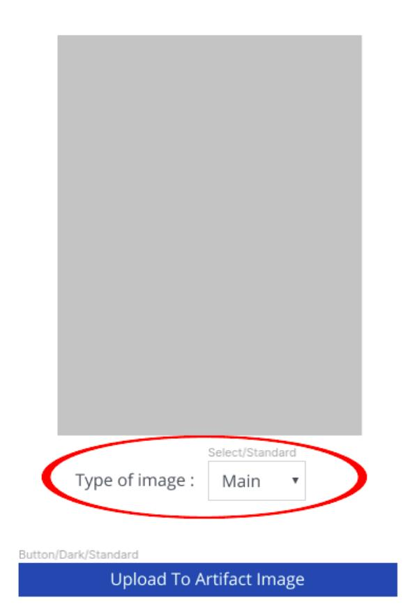
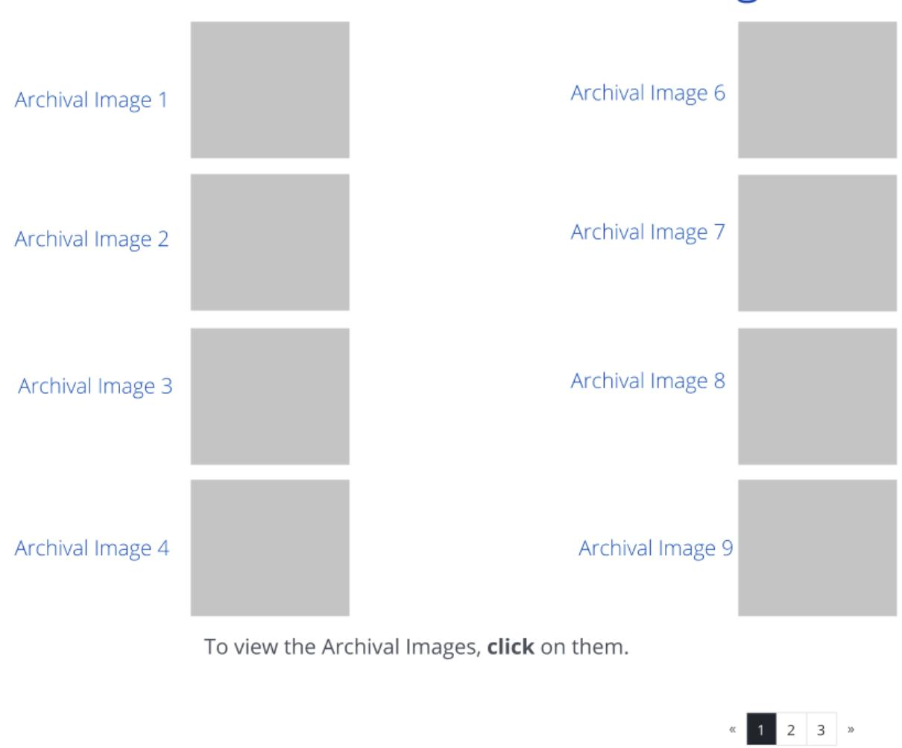
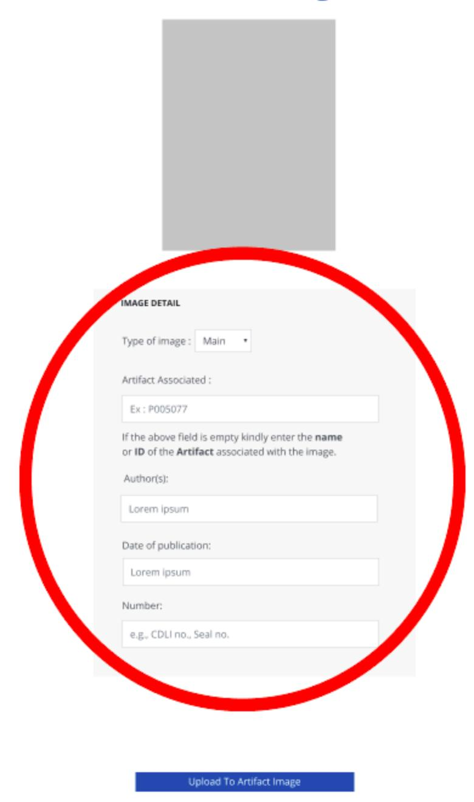
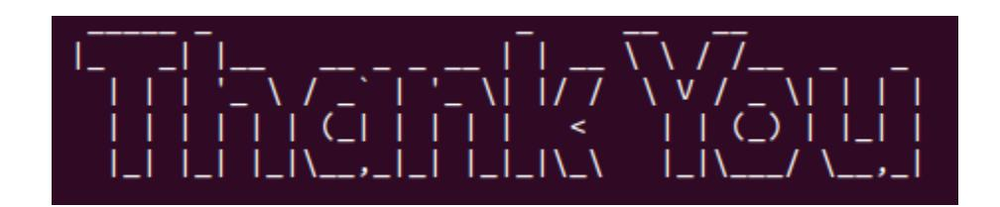

# Digital Library Management

Project Proposal By

Daksh Paleria

### INDEX

|PERSONAL | DETAILS | 3 |
|---------- | ---------------------------------- | ------------------- |
|SUMMARY |  | 3 |
|PROJECT | INFORMATION | 5 |
| | OBJECTIVES | 5 |
|RELEVANT | SKILLS | 6 |
| | TECHNICAL DESCRIPTION | 6 |
|TIMELINE |  | 24 |
| | DELIVERABLES | 26 |
|TECH | STACK PROPOSED | 27 |
|PREVIOUS | CONTRIBUTIONS | 27 |
|HOW | IS THIS GOING TO PROFIT THE | ORGANISATION ? 28 |
|WHY | AM I SUITABLE FOR THIS PROJECT ? | 29 |
|PERSONAL | INSPIRATION | 29 |
| | COMMITMENTS | 30 |

### PERSONAL DETAILS

- ● Hello:) I'm Daksh Paleria, currently in my 2nd year studying Computer Science & Engineering from Vellore Institute of Technology (VIT)
- My current location is Surat, Gujarat (GMT+5:30)
- GitHub - Daksh
- Email Address - dpaleria@gmail.com
- Mobile Number - +91 7016397736
- LinkedIn - Daksh
- Portfolio - Daksh

# SUMMARY

The current CDLI Framework has the necessary controllers, methods, authentication methods that can help in integrating the DL into our framework. We will be making our own controllers, methods to satisfy the needs of our project. The below flowchart summarises my complete approach. The following numbers are the order of steps:

Step 1: The Admin logs into the framework using their credentials.

Step 2: The Admin wants to change the information present on the artifacts page.

Step 3: As soon as Admin goes into our Image Management Framework, it specifies all the images that are related to that specific artifact.

Step 4: The Artifacts Table makes a call to the images table to display all the related images.

Step 5: As soon as the admin clicks on the archival images we convert them into web images.

Step 6: The admin takes a look at the web image and decides whether to add an image to the artifact page or not.

Step 7: The web image gets displayed on the framework once the admin approves it.

The same procedure is followed for Non Associated Images, where the admin has to add the artifacts ID to which the image is related and give the approval to upload it.

## PROJECT INFORMATION

- ● Organization: Cuneiform Digital Library Initiative.
- Project: Digital Library (DL) Management.
- Mentor: Jacob L. Dahl. This project is about preparing a dashboard in the existing CDLI Framework that can show an admin the visual assets of the digital library for each artifact but also add, edit, delete, images using the archival images served as a source of better quality images to prepare their web counterpart. We are supposed to manage the access to images in it (as some images are not public).

# OBJECTIVES

### Primary :

- Develop a dashboard and a series of workflows so admins can manage the digital library (dl)
- Populate the tables with information from the current dl

- Keep the system flexible so we can create an extension for crowdsourcing of images in the future.

### Secondary :

- Assist in setting up an automated grab of archival and raw images from the VM, to the archival server. These images will have been uploaded through the images manager or the minio interface.
- Set up a granular access to images at the image level (instead of at the artifact level).

# RELEVANT SKILLS

- ● Familiarity with tiff/jpg and vector handling libraries
- Familiarity with managing larger sets of files
- Understanding of Docker, Linux
- PHP / CakePHP/HTML/CSS
- Able to communicate complex ideas to non-specialists

# TECHNICAL DESCRIPTION

AIM: To make a dashboard for admins to manage the Digital Library (DL) and integrating a functionality so that we can convert our archival images(tiff) into web images(jpg) and then integrating the images into our database.

### What's the problem ?

In the existing CDLI Framework. Control over the images linked to artifacts is manual, making workflow slow and error-prone.

Since REST all functionalities are already stored in the database, the only thing that still remains is the Images that are linked to a specific artifact, right now we are pulling the images automatically from our web server, apart from the web server we have a storage in which we have our archival images which are in Tag Image File Format(tiff) format, so before displaying the archival images on our framework we would be required to change their formats into the JPG and make some changes in their Pixels per inch (ppi) values too. We will be using our archival images only if there is a problem in any of the web images or if we are making them for the first time.

### Solution

Let's divide the solution into smaller parts on the basis of their specification.

- 1. Admin Side Dashboard (Frontend).
- 2. Managing Image Information (Backend).

### Admin Side Dashboard

You can access the complete design file from here (I have reused most of the elements from existing designs just to make sure that there is consistency in the design of the complete framework).

We will be using the existing authentication to let the admins and users login which in turn allows the admin to access more features of the framework, whereas the user gets limited in viewing the framework rather than getting the access to edit the details and functionalities present in it.

We can add a new tab in the Admin Dropdown Menu which goes by the name "Manage Images" which can only be accessed if the user logs in with the admin credentials.

So using the existing framework's authentication function we can display this new option in the navbar just for admins, which can help in restricting the access.

As the number of artifacts is more than 350k, we can allow the admins to use the existing "Browse" methods to browse through the artifacts and there we can give them an option to manage images. The admins can browse through the images that are not yet associated with any of the artifacts, we can allow the admins use "Explore Non-Associated Image" which will help the admin go through the non-associated images.

We will first give a look to the "Manage Image" option.

After clicking on manage images option the admin will see the below screen.

This screen will show the admin the existing image which is already present on the framework for that specific artifact.F Here the Admin can remove this specific web image if they want to, but before doing that the Digital Library will check whether there is another image related to this specific artifact or not, if we are able to find a archival image related to this artifact then the admin can move ahead and remove the image(the image will be made non-public) by clicking on the image which will result in opening a popup to confirm whether they want to really delete the image or not. Now if the admin wants to explore the Archival Image related to this specific Artifact then they can scroll down to view them.

Now the admin will be able to access the archival images by opening this tab, the tab will consist of all the archival images related to this specific artifact.

Here we will allow the admin to get a Preview of the images present in the archive which are related to that specific artifact.

The admin can click on the image, which will then call our function to convert the archival image from tiff to jpg. After conversion of the image we will display the image and ask whether they want to upload the image to the framework or not.

This page opens up after the admin chooses the one of the archival image, now if the admin opens the image just to check whether that image already exists, then they can simply click on the "Close" button which will close the image pop up and take them back to the dropdown menu. Now if the admin wants to upload the image, then they can click on the "Upload to Artifact Image" which will take them to choose the type of image.

Here the admin can choose the type of image (main,linear,detail, envelope, line art, lineart detail) and then press on the "Upload to Artifact Image" to successfully upload the image to the framework. This was the case when we knew which image in the archival server is associated with which of the artifacts. The other case is of "Non Associated Archival Image" the images which are as of now not related to any of the given artifacts, such type of Images might also be used when needed.

So now if admins want to explore the images that are not associated with any of the artifacts then they can click the first option "Explore Non Associated Archival Images" which will open up the list of the images that are not associated with any of the artifacts.

After clicking on the above button, the following page comes up. Here again we give the admin a preview of the image. They can pick up any of the images to view by clicking on them, which then converts our images from tiff to jpg format. After viewing the image, the admin gets an option to add this image to the framework or not.

After clicking on any one of the above options the admin gets an option to whether to add the given image into the framework or not.

Here the admin is supposed to add the ID of the artifact it is related to, Once we get that information, we retrieve the rest of the other fields by going through the data of that specific artifact. For eg: If the admin gives the type of image as main and if a main image already exists then the DL will alert the admin that "A main image is already there for this given artifact" so here either the admin can go back and change the type of image or the admin can approve the DL to replace the existing main image with this one.

In this way we are able to manage the existing web images by giving the admin an option to explore them and if needed to delete them. On that same page we show the archival images related to that specific artifact, which on clicking gets converted to jpg format and is ready to be uploaded if needed.

### Managing Image Information

Now that we are done with the frontend we can now move on to the backend to see how that is going to be set up- which tables will play a major role and how are the new tables going to be linked with each other.

We are going to set up a new table which will go by the name "images". The following table will have its own unique ID. We are going to save the web images information in the table with the information of archival images once they get converted. The different columns in the table will be:

1. file_name: This column will help us in storing the file name of the image,

- this file name helps us identify the artifact to which it is associated.
- 2. id: This is a unique identifier for all of the images which helps us in calling the image.
- 3. ppi: This column will store the Pixels per inch (ppi) values of each image, it will be by default 600. The admin has an option to change it during the conversion.

4. height: This column will store the height of the image.

5. width: This column will store the width of the image.

6. artifact_id: This column will help us in linking the existing artifact table with our new table in order to help us find which image is associated with which table.

7. image_type: This column will store the type of image which is chosen by the admin during the conversion. The types are main, detail, envelope, line art, lineart detail, etc.

8. folder_name: This column stores the folder name of the image which helps us in finding the type of image.

Visual Representation of how the tables will look like:

Now that we are done with both the frontend and the backend, comes the task connecting both the frontend and backend together. We will be following some standard naming conventions and practices to bring up these new functionalities in our framework. Following the standard practices will help us a lot in maintaining the documentation and will help the other contributors too when they come in future to contribute.

### Connection of backend and frontend

For connecting the frontend and backend we are supposed to add these new tables with their controllers and a new route in our existing framework which will help to allow only the admins to access it. We will be following the CakePHP Naming Convention for Database Schema.

As you can see we have made a new table with the name images, to connect the table with our frontend we are supposed to make new controllers, new routes, new templates.

Following the standard convention:

- The table name is "images"
- A new class with name "ImagesTable" is to be created at app/cake/src/Model/Table/ImagesTable.php
- A new entity class with name "Image" is to be created at app/cake/src/Model/Entity/Image.php
- A new controller has to be created by the name "ImagesController" at app/cake/src/Controller/Admin/ImagesController.php

- A new template should be created under the Images folder at app/cake/src/Template/Images/index.ctp
- In the above same manner we will be creating a new view template as well app/cake/src/Template/Images/view.ctp
- We will be defining a new route in our routes.php file at app/cake/config/routes.php

Once we are done with making the controller, templates and other stuff, CakePHP will automatically make a call to the index.ctp file once we try to visit http://localhost:2354/admin/images which will further then call our templates view.ctp

Since view, index will just help us in listing and viewing we are supposed to create our new methods in order to perform the activities of add, editing, deleting images into the framework.

Here, we are connecting '/' (base path) to a controller called 'Pages', its action called 'display', and we pass a param to select the view file to use (in this case, src/Template/Pages/home.ctp)... */ //\$routes->connect('/', ['controller' => 'Pages', 'action' => 'display', 'home']);

In the similar manner we can declare our new methods like add, delete for managing the images. Below is an example from our existing codebase in which we have defined a function to add a new Artifact. You can find the code here.

public function add() { // Access Check if (!\$this->GeneralFunctions->checkIfRolesExists([1, 2])) { \$this->Flash->error(\$this->Auth->config('authError')); return \$this->redirect(\$this->referer()); } \$artifact = \$this->Artifacts->newEntity(); if (\$this->request->is('post')) { \$artifact = \$this->Artifacts->patchEntity(\$artifact, \$this->request->getData()); if (\$this->Artifacts->save(\$artifact)) { \$this->Flash->success(('The artifact has been saved.')); return \$this->redirect(['action' => 'index']); } \$this->Flash->error(('The artifact could not be saved. Please, try again.')); }

This alone won't help us in completion of our project, we have to define our own methods which will give the admin the functionality to access the archival images and convert them.

Now the next most important thing is conversion of archival images (tiff) to web images (jpg).

Coding our own converting tool: We can code our own converting tool, the tool code be code in any programming language. It's not a tedious task as we are just calling the tiff image, using some default packages we can convert the image into a jpg image. We can that program in our templates and then use it to call, which then starts conversion when the admin clicks on it. This specific code uses ImageMagick Library. I have gone through its installation and setup, since the PHP Community is helpful in answering the problems that anyone faced while installing this library or while implementing it in their projects. Since we will be using this, we are then supposed to add the version names in Docker too, and then specify container for the same. We are supposed to edit the cdlidev.py file too in order to add this specific library in it and then run docker compose up.

function tiff2jpg(\$file) { \$mgck_wnd = NewMagickWand(); MagickReadImage(\$mgck_wnd, \$file); \$img_colspc = MagickGetImageColorspace(\$mgck_wnd); if (\$img_colspc == MW_CMYKColorspace) { echo "\$file was in CMYK format "; MagickSetImageColorspace(\$mgck_wnd, MW_RGBColorspace); } MagickSetImageFormat(\$mgck_wnd, 'JPG'); MagickWriteImage(\$mgck_wnd, str_replace('.tif', '.jpg', \$file)); }

I have just 2 issues on which I'm working right now, issue #304 and #454. I will try to finish those issues by the end of April and after that start working on coding the converting tool since it is the one which could take most of the time as we are supposed to code it from scratch and add its dependencies in our config files.

# TIMELINE

All the research related work will be done in the community bonding period. As I'm already familiar with the codebase of the framework, it will be easy for me to add new functionalities to the framework. I will utilize this time to brush up my web development skills and learn the new required skills by watching and following some relevant tutorials.

The evaluation period will be used to cope up with backlogs and will be used to implement the requested changes mentioned in any PRs.

|Week #No |  | Task |  |  |
|----------------------------------- | -------------- | --------- | ------------ | -------------- |
|Week #0 (17 May 7 June) | Community |  | Bonding | Period. |
|Week #1(7 June 13 June) Work | with | mentors | to get | review |
|and | formalize | the | workflow | and |
|also | review the | design |  | templates on |
|Week #2 (14 June 19 June) Install | image | magick | library | and try |
|to | add them | in | nginx | or cake |
|container |  | and | test | them out |
|whether | they | will | work or | not. |
|Week #3 (20 June 26 June) Raise | an issue | to | get a | review from |
|mentors | on | the | table | model, |
|preparing | a | script | to | populate the |
|table | accordingly. |  |  |  |
|Week#4 (27 June 3 July) Using | cake | bake | to | generate |
|standard |  | model | controller | and |

|template | files. | remove | non-useful |  |
|------------------------------------- | ----------------- | ------------- | ------------- | ----------- |
|templates | and | controller |  | methods |
|and | start preparing |  | the | methods |
|structure | for | the | needs | of the |
|Week #5 (4 July 11 July) Prepare | the controller |  | method | to be |
|used | when a | user clicks | on | manage |
|images | from |  | an | artifact. |
|Documentation |  | of the | work | done till |
|12 July 16 July | 1st | Evaluation |  |  |
|Week #6 (17 July 23 July) Editing | the | current |  | Artifact |
|Template | to | display | the | archival |
|images | list | and their | thumbnails, |  |
|adding | the | image | converter | and |
|trying | out the | display | of | archival |
|images | thumbnail. |  |  |  |
|Week #7 (24 July 30 July) Adding | controller, |  | methods | for |
|accessing |  | the non | associated |  |
|archival | images | and | testing | them |
|with | sample | data. |  |  |
|Week #8 (31 July 6th Aug) Creating | view | templates | for | viewing |
|non | associated | archival |  | images, |
|documenting |  | the | work | done till |
|Week #9 (7 Aug 15 Aug) Implementing |  | the | code of | adding |
|the | desired | images |  | to the |
|framework, | type | of | image. | Testing |

| |  | out this | feature. Creating student |
|-------- | -------- | ---------- | --------------------------- |
| |  | reports | and completing the |
|16 Aug | 23 Aug |  | 2nd Evaluation |
|23 Aug | 30 Aug |  | Final Evaluation |

# DELIVERABLES

- ● The Digital Library (DL) Management will be added as a functionality in the existing framework.
- Storing the information regarding the images in the database and making calls from there in the framework.
- Giving the admin the option to convert the archival images into web images and add them into the associated artifact information.
- Allowing the admins to change the type of the image and also allow them to change the artifact associated with it and also allowing the admins to change the access of the web images and archival images.
- Management of the dashboard to make sure that we are able to provide the admin with functionalities such as adding new archival images, removing an existing web image, giving access to the public or not.
- Since the conversion consists of using a new library this will result in editing the main cdlidev.py file to satisfy the new needs.
- Helping the admins in automating tasks which then helps in easing the workload.

# TECH STACK PROPOSED

- ● Programming Language: PHP/CakePHP/HTML/CSS
- Tools/Libraries: Docker
- Version Control System (VCS): Git on GitLab
- IDE: VSCode
- Working Environment: Ubuntu 20.04

# PREVIOUS CONTRIBUTIONS

### Pull Request Opened :

[[!218]](https://gitlab.com/cdli/framework/-/merge_requests/218) Changed the address present in the footer of the framework.

(merged)

[[!214]](https://gitlab.com/cdli/framework/-/merge_requests/214) Displayed whether the given author is East Asian or not.(merged)

[[!267]](https://gitlab.com/cdli/framework/-/merge_requests/267) Re-indexed order for CDLB, CDLJ, CDLP. (draft)

[[!256]](https://gitlab.com/cdli/framework/-/merge_requests/256) Coded a new Contribute Page. (draft)

[[!266]](https://gitlab.com/cdli/framework/-/merge_requests/266) Updating framework_install.md (reviewed)

### Issue participated/resolved

[[#304]](https://gitlab.com/cdli/framework/-/issues/304) Make contribute page (in progress) [[#416]](https://gitlab.com/cdli/framework/-/issues/416) Solved East Asian Order for authors (solved) [[#304]](https://gitlab.com/cdli/framework/-/issues/304) Make contribute page (in progress) [[#413]](https://gitlab.com/cdli/framework/-/issues/413) Change Address in footer (solved) [[#454]](https://gitlab.com/cdli/framework/-/issues/454) Publication Index (in progress)

[[#467]](https://gitlab.com/cdli/framework/-/issues/467) Improving framework_install.md (reviewed, solved)

# HOW IS THIS GOING TO PROFIT THE ORGANISATION ?

Till now we didn't make any calls to the database when we were fetching an image of any specific artifact, these resulted in an issue. The issue was that the admins can't change the image or add, remove any image, they were unable to change the type of image, they were also unable to ensure which image should be displayed. This made the image management in the framework more tedious.

With the help of my proposed approach towards this issue we try to implement the image management by adding all the necessary information about the images in our database and make a call towards it. This gives the admins the freedom to edit, add, remove any image and also give them an option to add archival images by converting them into web images.

This will also help in managing the images that are right now not associated with any of the given artifacts listed out on the framework. Through this proposed idea we tackle the major image management issues.

## WHY AM I SUITABLE FOR THIS PROJECT ?

It's been more than 3 months since I first started exploring, working on the vast codebase of the CDLI Frameworks. I need no more time to explore the codebase and the workflow of the framework, from solving beginner issues to solving an issue in which you have to add a new route in the given framework, this shows that I have explored the framework pretty well.

I have the required skill set for this project and I'm looking forward to making myself equipped by working with the mentors in this GSoC.

# PERSONAL INSPIRATION

I'm a 2nd year currently pursuing a Bachelor of Technology in Computer Science & Engineering. I got introduced to the world of open-source in my first year and since then I have been involved in various local open-source groups present in and around my college campus. I'm a member in technical clubs like Institution of Engineering and Technology (IET-VIT) and Team Fourth Dimension (TFD). Under TFD I have worked on various open-source projects and have been mentoring the juniors of the team for a year now. Apart from these projects, I have been a constant open source contributor in various organisations as well.

# COMMITMENTS

I have my university exams which will get over by 15th June, so after that, I will be able to devote 35-40 hours a week. By the time my exams are going, I will be devoting 30 hours a week. If something comes up in between I will make sure to keep the mentors in the loop and try to finish off the work in advance:)

