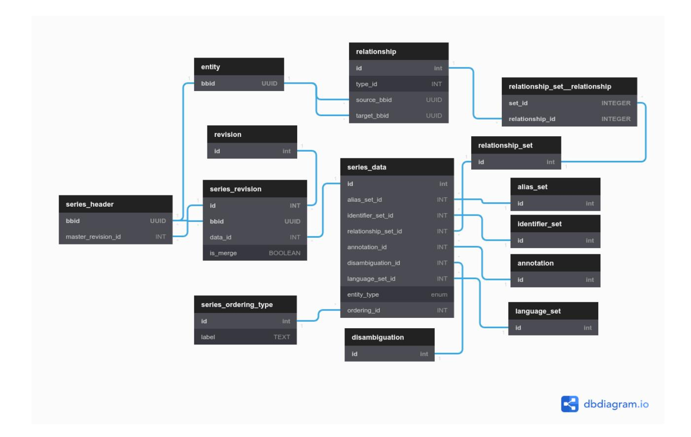
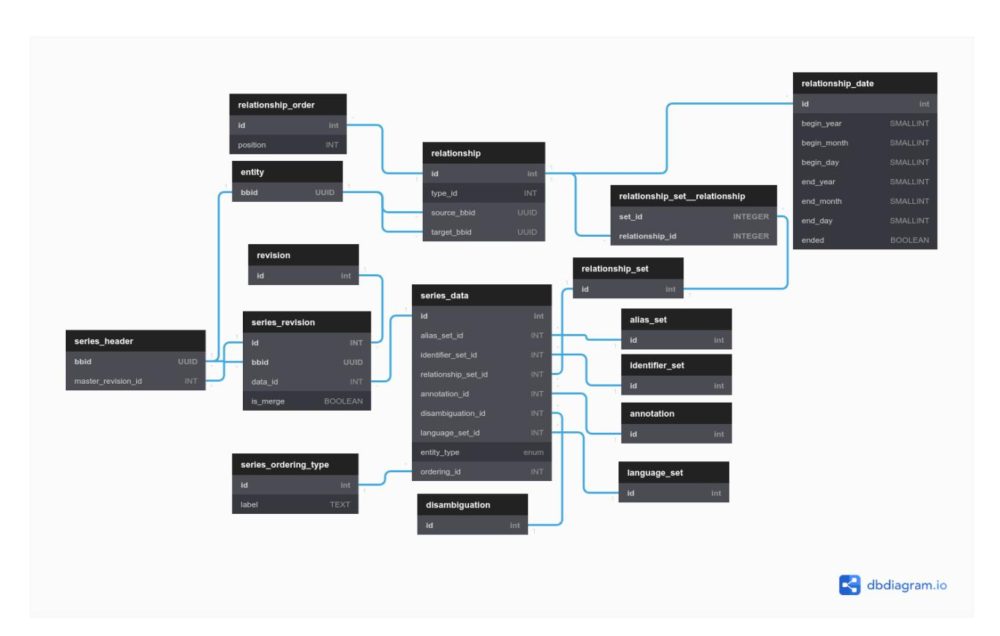
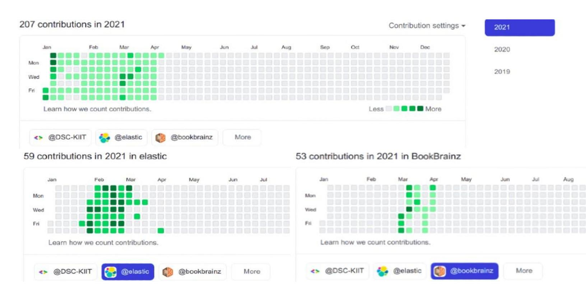
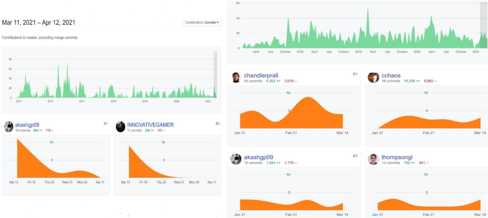

PROPOSAL

Implement a "Series" entity

By

Akash Gupta

# Personal Information

❖ Name: Akash Gupta ❖ IRC Nick: akashgp09 ❖ Email: akashgp9@gmail.com ❖ Github: akashgp09 ❖ Portfolio: akashgp09.co ❖ Blog: akashgp09.medium

## Project Name: Implement a "Series" entity

## Project overview

Bookbrainz lacks a feature which allows a person to create a series entity. A series is a sequence of separate author, work, edition, edition-group with a common theme. The individual entities will often have been given a number indicating their position in the series.

## FEATURES

➔ Basic Features:

❖ A user can create a series entity of a particular entity type. For ex: Author-Series, Work-Series, Edition-Series, Edition-Group-Series and can store the entities of that type in the Series. ❖ Implement a type Property. The type property primarily describes what type of entity the series contains. The type property will restrict the

series entity to just one entity type. No series will contain entities of different types (i.e work and edition within a same series entity is invalid)

❖ Implement a property Ordering type, which will provide the user a choice to order their individual entities in the series manually or automatically. ❖ Manual Ordering of entities in series provides flexibility to the user to self position the individual entities by assigning a number to each entity indicating their order in the series.

## UI Prototype

The add navbar item on the homepage will now have an additional item: Series.

Note: For Better presentation of UI, I have arbitrarily picked an icon to represent the series entity. It will be changed accordingly

Similar to other entities, a user can enter the Name, Sort Name, Language, Disambiguation, Alias and Identifiers for the series entity.

The above Type input will allow users to choose the entity type for the series entity from a list of options.

(Note: For now we have just considered only 4 entity types: Author Series, Work Series, Edition Series and Edition Group Series. According to our use case we can remodel it accordingly)

The Ordering Type input will have two options: Automatic and Manual.

The Add Relationship Modal will now have an extra input field to assign a position to the entity in the series.

#### Manual Ordering of Entities :

This will provide users the ability to position the individual entities and display them in the order they want by assigning a number to each entity indicating their position in the series.

#### Example of a Work Series Entity Ordered manually :

A column labelled Order indicates the position of the individual entities displayed. Automatic Ordering of Entities:

When a user selects the ordering type as automatic, the individual entity will be displayed in the order they were added in the Series. Moreover there will be no Order Column in the series entity table.

#### Example of a Work Series Entity Ordered Automatically :

The Series Entity Shown above is an example of type Work Series. Depending on the type of series, The Series entity will render the respective entity-table.

For Example: Series Entity of Type Work will render work-table component and Series Entity of Type Edition will render edition-table component.

Note: we can add a new option alphabetical sorting to ordering type.

This option will allow us to sort the entities in the series alphabetically according to the entity name(defaultAlias.name)

## DATABASE CHANGES

Few new tables will be added in the existing database:

❖ series_header ❖ series_revision ❖ series_ordering_type

❖ Series_ordering_type: this table will contain the ordering type. which determines whether the series is ordered automatically or manually. The ordering_type column in series_data table is responsible for restricting the ordering type of a Series Entity. ❖ The other three tables i.e series_data, series_revision and series_header for series entity will be similar to edition_data/edition_group_data, edition_revision/edition_group_revision and edition_header/edition_group_header tables of edition and edition_group entities respectively.

ALTER TYPE bookbrainz.entity_type ADD VALUE 'Series';

CREATE TABLE bookbrainz.series_ordering_type (id SERIAL PRIMARY KEY, label TEXT NOT NULL UNIQUE CHECK (label <> ''));

CREATE TABLE bookbrainz.series_data (id SERIAL PRIMARY KEY, alias_set_id INT NOT NULL REFERENCES alias_set(id), identifier_set_id INT REFERENCES bookbrainz.identifier_set(id), relationship_set_id INT REFERENCES bookbrainz.relationship_set(id), annotation_id INT REFERENCES bookbrainz.annotation(id), disambiguation_id INT REFERENCES bookbrainz.disambiguation(id), language_set_id INT REFERENCES bookbrainz.language_set(id), entity_type bookbrainz.entity_type NOT NULL, ordering_id INT REFERENCES bookbrainz.series_ordering_type(id));

CREATE TABLE bookbrainz.series_header (bbid UUID PRIMARY KEY, master_revision_id INT);

id INT REFERENCES bookbrainz.revision (id), bbid UUID REFERENCES bookbrainz.series_header (bbid), data_id INT REFERENCES bookbrainz.series_data(id), is_merge BOOLEAN NOT NULL DEFAULT FALSE, PRIMARY KEY (id, bbid));

ALTER TABLE bookbrainz.series_header ADD FOREIGN KEY (bbid) REFERENCES bookbrainz.entity (bbid);

ALTER TABLE bookbrainz.series_header ADD FOREIGN KEY (master_revision_id, bbid) REFERENCES bookbrainz.series_revision (id, bbid);

- ● One Additional Change to the existing database will be adding a position column to the relationship table.

ALTER TABLE bookbrainz.relationship ADD COLUMN position INT;

#### /∗ Sample view for series ∗/

CREATE VIEW bookbrainz.series AS SELECT e.bbid, sd.id AS data_id, sr.id AS revision_id, (sr.id = s.master_revision_id) AS master, sd.annotation_id, sd.disambiguation_id, als.default_alias_id, sd.entity_type, sd.ordering_id, sd.alias_set_id, sd.language_set_id, sd.identifier_set_id, sd.relationship_set_id, e.type

FROM bookbrainz.series_revision sr LEFT JOIN bookbrainz.entity e ON e.bbid = sr.bbid LEFT JOIN bookbrainz.series_header s ON s.bbid = e.bbid LEFT JOIN bookbrainz.series_data sd ON sr.data_id = sd.id LEFT JOIN bookbrainz.alias_set als ON sd.alias_set_id = als.id WHERE e.type = 'Series';

Note: Instead of the position attribute on series, we can have a more generic relationship attributes system that could be used for other cases. For example to describe that when a relationship started and ended at a certain date. we can have the changes to the above schema by adding tables for extra relationship attributes (relationship_order, relationship_date, etc.)

CREATE TABLE bookbrainz.relationship_order (id SERIAL PRIMARY KEY, position INT);

CREATE TABLE bookbrainz.relationship_date (id SERIAL PRIMARY KEY, begin_year SMALLINT, begin_month SMALLINT, begin_day SMALLINT, end_year SMALLINT,

end_month SMALLINT, end_day SMALLINT, ended BOOLEAN NOT NULL DEFAULT FALSE, CHECK (end_year IS NOT NULL OR end_month IS NOT NULL OR end_day IS NOT NULL) AND ended = TRUE end_year IS NULL AND end_month IS NULL AND end_day IS NULL

);

ALTER TABLE bookbrainz.relationship_order ADD FOREIGN KEY (id) REFERENCES bookbrainz.relationship (id);

ALTER TABLE bookbrainz.relationship_date ADD FOREIGN KEY (id) REFERENCES bookbrainz.relationship (id);

And in the frontend we will have date inputs which will describe when a relationship started and ended at a certain date.

This will involve some more complex setup with more schema changes(This might require a bit more detail discussion with mentor in finalizing the database schema)

## ORM BookBrainz-Data Changes

Few new models will be added in BookBrainz-data

series, series-data, series-revision and series-header

➔ series-data:

export default function seriesData(bookshelf) { const SeriesData = bookshelf.Model.extend({ aliasSet() { return this.belongsTo("AliasSet", "alias_set_id"); }, annotation() { return this.belongsTo("Annotation", "annotation_id"); }, disambiguation() { return this.belongsTo("Disambiguation", "disambiguation_id"); }, seriesType() { return this.belongsTo("SeriesType", "entity_type"); }, seriesOrderingType() { return this.belongsTo("SeriesOrderingType", "ordering_id"); }, format: camelToSnake, idAttribute: "id", identifierSet() { return this.belongsTo("IdentifierSet", "identifier_set_id"); }, languageSet() { return this.belongsTo("LanguageSet", "language_set_id"); }, parse: snakeToCamel, relationshipSet() { return this.belongsTo("RelationshipSet", "relationship_set_id"); }, tableName: "bookbrainz.series_data", }); return bookshelf.model("SeriesData", SeriesData);

#### ➔ series

export default function series(bookshelf) { const SeriesData = bookshelf.model("SeriesData"); const Series = SeriesData.extend({

defaultAlias() { return this.belongsTo("Alias", "default_alias_id"); }, idAttribute: "bbid", initialize() { this.on("fetching", (model, col, options) => { // If no revision is specified, fetch the master revision if (!model.get("revisionId")) { options.query.where({ master: true }); }); this.on("updating", (model, attrs, options) => { // Always update the master revision. options.query.where({ master: true }); }); }, revision() { return this.belongsTo("SeriesRevision", "revision_id"); }, tableName: "bookbrainz.series", }); return bookshelf.model("Series", Series);

➔ series-revision:

import { camelToSnake, diffRevisions, snakeToCamel } from "../../util"; export default function seriesRevision(bookshelf) {

const SeriesRevision = bookshelf.Model.extend({ data() { return this.belongsTo("SeriesData", "data_id"); }, diff(other) { return diffRevisions(this, other, [ "annotation", "disambiguation", "aliasSet.aliases.language", "aliasSet.defaultAlias", "relationshipSet.relationships", "relationshipSet.relationships.type", "seriesType", "seriesOrderingType", "languageSet.languages", "identifierSet.identifiers.type", ]); }, entity() { return this.belongsTo("SeriesHeader", "bbid"); }, format: camelToSnake, idAttribute: "id", parent() { return this.related("revision").fetch().then((revision) => revision.related("parents").fetch({ require: false }).then((parents) => parents.map((parent) => parent.get("id"))).then((parentIds) => { if (parentIds.length === 0) { return null; return new SeriesRevision().where("bbid", this.get("bbid")).query("whereIn", "id", parentIds).orderBy("id", "DESC").fetch(); }); }, parse: snakeToCamel,

revision() { return this.belongsTo("Revision", "id"); }, tableName: "bookbrainz.series_revision", }); return bookshelf.model("SeriesRevision", SeriesRevision);

#### ➔ series-header

import { camelToSnake, snakeToCamel } from "../../util"; export default function seriesHeader(bookshelf) { const SeriesHeader = bookshelf.Model.extend({ format: camelToSnake, idAttribute: "bbid", parse: snakeToCamel, tableName: "bookbrainz.series_header", }); return bookshelf.model("SeriesHeader", SeriesHeader);

Note: Some more models for other tables may be created as per requirement.

## Backend Server Changes

I will add two new middlewares in src/server/helpers/middlewares:

★ loadSeriesTypes ★ loadSeriesOrderingTypes

export const loadSeriesTypes= makeLoader('SeriesType','seriesTypes');

export const loadSeriesOrderingTypes= makeLoader('SeriesOrderingType','seriesOrderingTypes'); Our series entity will have similar routes like the other entities we have:

We will create a new file for our series entity routes which will have the following routes:

In src/server/routes/series.js:

function transformNewForm(data) { const aliases = entityRoutes.constructAliases(data.aliasEditor, data.nameSection); const identifiers = entityRoutes.constructIdentifiers(data.identifierEditor); const relationships = entityRoutes.constructRelationships(data.relationshipSection); return { aliases, annotation: data.annotationSection.content, disambiguation: data.nameSection.disambiguation, identifiers, note: data.submissionSection.note, relationships, typeId: data.seriesSection.type, }; const createOrEditHandler = makeEntityCreateOrEditHandler("series", transformNewForm, "typeId"); const mergeHandler = makeEntityCreateOrEditHandler("series", transformNewForm, "typeId", true

); const router = express.Router(); router.get("/create", auth.isAuthenticated, middleware.loadIdentifierTypes, middleware.loadLanguages, middleware.loadSeriesTypes, middleware.loadSeriesOrderingTypes.middleware.loadRelationshipTypes, (req, res) => { const { markup, props } = entityEditorMarkup(generateEntityProps("series", req, res, {})); return res.send(target({ markup, props: escapeProps(props), script: "/js/entity-editor.js", title: props.heading, }));); router.post("/create/handler", auth.isAuthenticatedForHandler, createOrEditHandler); router.param("bbid", middleware.redirectedBbid); router.param("bbid", middleware.makeEntityLoader("Series", "seriesType", "series.defaultAlias", "series.disambiguation", "series.identifierSet.identifiers.type",

"seriesOrderingType", ], "Series not found"); function _setSeriesTitle(res) { res.locals.title = utils.createEntityPageTitle(res.locals.entity, "Series", utils.templateSeries "\${"name"}"); router.get("/:bbid", middleware.loadEntityRelationships, (req, res) => { _setSeriesTitle(res); res.locals.entity.series.sort(entityRoutes.compareEntitiesByDate); entityRoutes.displayEntity(req, res); }); router.get("/:bbid/delete", auth.isAuthenticated, (req, res) => { _setSeriesTitle(res); entityRoutes.displayDeleteEntity(req, res); }); router.post("/:bbid/delete/handler", auth.isAuthenticatedForHandler, (req, res) => { const { orm } = req.app.locals; const { SeriesHeader, SeriesRevision } = orm; return entityRoutes.handleDelete(orm, req, res, SeriesHeader, SeriesRevision);); router.get("/:bbid/revisions", (req, res, next) => { const { SeriesRevision } = req.app.locals.orm; _setSeriesTitle(res); entityRoutes.displayRevisions(req, res, next, SeriesRevision);

}); router.get("/:bbid/revisions/revisions", (req, res, next) => { const { SeriesRevision } = req.app.locals.orm; _setSeriesTitle(res); entityRoutes.updateDisplayedRevisions(req, res, next, SeriesRevision); }); router.get("/:bbid/edit", auth.isAuthenticated, middleware.loadIdentifierTypes, middleware.loadSeriesTypes, middleware.loadSeriesOrderingTypes, middleware.loadLanguages, middleware.loadEntityRelationships, middleware.loadRelationshipTypes, (req, res) => { const { markup, props } = entityEditorMarkup(generateEntityProps("seriesGroup", req, res, {}, seriesToFormState)); return res.send(target({ markup, props: escapeProps(props), script: "/js/entity-editor.js", title: props.heading, }));); router.post("/:bbid/edit/handler", auth.isAuthenticatedForHandler, createOrEditHandler); router.post("/:bbid/merge/handler", auth.isAuthenticatedForHandler, mergeHandler

); export default router;

We will add a new function sortSeriesEntity in src/client/helpers/entity.tsx

export function sortSeriesEntity(entity, entitiesContainedBySeries if (entity.relationships[0].postion) { entitiesContainedBySeries.sort(function(a, b) { return a.position - b.postion; }); return entitiesContainedBySeries;

This function will check if the relationship object has truthy position value. Having a position value indicates the series entity is ordered manually and having a position value as null indicates the series entity is ordered automatically and we don't require sorting operation to perform before displaying it.

Suppose we have a relationships array as:

relationships: (3) [ { … }, { … }, { … } ]

id: 289, typeId: 10, sourceBbid: "...", targetBbid: "...", position: 3, target: { id: 290, typeId: 10, sourceBbid: "...", targetBbid: "...",

position: 1, target: { id: 291, typeId: 10, sourceBbid: "...", targetBbid: "...", position: 2, target: {

]

The sort() method will sort the above array of objects since we got a truthy position value. The sorted result will be:

id: 290, typeId: 10, sourceBbid: "...", targetBbid: "...", position: 1, target: { id: 291, typeId: 10, sourceBbid: "...", targetBbid: "...", position: 2, target: { id: 289, typeId: 10, sourceBbid: "...", targetBbid: "...", position: 3, target: {

Note: According to our use case if we add the option alphabetical sorting to ordering type, then we will need to expand and redefine the above sortSeriesEntity function so that it can also sort the entities in the series alphabetically by their name.

## PRE-GSoC

I believe, to accomplish the job of implementing a series entity, one should have a good understanding with the implementation of other entities. Almost more than 70% of the implementation of the series entity would be just like other existing entities of boobrainz with some slight changes.

My First priority before GsoC starts would be getting familiar with other entity implementations.

During this phase I will invest my time understanding the codebase more intensely. And Also in the meantime I will work on the existing tickets to make BookBrainz more excellent.

## Community Bonding Period

Fix Existing bugs, help to merge pending PRs, and close issues.

Discuss with mentor about the roadmap, Finalizing Database Schema and other plans of action.

## FUTURE WORK

I have learned a lot and picked up a majority of my skills by contributing to Open Source Projects over the past and even after the Google Summer of Code, I plan on continuing my contributions to BookBrainz, by working on open issues.

## TIMELINE

Here is a more detailed week-by-week timeline of the 10 weeks GSoC coding period to keep me on track

### Week 1 and 2 :

I will begin with setting up database (Creating new table) and Implementing the corresponding ORM models and functions with tests.

### Week 3,4 and 5 :

I will begin with creating the web server routes and add the new entity saving saving mechanism.

### Week 6-7:

Writing corresponding tests and cleaning up the code. Take reviews from mentor and make relevant changes. Unit Tests will be written using mocha and chai assertion library as already used for other entities in BookBrainz.

### Week 8 :

I Will begin Creating front-end entity create/edit/merge components (based on existing components for other entities)

### Week 9 :

Catch up if the any frontend component/page to be created is lagging behind.

Update the elasticsearch indexing to make the series entity appear in the search results.(This might require a bit of help from mentor side)

### Week 10 :

Clean up the code and write documentation. Discuss with the mentor relevant changes before the final submission of the work.

## STRETCH GOAL

❖ The addition of series endpoints in the existing API. ❖ Add achievements for creating series.

## Detailed information about yourself

My name is Akash Gupta(I go by @akashgp09 online), I am currently in the 2nd year of my Bachelor in Technology Degree from Kalinga Institute of Industrial Technology in Information Technology. I've always been fascinated by computers and the logic that made them tick. This was the major factor that resulted in me picking an interest in programming and deciding to follow the software development career path. I love working on web apps, as well as the related tools and technologies which make web apps possible and I have spent many of my nights up hacking on such projects.

I am a member of Google Developer Students Club at KIIT. We are a bunch of passionate development and design enthusiasts trying to foster software development culture in the campus. While working on our projects we adhere to very strict timelines and make sure to follow the best practices to create impacts of the highest significance.

### My Contributions in BookBrainz:

I started contributing to BookBrainz from the 2nd week of March 2021. Till now (12 April 2021) I have made 16 PRs in BookBrainz

❖ My PRs: Check Out ❖ My Commits: Check Out

#### Tell us about the computer(s) you have available for working on your SoC project!

I own a HP Probook X360 440G1, Core i5 8th Gen Processor with 16 GB RAM and 512 GB SSD running on Ubuntu 20.04.

#### When did you first start programming?

I started writing code in C++ in my 8th standard of school. I picked up some Python at secondary school and Javascript, C programming in my freshman year.

#### What type of music do you listen to? (Please list a series of MBIDs as examples.)

The choice of music mostly depends on the mood. My all time favorite music album is Starboy by The Weeknd aka Abel Makkonen Tesfaye.

#### If applying for a BookBrainz project: what type of books do you read?

I love to read. Some of my favourite books are Sherlock, Game of Thrones And Sacred Games.

#### What aspects of the project you're applying for (e.g., MusicBrainz, AcousticBrainz, etc.) interest you the most?

As I mentioned, I love reading. Even when I learn something new, I always prefer reading the documentation instead of watching some video tutorials.

Not just reading but also I love writing. You can check out some of my blogs on Medium.

#### Have you contributed to other Open Source projects? If so, which projects and can we see some of your code?

Yes, I have been involved in open source from the past 1 year.

#### Elastic -

Contributing to the development of Elastic Since January 2021, My Contributions include fixing bugs, adding features and writing tests.

I have worked with Typescript, Jest, React, a11y Testing

❖ My PRs: Check Out

#### DSC-Coding Portal -

A coding portal where people can practice their coding skills. I have helped setting up some big task like:

❖ JWT Authentication (Login/Sign-up) ❖ Google Oauth ❖ Running Code against Custom TestCases [#[1]](https://github.com/akashgp09/code/commit/08e81f6e4b1af143fe9824e1ea91f89df22dbc98) [#[2]](https://github.com/akashgp09/code/commit/1710c9611364d6ae839fb2bdf16c8b7a70831317) ❖ Integrated Compiler that supports code execution for C/C++/Python and Java. ❖ Integrated CodeMirror Editor

My Commits: Check Out

#### DSC-KiIIT Website -

❖ My PRs: Check Out

#### DSC-ASJX -

Developed the participant web portal for ASJX - an online Hackathon. Implemented Devfolio Integrated system for registrations, logging, submissions and judging.

❖ My PRs: Check Out

#### How much time do you have available, and how would you plan to use it?

I would be able to devote approx 50 hours every week to GSoC. My classes will probably start in the last 15 days. Workload will be less and I will be able to give 5-6 hours a day easily.

#### Do you plan to have a job or study during the summer in conjunction with Summer of Code?

No, I will be devoting all my time to GSoC.

## WHY ME ?

I'm a passionate open-source contributor, I believe that I am well suited for this project, because I am already working on the project, and I already know very well about the project vision and roadmap. Apart from developing I pay equal attention to testing and documentation which are truly the most important parts of a successful project.

#### Following are some points that I would like to highlight -

➔ Consistency: I am very consistent with my work, My Contributions are regular and consistent in open source projects.

➔ Active Contributions: No Matter what the project is either Elastic or BookBrainz, My Contributions are the top contributions since I started contributing. (after maintainers)

## LAST BUT NOT LEAST

I believe that I will finish the job at the end of happiness. Let's enjoy it.