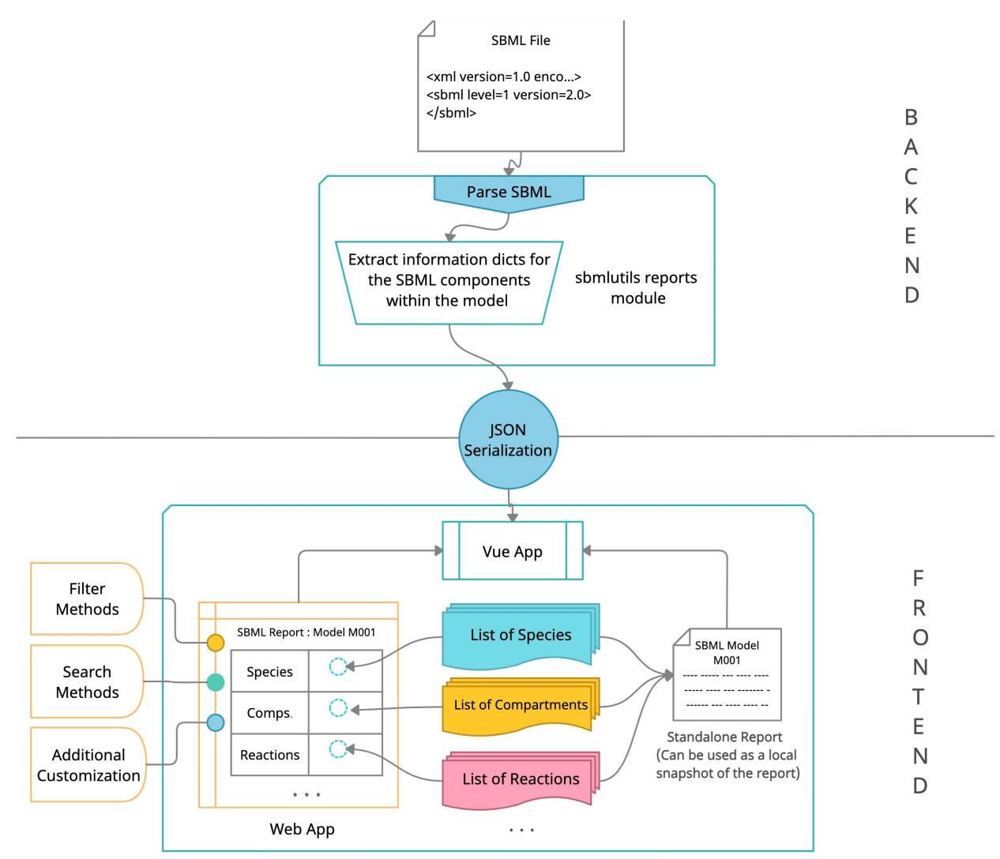
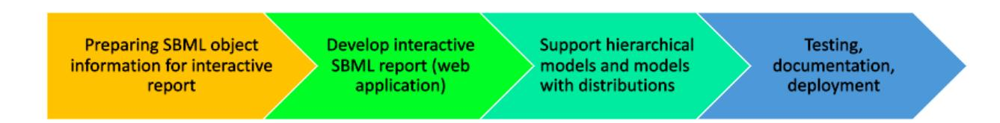
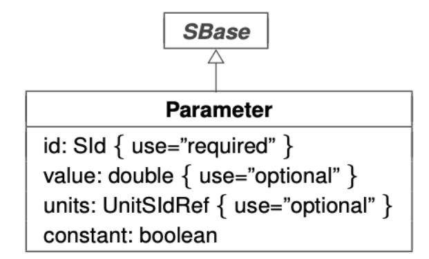
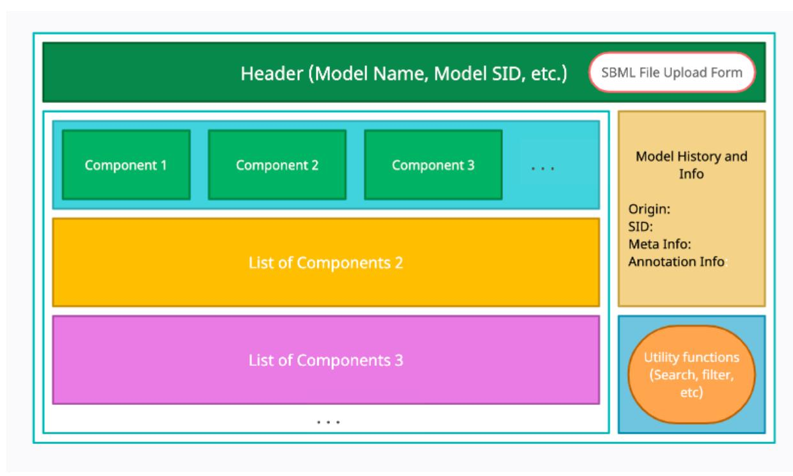
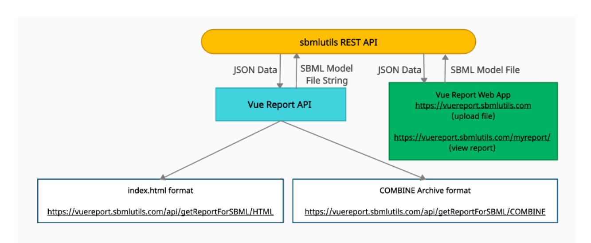
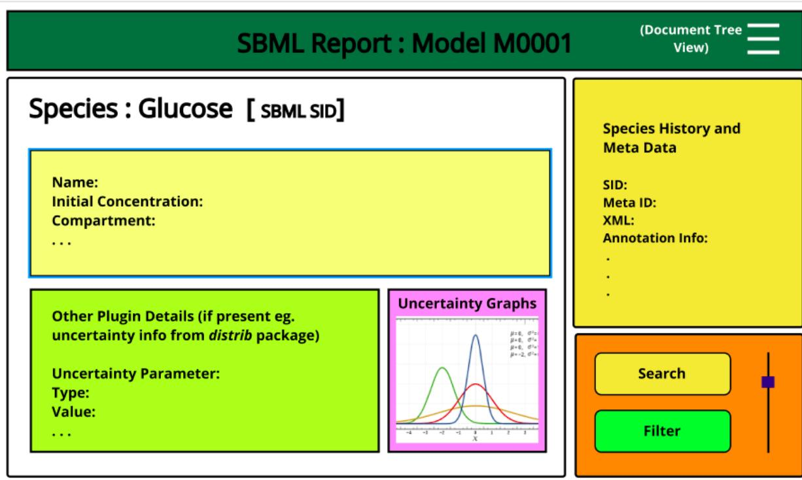
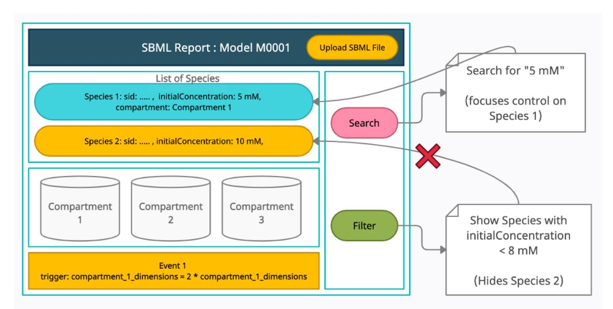

# SBML4Humans - Interactive SBML report for Humans

Proposal for Google Summer of Code, 2021

# Student

Name: Sankha Das E-mail: Github: sankha555 Phone: Postal Address: Homepage: <https://sankha555.github.io/index> University: Birla Institute of Technology and Science, Pilani Project Blog: <https://sbml4humans-gsoc-2021.blogspot.com/>

# Mentoring organization

National Resource for Network Biology (NRNB)

# Mentors

# About the project

The Systems Biology Markup Language (SBML) [1] is the de facto standard for representation and exchange of mathematical models of biological systems. SBML can represent many different classes of phenomena in biology, including metabolic networks, signaling pathways, or regulatory networks, and supports models of arbitrary complexity from single processes to multi-scale models. SBML is currently supported by more than 300 tools [2]. A detailed overview about SBML, examples and use cases are provided in the SBML specification [3] with a recent high level introduction in Keating et al. 2020 [4].

SBML is a standard format for the representation and exchange of biological models between computers. The information in SBML is organized as a list of components (e.g. compartments, species, parameters, reactions, etc.). The model specifications being written in XML, a suitable parser can easily create a tree structure for the model and the relations between its different components. SBML is difficult to read, comprehend and interpret by humans directly, and tools are required to provide an abstraction layer to interact with SBML objects and the relationships between them.

Dr. Matthias König (Humboldt-University Berlin, Germany) Dr. Ralf Steuer (Humboldt-University Berlin, Germany)

The objective of the project SBML4Humans is to address this issue by providing an interactive and reactive report for SBML models which will allow Humans (experts as well as novices) to easily comprehend the content of a model. An overview of the report workflow is provided in Figure 1 with key features being:

- rendering of information for human consumption in form of interactive HTML pages
- navigation between components (e.g. which species are involved in which reactions, which gene catalyzes which reaction, in which math expression does a certain parameter appear, etc.)
- access to meta-information (e.g. resolving additional information for annotations and meta-data and linking model components to databases)
- search and filter functionality (reduce information to relevant subset of information)
- interactive exploration of information (e.g. by providing abstraction layers)
- export of standalone reports for dissemination and exchange

Fig. 1. SBML4Humans workflow for creating interactive SBML reports. In the first step the SBML information will be parsed and prepared as JSON. The report is generated using this information within an interactive Vue web application. Reports can either be consumed directly on the web or exported as standalone interactive reports for dissemination and exchange.

SBML4Humans will be part of the Open Source project sbmlutils. Currently, a non-interactive report for SBML models in the form of HTML webpages exists with basic information about the model, history, components, rules, rate laws, etc. displayed in tabular formats. Within this project the following extensions will be implemented:

- interactive SBML report with navigation between SBML objects
- search and filter functionality
- web application with REST API
- support for hierarchical models (comp extension [5])
- support for distributions and uncertainties (distrib extension [6])
- support for COMBINE archives [7]

The SBML4Humans reports will be made available in the form of both, (i) a standalone report generated by the python package sbmlutils (for exchange, e.g. as part of a publication supplement) as well as (ii) via a web application (without the need for installation). SBML4Humans will provide an interactive and reactive abstraction layer around SBML as an entry point to the models without having to know SBML. Such a report for Humans would be an important asset to communicate and disseminate computational models and allow one to easily understand computational models created by others.

# Technology

The main outcome of this project will be a web application which allows users to upload SBML models and retrieve the interactive SBML report (either via the web interface or programmatically via the REST API). The backend of the application will extend the sbmlutils package written in Python using LibSBML as SBML parser. The web application frontend will be built in JavaScript using Vue.js.

- LibSBML [8] is an efficient library used for the reading and parsing of SBML files. LibSBML provides many high-level utility functions for operations such as parsing SBML, developing structured information about SBML objects from the files, formulation of math objects, validation and conformity checking, etc. Within this project LibSBML will be used to parse SBML.
- sbmlutils [9] provides functionality around LibSBML for generating static reports for SBML models from their respective SBML files. sbmlutils provides support for extracting information for the reports from SBML in addition with helpers for mathematical formatting, conversion between different MathML modes and improved formula parsing. sbmlutils will be used as a backend for preparing all information for the reports, building on an existing and well tested code base for working with SBML information.
- Vue.js [10] is a versatile and progressive framework for building frontend user interfaces. It is easy to integrate with other libraries and backend applications. It supports reactive application components with inter-component interaction features and makes a perfect tool for developing the frontend of the SBML4Humans web application.

## Work plan

As highlighted above, the overall goal of the project SBML4Humans is to develop an interactive and reactive web-application for generation of reports from SBML files. This objective will be achieved via four modules:

Module 1 Preparing SBML object information for interactive report Module 2 Develop interactive SBML report (web application) Module 3 Extend SBML support for hierarchical models (comp) and models with distributions (distrib) Module 4 Testing, documentation, deployment

First an overview of the current status of the static HTML report generation in sbmlutils is provided followed by the extensions implemented in this project.

The reports module in sbmlutils contains classes and helper functions to read an SBML model and parse the SBML objects data. Information about SBML components such as compartments, species, reactions, initial value assignments, events, kinetic laws, unit definitions is extracted. The parsing of each component is performed using specialized methods for each component. The processed information for the component is returned in the form of a dictionary containing attribute-value pairs for the component. Since all SBML classes inherit from the SBase class, each of the components has a base information dictionary consisting of information such as SId, metaID, annotations, notes, and history. Additional attributes specific to that SBML object are parsed (e.g. KineticLaw for a reaction). In case of multiple instances of an SBML class (e.g. species, reactions, parameters etc.) the collection of each component is returned as a listOf<component> object. An example for collecting Parameter objects data is depicted in the code fragment in Figure 2 and UML diagram in Figure 3 below.The static report is generated from these object dictionaries by passing the information as a context to the Jinja template rendering engine. The information is rendered with a static HTML template by the Jinja engine as an SBML report.

Within SBML4Humans an interactive report of the SBML information will be implemented, by migrating from static HTML pages to an interactive web application. The SBML component information dictionaries mentioned above will be serialized to JSON as input for the Vue application. The objectives of the project "SBML4Humans - Interactive SBML Reports for Humans" [11] will be achieved via four modules, each accomplished through a number of milestones.

Fig. 2. Helper method in sbmlutils to collect SBML information for Parameter objects. The extracted information is subsequently rendered in an HTML report.

Fig. 3. Parameter class UML Diagram as given in the SBML Level 3 Version 2 Specification. As can be seen in the diagram, the Parameter class is a child class of the SBase class and inherits attributes from SBase (the info_sbase() method in sbmlutils).

## Module 1: Preparing SBML object information for interactive report

Module 1 focuses on the refactoring of the sbmlutils reports module which is responsible for the parsing and collection of SBML objects data from the SBML files. The methods will be updated to present data according to the new requirements.

#### Milestone 1.1 Separation of SBML information from rendering information

Currently, SBML object data and rendering information such as HTML fragments are mixed in sbmlutils. An important step will be the separation of these two layers. Many helper methods currently pad the parsed SBML objects' attributes with HTML tags for rendering them in the static HTML reports. These HTML tags will be removed so as to enable representing only the attribute-value data about the SBML objects in serialized JSON format. Removing the HTML tags is a prerequisite for customizable display formats, search, filtering and navigation features in the report.

#### Milestone 1.2 JSON serialization of information for web application

JSON [12] is the most commonly used standard format for representing and exchanging data in web applications. Serialized JSON can be easily generated from Python dictionaries. The data collected in milestone 1.1 will be passed on to the frontend Vue application in the form of serialized JSON for rendering the interactive report.

#### Module 2: Develop interactive SBML report (web application)

This module deals with the design and development of the frontend user interface (UI) for the web application. This includes coming up with a wireframe for the UI, implementing the design in the Vue templates for each component and defining the relationships between the components for navigation and customization.

#### Milestone 2.1 Design component hierarchy and wireframe for the frontend user interface

In a first step, a wireframe design for the user interface (UI) of the components will be developed. This calls for a basic exercise in UI/UX designing that will provide a high level overview of the outline of the web application. Each SBML object will be associated with its own dedicated Vue component with data attributes and component specific methods. Individual component instances will be aggregated into containers to represent lists of SBML objects. UIs for each utility in the application will also be designed, namely:

- SBML file upload
- Report display
- Navigation between SBML components and change of perspective for each component
- Filtering and searching
- Display of hierarchical models and uncertainties data

Tools like Figma and Adobe XD will be used to design these UI components and define the relative flow and accessibility of the different parts of the application. This milestone would also define the aesthetics and general look and feel of the application. A prototype UI for the web application is shown in Figure 4.

Fig. 4. A basic user interface proposed for the web application report.

## Milestone 2.2 Development of UI components in Vue

The next step is the development of the components in the web application. The JSON object information from Module 1 will be used to render data in the corresponding UI components.

As an example, one of the classes that would be implemented in many of the models will be the SBML Species class, which inherits attributes from the SBase class and adds its own attributes and methods. Such inheritance will also be incorporated in the Vue components, with base components (e.g. for SBase class), and other components customly extending the base components, to build all the components for the web application.

The data attributes for each component are injected into the Vue templates using Vue's template tagging and data binding constructs. Data values dependent on other SBML components (e.g. concentration of a species might change based on a KineticLaw component) will load and update themselves by virtue of Vue's inter-component communication and reactive nature of the components. Hence, all data changes will be reflected in the templates without the need to reload the page, making the report completely interactive with real-time updates.

#### Milestone 2.3 sbmlutils REST API with COMBINE archive support

Besides viewing the interactive reports in the web application, the project will also support report generation and download as standalone reports through an sbmlutils REST API. This API will be implemented using FastAPI and provide endpoints for the standalone reports and for generating the SBML JSON information for the Vue application (see Figure 5).

The API will provide endpoints to upload either SBML models or COMBINE archives with SBML models and retrieve the reports either as standalone files or within a COMBINE archive. The interactive Vue report will also fetch JSON data using the same API.

Fig. 5. Schema showing the different formats and methods of SBML model upload and report extraction.

## Milestone 2.4 Implement inter-component navigation

Each component can be rendered in its own separate view with an option to navigate between connected components. This will also give a clear idea to the user about which components are encapsulated under which components and the relationship between these components.

As a result of this feature, it would be possible to determine which reactions are connected to which species, the enclosure relationships between a compartment and the species it contains, links between parameters and mathematical expressions, action-consequence relationships between event assignments and rules, and many other similar properties. It will be possible to switch between the component detail view and the report view easily, and similarly switching detail views between two interlinked components (e.g. a species entity and the compartment in which it is enclosed).

Fig. 6 Individual Component view for one of the Species components in the SBML Model.

#### Milestone 2.5 Implement search and filter

An option to search in a report will be applied both to the complete report as well as to a specific component within the report. Such a feature will help the user to easily navigate and focus on a specific keyword or entity within the report.

Filtering options will be useful in a number of ways. One of them would be to selectively show and hide specific components within the report. At a point of time, it might be necessary to only focus on the reaction components of the model, for which one can only display the Vue component for reactions in the report, and the rest of the components can be hidden. Range based-filtering would enable one to look at SBML objects satisfying particular constraints in their attribute values (e.g. concentration greater than 0.1 mmole/L). The filtering process will be interactive and real-time.

Fig. 7. Real-time updates taking place in the report due to reactivity of Vue.

## Module 3: Extend SBML support for hierarchical models (comp) and models with distributions (distrib)

As part of the redesign, additional SBML packages will be supported (compared to the current static report). Two important SBML extensions are packages for the representation of distributions and uncertainties (the distrib package) and hierarchical models (the comp package).

#### Milestone 3.1 Support for uncertainties and distributions (distrib)

The SBML distrib package provides classes and methods to represent components data derived from various probabilistic and statistical distributions. A particular SBML object can have its attribute data values based on a particular probability distribution (e.g. a Gaussian distribution with mean = 0.5 and standard deviation = 1) which is representative of many real-world situations. As part of the community binding I have contributed a preliminary support for uncertainties data in the sbmlutils reports (see pull requests below). The Vue report will extend interactive rendering of the uncertainties data in the individual component view for each SBML object. This will include the number, type, values and hierarchical relationships of the uncertainty parameters.

#### Milestone 3.2 Support for Hierarchical models (comp)

Basic support for hierarchical models will be added to the reports. The following SBML objects and add-ons will be supported:

- comp package classes like Deletions, Ports, Replacements, ReplacedBy (interfaces and model coupling)
- multiple submodels within a model

#### Module 4: Testing, documentation, deployment

This module addresses testing documentation and deployment.

#### Milestone 4.1 Testing

All implemented features will be covered by unit tests and integration tests which will be run in continuous integration. In addition, a wide range of use cases and example models will be applied.

#### Milestone 4.2 Documentation

All added features, bug fixes and test cases, will be documented. This will help in coming up with a comprehensive documentation and improve the usability of the project. Documentation includes providing online help within the report.

#### Milestone 4.3 Deployment

The completed project will be deployed as an end-user oriented web application. This will enable anyone to access the report and facilitate generation and sharing of reports for SBML files.

In summary, within this Google Summer of Code project "SBML4Humans - Interactive SBML Reports for Humans" [12] an interactive report of the SBML models for Humans will be developed.

## Timeline

The following Gantt chart (Figure 8) provides an overview of the project timeline followed by a detailed listing of the individual steps in the project.

Fig. 8. Gantt chart: SBML4Humans

|Date Task |  |  |
|----------------------------------------------------- | -------------------------------------------------------------- | ------------------------------------ |
|● | Application submitted |  |
|● | Study the sbmlutils and | libsbml codebase in further detail |
|● | I have University end-semester examinations from 1st | May to 15th May. So, I will be |
|May 17 - June 6 ● | Interact with mentors, discuss implementation details | and finalize them |
|● | Set up project directories, and install dependencies | and tools for project |
|● | Start refactoring sbmlutils | reports module ( Milestone 1.1 ) |
|● | Work on JSON serialization of the SBML data ( | Milestone 1.2 ) |
|● | Testing and documentation of | Milestone 1.1 and Milestone 1.2 |
|June 11 - June 13 ● | Work on UI/UX designing for the Vue application ( | Milestone 2.1 ) |
|● | Write in project blog about work done so far |  |
|June 14 - July 2 ● | Develop Vue components for the interactive report | ( Milestone 2.2 ) |
|● | Implement test cases and write documentation for Vue | components |
|● | Integrate Vue app with REST API ( | Milestone 2.3 ) |
|● | Implement inter-component navigation in the report | ( Milestone 2.4 ) |
|● | Testing and documentation of | Milestone 2.3 and Milestone 2.4 |
|July 12 - July 16 EVALUATIONS |  |  |
|July 17 - July 23 ● | Implement search and filter feature ( | Milestone 2.5 ) |
|● | Add tests and documentation for search and filter | feature |
|● | Extend sbmlutils to include complete uncertainty information | in distrib package |
|● | Implement support for uncertainties in Vue application | ( Milestone 3.1) |
|● | Add test cases and documentation for uncertainties |  |
|● | Add support for comp package classes in Vue application |  |
|● | Implement support for multiple submodels as part of | Milestone 3.2 |
|● | Testing and documentation of | Milestone 3.2 |
|August 8 - August 11 ● | Add tests and documentation for all features of the | report |
|● | Testing of the entire report generation process (Complete | Milestone 4.1 ) |
|● | Deployment of the web application ( | Milestone 4.3 ) |
|● | Final documentation of all features and the web application | release |
| | (Complete Milestone 4.2 ) |  |
|August 16 - August 23 FINAL | EVALUATION |  |
|Interact with mentors for evaluation and submission |  | of complete code |

# Prior contributions

As part of the community binding, the workflows for code contribution and code review to sbmlutils have been established. I have been able to contribute substantial improvements to the sbmlutils code base over the last couple of weeks. These include full flake8 conformity, passing mypy static type checking and increased code coverage by tests. All pull requests have been included in the latest releases of sbmlutils. A complete list of all my contributions and the work during the last week leading to this application can be found in my project blog <https://sbml4humans-gsoc-2021.blogspot.com/>.

#### Pull requests

- PR #200: improved rendering MathML formulae in the reports along with LaTeX formatting
- PR #209: returned the generated HTML report in a variable, making it more flexible and versatile
- PR #217: a preliminary version of uncertainty data rendering was added to the reports
- PR #226: a prototype of the interactive Vue report was successfully built and tested
- PR #185: updated the sbmlutils codebase to use f-strings and Python 3 file handling standards
- PR #187: added type annotations for methods in the reports module with full PEP8 conformity

## About me

## Motivation

One of the key factors that motivates me to take up and work on this project is that it is directly linked to something that helps one understand the life around them better - the study of biology. Biology as a subject has always fascinated me about the seamless opportunities it provides to mankind to improve and develop the quality of health and life on the planet. In today's era, the amalgamation of biology and computer science, has led to huge leaps in these developments. The golden opportunity to contribute to a project that would help in better exchange and visualization of biological models for research and development motivates me to contribute dedicatedly in its successful execution. The domain of open-source development will make the experience even more special as the very idea of collaborative innovation that open-source fosters inspires me to work hard for this project. I personally believe that a person's education is fully justified when they contribute something back to the society using the knowledge gained from their education. Having completed this project successfully, I would also consider myself to have given back to the society in a small way by improving and enriching the SBML report generation process.

## Education

- I am an undergraduate student at Birla Institute of Technology & Science, Pilani, Rajasthan, India, pursuing 2nd year of studies in Bachelor of Engineering (Hons.) in Computer Science Engineering.
- Relevant courses include Object-Oriented Programming, Data Structures and Algorithms, Database Systems and General Biology.
- I have always been a meritorious student from my school days and have also been awarded the Institute Merit Scholarship at University for being in the top 10 in a batch of 1000 students on the basis of academic merit.

#### Experience

- I have been actively involved in full-stack Web development over the past two years at my university student forums and I also lead the Backend Development team at the Google Developer Students Club in my university.
- My experience in web development has exposed me to technologies such as Django (Python), Node.js (JavaScript), REST APIs, the XML and JSON standards, and frontend frameworks such as React (JavaScript). I also have been learning Vue.js for the past two months to prepare myself for the SBML4Humans project.
- My familiarity with version control technologies such as Git and Github, and IDEs such as PyCharm and Visual Studio Code will help me to get started on the project without much delay or difficulties.
- I have studied subjects like Biology and Chemistry uptil my freshman year at university and have strong foundational knowledge in basic biological and bio-chemical structures, reactions, kinetics, etc.
- My projects can be viewed on my Github page.

## Why me?

- I believe that for successful execution of any project, a person needs three qualities: knowledge, experience and attitude. Since my school days, I have been recognized as a student who is not only sound in his knowledge, but also possesses the qualities of hard work, persistence, curiosity and self-motivation that are desired in a GSoC student.
- In my extensive experience in web development, I have witnessed myself execute numerous full-fledged web application projects successfully. Hence, I am a perfect fit for someone who knows the required tech-stack and the entire process of building a web app, right from data processing to developing and integrating the user interface.
- Always a diligent, dedicated and punctual student, I am someone who never deters from going that extra mile to make my work standout from the rest, thus making me an ideal choice for building something truly extraordinary.
- Over the past few months, I have been constantly interacting and learning from my mentors which has also set me in a very good environment in the NRNB community, making me an ideal candidate for this project under NRNB.

## Commitments/precautions

I will be able to devote 42-45 hours per week to my GSoC project as I don't have any other commitments scheduled during the community-bonding and coding period. I would be having my university end-semester examinations during the first two weeks of May 2021 during which I might be a bit less active for work and discussions with my mentors. Outside this, I will be able to devote my time completely for successful execution of the project except in the case of some unforeseen circumstances due to which I might have to take a break for a day or two. Under any situation, I would keep my mentors informed well in advance about any such changes in the workflow and schedule.

# References

- 1. SBML webpage: http://sbml.org/Main_Page (accessed 2021-04-02)
- 2. SBML Software Guide: https://www.google.com/url?q=http://sbml.org/SBML_Software_Guide (accessed 02-04-2021)
- 3. SBML Level 3 Specification: <https://pubmed.ncbi.nlm.nih.gov/31219795/> (accessed 02-04-2021) Hucka M, Bergmann FT, Chaouiya C, Dräger A, Hoops S, Keating SM, König M, Novère NL, Myers CJ, Olivier BG, Sahle S, Schaff JC, Sheriff R, Smith LP, Waltemath D, Wilkinson DJ, Zhang F. The Systems Biology Markup Language (SBML): Language Specification for Level 3 Version 2 Core Release 2. J Integr Bioinform. 2019 Jun 20;16(2):20190021. doi: 10.1515/jib-2019-0021. PMID: 31219795; PMCID: PMC6798823.

- 4. SBML Level 3 High Level Specification: <https://pubmed.ncbi.nlm.nih.gov/32845085/> (accessed 2021-04-02) Keating SM, Waltemath D, König M, Zhang F, Dräger A, Chaouiya C, Bergmann FT, Finney A, Gillespie CS, Helikar T, Hoops S, Malik-Sheriff RS, Moodie SL, Moraru II, Myers CJ, Naldi A, Olivier BG, Sahle S, Schaff JC, Smith LP, Swat MJ, Thieffry D, Watanabe L, Wilkinson DJ, Blinov ML, Begley K, Faeder JR, Gómez HF, Hamm TM, Inagaki Y, Liebermeister W, Lister AL, Lucio D, Mjolsness E, Proctor CJ, Raman K, Rodriguez N, Shaffer CA, Shapiro BE, Stelling J, Swainston N, Tanimura N, Wagner J, Meier-Schellersheim M, Sauro HM, Palsson B, Bolouri H, Kitano H, Funahashi A, Hermjakob H, Doyle JC, Hucka M; SBML Level 3 Community members. SBML Level 3: an extensible format for the exchange and reuse of biological models. Mol Syst Biol. 2020 Aug;16(8):e9110. doi: 10.15252/msb.20199110. PMID: 32845085.
- 5. SBML Hierarchical Models (comp package) specification: <https://pubmed.ncbi.nlm.nih.gov/26528566/> (accessed 2021-04-02) Smith LP, Hucka M, Hoops S, Finney A, Ginkel M, Myers CJ, Moraru I, Liebermeister W. SBML Level 3 package: Hierarchical Model Composition, Version 1 Release 3. J Integr Bioinform. 2015 Sep 4;12(2):268. doi: 10.2390/biecoll-jib-2015-268. PMID: 26528566; PMCID: PMC5451323.
- 6. SBML distrib package specification: <https://pubmed.ncbi.nlm.nih.gov/32750035/> (accessed 2021-04-02) Smith LP, Moodie SL, Bergmann FT, Gillespie C, Keating SM, König M, Myers CJ, Swat MJ, Wilkinson DJ, Hucka
- M. Systems Biology Markup Language (SBML) Level 3 Package: Distributions, Version 1, Release 1. J Integr Bioinform. 2020 Jul 20;17(2-3):20200018. doi: 10.1515/jib-2020-0018. PMID: 32750035; PMCID: PMC7756622.
- 7. COMBINE Archive and OMEX format specification: <https://pubmed.ncbi.nlm.nih.gov/25494900/> (accessed 2021-04-02) Bergmann FT, Adams R, Moodie S, Cooper J, Glont M, Golebiewski M, Hucka M, Laibe C, Miller AK, Nickerson DP, Olivier BG, Rodriguez N, Sauro HM, Scharm M, Soiland-Reyes S, Waltemath D, Yvon F, Le Novère N. COMBINE archive and OMEX format: one file to share all information to reproduce a modeling project. BMC Bioinformatics. 2014 Dec 14;15(1):369. doi: 10.1186/s12859-014-0369-z. PMID: 25494900; PMCID: PMC4272562.
- 8. LibSBML webpage: <http://sbml.org/Software/libSBML> (accessed 2021-04-02)
- 9. sbmlutils repository: <https://github.com/matthiaskoenig/sbmlutils> (accessed 2021-04-02)
- 10. Vue.js webpage: <https://vuejs.org/> (accessed 2021-04-02)
- 11. SBML4Humans Project Description: <https://github.com/nrnb/GoogleSummerOfCode/issues/164> (accessed 2021-04-02)
- 12. JSON documentation: <https://docs.python.org/3/library/json.html> (accessed 2021-04-02)
- 13. LibSBML classes collection: <https://model.caltech.edu/software/libsbml/5.18.0/docs/formatted/python-api/annotated.html> (accessed 2021-04-02)
- 14. libsbml repository: <https://github.com/sbmlteam/libsbml> (accessed 2021-04-02)