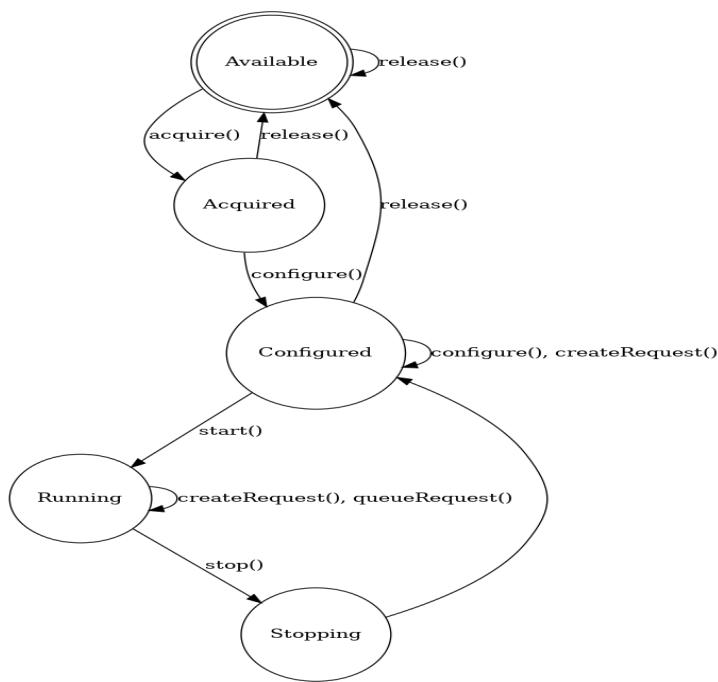

# Libcamera GSoC Proposal

# Introduction

Name: Vedant Paranjape

IRC nickname: xxx

Email: xxx

Twitter: xxx

GitHub: <https://github.com/VedantParanjape>

Time zone: IST (UTC+5:30)

Commitments: xxxx

Blog: https://ve0x10.in/blog/, here I will log my progress.

# Academic/Technical background

- 1) xxx
- 2) Work experience:
- ● Google Summer of Code 2020 participant with BeagleBoard.org
- Report: <https://github.com/VedantParanjape/simpPRU/wiki/>
- Built a statically typed, compiled language called simpPRU for TI's am335x PRU(programmable real time unit). Used bison, flex to create parser and lexer, then converted code down to C, rather than ASM, because pru-gcc tool chain is quite mature.
- simpPRU has a syntax similar to python, thus making it easier for a beginner to start coding for the PRU, which usually involves in depth knowledge of Linux API's and low level register manipulation. Extensively used Linux Kernel's Remoteproc framework.
- Distributed it through Debian packages, and setup CI/CD using docker and GitHub actions to automate build and release process.
- Contributed to pru-gcc tool chain, and added support for it on TI am572x.

- 3) I have done a lot of personal projects right from my high school. Some ones where I worked hard in chronological order are:
- Open-Authenticator: An Open Source TOTP based hardware authenticator using ESP32. I designed a custom pcb and 3d-case for this, which has a display, battery and power management built in. It was mentioned on hackster.io, and I got sponsorship for this from PCBway and OSHpark. This is still work in progress and I have logged my progress on this hackaday page. I developed firmware, and hardware myself. It is still WIP and will be finally sold on crowdfunding platform crowdsupply.com when complete.
- ESP32 Wireless Logger: ESP32 is a cheap microcontroller with Wi-Fi, It has a dual-core processor clocked at 160Mhz. I built a component which sends log messages generated by the microcontroller over Wi-Fi, using either TCP, UDP or Web sockets, is user selectable. It has a minimal memory footprint, 20kb when using UDP Sockets.
- RTL-SDR demodulator: Implemented Amplitude Shift Keying(ASK) demodulation using rtl-sdr(software defined radio) to capture RF data samples transmitted by a 434 MHz module. Data is encoded as UART packets and modulated by a 434 MHz module by ASK. It shows a amplitude vs time plot for received data, with a normalized graph to extract data from the samples.
- Synchronous Music Player: A C++ based application which plays an audio file in a synchronous manner on various connected client devices to boost the overall audio output. Uses Boost.Asio for networking and Boost.Thread for multi-threading. Files are sent over TCP, and control signals are broadcasted over UDP.
- LAN Chat Application: A C++ based Chat Application which has a Server and a Client for Windows. It uses Winsock API for LAN communication between server and clients. Supports Multiple client connections using multi-threading.
- 4) I have decent experience with C and C++ as demonstrated with projects and work experience. Also, Linux has been my daily driver for 2.5 years now and I am fairly comfortable with it, similarly I use the terminal for most of my work. I have experience with git, and can confidently do advanced git features like cherry-pick and rebase. I didn't have experience

with patch based workflow, but as a part of the warm-up task, I have

submitted a patch fixing the README in libcamera, and I can say I have got hold of the workflow that I can confidently work with it.

- 5) Likewise, I have decent experience both as a user and contributor in the open source world, I like all my tools open source, and I regularly make open source projects, as well try to contribute to open source projects. I have listed them below.
- a) Embox: <https://github.com/embox/embox/commits?author=VedantParanjape>
- b) KiBuzzard: <https://github.com/VedantParanjape/KiBuzzard>
- c) Buzzard: <https://github.com/sparkfunX/Buzzard/pull/23>
- d) kimchi-gps-lid: <https://github.com/mwelling/kimchi-gps-lid/commits?author=VedantParanjape>
- e) pru-gcc: <https://github.com/dinuxbg/gnuprumcu/commits?author=VedantParanjape>
- f) ftxui: <https://github.com/ArthurSonzogni/FTXUI/commits?author=VedantParanjape>
- 6) I am an active member of the Robotics Club of my college, called SRA. Furthermore, I also mentored a study group of 25 students in embedded systems and computer architecture, other than that I also contributed to firmware for a 3-DOF arm, it used esp32, ROS and ROS-serial. Also worked on SRA Board component which is a component library for SRA board, which is a custom designed robotics board powered by esp32. It acts as HAL for using peripherals on the SRA board Contributions: https://github.com/SRA-VJTI/sra-board-component/commits?author=Veda

ntParanjape

# Why did you apply to libcamera? What looked interesting/exciting?

I found libcamera to be a much-needed project. About 8 months ago, I got a recommendation for a YouTube video about Libcamera in Embedded Linux Conference. I found it a pretty interesting take on the problem, after that when I saw the organization list for GSoC and found libcamera I decided to apply for libcamera, the talk motivated me to. Not only that, but I have always been an embedded

enthusiast and cameras are the most important piece of hardware in a smartphone or laptop. I found this a very good opportunity to contribute to an open source camera stack. This will also help me learn more about kernel development and also the user land part of interacting with kernel drivers.

I found libcamera interesting as a whole. I had tried using V4L2 to stream images from a camera, but had a hard time doing it. But then even though libcamera is in alpha stage, it was a breeze to do the same with libcamera. I find the simplicity and modularity the best part of libcamera.

# The Proposal

#### Warm up Tasks

- 1) Built libcamera and libcamera-gstreamer element and played with it. Logged my observations here.
- 2) Completed gstreamer tutorials, also solved the exercises given there.
- 3) Created a camera streamer using libcamera and Qt5. Log for the same and code can be found here.
- 4) Also submitted a patch, which got merged.

#### Hardware

I have a Raspberry Pi 4B+ (4Gb Variant) and RPI-Cam-v2 (5mp CSI camera module)

### Goal

- 1) Implement request pads in the gstreamer element. According to discussion with ndufresne on IRC, the template for implementing request pads is present in the source code. Since, there's GstPad subclass defined in the source, we can simply do per-pad configuration, which we actually want to do, since the main objective of using request-pads is that, we can create new pads on the fly with arbitrary configuration settings, to actually add the multi stream support.
- 2) Add relevant functions to handle request-pad related actions. Once I am done with implementing Request pads in goal 1, I need to implement the functions associated with request-pads like _set/get_property(), _pad_init/query(). The names are not exact, but similar ones need to be implemented for request pads.

- 3) Add relevant capabilities to the GstLibcameraPad. Each stream can be used for different things like for viewfinder or raw video, so it doesn't make sense for all of them to have the same width and height, So using this we can set the height and width of the stream by negotiating pad capabilities of request pads while asking for new ones.

### The Plan

- 1) Implement request pads in gstreamer element: Since, we cannot change camera config in libcamera without actually stopping the camera, as described in the below image. Every time a new pad is requested we need to add the

requested config to CameraConfiguration object, and then reconfigure camera and start it. Right now all this is done in gst_libcamera_src_task_enter(), it generates config, validates it and configures the camera, whereas gst_libcamera_src_open() starts the camera manager and acquires camera connected to the system. Since to reconfigure we need to stop the camera, then reconfigure and acquire it, and this is being handled by gst_libcamera_src_task_enter() and gst_libcamera_src_open() which are to be called only once. There needs to be a way to hot load the camera, without completely shutting down libcamera. I propose to implement some functions, gst_libcamera_stop_for_reconfig(), gst_libcamera_hotload(). Referring to the above image, the first function will bring it to Configured state and then the second one will reconfigure and bring it back to Running state. So, the second

function will add caps requested by the request pad and then start the camera again, ready to stream.

- 2) Add relevant functions to handle request-pad related actions: Since, request pad also needs to be initialized, and there needs to be functions to get/set properties, stop the pads when not in use. This will use the two functions which are present defined in goal 1 to handle making new request pads with required caps. In my opinion, at this stage, we should put GStreamer in PAUSED State, as we need to stop libcamera before we can add a new camera config to it, required by the new pad. Once a new config from this request pad is added to the camera config, we can again put Gstreamer in PLAYING state. Unless we do this, the stream for other running pads will break as we stopped the libcamera, and it might be a bit buggy for the end-user. The Other way is that we send a message on the GStreamer Bus and the user needs to look out for this message, to maybe handle a sudden break in streaming.

Reference for Request pads: Request and Sometimes pads

- 3) Add relevant capabilities to the GstLibcameraPad: Since, different streams are being used parallelly, one might need to have different resolutions for each stream. Libcamera allows one to configure the video's height and width through cameraconfiguration object. This can be done through pad properties, but after discussion on IRC, I am convinced that it should never be added as a property, rather done through cap negotiation. Again in this goal we would need to stop libcamera, as we need to add new config to libcamera cameraconfiguration, to support the requested resolution.

Reference for Caps negotiation: Caps negotiation basics / Discussion on IRC

### The timeline

|May 17 Proposal accepted or rejected ● Finish | with | exams and practicals |
|----------------------------------------------- | ------------- | ---------------------------------- |
|till, | 20th May |  |
|● Read | up more | about making |
|custom | elements | in gstreamer. |
|● Also, | try to | make an element |
|which | uses | request pads. |
|June 07 Pre-work complete ● Start | coding | ! |
|June 14 Milestone #1 ● Goal | 1 |  |
|○ | Declaring | necessary |
|○ | Adding | Doc strings to the |
| | defined | classes. |
|June 28 Milestone #2 ● Goal | 1 |  |
|○ | Complete | functions |
| | needed | to hot load |
|○ | Also | write test cases for |
| | the | same. |
|July 12 Milestone #3 ● Goal | 2 |  |
|○ | Implement | functions to |
| | get/set | pad properties. |
|○ | Complete | documenting |
| | whatever | is done till now. |
|July 12 16 Phase 1 Evaluation ● | Summarize | work done till now in a |
|blog | post, and | submit it for |
|July 30 Milestone #4 ● Goal | 3 |  |
|○ | Implement | caps |
|August 10 Milestone #5 ● Goal | 3 |  |
|○ | Write | examples and tests |
| | for the | source code |
| |  | implemented in this |
|August 16 26 Final Week ● | Documenting | the |
| |  | libcamera-gstreamer-element as a |
|whole, | with | doc strings and |
|configuring | it | with Doxygen of the |
|parent | project. |  |
|● | Summarizing | work done till now in |
|a blog | post | and submitting it for |
|August 23 30 End of session ● Mentors | submit | final student |