# Example Zoo

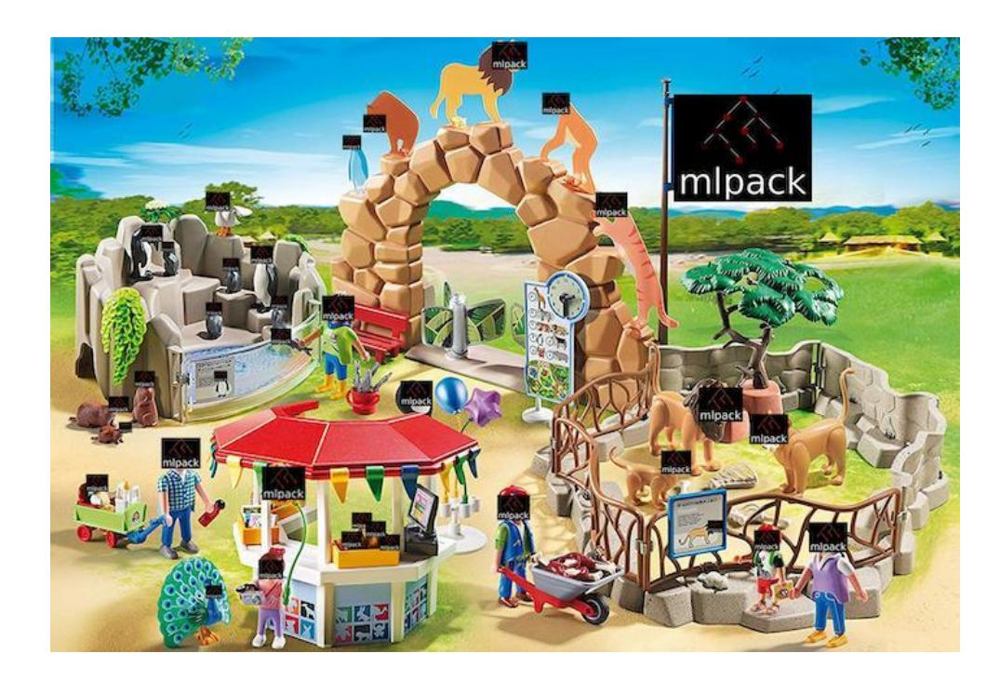

# About Me

- Name: David Port Louis.
- Field of study: Bachelors in Computer Science and Engineering.
- Joining Date: 24th August 2018.
- Expected Graduation Date: 1st June 2022.
- Location: Puducherry India, +5:30 IST
- Email: dportlouis@gmail.com
- Homepage: <https://davidportlouis.github.io>
- Phone: (+91) 9566354725
- IRC: @art3mis
- to my CV

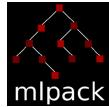

#### Known Languages:

- C / C++: I'm fairly proficient in both these languages. I have experience building a micro-library based on PyTorch which heavily relies on C++ frontend of PyTorch. I'm also familiar with Make and CMake build tools. Currently I have started to learn Modern C++ and best practices.
- Python: I'm proficient in this language. I can write lean, well structured code to solve complex problems utilizing the full extent of the language's feature set. In day to day work I spend more time writing Pythonic code for implementing deep neural nets using PyTorch. I'm also Comfortable with most machine learning / data science packages.
- Matlab / Octave: Comfortable reading complex implementations in these languages and porting them over to Python. I also have a basic understanding of writing scripts, functions, handling data, working with vectors and matrices and visualization.
- Shell Scripting: Comfortable writing scripts to automate command line tasks, build systems, monitoring logs etc, since I primarily use linux for the development.

### Open Source Contributions:

- mplack:
- Opened an Issue about Upsampling Layer (question)
- Added Linear Regression for Salary dataset (waiting to be reviewed)
- fbdevelopercircles:
- Added bash scripting and pytorch resources in tools section
- trueline:
- Added support for anaconda (conda) environment

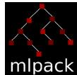

#### Familiar areas and coursework relevant to Machine Learning:

I'm a Junior year CS student enthusiastic in exploring machine learning and mathematics. I'm interested in ML from my freshman year, since then I have pushed myself to explore the field, by reading research papers, blog posts and implementing what I learnt. I'm familiar with classification, regression, Tree based, ensemble learning, gradient boosting & other unsupervised techniques. With respect to deep learning I work mostly in Computer Vision, with recent involvement in NLP & Reinforcement Learning. My coursework includes Advanced ML Techniques, Probability and Statistics, currently studying Expert system and Decision making. Apart from this, I've done MOOCs from Stanford (ML) and Deep Learning Nanodegree from Udacity and also other courses on DL and ML on Coursera.

# Project Goals:

# Abstract

"Libraries are like LEGO kits, only pre-assembled. If one needs to understand it, then one should interact with it"

Technical documentation is not always easy to navigate, especially for starters. Example Zoo from mlpack ideas is aimed at showcasing to starters the potential usage of the libraries APIs through thoughtful & robust real-world examples. This idea reflects on the fact that reading documentation may not be enough when one is trying to figure out what's going on with a program. Example Zoo provides starters a glimpse of most if not all features provided by mlpack, such that users can run the code for themselves to see it in action, maybe change things, Break it & figure out how to fix it. This would enable a starter to become familiar with the library relatively faster than reading documentation and starting from scratch.

# Potential Impact of the project

- 1. Users can understand various library features by exploring sample codes.
- 2. Users get the experience of reading & running example codes rather than reading documentation.
- 3. Starters can extend / utilize code from samples in their own use cases.
- 4. Users will be able to adapt to the library quickly.

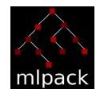

- 5. Users can discover the possibility of what they can build, by utilizing the library.

# Project Deliverables:

- 1. Self contained examples demonstrating use of library APIs
- 2. Provide useful visualization & benchmarks on various dataset
- 3. Sample code will be well documented (in-line comments) in order to explain to users what and how things are done.
- 4. All Examples will be in Ipython notebook & can be executed in (Jupyter, Binder & Colab)

# Implementation:

I'll be working on seven examples across various topics in machine learning using the following datasets, all the datasets mentioned below are available in Kaggle:

- 1. Linear Regression Avocado Prices
- 2. Random Forest Classification Rain in Australia
- 3. Decision Tree Classification Loan Default Prediction
- 4. Image Classifier using ConvNet CIFAR10
- 5. Convolutional Autoencoder MNIST
- 6. Adaboost Classifier Graduate Admission 2
- 7. Naive Bayes Classifier MicroChip Quality Control

All the above examples would be implemented in C++ and Python (using python bindings)

- 1. Linear Regression on Avocado Prices Data

My Idea here is to showcase a Linear Regression model to predict avocado prices.

❯❯ ~ 14:35 kaggle datasets download -d neuromusic/avocado-prices

- The data is loaded from csv into an armadillo matrix using data::Load() method.

arma::mat avocado_data; data::Load("avocado.csv", avocado_data, true);

- Perform exploratory data analysis to generate visualizations using matplotlib-cpp, seaborns for python

Visualizing Average price of Conventional Avocados over time avocado_data[conv_].plot(x="Date", y="AveragePrice", kind="scatter", cmap="plasma", title="Average Price of Conventional Avocados Over Time", color= avocado_data[conv_]["AveragePrice"]) plt.show()

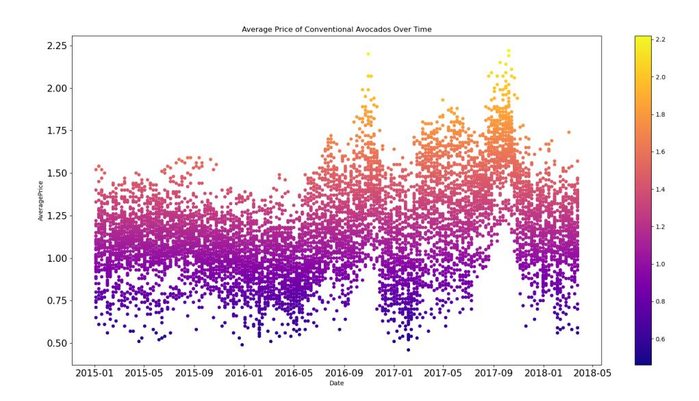

Visualizing Average price of Conventional Avocados over time avocado_data[org_].plot(x="Date", y="AveragePrice", kind="scatter", cmap="plasma", title="Average Price of Organic Avocados Over Time", color= avocado_data[org_]["AveragePrice"]) plt.show()

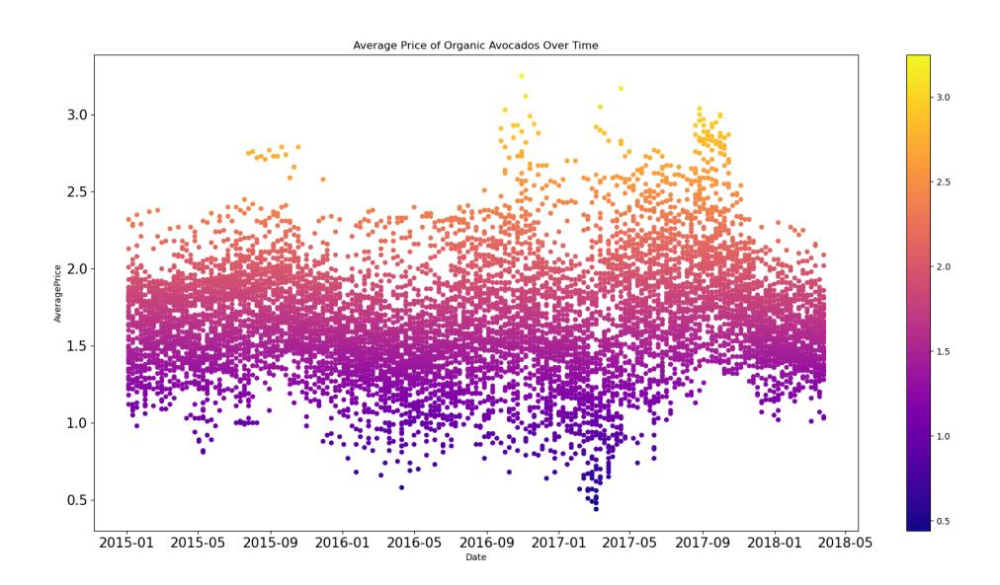

- Split the data into features (input) and targets (labels) respectively

arma::Row<size_t> targets = arma::conv_to<arma::Row<size_t>>::from(avocado_data.row(avoca do_data.2)); avocado_data.shed_row(avocado_data.2)

- Preprocess the data i.e scale the features, targets & one hot enc categorical features

data::MinMaxScaler scaleFeatures; scaleFeatures.Fit(trainX); scaleFeatures.Transform(trainX, trainX); scaleFeatures.Transform(validX, validX);

- We use the LinearRegression API from mlpack to create and fit a linear model to the data

LinearRegression<> lr(Xtrain, Ytrain, 0.0) lr.Train(Xtrain, Ytrain)

- Finally we can use the Predict() method provided by LinearRegression to predict targets for test data

lr.Predict(Xtest, Ypreds)

In addition to the above implementation. I will also concentrate on feature-selection, more EDA, insightful visualizations and comparison of various metrics such as MAE, MSE & RMSE.

## 2. Random Forest Classification on Rain in Australia Data

Second Implementation in this project focuses on showcasing a Random Forest model to predict whether it will rain or not in Australia based on observations from numerous Australian weather stations.

❯❯ ~ 14:35 kaggle datasets download -d jsphyg/weather-dataset-rattle-package

- The data is loaded from csv into an armadillo matrix using data::Load() method.

arma::mat rainfall_data; data::Load("wetherAUS.csv", rainfall_data, true);

- Perform exploratory data analysis to generate visualizations.
- Additionally we will use Plotly in Python for interactive visualization

Visualizing will it rain tomorrow! against Evaporation & fig = px.scatter(rainfall_data, y="Evaporation", x="Humidity3pm",size="Rainfall", color="RainTomorrow", hover_name="Location", template='plotly_dark', log_y=True,

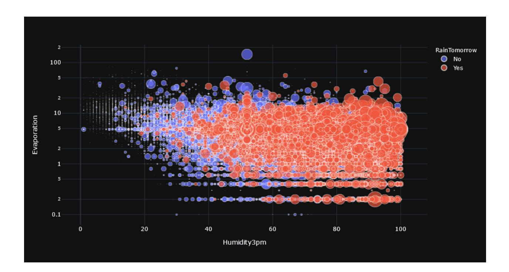

arma::Row<size_t> targets = arma::conv_to<arma::Row<size_t>>::from(rainfall_data.row(rain fall_data.n_rows:
- 1)); rainfall_data.shed_row(rainfall_data.n_rows
- 1)

- We use RandomForest API from mlpack to create and fit Tree models to the data.

RandomForest<> rf(Xtrain, Ytrain, 2 / # of classes./

- Finally we can use the Classify() method provided by RandomForest to predict targets for test data.

arma::Row<size_t> output; rf.Classify(Xtest, Ypreds)

PCA<> pca(true); pca.Apply(rainfall_data, 2 / # of principal components /)

- For visualization we project the target variable against the two new features i.e principal components. Below Image visualizes the first two principal components for rainfall prediction.

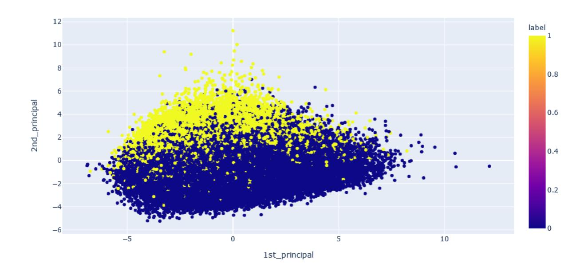

Similar to above implementation, we will extend on feature-selection, more EDA, visualization (interactive using plotly) & benchmark using various metrics such as MAE, MSE, RMSE, visualize various features using PCA.

## 3. Decision Tree Classification on Loan Default Prediction Data

Third Implementation in this project focuses on showcasing a Decision Tree model to predict loan defaulters based on annual income and bank saving balance.

❯❯ ~ 14:35 kaggle datasets download -d kmldas/loan-default-prediction

arma::mat loan; data::Load("Default_Fin.csv", loan, true);

ax = loan.plot(x="Bank Balance", y="Annual Salary", color="Defaulted?", kind="scatter", title="Loan Defaults", template="plotly_dark") ax.show()

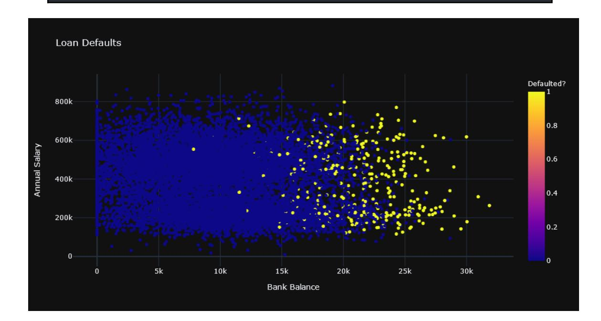

arma::Row<size_t> targets = arma::conv_to<arma::Row<size_t>>::from(loan.row(loan.n_rows:
- 1)); iris.shed_row(loan.n_rows
- 1)

- We use the DecisionTree API from mlpack to create and fit Tree models to the data.

DecisionTree<> dt(Xtrain, Ytrain, 3 / # of classes./

- Finally we can use the Classify() method provided by DecisionTree to predict targets for test data.

arma::Row<size_t> output; dt.Classify(Xtest, Ypreds)

PCA<> pca(true); pca.Apply(loan, 2 / # of principal components /)

- For visualization we project the target variable against the two new features i.e principal components. Below Image visualizes the first two principal components for loan defaults.

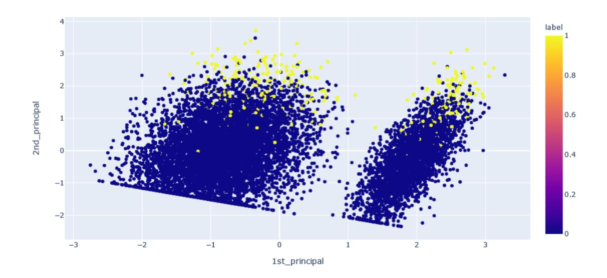

## 4. CIFAR10 Image Classifier using ConvNet

This module is aimed at giving a sneak peek at deep learning i.e various ANN layers such as Convolution, ReLU, Dropout by training a multi class image classifier using the CIFAR10 dataset.

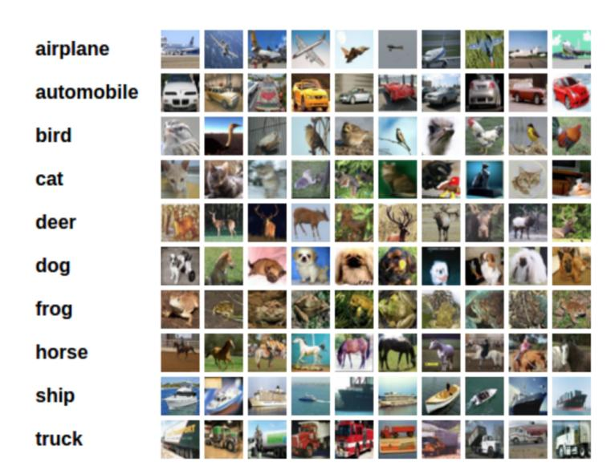

- Initial Setup and Downloading data involves loading images into arma::mat imageMatrix, the only difference will be the use of (Deep) artificial neural network layers to train our image classifier.

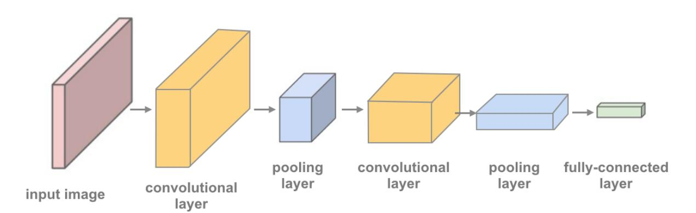

#### ● Deep Neural Net Architecture is as shown below

FFN<NegativeLogLikelihood<>, RandomInitialization> model; // convolutional layer (sees 32x32x3 image) model.Add<Convolution<>>(3,16,3,3,1,1,1,1,28,28); model.Add<ReLU<>>(); model.Add<MaxPooling<>>(2,2,2,2,true); model.Add<Convolution<>>(16,32,3,3,1,1,1,1,28,28); model.Add<ReLU<>>(); model.Add<MaxPooling<>>(2,2,2,2,true); # convolutional layer (sees 8x8x32) model.Add<Convolution<>>(32,64,3,3,1,1,1,1,28,28); model.Add<ReLU<>>(); model.Add<MaxPooling<>>(2,2,2,2,true); # linear layer (64 4 4 -> 500) model.Add<Linear<>>(16 4 4, 10); model.Add<ReLU<>>(); # add dropout layer model.Add<Dropout<>>(0.25); # linear layer (500 -> 10) model.Add<ReLU<>>(); model.Add<LogSoftMax<>>();

- Since this a multiclass classification example, we will be using Negative Log Likelihood loss to quantify the learning process i.e our model is able to classify between different images
- We will be using SGD Optimizer from ensmallen library to optimize the above loss function.

ens::SGD optimizer(0.01 /learning rate/, 16 /batch size/);

- Visualizing Training and validation loss curves using matplotlib (-cpp).

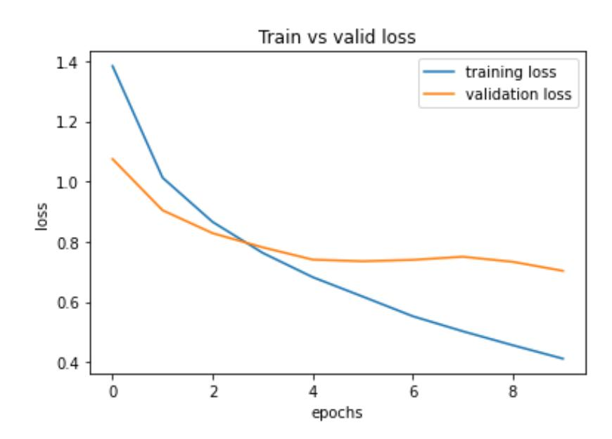

- Get predictions on training, validation data and Compute their respective accuracies.

model.Predict(validX, logits) preds = getLabels(logits) double valAccuracy = arma::accu(preds == Ytrain) / (double) Ytrain.n_elem * 100;

This is how the above module will proceed while implementing. Also we can try to implement various ConvNet architectures and provide insight to users on how each network performs when implemented using mlpack. We can also extend this network to other datasets by simply swapping the dataset and retraining the network. Even visualize various features using PCA.

## 5. Reconstructing Noisy MNIST Images using Convolutional Autoencoders

This example is aimed at showcasing a Convolutional Autoencoder using Convolution and TransposeConvolution layers from mlpack to reconstruct noisy images as close as possible to their original images.

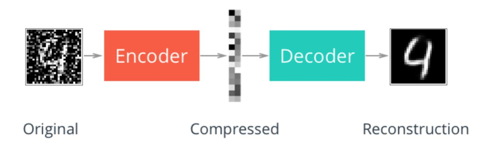

# Denoising Convolutional Autoencoder

In denoising autoencoders, we will introduce some noise to the images. The denoising autoencoder network will also try to reconstruct the images. But before that, it will have to cancel out the noise from the input image data. In doing so, the autoencoder network will learn to capture all the important features of the data.

- Initial Setup and Downloading data is similar to the above implementation, the only difference will be the use of Deep neural network layers to train our autoencoder.

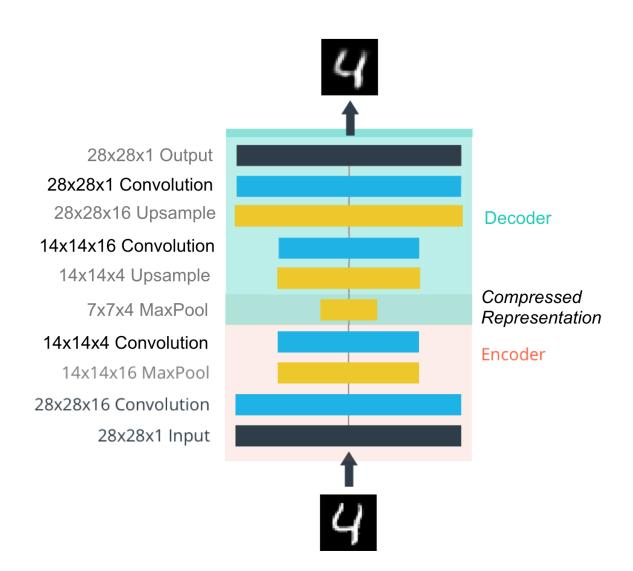

- Deep Neural Net Architecture is as shown below

FFN<MeanSquaredError<>, RandomInitialization> model; // convolutional layer (sees 28x28x1 image) model.Add<Convolution<>>(1,16,3,3,1,1,1,1,28,28); model.Add<ReLU<>>(); model.Add<MaxPooling<>>(2,2,2,2,true); # convolutional layer (sees 14x14x16) model.Add<Convolution<>>(16,4,3,3,1,1,1,1,28,28); model.Add<ReLU<>>(); model.Add<MaxPooling<>>(2,2,2,2,true); // Decoder Stack model.Add<TransposeConvolution<>>(4,16,3,3,1,1,1,1,28,28); model.Add<ReLU<>>(); # convolutional layer (sees 14x14x16) model.Add<TransposeConvolution<>>(16,1,3,3,1,1,1,1,28,28); model.Add<LogisticFunction<>>(); # reconstructed image 28x28x1

- We are using mean squared error as the loss function as each of the values that the neural network predicts will be image pixel values which are numbers.
- Therefore, we need the mean squared error to calculate the dissimilarity between the original pixel values and the predicted pixel values.
- We will be using SGD Optimizer from ensmallen library to optimize the above loss function.

ens::Adam optimizer(0.01 /learning rate/, 32 /batch size/);

- Visualize reconstructed images versus original noisy images

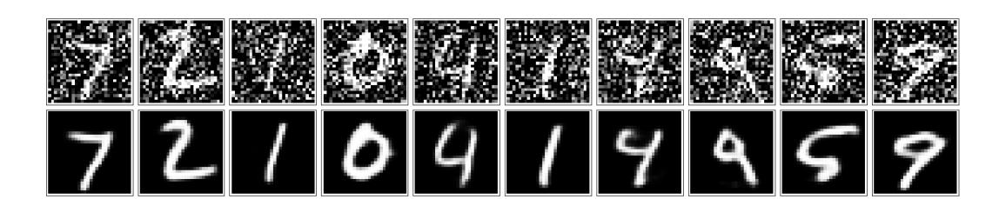

### 6. AdaBoost Classification on Graduate Admission 2 Data

This implementation focuses on showcasing a AdaBoost model using weak learners to predict student acceptance in grad school based on various performance scores.

❯❯ ~ 14:35 kaggle datasets download -d mohansacharya/graduate-admissions

arma::mat admissions; data::Load("Admission_Predict_Ver1.1.csv", admissions, true);

ax = admissions.plot(x="GRE Score", y="CGPA", kind="scatter", color="Chance of Admit ", template= "plotly_dark", title="Grad School Acceptance") ax.show()

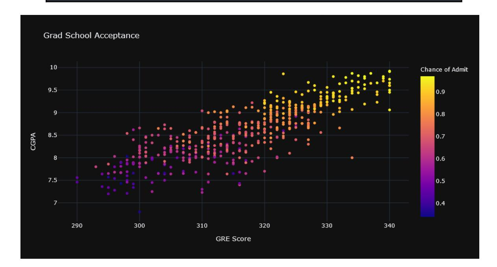

arma::Row<size_t> targets = arma::conv_to<arma::Row<size_t>>::from(admissions.row(admissi ons.n_rows:
- 1)); iris.shed_row(admissions.n_rows
- 1)

- We use the DecisionTree as a weak learner and utilize AdaBoost API from mlpack for ensemble learning

DecisionTree<> dt(Xtrain, Ytrain, 3, 20); AdaBoost<> ab(Xtrain, Ytrain, 3,20, dt / weak learner /);

- Finally we can use the Classify() method provided by AdaBoost to predict targets for test data.

arma::Row<size_t> output; ab.Classify(Xtest, Ypreds)

PCA<> pca(true); pca.Apply(rainfall_data, 2 / # of principal components /)

- For visualization we project the target variable against the two new features i.e principal components. Below Image visualizes the first two principal components for university admissions.

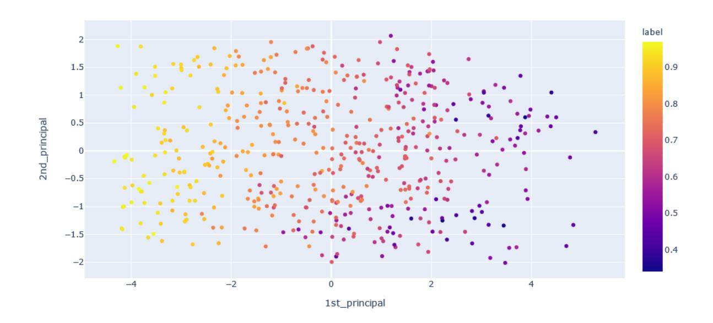

## 7. Naive Bayes Classification on MicroChip Quality Control Data

This Implementation focuses on showcasing a NaiveBayesClassifier model to determine whether microchips from a fabrication plant passes quality assurance (QA).

❯❯ ~ 14:35 kaggle datasets download -d johnjyjy/microchip-quality-control

arma::mat qc; data::Load("microchip_quality.txt", qc, true);

ax = qa.plot(x="test_1", y="test_2", color="status", kind="scatter", title="MicroChip Test") ax.show()

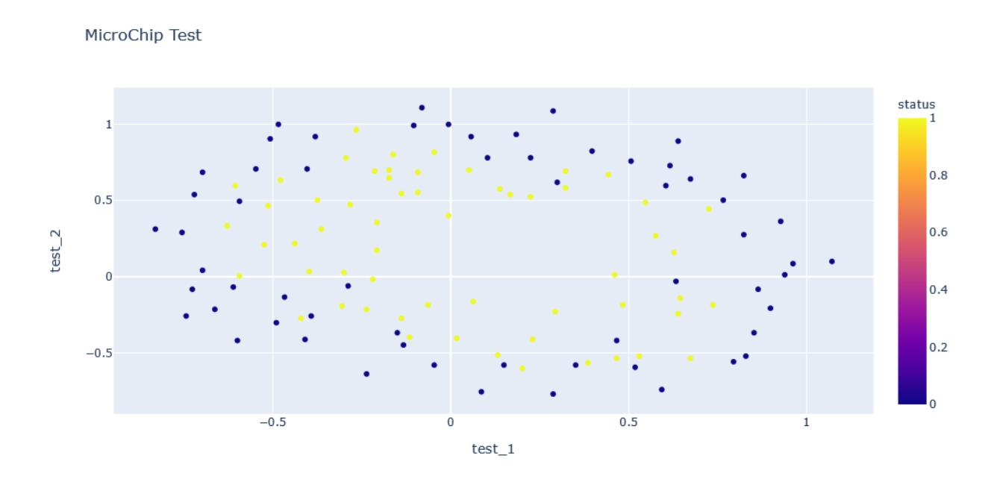

- Splitting data into features as well as, preprocessing is similar to previous examples.

arma::Row<size_t> targets = arma::conv_to<arma::Row<size_t>>::from(qc.row(qc.n_rows:
- 1)); iris.shed_row(qc.n_rows
- 1)

- We use the NaiveBayesClassifier API provided by mlpack for creating and training the model

NaiveBayesClassifier<> nb(Xtrain, Ytrain, 2 / num classes /);

- Finally we can use the Classify() method provided by NaiveBayesClassifier to predict targets for test data.

arma::Row<size_t> output; nb.Classify(Xtest, Ypreds)

# Weekly Timeline

|Time Period | Work |  |  |
|----------------- | ----------- | ---------------- | --------- |
|● Continue | to | contribute | to |
|examples | by fixing | issues | on the |
|● Familiarize | myself | with the | library |
|● Continue | research | for | further |
|● Get familized |  | with code-base | for |
|● Get to | Know | the mentors | and |
|● Discuss | action | plans with | mentors |
|● Gather | relevant | information | for |
|implementation |  | of | Linear |
|● Discuss | the | implementation | of |

|● Implement | the | Linear | Model |
|------------------------------------- | -------------------- | ------------- | ---------- |
|● Gather | relevant | information | for |
|implementation |  | of Random | Forest |
|● Discuss | the implementation |  | with |
|● Implement | the | Random | Forest |
|● Test both the examples thoroughly |  |  |  |
|● Gather | relevant | information | for |
|implementation |  | of Decision | Tree |
|Classifier | on | Load | Default |
|● Discuss | the implementation |  | with |
|● Implement | the | Decision | Tree |
|● Gather | relevant | information | for |
|implementation |  | of | AdaBoost |
|Classifier | on Graduate | Admissions |  |
|● Discuss | the implementation |  | with |
|● Implement | the | Decision | Tree |
|● Test both the examples thoroughly |  |  |  |
|● Gather | relevant | information | for |
|implementation |  | of Naive | Bayes |
|Classifier | on | Microchip | Quality |
|● Discuss | the implementation |  | with |
|● Implement | the | Naive | Bayes |
|● Test the example thoroughly |  |  |  |
|● Five | examples | will | be fully |
|implemented, |  | tested | and |

|● Gather | relevant | information | for |
|----------- | ----------------------------- | ---------------------- | ------------- |
| | implementation | of Image | Classifier |
|● Discuss | the | implementation | with |
|● Design | and | test the | ConvNet |
|● | Implement | ConvNet | example on |
|● | Test the example thoroughly |  |  |
|● Gather | relevant | information | for |
| | implementation | of | Denoising |
|● Discuss | the | implementation | with |
|● Design | and | test the | autoencoder |
|● | Implement | ConvNet | example on |
|● Test | all the | examples | & add |
|● Update | the | inline documentation | in |
|● This | period | will also be | used as |
|buffer | time | for fixing | unplanned |
|issues | or if | any phase | requires |

# When you'll need to start work ?

- I can start working immediately after May 17th (Student selections announcement date). I prefer to get work started early, so that I can look into implementing other examples, it would also provide me some buffer time if things go south.

## How much time are you going to invest in this task?

- I have no other long / short term commitments during summer. I'm willing to dedicate at least 40 hrs per week during the GSOC period.
- I can generally dedicate at least 8 hours to work on a daily basis. This time is generally split into 4 hour intervals throughout the day, since that is my current workflow.

# Communication with mentor(s)

- Since Gitter / mail is my preferred mode of communications with regards to mlpack, any discussion with mentor(s) will take place via Gitter / mail.
- I will be regularly updating about the project's progress to my mentor(s) through the same.

# Exams or Classes that overlap during the GSOC time period ?

- Following the month of May, there is a possibility of final exams in my college, which may lead to me not being able to dedicate time to the project for 2 to 3 weeks. Additionally, in the event of a general disruption due to personal circumstances, I also may not be able to work for around 2-3 days.
- However, I will inform any such event at least a week ahead of time to ensure that everyone is in the loop about what is going on and prevent mishaps.

# After GSOC

- I'm super excited and comfortable to work on mlpack because of my field of interest, experience, eager to learn and work related to implementations in ML.
- I think of GSOC as a portal which introduced me to this amazing library and community, despite whether I'm being selected or not doesn't matter. I would still contribute to mlpack because I feel it would help me expand my knowledge and give me an opportunity to contribute back to the community.

- I would be happy to work and contribute to mlpack even after GSOC.

# Are you applying for other Projects ?

No, mlpack is the only project I was comfortable given my experience. To be frank would I like to work only on projects that are in my field of interest.

# Optional Question

Both algorithm implementation and API design are important parts of mlpack. Which is more difficult? Which is more important? Why?

According to my understanding mlpack is a library, where algorithms are methods (under the hood) which perform some action, on the other hand API is an Interface / gateway via which users request or invoke the underlying algorithm. I explicitly cannot state that one is more difficult than the other; it depends on the algorithm & API implementation and the expertise of the individual implementing it. Similarly, algorithms pertain to performance while API pertains to interactivity with users, So both are equally important.

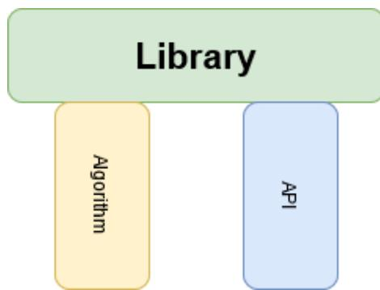

The above illustration describes my understanding of algorithms and API, which serve as the two pillars of a library.Thus Equal care should be given to both in order to design a stable and good library.

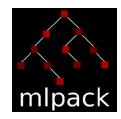

# Ending Note

I would like to thank the amazing mentors who dedicated their time to review and provide views on my proposal. I'm looking forward to working with this amazing community, adding some value to it while cherishing my knowledge and experience.