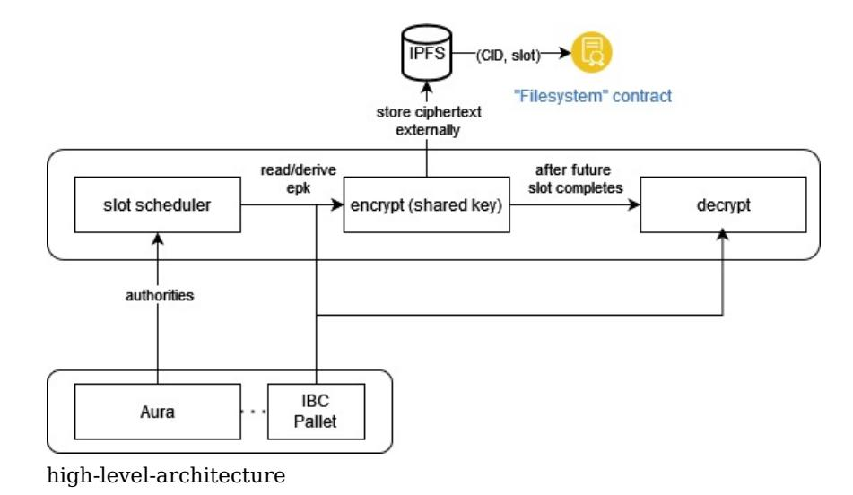

# Cryptex: EtF Network with Aura

# Project Overview :page_facing_up:

This is an EtF (encryption-to-the-future) network based on Aura. This proposal adds identity based encryption (IBE) in conjunction with a modified version of Aura to enable an EtF network, wherein messages can be encrypted to a slot in the future.

### Overview

This proposal presents a blockchain that uses a modified Aura in which blocks are sealed. We then implement an encryption-to-the-future (EtF) scheme, where messages can be encrypted for arbitrary slots and epochs in the future. Our proposal consists of a runtime, which modifies Aura and introduces a new pallet to enable the identity based cryptosystem (IBC), a light client, and an SDK which handles synchronization with the blockchain, slot scheduling, and offchain encryption and decryption functionality. In essence, this presents a simplified flavor of 'timelock encryption', though sacrifices fulldecentralization for ease of implementation and feasibility (for the time being).

Being the first EtF network in the ecosystem, Cryptex introduces several new cryptographic primitives which would be useful to others as well. This proposal lays the foundation for a more robust system later on, using a proof of stake consensus (Sassafras) and more sophisticated cryptographic primitives for EtF, such as McFly or based on commitment witness encryption. An EtF network can enable randomness beacons, sealed-bid auctions, non-interactive secret sharing, and many other use cases.

We want to build more extensive and secure decentralized data tools, for which this proposal lays the foundation. We believe that the internet is a better place when it's more fair for all.

### Project Details

The major pieces: 1. IBE Block Seals 2. Encryption-to-Future

For a more in-depth (informal) look at the mathematics behind this, look at etf_aura.pdf

#### What this is not

For the scope of the proposal, we are assuming a static, well defined validator set using PoA consensus based on Aura. the proposal does not highlight any specific privacy preserving tools nor does it use threshold signatures or any specific MPC protocols most of that is scoped for the future though

#### Notation and Terminology

For the following, assume that we are using curve BLS12-381. As such, we will refer to its scalar field using ℤp. Similarly, we have the pairing friendly elliptic curve groups?1 and?2.

#### Background

Threshold Secret Sharing Threshold secret sharing (TSS) was first introduced by Shamir in 1979. Our protocol uses a TSS scheme with a semi-trusted coordinator to obtain (*not derive) a shared session secret key and shared session public key among the session validator set. We explain this below, and more in depth in etf_aura.pdf.

Identity Based Cryptography Identity Based Cryptography (IBC) was first introduced by Shamir in 1984. Since then, there has been significant research into identity based cryptosystems, I present an overview to the reader here. A complete IBC consists of six algorithms: Setup, Keygen, Encrypt, Decrypt, Sign, Verify. Our network will leverage the sign and verify functionalities to seal and verify blocks, and will use the encrypt and decrypt functionalities to enable encryption-to-future-slots.

The goal of this is to introduce an IBE-BLS block seal in Aura, where each slot has a unique role associated with it that we can encrypt to. In the future, we intend to migrate to Sassafras. This is the first step to building encryption to the future. We will do this by creating a fork of Aura where we create a DLEQ proof of a BLS signature, which is then used to sign the block using a Fiat-Shamir transform.

Assume there is a static set of validators defined on network genesis. In Aura, each validator defined in the validator set authors a block in sequential (round robin) order. More concretely, let A = {A1,..., An} be the well defined set of authorites. For now, we'll assume that this set is static. In Aura slots are divided into discrete slots of t seconds each. For any slot s, the winner of the slot is determined by A[s % |A|], where A is the set of authorities defined on genesis. Note that this implies, in most cases, that a validator will author more than one block during an epoch.

#### Implementation

We provide an overview of how the IBC can be used in the context of our blockchain using Aura. We will attempt to make this a technical treatment while omitting some of the mathematical details. For details, we again refer the reader to etf_aura.pdf

Our implementation makes use of the SessionManager trait to perform session shared public/secret key setup within a new pallet, which facilitates the identity based cryptosystem.

#### Genesis/Setup

Each validator generates a private key and public key for the underlying signature scheme of the blockchain. Theoretically this could be implemented on any scheme, but we use BLS12-381. Each Ai ∈ A generates keys (ski,pki), storing the secret key ski securely (in their keystore), with the public keys used to define the initial validators. This is just standard setup.

On genesis, each authority must have a known secret available. To make this as simple as possible, we will simply hardcode the genesis secrets within the genesis block. This is the only time the secrets will be encoded in plaintext.

Before a new session starts and after the initial session, a semi trusted node, the coordinator, is responsible for facilitating the threshold secret sharing. It does this by generating a secret polynomial and secret shares, encrypting them, and distributing them to upcoming session validators prior to the session start. To make things even simpler, the coordinator will also derive public keys for each of the authorities based on the secret shares, and publish the public keys along with the encrypted secrets.

The coordinator also chooses system parameters for the IBC, a generator P ∈?1, then calculates Ppub = sP, where s is the secret created the the TSS scheme. Then publish (P,Ppub,(k1,Q1),...,(kn,Qn)) onchain, where k1,..., kn and Qi are the public keys. are the encrypted secrets. This will happen at the end of a session during the new-session function.

Keygen and Identity Each slot in any given epoch has a unique role associated with it, which is calculated from the slot schedule. For any given address, epoch, and slot number, we calculate a unique role by hashing the address, epoch, and slot number. Later on when encrypting, we will use this value to verify signatures. That is, the public key is Q i = H(IDi=(Ai||ek ||slr)).

Block Sealing The winner of a slot s calculates a secret key corresponding to the slot seed and uses it to sign the block. This operation aligns with the extract phase of the IBE. We implement this within the Aura client code. This works by computing a DLEQ proof π = (c,r) where r is randomly selected from the scalar field and c = H(R1,R2,Q i,Sslot,b) where R1 = rG1, R2 = rG2 (for G1, G2 generators of?1,?2 resp.), and b is the block hash. We then use the output to produce a proof of knowledge pok = csi + r.

Validation When other nodes import the block, they validate it by obtaining the ID for the slot and calculating the public key Qi and verifying the signature. We verify the signature by using the DLEQ proof to verify that the secret key used to seal the block was constructed by the proper slot winner.

We propose an Encryption-to-Future (EtF) scheme on top of the modified Aura consensus proposed above. We enable two flavors of EtF, one which allows for encryption to specific slots in the future (but which relies on a single authority for decryption, who could release the key early or not at all), and another which allows for encryption to specific epochs and requires a threshold of authorities to seal blocks to enable decryption.

The high level idea for encrypting to a specific slot is that given a duration of time, t, we can identify a 'slot seed', a role to which we can encrypt a message such that it will be decryptable after time t passes, when the corresponding secret will be published. We accomplish this by:
- Given a duration t from the current slot, calculate a future epoch and slot which will be active when that time occurs. Then, based on the order of the authorities, we calculate the slot seed.
- Encryption and Decryption: both encryption and decryption happen offchain "for free". We intend to use a symmetric flavor of encryption to accomplish this once the slow seed is known. We would also like to explore using the same approach taken in Boneh-Franklin IBE for both encryption and decryption.

As can be seen, it will be paramount that all participants agree on the same 'time'.

The second type of EtF that we enable uses the threshold scheme setup in the IBE Block seal section to decrypt data. We build this off of the previous result (encryption to a slot). Here, we aggregate the public keys Qderived from each authority's identity and use the same BF IBE scheme to encrypt a message for the aggregated public key. Subsequently, using the same decryption approach as BF IBE, once at least at threshold of validators have release their key share, any messages encrypted for Qcan be decrypted.

#### Implementation Details

Since all of this functionality should happen outside the context of a runtime, we implement this as a specialized light client based on smoldot.

#### Slot Scheduling

As mentioned above, the idea is that we can take some arbitrary time in the future, tfut, and identify a slot and epoch when that future time is expected to occur (assuming persistent liveness of the network). Very roughly, our approach will be similar to the following:

If we assume that the current slot index is slprev and the epoch is ek, then we allow slots to be schedule starting from the next slot in the queue, slcurr. Given that each slot lasts a static amount of time, say tslot sec/slot, we can calculate the slot number t seconds in the future with slfut = ((t/tslot)%s) + 1 where s is the number of slots per epoch. We can then identify the slot winner by calculating A[fut % |A|], and thus the ID. The authority slot assignments will be provided to the user from a light client, with calculations of slot seeds occuring within the SDK.

#### Encryption-to-future-slots (EtF)

Assuming that we have found an ID for a future slot slfut, we now want to encrypt for that slot. We will use the Boneh-Franklin IBE scheme to encrypt the message for the slot. We have a basic implementation of the BF IBE schemehere.

The ciphertext can be stored offchain with a reference to it published on-chain (in a pallet or contract) by calculating its sha256 hash, for example. In the future, we will replace this flavor of encryption with a more elegant solution (e.g. some type of witness encryption).

#### Decryption

When a slot winner's slot is active, they derive a secret key which they then use to seal the block. Additionally, the derived secret key can also be used to decrypt any messages that were encrypted for this slot. When the slot winner publishes a block, it also publishes its newly derived secret key. Offchain decryption will be possible with the BF IBE decryption mechanism.

### High Level Architecture

We propose the architecture of the system at a high level. It consist of three pieces:
- blockchain: The PoA blockchain with modified block sealing as above. It is a substrate based runtime with a new pallet that enables the identity based cryptosystem along with our modifications to Aura.
- user-agent: sdk & client: A user-agent which handles slot scheduling, encryption, and decryption, as well as synchronization with the blockchain.
- application + storage layer: Could be anything, we will use IPFS in conjunction with a smart contract or a pallet to builds apps on the network.

# Ecosystem Fit

Help us locate your project in the Polkadot/Substrate/Kusama landscape and what problems it tries to solve by answering each of these questions:

Where and how does your project fit into the ecosystem? to date, there is no EtF network in the ecosystem our project tried to take a rigorous academic approach our proposal brings new primitives and capabilities to the ecosystem Who is your target audience (parachain/dapp/wallet/UI developers, designers, your own user base, some dapp's userbase, yourself)? parachain + dapp developers: we provide primitives that can allow other chains to use EtF as well. Additionally, using XCM we can explore cross-chain EtF capabilities. users: We don't expect standard users to use the core implementation directly, but we will build applications and other protocols on top of the EtF network which users will find interesting and valuable, such as sealed-bid auction, voting application, and secret sharing applications. What need(s) does your project meet? It provides a flavor of 'timelock encryption' within the ecosystem It lays the foundation for enhancements to the network in the future, which could enable more robust, decentralized, and secure use cases, such as a randomness beacon, decentralized secret sharing, lotteries, and more. Are there any other projects similar to yours in the Substrate / Polkadot / Kusama ecosystem? Ruby, sponsored by a w3f grant, enables "cryptographic privacy and access control infrastructure" If so, how is your project different? Distinct from Ruby protocol, which leverages functional encryption and focuses on monetization of data, where functions can be evaluated over some encrypted data, our design enables encryption to the future 'for free', with monetization outside of the core implementation. Ruby incorporates zk proofs and other privacy preserving tools, which we intend to do in the future. If not, are there similar projects in related ecosystems? Drand: Drand, the distributed randomness beacon, uses a DKG and threshold BLS signatures in their 'league of entropy' in order to provide randomness as a service. They also enable flavors or timelock encryption described (here) [https://drand.love/docs/timelock-encryption/#the-math-bit-%F0%9F%A4%93]. Lit Protocol: LIT is a protocol that runs on a distributed network of mostly static nodes who each participate in a DKG to enable TSS *threshold signature scheme/threshold secret sharing. LIT, however, isn't a blockchain and it does not use IBE.

# Team :busts_in_silhouette:

Contact Name: Tony Riemer Contact Email: driemworks@idealabs.network Website: https://idealabs.network

### Legal Structure

Registered Address: TBD Registered Legal Entity: TBD

### Team's experience

Tony has worked on two, here as "iridium" and here as "Ideal Labs".

### Tony Riemer

I am an engineer and math-lover with a passion for exploring new ideas. I studied mathematics at the University of Wisconsin and subsequently went to work at Fannie Mae and then Capital One, where I mainly worked on fintech products, like systems for loan servicing and efficient pricing algorithms. For the previous year and a half, I've been working exclusively in the web3 space, including having worked on two web3 foundation grants here and here and as an independent consultant. Beyond the web3 sphere, I have dabbled in many open source projects as well as have built several of my own, ranging from computer vision, machine learning, to IoT and video games. Most recently, I attended the Polkadot Blockchain Academy in Buenos Aires, and this new proposal is an application of ideas I learned there applied to my previous grant.

### Carlos Montoya

I have been doing software for more than 20 years, most recently in the startup world.:
- Blockchain Experience I am currently Engineering Manager at Parity's Ecosystem Development department. My passion for web3 started a couple of years ago during covid. I started my journey building smart contracts with solidity, and took part in some boot-camps and hackathons through 2021 and 2022. I built several apps, one of them a decentralized job-board protocol called web3Jobs (Repo). Early this year I had the fortune to participate in the PBA hosted in Buenos Aires, and I have been in love with Substrate and Rust since then. Cryptex's idea emerged during my time in the academy.
- Software Engineering Experience Since early 2021 I have been building TeamClass as CTO and partner. TeamClass is a b2b marketplace for helping companies with their team-building initiatives through virtual events. We bootstrapped TeamClass ourselves and made sales by 3.8M in our first year. Previously, between 2016 and 2020 I was completely focused on building StellarEmploy with my cofounders, where we had the opportunity to participate in NY ERA (Accelerator), and got institutional capital. StellarEmploy's technology was recently acquired by Learning Collider. Finally, between 2004 and 2015, I was CTO and Chief Architect at MVM Software Engineering, a technology firm with a deep focus on energy solutions. During my time there I had the responsibility of defining the way of doing software for the entire company, leading very skilled people, building complex software products, and managing hundreds of initiatives for helping the company to expand its operations in Colombia, the Dominican Republic, and Mexico.
- Carnegie Mellon University Master of Science Information Technology, 2011
- 2013
- Tecnológico de Monterrey Master in Information Technology Management, 2011
- 2013
- Universidad Pontificia Bolivariana Innovation and Technology Management, 2009
- 2010
- Universidad Autónoma de Manizales Systems Engineer, 1997
- 2002

## Team Code Repos

The intended repos for this project are (but possibly subject to name change):

https://github.com/ideal-lab5/substrate https://github.com/ideal-lab5/cryptex-node https://github.com/ideal-lab5/cryptex-sdk https://github.com/ideal-lab5/contracts https://github.com/ideal-lab5/cryptex-client

Please also provide the GitHub accounts of all team members. If they contain no activity, references to projects hosted elsewhere or live are also fine.

This proposal is a result of the discussion here: https://github.com/w3f/Grants-Program/pull/1660 We have an implementation of BasicIdent over BLS12-381 here: BasicIdent There are many protocols that use some form of witness encryption to accomplish something similar, for example time lock encryption or commitment witness encryption. Our design is inspired by these ideas but uses a simpler approach (for now…). BF IBE IBS Overview

# Development Roadmap :nut_and_bolt:

### Overview

Total Estimated Duration: 3 months Full-Time Equivalent (FTE): 1.5 FTE Total Costs: 30,000 USD

# Common Deliverables

It should be assumed that, unless specified otherwise, each deliverable also includes proper testing (e.g. deliverable (0c)) and documentation of the item, including manual testing, unit testing, and benchmarking.

The following items are mandatory for each milestone:

|Number Deliverable |  |  |  |  | Specification |  |
|------------------------------- | --------------- | ------------- | ---------- | --------------- | --------------- | --------------------- |
|0a. License | GPLv3 |  |  |  |  |  |
|0b. Documentation |  |  |  |  |  |  |
|We | will | provide | both | inline |  | documentation of |
|the | code | and a | basic |  | tutorial that | explains how a |
|user | can | (for | example) |  | spin up one | of our |
| | Substrate | nodes | and | send | test | transactions, which |
|will | show | how | the | new | functionality | works. |
|0c. Testing and Testing Guide |  |  |  |  |  |  |
| | Core | functions | will | be fully | covered | by |
| | comprehensive |  | unit | tests | to ensure | functionality |
|and |  | robustness. | In | the | guide, we | will describe |
|how | to | run these |  | tests. |  |  |
|0d. Docker |  |  |  |  |  |  |
|We | will | provide | a | Dockerfile(s) | that | can be used |
|to | test all | the |  | functionality | delivered | with this |
|0e. Article |  |  |  |  |  |  |
|We | will | publish | an | article | /workshop | that explains |
|[…] | (what | was |  | done/achieved | as | part of the |
| | grant). | (Content, |  | language | and | medium should |
| | reflect | your | target | audience | described | above.) |

Additionally, outside the scope of the specified milestones, we also intend to formalize the ideas in this proposal within a whitepaper.

# Milestone 1 — Block Seals

Goal: Implement the IBE block seal in Aura. We do this by creating a new pallet to facilitate the identity based cryptosystem, as well as modifying the Aura pallet and client code.

|Number Deliverable |  |  |  | Specification |  |  |  |
|------------------------------------------- | -------------- | ------------ | ---------- | --------------- | ---------- | ------------- | ----------- |
|1. Substrate module: IBE Pallet/IBC Setup |  |  |  |  |  |  |  |
|We | create | a new | pallet | responsible |  | for storing |  |
| | parameters | needed | for | the | identity | based |  |
| | cryptosystem | as | detailed | above. | This | includes |  |
| | param | generation | and | distribution | of | the msk | to |
| | authorities. | The | outcome | of | the | deliverable | is the |
|pallet | capable | of | storing | system | params | for | the |
|IBC, | including | the | keygen | phase |  | managed | by the |
|We | modify | the | Aura | pallet to | be able | to | calculate |

|2. Substrate module: Aura Pallet epk’s | for | each known | session |  | validator. | Pubkeys |
|------------------------------------------- | -------------- | --------------- | ---------------- | ---------- | ------------ | ----------------- |
|will | be | calculated | on session |  | planning | and |
| | encoded | in runtime | storage. |  |  |  |
|3. Substrate module: Aura Client |  |  |  |  |  |  |
|We | modify | the Aura | client | to sign |  | blocks with its |
|secret | key | generated | with | the | identity | based |
| | cryptosystem | as | detailed | above. | We | also modify |
|the | signature |  | validation | phase of |  | consensus to |
|verify | the |  | signature/DLEQ | proof. | For | the sake of |
|ease, | the | block | author will | publish | its | secret along |
|with | the | block. |  |  |  |  |
|4. Substrate Module: Validator Incentives |  |  |  |  |  |  |
|We | ensure | that | validators | are | rewarded | when |
|they |  | participate | honestly | within | the | protocol |
|(i.e. | publish | a secret). | We | do this | by | making our |
|token |  | inflationary, | where | each | block | author is |
| | rewarded | in additional | tokens |  | when | they correctly |
| | output a | secret. |  |  |  |  |

### Milestone 2 — Encryption to Future Slots

Goal: We want to enable encryption to future slots, including slot scheduling, encryption, and decryption. The following items also necesitates the development of a basic user interface, which uses the light client and SDK which we develop.

|Number Deliverable |  |  |  | Specification |  |  |  |  |
|------------------------- | ------------- | ------------- | -------------- | ------------------ | -------------------- | ------------- | ----------- | ------------- |
|1. Light Client |  |  |  |  |  |  |  |  |
|We |  | implement | a light | client |  | (based | on | smoldot) |
|with | the | added |  | functionality |  | that it: | a. can | open |
| | connections | to | specific |  | nodes | b. ensure |  | clocks are |
| | properly | set, | otherwise |  | return | an | error. | This is to |
| | ensure | proper |  | synchronization, |  | so | that slot |  |
| | scheduling | can | be |  | reliable/accurate. |  |  |  |
|2 User Interface: setup |  |  |  |  |  |  |  |  |
|We | introduce |  | a user | interface |  | which | will | act as a |
| | testbed | for | integrations |  | between | the | light | client |
|and | the | SDK. | The user |  | interface | will | be a | React |
| | project, | will | connect | to the |  | network | via | the light |
|client, | and | will | interface |  | with | IPFS | (for | storage |
|and | retrieval |  | of | ciphertexts). |  | This | intention | is to |
| | integrated | both | light | client | and | SDK | and | also to |
| | ensure | that | interactions |  | with | the chain |  | function as |
|3. SDK: Slot Scheduling |  |  |  |  |  |  |  |  |
|We |  | implement | slot | scheduling |  | logic | to | identify a |
|future | slot | based | on | some | future | ‘time’ | and | derive |
|its | inputs. |  |  |  |  |  |  |  |
|4. SDK: Encryption |  |  |  |  |  |  |  |  |
|Using | the | output | of | the | slot | scheduler, | the | user |
|agent | will | be | able to | encrypt | to | a | future | slot or |
|epoch. |  | Ciphertexts |  | will be | stored |  | offchain | in IPFS, |
|and | we | will | refer to | stored |  | ciphertexts | by | their |
|5. SDK: Decryption |  |  |  |  |  |  |  |  |
|After | a | block | is authored |  | for the |  | specified | future |
|slot, | we | can | decrypt | the | secret | by | fetching | the |
|secret |  | published | with | the | block | (if | encrypted | to a |
|slot) | or a |  | threshold | of | published | secrets |  |  |
| | (encrypted | to | epoch) | and | using | it to | decrypt | the |
| | ciphertext |  | created | previously. |  |  |  |  |

# Milestone 3: Putting it all together - Sealed-Bid NFT Auction PoC

Goal: We want to put everything developed thus far into action by developing an application that runs on the EtF network. A simple use case is to create a sealed-bid auction platform, where bids are sealed until a certain slot in the future. This work will include the development of an auction contract along with a user interface. At the end of this milestone, we will have a small testnet hosted on google cloud as well as a dapp for sealed-bid NFT auctions.

|1. Smart Contract: Auction Contract |  |  |  |  |  |  |  |
|------------------------------------- | -------------- | --------------- | --------------- | ------------ | ------------ | ------------ | ------------- |
|We | develop | a | smart | contract | (and | host | it on our |
| | blockchain) | that | enables | an | on-chain |  | auction |
| | where | participants | can | issue | a | sealed-bid | which |
|will | unseal | at | some specific |  | future | slot. | The sealed |
|bid | is | stored in | the | contract. |  |  |  |
|2. UI/SDK: Auction Interface |  |  |  |  |  |  |  |
|We | develop | an | interface | based | on | the | testbed |
| | created | in the | previous | milestone. |  | This | interface |
|will | have | functionality |  | to make | calls | to | contracts, |
| | storage, | and the | blockchain. |  | We | also | use this |
| | milestone | to | ‘batrtletest’ | our | SDK | and | resolve any |
| | issues that | could | arise | in a | real-world |  | use case. |
|3. UI + Testnet Deployment |  |  |  |  |  |  |  |
|We | deploy | validator | nodes | to | google |  | cloud and |
|build | our | first | testnet. | We will | setup |  | telemetry |
|and |  | monitoring | in order | to | gauge |  | real-time |
| | performance. | We | will | also host | our | UI | production |
|build | on | IPFS and | setup | proper |  | certs. |  |

# Future Plans

enhance the design to use privacy preserving mechanisms migrate to the new sassafras consensus instead of Aura investigate and implement more advanced approaches to EtF complete a whitepaper which details the design security audit should be performed explore and implement more use cases on the network such as: implement non-interactive rulebased secret sharing on the EtF network we aim to become a parachain

# Additional Information :heavy_plus_sign:

How did you hear about the Grants Program? Web3 Foundation Website / Medium / Twitter / Element / Announcement by another team / personal recommendation / etc. - Tony initially heard about this a year ago via the substrate website. Collectively, we all learned about the grants program at the polkadot blockchain academy.

Here you can also add any additional information that you think is relevant to this application but isn't part of it already, such as:

As stated previously, Tony has worked on two grants previous to this one. The items in this grant are very much inspired by the Iris grant, however, it is intended to fix all of the vulnerabilities and issues (i.e. lack of scalability) that Iris failed to do.