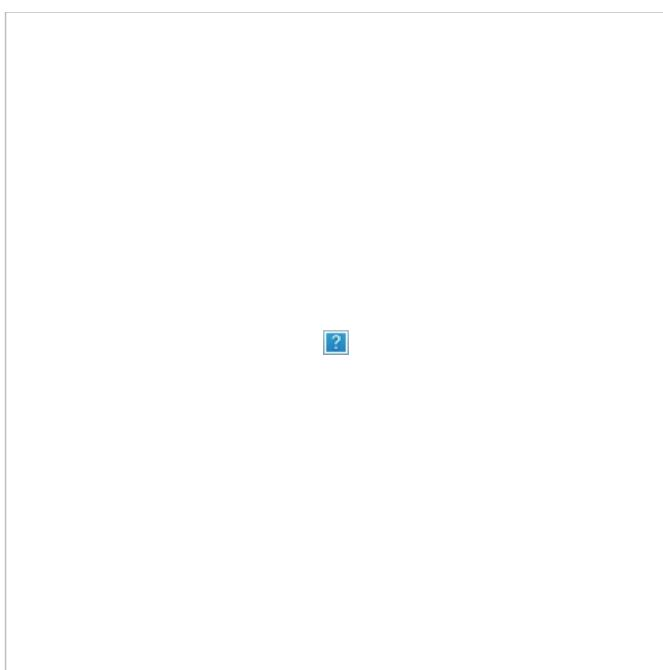
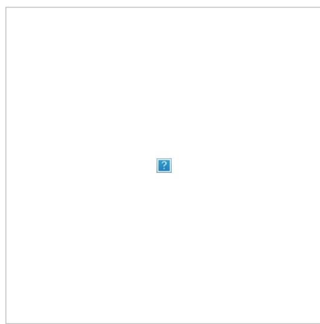

# SubVT Telegram Bot for Kusama and Polkadot

#### -10th of May, 2022 Development Update

Despite the initial plan to upgrade the existing 1KV Telegram Bot, SubVT Telegram Bot has been rewritten from scratch in Rust and is fully integrated with the SubVT Backend. You may find the Telegram bot crate in the SubVT Backend repository.

Release and submission date for the bot including all milestones is the 19th of May 2022. It's going to be an overdelivery with the following additional features on top of the complete initial promises:

Extra commands: /referenda: Lists the open on-chain referenda for the network, and the user can click on one of them to view the contextual information fetched from Polkassembly, and the information also shows the votes of the validators on the chat for the selected referendum. /nfts: Displays a paged list of the NFTs on the stash account of a selected validator. User can then select an NFT and get redirected to its web URL. This command uses the sub.id API. /networkstatus: This command was included under Future Plans in the initial proposal. It is implemented and is going to be available on the release. /contact: Lets the user to post bug reports and feature requests directly from the bot to the dev team. /summary: Summary information of all the validators on the chat. Useful to get an overall view of the validators such as which ones are active, which ones are active next session, their nominator count and active/inactive nomination amounts etc. Extra notifications when: A validator is going to be active/inactive next session (early notification for possible preparation or checks). A validator has outstanding payouts. A validator votes for a referendum. There's a new referendum open for vote. Referendum passed / not passed / cancelled. There's a new democracy proposal. A validator has delegated or undelegated its votes.

## Project Overview :page_facing_up:

#### Overview

SubVT Telegram Bot is an upgrade for the existing Helikon Polkadot/Kusama 1KV Telegram Bot to support all validators on Kusama and Polkadot with increased functionality and performance.

Future upgrades aim for adding support for other proof-of-stake (PoS) Substrate-based networks such as HydraDX, Darwinia (Crab), Edgeware and more, and Telemetry data access to support more real-time node data and notifications.

The 1KV Bot currently serves 221 out of 359 valid nodes on Kusama and 90 out of 129 valid nodes on Polkadot. Relatively high adoption rates (61% on Kusama and 69% on Polkadot) with very little announcement have resulted in our interest in extending the bot's support to all Kusama and Polkadot validators, and other Substrate-based PoS networks in the future.

This upgrade consists of migrating the bot to use the backend services and storage of SubVT (Substrate Validator Toolkit), which is an under-development native mobile application project for iOS and Android phones, tablets and wearables, supported by the Kusama Treasury.

### Project Details

The 1KV Bot currently has a number of issues such as:

No support for validators outside the 1KV. It's also not possible for it to support networks other than Kusama and Polkadot in its current state. New nomination notification doesn't work for nested calls such as multi-sigs, batch calls and proxied calls. It only works for top-level nominate extrinsics. /stakinginfo command displays only an overview of the nominations backing the validator. The command response is slow on Kusama and even slower on Polkadot since it fetches and indexes the nomination data for the validator after every command call. No account age information. No chart for 1KV rating history. No 1KV score information. Missing notifications for: Lost nominations. validate extrinsic. On-chain identity change. Payouts.

Current state of the 1KV Bot

SubVT backend, under development for the SubVT mobile applications, is near its first-phase completion and can provide very fast data access required by the current 1KV Bot functionality and more. Below is a diagram of the proposed upgrade for the 1KV bot to utilize the SubVT backend services.

SubVT backend is being developed in Rust. Proposed upgrade for the bot is going to improve and re-structure the current Javascript codebase to have the following modules:

- 1. Telegram Bot API communication component.
- 2. Information services component, which serves the commands sent from the user device.
- 3. Notifier component, which delivers notifications as Telegram messages to the user's phone through the Telegram Bot API.

SubVT Telegram Bot components

Below is a list of commands that the bot will have after the upgrade.

|Command |  |  |  |  |  |  | Description |
|----------------- | ----- | ------------ | -------------- | ----------- | ----------- | ----------- | --------------------------------------------------------------------- |
|/validator-info |  | Complete |  | chain | data | and | (optional) 1KV data about the validator. |
| | An |  | overview | of | the | active | and inactive nomination data. Number of nominators and total |
| |  |  | Breakdown | of all | active | and | inactive nominations. Includes nominator addresses and |
| |  | identities |  | and | number | of | other nominees per each nomination. |
| | A | chart |  | that | displays | the | total rewards earned by the validator per month and the total |
| |  | amount |  | earned. |  |  |  |
| | A | chart |  | that | displays | the | total rewards paid out by the validator to nominators per month and |
| | the |  | total | paid-out | amount. |  |  |
|/settings |  |  | Notification |  | settings. |  |  |
|/add | Add | a | new | validator | to | the | chat. |
|/remove |  | Remove |  | an | existing | validator | from the chat. |
|/help | A | list | of | commands | and | their | descriptions. |
|/about |  |  | Development, |  | codebase | and | contribution details. |

And below are the list of notifications after the upgrade:

New notifications: New nominations in batch, multi-sig and proxy calls. Nomination lost. New validate extrinsic. Identity or parent identity changed. Payout call for an era, or multiple eras in a batch call. Existing notifications: Active set inclusion and exclusion. Block(s) authored. Validator chilled. Offline offence committed. Commission changed. Controller changed. 1KV-related. Validity changed. Rank changed. Binary version changed.

#### Ecosystem Fit

There are currently two more bots for the Polkadot and Kusama validators, both production-level and robust. One is by CryptoLab, and the other by Ryabina, both with Kusama and Polkadot versions.

Ryabina bot is a more generalized one that supports configurable alerts for all extrinsics and events, yet it doesn't provide more validatorspecific functionality such as in-chat reward reports, and the configuration is not very user-friendly due to the generalized nature of the solution. It also doesn't support 1KV data.

#### Contact

Contact Name: Kutsal Kaan Bilgin Contact Email: kutsal@helikon.tech Website: helikon.tech (Under Construction)

#### Legal Structure

Registered Address: Omer Avni Mah. Balcik Sok. 4/4 34427 Beyoglu Istanbul Turkey Registered Legal Entity: Helikon Teknoloji ve Medya Tic. Ltd. Sti.

#### Team's experience

I am a software developer with a bachelor's degree in Computer Science and 20 years of experience in development and leading. After a series of positions mostly in enterprise software development settings, I focused on native mobile development for iOS and Android between 2012 and 2019, in which year I was introduced to the world of blockchain and cryptocurrencies when I got hired by Tari. For a duration of 1 year and 8 months I led the development of Aurora, the Tari cryptocurrency wallet for Android and iOS. The app got received very well by the Tari community thanks to its lean, eye-pleasing design and simple UX. I learned a lot at Tari about how blockchain systems work and the cryptocurrency ecosystem in general. Working with a product management team that's super-focused on usability and simplification gave me a perspective on the value of good UX and UI in a field that's notorious for its technical difficulties for the notso-technical users.

After my time at Tari I got interested in Polkadot and Kusama ecosystems and started running a Kusama validator enrolled in 1KV. I developed the Kusama 1KV Bot just to scratch my own itch, then ported it to Polkadot. After experimenting a bit with Substrate storage and RPC interface, I developed the idea of SubVT and prepared a treasury spending proposal for the project, which got accepted by the Kusama council. I have been working with Klad, supervising the UX and UI design for the project, which is now complete. I've also been working on the SubVT backend, which is also near completion, bringing SubVT to its second stage: Android and iOS applications development.

#### Team Code Repos

#### Helikon Labs

github.com/helikon-labs github.com/helikon-labs/polkadot-kusama-1kv-telegram-bot github.com/helikon-labs/subvt (in progress) github.com/helikon-labs/subvt-backend (in progress) github.com/helikon-labs/subvt-landing-page

#### Team Members

github.com/kukabi

### Team LinkedIn Profiles (if available)

N/A

## Development Status :open_book:

The original 1KV Bot for Kusama and Polkadot has been running successfully for nearly 9 months. SubVT backend is near completion with the deadline of the 13th of December with complete tests and documentation.

### Development Roadmap :nut_and_bolt:

#### Overview

Total Estimated Duration: 3 months Full-Time Equivalent (FTE): 0.33 Total Costs: 9,600 USD

### Milestone 1 — Migration to the SubVT Services, Extended Support and Initial Fixes

Estimated duration: 1.5 months FTE: 0.33 Costs: 4,800 USD

|Number |  | Deliverable | Specification |
|-------- | --------------- | ------------- | ----------------------------------------------------------- |
|0a. | License |  | GPLv3 |
|0b. | Documentation |  | Milestone progress report and inline code documentation. |
| |  |  | GitHub README that explains how to run an instance. |
| |  |  | Separate markdown in the GitHub repository that documents |

|0c. | Testing Guide | the complete test cases and how to run them. |
|----- | ---------------------------- | -------------------------------------------------------------- |
|0d. | Docker |  |
| |  | A Dockerfile that can be used to test all the functionality |
| |  | delivered with this milestone. |
|0e. | Article |  |
| |  | An article that documents the development process and the |
|1. | SubVT Services Migration | Migrate the bot to use the SubVT backend services. |
|2. | Support for All Validators |  |
| |  | Extend the bot to support not just 1KV validators but all |
| |  | Kusama and Polkadot validators. |
|3. | Notification Fixes |  |
| |  | Fix the notification logic so that the bot supports nominate |
| |  | notifications for multi-sig, batch and proxy calls. |

### Milestone 2 — New features

Estimated Duration: 1.5 months FTE: 0.33 Costs: 4,800 USD

|Number Deliverable |  |  |  |  | Specification |  |  |  |
|----------------------------------- | ------------ | ---------- | ----------- | ------------ | --------------------- | ------------- | ------------ | ----------------------- |
|0a. License | GPLv3 |  |  |  |  |  |  |  |
|0b. Documentation | Milestone | progress |  | report and | inline | code |  | documentation. |
| | GitHub | README | that | explains | how | to run | an | instance. |
|0c. Testing Guide |  |  |  |  |  |  |  |  |
| | Separate | markdown | in | the | GitHub |  | repository | that documents |
|the | complete | test | cases | and | how | to run | them. |  |
|0d. Docker |  |  |  |  |  |  |  |  |
|A | Dockerfile | that | can | be used | to | test all | the | functionality |
| | delivered | with | this | milestone. |  |  |  |  |
|0e. Article |  |  |  |  |  |  |  |  |
|An | article | that | documents | the |  | development |  | process and the |
|1. Improve Validator Info Message |  |  |  |  |  |  |  |  |
| | Include | account | age | and | optional | 1KV | score | data in the |
| | validator | info | message. |  |  |  |  |  |
|2. Implement New Notifications |  |  |  |  |  |  |  |  |
| | Extend | the bot | with new |  | notifications | for | lost | nominations, on |
| | chain | identity | change, | validate |  | extrinsic |  | and payouts calls for |
|a | single | era or | multiple | eras | in a | batch | call. |  |
|3. Implement New Commands |  |  |  |  |  |  |  |  |
| | Implement | the | new |  | /nomination-details |  |  | and /payouts |

## Future Plans

Telemetry integration. Notifications for peer count and bandwidth thresholds, and possibly others related to the Telemetry data /network-info command. Displays a summary of the network's status and overall staking data. Support for additional Substrate-based PoS networks. Score spider chart for 1KV members.

### Additional Information :heavy_plus_sign:

#### How did you hear about the Grants Program?

I read about the program when I was initially researching into the Polkadot ecosystem in early 2021.

In October 2021 Marcin Górny kindly offered support for the extension of the 1KV Bot to all Kusama and Polkadot validators in an issue he posted to the 1KV Bot repository.