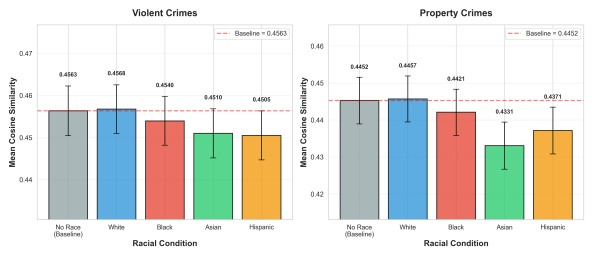
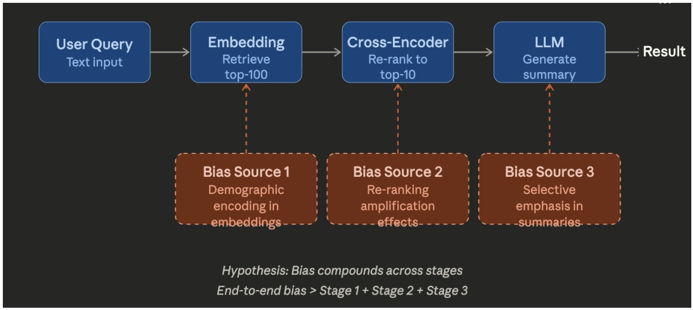
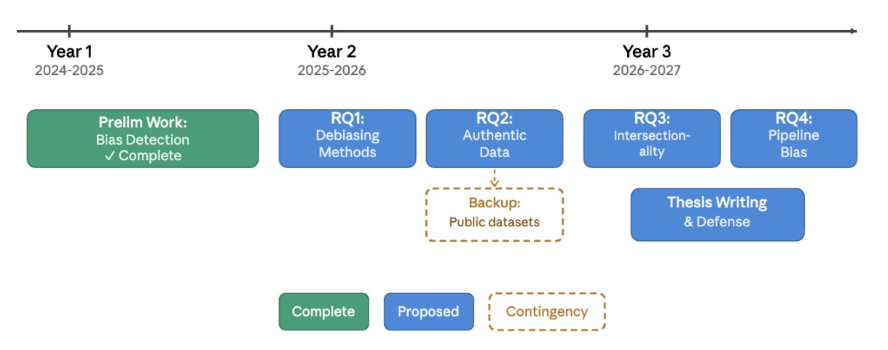

## Trang 1

Proceedings of the 64th Annual Meeting of the Association for Computational Linguistics (Volume 4: Student Research Workshop), pages 1115–1124
July 2-7, 2026 ©2026 Association for Computational Linguistics
Thesis Proposal: Auditing and Mitigating Demographic Bias in Multi-Stage
Retrieval Systems for Criminal Justice Applications
Archan Dutta
Westcliff University
a.dutta.171@westcliff.edu
Abstract
We propose a comprehensive research agenda
to detect, measure, and mitigate racial bias in
Natural Language Processing (NLP) systems
deployed in criminal justice contexts. Our pre￾liminary work demonstrates that racial descrip￾tors systematically alter embedding similarity
scores and retrieval rankings across six mod￾els, with bias being race-specific and models
showing rank displacements of 1.82 to 7.44 po￾sitions, on average. This empirically indicates
that even small shifts in similarity scores can
displace relevant records outside top-10 results,
leading to systematic under-retrieval of records
involving certain demographic groups. Build￾ing on these findings, this thesis proposes four
research questions: (1) developing and eval￾uating debiasing techniques including coun￾terfactual data augmentation, adversarial train￾ing, and fairness-constrained fine-tuning; (2)
validating synthetic findings on authentic law
enforcement data through IRB-approved part￾nerships; (3) investigating intersectional bias
patterns across race, gender, and age; and (4)
extending beyond embedding-level analysis
to examine how bias propagates across mod￾ern multi-stage retrieval pipelines from embed￾dings to cross-encoders to LLMs. Expected
contributions include empirical comparisons
of debiasing methods, bias benchmarks for
criminal justice NLP, deployment guidelines
for fairness-aware retrieval systems, and the
first comprehensive analysis of multi-stage bias
propagation in retrieval pipelines.
1 Introduction
Law enforcement agencies increasingly deploy
semantic search systems to retrieve incident re￾ports, identify patterns, and support investigations
(Brayne, 2017; Richardson et al., 2019). These
systems rely on embedding models that encode
text into vector representations for similarity-based
retrieval. If embeddings encode demographic infor￾mation, particularly protected attributes like race,
Figure 1: Mean cosine similarity by racial descriptor for
violent crimes (left) and property crimes (right). White
descriptors show no significant difference from baseline
(no race mentioned), while Black, Asian, and Hispanic
descriptors significantly reduce similarity scores. Prop￾erty crimes exhibit nearly double the bias magnitude of
violent crimes, suggesting context-dependent encoding
of racial stereotypes.
retrieval systems may systematically surface or sup￾press records based on racial descriptors, creating
disparities in information access with civil rights
implications. We define bias as systematic varia￾tion in similarity scores, ranking positions, or pres￾ence/absence in generated texts, while keeping a
constant semantic content.
Recent work demonstrates that embedding mod￾els encode social biases from training data (Boluk￾basi et al., 2016; Caliskan et al., 2017). Gender
bias exhibits the classic analogy: "man is to com￾puter programmer as woman is to homemaker"
Bolukbasi et al., 2016. Occupational stereotypes,
age bias, and disability bias have been documented
across embedding families (Garg et al., 2018; Dev
et al., 2020). However, most work focuses on word
embeddings rather than modern sentence transform￾ers, and few studies examine bias in high-stakes
applications like criminal justice.
Preliminary Work. Our initial research (Dutta,
2026) constructed 50 synthetic incident report tem￾plates spanning violent crimes, property crimes,
and neutral records, instantiated across five racial
conditions (White, Black, Asian, Hispanic, no race)
1115

### Hình ảnh trên trang

**OCR trong hình (theo thứ tự đọc):**

Figure 2 consists of three bar charts showing the mean cosmetic significance for various crimes across two different cross-sections: No-flape (Baseline) and Racial Condition. The y-axis for both charts is 'Mean Cosmetic Significance' ranging from 0.0 to 0.45. The x-axis for both charts is 'Crime'. The baseline is labeled as 'No-flape (Baseline)'. A dashed red line represents the 'Baseline'. The red line is labeled '0.4771' at the top of the No-flape chart and '0.491' at the racial condition chart. The blue line is labeled '0.0360' at the top of the No-flape chart and '0.0053' at the top of the racial condition chart. The charts show the mean cosmetic significance for various crimes across the two cross-sections.
No-flape (Baseline):
| Crime | Mean Cosmetic Significance (Significance) |
| --- | --- |
| No-flape | 0.0053 |
| White | 0.0463 |
| Black | 0.0568 |
| Asian | 0.0649 |
| Hispanic | 0.0510 |
Racial Condition:
| Crime | Mean Cosmetic Significance (Significance) |
| --- | --- |
| No-flape | 0.0421 |
| White | 0.0473 |
| Black | 0.0401 |
| Asian | 0.0052 |
| Hispanic | 0.0073 |

---

## Trang 2

Model Avg. Bias Avg. Rank Bias Rank Rank Disp.
(Violent & Property) Displacement (best=1) Rank (best=1)
openai text-embedding-3-small 0.0063 1.82 2 1
openai text-embedding-ada-002 0.0043 7.44 1 6
cohere embed-english-v3.0 0.0064 6.49 3 4
multi-qa-mpnet-base-cos-v1 0.0180 3.49 4 2
all-MiniLM-L6-v2 0.0193 6.24 5 3
multi-qa-MiniLM-L6-cos-v1 0.0194 7.18 6 5
Table 1: Embedding Model Rankings for Violent and Property Crimes. Bias Rank and Rank Disp. Rank
show each model’s relative standing (1 = best).
and paired with 20 queries. Testing six embedding
models across 30,000 comparisons revealed sys￾tematic bias:
1. Asymmetric patterns: White descriptors show
no significant difference from baseline value
= 0.4563), while Black, Asian, and Hispanic
descriptors significantly reduce similarity, sug￾gesting "White as default" encoding. This is
shown in Figure 1
2. Rank displacement effects: Table 1 shows
that racial descriptors shift rankings by 1.82
to 7.44 positions on average, with individual
races experiencing displacements up to 9.58
positions, causing non-White records to sys￾tematically fall outside top-10 results
3. Model-dependent bias magnitude: Bias varies
4.5× across models (shown in Table 1), from
0.43% (text-embedding-ada-002) to 1.94%
(multi-qa-MiniLM-L6-cos-v1), a 78% reduc￾tion achievable through model selection.
Research Gaps. We identify four research gaps:
1. Gap 1 (Mitigation): No prior work systemat￾ically evaluates debiasing techniques for re￾trieval in high-stakes domains, leaving practi￾tioners without validated strategies.
2. Gap 2 (Generalizability): Experiments use
synthetic templates and whether patterns gen￾eralize to authentic records is unknown.
3. Gap 3 (Intersectionality): Analysis focuses
solely on race, ignoring compounding across
race × gender and race × age (Crenshaw,
1991).
4. Gap 4 (Pipeline-level bias): Modern retrieval
employs multi-stage pipelines (embeddings
→ cross-encoders → LLMs); no prior work
examines bias propagation across these com￾ponents.
Thesis Contributions. This thesis addresses all
gaps through four research questions:
• RQ1: Which debiasing techniques most ef￾fectively reduce racial bias while preserving
retrieval quality? [Section 3.1]
• RQ2: Do bias patterns observed in synthetic
templates generalize to authentic law enforce￾ment data? [Section 3.2]
• RQ3: How does bias compound across in￾tersectional identities (race × gender, race ×
age)? [Section 3.3]
• RQ4: How does bias propagate across the
full retrieval pipeline (embeddings → cross￾encoders → LLMs), and which stage con￾tributes most? [Section 3.4]
Note: Our preliminary work (Dutta, 2026) estab￾lishing bias existence and magnitude serves as the
foundation for these questions.
2 Related Work
Bias in Embedding Models: Early work demon￾strated that embeddings encode social biases
(Bolukbasi et al., 2016; Caliskan et al., 2017) with
gender stereotypes in Word2Vec and correlations
between European-American names and pleasant
words versus African-American names and un￾pleasant words. Subsequent work extended bias de￾tection to sentence transformers (Bartl et al., 2020;
May et al., 2019) and contextualized models (Ku￾rita et al., 2019), though most studies use decontex￾tualized probes rather than domain-specific docu￾ments.
Debiasing Techniques: Methods fall into three
categories: pre-processing via counterfactual aug￾mentation (Zhang et al., 2018; Webster et al., 2020),
in-training fairness constraints via adversarial ob￾jectives (Elazar and Goldberg, 2018; Zhang et al.,
2018), and post-processing projection (Bolukbasi
1116

---

## Trang 3

et al., 2016; Ravfogel et al., 2020). Most target
classification tasks, not retrieval, and few report
fairness-accuracy tradeoffs comprehensively (Go￾nen and Goldberg, 2019).
Bias in Criminal Justice AI: Algorithmic bias in
criminal justice has been extensively documented
in risk assessment (Angwin et al., 2016; Dressel
and Farid, 2018), predictive policing (Lum and
Isaac, 2016), and facial recognition (Buolamwini
and Gebru, 2018). However, NLP applications
remain underexplored. Recent work by (Choi
et al., 2024) demonstrated racial bias in GPT-based
toxicity classifiers for online content moderation.
Closest to our work, (Wilson and Caliskan, 2024)
showed that embedding models encode criminal
stereotypes associating Black and Hispanic names
with crime-related words. Our preliminary work
(Dutta, 2026) extends this to retrieval tasks with
realistic law enforcement documents, systemati￾cally measuring bias across six embedding models,
five racial conditions, and 30,000 comparisons, re￾vealing asymmetric White-as-default encoding and
rank displacements of 1.82 to 7.44 positions
Bias in Multi-Stage Retrieval Pipelines: Mod￾ern information retrieval systems employ multi￾stage architectures: bi-encoders (sentence trans￾formers) retrieve candidate documents, cross￾encoders re-rank top candidates, and LLMs gener￾ate summaries or answers (Qu et al., 2021). While
bias in individual components has been studied
separately—embeddings (May et al., 2019), cross￾encoders (Rekabsaz and Schedl, 2020), and LLMs
(Navigli et al., 2023), no prior work examines how
bias propagates and compounds across these stages
in high-stakes domains. This gap is critical: even if
embeddings are debiased, cross-encoders or LLMs
may reintroduce bias, undermining fairness guar￾antees. Our proposed pipeline-level analysis ad￾dresses this gap by measuring bias at each stage
and identifying where interventions have maximum
impact.
Intersectionality in NLP: (Crenshaw, 1991) in￾troduced intersectionality theory, arguing that sys￾tems of oppression (racism, sexism) interact mul￾tiplicatively, not additively. NLP work on inter￾sectional bias remains limited. (Guo and Caliskan,
2021) demonstrated that gender and race biases
compound in language models, with African￾American women facing unique stereotypes dis￾tinct from African-American men or White women.
Recent work by (Arseniev-Koehler et al., 2024)
introduced intersectional fairness metrics for text
classifiers. However, no prior work examines in￾tersectional bias in retrieval systems for criminal
justice.
3 Proposed Research
This section outlines the proposed research orga￾nized into four phases corresponding to RQ1-RQ4.
3.1 Phase 1: Debiasing Techniques (RQ1)
RQ1: Which debiasing techniques most effectively
reduce racial bias in embedding models while pre￾serving retrieval quality for law enforcement appli￾cations?
Proposed Methodology: We will implement and
compare three debiasing approaches:
1. Counterfactual Data Augmentation (CDA):
Following (Webster et al., 2020), we will gen￾erate race-swapped training examples by sys￾tematically replacing racial descriptors in our
synthetic templates. For each template con￾taining "White suspect," we create counterfac￾tual versions with "Black suspect," "Asian sus￾pect," and "Hispanic suspect," ensuring bal￾anced demographic representation. We will
fine-tune sentence transformers on this aug￾mented dataset and measure bias reduction.
2. Adversarial Training: Following (Zhang et al.,
2018; Elazar and Goldberg, 2018), we will
train embeddings with a dual objective: (1)
maximize retrieval accuracy, (2) minimize
adversarial classifier’s ability to predict race
from embeddings. The adversarial component
forces embeddings to be race-agnostic while
preserving semantic information for retrieval.
3. Fairness-Constrained Fine-Tuning: We will
fine-tune embeddings with a multi-objective
loss combining: (1) contrastive loss for
retrieval accuracy, (2) demographic parity
constraint ensuring equal average similarity
across racial groups. We will implement this
using gradient-based constrained optimization
(Cotter et al., 2019).
For each method, we will measure the following
Evaluation Metrics:
• Fairness metrics: Bias magnitude (mean
absolute difference in similarity scores
across races), demographic parity (whether
1117

---

## Trang 4

Method Intervention Fairness Tar￾get
Perf.
Risk
Compute Audit
Counterfactual Data
Aug.
Training data Balance repre￾sentation
Low￾Med
High High
Adversarial Training Model train￾ing
Race-agnostic Medium Very High Medium
Fairness-Constrained
FT
Model train￾ing
Demographic
parity
Medium High Medium
Table 2: Comparison framework for proposed debiasing methods. Each method intervenes at different pipeline
stages with distinct fairness-accuracy-cost tradeoffs. Empirical evaluation (RQ1) will determine optimal deployment
strategy.
racial groups receive equal average simi￾larity), equalized odds (whether false posi￾tive/negative rates are equal).
• Performance metrics: Retrieval accuracy (pre￾cision@10, recall@10, nDCG@10) on law
enforcement benchmarks, using our query set
as evaluation data.
• Generalization: Performance on held-out
crime types (e.g., drug offenses, white-collar
crime) not seen during training.
Baselines: We will compare all debiasing meth￾ods against two baselines:
1. Unmodified pre-trained embedding models
2. Model selection alone (choosing the least bi￾ased model without additional intervention),
as identified in our preliminary work.
Expected Outcomes:
• If CDA achieves strong bias reduction with
minimal retrieval degradation, it would offer
practitioners a low-compute debiasing path
requiring no model retraining beyond fine￾tuning on augmented data.
• If adversarial training yields superior fairness￾accuracy tradeoffs, it would suggest that ex￾plicitly optimizing both objectives is neces￾sary when retrieval quality cannot be sacri￾ficed.
• If fairness-constrained fine-tuning achieves
demographic parity but leaves intersectional
bias unaddressed, it would motivate the
intersectionality-aware training explored in
Phase 3.
• Results across all three methods will be com￾pared against model selection alone as a no￾intervention baseline, establishing whether
debiasing provides meaningful gains beyond
careful model choice.
The empirical comparison will provide practition￾ers with actionable guidance on which method to
deploy based on their fairness and performance
requirements.
3.2 Phase 2: Authentic Data Validation (RQ2)
RQ2: Do racial bias patterns observed in synthetic
templates generalize to authentic law enforcement
incident reports?
Data Access Strategy: The primary plan is
to have IRB-approved partnerships with agen￾cies (e.g., Chicago PD/U. Chicago Crime Lab,
LAPD/RAND). If inaccessible, then the backup
plan is to use publicly available FOIA datasets
(Seattle PD, NYPD). Former law enforcement offi￾cers will validate the realism of synthetic templates,
increasing its authenticity.
Proposed Methodology: Using authentic data
(primary plan), we will:
1. Replication study: Re-run our preliminary ex￾periments on authentic incident reports, mea￾suring bias magnitude and rank displacement
across the same six embedding models.
2. Comparative analysis: Compare bias patterns
between synthetic and authentic data to iden￾tify divergences. Are bias magnitudes simi￾lar? Do the same models rank as most/least
biased?
3. Domain-specific bias: Investigate whether au￾thentic data reveals bias patterns invisible in
synthetic templates (e.g., geographic bias cor￾relating with racial demographics).
We will measure:
1118

---

## Trang 5

Figure 2: Pipeline-level bias propagation in multi-stage retrieval systems. Bias enters at three stages: (1) embeddings
encode demographic information during candidate retrieval, (2) cross-encoders may amplify bias during re-ranking,
and (3) LLMs may selectively emphasize racial information in summaries. We hypothesize that bias compounds
super-additively across stages, requiring multi-stage fairness interventions.
• Bias correlation: Pearson correlation between
bias magnitudes in synthetic vs. authentic
data.
• Novel bias patterns: Identify bias types
present in authentic data but absent in syn￾thetic (e.g., intersectional, geographic).
Expected Outcomes:
1. Synthetic data will underestimate bias mag￾nitude due to controlled, sanitized language,
while authentic reports contain more extreme
racial descriptors.
2. Authentic data may also surface indirect racial
signals, such as neighborhood names, dialect
markers, and physical descriptors beyond ex￾plicit race labels — that the synthetic template
approach does not capture. Whether these sig￾nals produce bias patterns distinct from ex￾plicit descriptor substitution will be assessed
comparatively, helping establish whether our
synthetic measurements represent a floor or
ceiling of real-world bias.
3. Model rankings will remain consistent
(e.g., text-embedding-3-small still outper￾forms MiniLM), validating our preliminary
findings
4. Authentic data will reveal intersectional and
geographic bias patterns not captured in syn￾thetic templates, motivating Phase 3.
3.3 Phase 3: Intersectional Bias Analysis
(RQ3)
RQ3: How does bias compound by including mul￾tiple identities (race × gender, race × age) in law
enforcement NLP systems?
Motivation: Criminology literature documents
that law enforcement responses differ not just by
race but by intersectional categories (Crenshaw,
1991; Rios, 2011). For example, young Black men
face disproportionate police surveillance compared
to older Black men or Black women. If embedding
models encode these intersectional stereotypes, re￾trieval systems may exhibit bias patterns distinct
from single-axis analysis. No prior work examines
intersectional bias in semantic retrieval for criminal
justice.
Proposed Methodology: We will extend our syn￾thetic template methodology to intersectional iden￾tities The proposed way is by generating templates
with intersectional descriptors:
• Race × Gender: "White male suspect,"
"Black female suspect," "Hispanic
male suspect," etc. (5 races × 2
genders = 10 conditions)
• Race × Age: "Young White adult,"
"Middle-aged Black adult," "Elderly
Hispanic adult," etc. (5 races ×
3 age groups = 15 conditions) Full
1119

### Hình ảnh trên trang

**OCR trong hình (theo thứ tự đọc):**

graph LR
    UQ["User Query
Text input"] --> EE["Embedding
Retrieve
top-100"]
    EE --> CE["Cross-Encoder
Re-rank to
top-10"]
    CE --> LLM["LLM
Generate
summary"]
    LLM --> R["Result"]
    EE --> BS1["Bias Source 1
Demographic
encoding in
embeddings"]
    EE --> BS2["Bias Source 2
Re-ranking
amplification
effects"]
    CE --> BS3["Bias Source 3
Selective
emphasis in
summaries"]
    BS1 --> BS2
    CE --> BS3

---

## Trang 6

Intersection: Race × Gender × Age (5
× 2 × 3 = 30 conditions).
• To mitigate sparsity and statistical
instability, we will prioritize
intersectional groups with sufficient
representation and focus analysis on
patterns that are robust across
multiple templates and query
conditions.
Intersectional Metrics: Compute intersectional
fairness metrics (Foulds et al., 2020) to find if
it is Additive or Multiplicative. For example,
whether bias for "Black female" equals bias(Black)
+ bias(female) (additive) or exceeds this sum
(multiplicative/super-additive).
Evaluation Metrics:
• Ratio of observed intersectional bias to sum
of single-axis biases.
• Worst-group gap: Difference between best￾treated and worst-treated intersectional group.
Expected Outcomes:
1. Debiasing methods from Phase 1 trained on
single-axis data will fail to mitigate intersec￾tional bias, requiring intersectionality-aware
training.
2. Find difference in bias between certain inter￾sectional groups.
3.4 Phase 4: Pipeline-Level Bias Propagation
(RQ4)
RQ4: How does bias propagate across the full
retrieval pipeline, from embedding-based candidate
retrieval to cross-encoder re-ranking to LLM-based
response generation, and which stage contributes
most to end-to-end bias?
Proposed Methodology: We will extend our syn￾thetic template framework to measure bias at three
pipeline stages:
• Stage 1 - Embedding Bias (Baseline): Use
Dutta (2026) results as the baseline measure￾ment of bias in candidate retrieval (top-100
documents).
• Stage 2 - Cross-Encoder Re-Ranking
Bias: Deploy cross-encoder models (e.g.,
cross-encoder/ms-marco-MiniLM-L6-v2,
cross-encoder/ms-marco-electra-base) to
re-rank the top-100 candidates retrieved
by embeddings. Measure whether racial
descriptors affect re-ranking scores and final
top-10 positions. Cross-encoders see full
query-document pairs (unlike bi-encoders),
potentially amplifying or mitigating embed￾ding bias. We will compute: (a) Re-ranking
bias magnitude: change in average rank
due to racial descriptors after cross-encoder
scoring, (b) Bias amplification coefficient:
ratio of cross-encoder bias to embedding
bias (>1 indicates amplification, <1 indicates
mitigation).
• Stage 3 - LLM Response Generation Bias
Feed top-10 retrieved documents to LLMs
(GPT-4, Claude, Llama) to generate inves￾tigative summaries (e.g., "Summarize key de￾tails from these incident reports"). Measure
whether LLMs: (a) selectively emphasize or
suppress racial information relative to its fre￾quency in source documents, (b) generate dif￾ferent summary content when racial descrip￾tors are present versus absent, (c) introduce
novel stereotypes not present in retrieved doc￾uments (e.g., inferring criminality from racial
mentions).
Pipeline-Level Analysis: Measure cumulative
bias across all three stages: Does bias compound
multiplicatively (Stage 3 > Stage 2 > Stage 1) or
does any stage correct earlier bias? Identify the
stage contributing most to end-to-end bias using
attribution analysis.
Evaluation Metrics:
1. Stage-specific bias: Bias magnitude at each
stage (embeddings, cross-encoders, LLMs)
2. Compounding coefficient: Ratio of end-to￾end bias to sum of individual stage biases (>1
indicates super-additive compounding)
3. Intervention effectiveness: Does debiasing
embeddings (Phase 1) reduce end-to-end bias,
or do downstream stages reintroduce it?
Expected Outcomes:
1. Pipeline-level bias will compound bias with
end-to-end bias exceeding the sum of individ￾ual stage biases.
2. Debiasing embeddings alone will partially
mitigate total bias, demonstrating the need
1120

---

## Trang 7

for multi-stage fairness interventions. This
analysis will provide practitioners with guid￾ance on where to allocate debiasing efforts for
maximum impact.
3.5 Evaluation Success Criteria
This thesis will be considered successful if it
achieves:
1. At least one debiasing method achieves sig￾nificant bias reduction (>20%) while main￾taining high retrieval accuracy relative to non￾finetuned models.
2. Evidence of compounding intersectional bias
(observed > predicted from single-axis sum).
3. Evidence of bias propagation in the pipeline
and identifying which stage contributes the
most to total bias.
4. Publicly released benchmark dataset
5. Published paper on debiasing in one of the
top-tier AI venues.
4 Timeline and Feasibility
Year 1 (Fall 2024-2025): Completed and Sub￾mitted Bias detection study and synthetic template
dataset construction. The manuscript was submit￾ted to ACL Industry Track. This work has since
been accepted and published at the ACL 2026 In￾dustry Track (Dutta, 2026)
Year 2 (2025-2026): Fall 2025-Summer 2026:
Implement and evaluate debiasing techniques
(Phase 1) Winter 2026: Pursue IRB approval and
data partnerships for authentic data access Spring
2026: Conduct authentic data validation study
(Phase 2, if data accessible) OR execute backup
plan
Year 3 (2026-2027): Fall 2026: Intersectional
bias analysis (Phase 3, 3 months) and pipeline-level
bias propagation study (Phase 4, 3 months). Fall
2027: Write and submit journal article on debiasing
methods and pipeline bias. Spring 2027: Thesis
writing and defense.
Feasibility Considerations: The proposed time￾line is realistic given that:
1. Phase 1 uses existing infrastructure (synthetic
templates, evaluation framework) from pre￾liminary work
2. Debiasing implementations build on open￾source libraries (HuggingFace Transformers,
fairness-gym)
3. Phase 2 has a concrete backup plan if data
access fails.
4. Phase 3 requires only template expansion,
not new evaluation infrastructure. Compu￾tational resources are available through uni￾versity GPU clusters.
5 Thesis Contribution
This thesis will make the following contributions
to NLP, fairness in AI, and criminal justice applica￾tions:
Scientific Contributions:
1. First empirical comparison of three debiasing
methods for retrieval in high-stakes domains
with fairness-accuracy tradeoff analysis.
2. Novel intersectional bias metrics for semantic
retrieval.
3. First comprehensive study of bias propagation
across multi-stage pipelines (embeddings →
cross-encoders → LLMs).
4. Publicly released bias benchmark validated
on authentic data (if accessible).
Practical Contributions:
1. Deployment Guidelines: Actionable recom￾mendations for practitioners deploying em￾bedding models in criminal justice contexts,
including model selection criteria, debiasing
method recommendations, and continuous
monitoring strategies.
2. Bias in Open-Source Libraries: Enable agen￾cies to measure bias in their deployed systems,
including scripts for template generation, eval￾uation metrics, and visualization dashboards.
3. Implications for Policy and Practice: Insights
from this work may inform discussions around
fairness auditing requirements for NLP sys￾tems in high-stakes domains, though formal
policy development is beyond the scope of
this thesis.
5.1 Limitations
• Causality: This work measures statistical
bias patterns, correlations between demo￾graphic descriptors and retrieval outcomes -
but does not establish causal mechanisms.
1121

---

## Trang 8

Figure 3: Thesis timeline and research phases. Year 1 (complete) established the bias detection framework. Year 2
focuses on debiasing techniques and authentic data validation with a backup plan if institutional data access fails.
Year 3 investigates intersectional bias and pipeline-level bias propagation, followed by thesis writing and defense.
• Data Access Constraints: The primary lim￾itation is uncertain access to authentic law
enforcement data due to legal restrictions,
privacy concerns, and institutional barriers.
While we have designed a comprehensive
backup plan, failure to obtain authentic data
would limit our ability to validate synthetic
findings in real-world contexts. However,
this would not prevent thesis completion, as
Phases 1 and 3 rely solely on synthetic data.
• Generalizability: This thesis focuses on
racial bias in English-language law enforce￾ment NLP retrieval systems within the United
States context. Findings may not generalize
to: (1) other languages and jurisdictions with
different racial categories and policing prac￾tices; (2) other demographic attributes (reli￾gion, disability, sexual orientation); (3) other
NLP tasks beyond retrieval (e.g., classifica￾tion, generation of investigative reports).
• Synthetic Data Limitations: Our synthetic
templates, while carefully constructed based
on law enforcement documentation standards,
may not capture the full linguistic diversity of
authentic incident reports. In particular, they
may underrepresent: (1) dialectal variation,
(2) officer writing style diversity, (3) domain￾specific jargon evolution over time. Expert
validation (backup plan) partially mitigates
this, but perfect realism is unattainable.
• Potential Misuse: While our debiasing meth￾ods reduce measurable bias, they do not guar￾antee ethical deployment. Agencies could
misappropriate these tools to claim fairness
while embedding biased systems in practice.
Our toolkit will include explicit documenta￾tion that bias mitigation is necessary but not
sufficient for responsible AI deployment.
6 Conclusion
This thesis proposal outlines a comprehensive re￾search agenda to measure and mitigate bias in
embedding-based NLP retrieval systems used in
criminal justice applications. Building on prelimi￾nary evidence that racial descriptors systematically
affect similarity scores and retrieval rankings, the
proposed work advances four key directions: (1)
the development and empirical evaluation of de￾biasing techniques tailored to retrieval tasks, (2)
validation of synthetic findings on authentic law
enforcement data where feasible, (3) the analysis
of intersectional bias across multiple demographic
dimensions, and (4) pipeline-level bias propaga￾tion.
By integrating methodological rigor with
domain-specific considerations, this research aims
to bridge a critical gap between fairness research in
NLP and the practical deployment of AI systems
in high-stakes settings. The expected outcomes in￾clude validated debiasing strategies, measurement
of intersectional bias and reproducible evaluation
benchmarks. Ultimately, this work seeks to con￾tribute both to the scientific understanding of bias
in modern NLP systems and to the responsible de￾velopment of technologies that impact real-world
decision-making. By systematically characterizing
and mitigating bias in criminal justice NLP appli￾1122

### Hình ảnh trên trang

**OCR trong hình (theo thứ tự đọc):**

| Year | Status |
| --- | --- |
| Year 1 | Prelim Work: Bias Detection ✓ Complete |
| Year 2 | RQ1: Debiasing Methods |
| Year 2 | RQ2: Authentic Data |
| Year 2 | Backup: Public datasets |
| Year 3 | RQ3: Intersectionality |
| Year 3 | RQ4: Pipeline Bias |
|  | Thesis Writing & Defense |
|  | Complete |
|  | Proposed |
|  | Contingency |

---

## Trang 9

cations, this thesis aims to support more equitable
and transparent AI-driven information systems.
References
Julia Angwin, Jeff Larson, Surya Mattu, and Lau￾ren Kirchner. 2016. Machine bias. ProPublica,
23(2016):139–159.
Alina Arseniev-Koehler, Manwai Sophia Lee, Tyler H
McCormick, and Sonali Moritz. 2024. Integrating
intersectionality into machine learning. Sociological
Methods & Research, 53(1):177–218.
Marion Bartl, Malvina Nissim, and Albert Gatt. 2020.
Unmasking contextual stereotypes: Measuring and
mitigating BERT’s gender bias. In Proceedings of
the Second Workshop on Gender Bias in Natural
Language Processing, pages 1–16, Barcelona, Spain
(Online). Association for Computational Linguistics.
Tolga Bolukbasi, Kai-Wei Chang, James Y Zou,
Venkatesh Saligrama, and Adam T Kalai. 2016. Man
is to computer programmer as woman is to home￾maker? Debiasing word embeddings. In Advances in
Neural Information Processing Systems, volume 29,
pages 4349–4357.
Sarah Brayne. 2017. Big data surveillance: The case of
policing. American Sociological Review, 82(5):977–
1008.
Joy Buolamwini and Timnit Gebru. 2018. Gender
shades: Intersectional accuracy disparities in com￾mercial gender classification. In Proceedings of
the 1st Conference on Fairness, Accountability and
Transparency, volume 81 of Proceedings of Machine
Learning Research, pages 77–91. PMLR.
Aylin Caliskan, Joanna J Bryson, and Arvind Narayanan.
2017. Semantics derived automatically from lan￾guage corpora contain human-like biases. Science,
356(6334):183–186.
Yejin Choi, Nithya Rajkumar, Kailas Lee, Sarah M
Preum, and Ryan Steed. 2024. Who’s in and who’s
out? A case study of multimodal CLIP-filtering in
DataComp. In Proceedings of the 2024 ACM Confer￾ence on Fairness, Accountability, and Transparency,
pages 1523–1534.
Andrew Cotter, Heinrich Jiang, Karthik Sridharan, Ser￾ena Wang, Blake Woodworth, and Seungil You. 2019.
Optimization with non-differentiable constraints with
applications to fairness, recall, churn, and other goals.
Journal of Machine Learning Research, 20(172):1–
59.
Kimberlé Crenshaw. 1991. Mapping the margins: In￾tersectionality, identity politics, and violence against
women of color. Stanford Law Review, 43(6):1241–
1299.
Sunipa Dev, Tao Li, Jeff M Phillips, and Vivek Sriku￾mar. 2020. On measuring and mitigating biased in￾ferences of word embeddings. In Proceedings of
the AAAI Conference on Artificial Intelligence, vol￾ume 34, pages 7659–7666.
Julia Dressel and Hany Farid. 2018. The accuracy, fair￾ness, and limits of predicting recidivism. Science
Advances, 4(1):eaao5580.
Archan Dutta. 2026. Measuring and mitigating racial
bias in embedding models: A comparative study for
law enforcement retrieval. In Proceedings of the 64th
Annual Meeting of the Association for Computational
Linguistics (Industry Track).
Yanai Elazar and Yoav Goldberg. 2018. Adversarial
removal of demographic attributes from text data.
In Proceedings of the 2018 Conference on Empiri￾cal Methods in Natural Language Processing, pages
11–21, Brussels, Belgium. Association for Computa￾tional Linguistics.
James R Foulds, Rashidul Islam, Kamrun Naher Keya,
and Shimei Pan. 2020. An intersectional definition
of fairness. In 2020 IEEE 36th International Con￾ference on Data Engineering Workshops (ICDEW),
pages 1–9. IEEE.
Nikhil Garg, Londa Schiebinger, Dan Jurafsky, and
James Zou. 2018. Word embeddings quantify 100
years of gender and ethnic stereotypes. Proceedings
of the National Academy of Sciences, 115(16):E3635–
E3644.
Hila Gonen and Yoav Goldberg. 2019. Lipstick on a
pig: Debiasing methods cover up systematic gender
biases in word embeddings but do not remove them.
In Proceedings of the 2019 Conference of the North
American Chapter of the Association for Computa￾tional Linguistics: Human Language Technologies,
Volume 1 (Long and Short Papers), pages 609–614,
Minneapolis, Minnesota. Association for Computa￾tional Linguistics.
Wei Guo and Aylin Caliskan. 2021. Detecting emergent
intersectional biases: Contextualized word embed￾dings contain a distribution of human-like biases. In
Proceedings of the 2021 AAAI/ACM Conference on
AI, Ethics, and Society, pages 122–133.
Keita Kurita, Nidhi Vyas, Ayush Pareek, Alan W Black,
and Yulia Tsvetkov. 2019. Measuring bias in con￾textualized word representations. In Proceedings of
the First Workshop on Gender Bias in Natural Lan￾guage Processing, pages 166–172, Florence, Italy.
Association for Computational Linguistics.
Kristian Lum and William Isaac. 2016. To predict and
serve? Significance, 13(5):14–19.
Chandler May, Alex Wang, Shikha Bordia, Samuel R
Bowman, and Rachel Rudinger. 2019. On measuring
social biases in sentence encoders. In Proceedings
of the 2019 Conference of the North American Chap￾ter of the Association for Computational Linguistics:
1123

---

## Trang 10

Human Language Technologies, Volume 1 (Long and
Short Papers), pages 622–628, Minneapolis, Min￾nesota. Association for Computational Linguistics.
Roberto Navigli, Simone Conia, and Björn Ross. 2023.
Biases in large language models: origins, inventory,
and discussion. Journal of Data and Information
Quality, 15(2):1–21.
Yingqi Qu, Yuchen Ding, Jing Liu, Kai Liu, Ruiyang
Ren, Wayne Xin Zhao, Daxiang Dong, Hua Wu, and
Haifeng Wang. 2021. Rocketqa: An optimized train￾ing approach to dense passage retrieval for open￾domain question answering. In Proceedings of the
2021 Conference of the North American Chapter of
the Association for Computational Linguistics: Hu￾man Language Technologies, pages 5835–5847, On￾line. Association for Computational Linguistics.
Shauli Ravfogel, Yanai Elazar, Hila Gonen, Michael
Twiton, and Yoav Goldberg. 2020. Null it out: Guard￾ing protected attributes by iterative nullspace projec￾tion. In Proceedings of the 58th Annual Meeting of
the Association for Computational Linguistics, pages
7237–7256, Online. Association for Computational
Linguistics.
Navid Rekabsaz and Markus Schedl. 2020. Neural
ranking models with multiple document fields. In
Proceedings of the 13th International Conference on
Web Search and Data Mining, pages 700–708.
Rashida Richardson, Jason M Schultz, and Kate Craw￾ford. 2019. Dirty data, bad predictions: How civil
rights violations impact police data, predictive polic￾ing systems, and justice. New York University Law
Review Online, 94:192–233.
Victor M Rios. 2011. Punished: Policing the lives of
Black and Latino boys. NYU Press.
Kellie Webster, Xuezhi Wang, Ian Tenney, Alex Beu￾tel, Emily Pitler, Ellie Pavlick, Jilin Chen, and Slav
Petrov. 2020. Measuring and reducing gendered
correlations in pre-trained models. arXiv preprint
arXiv:2010.06032.
David Wilson and Aylin Caliskan. 2024. Bias in lan￾guage models: Beyond words. In Proceedings of the
2024 ACM Conference on Fairness, Accountability,
and Transparency, pages 142–153.
Brian Hu Zhang, Blake Lemoine, and Margaret Mitchell.
2018. Mitigating unwanted biases with adversarial
learning. In Proceedings of the 2018 AAAI/ACM
Conference on AI, Ethics, and Society, pages 335–
340.
1124
