## Trang 1

Thesis Proposal
Composite Security Requirements in the 
Presence of Uncertainty 
Hanan Hibshi
Societal Computing
Institute for Software Research
Carnegie Mellon University
hhibshi@cs.cmu.edu
December 2015
Submitted in partial fulfillment of the requirements for the degree of 
Doctor of Philosophy
Thesis Committee
Travis D. Breaux (Chair)
Institute for Software Research
Carnegie Mellon University
Lorrie Faith Cranor
Institute for Software Research
Carnegie Mellon University
Stephen B. Broomell
Social and Decision Sciences
Carnegie Mellon University
Dongrui Wu
DataNova LLC

---

## Trang 2

**OCR trong hình (theo thứ tự đọc):**

i

---

## Trang 3

ii
Abstract
Providing secure solutions for information systems relies on 
decisions made by expert security professionals. These professionals 
must be capable of aligning threats to existing vulnerabilities to provide 
mitigations needed to minimize security risks. Despite the abundance of 
security controls, guidelines, and checklists, security experts rely mostly 
on their background knowledge and experience to make security-related 
decisions. I plan to explore how security experts make security-related 
decisions, collect their assessments of security measures nested in 
scenarios, and extract security mitigation rules. These rules could be 
used to build an intelligent fuzzy logic recommendation system, which 
captures the knowledge of many experts in combination. Extracting 
security knowledge from experts is done empirically with user-studies by 
applying factorial vignettes to capture the experts' assessments of 
mitigations in scenarios composed of many components affecting the 
decision-making process. The results are analyzed with multi-level 
modeling in order to capture the weights and priorities assigned to 
security requirements. The outcome of the analysis will be used to
generate membership functions for a type-2 fuzzy logic system. The 
corresponding fuzzy rule-sets encode the interpersonal and intra￾personal uncertainties among experts in decision-making. This work 
explores security decision-making in presence of: composite security 
requirements, varying expertise, and uncertainty.

---

## Trang 4

1
1 Introduction and Background
Despite the abundance of well-documented security best practices, we continue to 
see security breaches that affect different organizations and industries. The 2014
OWASP Top 10 Application Security Risks report shows that attacks are occurring due 
to the exploitation of common, well-documented vulnerabilities, such as injection and 
cross-site scripting attacks [1]. Companies rely on human security analysts to evaluate 
the security of their systems. To make this decision, the analyst must reason over 
potentially millions of scenarios that account for various permutations of network type, 
services offered, threat type, etc. When requirements change by adding new components 
and features, these risk calculations must be updated. What is not known is how 
changes in threats and requirements affect the analyst’s ability to perceive changes in 
risk and their ability to identify new, and reprioritize existing, security requirements.
Haley et al. describe security as a wicked problem [2]. Wicked problems are those 
difficult to solve problems due to unclear, ambiguous, or conflicting requirements [2], [3]. 
Wicked problems are challenging, because the space of possible solutions are difficult to 
enumerate [4], and this is the challenge that faces analysts when addressing security 
problems. Security analysts may respond differently to the same security problem, and 
they also may be resolving discrepancies represented in the problem differently. For 
example, analysts can look at the same artifact describing a network architecture, 
whereby one analyst might assess the security of the authentication mechanisms, while 
another is more focused on encryption mechanisms. With such wicked problems, 
researchers suggest that the design of solutions should be aimed at reducing ambiguity 
by reaching a collective understanding of the problem representation [3], [4]. We believe 
that there are three factors that make security analysis a wicked problem: how security 
requirements work together, which we call composition; the varying levels of expertise 
maintained by experts themselves; and the uncertainty that is present to some level in 
security decisions. In the remainder of this section we will first explain the security risk 
quantification problem, because security analysis is all about minimizing the risk. Next, 
we will explain the problem with current security checklists. Lastly, we will discuss the 
role of security expertise in decision-making and how requirements composition, 
expertise differences, and uncertainty affect the analysts’ decision-making process.

---

## Trang 5

2
1.1 Quantifying Security Risk
The U.S. National Institute of Standards and Technology (NIST) defines security 
risk to researchers defines risk the product of likelihood and impact: the likelihood of a 
threat to occur on a resource, and the impact of the threat occurrence on the 
organization [5]. There has been a number of efforts were researchers suggest methods 
that help assess the security risk and hopefully quantify the risk according to NIST’s 
definition[6]–[8], [5]. However, existing approaches are being criticized for not solving 
the security problem [9], [10] as our systems continue to get hacked [9]; and some 
researchers question the terms of feasibility of such approaches. Garfinkel emphasizes 
that despite the rapid growth in technology solutions, the analysis tools and techniques 
available for digital investigators is not accommodating the new demands of technology 
[11]. This view also applies to security risk analysis, the rapid growth in technology and 
data calls for new approaches for security risk assessment. Garfinkel also argues that 
despite the different approaches to risk assessment, is not feasible in practice, because 
we cannot put an exact number on impact and likelihood of adverse events and that is 
the reason why many organizations use catalogues of best practices as a way minimize 
the security risk [10]. 
We cannot eliminate risk, but we can reduce it to an acceptable limit. This 
challenge with security risk quantification goes back to security being a wicked problem. 
This “wicked” nature made researchers suggest that security requirements could only be 
satisficed as opposed to satisfied [12], [13]. Research in risk quantification is proposing 
methods that help with defining what is secure enough, but the challenge with risk 
remains: when do we know a certain security requirement or mitigation is sufficient? 
Since organizations are in need for risk assessment, they rely on security best practice 
checklists to perform their analysis, [10] and they probably consider that there enough
threshold. In addition, cost plays a big role when deciding on security requirements, 
making most organization rely on the NIST’s impact and likelihood formula of a 
possible failure [14]. Haley et al. asserts that it is more feasible to assess security risk 
and reason about satisfaction of a security requirement in the context of a given 
situation as opposed to reasoning in a broader context, because it is harder to claim 
that a negative event is never going to happen [14]. Garfinkel points out that the 
context or situation where the security best practices exist in is lacking from current 
checklists [10]. 
1.2 Security Checklists
Security guidelines and best practices are widely available and documented in a 
checklist style. For example, the U.S. National Institute of Standards and Technology 
(NIST) Special Publication (SP) 800 series describes best practice security requirements

---

## Trang 6

3
[15], and the Common Criteria describes a method to evaluate system security. In 
particular, the NIST SP 800-53 lists 256 security controls, which security analysts can 
apply in a checklist by deciding whether the control applies to their system. To make 
this decision, the analyst must reason over potentially millions of scenarios that account 
for various permutations of network type, services offered, threat type, etc. Hence, the 
problem is not the lack of security guidelines but in the fact that they are not usable. 
When requirements change by adding new components and features, these risk 
calculations must be updated. What is not known is how changes in threats and 
requirements affect the analyst’s ability to perceive changes in risk and their ability to 
identify new, and reprioritize existing, security requirements. In other words, the 
checklists only lists the requirement that could decrease the risk, mapping the 
requirement to certain threat scenarios or to other requirements is totally done by the 
analyst. In addition, the context in which requirements exist in composition with 
priorities and dependencies among each other is also missing from the checklists and it 
is the security analyst’s job to figure out the context and the underlying dependencies 
[10]. 
To create repeatable solutions in security, we need to have a certain level of 
abstraction. An abstract solution exists regardless of the underlying technology(s), and 
this is what provides more stability for a system [10]. For example, the Open Web 
Application Security Project (OWASP) is an organization that provides software 
security checklists in its online materials that help developers to reduce the security risk 
by applying security best practices to their software. However, the technical solutions 
here are fine-grained to the program-level, where it’s challenging for the average 
developer to draw the abstraction. These specific solutions in guidelines are only 
applicable as long as the specific technology(s) exist, and once new technologies appear, 
the solutions are no longer applicable. What is needed here is the abstract solution that 
can be applied in similar contexts independent of technology details so the solution will 
remain stable no matter how the technology changes. Software design patterns are a 
good example of abstract solutions [16]–[18], although, more work is needed to 
understand how analysts fit security patterns to problems.
1.3 Security Risk Assessment as a Wicked Problem
Security problems are often assessed by experts who are responsible for reviewing 
a systems specification, and deciding what mitigations will mitigate security threats. 
Experts are also sometimes responsible for making sure companies are in compliance 
with security guidelines, such as NIST 800-53. This practice is affected by the analysts’ 
expertise and their ability to make decisions about security requirements that exist in 
composition. Composition means that the requirements do not exist independent of each

---

## Trang 7

4
other; instead they exist in a context with dependencies and priorities among the 
different requirements. Adding or removing a requirement affects other requirements in 
that context. For example, if an organization decides to open a web access port to its in 
house system that was closed in the past, this would affect the authentication 
mechanisms, the access control policy, passwords, and so on. As we have mentioned 
earlier, the composition of requirements and context in which they exist is missing from 
conventional representations of guidelines and it is all sorted out during the security risk 
assessment done by analysts.
In addition to composition, security risk assessment is affected by the analysts’ 
own expertise, and the level of uncertainty that might exist in the decisions they make. 
Below, we will explain the three factors that affect security analysts risk assessment: 
expertise, composition, and uncertainty. We believe that these factors contributes to 
making security risk assessment a wicked problem: 
1.3.1 Security Analysts Knowledge and Expertise
Experts rely on tacit knowledge to conduct the analysis. Security experts are not 
all equal in their knowledge and skillset. For example, security knowledge can be 
acquired from specialized courses, on-the-job training, or self-study. In addition, some 
experts may be more specialized in certain areas of security, such as web-security or 
mobile security. Ben-Asher and Gonzalez [19] examined how the knowledge gap between 
novices and experts affect analysts’ ability to detect cyber attacks as the experts 
performed significantly better than novices. To detect attacks successfully, cyber 
security experts need: 1) domain knowledge [20]–[22] that is obtained through formal 
academic learning and practical hands-on experience with tools; and 2) situated 
knowledge which is organization dependent and which analysts tend to learn through 
continuous interaction with certain environments [22]–[24]. 
We elaborate more on security expertise in Section 3 as we show our results from 
11 interviews of security experts during the conduct of security assessments. 
1.3.2 Security Requirements Composition 
Expert’s tacit knowledge in security includes many domains under security, 
including cryptography, network security, web security, mobile security, database 
security, and malware analysis, among others. It is challenging to find one expert in all 
these area, combined. Understanding complex attacks, for example, requires knowledge 
combined from a number of security fields and understanding how the “pieces of the 
puzzle” are composed together to form the attack[19], [25]. Stuxnet is a good example of 
such attacks where the attack targeted networks with hosts running the Windows
operating system and the Siemens Step7 software [26]. This attack, which targeted

---

## Trang 8

5
vulnerabilities found on network hosts proves that focusing on strengthening the 
security of the network alone is not sufficient as other factors such as the hosts, their 
operating systems, and other connected components need to be taken into consideration 
when performing the security risk assessment[9]. This broad understanding helps 
analysts decide upon the proper requirements that work together to mitigate attacks. 
For example, stronger passwords with rules of 16 alphanumeric and special characters 
could be considered a good security requirement, but this cannot be an absolute rule. 
The type of password relies on other factors such as: the type of network where the 
connection is made, the sensitivity of the data involved, and so on [25]. In Section 4 
below, we elaborate on this effect when we report the results of our “composition study”. 
1.3.3 Uncertainty in Security Decisions
The research paradigm in software engineering is shifting towards recognizing 
uncertainty as a first-class concern that affects design, implementation, and deployment 
of systems [27]. Garlan argues that the human in the loop, mobility, rapid evolution, 
and cyber physical systems are possible sources of uncertainty [27]. These sources of 
uncertainty affect the analysts’ security assessment. In this thesis we focus mostly on 
the uncertainty in expert’s security assessments that could be interpersonal and 
intrapersonal. The interpersonal uncertainty exists between different experts as experts 
can judge the same situation differently. The intrapersonal uncertainty is the 
uncertainty that experts might have about a decision that they are making [28]. For 
example, an expert might describe a security requirement to be adequate. The 
uncertainty that this expert has about the meaning of adequate security is intrapersonal
uncertainty, and the uncertainty about the meaning of adequate between two different 
experts is interpersonal uncertainty. 
In sections 3 and 4, we report the uncertainty observations we found in our study 
data. In section 5, we show how we propose to account for the uncertainty in our 
modeling of experts’ security assessment.

---

## Trang 9

6
2 Thesis Statement 
The increasing complexity of security attacks takes advantage of three challenges 
to making reliable security assessments: 1) security experts’ knowledge is typically stove 
piped, 2) security against specific threats is achieved through composition of multiple 
requirements, and 3) security-decisions carry a measurable degree of uncertainty. This 
thesis examines security requirements composition in presence of uncertainty and 
attempts to extract and model experts’ knowledge in the form of rules. The theoretical 
outcome is repeatable methodology to create risk assessment models that conform to the 
real world, while the practical outcome is a step towards understanding how to automate 
and improve security recommendations. 
In Sections 3 and 4, we explain in detail the formative studies that motivated 
and led to the discovery of the three factors in the above thesis. In Section 5, we 
provide our proposed work that includes our summative studies to further explore the 
effect of composition on security risk, and the translation of results into rules of an 
Interval Type II Fuzzy Logic System (IT2FLS), which is a formal method that accounts 
for uncertainty and variation of context. This translation shows how elicited information 
from experts can be modeled with a formal method without ignoring the characteristic 
of the problem at hand.

---

## Trang 10

7
3 Security Expert’s Decision-Making
This section reports our summary results of 11-security expert’s interviews [29], 
where we apply grounded analysis [30], [31]and Situation Awareness [32], [33] to 
understand how security experts form their decisions. In this study, we examine 
different security analysts’ responses to the same artifacts with and without checklists, a 
prominent requirements analysis method. We develop a novel coding method to apply 
Situation Awareness (SA) to interview data, to understand how security experts decide 
on appropriate security requirements. As a result, we present the following outcomes of 
this formative study [29]:
• New hypothesis based on SA decision-making patterns to measure how attack 
models enhance security analysis and how novices and experts differ in the 
application of these models under uncertainty; and
• New evidence based on SA decision-making patterns that explain the issues with 
using checklists. 
• New hypotheses about security requirements composition that impact security 
analysis and decision-making.
3.1 Situation Awareness and Security Risk Assessment 
Situation Awareness (SA) is framework introduced by Mica R. Endsley in 1988 
[32] that distinguishes between a user’s “perception of the elements in the environment 
within a volume of time and space, the comprehension of their meaning, and the 
projection of their status in the near future” during their engagement with a system. 
Perception, comprehension and projection are called the levels of SA, and a person 
ascends through these levels in order to reach a decision. To illustrate, consider an SQL 
injection attack , in which an attacker inserts an SQL statement fragment into an input 
variable (often via a web form) to gain unauthorized database access. When an expert 
conducts a source code vulnerability assessment, they look for cues in the code to place 
input sanitization, which is a mitigating security requirement. Upon finding such cues 
(perception), analysts proceed to reason about whether the requirement has or has not 
been implemented (comprehension). Once understood, they can informally predict the 
likelihood of an SQL injection attack and the consequences on the system (projection) 
based on their experience and understanding of the threat and attack vector.
We believe SA can be used to explain how analysts perform risk assessments. 
The NIST Special Publication 800-30 [15] defines risk as the product of the likelihood
that a system’s vulnerability can be exploited and the impact that this exploit will have 
on the system. The ability to predict likelihood and impact depend on the analyst’s 
ability to project prospective events based on what they have perceived and

---

## Trang 11

8
comprehended about the system’s specification and its state of vulnerability. . If the 
expert succeeds in all three SA levels, then they have “good” SA and they should be able 
to make more accurate decisions about security risks. Failure in any level results in 
“poor” SA that leads to inaccurate decisions or no decisions at all. We will describe 
below our method to detect the SA-levels in security expert interviews.
Endsley and other researchers [32]–[34] go beyond the SA definition to establish a 
holistic framework that scientists in other fields could benefit from and apply. This 
framework entails details and relationships to other concepts such as: expertise effect, 
goals, mental models, automation, uncertainty, and requirements analysis. A schema in 
cognitive psychology is defined as the mental framework in the human’s cognition of 
prepossessed ideas that represent some aspects of the world [35]–[37]. Schemata are a 
group of schemas organized in cognition that improve humans’ ability to retrieve 
knowledge or acquire new knowledge [35]–[37]. For example, when we solve new 
problems using a computer programming language, schema theory suggests that our 
cognition matches the new problem structure with existing schemata for solving past 
problems and this process is what cognitive psychologists call: schema abstraction [38].
Rao et al. found that the number and variety of training examples in programming 
language experiments had minimal effect on schema abstraction [39]. Thus, we may 
conclude that schema abstraction is an expert ability that is acquired over multiple, 
repetitive examples across different contexts. Endsley explains how expertise can help a 
person build and enhance mental schemata which in turn, facilitates the person’s ability 
to interpret their perceptions and make necessary projections that lead to better 
decisions [33].
The SA framework is flexible and could be customized according to the needs of 
a system. Examples of fields in which SA has been applied include military operations 
[40], command and control [41], cyber security [42], [43] and many others [33], [44]. 
Researchers have modeled SA in intelligent and adaptive systems [40], [41], [44]. Feng et 
al. proposed a context-aware decision support system that models situation awareness in 
a command-control system [41]. Their focus was to have agents based on “rule-based 
inference engines” that provide decision support for users. They applied Endsley’s 
concepts and focused on “Shared Situation Awareness” along with a computational 
model that they applied to a case study of a command and control application. Chen et 
al. extended a cyber intrusion detection system using a formalization of SA concepts; 
the logic formalization is derived from experts’ experiences [42]. Jakobson proposed a 
framework of situation aware multi-agent systems that could be cyber-attack tolerant 
[43]. To our knowledge, SA1 has not been widely adopted in requirements engineering to 
understand how requirements analysts make decisions early in system design.
 
1 The literature includes a related term: Situational Awareness, which is different from Endsley’s SA term we use here

---

## Trang 12

9
3.2 Using SA to Explore Security Decision-Making
We chose the definitions of SA levels to be our basis for the grounded analysis that 
we perform on interview data of 11 security experts [29]. Below we provide an overview 
of our approach that consist of three phases:
• The preparation phase, in which we developed the research protocol, including 
tailoring SA to security analysis, selecting the system artifacts to use in the analysis, 
and recruiting the security analysts to be interviewed; 
• The interview phase, wherein we elicited responses from the selected analysts; and 
• The qualitative data analysis phase, in which we coded the interview transcripts and 
systematically drew inferences from the data.
We applied grounded analysis using coding theory [45] to link SA concepts to the 
dataset and validate whether our observations are consistent and complete with respect 
to that dataset [30], [45]. In the first cycle, we applied the hypothesis coding method to 
our dataset [45] using a predefined code list derived from Endsley’s SA levels; this 
method tests the validity of the initial code list. In the second cycle, we applied 
theoretical coding to discover decision-making patterns from the dataset. We now 
discuss the three phases.
3.2.1 The Preparation Phase
The SA framework can be tailored to a field of interest by mapping SA levels to 
statements made by domain analysts. We tailored the framework by verbally probing 
the analyst during the interview as they were asked to evaluate the security risk of 
information system artifacts. We expected the dataset to show how analysts build 
situation awareness. We also expected it to help us further discover how perceptions of 
security risk evolve as the analysts’ awareness of both potential vulnerability and 
available mitigations increases. The inability to perceive risk may be due to limitations 
in analysts’ knowledge or ambiguities in the artifacts. We map Endsley’s SA levels to 
security analysis as follows:
Level 1: Perception: the participant acknowledges perceiving security cues in 
the given artifact. Examples include: “there is a picture of a firewall here” or “there are 
SQL commands in the code snippet.” Each observation excludes any deeper 
interpretation into the meaning of the perception.
Level 2: Comprehension: the participant explains the meaning of cues that 
they perceived in Level 1. They provide synthesis of perceived cues, analysis of their 
interpretations, and comparisons to past experiences or situations. Examples of 
comprehension include: “the firewall will help control inbound and outbound traffic...” 
and “the SQL commands are used to access the database which might contain private

---

## Trang 13

10
information, so we need to check the input to those commands, but this is not done in 
the code...”
Level 3: Projection: the participant has comprehended sufficient information 
in Level 2, so they can project future events or consequences. In security, projections 
include potential, foreseeable attacks or failures that result from poor security. 
Examples include: “this port allows all public traffic, which makes the network prone to 
attacks... ”, or ”unchecked input opens the door to SQL injection…”
Finally after Level 3, we expect participants to make security-related decisions. 
Decisions include steps to modify the system to mitigate, reduce or remove 
vulnerabilities. Continuing with the SQL injection example, one decision could be: “this 
port should be closed” or “a function should be added here that checks the input before 
passing it to the SQL statement.” Closing the port prevents an attacker from exploiting 
the open port in an attack, whereas checking the input can remove malicious SQL in an 
SQL-injection attack.
3.2.1.1 Selection of Security Artifacts 
We presented each participant with three categories of security-related artifacts: 
source code, data flow diagrams, and network diagrams. We chose these artifacts to 
cover a broad range of security knowledge, from low-level source code to high-level 
architecture, noting that security requirements should be mapped to each artifact in 
different ways and analysts require different skills to do this mapping. Based on our 
own experience and knowledge of security expertise, we considered the effect of 
specialization in areas such as secure programming, network security, and mobile 
security in selecting these artifacts. Hence, the selection aims to satisfy two goals: 1) to 
account for diverse background and experience; and 2) to assess whether different 
artifacts show differences among SA levels. We selected artifacts that are typical 
examples comparable to what is generally taught in college-level security courses. We 
now describe the artifacts used in this study:
a) Source Code (SC). We present participants with JavaScript code snippets, 
corresponding SQL statements, and a picture of a web user interface related to the 
snippet. The SC contains two vulnerabilities, an SQL injection attack and unencrypted 
username and password. JavaScript is a subset of a general purpose programming 
language, i.e., no templates, pointers, or memory management. Thus, we expect analysts 
with general programming language proficiency and knowledge of SQL injection to be 
able to spot these vulnerabilities in the SC. We also list a high-level security goal to 
prompt participants and we ask participants if the goal has been satisfied.
b) Data Flow Diagram (DFD). We present participants with a DFD for installing 
an application on a mobile platform. As shown in Figure 1, the diagram contains high-

---

## Trang 14

11
level information about the data flow between the user, app developer and the market. 
The participants are asked about possible security requirements to ensure secure 
information flow, and whether they can evaluate those requirements based on this 
diagram. 
Figure. 1. The Data Flow Diagram Artifact
c) Network Diagrams (ND). We present participants two network diagrams: ND1 
shows an insecure network, and ND2 shows a network with security measures that 
address weaknesses in ND1. After participants are provided time to study ND1, we 
present ND2 and ask participants to evaluate whether ND2 is an improvement over 
ND1. After collecting data on participants’ evaluation of ND2, we present 15 security 
requirements to participants, which we explain are part of a security improvement 
process, and we ask participants to assess whether the network in ND2 satisfies the 15 
requirements (shown in Appendix I). 
3.2.1.2 Selection of Security Experts
In this study, we aim to observe how security expertise affects requirements 
analysis. However, security analysts are not all equal in expertise; some analysts have 
more experience than others in particular areas, and training in academia is different 
than hands-on practice. To cover a broad range of expertise, we invited industrial 
practitioners and Ph.D. students at different stages of matriculation, all working in 
security. We will present the demographics data later in this section. 
3.2.2 The Interview Phase
We designed the interviews to study how analysts reach a security-related 
decision, and not to study the correctness of the decision or degree of security 
improvement. We chose this design to reduce participants’ anxiety about being 
personally evaluated. During our interviews, we only ask the following kinds of
questions: 
Internet
App Store / Market App Developer 
User •Login Credentials 
•App Name 
•App Permissions 
•Billing Information 
•App Attributes 
•App Install Package 
• Digital Signature 
•App 
Registration 
Status 
•User Authentication 
•App Install Package 
Data flow 
Trust Boundary 
Data Store 
[Key store] 
[App Data] 
[Customers]
[Registered 
Apps]
[Data] 
[Installed Apps] 
Key:

### Hình ảnh trên trang

**OCR trong hình (theo thứ tự đọc):**

Internet

---

## Trang 15

12
• What cues did the participant look at? (Perception)
• How were the cues interpreted? (Comprehension)
• Why did they interpret a cue that way? (Comprehension)
• What are the future consequences of each interpretation? (Projection)
• Based on those projected consequences, what is the best practice? (Decision)
Our approach differs from how SA is traditionally studied in human operator 
environments (e.g., airplane cockpits and nuclear power plants) that use the Situational 
Awareness Global Assessment Technique (SAGAT) [33], in that our participants are not 
immersed in a simulation per se. Rather, we present artifacts (SC, DFD, ND1 and ND2) 
to participants with prompts to evaluate artifacts for vulnerabilities asking them to act 
as the security analyst in this setting. We observe their ability to conduct requirements 
analysis, their proposed modifications or decisions, and their evaluation of security 
requirements’ satisfaction.
In addition, we ask participants to share information about their decision￾making, such as unstated assumptions and what artifact cues led participants to reach a 
decision. We were careful not to guide participants in a particular direction by keeping 
our questions general. In addition, we avoided questions such as: what do you perceive, 
comprehend, or project? For example, if a participant identified an attack scenario, we 
would follow with “why would you think such an attack could occur”, or “could you 
describe how it could happen?” Based on our approach to limit our influence on their 
responses, we found participants returning to the artifact to identify cues and to explain 
their interpretation.
We present ND1 before ND2, and we ask participants to draw on ND1 to 
improve this diagram. After this step, we show participants the secure diagram ND2 
and ask them to compare this diagram to their own solution to ND1. Then, we ask 
participants to review the requirements list (shown in Appendix I), and to answer the 
following questions for each requirement: 
• Is the requirement satisfied or not satisfied based on the information given in the 
diagram? 
• How would the participant evaluate the security requirement: is it good, bad, 
unnecessary, immeasurable, unrealistic, etc. 
The questions above are asked in a conversational style with an open-ended 
fashion where participants are free to comment, explain and elaborate in their answers. 
Finally, given our interest in distinguishing novices from expert analysts, we 
asked participants to provide a brief description of their relevant background. Questions 
to elicit background information were asked twice: first, at the interview start, we ask 
participants about their security background, their education, industry experience, and 
security topics of interest. Lastly, at the end, we ask the participant about the analysis

---

## Trang 16

13
process they used during the interview and how it relates to their background. We audio 
recorded the interviews for transcription and analysis.
3.2.3 The Grounded Analysis Phase
Grounded analysis is used to discover new theory and to apply existing theory in 
a new context [30]. We apply grounded analysis in three steps: (1) we transcribe the 
interviews; (2) beginning with our initial coding frame (see Table 1), we code the 
transcripts by identifying phrases that match our codes, while discovering new codes to 
further explain phrases that do not match our preconceived view of the data; and (3), 
we review previously coded datasets to ensure the newly discovered codes were 
consistently applied across all transcripts. After piloting the initial study design on two 
participants, we observed uncertainty among participants so we added codes to capture 
the uncertainty. Table 1 shows the complete coding frame: the first eight codes (P, C, J, 
D, including the variants that account for uncertainty U*) constitute the initial coding 
frame and were inspired by Endsley’s terminology for the Situation Awareness [33]; the 
remaining four codes were discovered during our analysis to account for the interview 
mechanics. We employed two coders (myself and a co-researcher) who first met to 
discuss the coding process and coding frame, before separately coding the transcripts, 
and finally meeting to resolve disagreements. The process to resolve disagreements led 
to improvements in the form of heuristics that explain when to choose one code over the 
other in otherwise ambiguous situations. To efficiently identify disagreements, we used a 
fuzzy string-matching algorithm [46] to align the separately coded transcripts. Finally, 
each coder recorded their start and stop times.
To ensure all statements are coded, we applied the null code {NA} to any 
statements that did not satisfy the coding criteria, such as when participants request a 
scrap piece of paper to draw a figure, or when they ask how much time is remaining for 
the interview, and so on. We code statements, such as: ”I took a course in security...” or 
“I saw on the news a security breach related to this artifact” as background {BG}, which 
includes their personal experience and knowledge. If the participant compares and 
contrasts comprehended information from the artifact to their experience or knowledge, 
then that information is coded as comprehension {C}. To improve construct validity, 
the two raters resolved borderline cases by discussing and refining the code definitions 
and heuristics. The following heuristics were used to classify statements and draw 
clearer boundaries between coded data:

---

## Trang 17

14
TABLE 1. SITUATION AWARENESS ANNOTATION CODES
Code Name and Acronym Definition and Coding Criteria Used to 
Determine Applicability of the Code
Perception {P} Participant is acknowledging that they can see 
certain cue(s)
Comprehension {C} Participant is explaining the meaning of cue(s) 
and conducting some analysis on the data perceived
Projection {J} Participant is predicting possible future 
consequence(s) or risk(s) involved
Decision {D} Participant is stating their decision 
Uncertain Perception {UP} Uncertainty at perception level: participant is 
missing certain data that would help them analyze the 
artifact
Uncertain Comprehension {UC} Uncertainty at comprehension level: participant is 
not missing data but they can’t interpret the meaning 
with confidence
Uncertain Projection {UJ} Uncertainty at projection level: participant 
cannot predict possible future consequences, confidently
Uncertain Decision {UD} Uncertainty in decision: participant is not 
confident about the decision that should be made
Assumption {A} Participant is stating assumption(s)
Ask Question {Q} Participant is asking the interviewer questions 
Probe {Pro} Interviewer is triggering the participant’s 
thinking with questions or directions
Background {BG} Participant is providing information regarding 
their personal background 
Null code {NA} Statement is not applicable to code criteria above
• Perception: The participant verbally identifies a cue in the data (e.g. line number 
in code, an entity on the network diagram, a specific requirement in the text). 
Participants are only reporting what they see, and are not commenting or analyzing 
the cue. 
• Comprehension: participant analyzes, makes inferences, or makes comparisons 
about what they see. This may include the name of the cue (e.g. firewall), but the 
statement at least includes an interpretation in addition to reporting the perception 
of the cue. 
• Projection: The participant forecasts future attacks, possible threats or any events 
that could occur based on the context found in the artifact.
• Decision: The participant makes a decision with regards to the context. This 
includes deciding whether the system is secure or not secure, or if a certain

---

## Trang 18

15
requirement is satisfiable. Introducing new mitigations of security threats are also 
considered decisions.
• Uncertianty (at any SA level): To determine if the participant is uncertain, first 
examine the verbal cues that indicate uncertainty, including, but not limited to: “I 
guess”, “I am not sure”, and “this is not clear to me”. For example, the participant 
may indicate that they do not know what an icon represents. Alternatively, if the 
participant acknowledges that they see a cue, but that they cannot understand its 
role in the artifact, then this is an uncertain comprehension.
• Assumption: The participant here needs to overtly express that they are making an 
assumption. Examples of such statements include: “I am going to guess that this 
means”, “I assume”, “Based on my experience this means, but it’s not necessarily 
what the artifact tells me,” and so on. To clarify how to distinguish assumptions 
from comprehensions, a comprehension is when the participant is explaining a 
certain cue’s meaning based on the information given in the artifact. Assumptions, 
however, provide further explanation based on the participant’s experience with 
similar systems to compensate for missing cues or missing information in the artifact.
After the first cycle coding, we conducted a second cycle or axial coding [45] to 
identify decision-making patterns. In grounded theory, axial coding is the process of 
relating codes to each other by finding relationships, themes and phenomena that exist 
among the codes and categories [30], [45]. We defined cut-offs between coded sequences 
by sequentially numbering each statement and then assigning group numbers to 
statements that address the same idea or topic the participant is discussing. The groups 
serve to delineate transitions between units of analysis. We programmatically extracted 
SA-level sequences (e.g., P-C for perception followed by comprehension) that we later 
associated with separate, named patterns, and we searched the dataset without the cut 
offs to assess pattern validity, i.e., to detect false-positives, wherein the SA-level 
sequence does not correspond to the pattern that we assigned. We used the false 
positives identification to compute pattern accuracy, which is the ratio of true positives 
over the sum of true and false positives. 
The next step in our grounded analysis includes labeling interviewee statements 
with entity identifiers from the specifications, such as variables and functions in the 
source code or servers and firewalls in the network diagram. The labeled artifacts allow 
us to sort our results by entity to see how different participants react to and analyze the 
same entity and to link the decision patterns to corresponding entities involved in the 
pattern.

---

## Trang 19

16
3.3 Evaluation of the Qualitative Approach
We recruited a total of 11 participants. In grounded analysis, reaching a point of 
“saturation“ is the main determinant of the number of participants’ (or cases) needed to 
complete a qualitative study2 [31], because determining the exact right sample size is 
context-dependent on the type of research being conducted. Atran et al. [47] estimated 
that a minimum of 10 participants is needed to show consensus, while Guest et al. [48]
argued that a sample size of six could be sufficient if there is a homogeneity that exists 
among participants in the sample. In our sample, we reached saturation after 8 
participants, but we continued to recruit 3 more participants to explore more data and
confirm that we reached saturation. 
Below, we report the results from our empirical evaluation: the artifact 
assignment and inter-rater reliability.
3.3.1 Artifact Assignment
Due to self-perceived inexperience by participants and time limitations, not every 
participant analyzed all artifacts in the three categories we described above. The 
average total interview time per participant to complete each interview was 29 minutes. 
Table 2 presents the participant assignment to conditions: the shaded cells show the 
category of artifacts that participants attempted; cells labeled with “X” indicate that the 
participant spent at least 15 minutes analyzing the artifact. Because participants have 
varying skills and expertise, some participants invested more time than others analyzing 
certain artifacts. The order in which the artifacts were presented to different 
participants was randomized and the time allowed to complete the interview was 
limited to 60 minutes. Thus, not all participants reviewed all artifacts. The Sum column 
in Table 2 presents the total number of participants who reviewed each artifact.
TABLE 2. PARTIICPANTS' ASSIGNMENT BY ARTIFACT
Artifact Participants Sum
1 2 3 4 5 6 7 8 9 10 11
1) Source Code X X X X X 8
2) Data Flow X X X X X X 7
3) Network X X X X X 7
 2 Some qualitative researchers stay away from reporting the sample sizes to adhere to qualitative research principles

---

## Trang 20

17
3.3.2 Agreement and Inter-rater Reliability 
Two raters applied the coding frame from Table 1 to the transcripts of participant 
audio recordings. We measured inter-rater reliability using Cohen’s Kappa, a statistic 
for measuring the proportion of agreement between two raters above what might be 
expected by chance alone [49]. We calculated Kappa for each participant, which ranges 
between 0.51-0.77 with a median of 0.62. These values are considered moderate to 
substantial agreement [49]. The coding times were 19 and 8 hours for raters 1 and 2, 
respectively. Rater 1 spent more time documenting heuristics and developing the 
method. In addition to the above time, 6 hours were used for the resolution of 
disagreements between the two coders. Table 3 shows the breakdown of the total 2,595 
coded statements in our final dataset by code (including the pilot participants P1 and 
P2). 
TABLE 3. FINAL DATA SET FREQUENCIES BY CODE
Code Total Codes Code Total Codes
Perception 250 Uncertain Perception 82
Comprehension 498 Uncertain Comprehension 180
Projection 215 Uncertain Projection 13
Decision 367 Uncertain Decicsion 25
Question 95 Probe 535
Background 47 Assumption 45
N/A 243
3.4 Summary Results from the “SA Study”
We will summarize below the major takeaways from this qualitative study that 
informed the next steps of this dissertation (full results can be found in the published 
technical report [29], and ESPRE’14 workshop paper [50]). 
3.4.1 Participants’ Background and Expertise
We investigated whether more experienced participants would exhibit better SA 
and, thus, be able to form more confident decisions. Herein, we report our findings 
drawn from demographic data including participants’ background and experience, and 
their experiences reported as remarks during their interview that we coded as {BG}. 
Next, we examine the role of expertise in forming more confident decisions.
Table 4 summarizes participant backgrounds: the participant number P# which 
is used consistently throughout this paper; Years is the number of years of industry 
experience, including internships; Security Areas are the general topics that best 
describe their industry experience; Research Focus are the topics that best describe 
their research experience; and Degree is their highest degree earned, or in progress;

---

## Trang 21

18
Among the total eleven, four participants (P1, P3, P4, P5) have extensive industry 
experience in security (4-15 years) with diverse concentrations.
TABLE 4. SUMMARY OF PARTICIPANTS BACKGROUND 
P# Industry Research Degree Years Security Areas
P1 5+ Network, systems, forensics and more. Mobile computing, forensics, systems security PhD.
P2 <1 Security protocols, social networks. Global cyber threat PhD.*(5th yr)
P3 15+ Systems, Networks, programming, and 
more. NA B.S.
P4 5+ Systems, Networks, architecture, and 
more
Security for real-time critical systems & 
architecture
PhD.
P5 10+ Software Architecture, Secure 
Programming
Software Architecture M.S.
P6 0 NA Cyber & system security PhD.* (4th
yr)
P7 0 NA Android security, malware, static analysis. PhD.*(4th yr)
P8 1 Infrastructure security, log
visualization Security and Privacy PhD.*(5th yr)
P9 0 NA Security analysis, network traffic PhD.*(2nd
yr)
P10 0 NA Anomaly Detection PhD.*(1st yr)
P11 0 NA Network traffic PhD.*(4th yr)
*Ph.D. student, followed by year of matriculation in parentheses 
P1, and P4 hold a Ph.D. in security and specialize in systems and infrastructure. 
These two PhDs and P5 have teaching experience in which they taught advanced 
security courses. The remaining seven participants were all PhD. students with research 
specialties in security. The PhD. students had varying levels of experience, from a 
student who completed security courses, but who did not apply these lessons in practice 
beyond class projects, to students who had completed internships with a reputable 
company working on infrastructure security and log visualizations.
According to Endsley & Jones [33], an increase in experience may affect 
participants’ ability to project future consequences and, hence, may lead to more 
confident decisions. In our study, we observe that participants with more industry 
experience were able to make more assumptions compared to those with less experience. 
For example, participants with more than 5+ years of industry experience made an 
average of 7 assumptions, while participants with less than 5 years of experience made 
an average of 1 assumption. We coded statements with assumptions when the 
participant explicitly mentions that they are missing relevant details and that they have 
to assume or guess to complete their understanding.
Difference in artifacts presentation and notation could possibly affect situation 
awareness. Certain portions of an artifact were likely more unclear than others, so we

---

## Trang 22

19
may only expect to see assumptions when participants encountered less clear portions of 
the artifact. The pattern (UC→A→D) was observed for experts P1, P3, and P9, when 
they analyzed the network artifact, and was observed for P11 when they analyzed the 
source code artifact. Participant P11 demonstrates advanced understanding when 
analyzing the source code artifact by reaching 24 decisions and this participant was the 
only participant to make 2 assumptions in that artifact.
3.4.2 Expertise Role in the Attacker Threat Model 
Expert security analysts project future attack scenarios, and then decide how to 
mitigate these attacks. In security analysis, projection and decision are closely related, 
because security analysts may be trained to think like an attacker and have an attack 
model in mind [51], [52]. With an attack model in mind, the analyst decomposes a 
future attack scenario into multiple steps that exploit vulnerabilities. Under SA, we 
expect this decomposition to first appear as perceptions and comprehensions of the 
vulnerabilities, which then lead to the conclusion of projected exploitation, and finally a 
commensurate decision to mitigate the vulnerabilities. For example, Participant P3, 
notes: ”what could I do since I am looking at this code to do bad stuff”, 
which is their reflection on trying to walk through threat models that could be relevant 
to the code segment under review. P3 further stated: “it's critical if you're 
trying to design something secure to try and get into the mind of an 
attacker. If you can't think like an attacker, then you don't know how to 
defend against an attacker”
We analyzed our dataset to measure how often security analysts employed the 
attacker perspective. In our study, five participants (P1, P2, P6, P8, P10) demonstrated 
the need to think like an attacker as demonstrated by the word “attack” in their 
statements while referring to how an intruder would act. 
Our results show 45 instances of attack words used where participants 
demonstrate knowledge of an attack; out of which only 29 instances describe an 
application of the attacker model where participants describe how the attack is taking 
place. The remaining 16 instances out of the 45 statements include instances where 
participants are explaining attacks that they knew about from their background, but 
without relating that knowledge to the artifact being analyzed. For example, the word 
attack could show up in a {BG} statement without a relevant SA pattern. For our 
analysis, we are interested in the 29 instances where participants are actually thinking 
like an attacker by demonstrating an attack scenario. Table 5 shows our results from 
this analysis: the participant number (P#) who described the attack scenario; the 
frequency (Freq.) that the term attack appears, the security artifact (Art.); and the 
relevant in-context patterns associated with the word – the SA code of the statement

---

## Trang 23

20
containing the attack word is highlighted in bolded text to show the position within the 
pattern. Each participant can exhibit multiple, separate instances of thinking like an 
attacker, which we separated by artifact and in-context pattern. 
TABLE 5. PARTICIPANTS USE OF THE TERM "ATTACK"
P# Freq. Art. In-Context Pattern
P1 5 ND1 P→C→C→Pro→J
ND2 P→C→J→C
ND2 D→D→Pro→C→C→J→C→C
ND2 U→J→Pro→UJ→Pro→J
ND2 Pro→UJ→Pro→J
P3 3 ND1 P→C→D→Pro→C→D→C→D→J→D→D→
Pro→J
ND2 D→J→Pro→J→Pro→J→Pro→J→C
P4 2 ND2 D→C→C→J
SC D→C→Pro→J→Pro→C→C→P→C
P6 4 SC J→D→J→J→C→C→J→Pro→C→C→Pro→P→J
SC C→C→J
SC D→J →D→D→J→Pro→C→P→J
P8 3 SC C→Pro→J→Pro→J→D
DFD C→C→D→J→Pro
DFD C→J→J→C→C
P9 1 ND2 Pro→J→J→D→UP→D
P10 7 SC D→Pro→J→J→J→D→C
SC J→Pro→Pro→J→J→D
SC J→J→Pro→J→J→J
P11 4 SC P→J→J→D→D
SC C→C→D
ND2 D→C→C→UC
Among the 29 instances of the word “attack”, we observe that most instances 
(25/29) occurred in the projection stage of SA. In less than half of the instances (12/29), 
the projection was observed after the interviewer probed the participant to explain why 
they were perceiving, comprehending or projecting prior to describing the attack 
scenario (coded as Pro→J). Participants P2, P5, P7 are absent from Table 5, so they do 
not demonstrate the attacker model in their analysis.
Attack scenarios can be simple, meaning a single vulnerability is exploited to 
achieve an attacker’s goal, or complex, meaning that multiple exploits are needed. In 
our results, we can observe and measure the complexity of attack scenarios as a series of 
different SA stages needed to demonstrate how an attack occurs within an artifact. For 
example, P9 projects a password brute force attack by looking at one item: requirement 
R7 on the list that reads: “Company X will require strong passwords (8 characters with 
complexity) for all user accounts.” Based on the brute force projection, P9 decides that 
8 characters alone are insufficient for a secure password policy. Alternatively, consider

---

## Trang 24

21
the attack pattern that P1 and P4 found in ND1: our entity analysis shows that in 
order to demonstrate the possible attack on the insecure network, both participants 
where analyzing multiple items in the ND1 diagram: allowed inbound ports on the 
router, the web server, the DNS controller, and the mail server. P1 further explained:
{J} From an attacker that has no other entry point he is going to look at 
these three things [speaking about the 3 allowed inbound ports shown on 
the router], and if they didn’t have any DNS server inside, there will 
be no reason to have port 53 open {/J}
Using SA patterns, we can compare participants’ analysis when looking at the 
same entity (see our explanation of entity analysis in Section 3.2.3). For example, In 
Table 5, participant P1 presents the pattern (P→C→J→C) in ND2 by first perceiving 
server names (entity code: NAME), such as Alpha, Lima, Bravo, etc. Participant P1 
comprehends the server naming scheme and subsequently projects that an attacker 
discovering these names alone cannot tell the role or function of the servers. Based on 
our entity analysis that links SA codes to these servers across participants, we found 
that participant P11 perceived the same naming scheme in their analysis 
(Q→P→C→UC→C), but they were unable to project based on the meaning of the scheme 
and thus were unable to see the attack scenario. Instead, P11 asks questions, 
experiences uncertain comprehension due to the meaning of the naming scheme and 
whether the scheme has any relevance to network security. Unlike P1, participant P11 
stops at comprehension and does not proceed to projection or decisions. This is an 
example of how the same cue could be interpreted differently by experts of different 
expertise levels.
Our SA attack model shows how we can use SA to detect a certain expertise 
skill: thinking like an attacker. A conclusion that is based on the background data alone 
that is shown in Table 4 above, might indicate that participants P1, P3, P4, and P5 
have more expertise with respect to these artifacts compared to the remaining 
participants in the table who could be treated as novices. This classification, which 
could be referred to as industry classification, is based on participants’ clearly 
combining years of practical industry experience along with academic degrees. However, 
this classification does not take into account the personal skills that a security analyst 
might acquire through their job or academic learning. Our attack threat model, on the 
other hand, help address this limitation by identifying the experts who demonstrate who 
can think like an attacker. Table 5 shows that in addition to P1, P3, P4, who are 
already identified experts based on their industry experience, P6, P8, P9, P10 P11 can 
also demonstrate the skill of thinking like an attacker. 
Going back to Table 5, we observe that except for P11’s ND2 pattern, all 
participants had their “attack” keyword appearing in a projection or a decision

---

## Trang 25

22
statement, which resonates with the definition of our projection statements where a 
future attack is described, and our decision statements where mitigations to an attack is 
explained. By looking into the details of P11’s pattern (D→C→C→UC), we observe how 
the participant is stuck at the comprehension level where they demonstrate a level of 
uncertainty. 
3.4.3 Expertise Role in Security Requirements Mapping 
After presenting the diagram ND2 to the participants, we presented the security 
requirements checklist. We observed individual differences among experts and novices 
when assessing a single requirement and linking it to the diagram entities. In general, 5 
out of 7 participants who were presented with ND2 exhibited an improved ability to 
discuss items in the checklist that they previously missed, as compared to the two 
modes above. Analysts made an effort to connect each requirement to entities in the 
diagram. Table 6 below shows the results of mapping requirements to entities in the 
diagram by the 5 participants who were presented with ND2 and were successful in the 
mapping exercise. Participant P2, and P5 are absent from the table as they have stated 
that they could not see how to do the mapping. None of the participants shown in 
Table 6 managed to map requirement R3 (shown in Appendix I), which is about 
“hardening” the network. Participant P4 stated that the rule makes no sense, as it 
cannot be qualified nor quantified. Participant P3 commented: “that's not uncommon 
for compliance to do that, to just state in very general terms a 
requirement, and then it's a little loose interpretation as to whether or 
not you've met that compliance or not.” Highlighted cells in the table indicate 
that participants stated that dependencies exist among the highlighted requirement. 
Participant P1 found the requirements R11 and R12 to be related. Participants P1, P3, 
and P11 agreed that R9 and R10 are related, but P11 failed to point out the entities on 
the diagram that map to the requirements. 
Mapping the requirements-entity matching data in Table 6 to experience and 
background data in Table 4, we observe that P1, P3, P4 who has more industry 
experience then P9 and P11, were able to match more requiremnts on the list. 
Using our entity analysis, we compared participants’ responses across entities in 
diagram ND2. Our analysis results indicate that the requirements list helps both experts 
and novices: the experts’ attention was focused towards a specific security component 
and supported them in reaching better-informed decisions, and the novices became 
aware of a requirement and/or its security justification. Consider requirement R12 that 
requires a split DNS policy: expert participants P1, P3, P4, and P9 were able to map 
requirement R12 to the split DNS servers shown on the diagram and to state that the 
network satisfies the requirement, and they were also able to explain why such

---

## Trang 26

23
requirement is important from a security standpoint. Participants P1, P3, P4, P9 
demonstrated the patterns: (P→P→UP→P→UP→D), (P→Q→Pro→D→J→J→J→A→J), 
(Q→C→C→C→J→J), (C→P→J→D→Pro→D→UC→C→A→C→C→J→C→D) respectively.
TABLE 6. PARTICIPANTS’ REQUIREMENTS MAPPING TO ENTITIES IN ND2
R#* P1 P3 P4 P9 P11
R1
DMZ
Firewall-1 Firewall-1 Firewall-1 DMZ
R2
Proxy
Proxy (Squid) Firewall-1, 
DNS-1 Proxy (Squid)
R3
Harden services
R4
Web filtering Proxy (Squid) Proxy (Squid)
Snort1, 
Snort2, 
ArpWatch
R5
Windows group policy
Windows DC Firewall-1, Firewall-2, 
Exchange Mail Server
R6
Electronic mail relay 
and filters
Firewall-1, 
Firewall-2
Exchange Mail 
Server
Exchange Mail Server, 
Mail Server on DMZ, 
Firewall-1
Exchange 
Mail 
Server
R7
Strong passwords
Windows DC Exchange Mail Server
R8
Network segments
Firewall-2 Firewall-2 Firewall-1, Firewall-2
R9
Logging Syslog Syslog Nagios, ArpWatch Syslog
R10
Time synch.
Windows NTP Windows NTP Windows NTP
R11
IDS
Snort-1, Snort-2, 
ArpWatch Snort-1, Snort-2,
Snort-1, Snort-2, 
ArpWatch
R12
Split DNS
DNS-1, DNS-2, 
DMZ
DNS-1, DNS-2, 
DMZ
DNS-1, DNS-2, Firewall￾1, Firewall-2
DNS-1, 
DNS-2
R13
Packet sniffers ArpWatch Snort-1, Snort-2, 
ArpWatch
R14
Centralized sys. 
monitoring 
Windows MRTG, 
Nagios Syslog Windows MRTG, 
Nagios
R15
Isolated admin network
Firewall-2
*Requiremnts’ full descriptions are listen in Appendix I 
We investigated why P3 and P9 had longer patterns, and we found that P3 was 
demonstrating an attacker’s attempt against the DNS server and how the split DNS 
increases the difficulty for attackers to break into the system. Towards the middle of 
participant P9’s pattern, the participant exhibits uncertainty about why this 
requirement is needed for the system’s security. At that point, they made an assumption 
that enabled their ability to comprehend and project before reaching their final decision.

---

## Trang 27

24
Participant P11, was able to state that the requirement R12 is satisfied based on the 
diagram, but was unclear why a split DNS policy is needed. This is a good example of 
how introducing structure to security analysis, could help novices become aware of 
essential security requirements. 
Table 6 suggests that participant P4 provided more mitigations among all 
participants. We found that P4 employed a matrix-based analysis approach by drawing 
a table on a blank piece of paper, listing the requirements numbers, and documenting 
how the requirement could be satisfied given the information shown on the diagram. 
During the interview process, P4 exhibited more depth in their analysis and had greater 
confidence as evidenced by the absence of uncertainty patterns in his analysis of the 
ND2 and the requirements mapping. We use the word depth here because P4 was able 
to refine requirements into specification levels and write down system specification and 
software configurations that are essential to satisfy the requirement, and this 
observation did not occur with any of the other participants.
3.5 Summary Conclusions of the “SA Study”
The major contribution of the SA study was new hypotheses regarding security 
decision-making and security requirements composition. The SA study highlights the 
following [29]:
Security requirements exist in composition. Deciding on security 
requirements that mitigate threats relies on: the context of the attack and the 
composition of requirements. Attack patterns found in the data confirm this finding as 
participants need to understand and comprehend how perceived cues interacts forming a
context where a future attack can occur. This thorough understanding can lead to 
deciding on proper attack mitigations. 
Security decision-making involves uncertainty. Uncertainty in this context 
means missing information that is essential to the get the full picture, or ambiguity in 
presentation where analysts could have different interpretation of the same item. 
Experts differ in handling uncertainty based on their past experiences, but even when 
highly confident, experts tend to quantify security with “it depends”, which means: 1)
that security decisions rely on the context, 2) we need better linguistic expressions that 
accommodates the uncertainty present in security decisions. 
Security expertise is broad and stove-piped. Our results suggest that 
experts vary in their domains of security expertise and that variation impacts their 
security analysis. Participants P11 for example, performed better when analyzing the 
SC artifact, as they were able to detect and mitigate the SQL injection vulnerability, 
but performed poorly trying to map ND2’s entities to the requirements list.

---

## Trang 28

25
4 Composition in Security Decision-Making
This section reports our summary results of two user surveys [25] that examined
how changing threats and requirements affect the analysts’ ability to perceive security 
risk and make corresponding decisions to prioritize security requirements. 
The survey is designed to elicit risk perceptions from multiple analysts and target
the mitigating effects of specific requirements to the threats they address. This approach 
allows us to isolate the effect of composition on security risk, and to address the 
limitations of differing levels of security expertise. In addition, the design asks analysts 
to report missing requirements. This step is aimed at improving completeness and 
reducing ambiguity.
4.1 Approach for the Composition Study
We now introduce factorial vignettes, before describing the experimental design.
4.1.1 Factorial Vignettes Design
This study is based on, factorial vignettes, which are scenarios comprised of 
discrete factors that contribute to human judgment. Researchers systematically 
manipulate the factors to understand their composite and individual effects on a 
decision [53], [54]. This method is used by social and decision scientists and applied 
across psychology, sociology, and marketing, to name a few [44], [45]. Factorial vignettes 
are proven more effective to understanding decision making than direct questioning or 
single statement ratings that obscure the underlying contributions of different factors to 
the overall decision [53], [54], [56]. Factorial vignettes are presented in surveys using a 
basic template that contains multiple dimensions of the construct of interest. In our 
case, each dimension is a security requirement that influences the perceived level of 
security risk: some requirements increase risk, while others decrease risk. Figure 2 shows 
the template that we used in our study to create the vignettes: a vignette is a standard 
scenario generated by the template, wherein each variable name (starting with a $) is 
replaced by a level in the corresponding dimension.
Figure. 2. The template used for vignette generation (fields with $ sign are replaced with values selected from Table 1)

### Hình ảnh trên trang

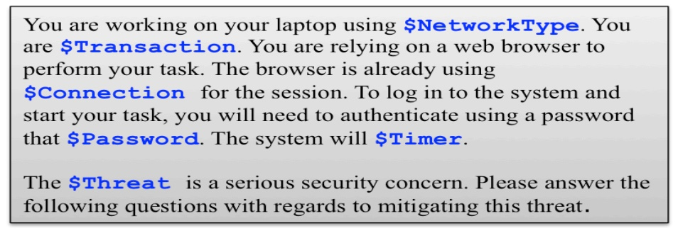

**OCR trong hình (theo thứ tự đọc):**

| You are working on your laptop using $NetworkType . You are $Transaction . You are relying on a web browser to perform your task. The browser is already using $Connection for the session. To log in to the system and start your task, you will need to authenticate using a password that $Password . The system will $Timer . The $Threat is a serious security concern. Please answer the following questions with regards to mitigating this threat. |
| --- |

---

## Trang 29

26
In this study, each level corresponds to a requirement or system constraint 
variant, which is either a quality requirement (e.g., a “weak” vs. “strong” password) or 
more concrete interpretation of an otherwise ambiguous requirement (e.g., 
“unencrypted” vs. “encrypted” Wi-Fi). In Table 7, we present the dimensions and levels 
to Figure 2. Each level has a code (in parentheses) that we used to analyze and report 
our results. The level ($Threat = Man-in-the-Middle) occurs when an attacker 
intercepts the encrypted communication between two parties by decrypting the 
encryption. The level ($Threat = Packet Sniffing) is passive in that the attacker 
eavesdrops on network packets to steal information without interacting with any 
parties, directly.
TABLE 7. VIGNETTE DIMENSIONS AND THEIR LEVELS
Dimension Level(s)
$NetworkType
(EmpNetwork) Your employer’s network at your office
(PublicWIFI) Public unencrypted Wi-Fi at a public area (restaurant, airport)
(VPNUnencrypted)Your employer’s VPN that you connected to through public unencrypted Wi￾Fi
(VPNEncrypted) Your employer’s VPN that you connected to through public encrypted Wi-Fi
$Transaction (E) Accessing your email account and replying to confidential emails
(F) Performing a financial transaction using your credit card
$Connection SSL
$Password
(Weak) A password that is at least 8 characters long
(Strong) A password that is at least 16 characters and must include an uppercase and a 
lowercase letter, a symbol, and a number digit
$Timer (Yes) Automatically log you off the session after 15 minutes of inactivity
(No) Never time-out
$Threat
Man-in-the-Middle
Packet-Sniffing
The choice of dimensions and levels in factorial vignettes is determined by the 
researcher’s judgment based on the research questions. We seek to evaluate the effect of 
changes in requirements composition and in threats where the composition spans a 
range of security knowledge, including network and application security, perceived 
sensitivity of information, and general “best practice” vs. threat-targeted mitigations. 
The dimensions that we chose are not the only dimensions that can be evaluated. In 
addition, the number of levels for each dimension is not the only number that exists. 
In factorial vignette design, the space of all possible dimensions and levels is 
called the factorial object universe [53] and the factorial object sample is the sample 
across the universe that we use to instantiate the vignette template [53]. Sampling is 
random or systematic and the choice is based on prior theory, research, and reasoning 
[57]. Factorial sampling is used to eliminate unrealistic combinations of levels and to

---

## Trang 30

27
exclude scenarios that are likely to produce a predictable outcome [54]. Sampling from 
vignettes is more efficient than classic factorial designs, wherein all possible 
combinations of factors are tested [53]. 
We chose our initial scenario about logging into a remote e-mail service, because 
it crosses between novice and expert security knowledge, and this would allow us to 
measure the effect of security expertise on risk perception. We reviewed the universe 
and selected dimensions that had a sufficient number of levels to provide a rich space 
from which to sample; this includes network types and password complexity. Based on 
Table 7, we have 32 (4×2×1×2×2) conditions per $Threat type.
Our vignette selection is based on removing unrealistic and idiosyncratic 
scenarios. For example, the $Connection dimension consists of one level, only, which is 
called a blank dimension. While we can evaluate unencrypted HTTP sessions in a 
scenario, the prevalence of knowledge about the high risk of unencrypted sessions 
suggests this level would predictably lead respondents to rate this requirement as 
inadequate to protect against the chosen threats. Blank dimensions are included in the 
vignettes, but not as statistical variables in the analysis, because they have no statistical 
effect to be measured. That said, blank dimensions are not to be eliminated, because 
their presence and absence affect how participants make decisions. In our case, removing 
SSL introduces an ambiguity: some participants may assume it exists, while others may 
assume it is absent. To control for this variability, we made this requirement explicit.
4.1.2 Survey Design and Research Questions
We designed our survey to answer three research questions:
RQ1. Does requirements composition affect risk perception in a security scenario 
to cause varied ratings of the security adequacy level, or can requirements be treated 
independently in a checklist? 
RQ2. Which security requirements in a security scenario contribute more weight 
to experts’ security adequacy judgment? 
RQ3. Would experts be able to detect ambiguities in a security scenario and 
provide modifications to improve the security adequacy ratings? 
To answer these questions, we designed our survey instrument with three parts: 
the security vignettes, a security knowledge test, and a demographics test. In addition, 
each participant receives a consent form noting that participation is voluntary. We 
presented participants with the Man-in-the-Middle threat, where they answer all three 
parts of the survey. A week after taking the survey, participants are invited back for the 
Packet-Sniffing threat, where they do not repeat the security knowledge test or the 
demographic questions.

---

## Trang 31

28
The Security Vignettes: In our study, each participant rates four vignettes to 
observe all the four network levels (see Table 7). Since we have a total of 32 vignettes 
per threat, we have 8 possible combinations of the dimensions and, thus, each 
participant is randomly assigned to one of eight conditions, where they rate four 
vignettes (8×4 = 32 vignettes). Each condition randomly assigns the participant to a 
single level of the $Transaction, $Password, and $Timer dimensions (between-subjects 
effect), which are the same across all the four vignettes that the participant rates. The 
four vignettes differ by the $NetworkType dimension (within-subjects effect) and are 
presented in a randomized order. For all four vignettes, a participant is asked to first 
rate the overall security level of the scenario within the context of the given threat. The 
rating levels are displayed in a random order from the following list: 
• Excessive security measures that exceed the requirements to mitigate the threat
• Adequate security measures that are enough to mitigate the threat
• Inadequate security measures that are not enough to mitigate the threat
Next, we ask participants to rate the dimension levels based on the security 
requirement’s ability to mitigate the given threat. This mitigation rating is applied to 
the $NetworkType, $Connection, $Password and $Timer, only, because they represent a 
mitigation that can be modified to improve security. Participants provide their rating 
on a 5-point Likert-scale, where point 1 is labeled “inadequate mitigation”, point 3 is 
labeled “adequate mitigation” and point 5 is labeled “excessive mitigation.” For each 
such dimension, we list the selected level for the vignette from Table 7. These ratings 
are used to test which requirements (or factors) affect the overall security.
Participants are also given the opportunity to list additional security 
requirements that they believe contribute to increasing the security level to adequate. 
These are open-ended responses that we later analyzed by coding [45].
The Security Knowledge Test: Following the vignettes, participants are 
required to answer ten security knowledge questions. We selected these questions to 
cover user-level to administrator security knowledge, including cryptography, firewall 
rules, encryption, hashing, file permissions, and network security. The questions cover 
security concepts, and are intentionally inconvenient to search for on the Internet to 
reduce cheating. The responses are used to calculate a score that serves as a proxy 
experience metric.
Demographics Survey: Finally, participants answer questions about job 
experience and security training. 
4.1.3 Deployment and Subjects Recruitment 
We recruited security experts using e-mail invitations to participate in our Man￾in-the-Middle study (32 vignettes, where each participant sees 4 vignettes). The

---

## Trang 32

29
invitation was sent to security class mailing lists at Carnegie Mellon University and 
North Carolina State University. We also sent invitations to security-research mailing 
lists at Carnegie Mellon University. We compensated participants a $10 Amazon gift 
card for participation. A week after taking this study, those participants were invited 
back to the Packet-Sniffing study (another 32 vignettes, where each participant sees 4 
vignettes), and compensated with a second $10 Amazon gift card.
4.1.4 Analysis Approach
We now discuss our multi-level modeling and grounded analysis approach.
4.1.4.1 Analysis of Multi-level Models
Multi-level models are statistical regression models with parameters that account 
for multiple levels in datasets [58]. Our study design described above supports both 
within and between subjects effects (mixed-effects). Thus, we treated the data as two 
studies based on the two levels of the $Threat dimension, which we assume the 
participant responses to the two threats are independent due to the week delay between 
surveys.
The quantitative dataset consists of one major outcome dependent variable: the 
$OverallRating, which is the security experts’ judgment rating of the overall security 
level. This variable has three possible values -1, 0, or 1 that correspond to inadequate, 
adequate or excessive security, respectively. The fixed effects independent variables are 
the vignette dimensions: $NetworkType, $Transaction, $Password, $Timer, which we 
will refer to as requirements-mitigation variables. The random effect, independent 
variable is grouped by participant’s $ID, because we have repeated measures for each 
subject who sees four levels of $NetworkType. We have four dependent mitigation-rating 
variables: $NetworkRating, $Connection-Rating, $PasswordRating, and $TimerRating 
that correspond to individual ratings of the $NetworkType, $Connection, $Password, 
and $Timer dimensions, respectively. Mitigation-rating variables are assigned an integer 
from 1-5. 
We quantify experience using a $Score variable, which is an independent 
exploratory variable assigned an integer from 0-10 equal to the number of correct 
answers provided by the participant to the 10 security screening questions. 
We analyze our data using multi-level modeling [58]to account for our mixed 
effect experiment design. We used R [59] and lme4 [60] as our tools to conduct the 
analysis. As described earlier, each participant rated all four levels of the $NetworkType
dimension, while only rating one level of the remaining dimensions. Hence, our analysis 
simultaneously accounts for dependencies in the repeated measures, calculates the 
coefficients (weights) for each explanatory independent variable, and tests for

---

## Trang 33

30
interactions. We test the multi-level models’ significance using the standard likelihood 
ratio test: we fit the regression model of interest; we fit a null model that excludes the 
independent variables used in the first model; we compute the likelihood ratio; and 
then, we report the chi-square, p-value, and degrees of freedom [58]. For fitted models 
that show statistical significance, we report the coefficient values from the regression 
model, which represents the dimension weight for predicting the dependent variable. 
To determine sample size, we conducted a priori power analysis with G*Power
[61] to test for the required sample size of repeated measures ANOVA. We estimated a 
sample size >96 per threat scenario for the recommended power level of 0.8 and a 
medium-sized effect [62]. 
4.1.4.2 Grounded Analysis 
We analyzed the mitigation requirements by first excluding non-mitigation 
responses. We then apply open coding[30], [31] to code responses with short phrases 
(concept labels) and then group the phrases into six emergent categories: server, if the 
requirement is the responsibility of a web server, client, if the requirement is the 
responsibility of an application on the user’s computer (e.g., a browser); encryption, if 
the requirement primarily concerns encrypting data or communications; private 
network, if the requirement suggests switching to a non-public network; attack detection 
and prevention, if the requirements is aimed at preventing and/or addressing certain 
attacks; and identity and authentication, if the requirement concerns verifying the 
identity of the user or their device. 
After first cycle coding and categorization, we conducted a second-cycle coding 
[45], wherein we linked the categories to vignette dimensions and a direction as follows: 
a refinement, if the requirement refines the dimension by extending it’s functionality; a 
reinforcement, if the requirement adds auxiliary security not directly related to the 
dimension; a generalization, if the requirement is more general than the dimension, but 
includes the dimension’s mitigation; and a replacement, if the requirement replaces the 
dimension. For example, two requirements, multi-factor authentication and password 
expiry policy, are coded by the password dimension, yet the former is a replacement, 
because it replaces passwords with new functionality, and the latter is a refinement, 
because it extends passwords with expiration. 
4.2 Summary Results
We summarize our results for the composition study here. . We report our full 
results in our RE’15 paper [25].

---

## Trang 34

31
4.2.1 Descriptive Statistics
A total 174 participants responded to the Man-in-the-Middle threat survey, of 
which, 116 returned to respond to the Packet-Sniffing survey. These sample sizes exceed 
what we estimated prior to conducting the study. The sample consists of 26% females 
and 73% males (1% unreported gender). The age groups sorted by dominance in the 
sample are 18-24 (63%), 25-34 (33%), and 35+ (3%). Within the sample there are 101 
graduate students, 42 undergraduate students and 2 university professors.
The average number of participants per vignette is: 22 for the Man-In the-Middle 
threat, and 15 for the Packet-Sniffing threat; the number of participants is close but not 
equal across vignettes due to randomization. Table 8 presents descriptive statistics of 
participant ratings.
TABLE 8. DESCRIPTIVE STATISTICS OF THE RATING VARIABLES
Man-in-the-Middle Packet-Sniffing
Percentage* Percentage*
Adequacy Scale Adequacy Scale
1 0 -1 1 0 -1
$OverallRating 5 53 42 7 92 0
Item Rating
Adequacy Scale Adequacy Scale
5 4 3 2 1 5 4 3 2 1
$NetworkRating 1 9 37 21 32 2 7 36 22 33
$ConnectionRating 2 12 68 17 1 0 11 71 15 3
$PasswordRating 7 17 43 21 12 8 13 39 26 14
$TimeRating 2 11 29 17 41 4 12 27 21 36
*Percentages are calculated with respect to each threat study sample; 
adequacy scale 5=Excessive, 3=Adequate, 1=Inadequate
4.2.2 Grounded Analysis of Suggested Mitigations
We elicited 905 mitigations from 108 participants: 540 for Man-in-the-Middle 
(104 participants) and 365 for Packet-Sniffing (64 participants). We organized the 
mitigations into 6 categories. Figure 3 shows all 6 categories with mitigation concepts 
under each category. We analyzed elicited mitigations in response to the network effect, 
because our statistical results suggest that the $NetworkType has the most influence on 
participants’ judgments. Table 9 shows for each $NetworkType, the number of 
mitigations provided by participants (Mits.), the number of respondents providing these 
mitigations (Resp.), and total mitigations. Table 10 shows the number of refinements 
(Refine.), which are elaborations on an existing security requirement in the vignette 
(e.g., SSL, VPN); reinforcements (Reinf.), which describe auxiliary or new security 
functionality intended to complement existing requirements; replacements (Repl.), which 
describe a requirement to supplant an existing requirement (e.g., WPA2 supplants

---

## Trang 35

32
WEP); and generalizations (Gen.), which describe more abstract requirements (e.g., 
secure network v. VPN).
TABLE 9. NUMBER OF MITIGATION REQUIREMENTS BY THREAT AND NETWORK TYPE
$NetworkType
Man-in-the-Middle Packet Sniffing Total
Mits. Resp. Mits. Resp. Mits.
Employer’s Network 129 73 100 51 229
Public Wi-Fi 162 82 110 57 272
VPN over Unencrypted Wi-Fi 135 73 79 47 214
VPN over Encrypted Wi-Fi 114 73 76 42 190
TABLE 10. REFINEMENTS, REINFORCEMENTS, REPLACEMENTS, AND GENERALIZATIONS REQUIREMENTS BY 
NETWORK TYPE
$NetworkType Refinements Reinforcements Replacements Generalization Total
Employer’s Network 107 41 63 18 229
Public Wi-Fi 88 33 122 29 272
VPN over Unencrypted Wi-Fi 91 23 78 22 214
VPN over Encrypted Wi-Fi 101 23 57 9 190
Total 387 120 320 78 905
In Table 9, the weakest network type Public Wi-Fi has the highest number of 
mitigations for both threat types. Notably, Table 10 includes 155 auto-log off timer 
mitigations suggested by participants who observed no auto logoff timer in the vignette, 
and 107 complex-password mitigations suggested by participants who observed a weak 
password in the vignette. After removing such refinements that we expected to see in 
the lower security dimension levels, we found 125 refinements remaining. We now 
highlight some of the findings.
Several refinements served to remove ambiguity. For example, we found 51 
mitigations that refine SSL, such as requiring updates or patching the heart bleed
vulnerability [63]. One participant suggested using WPA2 encrypted Wi-Fi, because the 
Wi-Fi encryption was unspecified. Two participants stressed that VPN over encrypted 
network should use a reliably strong encryption.

---

## Trang 36

33
Figure. 3. The elicited requirements and their categories (numbers in parentheses correspond to number of statements)

### Hình ảnh trên trang

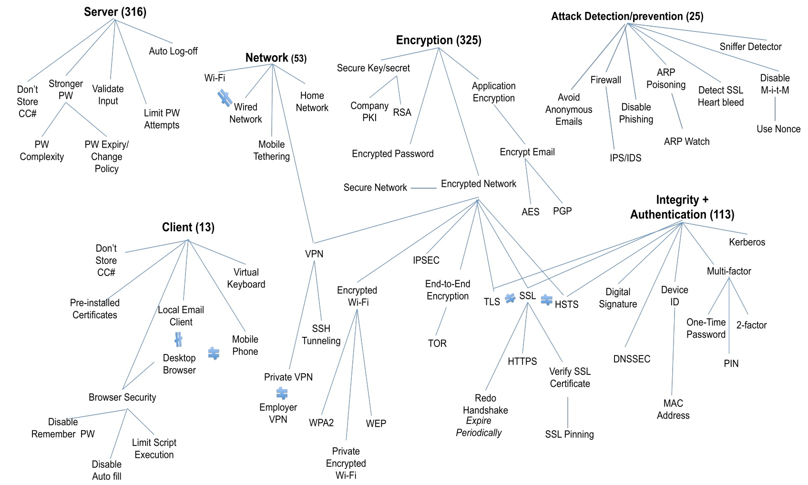

---

## Trang 37

34
Among reinforcements, we found 25 mitigations proposing attack detection / 
prevention techniques (see Figure 3), 24 mitigations adding email encryption under the 
email transaction condition, and 8 requirements to add browser security and pre￾installed SSL certificates, among others. Some reinforcements were inspired by the 
vignette: four mitigations against man-in-the-middle attacks, four against packet 
sniffing, and two against email phishing attacks.
Replacement mitigations aim to replace a less secure requirement or constraint 
with a more secure alternative. We found 95 mitigations to replace the password with 
multifactor authentication. We also found 21 mitigations to replace SSL with TLS or 
HSTS, which is a recent security proposal receiving more attention[64], [65]. 
4.2.3 Requirements Composition and Priorities 
Our results from the multi-level modeling and the grounded analysis suggest that 
risk perception varies with how requirements are composed. The coefficients obtained 
from the regression suggest that there are weights and priorities assigned to the 
requirements. 
The $OverallRating variable is the major outcome dependent variable of 
interest, because this variable represents the experts’ security rating of the scenario 
based on the composition of the requirements. Our multi-level regression results indicate 
that the $NetworkType is the only dimension that had an effect on experts’ 
$OverallRating of the security scenario. This does not mean the other dimensions had 
no effect on expert judgment. These estimates imply that the network type had the 
most influence (weight) on judgments of overall rating and the importance of each 
network type depends on the type of $Threat.
We observed composition across the participants’ $PasswordRating, 
$TimerRating, and $ConnectionRating and from the grounded analysis results. When 
participants rated the password level adequacy, the $PasswordRating was lowered by 
the Public Wi-Fi network level, even when the password level was strong. Similarly, the 
$TimerRating was lowered by the use of Public Wi-Fi or VPN over unencrypted Wi-Fi. 
When the $NetworkType changes to Public Wi-Fi, respondents rate the strong password 
and auto-logoff timer as less than adequate, because participants likely view these two 
requirements as reinforcements that raise the general level of security, but do not 
mitigate the threat. In our grounded analysis, we further saw participants focusing their 
attention on providing requirements to replace the weak network. One participant 
stated that the timer, password, and SSL are no longer effective, if the communication 
is happening over a vulnerable network like Public Wi-Fi. Another participant 
explained that, despite the use of employer’s VPN, a public unencrypted Wi-Fi could

---

## Trang 38

35
still be vulnerable. In addition, our multi-level modeling results for the 
$ConnectionRating show that for the Man-in-the-Middle threat, participants generally 
rated SSL near adequate, but the ratings dropped in the presence of Public Wi-Fi. 
Moreover, we saw participants providing requirements refinements for SSL regardless of 
change in dimensions’ levels. For example, five participants suggested to update the SSL
version, and five participants suggested to verify SSL certificates and they replicated 
these modifications for all four-network types. 
The suggested refinements for SSL levels indicate that our proposed vignettes are 
incomplete, and that we should broaden the scope of our composition to include new 
dimensions/levels than what we proposed. Our grounded analysis also confirms that 
there are more dimensions to consider, such as browser security configurations. Secure 
communication relies on the browser’s configuration, as we found 17 browser security 
reinforcements that 11 participants proposed as mitigations to increase the overall 
security level. Among these, seven browser security reinforcements were suggested in the 
presence of the employer’s network and/or VPN over Encrypted Wi-Fi. After 
examining all the mitigations provided by these participants, we found that when 
$NetworkType is weak, because participants marked it as inadequate or propose to 
replace it. When the risk is lowered by using a more secure $NetworkType, participants 
propose requirements that target other dimensions to increase the overall security level.
The grounded analysis in this study shows how experts identified ambiguous 
requirements proposed to reinforce, replace, and/or refine these requirements. The 
vignette dimensions were observed to affect participants’ risk perception leading them to 
list mitigations based on the dimensions and their levels. For example, participants 
focus attention on replacing weaker requirements with stronger levels (e.g. replacing 
Public Wi-Fi), and that explains the high number of replacement mitigations provided 
for public Wi-Fi (see Table 10). In addition, out of the total 907 mitigations, only 78 
(9%) were not directly related to our dimensions in the study as they include categories 
such as browser security and device identifiers (see Figure 3 for categories) Regarding 
ambiguity, we note that participants might assume that the public Wi-Fi is 
unencrypted, because vignette description omits mention of encryption. Similarly, the 
vignette does not provide details about the SSL dimension and participants made their 
own assumptions that made them list mitigations of refinements (e.g. version update), 
reinforcement, (e.g. certificate verification), and even replacement (e.g. TLS). This 
observation suggests two things with regards to ambiguity resolution: 1) when 
participants make assumptions to resolve ambiguity, they might lean towards assuming 
lower security (e.g. unencrypted Wi-Fi, insecure SSL versions); and 2) adding and 
removing requirements in a composition can have interactions by increasing or 
decreasing levels linked to the refined requirement (e.g. SSL). The method we introduce

---

## Trang 39

36
in this work allowed us to assess such composition, however, additional work is needed 
to evaluate the effect of these elicited mitigations on the overall and dimension-specific 
risk perceptions. 
4.3 Summary Conclusions from the “Composition Study”
The purpose of the Composition Study is to empirically examine hypotheses 
generated earlier by the SA study. We summarize our findings from the Composition 
Study below:
Security requirements exist in composition. Our study showed some 
evidence that assessment of requirements relies on how they are composed together 
along with other requirements. Participants did not judge security requirements 
independent of other existing requirements in the scenario For example; the network 
type affected the ratings of other requirements involved in the scenario (e.g. password, 
timer) as participants were evaluating everything involved in the scenario to make their 
judgment. 
Certain security requirements have more weight. In the study, we have seen 
that until the security of some requirements are increased; other requirements may not 
be introduced or considered in depth. The evidence of this finding comes from our 
quantitative and qualitative results. For example, we have demonstrated how the public 
Wi-Fi had an impact on decreasing the ratings and participants wouldn’t consider other 
factors (e.g. connection, password) unless the network type requirements security level 
improves.

---

## Trang 40

37
5 Proposed Research Work
Based on findings from the formative studies described in Sections 3, 4 above, I 
plan to conduct two more major phases in my research: collect agreed upon solutions of 
security scenarios by representing composite requirements to a diversity of security 
expert, and use the results to generate membership functions and rules for an Interval 
Type II Fuzzy Logic System (IT2FLS). We will explain below the two phases.
5.1 Advanced Security Requirements Composition Studies
Our initial study [25] that we explained in Section 4, uses simplified scenarios 
where participants were assumed to have first-hand experience from the user’s 
perspective. To study security requirements more effectively, I plan replicate this study 
design with the following changes:
Consider scenarios from various system administrative perspectives: 
the new vignettes should take into account that experts are providing their judgment 
not from an end-user standpoint, but from the role of a system administrator 
performing a security assessment role.
Consider variety of specialized areas in security: one of the observations
in our SA study [29](shown in Section 3), suggest that security experts differ in their 
background knowledge and their skillsets could vary depending on the area of security 
that they are more specialized in. We have also shown in the Section 1 that other 
researchers had similar observations in their experiments [19]. Therefore, the improved 
study design should take into account scenarios representing security knowledge from 
different, concentrated technical areas with boundaries between their respective 
professions. We choose three areas: network security, database security, and mobile 
security. 
Provide means to map security background knowledge to performance 
in the new scenarios: we plan to test for correlations between different expertise 
areas and participant assessments of the scenarios. We achieve this by modifying our 
background questions to include new questions based on the background knowledge 
needed for the new scenarios. For example, we include questions about TLS/SSL 
certificate pinning and jail broken phones, because our scenarios related dimensions in 
the mobile security scenario. 
Include attention checks: The security background questions are placed at 
the end of the survey. At this point, participants may experience fatigue and start 
selecting random answers. To ensure that participants are actually paying close 
attention to their answers, we include two attention-check questions where we ask

---

## Trang 41

38
participates to select a specific option that should be easily known, if they are paying 
attention. 
5.1.1 Improved Security Vignettes
Four templates are designed for this study. Two templates for the network 
administration scenario, and one template for each of the database security and mobile 
security scenarios. All scenarios share a common dimension: the risk $Impact. We have 
two levels of risk $Impact:
• High risk: to represent high risk we choose a theme of an online 
shopping website. The impact here is consumers’ credit card and billing 
information stored in company’s databases. 
• Low risk: to represent low risk we choose a theme of free online news 
service website. The impact here is consumer’s first names and news 
category preferences. 
Figures 4-7 show the templates used for our new proposed design. Variables in 
the template are preceded with a $, and they are replaced by a level in the 
corresponding dimension. 
Figure. 4. The network administration template #1
Company X offers $Theme. User information in the company’s databases includes $Impact
for purchasing products/services in the future.
You are a network administrator for company X who is responsible for hardening the 
network against attacks. Currently, you are evaluating the following setting:
• Employees are allowed $NetworkAccess to the employer’s network using 
$NetworkAuthentication.
• The company implements a DMZ that contains $DMZ for public Web Services where 
clients can access their profiles and update their information.
The Man-in-the-middle attack is a serious security concern. Please answer the 
following questions with regards to mitigating this threat.
Please do not account for insider-threat in your answers. In other words, please 
assume that company employees are trustworthy and have no malicious intent.

### Hình ảnh trên trang

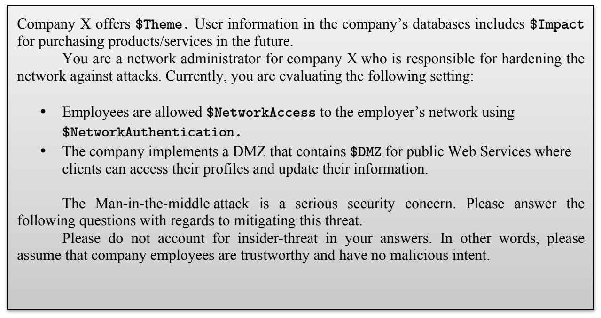

**OCR trong hình (theo thứ tự đọc):**

| Company X offers $Theme . User information in the company's databases includes $Impact for purchasing products/services in the future. You are a network administrator for company X who is responsible for hardening the network against attacks. Currently, you are evaluating the following setting: • Employees are allowed $NetworkAccess to the employer's network using $NetworkAuthentication . • The company implements a DMZ that contains $DMZ for public Web Services where clients can access their profiles and update their information. The Man-in-the-middle attack is a serious security concern. Please answer the following questions with regards to mitigating this threat. Please do not account for insider-threat in your answers. In other words, please assume that company employees are trustworthy and have no malicious intent. |
| --- |

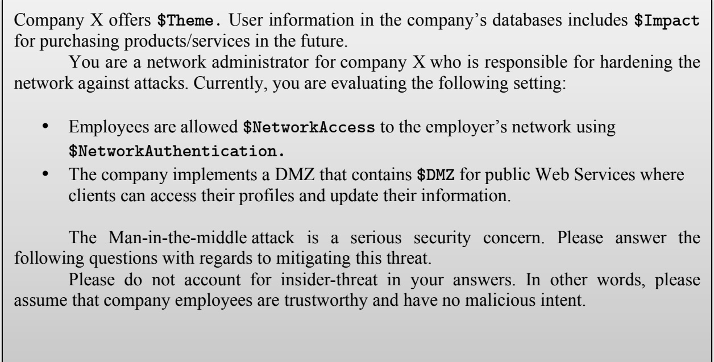

**OCR trong hình (theo thứ tự đọc):**

| Company X offers $Theme . User information in the company’s databases includes $Impact for purchasing products/services in the future. | You are a network administrator for company X who is responsible for hardening the network against attacks. Currently, you are evaluating the following setting: | • Employees are allowed $NetworkAccess to the employer’s network using $NetworkAuthentication . |
| --- | --- | --- |
| • The company implements a DMZ that contains $DMZ for public Web Services where clients can access their profiles and update their information. | The Man-in-the-middle attack is a serious security concern. Please answer the following questions with regards to mitigating this threat. | Please do not account for insider-threat in your answers. In other words, please assume that company employees are trustworthy and have no malicious intent. |

---

## Trang 42

39
Figure. 5. The network administration template #2
Figure. 6. The database security template #2
Company X offers $Theme. User information in the company’s databases includes $Impact
for purchasing products/services in the future.
You are a network administrator for company X who is responsible for hardening the 
network against attacks. Currently, you are evaluating the following setting:
• Mitigations at the company prevent all employees from accessing social media sites.
• The CFO of the company has a special laptop that provides unrestricted access to all 
company data. This laptop is using $LaptopOS. The CFO using their laptop can 
download from $CFOTransaction.
The Man-in-the-middle attack is a serious security concern. Please answer the 
following questions with regards to mitigating this threat.
Please do not account for insider-threat in your answers. In other words, please 
assume that company employees are trustworthy and have no malicious intent. 
Company X offers $Theme. User information in the company’s databases includes $Impact
for purchasing products/services in the future.
You are a database security developer responsible for securing a database against
attacks. Currently, you are evaluating the following setting:
• User accounts and access control is handled by $DBAccess.
• $DBMonitor
• Errors are handled by $Error. 
The Man-in-the-middle attack is a serious security concern. Please answer the 
following questions with regards to mitigating this threat.
Please do not account for insider-threat in your answers. In other words, please 
assume that company employees are trustworthy and have no malicious intent.

### Hình ảnh trên trang

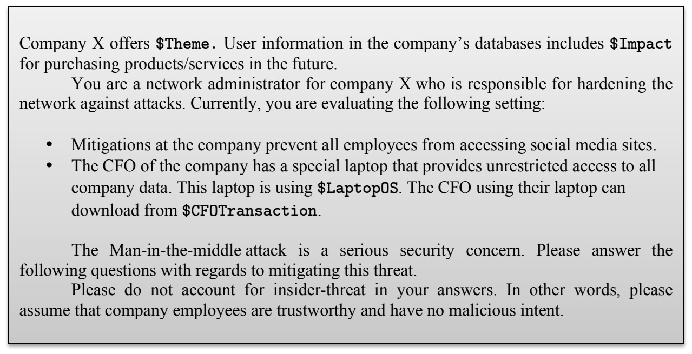

**OCR trong hình (theo thứ tự đọc):**

Company X offers
$Theme
. User information in the company's databases includes
$Impact
for purchasing products/services in the future.
You are a network administrator for company X who is responsible for hardening the network against attacks. Currently, you are evaluating the following setting:
Mitigations at the company prevent all employees from accessing social media sites.
The CFO of the company has a special laptop that provides unrestricted access to all company data. This laptop is using
$Laptop0S
. The CFO using their laptop can download from
$CFOTransaction
.
The Man-in-the-middle attack is a serious security concern. Please answer the following questions with regards to mitigating this threat.
Please do not account for insider-threat in your answers. In other words, please assume that company employees are trustworthy and have no malicious intent.

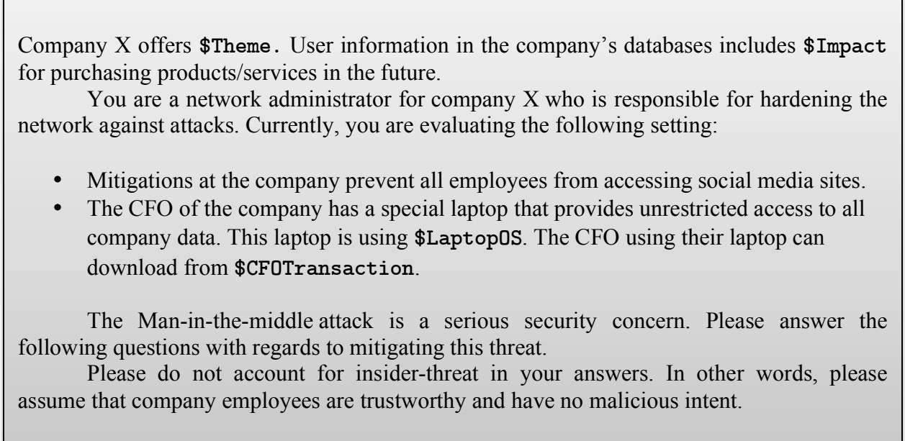

**OCR trong hình (theo thứ tự đọc):**

Company X offers
$Theme
. User information in the company's databases includes
$Impact
for purchasing products/services in the future.
You are a network administrator for company X who is responsible for hardening the network against attacks. Currently, you are evaluating the following setting:
• Mitigations at the company prevent all employees from accessing social media sites.
• The CFO of the company has a special laptop that provides unrestricted access to all company data. This laptop is using
$Laptop0S
. The CFO using their laptop can download from
$CFOTransaction
.
The Man-in-the-middle attack is a serious security concern. Please answer the following questions with regards to mitigating this threat.
Please do not account for insider-threat in your answers. In other words, please assume that company employees are trustworthy and have no malicious intent.

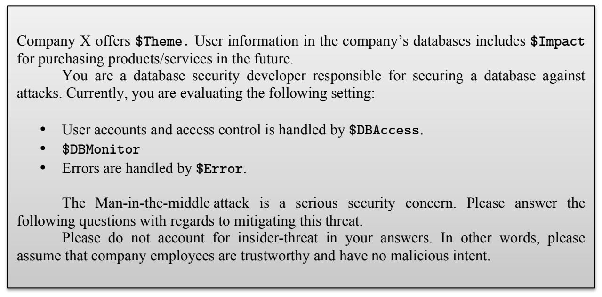

**OCR trong hình (theo thứ tự đọc):**

Company X offers
$Theme
. User information in the company's databases includes
$Impact
for purchasing products/services in the future.
You are a database security developer responsible for securing a database against attacks. Currently, you are evaluating the following setting:
• User accounts and access control is handled by
$DBAccess
.
•
$DBMonitor
• Errors are handled by
$Error
.
The Man-in-the-middle attack is a serious security concern. Please answer the following questions with regards to mitigating this threat.
Please do not account for insider-threat in your answers. In other words, please assume that company employees are trustworthy and have no malicious intent.

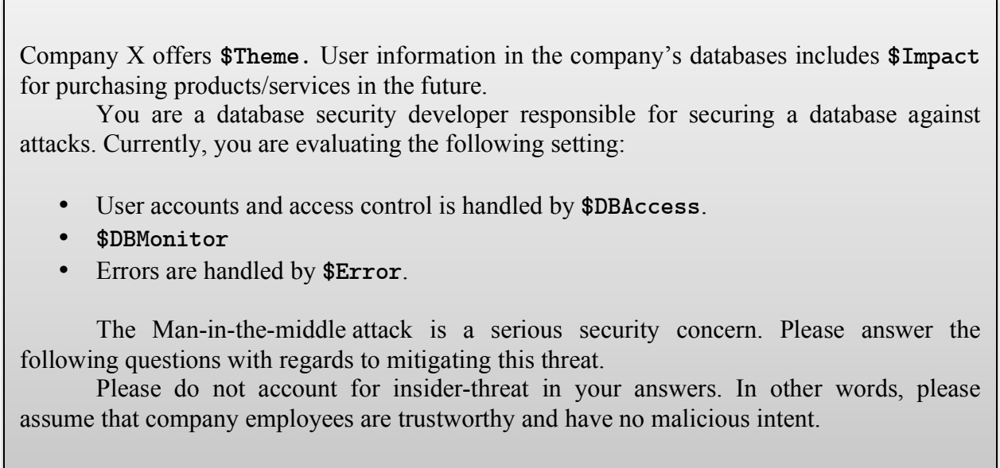

**OCR trong hình (theo thứ tự đọc):**

Company X offers
$Theme
. User information in the company's databases includes
$Impact
for purchasing products/services in the future.
You are a database security developer responsible for securing a database against attacks. Currently, you are evaluating the following setting:
• User accounts and access control is handled by
$DBAccess
.
•
$DBMonitor
• Errors are handled by
$Error
.
The Man-in-the-middle attack is a serious security concern. Please answer the following questions with regards to mitigating this threat.
Please do not account for insider-threat in your answers. In other words, please assume that company employees are trustworthy and have no malicious intent.

---

## Trang 43

40
Figure. 7. The mobile security template
5.2 Modeling the Results with IT2FLS
In this section, we will first give a brief background and explanation of IT2FLS, 
and then discuss how we apply it to the security requirements composition problem. 
5.2.1 Fuzzy Logic and IT2FLS
Scientists and engineers realized in the late nineteenth century that uncertainty 
exists in real world problems [66]. The following is a good summary by Timothy J. Ross 
[67]of various research efforts to classify uncertain information: 
Uncertainty can be manifested in many forms: it can be fuzzy (not sharp, 
unclear, imprecise, approximate), it can be vague (not specific, amorphous), it 
can be ambiguous (too many choices, contradictory), it can be of the form of 
ignorance (dissonant, not knowing something), or it can be a form due to natural 
variability (conflicting, random, chaotic, unpredictable)[67]. 
To account for uncertainty in systems, it was quantified and modeled based on 
probability theory[66]; an approach challenged by Max Black in 1937, who proposed to 
measure the degree of vagueness to account for uncertainty[66], [68]. Decision scientists 
argue that human thinking is reliant on approximate reasoning to handle imprecise 
uncertain information[66]. 
Company X offers $Theme. User information in the company’s databases includes $Impact
for purchasing products/services in the future.
You are a mobile app security specialist responsible for securing the company’s 
mobile app. Employees will use the mobile app to access the company’s internal 
network. Currently, you are evaluating the following setting:
• Users are authenticated on the server-side by using $MobileAuth
• For device authentication token, $DeviceAuth.
• The employees could use the mobile app to access their accounts and interact with the 
company’s internal system. TLS/SSL certificate pinning is used to mitigate CA 
compromise. The company $DevicePolicy.
• Sensitive data (passwords, encryption keys) is stored permanently on the server-side. 
For cache/temporary storage of sensitive data, encryption and a timer is enforced. 
• The app is obtained via $Installation.
The Man-in-the-middle attack is a serious security concern. Please answer the 
following questions with regards to mitigating this threat.
Please do not account for insider-threat in your answers. In other words, please 
assume that company employees are trustworthy and have no malicious intent.

### Hình ảnh trên trang

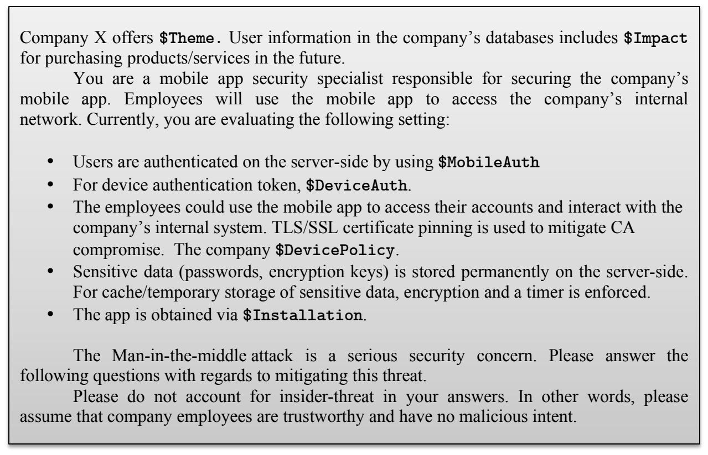

**OCR trong hình (theo thứ tự đọc):**

Company X offers
$Theme
. User information in the company's databases includes
$Impact
for purchasing products/services in the future.
You are a mobile app security specialist responsible for securing the company's mobile app. Employees will use the mobile app to access the company's internal network. Currently, you are evaluating the following setting:
• Users are authenticated on the server-side by using
$MobileAuth
• For device authentication token,
$DeviceAuth
.
• The employees could use the mobile app to access their accounts and interact with the company's internal system. TLS/SSL certificate pinning is used to mitigate CA compromise. The company
$DevicePolicy
.
• Sensitive data (passwords, encryption keys) is stored permanently on the server-side. For cache/temporary storage of sensitive data, encryption and a timer is enforced.
• The app is obtained via
$Installation
.
The Man-in-the-middle attack is a serious security concern. Please answer the following questions with regards to mitigating this threat.
Please do not account for insider-threat in your answers. In other words, please assume that company employees are trustworthy and have no malicious intent.

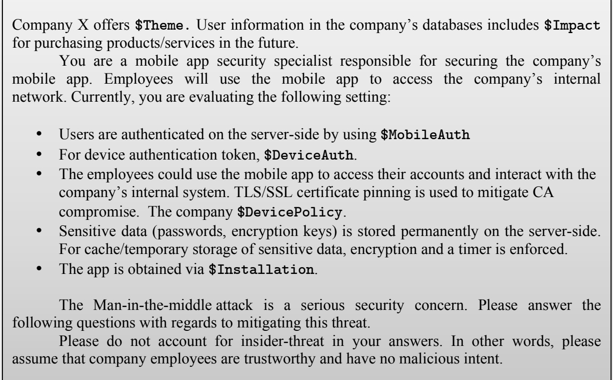

**OCR trong hình (theo thứ tự đọc):**

| Company X offers $Theme . User information in the company's databases includes $Impact for purchasing products/services in the future. You are a mobile app security specialist responsible for securing the company's mobile app. Employees will use the mobile app to access the company's internal network. Currently, you are evaluating the following setting: • Users are authenticated on the server-side by using $MobileAuth • For device authentication token, $DeviceAuth . • The employees could use the mobile app to access their accounts and interact with the company's internal system. TLS/SSL certificate pinning is used to mitigate CA compromise. The company $DevicePolicy . • Sensitive data (passwords, encryption keys) is stored permanently on the server-side. For cache/temporary storage of sensitive data, encryption and a timer is enforced. • The app is obtained via $Installation . The Man-in-the-middle attack is a serious security concern. Please answer the following questions with regards to mitigating this threat. Please do not account for insider-threat in your answers. In other words, please assume that company employees are trustworthy and have no malicious intent. |
| --- |

---

## Trang 44

41
Fuzzy logic enables formalizing the vague notions in human languages [66]. Lotfi 
Zadeh introduced Fuzzy logic (FL) in 1965 [69] as a mathematical tool that 
complements the existing probability theory and handles the uncertainty that always 
exist in real world problems [66], [70]. Zadeh argues that in a classic “crisp” or “binary” 
set theory, everything is either true or false, whereas in the real world there are many 
phenomena that fall along a spectrum and in between the gray area of black and white. 
Humans tend to use linguistic terms like low, medium, high, too high, etc. to describe 
such phenomena in the world [69], [71]. The mathematical foundation of fuzzy logic that 
give up classical precision allowed for computational applications to handle 
approximations of input and output values that are difficult to quantify with traditional 
probability theory[66], [67], [70]. 
To illustrate, consider the proposition: “The system is secure”. In a classic binary 
logic, this proposition can be either true or false. However, if we present this proposition 
to a security expert, they might hedge and say, “it depends,” or question the word 
secure and it’s meaning, or as one of the experts in our SA study stated: “I hesitate to 
call something secure.” On the other hand, security experts in our composition study 
were able to use linguistic adjectives like inadequate, adequate, and excessive to 
evaluate the security of the scenarios (where the linguistic adjectives labeled a 5-point 
semantic scale). Consider that we are trying to mathematically represent, adequate. Let 
X be our universe of discourse 𝑋 = [1,5] and set A in the universe to represent 
“Adequate”. Lets try to define A as a “crisp” set. For illustration, lets assume that an 
interval between 2,3 is what makes values adequate as in to Figure 8 below: 
Figure. 8. Defintion of Adequate Secutiy in Crisp Sets
The function 𝜇!(𝑥) is the membership function to describe A, such that: 
𝐴 ⇒ 𝜇! 𝑥 = 1 2 ≤ 𝑥 ≤ 3
0 𝑜𝑡ℎ𝑒𝑟𝑤𝑖𝑠𝑒 (1)
We can also write: 𝐴 = {𝑥|𝑥 ≥ 2 𝑎𝑛𝑑 𝑥 ≤ 3}. The problem with this definition is 
that it defines everything in terms of true or false; a value is either adequate or not. 
0.5
1
x
1 2 3 4 5
Adequate
µA(x)

---

## Trang 45

42
Consider the value 3.1 for example, is it adequate? Based on the definition above, this 
value is not adequate, because 3 is the threshold value for the adequate set. But one 
might argue that this definition with its inclusion/exclusion criteria is not very accurate. 
A value like 3.1 is very close to adequate or is adequate with a lesser degree than 1, but 
greater than 0. To address this concern, fuzzy set theory allows one to express to what 
degree does a value x belong to a set A. Fuzzy sets relax the boundaries and thresholds 
to account for the cases where it is unrealistic to draw a strict boundary [69], [28], [72]. 
Figure 9 below, shows how an adequate fuzzy set F, could be defined: 
Figure. 9. Definision of Adequate in Fuzzy Sets 
The membership function 𝜇!(𝑥) provides a measure of the degree of 
similarity[28] of an element in the fuzzy set. A fuzzy set F in X may be represented as a 
set of ordered pairs of its element x and its membership grade, i.e.[28], 
𝐹 = 𝑥, 𝜇! 𝑥 | 𝑥 ∈ 𝑋 (2)
In our running example, a fuzzy definition provides more granularity to our 
definition of the linguistic term adequate. For example, a security mitigation that has 
the rating of 3 is adequate with a degree of 0.5 in Figure 9, while a security mitigation 
with a rating of 2.5 has a degree of 1. The values 3.1 or 1.9 can also be considered 
adequate, but with a lesser degree of membership. 
Recall from our composition study, we defined three linguistic labels: inadequate, 
adequate, and excessive. Figure 10 below shows two possible examples of the three 
membership functions for all of the three linguistic labels from our composition study:
Figure. 10.Possible membership functions for the “composition study”
0.5
1
x
1 2 3 4 5
Adequate
µF (x)
0.5
1
x
1 2 3 4 5
Adequate
µF (x)
Inadequate Excessive
0.5
1
x
1 2 3 4 5
Adequate
µF (x)
Inadequate Excessive

---

## Trang 46

43
Membership functions (MF) for a certain linguistic variable are context 
dependent [28], [73]. Figure 10 only shows a hypothetical example, not the actual 
membership functions derived from the actual study results. Determining the 
membership functions for a fuzzy logic system relies on collecting data either from 
existing datasets or by conducting user surveys and experiments [28], [74]. 
Consider that we surveyed security experts to indicate the start and end points 
for an adequate interval (based on an 1-5 scale) in a certain security scenario. A possible 
approach would be to use the mean survey data to construct one membership function 
representing all the different adequate intervals collected from experts: The mean of for 
each end point will be the end points of a triangular MF and we use the mean of these 
two end points for the apex of the MF. This class of membership functions is called a
Type-1 membership function. 
The common phrase “words mean different things to different people [28], [74]” is 
a motivation for using fuzzy logic to “compute with words [28], [74]”. This statement 
acknowledges the uncertainty that exists among the meaning of words. Type-1 
membership functions in a Type-1 fuzzy logic system summarize the results into one 
membership function, making the uncertainty in the data disappear. Alternatively, 
Type-2 membership functions model the uncertainty by providing a footprint of 
uncertainty [28], [74]. Figure 11 [75] below highlights an example of how a Type-2 
membership function appears; as if we blurred the type-1 membership functions by 
including the uncertainties. 
Figure. 11.Blurring a type-1 membership functions to include uncertainties
In the Type-2 approach, we account for the uncertainty around the end points. 
Instead of using a grand mean of all the responses that we collected from experts as in 
the Type-1 MF approach, we construct membership functions from each expert’s

### Hình ảnh trên trang

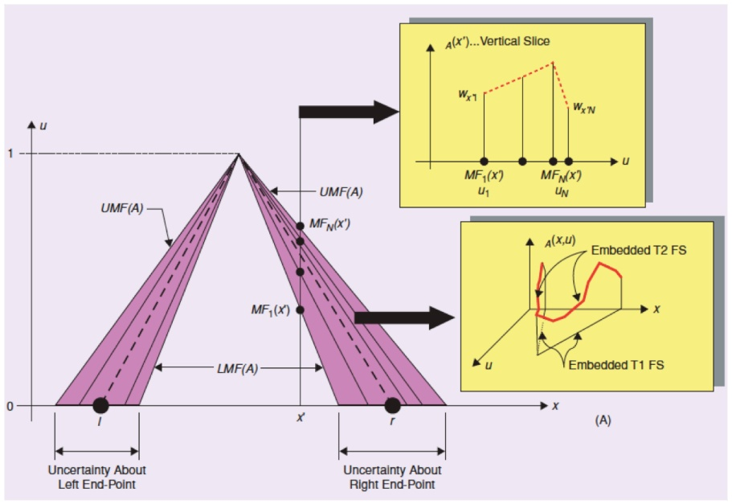

---

## Trang 47

44
response. The result would be 𝑁 membership functions that are sketched together as 
Figure 11 [75] illustrates. In Figure 11, the dashed line represents the Type-1 
membership function or what we call the primary MF; the shaded region represents the 
footprint of (FOU). For each value 𝑥, there is 𝑁 possible grades or MFs associated with 
it: 𝑀𝐹! 𝑥 , 𝑀𝐹! 𝑥 , … … 𝑀𝐹! 𝑥 . Now for each of these MFs, we can think of the 
possibility of this MF value for a value 𝑥 by assigning a weight that represents the 
possibility. This is called the secondary MF (in 3-D) where at each 𝑥, the collection of 
MFs and their weights can be represented as: { 𝑀𝐹! 𝑥 , 𝑤!" , 𝑖 = 1, … , 𝑁}. The vertical 
slice in the upper right corner of Figure 11 shows the weights, the wavy slice depicts the 
embedded T1 and T2 fuzzy sets [28], [75]. 
In order to make computation more feasible and applicable to the demand of 
applications and systems, fuzzy systems researchers simplified Figure 11 by assuming 
uniform weights (possibilities of MF grades at a point x), which would results in a 
uniform FOU as Figure 2 illustrates. This type if of fuzzy sets is called the Interval 
Type-2 Fuzzy set (IT2FS)[28], [75]. Looking at Figure 12, we can conjecture that the 
FOU has a Gaussian Primary MF where the standard deviation is fixed (since we 
assumed uniform weighting, but the mean is uncertain and could be any value in the 
interval 𝑚!, 𝑚! [28], [75]. The IT2FS is analogous to the union of all the embedded T1 
FS that are covered in the FOU [75]. 
Figure. 12.Interval Type-2 FOU [75]
Type-2 FS are used in a rule-based system that consists of four components: 
rules, a fuzzifier, an inference engine, and an output processor. Inputs and outputs to 
the system are crisp, and the heart of the system is the rule set, which are expressed as 
a collection of if-then statements. Rules can be collected by surveying experts in the 
field [75]. The following is an example of a one-antecedent rule in a Type-2 Fuzzy Logic 
System (IT2FLS): 
𝑰𝑭 𝑁𝑒𝑡𝑤𝑜𝑟𝑘 𝑇𝑦𝑝𝑒 𝑖𝑠 𝐼𝑛𝑎𝑑𝑒𝑞𝑢𝑎𝑡𝑒 𝑻𝑯𝑬𝑵 𝑂𝑣𝑒𝑟𝑎𝑙𝑙 𝑆𝑒𝑐𝑢𝑟𝑖𝑡𝑦 𝑖𝑠 𝐼𝑛𝑎𝑑𝑒𝑞𝑢𝑎𝑡𝑒

### Hình ảnh trên trang

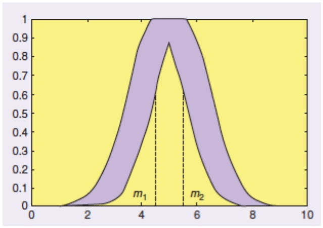

**OCR trong hình (theo thứ tự đọc):**

A graph showing a positively skewed distribution with a median at
x=4
. The distribution is shaded in yellow and is concentrated around the median at
x=4
. The y-axis ranges from 0 to 1.0, and the x-axis ranges from 0 to 10. The median is labeled
m_1
at
x=4
. The distribution is sharply curved and skewed towards the left side, with a sharp peak at
x=4
.

---

## Trang 48

45
We can also have two-antecedent rules such as the following example: 
𝑰𝑭 𝑁𝑒𝑡𝑤𝑜𝑟𝑘 𝑇𝑦𝑝𝑒 𝑖𝑠 𝐼𝑛𝑎𝑑𝑒𝑞𝑢𝑎𝑡𝑒 𝑨𝑵𝑫 𝑃𝑎𝑠𝑠𝑤𝑜𝑟𝑑 𝑖𝑠 𝐸𝑥𝑐𝑒𝑠𝑠𝑖𝑣𝑒
𝑻𝑯𝑬𝑵 𝑂𝑣𝑒𝑟𝑎𝑙𝑙 𝑆𝑒𝑐𝑢𝑟𝑖𝑡𝑦 𝑖𝑠 𝐴𝑑𝑒𝑞𝑢𝑎𝑡𝑒
There are two sources of uncertainties that can occur when surveying experts: 1) 
the words used can vary in meaning for different experts, and 2) the consequents for the 
same rule can vary by experts. In such situations, IT2FLS is a good fit since it can 
handle such uncertainties [74], [75]. 
5.2.2 Using IT2FLS to Model the Factorial Vignette Results
We plan to model our factorial vignette results with IT2FLS as follows: 
1. Collect start and end intervals of words used in our surveys to create the 
membership functions of the chosen words.
2. Translate the outcome of the composite scenarios into if-then rules.
The first step is straightforward; we plan to conduct a survey where we ask 
security experts to provide us with the start and end points of an interval that represent 
a word in the context of security. This way we will be able to create membership 
functions for the terms: adequate, inadequate and excessive. 
The second step is more unique to our approach. In their previous studies, 
Mendel et al. have showed that experts can be shown the antecedents of rules and asked 
to fill in the consequences, directly. We take a less direct approach, as we prefer to show 
experts scenarios of possible security situations (using factorial vignettes). Next, we plan 
to use the results of that study to derive the if-then rules to be used in an IT2-FLS.

---

## Trang 49

46
6 Conclusions 
The motivation for this work is to improve current security practices by assisting 
the security analyst with tools that go beyond checklists and guidelines, which only 
serve compliance goals. We explained why security is a wicked problem, wherein a 
human is needed to understand security requirements composition while assessing the 
risk. In this setting, the analysts need assistance that lead them to better understanding 
and, hence, more informed mitigation selection. We mainly focus on three aspects that 
make security a wicked problem: 1) security experts’ diversity of knowledge and 
skillsets, 2) the composition of security requirements in different contexts and its effect 
on security-decision making, and 3) the uncertainty involved in security decision￾making. In Section 3, we show results of our exploratory SA study where we 
instrumented situation awareness and used grounded theory to discover differences in 
security decision-making and the challenges that face security novices and experts. In 
Section 4, we present results of our composition study, where we instrument factorial 
vignettes as a method to extract from security experts the proper mitigation 
requirements, and the weights/priorities of those requirements. In Section 5, we explain 
our proposed studies that aim to extract expert knowledge in certain security contexts 
while taking into account the varying skillset of experts. Finally, we explain how we 
plan to model the results using IT2FLS: a formal method that accounts for uncertainty 
that is either caused by the diversity of experts, the context effect, or both. This work 
aims to serve the research community with important findings that advance our 
knowledge toward improved security decision-support systems.

---

## Trang 50

47
7 Remaining Tasks and their Timeline
This section lists down all the remaining tasks for accomplishing the dissertation 
goals. Table 11 below shows the breakdown of tasks and their corresponding months. 
TABLE 11. TIME LINE OF REMAINING TASKS 
Task Duration 
Execute the surveys and collect data Jan 2016 
Analyze empirical results of the new surveys Jan - Feb 2016
Extract rules and membership functions for the IT2FLS using existing 
RE’15 data
Jan - Feb 2016
Write the RE’16 paper Feb 2016
Extend the RE’15 paper to a journal paper using data from the new study Mar 2016
Extract rules and membership functions for IT2FLS using data from the 
latest surveys.
April 2016, May 2016
Write ICSE Paper Aug –Sep 2016
Write dissertation Fall 2016
Defend the thesis Jan 2017
(Hopefully) graduate Spring 2017
Bibliography 
[1] OWASP, “OWASP Top Ten Project - OWASP,” 28-Oct-2014. [Online]. Available: 
https://www.owasp.org/index.php/Category:OWASP_Top_Ten_Project. [Accessed: 28-
Oct-2014].
[2] C. B. Haley, R. C. Laney, B. Nuseibeh, and W. Hall, “Validating security requirements 
using structured toulmin-style argumentation,” Dep. Comput. Open Univ. Milton Keynes 
UK Tech. Rep., vol. 4, p. 21, 2005.
[3] H. W. J. Rittel and M. M. Webber, “Wicked problems,” Man-Made Futur., vol. 26, no. 1, 
pp. 272–280, 1974.
[4] A. H. Dutoit, R. McCall, I. Mistrík, and B. Paech, “Rationale management in software 
engineering: Concepts and techniques,” in Rationale management in software engineering, 
Springer, 2006, pp. 1–48.
[5] G. Stoneburner, A. Y. Goguen, and A. Feringa, “SP 800-30. Risk Management Guide for 
Information Technology Systems,” National Institute of Standards & Technology, 
Gaithersburg, MD, United States, 2002.

---

## Trang 51

48
[6] M. S. Ahmed, E. Al-Shaer, and L. Khan, “A novel quantitative approach for measuring 
network security,” in INFOCOM 2008. The 27th Conference on Computer 
Communications. IEEE, 2008.
[7] J. Homer, X. Ou, and D. Schmidt, “A sound and practical approach to quantifying security 
risk in enterprise networks,” Kans. State Univ. Tech. Rep., pp. 1–15, 2009.
[8] K. Labunets, F. Massacci, F. Paci, and L. M. S. Tran, “An Experimental Comparison of 
Two Risk-Based Security Methods,” in 2013 ACM / IEEE International Symposium on 
Empirical Software Engineering and Measurement, 2013, pp. 163–172.
[9] S. L. Garfinkel, “The Cybersecurity Risk,” Commun ACM, vol. 55, no. 6, pp. 29–32, Jun. 
2012.
[10] S. Garfinkel, “Design principles and patterns for computer systems that are simultaneously 
secure and usable,” Massachusetts Institute of Technology, 2005.
[11] S. L. Garfinkel, “Digital forensics research: The next 10 years,” Digit. Investig., vol. 7, pp. 
S64–S73, 2010.
[12] L. Chung, “Dealing with security requirements during the development of information 
systems,” in Advanced Information Systems Engineering, 1993, pp. 234–251.
[13] J. Mylopoulos, L. Chung, and B. Nixon, “Representing and using nonfunctional 
requirements: A process-oriented approach,” Softw. Eng. IEEE Trans. On, vol. 18, no. 6, 
pp. 483–497, 1992.
[14] C. B. Haley, R. Laney, J. D. Moffett, and B. Nuseibeh, “Security requirements engineering: 
A framework for representation and analysis,” Softw. Eng. IEEE Trans. On, vol. 34, no. 1, 
pp. 133–153, 2008.
[15] “NIST/ITL Special Publication (800),” 02-Jan-2015. [Online]. Available: 
http://www.itl.nist.gov/lab/specpubs/sp800.htm. [Accessed: 02-Jan-2015].
[16] C. Alexander, S. Ishikawa, and M. Silverstein, A Pattern Language: Towns, Buildings, 
Construction. Oxford University Press, 1977.
[17] E. Gamma, R. Helm, R. Johnson, and J. Vlissides, Design patterns: elements of reusable 
object-oriented software. Pearson Education, 1994.
[18] M. Shaw and D. Garlan, Software architecture: perspectives on an emerging discipline, vol. 
1. Prentice Hall Englewood Cliffs, 1996.
[19] N. Ben-Asher and C. Gonzalez, “Effects of cyber security knowledge on attack detection,” 
Comput. Hum. Behav., vol. 48, pp. 51–61, Jul. 2015.
[20] K. A. Ericsson and A. C. Lehmann, “Expert and exceptional performance: Evidence of 
maximal adaptation to task constraints,” Annu. Rev. Psychol., vol. 47, no. 1, pp. 273–305, 
1996.
[21] M. T. Chi, “Two approaches to the study of experts’ characteristics,” Camb. Handb. Expert. 
Expert Perform., pp. 21–30, 2006.
[22] J. R. Goodall, W. G. Lutters, and A. Komlodi, “Developing expertise for network intrusion 
detection,” Inf. Technol. People, vol. 22, no. 2, pp. 92–108, 2009.
[23] J. R. Goodall, W. G. Lutters, and A. Komlodi, “I know my network: collaboration and 
expertise in intrusion detection,” in Proceedings of the 2004 ACM conference on Computer 
supported cooperative work, 2004, pp. 342–345.

---

## Trang 52

49
[24] F. L. Schmidt and J. E. Hunter, “Tacit knowledge, practical intelligence, general mental 
ability, and job knowledge.,” 1993.
[25] H. Hibshi, T. Breaux, and S. B. Broomell, “Assessment of Risk Perception in Security 
Requirements Composition,” 2015 IEEE 23rd Int. Requir. Eng. Conf. RE, pp. 146–155, 
Aug. 2015.
[26] T. M. Chen and S. Abu-Nimeh, “Lessons from stuxnet,” Computer, vol. 44, no. 4, pp. 91–93, 
2011.
[27] D. Garlan, “Software engineering in an uncertain world,” in Proceedings of the FSE/SDP 
workshop on Future of software engineering research, 2010, pp. 125–128.
[28] J. M. Mendel, Uncertain rule-based fuzzy logic systems : introduction and new directions. 
Prentice Hall PTR, 2001.
[29] H. Hibshi, “Discovering Decision-Making Patterns for Security Novices and Experts,” 
Technical Report, Carnegie Mellon University, 2015.
[30] J. Corbin and A. Strauss, Basics of qualitative research: Techniques and procedures for 
developing grounded theory. Sage, 2007.
[31] B. G. Glaser and A. L. Strauss, The discovery of grounded theory: Strategies for qualitative 
research. Transaction Publishers, 2009.
[32] M. R. Endsley, “Design and evaluation for situation awareness enhancement,” in Proceedings 
of the Human Factors and Ergonomics Society Annual Meeting, 1988, vol. 32, pp. 97–101.
[33] M. R. Endsley and D. G. Jones, Designing for situation awareness: An approach to user￾centered design. Taylor & Francis US, 2003.
[34] M. R. Endsley, “Toward a theory of situation awareness in dynamic systems,” Hum. Factors 
J. Hum. Factors Ergon. Soc., vol. 37, no. 1, pp. 32–64, 1995.
[35] J. R. Anderson, Learning and memory. John Wiley New York, 2000.
[36] J. A. Anderson, “Cognitive styles and multicultural populations,” J. Teach. Educ., vol. 39, 
no. 1, pp. 2–9, 1988.
[37] F. C. Bartlett and C. Burt, “Remembering: A study in experimental and social psychology,” 
Br. J. Educ. Psychol., vol. 3, no. 2, pp. 187–192, 1933.
[38] D. L. Hintzman, “‘Schema Abstraction’ in a multiple-trace memory model,” Psychol. Rev., 
vol. 93, no. 4, pp. 411–428, 1986.
[39] A. Rao, H. Hibshi, T. Breaux, J.-M. Lehker, and J. Niu, “Less is More?: Investigating the 
Role of Examples in Security Studies Using Analogical Transfer,” in Proceedings of the 
2014 Symposium and Bootcamp on the Science of Security, New York, NY, USA, 2014, 
pp. 7:1–7:12.
[40] G. Digioia and S. Panzieri, “INFUSION: A system for situation and threat assessment in 
current and foreseen scenarios,” in 2012 IEEE International Multi-Disciplinary Conference 
on Cognitive Methods in Situation Awareness and Decision Support (CogSIMA), 2012, pp. 
316–323.
[41] Y.-H. Feng, T.-H. Teng, and A.-H. Tan, “Modelling situation awareness for Context-aware 
Decision Support,” Expert Syst. Appl., vol. 36, no. 1, pp. 455–463, Jan. 2009.
[42] P.-C. Chen, P. Liu, J. Yen, and T. Mullen, “Experience-based cyber situation recognition 
using relaxable logic patterns,” in 2012 IEEE International Multi-Disciplinary Conference

---

## Trang 53

50
on Cognitive Methods in Situation Awareness and Decision Support (CogSIMA), 2012, pp. 
243–250.
[43] G. Jakobson, “Using federated adaptable multi-agent systems in achieving cyber attack 
tolerant missions,” in 2012 IEEE International Multi-Disciplinary Conference on Cognitive 
Methods in Situation Awareness and Decision Support (CogSIMA), 2012, pp. 96–102.
[44] K. E. Schaefer, D. R. Billings, and P. A. Hancock, “Robots vs. machines: Identifying user 
perceptions and classifications,” in 2012 IEEE International Multi-Disciplinary Conference 
on Cognitive Methods in Situation Awareness and Decision Support (CogSIMA), 2012, pp. 
138–141.
[45] J. Saldaña, The coding manual for qualitative researchers. Sage, 2012.
[46] A. Arasu, S. Chaudhuri, K. Ganjam, and R. Kaushik, “Incorporating String Transformations 
in Record Matching,” in Proceedings of the 2008 ACM SIGMOD International Conference 
on Management of Data, New York, NY, USA, 2008, pp. 1231–1234.
[47] S. Atran, D. L. Medin, and N. O. Ross, “The cultural mind: environmental decision making 
and cultural modeling within and across populations.,” Psychol. Rev., vol. 112, no. 4, p. 
744, 2005.
[48] G. Guest, A. Bunce, and L. Johnson, “How many interviews are enough? An experiment 
with data saturation and variability,” Field Methods, vol. 18, no. 1, pp. 59–82, 2006.
[49] J. Cohen, “Weighted kappa: Nominal scale agreement provision for scaled disagreement or 
partial credit.,” Psychol. Bull., vol. 70, no. 4, p. 213, 1968.
[50] H. Hibshi, T. Breaux, M. Riaz, and L. Williams, “Towards a framework to measure security 
expertise in requirements analysis,” in 2014 IEEE 1st Workshop on Evolving Security and 
Privacy Requirements Engineering (ESPRE), 2014, pp. 13–18.
[51] B. Potter and G. McGraw, “Software security testing,” Secur. Priv. IEEE, vol. 2, no. 5, pp. 
81–85, 2004.
[52] A. Van Lamsweerde, S. Brohez, R. De Landtsheer, and D. Janssens, “From system goals to 
intruder anti-goals: attack generation and resolution for security requirements engineering,” 
Proc RHAS, vol. 3, pp. 49–56, 2003.
[53] P. H. Rossi and S. L. Nock, Measuring Social Judgments: The Factorial Survey Approach. 
SAGE Publications, 1982.
[54] L. Wallander, “25 years of factorial surveys in sociology: A review,” Soc. Sci. Res., vol. 38, 
no. 3, pp. 505–520, Sep. 2009.
[55] K. Auspurg and T. Hinz, Factorial Survey Experiments, vol. 175. SAGE Publications, 2014.
[56] C. S. Alexander and H. J. Becker, “The use of vignettes in survey research,” Public Opin. 
Q., vol. 42, no. 1, pp. 93–104, 1978.
[57] G. Jasso, “Factorial survey methods for studying beliefs and judgments,” Sociol. Methods 
Res., vol. 34, no. 3, pp. 334–423, 2006.
[58] A. Gelman and J. Hill, Data analysis using regression and multilevel/hierarchical models. 
Cambridge University Press, 2006.
[59] R Core Team, R: A Language and Environment for Statistical Computing. Vienna, Austria: 
R Foundation for Statistical Computing, 2013.

---

## Trang 54

51
[60] D. Bates, M. Maechler, B. Bolker, S. Walker, R. H. B. Christensen, H. Singmann, and B. 
Dai, lme4: Linear mixed-effects models using Eigen and S4. 2014.
[61] F. Faul, E. Erdfelder, A.-G. Lang, and A. Buchner, “G* Power 3: A flexible statistical power 
analysis program for the social, behavioral, and biomedical sciences,” Behav. Res. Methods, 
vol. 39, no. 2, pp. 175–191, 2007.
[62] J. Cohen, Statistical Power Analysis for the Behavioral Sciences. L. Erlbaum Associates,
1988.
[63] US-CERT, “OpenSSL ‘Heartbleed’ vulnerability (CVE-2014-0160) | US-CERT,” US-CERT, 
08-Apr-2014. [Online]. Available: https://www.us-cert.gov/ncas/alerts/TA14-098A. 
[Accessed: 09-Mar-2015].
[64] Andy Ellis, “SSL is dead, long live TLS - The Akamai Blog,” 14-Oct-2014. [Online]. 
Available: https://blogs.akamai.com/2014/10/ssl-is-dead-long-live-tls.html. [Accessed: 08-
Mar-2015].
[65] Marshall Honorof, “SSL vs. TLS: The Future of Data Encryption,” 06-Sep-2013. [Online]. 
Available: http://www.tomsguide.com/us/ssl-vs-tls,news-17508.html. [Accessed: 08-Mar￾2015].
[66] N. Siddique and H. Adeli, Computational intelligence: synergies of fuzzy logic, neural 
networks and evolutionary computing. John Wiley & Sons, 2013.
[67] T. J. Ross, Fuzzy logic with engineering applications. John Wiley & Sons, 2009.
[68] M. Black, “Vagueness. An Exercise in Logical Analysis,” Philos. Sci., vol. 4, no. 4, pp. 427–
455, 1937.
[69] L. A. Zadeh, “Fuzzy sets,” Inf. Control, vol. 8, no. 3, pp. 338–353, 1965.
[70] W. Pedrycz, P. Ekel, and R. Parreiras, Fuzzy multicriteria decision-making: models, 
methods and applications. John Wiley & Sons, 2011.
[71] S. N. Sivanandam, S. Sumathi, S. N. Deepa, and others, Introduction to fuzzy logic using 
MATLAB, vol. 1. Springer, 2007.
[72] M. Mukaidono, Fuzzy logic for beginners, vol. 34. World Scientific, 2001.
[73] J. M. Mendel, “Fuzzy logic systems for engineering: a tutorial,” Proc. IEEE, vol. 83, no. 3, 
pp. 345–377, 1995.
[74] J. Mendel and D. Wu, Perceptual computing: aiding people in making subjective judgments, 
vol. 13. John Wiley & Sons, 2010.
[75] J. M. Mendel, “Type-2 fuzzy sets and systems: an overview,” IEEE Comput. Intell. Mag., 
vol. 2, no. 1, pp. 20–29, Feb. 2007.

---

## Trang 55

52
Appendix 
Appendix I 
List of Requirements Used in Artifact ND2
R1. Company X’s network, with the exception of the publicly available services which 
will reside in a demilitarized zone (DMZ), will be unavailable for connections 
initiated from the Internet to Company X’s network
R2. The employees of Company X will be required to use a web proxy server for 
connections to the World Wide Web.
R3. Company X will harden and secure the services and operating systems of critical 
systems 
R4. Company X will implement web content filtering and shall block inappropriate 
(pornographic) web sites
R5. Company X will implement a Windows domain, and will manage server and user 
system configurations through group policy centrally on the network 
R6. Company X will implement a electronic mail relay, relaying mail from the 
Internet through a mail filter, which will filter spam and malware as mail enters 
Company X’s network.
R7. Company X will require strong passwords (8 characters with complexity) for all 
user accounts.
R8. Company X will implement multiple networks (management, user, data center), 
and will implement strict access controls between each network.
R9. Company X will deploy system logging capabilities at all critical systems and will 
gather the logs centrally for review and response 
R10. Company X will implement system time synchronization on the network for 
logging and auditing capabilities.
R11. Company X will implement multiple Intrusion Detection Systems (IDS) in 
multiple places on the network and shall audit regularly
a. File System Integrity IDS sensors shall be implemented
b. Network packet pattern matching IDS sensors shall be implemented.
R12. Company X shall implement split Domain Name System (DNS) services.
R13. Company X will monitor network traffic with packet sniffers. 
R14. Company X will implement centralized system/service availability monitoring.
R15. Company X will administer all systems either interactively from the console or 
remotely from an isolated management network.
