## Trang 1

1
Thesis Proposal:
Toward Sense Making with Grounded Feedback
Eliane Stampfer Wiese
Committee: Kenneth R. Koedinger (chair), Daniel L. Schwartz, Robert 
Siegler, Vincent Aleven, Aniket Kittur 
Abstract. Students often perform symbolic mathematical procedures without understanding the 
concepts that underlie them. One way to support students in making sense of these procedures is 
to provide a second representation that triggers conceptual thinking, in a way that symbols 
generally do not. This work investigates grounded feedback, in which students’ inputs are in a 
representation they are intended to learn (often symbolic), while dynamic feedback is shown in a 
second, easier-to-reason-with representation (often more concrete). Grounded feedback is based 
on similar feedback designs with experimental support in adults (Mathan & Koedinger, 2005; 
Nathan, 1998). The proposed work will extend the prior work by investigating grounded 
feedback in children and by examining different features of grounded feedback to determine if 
the entire set of features is truly necessary.

---

## Trang 2

2
1 Introduction 
How can feedback best support learning in science, technology, engineering, and math (STEM) 
domains? A common lament in STEM education is that students often learn procedures without 
true understanding, without connecting procedural steps to broader concepts or without being 
able to connect the procedures to the ‘real world’ (Schoenfeld, 1988). One obstacle to learning 
with understanding may be the notation in which these domains are communicated. Math, for 
example, is a language of its own with arbitrary conventions (e.g., the numerator is the top 
number of a fraction) and the shapes of the symbols convey very little (e.g., ‘-’ means ‘subtract’, 
but ‘=’ does not mean ‘subtract twice’). When it is difficult to translate between symbols and 
their meanings, it may be easier for students to learn to execute a procedure by memorizing 
symbol manipulations - that is, learning by rote. To encourage students to connect symbols to 
concepts, it may be beneficial to provide an intermediate representation that shows the content of 
the student’s work in a form that makes relevant features more salient and is thus easier to reason 
with. For example, a student may propose that 1/7 equals 3/11. When the two fractions are 
plotted on a number line, their magnitudes become more salient, and the student may then realize 
that: (1) the two fractions are not equivalent; (2) 3/11 is larger; and perhaps even (3) 3/11 is 
about twice as large. 
Using multiple representations or non-symbolic representations is not a new idea. 
However, how to use these representations is still an open question. One promising approach is 
grounded feedback, which functions primarily by having students take an action in the target 
domain (often symbolic) and providing feedback in a representation that is easier to reason with. 
The first representation is the less familiar target, and having students enter their inputs in that 
representation forces students to engage with the target content. The second, easier-to-reason￾with, feedback representation is hypothesized to help students think conceptually about the 
problem. The link between the target representation and the feedback representation is 
hypothesized to help students see the connections between the less-familiar inputs and the 
concepts that govern them.
Grounded feedback has experimental support, although the exemplars we found did not 
cite each other regarding the feedback design and did not use the same terminology for their 
feedback. Therefore, though this kind of feedback is part of the established literature, I do not

---

## Trang 3

3
know of any other work that has grouped these exemplars together, drawn a design framework 
based on their high-level characteristics, or explicitly defined what I refer to as grounded 
feedback. My prior work focused on implementing grounded feedback, defining it explicitly, and 
investigating what levels of prior knowledge are required for students to benefit from it. My 
proposed work will explore if all of the features of grounded feedback are necessary to support 
learning.
This paper begins by summarizing the two exemplars that grounded feedback is based 
on: Nathan’s ANIMATE tutor (1998) and Mathan & Koedinger’s Excel tutor (2005), and the 
experimental results that support them. Next, I provide a list of features that, together, define 
grounded feedback. In my first implementation of grounded feedback in a fraction addition tutor, 
I found that it was not truly grounded – the students did not interpret the feedback effectively. 
Difficulty Factors Assessments revealed the students’ lack of requisite prior knowledge needed 
for interpreting the feedback. My proposed work will again compare grounded feedback to a 
control, this time taking into account the misconceptions and gaps in prior knowledge that 
students will likely bring. In addition, my proposed work will explore which features of 
grounded feedback best support learning. 
1.1 Example of Grounded Feedback: ANIMATE
Nathan’s 1998 ANIMATE tutor introduced situational feedback, which supports students in 
“integrating their mathematical knowledge with their knowledge of the situation of the story 
problem” (Nathan, 1998). The ANIMATE tutoring system teaches students how to model a story 
problem with algebra equations. Students set up equations that drive animations, which the 
student can then compare to the situation in the story. A sample problem: a train leaves its station 
going 75 miles per hour. A helicopter leaves from the same station two hours later, going 300 
miles per hour. Can the helicopter catch up with the train before it falls off a broken bridge 60 
miles ahead? Figure 1 shows a sequence of example student work and feedback for this problem.
Figure 1a shows the student’s expectation that after an hour, the train will have traveled 75 miles

---

## Trang 4

4
and the helicopter will not have left the city yet. Figure 1b shows the system of equations the 
student has entered to model the story problem. The first row shows that the student is trying to 
find the distance when the helicopter catches up with the train, so the train’s distance (D1) is set 
to equal the copter’s distance (D2). In the first column, the equation sets the train’s distance to 
equal the train’s speed multiplied by its travel time, and likewise for the copter in the second 
column. The bottom row relates the amount of time that the two vehicles have been traveling. 
This student-entered equation demonstrates a common misconception. The student tried to model 
that the copter leaves two hours after the train by inputting “T1 = T2 – 2”, perhaps thinking if the 
train left at 9am, the helicopter would have left at 11am, and 9 = 11 – 2. However, the equation 
requires that T1 and T2 represent the amount of time each vehicle has been traveling, not the 
clock time when they left. Therefore, the correct equation is “T1 = T2 + 2” since the train travels 
for 2 hours more than the helicopter. After setting up these equations and pressing the “Run” 
button, the equations would drive animations of the train and the helicopter. Figure 1c shows the 
animation for the positions of the train and helicopter after an hour. Unlike the student’s 
expected outcome in Figure 1a, Figure 1c shows that the helicopter travelled 300 miles and the 
train stayed at the station. A full reconstruction of the ANIMATE interface at this point is shown 
Figure 1: a) Student’s expectation that after one hour, the train will have gone 
75 miles and the helicopter will not have left. b) Student’s inputted equations 
for modeling the story problem. c) ANIMATE’s feedback, based on the 
entered equations, does not match the student’s expectations. The feedback 
supports qualitative reasoning, while the input format supports algebraic 
symbolization.

### Hình ảnh trên trang

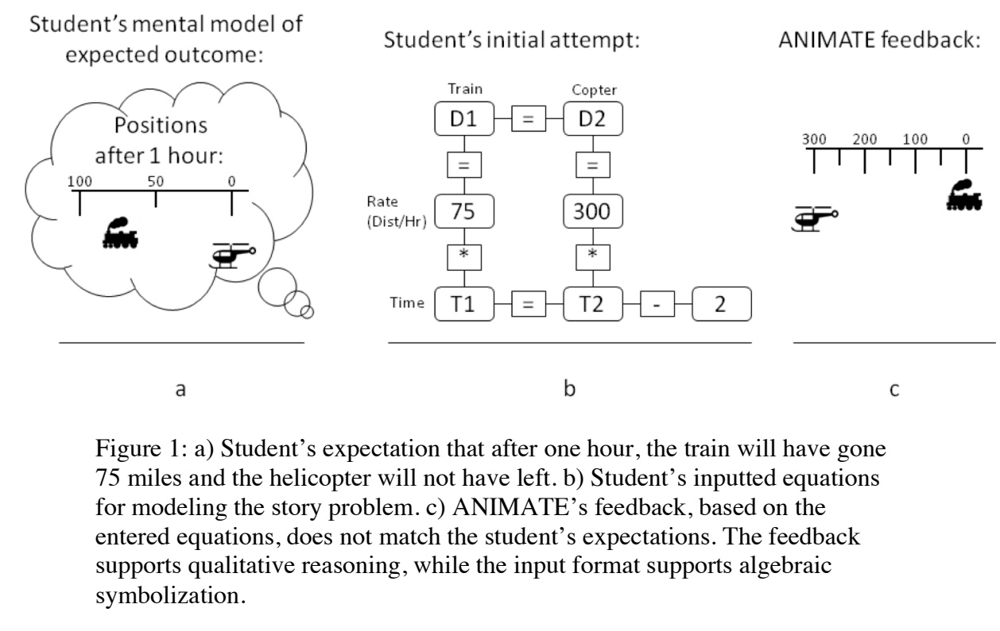

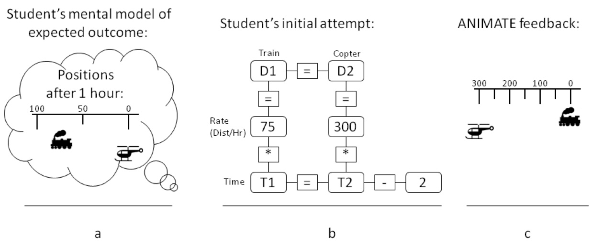

---

## Trang 5

5
in Figure 2. In this example, the animation would show the chase helicopter leaving before the 
train, which does not match the problem. This kind of feedback “shows” the student that his 
equation is wrong rather than “telling.” Ideally, the student reconsiders the equations he entered 
to locate the error. 
Nathan termed ANIMATE’s feedback “situational feedback” because it shows the 
consequences of the students’ inputs in terms of the situation in the story problem. This type of 
feedback does not explicitly state whether the students’ answers are correct or not, and is 
intended to encourage the students to evaluate their work for themselves. In an experiment with 
college students, Nathan compared the ANIMATE tutor to a version that did not let students run 
the simulations. Instead, it gave pop-up hints when the student made an error, for example, “It is 
common to over-generalize ‘later than’ to mean minus. Please check your current work.” While 
both groups improved in modeling story problems from pre- to posttest, the situational feedback 
group improved more. 
Figure 2: Reconstructed ANIMATE screenshot. The student’s entered 
equations are in the box at the bottom right; the clock at the left shows one 
hour has been simulated; the animation at the top shows the movement of the 
train and helicopter as governed by the student’s equations. The animation 
does not match the story description.

### Hình ảnh trên trang

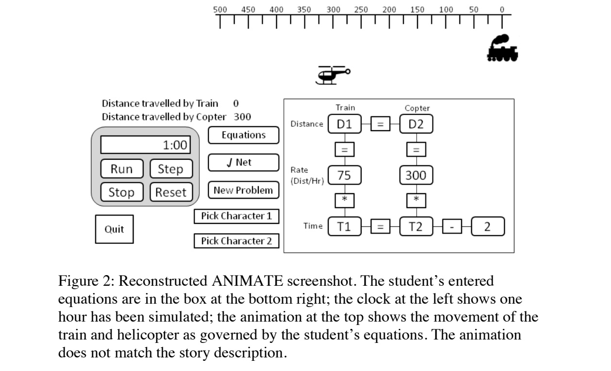

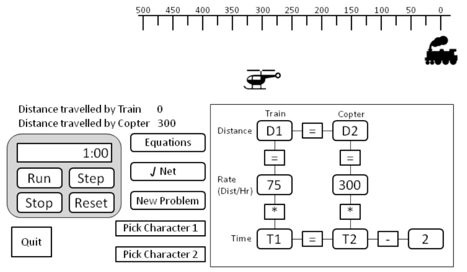

**OCR trong hình (theo thứ tự đọc):**

The diagram illustrates a train and copter system. A horizontal axis represents distance in units from 0 to 500. The train is labeled "Train" and the copter is labeled "Copter". A distance traveller is shown at the top of the train, with a scale bar at the bottom representing distance from 0 to 500. The train is connected to the copter by a line labeled "D1". The copter is connected to the train by a line labeled "D2". The train and copter are shown as single stages of travelling a distance of "D1". A second stage is shown as a single stage of travelling a distance of "D2". The train and copter are also shown as single stages of travelling a distance of "D1". A pick character is shown at the bottom of the train, connected to the copter by a line labeled "Pick Character 1". A pick character is also shown at the bottom of the copter, connected to the train by a line labeled "Pick Character 2". The train and copter are also shown as single stages of travelling a distance of "D1".
Distance travelled by Train 0
Distance travelled by Copter 300
Equations
J \text{ Net}
New Problem
Pick Character 1
Pick Character 2
Train
D1 = D2
Rate (Dist/Hr) = 75
Time = T1 = T2 = 2

---

## Trang 6

6
1.2 Another Example of Grounded Feedback: Excel Tutor
Though Mathan & Koedinger's 2005 Excel study involves a very different student population 
and domain, I argue that their tutor has a similar kind of feedback, also with large well￾established learning benefits. In Mathan & Koedinger’s study, adult job-seekers learned to write 
spreadsheet formulas with absolute and relative cell references. For example, one problem asks 
students to calculate the interest owed on a loan of $10,000, at various interest rates (Figure 3). 
The problem content was designed so that students would likely be able to calculate each of the
interests owed, or at least recognize clearly incorrect values (Figure 3a). Figure 3b shows the 
student-entered formula “=B2*A5” in the cell B5 (entry shown at the top) to multiply the loan 
amount by the interest rate. Excel responds with “$100” in B5 and this value matches the 
student’s expectations. However, when the student copies the formula from B5 and pastes it in 
cells B6 through B8 (Figure 3c), Excel produces values that do not match the student’s 
expectations. The first error is that the interest owed at the 5% interest rate is shown to be $0. 
Upon inspecting the formula for that erroneous cell (top of Figure 3c), the student sees (or is 
intended to see) that the interest rate is not being multiplied by the loan amount, but by the cell 
directly underneath. Excel multiplied the wrong cells because the student used a relative instead 
Figure 3: a) The student mentally calculates the interest rates. b) The student 
multiplies the first interest rate (cell B2) by the loan amount (cell A5), yielding 
the correct interest for cell B5. c) When that formula is copied and pasted in 
cells B6-B8, it multiplies the interest rates by cells under the loan amount. This 
result does not match the student’s expectations.

### Hình ảnh trên trang

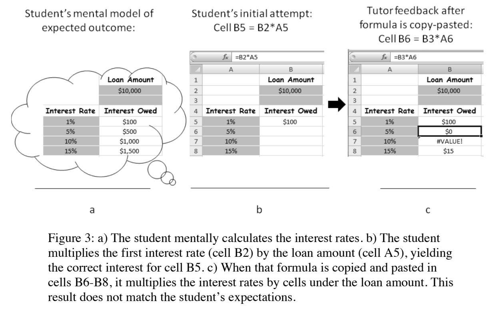

**OCR trong hình (theo thứ tự đọc):**

Figure 3: a) The student mentally calculates the interest rates. b) The student multiplies the first interest rate (cell B2) by the loan amount (cell A5), yielding the correct interest for cell B5. c) When that formula is copied and pasted in cells B6-B8, it multiplies the interest rates by cells under the loan amount. This result does not match the student's expectations.

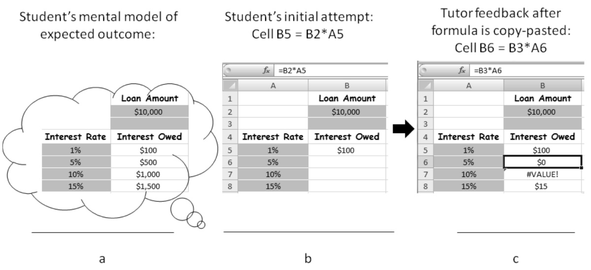

**OCR trong hình (theo thứ tự đọc):**

The diagram is divided into three parts:
Student's mental model of expected outcome:
A computer table with columns for 'Loan Amount' and 'Interest Rate'. The 'Loan Amount' column contains a single cell with '$10,000'. The 'Interest Rate' column contains a single cell with '$100'.
Student's initial attempt:
A single cell for 'Loan Amount' and 'Interest Rate'.
Tutor feedback after formula is copy-pasted:
A single cell for 'Loan Amount' and 'Interest Rate'.
The final formula is a computer table with columns for 'Loan Amount' and 'Interest Rate'. The 'Loan Amount' column contains a single cell with '$100'. The 'Interest Rate' column contains a single cell with '$100'. The final formula

---

## Trang 7

7
of an absolute reference (the correct formula for B5 is “=B$2*A5”, so that when it is copied and 
pasted into the cells below, the 2 does not change). 
Both the Excel tutor and ANIMATE provide learning environments where student errors 
are an expected part of learning. Strong empirical support for the success of these systems comes 
from experiments comparing them to robust controls. Mathan & Koedinger compared the 
“Intelligent novice model spreadsheet tutor” (Figure 4) to a version that gave explicit interactive 
support as soon as students entered an incorrect formula (Figure 5). In the control condition, 
Figure 4: The Intelligent Novice tutor allows students to enter incorrect 
formulas and observe the results. It provides interactive support only if the 
student cannot fix the error on her own.

### Hình ảnh trên trang

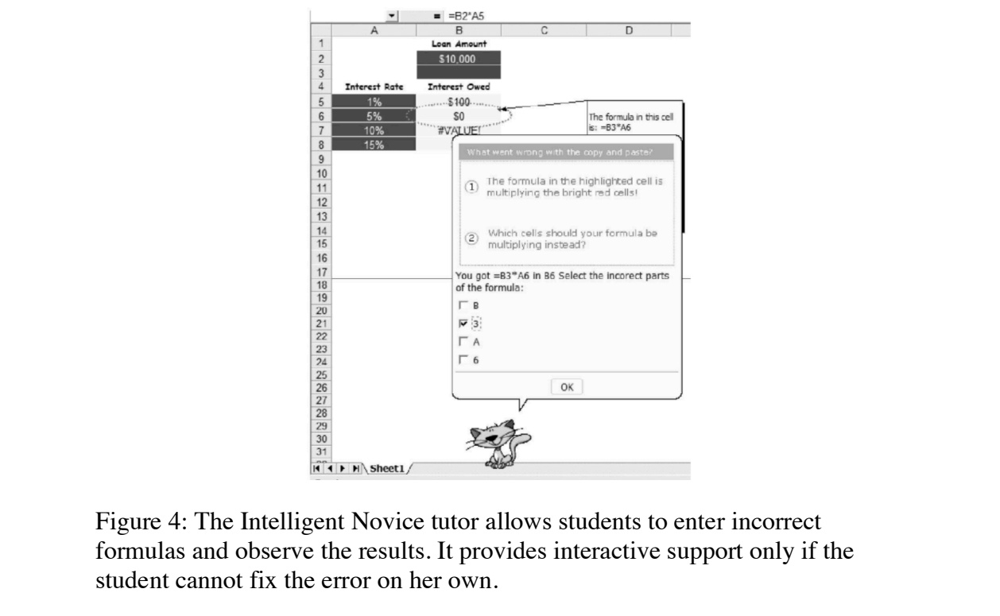

**OCR trong hình (theo thứ tự đọc):**

Figure 4: The Intelligent Novice tutor allows students to enter incorrect formulas and observe the results. It provides interactive support only if the student cannot fix the error on her own.

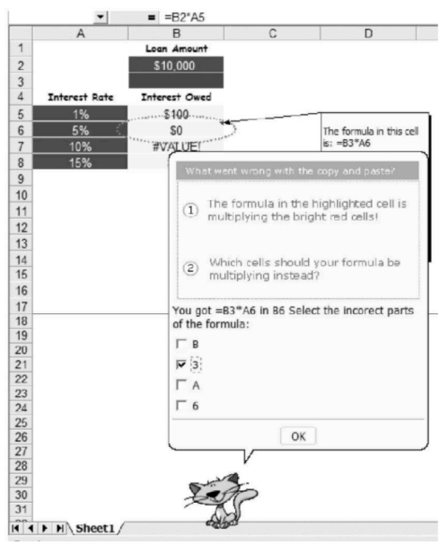

**OCR trong hình (theo thứ tự đọc):**

The screenshot shows a selection box with a selection button at the top and a selection button below it. The selection box is divided into three horizontal sections: 'A', 'B', and 'C'. The 'A' section contains a selection button at the top and a selection button below it. The 'B' section contains a selection button at the top and a selection button below it. The 'C' section contains a selection button at the top and a selection button below it. A selection button is also visible in the 'A' section at the bottom of the 'A' section. The 'B' section at the bottom of the 'B' section contains a selection button at the top and a selection button below it. The 'C' section at the bottom of the 'C' section contains a selection button at the top and a selection button below it. A selection button is also visible in the 'B' section at the bottom of the 'B' section. The 'C' section at the bottom of the 'C' section contains a selection button at the top and a selection button below it. A selection button is also visible in the 'C' section at the bottom of the 'C' section. A selection button is also visible in the 'B' section at the bottom of the 'B' section. A selection button is also visible in the

---

## Trang 8

8
students had to generate the correct formula before pasting it into multiple cells. In both 
conditions, the tutor offered text hints if students needed them. The key differences between the 
tutors were that students in the intelligent novice condition could (1) see how Excel responded to
incorrect formulas; and (2) try to recognize and correct their own errors before the tutor jumped 
in. Mathan & Koedinger found that students in the intelligent novice condition showed 
significantly better learning from pretest to posttest on all of their measures, with substantial
effect sizes1 for problem solving (effect size: .50), conceptual understanding (effect size: .59),
transfer (effect size .43), and retention (effect size: .33). These strong results show the additive 
benefit of the intelligent novice feedback in a learning environment that already provides text 
hints.
Although ANIMATE and the Excel tutor look different on the surface, the two learning 
environments share underlying characteristics. In both tutors, errors are uncovered when the 
student sees how their inputs are reflected back by the system. In ANIMATE, equations are 
reflected back in the animations, and in the Excel tutor, formulas are reflected back in the 
calculated values. By going back and forth between the animations and the equations, or the 
spreadsheet formulas and their resulting values, the student (ideally) constructs the bridge 
between them. This student-constructed knowledge contrasts with text hints that tell students 
what the connections are. 
 
1 Across all treatment-to-control comparisons
Figure 5: The Excel control tutor gives interactive support as soon as an 
incorrect answer is entered – unlike the Intelligent Novice tutor, it does not 
allow students to copy and paste incorrect formulas, thus reducing students’ 
opportunities to diagnose and fix errors on their own.

### Hình ảnh trên trang

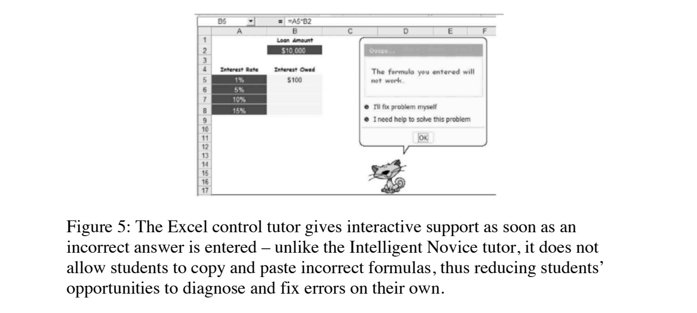

**OCR trong hình (theo thứ tự đọc):**

Figure 5: The Excel control tutor gives interactive support as soon as an incorrect answer is entered – unlike the Intelligent Novice tutor, it does not allow students to copy and paste incorrect formulas, thus reducing students' opportunities to diagnose and fix errors on their own.

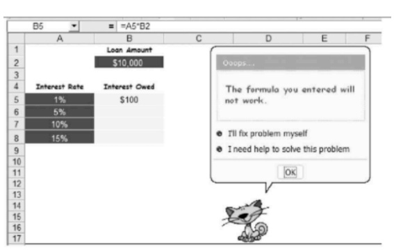

---

## Trang 9

9
1.3 Defining Grounded Feedback 
Nathan called ANIMATE’s feedback “situational feedback.” Mathan & Koedinger based their 
Excel tutor on an “intelligent novice model.” Although the authors used different terms and 
different kinds of tutors in their experiments, we propose that the demonstrated power of their 
treatments come from three common characteristics that we refer to, collectively, as grounded 
feedback. The three design features are: 
1) Students do not directly manipulate the feedback representation. Instead, the inputs are in 
a format that matches the domain learning goals. In ANIMATE, students do not directly 
manipulate the characters in the animations. Instead, they manipulate algebraic formulas 
that control the animations. This forces students to engage with the algebra. In the Excel 
tutor, students do not directly manipulate the values in the cells – they write formulas 
instead. 
2) The system provides feedback in a form that students can easily process and understand 
given their prior knowledge. The feedback is also intrinsic to the domain, thereby 
encouraging the student to connect steps in a procedure to conceptual principles. In 
ANIMATE, a student’s feedback on her equations is the animation, which those 
equations govern. The feedback is intrinsic to the mechanics of the tutor and to the math 
being taught. In the intelligent novice model spreadsheet tutor, a student’s initial 
feedback on her formula is the value that Excel calculates, an action intrinsic to Excel. 
3) Students can easily figure out the goal state for the feedback, and thus evaluate for 
themselves if their answers are correct or not. In ANIMATE, the problems are designed 
to be simple enough that once students read the story problems they should know what 
the animations should portray. In the Excel tutor, the math problems are designed to be 
simple enough that students can figure out the answers in their heads. 
We use the term grounded because the feedback is grounded in student’s prior knowledge, and it 
also evokes conversational grounding (Clark & Brennan, 1991). For example, ANIMATE 
dynamically translates a student’s intention (e.g., write an equation) to a representation 
(animation) that may help the student see if that action matched the original intention (is that the

---

## Trang 10

10
story in the problem?). It lets the system ask “did you mean that?” perhaps introducing cognitive 
dissonance when the feedback is not what the student intended. We hypothesize that grounded 
feedback works by triggering prior knowledge, thus reinforcing connections between what the 
student is learning (the input representation) and what the student already knows (the feedback 
representation). Grounded feedback environments allow students to iterate on their work through 
cycles of generation and feedback. Grounded feedback encourages students to evaluate their own 
work, and the act of evaluation may deepen conceptual knowledge. Ohlsson, (1996) provides a 
theoretical basis for this learning mechanism. He explains that evaluating our work often 
activates knowledge that was not available when the mistake was made in the first place (that is 
why we often correct mistakes when we check our own work, even without new information). 
Grounded feedback may help by making that evaluation step more explicit and by providing 
information that a novice can interpret about why her action was in error.
Grounded feedback is one implementation of multiple representations. Grounded 
feedback uses two representations for a specific aim: to show feedback in a familiar 
representation that facilitates students’ evaluation of their own work in the novel target 
representation. Multiple representations in general can have much broader aims and different 
types of structures. For example, the goal for an activity with multiple representations may be for 
students to discover the mapping from one to another, to construct one from the other, or to use 
each separately. Ainsworth (1999) described three categories of functions of multiple 
representations: (1) providing complimentary information (e.g., different map projections of the 
earth, one with accurate shapes and the other with accurate sizes); (2) constraining potential 
misinterpretations (e.g., a linked representation of an object moving according to a velocity-time 
graph to address a common misconception that a horizontal line on such a graph indicates an 
object at rest); and (3) constructing deeper understanding (e.g., combining base-10 blocks with 
symbolic numbers to encourage students to extract abstract principles of the base-10 number 
system). Grounded feedback has elements of the second and third categories: the grounded 
representation facilitates correct interpretation of the novel representation, and by mapping 
between both representations, students construct deeper understanding of the domain.

---

## Trang 11

11
1.4 Initial Fraction Addition Tutor Design
Nathan’s ANIMATE tutor and Mathan & Koedinger’s Excel tutor were targeted at college 
students learning algebra and adults learning about spreadsheets. How can grounded feedback be 
implemented for other domains and for younger students? This fraction addition tutor is one 
attempt to answer that question. Proficiency with fractions is a pivotal skill: fraction knowledge 
in fifth grade predicts math achievement in tenth grade even after statistically controlling for 
socioeconomic status, general IQ, and whole number arithmetic knowledge (Siegler et al., 2012). 
In this tutor, the grounded feedback takes the form of fraction bars. A fraction bar 
represents the fraction n/d by dividing a rectangle into d equal pieces and coloring in the n left￾most pieces. The top row of the tutor presents the fraction addition problem (Figure 6). The 
second row depicts fraction bars for the two addends, and combines the shaded areas of the 
addends to display the magnitude of the sum. The third row consists of fraction bars that are 
controlled by the student, and they dynamically display the converted and sum fractions that the 
student inputs in the text boxes at the bottom. The fraction bars are the same size, and 
corresponding bars are aligned vertically to encourage comparison. In a small pilot study, the 
five students spontaneously used the bars to find and fix their own errors (Stampfer, Long, 
Aleven, & Koedinger, 2011). 
This tutor design was intended to embody the design features of grounded feedback: 
1) The input format matches domain learning goals. The fraction bars are intended to 
support students in thinking about their actions conceptually. However, students’ actions 
Figure 6: Fraction addition tutor. The top row of fractions and fraction bars are 
given. The second row of fraction bars dynamically reflects students' inputs in 
the boxes at the bottom. This sample screenshot shows correct conversion and 
incorrect addition.

### Hình ảnh trên trang

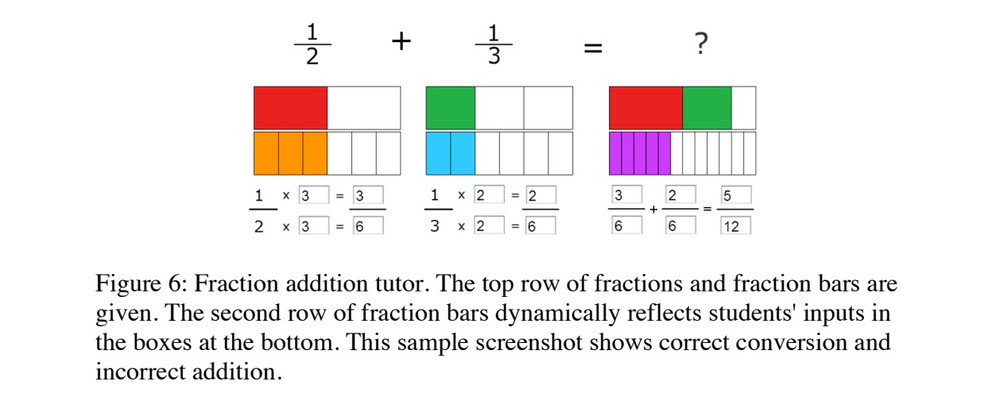

**OCR trong hình (theo thứ tự đọc):**

Figure 6: Fraction addition tutor. The top row of fractions and fraction bars are given. The second row of fraction bars dynamically reflects students' inputs in the boxes at the bottom. This sample screenshot shows correct conversion and incorrect addition.

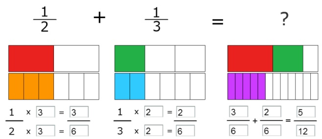

**OCR trong hình (theo thứ tự đọc):**

\frac{1}{2} + \frac{1}{3} = \frac{1}{6}

---

## Trang 12

12
themselves are taken in the symbolic domain: students input symbolic numbers, they do 
not directly manipulate the fraction rectangles. This ensures that students pay attention to 
the symbols, which they will ultimately be working with when they solve problems on 
paper.
2) The feedback is intrinsic to the domain, and students can interpret it and make inferences 
with it. Fraction bars reflect the underlying conceptual mathematics that a fraction 
symbol embodies. The full rectangle represents the unit, the number of equal pieces 
represents the denominator, and the colored amount represents the magnitude of the 
fraction, relative to one whole. Fraction bars in this interface facilitate many potential 
inferences: two fractions can have different denominators and still represent the same 
amount; a larger denominator means each piece is smaller; keeping the denominator the 
same, a larger numerator will create a larger colored-in amount; etc.
3) I thought students could envision a correct goal state for the feedback. When two 
fractions are equivalent, the grounded feedback will show that the same amount is 
colored in. I thought that students would recognize that the fraction bar corresponding to 
their inputted sum would have a colored amount that lined up with the multi-colored sum 
fraction above it.
After the pilot study, I ran an in-vivo classroom study in a local public school comparing the 
grounded feedback tutor to one that only provided correctness feedback (and only provided the 
symbolic representation) Although the grounded feedback condition (90 students) improved 
significantly from pre-test to post-test, process measures show incorrect interpretations of the 
fraction bars (Stampfer & Koedinger, 2012). Students often indicated they were done solving the 
problems even though the fraction bars did not line up – ‘often’ being, on average, 1 or 2 times 
per student per problem. This finding revealed that students could not correctly envision a goal 
state for the feedback, and therefore the feedback was not truly grounded. 
1.5 Students’ Prior Misconceptions Prevented Grounding
What prevented the students from understanding the fraction bar feedback? Using a theoretical 
cognitive task analysis, I identified three likely skills needed to understand the fraction bar

---

## Trang 13

13
representations for fraction addition: (1) equal areas represent equal amounts; (2) the rectangular 
bars represent the symbolic fractions written above or below them; (3) if two shaded areas are 
equal, the fractions they represent are equal. We developed matched test items intended to isolate 
those skills (Figures 7-10). Fraction addition items presented a equations and students indicated 
if they were true or false. Fraction equivalence items presented two fractions and students 
indicated if the first fraction was bigger than, equivalent to, or smaller than the second fraction. 
The four question presentations are intended to isolate the skills needed to make sense of the 
tutor interface in Figure 6. The pictures format (Figure 7) assesses if students know that the 
shaded rectangles use area to represent quantity, such that two rectangles with equal-sized 
shaded areas represent equal quantities. Pictures-and-numbers items (Figure 8) include fraction 
symbols with the fraction bars, to test if students can understand the fraction bars as 
representations of fractions. Half-pictures-and-numbers items (Figure 9) also include both 
fraction bars and fraction symbols, but only present the fraction bars as the hint at the top of the 
problem. This determines if students can find the relationship between the two fraction bars, map 
that relationship to the symbolic fractions represented, and then select the relationship that the 
symbolic fractions have to each other. Numbers-only (Figure 10) provides a baseline for how 
well students can evaluate the equivalence and addition problems without fraction bars. These 
questions formed the basis of a difficulty factors assessment (cf., Koedinger, Alibali, & Nathan, 
2008) with 155 5th-grade students (Stampfer & Koedinger, 2013).

---

## Trang 14

14
Figure 7: Pictures Only representation, testing if students know that area 
represents quantity.
Figure 8: Pictures and Numbers, testing if the images are comprehensible as 
fractions.

### Hình ảnh trên trang

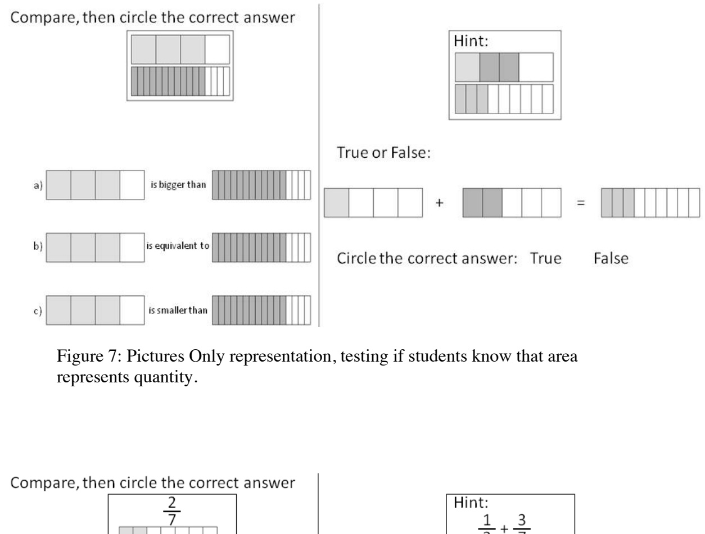

**OCR trong hình (theo thứ tự đọc):**

| Compare, then circle the correct answer | Comparison of two grids of squares with a circle of size \frac{2}{7} at the top. The grid on the left is labeled 'a) is bigger than' and the grid on the right is labeled 'is equivalent to'. The grid on the right is labeled 'is smaller than'. The circle is labeled 'Circle the correct answer: True False'. The correct answer is 'True'. |
| --- | --- |
| Compare, then circle the correct answer | Comparison of two grids of squares with a circle of size \frac{2}{7} at the top. The grid on the left is labeled 'a) is bigger than' and the grid on the right is labeled |

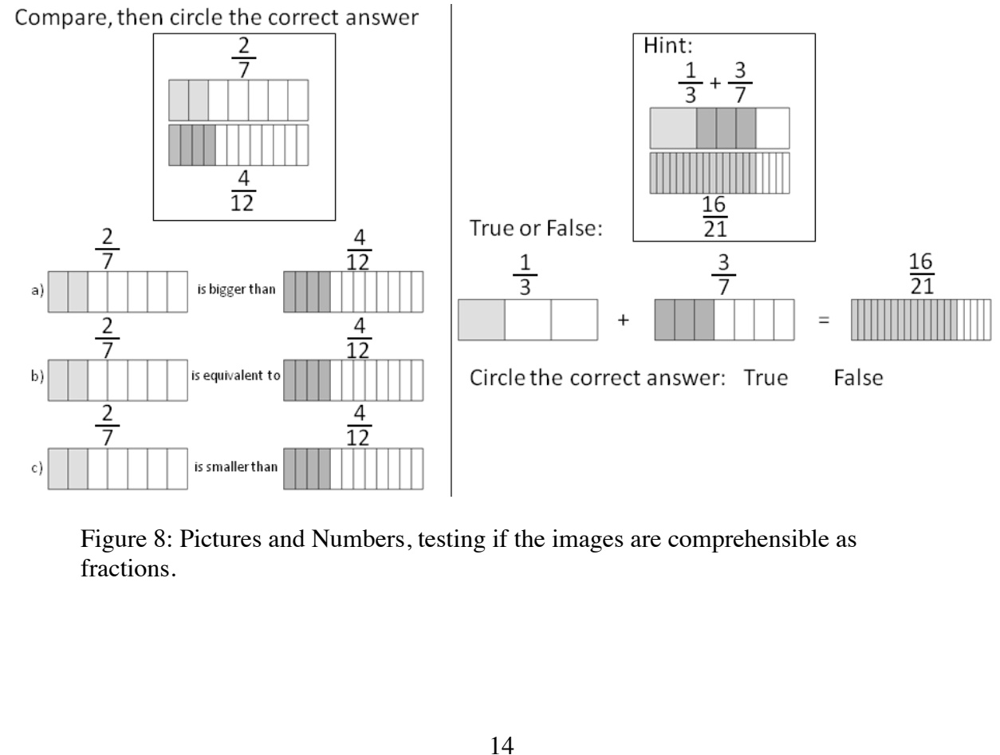

**OCR trong hình (theo thứ tự đọc):**

Compare, then circle the correct answer
a)
\frac{2}{7}
is bigger than
\frac{4}{12}
b)
\frac{2}{7}
is equivalent to
\frac{4}{12}
c)
\frac{2}{7}
is smaller than
\frac{4}{12}
True or False:
\frac{1}{3} + \frac{3}{7} = \frac{16}{21}
Circle the correct answer: True False
Figure 8: Pictures and Numbers, testing if the images are comprehensible as fractions.
14

---

## Trang 15

15
Figure 9: Half Pictures and Numbers, testing if students can map the relationship 
between the images to the relationship between the symbols.
Figure 10: Numbers Only control gives a baseline for student evaluation of solved 
problems.
On the equivalence items (Figure 11), students demonstrate competence with the three 
skills identified in the cognitive task analysis: equal areas represent equal quantities (pictures), 
the bars represent fractions (pictures and numbers), the relationship between the bars maps to the 
relationship between the fractions they represent (half pictures and numbers). Students were 
likely not solving these equivalence problems with the numbers alone, since numbers-only 
performance is much lower. Surprisingly, these skills are not consistently demonstrated with 
fraction addition. Pictures-only scores are just as high with addition as they are with equivalence, 
indicating that the knowledge that equal areas represent equal quantities does transfer to addition. 
However, performance decreases steadily across pictures-and-numbers and half-pictures-and-

### Hình ảnh trên trang

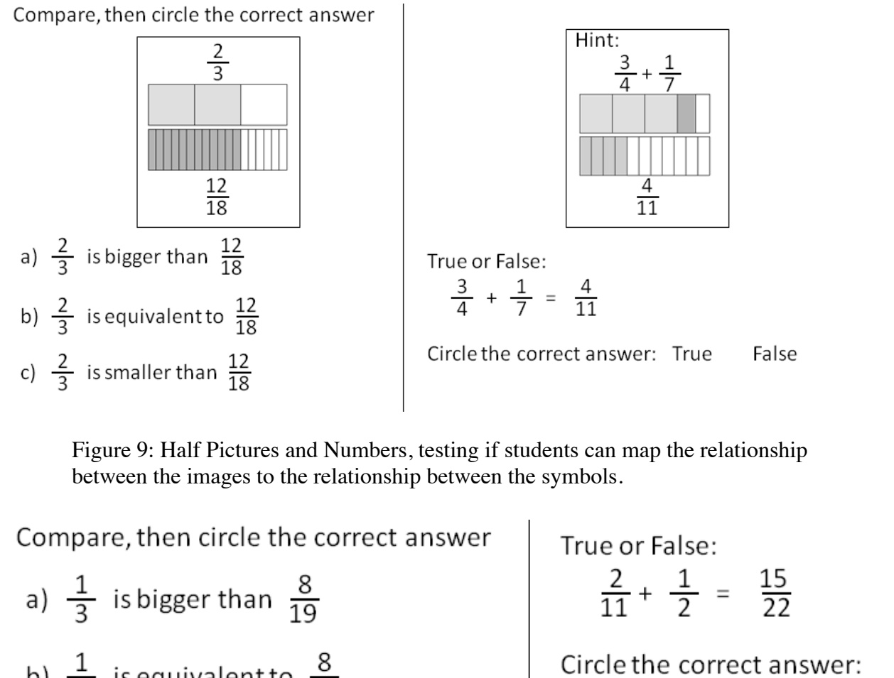

**OCR trong hình (theo thứ tự đọc):**

| Compare, then circle the correct answer \frac{2}{3} \frac{12}{18} a) \frac{2}{3} is bigger than \frac{12}{18} b) \frac{2}{3} is equivalent to \frac{12}{18} c) \frac{2}{3} is smaller than \frac{12}{18} | Hint: \frac{3}{4} + \frac{1}{7} \frac{3}{4} \frac{1}{7} \frac{4}{11} |
| --- | --- |
| True or False: \frac{3}{4} + \frac{1}{7} = \frac{4}{11} Circle the correct answer: True     False | True or False: \frac{2}{11} + \frac{1}{2} = \frac{15}{22} Circle the correct answer: |
Figure 9: Half Pictures and Numbers, testing if students can map the relationship between the images to the relationship between the symbols.

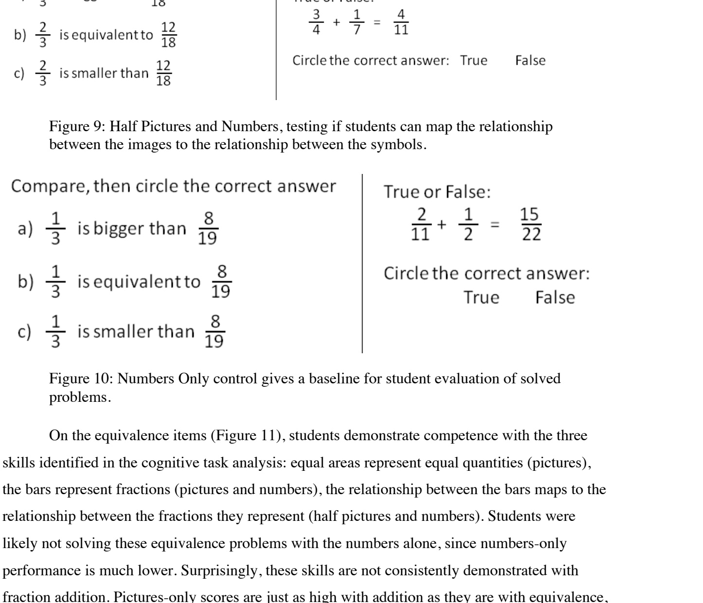

**OCR trong hình (theo thứ tự đọc):**

| b) \frac{2}{3} is equivalent to \frac{12}{18} c) \frac{2}{3} is smaller than \frac{12}{18} | \frac{3}{4} + \frac{1}{7} = \frac{4}{11} Circle the correct answer: True False |
| --- | --- |
| Figure 9: Half Pictures and Numbers, testing if students can map the relationship between the images to the relationship between the symbols. |  |
| Compare, then circle the correct answer a) \frac{1}{3} is bigger than \frac{8}{19} b) \frac{1}{3} is equivalent to \frac{8}{19} c) \frac{1}{3} is smaller than \frac{8}{19} | True or False: \frac{2}{11} + \frac{1}{2} = \frac{15}{22} Circle the correct answer: True False |
| Figure 10: Numbers Only control gives a baseline for student evaluation of solved problems. |  |
| On the equivalence items (Figure 11), students demonstrate competence with the three skills identified in the cognitive task analysis: equal areas represent equal quantities (pictures), the bars represent fractions (pictures and numbers), the relationship between the bars maps to the relationship between the fractions they represent (half pictures and numbers). Students were likely not solving these equivalence problems with the numbers alone, since numbers-only perform |  |

---

## Trang 16

16
numbers, suggesting difficulty both with understanding the bars in the context of fractions and 
mapping the relationship between the fraction bars to the relationship between the fraction 
symbols. Yet, the bars still increase performance above the numbers-only control (which has 
worse-than-chance scores). 
I hypothesize that the temptation of the incorrect add-both-numerators-and-denominators 
strategy overrides the area-as-quantity reasoning that students demonstrate when the numbers are 
not shown. Alternatively, students may not realize how to apply their area-as-quantity reasoning
to fraction addition. That is, students may not realize that when two fractions are added, they 
yield the same magnitude as their sum. All of the incorrect addition equations proposed a sum 
that was smaller than one of the addends. Students’ failure to reject this incorrect strategy, even 
with fraction bars showing the magnitude of each fraction, suggest that students do not know that 
the sum of two positive fractions is always larger than each addend. A follow-up study with the 
same 5th graders tested the hypothesis that the students could not correctly apply the principles of 
the addend-sum relationship: items presented a correct addition equation and students were asked 
if the sum was bigger than each added (or visa versa). Items had whole numbers, decimals, 
fractions, or variables, and all addends were positive (Figures 12 and 13). The results confirmed 
a gap in prior knowledge: percent correct with each number type was far from ceiling (whole 
numbers, 79; decimals, 75; fractions, 61; variables, 51). If students do not realize that two 
Figure 11: Percent correct on the equivalence and addition items presented in 
Figures 7-10.

### Hình ảnh trên trang

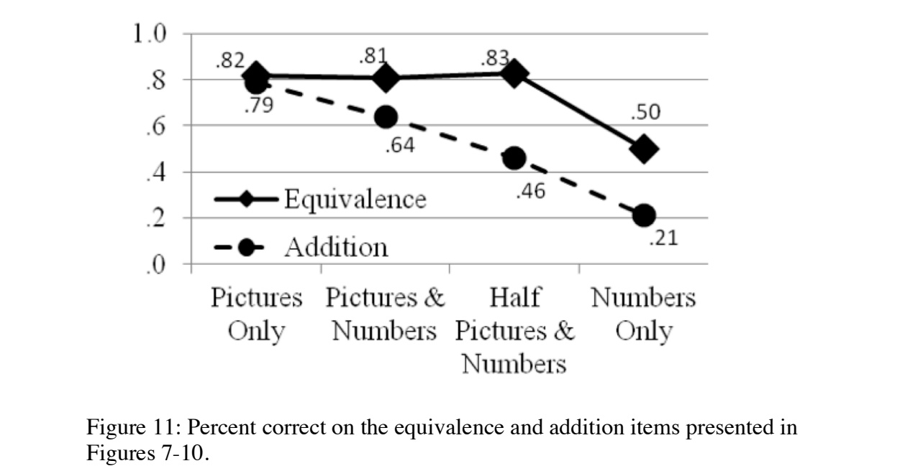

**OCR trong hình (theo thứ tự đọc):**

Figure 11: Percent correct on the equivalence and addition items presented in Figures 7-10.

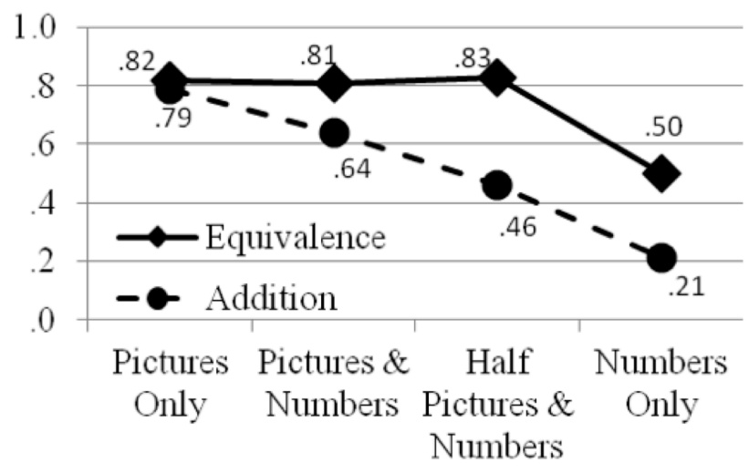

**OCR trong hình (theo thứ tự đọc):**

| Type | Pictures Only | Pictures & Numbers | Half | Numbers Only |
| --- | --- | --- | --- | --- |
| Equivalence | .79 | .64 | .83 | .50 |
| Addition | .21 | .07 | .46 | .21 |

---

## Trang 17

17
positive addends yield the same magnitude as their sum, visual feedback that makes magnitude 
more salient will not provide much benefit.
Figure 12: Addend-Sum item with whole numbers (left) and decimals (right)
Figure 13: Addend-Sum item with fractions (left) and variables (right)
2 Proposed Experiment 
My thesis will build on my prior work by investigating grounded feedback in more depth. I aim 
to answer this research question: Is grounded feedback beneficial for learning? My first 
experiment could not answer that question for at least two reasons: first, it only set out to 
compare grounded feedback and correctness feedback, without any intermediate conditions; and 
second, the ‘grounded’ feedback was not actually grounded. My proposed work will fix both of 
those problems.

### Hình ảnh trên trang

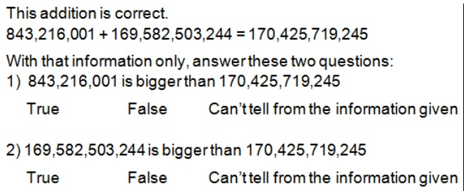

**OCR trong hình (theo thứ tự đọc):**

|  |  |  |
| --- | --- | --- |
| This addition is correct. |  |  |
| 843,216,001 + 169,582,503,244 = 170,425,719,245 |  |  |
| With that information only, answer these two questions: |  |  |
| 1) 843,216,001 is bigger than 170,425,719,245 |  |  |
| True | False | Can't tell from the information given |
| 2) 169,582,503,244 is bigger than 170,425,719,245 |  |  |
| True | False | Can't tell from the information given |

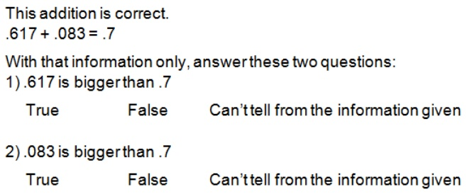

**OCR trong hình (theo thứ tự đọc):**

|  |  |  |
| --- | --- | --- |
| This addition is correct. |  |  |
| .617 + .083 = .7 |  |  |
| With that information only, answer these two questions: 1) 617 is bigger than .7. |  |  |
| True                      False | Can't tell from the information given |  |
| 2) .083 is bigger than .7. |  |  |
| True                      False | Can't tell from the information given |  |

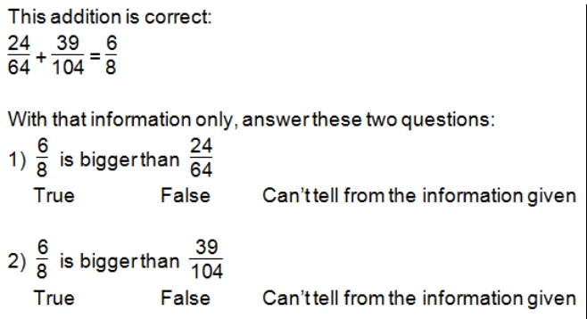

**OCR trong hình (theo thứ tự đọc):**

This addition is correct:
\frac{24}{64} + \frac{39}{104} = \frac{6}{8}
With that information only, answer these two questions:
1)
\frac{6}{8}
is bigger than
\frac{24}{64}
True                      False                      Can't tell from the information given
2)
\frac{6}{8}
is bigger than
\frac{39}{104}
True                      False                      Can't tell from the information given

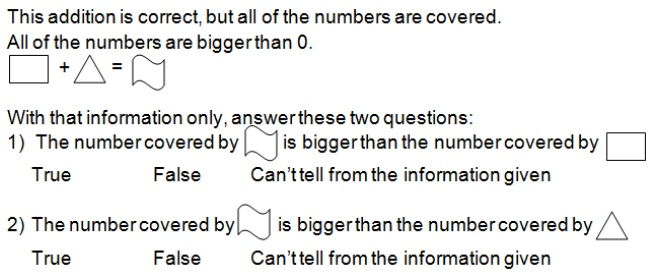

**OCR trong hình (theo thứ tự đọc):**

This addition is correct, but all of the numbers are covered.
All of the numbers are bigger than 0.
+ △ =
With that information only, answer these two questions:
1) The number covered by
is bigger than the number covered by
True                      False                      Can't tell from the information given
2) The number covered by
is bigger than the number covered by
True                      False                      Can't tell from the information given

---

## Trang 18

18
2.1 Four-Condition Ablation Experiment
My theoretical characterization of grounded feedback consists of three features: 
Feature 1, Input Mode: students’ inputs are in the target, to-be-learned representation.
Feature 2, Second Representation: a second representation reflects students’ inputs in a 
manner intrinsic to the domain, and which affords inferences.
Feature 3, Self-Evaluation: students can use the second representation to recognize when 
their answers are incorrect. 
The conditions in my proposed experiment ablate these features or otherwise allow for a more 
thorough understanding of their effects. All of the conditions will provide on-demand text hints 
and will only advance students to the next problem if the current problem was solved correctly.
The fraction addition tutors will provide support for both problem planning and execution.
Before starting a problem, students will be prompted to consider which fractions they need to 
convert, and to decide when they are ready to add (Figure 14). 
Condition 1: Grounded Feedback – No Ablation
Students will use a tutor similar to the one shown in Figures 1 and 14. Students will input 
fraction symbols, which will be reflected back as fraction bars. Students will be permitted to 
follow incorrect solution paths, such as adding the given fractions without converting them 
first. Ultimately, when the student attempts to move on to the next problem, the tutor will tell 
I	
  need	
  to	
  convert	
  
this	
  fraction
I	
  need	
  to	
  convert	
  
this	
  fraction
I’m	
  ready	
  to	
  add
Figure 14: The interface prompts students to plan their problem 
solving steps before executing the procedures.

### Hình ảnh trên trang

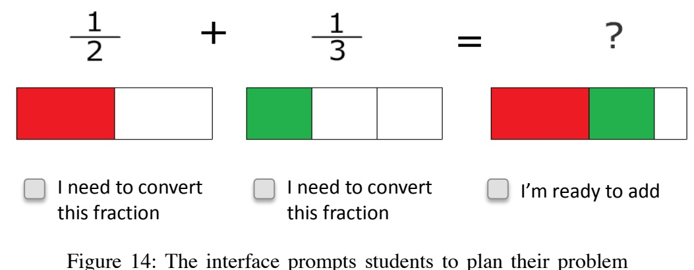

**OCR trong hình (theo thứ tự đọc):**

I need to convert this fraction

**OCR trong hình (theo thứ tự đọc):**

I need to convert this fraction

**OCR trong hình (theo thứ tự đọc):**

I'm ready to add

**OCR trong hình (theo thứ tự đọc):**

Bombardo

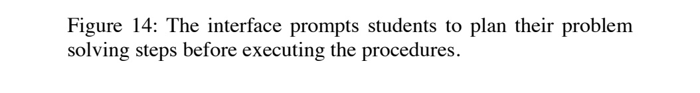

**OCR trong hình (theo thứ tự đọc):**

Figure 14: The interface prompts students to plan their problem solving steps before executing the procedures.

---

## Trang 19

19
them if their work is correct or if they need to continue working. Students will not get 
immediate correctness feedback on any intermediate steps.
Condition 2: Virtual Manipulatives – Ablation of input mode (feature 1)
Students will directly manipulate the fraction bars by clicking on one set of arrows to change 
the total number of pieces, and another set of arrows to change how many pieces are colored 
in (students may also click on each piece to color or un-color it). The fraction symbols will 
dynamically update to reflect the fraction bars. The input mode and link direction are the 
only differences between this tutor and the Grounded Feedback Tutor. In both cases, when 
the student attempts to move on to the next problem, the tutor will tell them if their work is 
correct or if they need to continue working. Students will not get immediate correctness 
feedback on any intermediate steps.
Condition 3: Correctness Feedback – Ablation of second representation (feature 2)
The tutor interface will consist of symbols only. Students will not see fraction bars. Students 
will receive immediate correctness feedback on each intermediate step, in addition to 
correctness feedback on each problem as a whole. Students will also get immediate feedback 
on the problem-planning steps, and will only be permitted to follow correct solution paths 
(e.g., the interface will not allow the student to begin adding if the fractions have not been 
converted properly).
Condition 4: Grounded plus Correctness – Examination of self-evaluation (feature 3) 
On the execution steps, students will receive both grounded and correctness feedback. 
Otherwise, this tutor will behave in the same manner as the Grounded Feedback Tutor. In 
both, students will input fraction symbols, which will be reflected back as fraction bars.
Unlike the Correctness Feedback tutor, students will not get correctness feedback on the 
problem-planning steps, because there is no grounded feedback on those steps. This means 
that students will be allowed to follow incorrect solution paths at the problem-planning stage. 
This design decision is based on the differences between grounded and correctness feedback: 
as with the Excel tutor, the fraction addition tutor requires that more than one action be 
performed before the grounded feedback can be displayed. Designing the Grounded plus

---

## Trang 20

20
Correctness tutor to function more like the Grounded Feedback tutor also allows it to serve as 
a tighter control.
2.1.1 Basis for Virtual Manipulatives Tutor (condition 2). The virtual manipulative tutor is 
based on physical manipulatives and their computer-based cousins. Manipulatives in general are 
popular in elementary and middle school math classes (McNeil & Uttal 2009); virtual fraction 
bars in particular are common for teaching equivalence and addition (e.g., Suh, Moyer, & Heo 
2005). However, while manipulatives often lead to improved problem-solving performance, 
evidence suggests that learning with manipulatives alone does not transfer to written, symbolic 
representations (Uttal et al., n.d.). One explanation for this lack of transfer is that operations on 
manipulatives may not involve the same cognitive processes as operations on symbols (Sarama 
& Clements 2009). Comparing the virtual manipulative tutor to the grounded feedback tutor will 
allow us to see if the presence of manipulatives determines performance and transfer or if the 
target of the operations matters too. If the first case is true, learning should be the same in the 
grounded feedback and virtual manipulatives condition; if the second case is true, there should 
be differences. More specifically, if the target of the operation matters, the grounded feedback 
condition will lead to better learning of symbolic operations, because students will be practicing 
operations on symbols. Additionally, including this condition will provide some experimental 
evidence on the effects of virtual manipulatives, which are popular online but lack studies on 
their effectiveness.
2.1.2 Basis for Correctness Tutor (condition 3). The correctness tutor is based on a strict 
interpretation of cognitive load theory. The absence of a second representation eliminates the 
cognitive overhead of interpreting the second representation, relating it to the input 
representation, and managing attention between the two. The immediate right/wrong feedback is 
intended to reduce floundering. The correctness tutor is intended to provide a robust control 
condition.
2.1.3 Basis for Grounded Plus Correctness Tutor (condition 4). While the Correctness tutor 
provides one control for the Grounded Feedback tutor, that comparison confounds the presence 
of the second representation and immediate feedback on the input representation. The Grounded 
plus Correctness tutor creates a tighter experimental design by allowing for the comparison of

---

## Trang 21

21
conditions that differ by one variable only. On a theoretical level, immediate correctness 
feedback may change how students respond to the grounded feedback. I propose two competing 
hypotheses. First, with correctness feedback, students may not bother doing the work of 
interpreting the second representation, and may ignore it entirely (hypothesis 4a). On the other 
hand, correctness feedback may enhance that interpretation by reducing cognitive load
(hypothesis 4b). I discuss each in more depth below.
Hypothesis 4a proposes that the Grounded plus Correctness tutor may provide too much 
scaffolding. The correctness feedback effectively turns a problem step into a correct or incorrect 
worked example (instead of the student deciding if her work was correct, the tutor marks it as 
correct or not). If the student knows how to interpret the grounded feedback, the correctness 
feedback may then provide redundant information, which will not lead to the most efficient 
learning (Kalyuga, Chandler, Tuovinen, & Sweller, 2001). More likely, the student may ignore 
the fraction bar feedback entirely and only pay attention to the correctness feedback – why put in 
the effort of interpreting the fraction bars if the computer will do it for free? That outcome would 
eliminate any potential benefits of providing opportunities for self-evaluation (feature 3), 
rendering the fraction bars simply a distraction (which would lead to worse learning in this 
condition than in the Correctness condition). Finally, as with the Correctness condition, the 
presence of immediate right/wrong feedback may lead students to evaluate their own work in a 
shallow manner that does not support robust learning (“my sum is wrong because the tutor 
marked it wrong” vs. “my sum is wrong because it’s smaller than the addends”). 
Hypothesis 4b proposes that the additional scaffolding in the Grounded plus Correctness 
tutor will enhance learning. When students interpret the fraction bar feedback after they make an 
error, they must both determine that they made an error and they must locate the error. The 
correctness feedback turns the error-existence task into a worked example, freeing cognitive 
resources to focus on locating the error. The error-location task is arguably the more important of 
the two, since it involves more complex reasoning about several domain features (meaning that 
the benefits of the second representation, feature 2, are more useful than the benefits of self￾evaluation, feature 3). As an example, consider the difference between assessment items that ask 
students if two fractions are equivalent versus asking students to prove that two fractions are or 
are not equivalent. The second item provides a much richer measure of skill.

---

## Trang 22

22
The Grounded plus Correctness tutor will also most likely lead to more efficient problem 
solving than the Grounded Feedback tutor since it indicates explicitly which steps are done 
correctly, and students are unlikely to undo work they know is correct. Consider a student 
converting a fraction. If the numerator was converted correctly but the denominator was not, the 
fraction bar feedback would indicate an incorrect response, and the student might think both 
parts of the fraction should be changed. With correctness feedback, the student would see 
immediately that only the denominator needed to be changed. Reducing the amount of time 
students spend backtracking will likely increase the amount of time they spend on productive 
learning. Further, if there are any students for whom the fraction bar feedback is not fully 
grounded, this tutor should provide superior learning. There are several pieces of knowledge that 
students must consider and coordinate to interpret the fraction bar feedback. Instead of students 
finding the feedback to be either grounded or not grounded, it is more likely that a student’s 
degree of grounding falls along a continuum, and that most students would benefit from extra 
support. Correctness feedback may even help the fraction bar feedback become more grounded 
as students see, over the course of tutoring, many fraction bar configurations that correspond to 
correct and incorrect responses. 
2.1.4 Specific Research Questions. These conditions allow for the evaluation of each feature of 
grounded feedback, without the explosion of conditions that would come from a full factorial 
design. Specifically, this design will answer these questions:
1) Does Feature 1 matter? That is, when the visual elements of the interface are held 
constant, does the mode of input matter? (compare Virtual Manipulatives to Grounded 
Feedback)
2) Does Feature 2 matter? That is, compared to seeing just the input representation, does a 
second graphical representation aid learning? (compare Correctness Feedback to 
Grounded plus Correctness)
3) Does Feature 3 matter? That is, is it more beneficial to provide immediate correctness 
feedback or to withhold it (to encourage the student to perform the evaluation for 
themselves)? (compare Grounded plus Correctness to Grounded Feedback)

---

## Trang 23

23
4) Are all of the features of Grounded Feedback beneficial for learning? (compare Grounded 
Feedback to all of the other conditions).
Each condition will teach fraction equivalence and fraction addition. Based on my prior work, 
the fraction bar feedback is grounded for equivalence. Since the fraction bar feedback is not 
grounded for addition, I will include instruction to address the gaps in the students’ prior 
knowledge. Including both topics will allow for comparison between a situation where the 
feedback is grounded on its own (equivalence) and one where students need additional 
instruction before they will be able to make sense of the feedback (addition). This design tests 
the robustness of grounded feedback, also allows for more nuanced conclusions on its 
applicability. Creating each of these tutors will involve iterative design, and both quantitative 
and qualitative pilots. The next sections describe this preliminary work. Afterwards I will fully 
describe the methods and analysis I will use for my final, Four Condition Ablation Study.
2.2 Tutor Design and Initial Pilot Studies
I would like to do at least two cycles of iterative design. For each of my four tutors, I will 
videotape a brief think-aloud with a student who can identify fractions but is not proficient at 
unrelated-denominator addition. Eye-tracking during the think aloud will confirm how long the 
student looks at the feedback and how often the student switches back and forth between looking 
at different parts of the interface. Then, I will meet with a teacher who has experience teaching 
fraction equivalence and addition. I will show the teacher clips from the think-aloud to get her 
reactions and feedback. Additionally, I will ask the teacher to try out each of the four tutors and 
give suggestions for improvement. I will also ask the teacher about his experience teaching 
fractions and common misconceptions his students demonstrate. Based on the teacher’s 
feedback, I will improve the design of the tutor and start the cycle again. After the iterative 
design cycles, I will do several think alouds with the final tutors. These think alouds will also 
include eye tracking. I will also give these students pre- and posttests to test-drive the assessment 
items. If necessary, I will make further improvements to the tutor design. The next section 
describes measures and data analysis for this set of think alouds.

---

## Trang 24

24
2.2.1 Analyzing Think Aloud Speech. Students’ speech during the Think Alouds will yield 
qualitative data on students’ interactions with the tutors, including usability (can students locate 
and use the necessary buttons and input areas efficiently?) understanding the questions and the 
steps (do students know what is being asked of them?), understanding the tutor feedback (do
students notice the feedback and can they interpret it correctly?), triggering of prior knowledge 
(do students make reference to things they learned outside the tutor?), decisions to use hints (how 
do students decide to ask for a hint?), usefulness of hints (do students read the hints when they 
are requested? Do students act on them appropriately?), reflection on their own work (do 
students evaluate their own work? If so, how? Do students think about the procedures in general 
beyond the specific problem?), and emotional state (do students seem frustrated? Engaged?). For 
the tutor conditions that include fraction bars, the Think Alouds will help show how the fraction 
bars factor into students’ thinking. When conducting and reviewing the Think Alouds I will look 
for data that answers these questions, both to improve the tutors and to provide illustrative 
anecdotes. Additionally, I will code the students’ speech for the presence of reflection and self￾evaluation, and for references to the tutor feedback at any stage of problem solving. This will 
generate quantitative data and allow for a more objective comparison of the tutor conditions.
2.2.2 Tutor Log Data. Tutor log data will show the time taken for each problem (and each step), 
the number of hints requested, and the number of errors made (among other types of clickstream 
data). If there are differences between conditions on these measures in the pilot, it is likely that 
there will be differences in student learning in the later experiments. 
2.2.3 Eye Tracking Data. Eye tracking data will give objective data on when and for how long 
students look at the tutor feedback. Measures will include the total amount of time students 
spend looking at the input areas, the feedback areas, and the number of times they switch 
between them. If there are differences in fixation patterns in the pilot, there will likely be 
differences in student learning later on. Hypotheses for each condition:
Condition 1: In the Grounded Feedback tutor, students will switch off between looking at the 
input areas and looking at the corresponding grounded feedback fraction bar (at times 
comparing the feedback bars to the bars representing the addends and sum). These students

---

## Trang 25

25
will look at the fraction bars longer than the Grounded plus Correctness students, since the 
Grounded plus Correctness Feedback students will be trying to determine if there is an error 
in addition to locating the error (while the Grounded plus Correctness students will be 
locating only). 
Condition 2: In the Virtual Manipulatives tutor, students will look at the fraction bars the 
majority of the time. They will look at the symbolic feedback only when the numerator 
and/or denominator of a converted fraction is large (since looking at the numeric feedback is 
faster than counting the pieces of the fraction bar).
Condition 3: In the Correctness Feedback tutor, students will spend a short amount of time 
looking at the feedback since the right/wrong color code is simple to interpret.
Condition 4: For the Grounded Feedback plus Correctness tutor, I have two conflicting 
hypotheses. Eye-Tracking Hypothesis 4-1 proposes that students will ignore the fraction bar 
feedback and instead just look at the correctness feedback. If the evidence supports this 
hypothesis, I would expect hypothesis 4a to be borne out as well, with poorer learning in this 
condition as a result. Eye-Tracking Hypothesis 4-2 proposes that students will switch off 
between looking at the correctness feedback and the fraction bar feedback. The correctness 
feedback will alert the student to incorrect inputs and the student will then look to the 
fraction bar feedback to figure out why that input was wrong. Therefore, students will spend 
longer looking at the fraction bars when their inputs are incorrect. If the evidence supports 
this hypothesis, I would also expect hypothesis 4b to be true, with improved learning for this 
condition as a result.
2.2.4 Test Scores. All of the Think Alouds will incorporate a pre-test, Think Aloud, post-test 
design with fraction addition items on the tests. This will give a basic level of learning. Some of 
the Think Aloud sessions will be more heavily focused on the assessment items, which will 
allow me to gauge the relative difficulty of different questions and the clarity of the instructions.
2.2.5 Fraction Equivalence and Addition Instruction. All of the conditions will receive the same 
up-front procedural instruction on the target tasks. The instruction will be based on worked 
examples, and will use a non-fraction-bar representation (as an example, Figure 15 shows the

---

## Trang 26

26
bug-and-ruler representation that I used in the first in-vivo study). Students will first see the 
equivalence instruction, then work with the equivalence tutor, then see the addition instruction, 
then work with the addition tutor. Before students see the procedural addition instruction, they 
will get instruction on how the addend-sum relationship applies to fraction addition. 
The evidence from the Difficulty Factors Assessments indicates that this student 
population does recognize that two equivalent fractions have the same magnitude, but does not 
recognize that both sides of an addition equation also have the same magnitude. Younger 
students often have difficulty interpreting the equals sign in whole-number addition equations, 
and instruction based on concreteness fading has shown promising results (Fyfe, Mcneil, Son, & 
Goldstone, n.d.). Concreteness fading begins with a very concrete representation, and slowly 
moves toward less concrete representations and finally symbols (e.g., instruction might start with 
the fairness of pairs of frogs sharing stickers, then move to dots, then move to symbolic 
numbers). Building off that instructional paradigm, I plan begin the instruction with concrete 
representations of equivalence. Students should have a firm grasp of equivalence at that point 
since they will have just finished working with the equivalence tutors. Students will see a 
succession of pairs of fractions and will be asked if the fractions are equivalent. First, students 
would see an equation with identical fractions (e.g., 1/4 = 1/4), then fractions with different 
denominators (e.g., 1/4 = 2/8), and then an addition expression (e.g., 1/4 = 1/8 + 1/8). Further 
examples would include incorrect equations that students should recognize as false (e.g., 2/16 = 
Figure 15: Up-front instruction used in the initial in-vivo study. The bugs and 
rulers provided a concrete context and insured that, for all students, the 
representation in the instruction would be different than the representation in 
the tutors.

### Hình ảnh trên trang

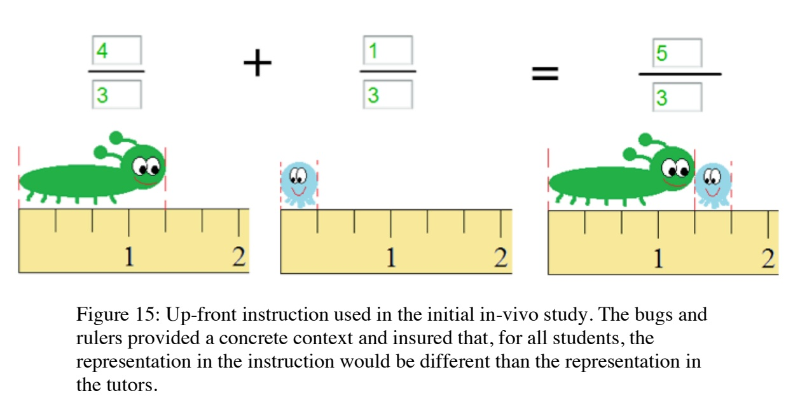

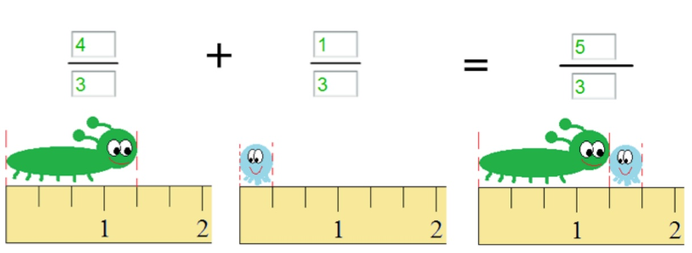

---

## Trang 27

27
1/8 + 1/8). Some demonstrations would use both fraction symbols and the concrete 
representation from the procedural instruction, and some would only use the concrete 
representation. The goal of this instruction is for students to see how the addend-sum relationship 
applies to fraction addition, and also to reinforce that the presence of symbols does not change 
whether an equation is true or false. Both of these pieces of knowledge were found to be lacking 
in the Difficulty Factors Assessments, and they are necessary both for a conceptual 
understanding of fractions and also for interpreting the grounded feedback. This instructional 
sequence would be piloted and iterated on just like the other parts of the fraction addition tutors.
2.3 Opposite-Conditions School Pilot
An in-vivo school study will compare the Correctness Tutor to the Grounded Feedback Tutor. Of 
the three non-Grounded tutors, the Correctness Tutor is farthest from the Grounded Feedback 
Tutor, therefore I expect the learning results to be different. This experiment will confirm if that 
is the case. If there is no difference in quality or efficiency of learning, I will re-evaluate the rest 
of my proposed work. However, I am confident enough that there will be a difference that I am 
planning to design all four tutors before running this pilot. Additionally, this pilot will allow for 
reliability testing of the assessment items.
This pilot will include at least 60 participants in each tutor condition, randomly assigned 
within classrooms. The classroom teachers will schedule the study in the fall, before their 
students have mastered unlike-denominator fraction addition. However, students should be able 
to identify fractions. The study activities will consist of:
1) Pretest: Fraction Equivalence 
2) Intervention: Fraction Equivalence Tutor
3) Midtest: Fraction Equivalence and Fraction Addition
4) Intervention: Fraction Addition Tutor
5) Posttest: Fraction Equivalence and Fraction Addition

---

## Trang 28

28
6) Delayed posttest (2-6 weeks after the intervention): Fraction Equivalence and Fraction 
Addition
Corresponding sections of each test will be matched and counter-balanced. Students will have a 
set amount of time to work with each tutor and to complete each assessment. Assessments will 
include target items (the same types of questions that were asked in the tutor, but with different 
numbers), transfer items (questions about equivalence or addition that require skills or concepts 
not explicitly taught in the tutor), far transfer items (subtraction), and preparation for future 
learning (the test item will include an embedded worked example to teach the student how to 
solve a far transfer problem). I will be present during part of the pilot study to ensure that the 
tutors work correctly. Additionally, I will make note of any persisting bugs in the software so 
that I can fix them before the full study. If the results from this study confirm that grounded 
feedback shows benefits for learning, I will continue with the final study. Also, reliability 
analysis of the test items will determine if I need to adjust them before the final study.
2.3.1 Pilot Study Measures: Test Scores. Improvement from pre to post test will indicate 
learning, and the change from post-test to delayed-post-test will indicate retention. Scores will be 
analyzed using the total test score and also by problem category (target, transfer, etc.). 
2.3.2 Pilot Study Measures: Log Data. Using the tutor log data, I will conduct learning curve 
analyses to determine the amount and rate of learning within each tutor. I will also compare 
metrics such as number of problems solved, number of hints requested per problem, and rates of 
incorrect problem evaluation (e.g., selecting the ‘done’ button when the problem was not solved 
correctly).
2.4 Running the Four-Condition Ablation Experiment
The Four-Condition Ablation Experiment will be run in the same manner as the pilot study. 
There will be at least 50 students in each condition, none of who participated in the pilot. The 
study will take place approximately 3 months after the pilot study, to allow for sufficient analysis 
of the pilot data and any necessary changes to the tutors. I will confirm with the classroom 
teachers that their students will not have mastered unlike-denominator addition at that point in 
the year, though I am confident the students will not be at ceiling since prior results with spring-

---

## Trang 29

29
semester 7th graders indicated they were far from ceiling at this skill (Wiese & Koedinger, 2014). 
As with the pilot, study activities will consist of:
1) Pretest: Fraction Equivalence 
2) Intervention: Fraction Equivalence Tutor
3) Midtest: Fraction Equivalence and Fraction Addition
4) Intervention: Fraction Addition Tutor
5) Posttest: Fraction Equivalence and Fraction Addition
6) Delayed posttest (2-6 weeks after the intervention): Fraction Equivalence and Fraction 
Addition
As with the pilot, corresponding sections of each test will be matched and counter-balanced. 
Students will have a set amount of time to work with each tutor and to complete each 
assessment. Test items will be reused from the pilot study based on the results of the reliability 
analysis. Measures and analyses will be the same as the pilot.
2.5 Contributions of the Proposed Work
The results from this work will inform several areas, including feedback design in tutoring 
systems, domain-specific findings on fraction addition and equivalence, and uses of concrete and 
abstract representations in instruction. Primarily, this work aims to determine if grounded 
feedback provides a set of useful design guidelines for tutoring systems. Further, I expect that 
results from the assessments and from the tutor log data will further illuminate students’ 
strategies and misconceptions when working with fractions. Finally, since the grounded feedback 
in these tutors is rather concrete, results from this work should inform discussions on the role of 
concrete and abstract representations in learning.

---

## Trang 30

30
3 Timeline 
May Preliminary tutor design
June
July
Iterative design with think-alouds, eye tracking, and teacher feedback
August Pilot lab study on final tutor design, with think-alouds, eye tracking, and pre- and 
posttests
September Analyze data from lab study and adjust tutors as necessary
October
November
Pilot in-vivo study comparing Grounded Feedback to Correctness Feedback
(timing will depend on classroom schedules)
December Analyze data from Pilot in-vivo study, adjust tutors and test items if needed
January
February
Four Condition Ablation Study (timing will depend on classroom schedules)
March
Early April
Analyze data from Four Condition Ablation Study
Late April
May
Early June
Write dissertation
Mid-June Defend
4 References 
Ainsworth, S. (1999). The functions of multiple representations. Computers & Education, 33(2-3), 131–
152. doi:10.1016/S0360-1315(99)00029-9
Clark, H. H., & Brennan, S. E. (1991). Grounding in communication. Perspectives on Socially Shared 
Cognition, 13(1991), 127–149. Retrieved from http://www.itu.dk/people/rkva/2011-Spring￾EB22/readings/Grounding-in-Communication.pdf
Fyfe, E. R., Mcneil, N., Son, J., & Goldstone, R. (n.d.). Concreteness fading in mathematics and science 
instruction: A systematic review.
Kalyuga, S., Chandler, P., Tuovinen, J., & Sweller, J. (2001). When Problem Solving is Superior to 
Studying Worked Examples. Journal of Educational Psychology, 93(3), 579–588.

---

## Trang 31

31
Koedinger, K. R., Alibali, M. W., & Nathan, M. J. (2008). Trade-offs between grounded and abstract 
representations: evidence from algebra problem solving. Cognitive Science, 32(2), 366–97. 
doi:10.1080/03640210701863933
Mathan, S., & Koedinger, K. R. (2005). Fostering the Intelligent Novice: Learning From Errors With 
Metacognitive Tutoring. Educational Psychologist, 40(4), 257–265. 
doi:10.1207/s15326985ep4004_7
Nathan, M. J. (1998). Knowledge and Situational Feedback in a Learning Environment for Algebra Story 
Problem Solving. Interactive Learning Environments, 5, 135–159.
Ohlsson, S. (1996). Learning from Performance Errors. Psychological Review, 103(2), 241–262.
Schoenfeld, A. H. (1988). When Good Teaching Leads to Bad Results: The Disasters of “Well Taught” 
Mathematics Courses. Educational Psychologist, 23(2), 1–22.
Siegler, R. S., Duncan, G. J., Davis-Kean, P. E., Duckworth, K., Claessens, A., Engel, M., … Chen, M. 
(2012). Early predictors of high school mathematics achievement. Psychological Science, 23(7), 
691–7. doi:10.1177/0956797612440101
Stampfer, E., & Koedinger, K. R. (2012). Tradeoffs between Immediate and Future Learning. In Paper 
presented at the European Association for Learning and Instruction (pp. 5–7).
Stampfer, E., & Koedinger, K. R. (2013). When seeing isn’t believing: Influences of prior conceptions 
and misconceptions. In M. Knauff, M. Pauen, N. Sebanz, & I. Wachsmuth (Eds.), Proceedings of 
the 35th Annual Conference of the Cognitive Science Society (pp. 1384–1389). Berlin, Germany: 
Cognitive Science Society.
Stampfer, E., Long, Y., Aleven, V., & Koedinger, K. R. (2011). Eliciting Intelligent Novice Behaviors 
with Grounded Feedback in a Fraction Addition Tutor. In Proceedings of the 15th annual 
conference on Artificial Intelligence in Education.
Uttal, D. H., Amaya, M., Maita, R., Hand, L. L., Cohen, C. A., Doherty, K. O., & Deloache, J. S. (n.d.). It 
works both ways: Transfer difficulties between manipulatives and written subtraction solutions.
Wiese, E. S., & Koedinger, K. R. (2014). How useful are fraction bars for understanding fraction 
equivalence and addition? A difficulty factors assessment with 5th, 6th, and 7th graders. Presented 
at the spring 2014 meeting of the Society for Research on Educational Effectiveness (SREE).
