## Trang 1

Thesis Proposal: 
Hybrid Resource-Bound Analysis 
of Programs
Long Pham1
Committee: Jan Hoffmann1
, Feras Saad1
, Matt Fredrikson1
, François Pottier2
1Carnegie Mellon University
2
Inria Paris
January 17th, 2025
1

---

## Trang 2

Resource Analysis
Goal of resource analysis
Infer a worst-case bound of the cost of a program as a function of inputs
2
Program
Resource metric
Worst-case 
cost bound
fun quicksort x 
= <body>
Time Memory Energy
resource 
analysis
𝑥 𝑥 − 1 /2

---

## Trang 3

Applications of Resource Analysis
1. Prevent algorithmic complexity attacks by inferring
worst-case resource usage / inputs
2. Estimate job size for job scheduling in 
cloud computing
3. Infer tool used at Meta/Facebook
4. Worst-case execution time (WCET)
for safety-critical embedded systems
3
https://github.com/facebook/infer

### Hình ảnh trên trang

---

## Trang 4

Existing Approaches to Resource Analysis
(Automatic) static analysis of the source code
+ Sound: any result is a valid bound
- Incomplete: cannot handle all programs
Data-driven analysis of runtime cost data
+ Always returns a result
- Only sound with respect to runtime cost data 
Interactive analysis with proof assistants (e.g., Coq and Agda)
+ Sound and expressive cost bounds
- Not fully automatic
4

---

## Trang 5

Proposal: Hybrid Resource Analysis
Idea Integrate complementary analysis techniques to overcome their 
respective limitations
5
fun f x =
 let y = g z 
 in
 ... 
Analysis B
Analysis A
combine overall cost bound

---

## Trang 6

Proposal: Hybrid Resource Analysis
Hybrid resource analysis covers a spectrum ranging from Analysis A to 
Analysis B
6
Analysis A Analysis B
fun f x =
 let y = g z 
 in
 ... 
fun f x =
 let y = g z 
 in
 ... 
Hybrid Resource Analysis
fun f x =
 let y = g z 
 in
 ... 
Cannot be 
analyzed by 
Analysis A
Best approach 
in evaluation

---

## Trang 7

Proposal: Hybrid Resource Analysis
Benefit of hybrid analysis
Retains the strengths of analysis techniques while mitigating their 
respective weaknesses
• Analyze a larger class of programs
• Infer a larger class of symbolic cost bounds
Thesis statement
Hybrid resource analysis enables the analysis of programs and inference of 
cost bounds that are beyond the reach of individual analysis techniques
7

---

## Trang 8

Structure of the Thesis
[1] Long Pham, Jan Hoffmann. Typable Fragments of Polynomial Automatic 
Amortized Resource Analysis. Published at CSL 2021
[2] Long Pham, Feras Saad, Jan Hoffmann. Robust Resource Bounds with Static 
Analysis and Bayesian Inference. Published at PLDI 2024
[3] Long Pham, Yue Niu, Nathan Glover, Feras Saad, Jan Hoffmann. Integrating 
Resource Analyses via Resource Decomposition. Under submission
8
Static analysis
• Background on AARA (§2.1)
• Polynomial-time completeness 
of AARA (§2.2) [1]
Data-driven analysis
• Bayesian data-driven analysis (§2.3) [2]
• Program-input generator inference 
(§2.7)
Hybrid analysis
• Hybrid AARA (§2.4) [2]
• Resource decomposition (§2.5, 2.6) [3]

---

## Trang 9

Outline
❑Motivation and overview
❑Background on AARA
❑Contribution: Bayesian data-driven analysis
❑Contribution: Hybrid AARA
❑Contribution: resource decomposition
❑Proposed work: inference of program-input generator
❑Timeline and conclusion
9

---

## Trang 10

State of the Art in Static Analysis
Static analysis examines the source code, constructs constraints defining the 
worst-case behavior, and solves them
• Type systems (e.g., AARA by Hoffmann, Hofmann, Jost et al.)
• Recurrence relations (e.g., COSTA by Albert et al.)
• Ranking functions (e.g., AProVE and KoAT by Giesl et al.)
Advantage
+ Soundness guarantee
Disadvantages
- Incomplete due to the undecidability of resource analysis
- Rewriting a program is difficult for non-expert users
10

---

## Trang 11

Static Analysis: AARA
Automatic Amortized Resource Analysis (AARA)
Type-based resource analysis that automates the potential method of 
amortized analysis
Example partition function Cost one unit per comparison
Input [1, 2, 3, 4] Output ([ , ], [ , ])
11
Cost is indicated 
by tick 𝑞 for 𝑞 ∈ ℚ

---

## Trang 12

One unit of 
potential has 
been consumed
Static Analysis: AARA
Automatic Amortized Resource Analysis (AARA)
Type-based resource analysis that automates the potential method of 
amortized analysis
Example partition function Cost one unit per comparison
Input [1, 2, 3, 4] Output ([ , ], [ , ])
12
Cost is indicated 
by tick 𝑞 for 𝑞 ∈ ℚ

---

## Trang 13

Static Analysis: AARA
Automatic Amortized Resource Analysis (AARA)
Type-based resource analysis that automates the potential method of 
amortized analysis
Example partition function Cost one unit per comparison
Input [1, 2, 3, 4] Output ([1, ], [ , ])
13
Cost is indicated 
by tick 𝑞 for 𝑞 ∈ ℚ
The input list element 
is added to the output

---

## Trang 14

Static Analysis: AARA
Automatic Amortized Resource Analysis (AARA)
Type-based resource analysis that automates the potential method of 
amortized analysis
Example partition function Cost one unit per comparison
Input [1, 2, 3, 4] Output ([1, 2], [3, 4])
Resource-annotated typing judgment
partition: int × 𝐿
2
(int) → (𝐿
1
int × 𝐿
1
int )
14
Input potential: 2 ⋅ 𝑛 Output potential: 1 ⋅ 𝑛1 +1 ⋅ 𝑛2
Cost is indicated 
by tick 𝑞 for 𝑞 ∈ ℚ

---

## Trang 15

Static Analysis: AARA
1. Assign variables
partition: int × 𝐿
𝑝
(int) → (𝐿
𝑞1 int × 𝐿
𝑞2 int )
2. Collect linear constraints
𝑝 ≥ 1 + 𝑞1
𝑝 ≥ 1 + 𝑞2
Sound: any cost bound inferred by AARA is a valid worst-case cost bound
Incomplete: there exists a polynomial-cost program that AARA cannot analyze 
because resource analysis is undecidable in general
15
Input 
potential
Output 
potential
Cost
Why AARA for static analysis
+ Compositionality offered by types
+ Automatic bound inference by LP solving
+ Precise cost bounds by amortized analysis
+ Soundness guarantee
AARA can express 
polynomial cost 
bounds in general

---

## Trang 16

Outline
❑Motivation and overview
❑Background on AARA
❑Contribution: Bayesian data-driven analysis
❑Contribution: Hybrid AARA
❑Contribution: resource decomposition
❑Proposed work: inference of program-input generator
❑Timeline and conclusion
16

---

## Trang 17

State of the Art in Data-Driven Analysis (Opt.)
Examples Input-sensitive profiling (Coppa et al.), 
Algorithmic profiling (Zaparanuks et al.), Dynaplex (Ishimwe et al.)
1. Collect cost measurements of inputs 𝑣1, … , 𝑣𝑁
2. Optimize cost bound (red line)
Minimize red line − black dots
Subject to red line ≥ black dots
Disadvantages of optimization
- Does not incorporate the user’s domain knowledge
- No quantitative measure of statistical uncertainty
17
𝑣1 , 𝑐1
𝑣𝑁 , 𝑐𝑁
𝑣1
𝑣𝑁...
...
𝑃
True worst￾case cost?

### Hình ảnh trên trang

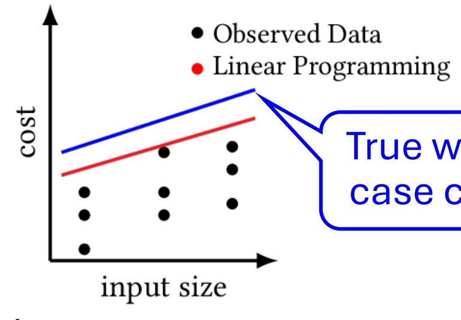

---

## Trang 18

Contribution: Bayesian Data-Driven Analysis
Bayesian data-driven resource analysis
1. Define a probabilistic model 𝜋(𝜃,𝐷)
𝜃 : latent parameter (cost bound)
𝐷: observed data (cost measurements)
2. Collect observed data 𝐷obs
3. Compute the posterior distribution
Bayes’ rule: 𝜋 𝜃 𝐷 = 𝐷obs =
𝜋(𝜃, 𝐷=𝐷obs)
׬) ,= obs) ⅆ𝜃
Draw posterior samples: 𝜃1, … , 𝜃𝑀 ∼ 𝜋(𝜃 ∣ 𝐷 = 𝐷obs)
Advantages over optimization
+ Can incorporate the domain knowledge in the probabilistic model
+ Posterior distribution captures statistical uncertainty
18

---

## Trang 19

Bayesian Data-Driven Analysis: Overview
Previous: Optimization (Opt)
New: Bayesian inference of 
worst-case costs (BayesWC)
New: Bayesian inference of 
polynomial coefficients (BayesPC)
19

### Hình ảnh trên trang

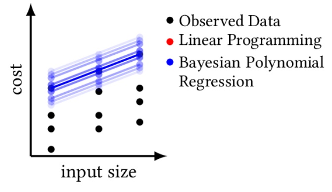

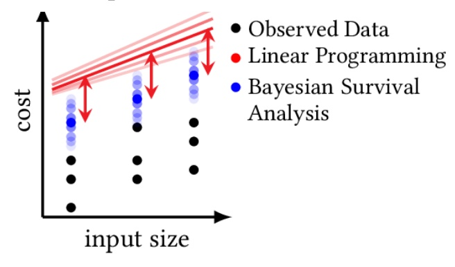

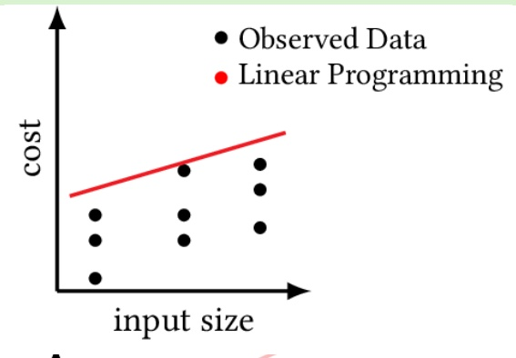

---

## Trang 20

Bayesian Data-Driven Analysis: BayesWC
Bayesian inference of worst-case costs (BayesWC)
1. Define a probabilistic model 𝜋(θ, 𝒄
max
, 𝒄)
𝒄
max: hidden worst-case cost (blue dots)
𝒄: observed cost (black dots)
2. Draw posterior samples of 𝒄
max
3. Optimize cost bound (red line) 
Minimize red line − blue dots
Subject to red line ≥ blue dots
20

### Hình ảnh trên trang

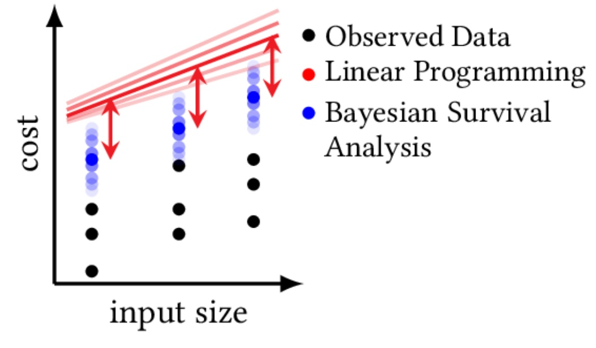

---

## Trang 21

Bayesian Data-Driven Analysis: BayesPC
Bayesian inference of polynomial coefficients (BayesPC)
1. Define a probabilistic model π(𝑝, 𝒄)
𝑝: cost bond (blue line)
𝒄: observed cost (black dots)
2. Draw posterior samples of cost bound 𝑝 (blue line)
21

### Hình ảnh trên trang

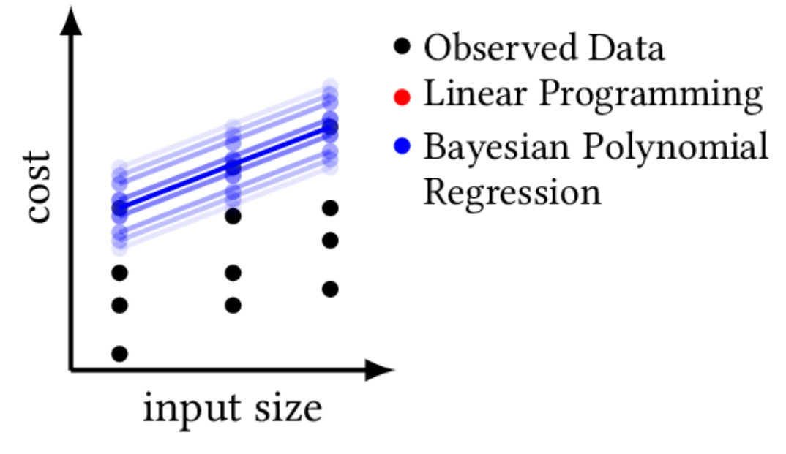

---

## Trang 22

Outline
❑Motivation and overview
❑Background on AARA
❑Contribution: Bayesian data-driven analysis
❑Contribution: Hybrid AARA
❑Contribution: resource decomposition
❑Proposed work: inference of program-input generator
❑Timeline and conclusion
22

---

## Trang 23

Hybrid Analysis: Goal and Challenge
Goal
Key challenge
Hybrid analysis needs an interface between:
1. Bayesian data-driven analysis draws samples
2. Static analysis solves constraints
How do we coherently combine constraints and posterior samples?
23
fun f x =
 let y = g z 
 in
 ... 
data-driven analysis
static analysis
posterior combine overall cost bound
samples
constraints
Design questions
1. What is the format of 
inference results?
2. What information needs 
to be exchanged during 
inference?

---

## Trang 24

Hybrid Analysis: Interface Design Attempt 1
Unsuccessful interface Symbolic cost bound (e.g., 1.1𝑛 + 1.2)
24
fun f x =
 let y = partition z 
 in
 ... 
data-driven analysis
static analysis
posterior combine overall cost bound
samples
constraints
⋅⊢ 𝑓: 𝜏1 → 𝜏2
𝑥: 𝜏1 ⊢ let y = … ∶ 𝜏2
Γ ⊢ partition 𝑧: ?
⋮
Missing info
Partition 
preserves the list 
size in the output
𝑐1,𝑖𝑛 + 𝑐0,𝑖
(𝑖 = 1, … , 𝑀)

---

## Trang 25

Hybrid Analysis: Interface Design Attempt 2
Interface Potential functions in the input and output
25
fun f x =
 let y = g z 
 in
 ... 
data-driven analysis
static analysis
posterior combine overall cost bound
samples
constraints
⋅⊢ 𝑓: 𝜏1 → 𝜏2
𝑥: 𝜏1 ⊢ let y = … ∶ 𝜏2
Γ ⊢ g z ∶ 𝜏
⋮
Challenge
(Γi
, 𝜏𝑖) cannot be 
arbitrary samples, 
which may violate linear 
constraints
Γi ⊢ g z ∶ 𝜏𝑖
(𝑖 = 1, … , 𝑀)
AARA’s typing 
judgment is a 
perfect match

---

## Trang 26

Hybrid AARA: Contribution
Hybrid AARA It integrates
• Bayesian data-driven analysis (BayesWC and BayesPC) and
• Automatic Amortized Resource Analysis (AARA)
by a novel interface between sampling algorithms and linear programming
26
AARA BayesWC and BayesPC
fun f x =
 let y = g z 
 in
 ... 
fun f x =
 let y = g z 
 in
 ... 
Hybrid AARA
fun f x =
 let y = g z 
 in
 ...

---

## Trang 27

Hybrid AARA: AARA + BayesPC
27
Key idea Draw samples from a probability distribution restricted to a convex 
polytope defined by linear constraints 
Reflective Hamiltonian Monte Carlo (Chalkis et al., 2023)
Substitution is safe because 
BayesPC respects linear 
constraints 𝐶0
Annotate 
code 
fragment
f x = 
 let y =
 stat(g z)
 in …
1. Collect linear constraints 𝐶0 from AARA
𝐶0
⋅⊢ 𝑓: 𝜏1 → 𝜏2
𝑥: 𝜏1 ⊢ let y = … ∶ 𝜏2
Γ ⊢ g z ∶ 𝜏
⋮
2. Collect 
runtime data 𝐷
𝐷
4. Plug type judgments from 
BayesPC into AARA
⋅⊢ 𝑓: 𝜏1 → 𝜏2
𝑥: 𝜏1 ⊢ let y = … ∶ 𝜏2
Γi ⊢ g z ∶ 𝜏𝑖
⋮
3. Run reflective HMC for 
BayesPC restricted to 𝐶0
Γi ⊢ g z ∶ 𝜏𝑖
(𝑖 = 1, … , 𝑀)

---

## Trang 28

Example Evaluation: Quicksort
28
Opt BayesPC
Data-driven
Hybrid
Resource metric: comparisons, each of which varies between 0.5 and 1.0
1. Bayesian analysis is more accurate than opt.
2. Hybrid analysis is 
more accurate than 
data-driven analysis
Static analysis is 
inapplicable to the 
partition function

### Hình ảnh trên trang

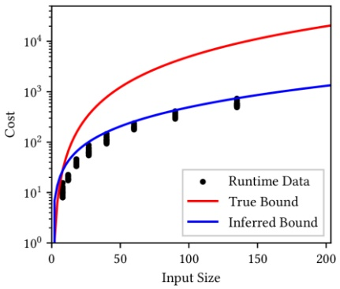

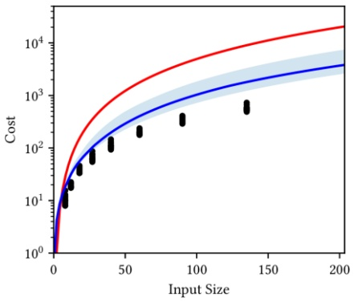

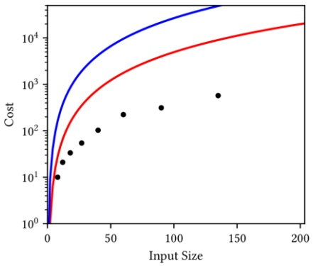

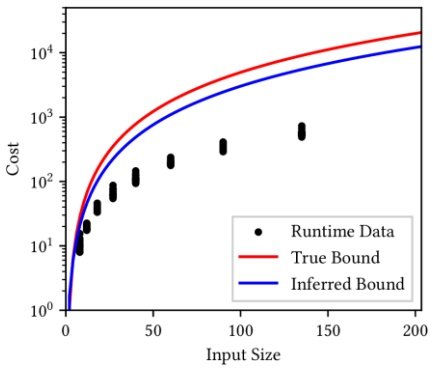

---

## Trang 29

Outline
❑Motivation and overview
❑Background on AARA
❑Contribution: Bayesian data-driven analysis
❑Contribution: Hybrid AARA
❑Contribution: resource decomposition
❑Proposed work: inference of program-input generator
❑Timeline and conclusion
29

---

## Trang 30

Limitations of Hybrid AARA
Two limitations Analysis techniques combined by Hybrid AARA must infer
• Polynomial bounds
• Quantities of the same resource metric
30
4 3 2 1
4 3 2 1
4 3 2 1
3 4 1 2
1 2 3 4
Merge sort Bubble sort
4 3 2 1
3 2 1 4
2 1 3 4
1 2 3 4
Recursion depth
log(𝑛) Recursion depth
𝑛
Non￾polynomial
Cannot be 
statically 
derived
Combined cost at 
recursion depth
𝑛
Per-iteration cost
𝑛

---

## Trang 31

Contribution: Resource Decomposition
Key idea Extend a program with an extra numeric non-negative variable to 
represent user-defined quantities (e.g., recursion depths and costs)
31
4 3 2 1
4 3 2 1
4 3 2 1
3 4 1 2
1 2 3 4
Instrumented merge sort
Original input
Resource guard
r ≥ 0 
r - 1
r - 2
r - 1
r
Raise an exception if 
it gets negative
Overall cost bound 𝑛 ⋅ 𝑟
Recursion-depth bound log(𝑛)
Overall cost bound
𝑛 ⋅ log(𝑛)
Decrement before a 
recursive call
Increment after a 
recursive call

---

## Trang 32

Resource Decomposition: Workflow
1. Manual code annotation: indicate what quantities should be represented by 
resource guards (e.g., recursion depth, cost of a code fragment, etc.)
2. Automatic transformation: instrument the code with resource guards
3. Conduct Analysis A on the resource-guarded program to infer 𝑓(𝑥, 𝑟)
Analysis B on the resource-guard to infer 𝑟 = 𝑔(𝑥)
4. Substitution: obtain an overall bound 𝑓(𝑥, 𝑔(𝑥))
32
fun f x =
 …
 let y = g z in
 …
Original
fun f x =
 mark 1 …
 let y = g z in
 … mark (-1)
Resource 
decomposed fun f x r =
 r := r-1 …
 let y = g z in
 … r := r +1
Resource guarded
Dataset
𝐷 = {(𝑥𝑖
, 𝑟𝑖)}𝑖=1
𝑁
Overall cost bound
𝑓(𝑥, 𝑟)
Resource-guard bound
𝑟 = 𝑔(𝑥)
Inferred bound
𝑓(𝑥, 𝑔(𝑥))

---

## Trang 33

Resource Decomposition: AARA + Bayesian
Swiftlet Instantiates the resource-decomposition framework with
AARA and Bayesian inference
33
To infer 𝑓(𝑥, 𝑟) To infer 
• 𝑟 = 𝑐0 + 𝑐1𝑛 or
• 𝑟 = 𝑐0 + 𝑐1 log(1 + 𝑐2 + 𝑐3𝑛)
for recursion depths
Correctly infer 
logarithmic 
recursion depths
More accurate
cost bounds 
than purely 
data-driven 
analysis

### Hình ảnh trên trang

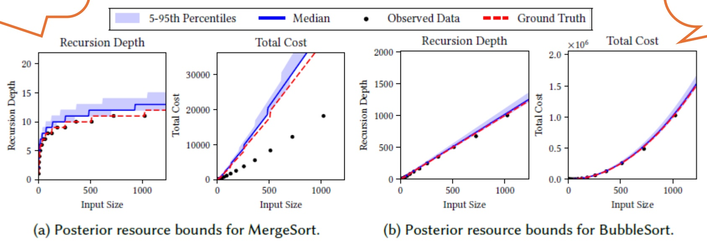

**OCR trong hình (theo thứ tự đọc):**

Figure 1 displays three panels (a, b, and c) showing posterior resource bounds for MergeSort and BubbleSort, respectively. Each panel compares the '5-95th Percentiles', 'Median', and 'Observed Data' with 'Ground Truth' for different depths of recursion.
Panel (a): Posterior resource bounds for MergeSort.
The x-axis represents 'Input Size' from 0 to 1000. The y-axis represents 'Total Cost' from 0 to 30000. A shaded region is shown for the 5-95th percentile (blue), with a dashed red line representing the 'Ground Truth' (black). The 5-95th percentile is at approximately 10,000 to 12,000 total cost.
Panel (b): Posterior resource bounds for BubbleSort.
The x-axis represents 'Input Size' from 0 to 1000. The y-axis represents 'Total Cost' from 0 to 1,000. A shaded region is shown for the Observed Data (red), with a dashed re

---

## Trang 34

Comparison between Hybrid Analyses
Hybrid AARA
Interface: potential functions in the 
input and output
+ Precise cost bounds parametric in 
the input and output sizes
- Inflexible: only polynomial bounds 
of the same resource metric
34
Resource decomposition
Interface: numeric non-negative 
variable
+ Flexible: r can represent any 
quantity with any symbolic bound
- Resource-guard bounds are only 
parametric in input sizes
let rec f x = 
 let y = g z in
 …
Γi ⊢ g z ∶ 𝜏𝑖
Typing tree
𝑓(𝑥, 𝑟)
let rec f x r = 
 let y = g z in
 … r := r – 1 …
𝑟 = 𝑔(𝑥)

---

## Trang 35

Outline
❑Motivation and overview
❑Background on AARA
❑Contribution: Bayesian data-driven analysis
❑Contribution: Hybrid AARA
❑Contribution: resource decomposition
❑Proposed work: inference of program-input generator
❑Timeline and conclusion
35

---

## Trang 36

Proposed Work: Program-Input Generator Inference
Issue Existing Bayesian data-driven analysis uses randomly generated 
program inputs and their cost measurements
36
3. Statistical analysis
Analyze 𝐷 to infer bounds
Quicksort Inputs are generated randomly
Challenge
Huge gap between 
worst-case complexity and 
average-case complexity
1. Program-input generation
𝑣1, … , 𝑣𝑁
2. Cost measurement
𝐷 = {(𝑣𝑖
, 𝑃 𝑣𝑖
, 𝑐𝑖)}𝑖=1
𝑁
Statistical analysis has no control

### Hình ảnh trên trang

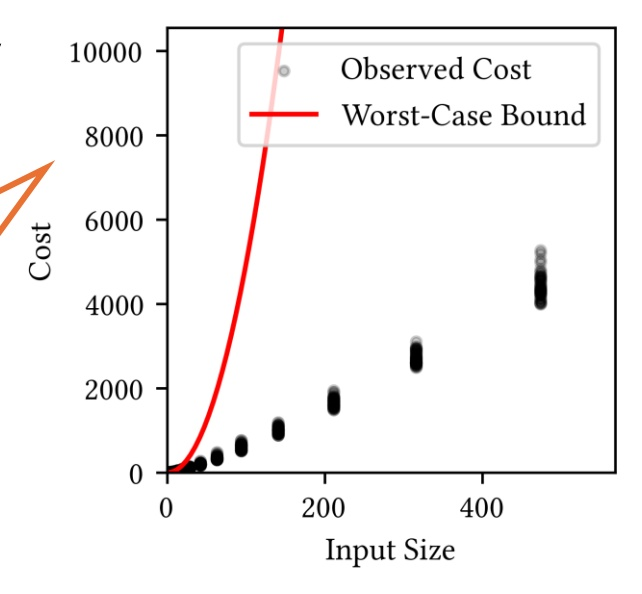

---

## Trang 37

Proposed Work: Program-Input Generator Inference
Proposal Statistically infer worst-case input generators as well as worst￾case cost bounds
37
1. Statistical analysis
Infer an input generator 𝑔
2. Cost measurement
Use 𝑔 to generate cost dataset 𝐷
3. Statistical analysis
Infer a cost bound
Quicksort Inputs are generated randomly
Solution
Use sorted lists to generate 
cost measurements
Statistical analysis has control

### Hình ảnh trên trang

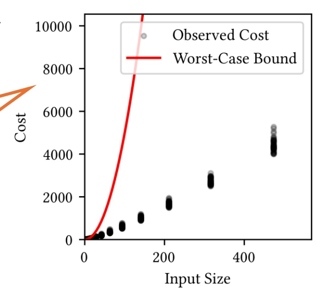

---

## Trang 38

Program-Input Generator Inference: DSL
DSL of program-input generators
1. Probabilistic generators
• The ability to generate all possible values (with some probability) is 
necessary for a statistical soundness guarantee of data-driven analysis
• More accurate characterization of a class of program inputs
2. Inductively defined by types
𝐿 = unit + (int × 𝐿)
38
let rec gL
x =
 let e = gbool x in
 if e then
 gunit x
 else
 let v1 = gint x in
 let v2 = gL
x in
 (v1
, v2
)
Generate a Boolean
Generate the unit element
Generate a head and tail

---

## Trang 39

Program-Input Generator Inference: Inference
Challenge in generator inference
How do we score generators?
Optimization We can run fuzzing (e.g., based on genetic algorithms) over 
the space of generators to find a generator with the highest score
Bayesian inference We cannot have a probability distribution where 
generators with higher scores have higher densities
39

---

## Trang 40

Outline
❑Motivation and overview
❑Background on AARA
❑Contribution: Bayesian data-driven analysis
❑Contribution: Hybrid AARA
❑Contribution: resource decomposition
❑Proposed work: inference of program-input generator
❑Timeline and conclusion
40

---

## Trang 41

Timeline
Fall 2024
• Submit the resource-decomposition paper to PLDI 2025
Spring 2025
• Thesis proposal
• Complete the design of the DSL for generators and implement a prototype
• Resubmit the resource-decomposition paper (if necessary)
• Complete the speaking-skill requirement
• Complete a thesis draft
Summer 2025
• Thesis defense
41

---

## Trang 42

Conclusion
1. Hybrid resource analysis integrates complementary analysis techniques 
to retain their strengths while mitigating their weaknesses
2. Two interfaces: resource-annotated types in Hybrid AARA and numeric 
program variables in resource decomposition
3. Proposed work: data-driven analysis for inferring worst-case program￾input generators as well as worst-case cost bounds
42
Analysis A Analysis B
fun f x =
 let y = g z 
 in
 ... 
fun f x =
 let y = g z 
 in
 ... 
Hybrid Resource Analysis
fun f x =
 let y = g z 
 in
 ... 
Cannot be 
analyzed by 
Analysis A

---

## Trang 43

Thank you

43

---

## Trang 44

Polynomial-time completeness of AARA
Polynomial-time completeness
Typable fragment of AARA contains all polynomial-time functions
Theorem 2.2
Given a polynomial-time Turing machine 𝑀: ℕ → ℕ, there exists a functional 
program 𝑃: ℕ → ℕ such that
• For every input 𝑛 ∈ ℕ, we have 𝑃 𝑛 = 𝑀(𝑛)
• The cost of 𝑃 is equal to the cost of 𝑀
• AARA can infer a polynomial cost bound of 𝑃
Key idea in the proof
Add an extra program variable to represent the known cost bound
44
This idea will be 
exploited in the 
design of hybrid 
resource analysis

---

## Trang 45

Polynomial-time completeness of AARA
Operation of 𝑃
• Create ℓpotential of length 𝑝 𝑤 , where each cell stores one unit of 
potential
• Every time 𝑀 moves its head, 𝑃 simulates the same move, removes one 
list cell from ℓpotential, and runs tick 1.0
45
Turing machine 𝑀 Tape with input 𝑤 Cost bound 𝑝( 𝑤 )
Program 𝑃 List with input 𝑤 List storing potential ℓpotential
Length 𝑝( 𝑤 )
Must know the polynomial 
bound in advance

---

## Trang 46

Resource Decomposition: Soundness
Soundness (Theorem 2.4)
If 𝑓(𝑥, 𝑟) is a sound overall cost bound of the resource-guarded program 
𝑃rg(𝑥, 𝑟) and 𝑔(𝑥) is a sound bound of a resource guard 𝑟, then 𝑓(𝑥, 𝑔(𝑥)) is 
a sound overall cost bound of the original program 𝑃(𝑥).
Proof
By a logical-relation argument
46

---

## Trang 47

Comparison: Resource Guards and Clocks
Comparison
Usage: resource guards are for decomposing resource analysis, while 
clocks are for termination proofs. If termination checkers are strong enough, 
we may no longer need clocks.
Quantities: resource guards can be any quantity that can be defined as a 
high-water mark cost, while clocks are (at least in the calf paper) recursion 
depths.
Summary 
A clock is a special case of a resource guard for (i) a recursion depth and (ii) 
decomposing resource analysis into Agda and a termination proof.
47
