## Trang 1

Thesis Proposal:
CRF Autoencoder Models
for Structured Prediction
with Partial Supervision
Waleed Ammar
Language Technologies Institute
School of Computer Science
Carnegie Mellon University
wammar@cs.cmu.edu
Thesis committee
Chris Dyer (chair), Carnegie Mellon University
Noah Smith (chair), Carnegie Mellon University
Tom Mitchell, Carnegie Mellon University
Kuzman Ganchev, Google Inc.
LATEX template due to David Bamman.

---

## Trang 2

Contents
1 Introduction 1
1.1 Thesis Statement . . . . . . . . . . . . . . . . . . . . . . . . . . . . . . . . . . . . . . . . 3
2 The CRF Autoencoder Framework 3
2.1 Case Study: Modeling Parts of Speech [status: 100%] . . . . . . . . . . . . . . . . . . . . . 6
2.2 Learning from Unlabeled Examples [status: 100%] . . . . . . . . . . . . . . . . . . . . . . 6
2.3 Are Manually-Defined Features Really Necessary? [status: 0%] . . . . . . . . . . . . . . . 8
3 Integration With Existing Methods for Partial Supervision 9
3.1 Supervision Opportunities in Low-Resource Settings . . . . . . . . . . . . . . . . . . . . . 9
3.2 Modeling Extra Supervision [status: 10%] . . . . . . . . . . . . . . . . . . . . . . . . . . . 9
4 NLP Tasks 11
4.1 Part of Speech Tagging [status: 80%] . . . . . . . . . . . . . . . . . . . . . . . . . . . . . . 11
4.2 Word Alignment [status: 50%] . . . . . . . . . . . . . . . . . . . . . . . . . . . . . . . . . 12
4.3 Code Switching [status: 50%] . . . . . . . . . . . . . . . . . . . . . . . . . . . . . . . . . 13
4.4 Dependency Parsing [status: 5%] . . . . . . . . . . . . . . . . . . . . . . . . . . . . . . . . 14
4.5 Frame Semantics [status: 0%] . . . . . . . . . . . . . . . . . . . . . . . . . . . . . . . . . 15
A Timeline 16
B References 18
i

---

## Trang 3

1 Introduction
For many prediction problems, it is important to explicitly model the output as a structure of interde￾pendent variables. Some of the classic structured prediction problems in NLP include part-of-speech (POS)
tagging where the output is a sequence of POS tags, and syntactic parsing where the output is a syntax
tree.
1 Statistical models of such problems can make useful predictions when plenty of labeled data are
available in the genre of interest. For example, POS taggers and constituent parsers trained and evaluated
on homogeneous subsets of the English Penn Treebank (Marcus et al., 1993) achieve an F1 score of 96.7%
(Petrov et al., 2012) and 91.43% (Zhang et al., 2009), respectively. However, the cost of developing large,
fully-annotated corpora in the languages and genres of interest may be prohibitive.
Unlike labeled data, unlabeled data is often abundant and cheap. A variety of techniques that learn
linguistic structures supplement the unlabeled data with other kinds of supervision. This supervision can
be subtle at times. For example, we use our knowledge about the task to make independence assumptions
about model variables, biasing the correlations and predictions a model could induce. Another important
kind of supervision, often taken for granted, is to specify characteristic features of the observations known
to be relevant to the task. For example, Smith and Eisner (2005); Berg-Kirkpatrick et al. (2010) use their
knowledge about POS tagging to manually define suffix features which correlate with certain POS tags. The
following supervision opportunities may potentially improve structured prediction in NLP when learning
from unlabeled data are:
• corpus-based: fully-labeled examples, underspecified labeled examples, and induced features.
• knowledge-based: characteristic features, independence assumptions, hard and soft constraints, sparsity,
ontologies, dictionaries and gazetteers.
In this thesis, our goal is to effectively learn from sizable corpora of unlabeled data, consolidating all
supervision cues we could find for a given structured prediction problem. To that end, we use efficient
methods such as specifying posterior regularization, parameter priors, and marginalizing underspecified
labels to leverage most supervision cues. However, existing methods for feature-rich modeling of unlabeled
data (Smith and Eisner, 2005; Haghighi and Klein, 2006; Berg-Kirkpatrick et al., 2010; Dyer et al., 2011)
leave a lot to be desired. To address this problem, we propose a new feature-rich model which is flexible,
effective, and scalable.
To realize the significance of this gap in feature-rich modeling of unlabeled data for structured prediction,
we first consider feature-rich modeling in supervised learning (i.e., learning from examples annotated by
human domain experts). Features that characterize relevant generalizations in labeled examples have long
been established as an important source of inductive bias (Mitchell, 1980). Intuitively, feature-rich models
allow related (but distinct) observations to share statistical strength. For example, it allows the model to
make better predictions for words which have not been seen in training (e.g., ‘Ammar’) by describing them
in terms of their characteristic features (e.g., a word which starts with a capital letter and appears in the
“people names” gazetteer), thereby relating them to similar and more common observations (e.g., ‘Smith’).
It is now taken for granted that competitive supervised structured prediction should use manually specified
features, or feature templates, often in discriminative models such as conditional random fields (Lafferty
et al. 2001, CRF). Throughout the years, the NLP research community accumulated a precious body of
knowledge about what features are useful for what tasks (Sha and Pereira, 2003; Sarawagi and Cohen,
2004; Settles, 2004; Kudo et al., 2004; Smith et al., 2005; Choi et al., 2005; McDonald, 2006; Blunsom and
Cohn, 2006). However, discriminative models cannot be readily used to learn from unlabeled data since
they model the output structure conditional on the input.
1We use the terms “latent structure”, “output structure”, “hidden structure” and “linguistic structure” interchangeably in refer￾ence to the structure to be predicted (e.g., a sequence of POS labels, a syntax tree).
1

---

## Trang 4

noun verb verb adp noun noun prt noun 
Jaguar was shocked by Mr. Ridley 's decision 
POS tagging
word alignment
Mary1 no2 daba3 una4 botefada5 a6 la7 bruja8 verde9 
 
 1 NULL 2 5 7 9 8 
 Mary did not slap the green witch 
code switching
dependency	
  parsing	
  
Australia was once expected to waltz smoothly into the European Union 
argument identification for frame semantic parsing
You gotta be kiddin me yad enta
english arabizi
 
Jaguar was shocked by Mr. Ridley 's decision 
self-­‐mover	
   self-­‐mo6on	
   manner	
   goal	
  
Figure 1: A labeled example of
each of the five structured predic￾tion problems we discuss. The lin￾guistic structure to be predicted is in
gray.
The first attempt to leverage this knowledge for learning from unlabeled data was Smith and Eisner
(2005), followed by Haghighi and Klein (2006); Daumé III (2009); Berg-Kirkpatrick et al. (2010); Dyer
et al. (2011), among others. These attempts suffer one or more of the following drawbacks:
• They do not scale (without approximate inference).
• They make strong independence assumptions which limit the scope of feature functions to local context
in the observed structure.
• There is an inconsistency between learning and prediction. Feature weights in generative models are
parameters of the joint distribution of input-output pairs. In learning, feature weights are optimized to
fit the marginal distribution of input (observed) variables. Consequently, generative models are bound to
learn high-magnitude weights for features which characterize obscure regularities in observed variables
which may or may not be relevant to the task. However, at prediction time, we do use those features to
discriminate between good and bad outputs.
We propose a framework for learning with unlabeled data which simultaneously addresses all three
problems by modeling the latent structure as a compression of the input structure, in an autoencoder ar￾chitecture. In a nutshell, the idea is to condition on one copy of the input structure and generate another,
via a set of interdependent latent variables which represent the linguistic structure of interest (see Fig. 2).
Our architecture is heavily inspired by the efficacy of its neural network realizations to induce feature repre￾sentations in several (otherwise supervised) learning problems (Vincent et al., 2008; Collobert and Weston,
2008; Socher et al., 2010). This is also related to Daumé III (2009) who uses locally normalized predictors
to independently predict the atomic parts of the latent structure and then generate the second copy of the
input structure. The significance of this framework is that we manage to use unlabeled data to learn fea￾ture weights in a discriminative CRF model. Discriminative models compare favorably to their generative
counterparts, in part because they (i.e., discriminative models) break the unrealistic independence assump￾tions which limit the scope of feature functions in generative models. As a result, in the proposed model,
we have access to a bank of feature templates for many structured prediction problems which have been
shown to work well in supervised learning. By conditioning on the first copy of the input structure, we no
longer suffer from inconsistency between feature interpretation in learning as opposed to prediction, since
the feature weights define the conditional probability of the latent structure conditional on the first copy of
the observation during both phases (train and test). We discuss scalability properties of this approach in
§2.2.
After introducing the feature-rich framework, we discuss how previously proposed methods can be
applied to this framework to leverage other supervision opportunities when available. We also present
instantiations of this framework, for several structured prediction problems in NLP: POS tagging, bitext
word alignments, dependency parsing, identification of code switching points, and frame semantic parsing.
Fig. 1 illustrates each of the five problems with a labeled example of the input (in black) and the correct
output linguistic structure (in gray). In this document, we report state-of-the-art results on two of these tasks
2

### Hình ảnh trên trang

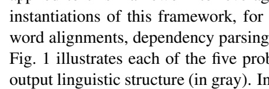

**OCR trong hình (theo thứ tự đọc):**

instantiations of this framework, for word alignments, dependency parsing Fig. 1 illustrates each of the five prolonged linguistic structure (in gray). In

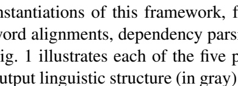

**OCR trong hình (theo thứ tự đọc):**

Instantiations of this framework, for ord alignments, dependency parsing. 1 illustrates each of the five putuput linguistic structure (in gray)

**OCR trong hình (theo thứ tự đọc):**

|  |  |
| --- | --- |
|  |  |
|  |  |
|  |  |
|  |  |
|  |  |

**OCR trong hình (theo thứ tự đọc):**

|  |  |
| --- | --- |
|  |  |
|  |  |
|  |  |
|  |  |
|  |  |

---

## Trang 5

(POS induction and bitext word alignment) using CRF autoencoders, and briefly mention preliminary results
we obtain in code switching and dependency parsing. Some subsections are tagged (e.g. [status: 80%]) to
indicate the extent to which parts of the thesis have been completed.
1.1 Thesis Statement
In structured prediction problems, feature-rich representations with a global context in the structured
observation can effectively bias learning from unlabeled examples. The autoencoder architecture with a
CRF encoding model is appropriate for modeling a variety of such problems. In this framework, effi￾cient inference algorithms are readily available for several parameterizations of the reconstruction model.
Furthermore, existing methods for learning with partial supervision can be effectively combined with this
framework to improve predictions.
2 The CRF Autoencoder Framework
The previous section demonstrated the need for a scalable feature-rich approach to learning from un￾labeled data in structured prediction problems. This section introduces CRF autoencoders, the approach
proposed here to address this need.
Notation. We use capital Latin letters (e.g., X, X, Y, Y ) to represent variables, and use small Latin letters
to either represent values of the corresponding capital-letter variable (i.e., x, x, y, y are candidate values
of the variables X, X, Y, Y ), or functions such as f(.), g(.), h(.). Greek letters (e.g., λ, λ, θ, θ) represent
model parameters or hyperparameters.2 Boldface symbols are vectors or other structures that group the
corresponding non-boldface symbols (e.g., λ = hλ1, . . . , λnλ
i; where nλ is the size of λ).
More specifically, we use X to denote a structured input variable with domain X, and use Y to denote an
output structured variable (i.e., the linguistic structure of interest) in domain YX which is typically exponen￾tial in input size nX. Xi ∈ X for i ∈ {1, . . . , nX} and Yi ∈ Y for i ∈ {1, . . . , nY} are atomic parts with
domain Xi (e.g., the set of word types in a corpus) and Yi (e.g., a set of part-of-speech labels), respectively.
In addition to the structured input X, each training example also includes side information, an observed
variable V which represents extra context in an arbitrary domain (e.g., username, date of birth, geocoor￾dinates).3 We assume that V is observed in labeled and unlabeled examples alike. Our model introduces
another (derived) observed variable, Xˆ = t(X) = hXˆ
1, . . . , Xˆ
nXi ∈ Xˆ; where t : X → Xˆ is a deterministic
transformation of the input structure (e.g., word types → word suffixes, and word types → pre-learnt word
embeddings).
General Model. A CRF autoencoder defines a family of distributions over latent structures and input recon￾structions, conditional on structured input and side information, i.e., p(Xˆ , Y | X = x, V = v). As shown
in Fig. 2 (left), the model assumes that X and Xˆ are conditionally independent given Y = y and V = v.
This is a critical assumption since otherwise it would have been trivial to reconstruct Xˆ conditional on X.
The intuition behind this structure is that, when the domain of Y is much smaller than that of Xˆ (i.e.,
Y  Xˆ) which is typical in structured prediction problems, an information bottleneck (Tishby et al., 2000)4
is created at Y which is required to reconstruct Xˆ despite its limited capacity. Therefore, the conditional
likelihood of reconstructing Xˆ conditional on X will increase when the latent structure effectively “soft
clusters” distinct values of the observed structure. In general, those soft clusters may or may not be linguis￾tically motivated, which is the hallmark of unsupervised learning in NLP. However, by defining the model
in terms of linguistically-motivated feature functions, we force distinct values of the observed structure to
2An exception is δ(p), which is an indicator function which returns 1 when the predicate p is true, and returns 0 otherwise.
3
Sometimes, we remove the dependency on V to simplify equations. It is however safe to assume that V is always conditioned
on at any step in the generative process.
4
In Tishby et al. (2000), an information bottleneck is used to induce a minimal compression which simultaneously generates
both the input structure and a relevant target variable.
3

---

## Trang 6

encoding reconstruction 
X V
Y
X
Λ
encoding reconstruction 
X
Yi-1 Yi Yi+1 
Xi-1 Xi Xi+1 
Λ Λ Λ
Figure 2: Graphical model representations of CRF autoencoders. Left: A general CRF autoencoder model. In the
encoding part of the model, the observed variables X, V generate Y. In reconstruction, Y, V generate X. The
internal structure of X, Y, Xˆ is not shown. Right: An instantiation of the CRF autoencoder model for POS tagging,
represented as a hybrid graphical model showing the first-order Markov dependencies among elements of the hidden
structure Y, the factor cliques used in the CRF encoder, and the independent generation of the atomic parts of Xˆ .
appear similar to the encoding model. It follows that the model tends to assign high probabilities for values
of the latent structures which correspond to linguistically-relevant clusters of inputs.
Eq. 1 gives the parametric form for the general model.
p(Xˆ = ˆx, Y = y | X = x, V = v) = p(Y = y | X = x, V = v) × p(Xˆ = ˆx | Y = y, V = v)
=
exp λ · g(x, y, v)
P
y0∈Yx
exp λ · g(x, y0
, v)
× p(Xˆ = Xˆ | Y = y, V = v) (1)
This model contrasts to traditional generative approaches which model the joint distribution of input￾output pairs, i.e., p(X, Y). By conditioning on X while generating Y, we can define a log-linear model with
global features in X where the partition function requires a tractable computation, since it only marginalizes
over values of Y ∈ YX, as opposed to X, Y (which spans the significantly larger domain X × YX).
Encoding. We can use any feature-rich model of p(Y | X = x, V = v) for the encoding part where super￾vised learning from h(x, v), yi tuples would be effective and efficient. We choose to use the family of CRF
models because it makes no further independence assumptions; hence the name CRF autoencoder.
In Eq. 1, λ is a vector of feature weights, and g(.) is a vector of feature functions which factorize
into arbitrary maximal cliques C. The direct dependencies within Y, which imply the maximal cliques C,
are used to encourage coherence and compatibility among the parts of Y. For example, the linear chain
CRF encoder in Fig. 2 (right) with maximal cliques C = {{Yi−1, Yi} : 2 < i < nX} is a popular choice for
sequence labeling problems where a first-order Markov assumption is justifiable.
Efficient inference is an important consideration while determining the dependencies among elements
of Y. The feature set is another important choice in the encoding model which can bias the model towards
inducing or predicting the desired linguistic structures.
In the encoding model, we condition on side information V to enrich the CRF feature set. For example,
side information may include other models’ predictions for X, source sentences in bitext word alignment
(where the observation X is often assumed to be the target sentence), metadata of a discourse, or author
information. The ability to condition on arbitrary side information is one of the relative strengths of CRF
autoencoders compared to purely generative models. In a generative model, modeling arbitrary side infor￾mation would require further inflating the space over which partition functions are computed.
Reconstruction. Two choices need to be made here: the deterministic transformation function t : X →
Xˆ which determines the reconstruction Xˆ = t(X), and the parametric form of the reconstruction model
p(Xˆ | Y = y, V = v).
4

### Hình ảnh trên trang

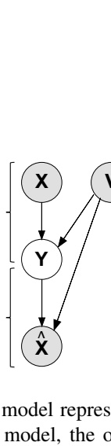

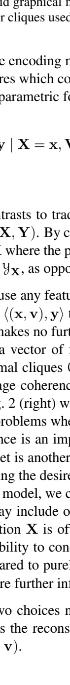

**OCR trong hình (theo thứ tự đọc):**

and graphical relations used to encoding the res which consist of a parametric function
y \mid \mathbf{X} = \mathbf{x}, \mathbf{V}
.

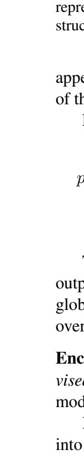

**OCR trong hình (theo thứ tự đọc):**

| representative structures |
| --- |
| appearance of the structure |
| p |
| output global over |
| Enclosure |
| vise model |
| into |

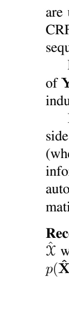

**OCR trong hình (theo thứ tự đọc):**

|  | are c |
| --- | --- |
|  | CRF |
|  | sequ |
|  |  |
|  | of Y |
|  | indu |
|  |  |
|  | side |
|  | (whe |
|  | info |
|  | auto |
|  | mati |
|  |  |
|  | Rec |
|  | \hat{\chi} w |
|  | p(\hat{X} |

---

## Trang 7

Example choices of the transformation function include the identity function, Brown clusters (Brown
et al., 1992), word embeddings, as well as manually-defined feature representations. Effectively, transfor￾mation functions supervise model training by deterministically mapping linguistically-similar inputs to the
same value in a smaller domain. When such supervision is not available, we use the identity function, letting
Xˆ = X.
Eq. 2-6 are proposed parameterizations of the reconstruction model for sequence labeling problems
where nY = nX and V is assumed to be empty (i.e., no side information is available). We follow the
equations with a discussion of each model.
Categorical: p(Xˆ = ˆx | Y = y) = Ynx
i=1
θxˆi|yi,yi−1
(2)
Log-Linear: p(Xˆ = ˆx | Y = y) = Ynx
i=1
exp λˆ · `ˆ(ˆxi
, yi−1, yi)
P
xˆ
0∈Xˆ exp λˆ · `ˆ(ˆx
0
, yi−1, yi)
(3)
Naïve: p(Xˆ = ˆx | Y = y) = Ynx
i=1
n`ˆ(ˆxi Y
)
j=1
θ
`ˆ
j (ˆxi)|yi−1,yi
(4)
Deficient: p(Xˆ = ˆx | Y = y) = Ynx
i=1
ˆθxˆi|yi−1 × ˆθxˆi|yi × ˆθxˆi|yi+1 (5)
Gaussian: p(Xˆ = ˆx | Y = y) = Ynx
i=1
1
p
(2π)K|Σyi
|
exp −
1
2
(ˆxi − µyi
)
>Σ
−1
yi
(ˆxi − µyi
) (6)
Eq. 2 is a simple reconstruction model which independently generates individual reconstruction elements
Xˆ
i (e.g., surface forms or word clusters) using categorical distributions θ.|yi−1,yi
.
Eq. 3 & Eq. 4: The categorical distributions in Eq. 2 miss an opportunity to share statistical strength
among values of Xˆ
i
that are clearly related, according to the task at hand (e.g., “10” and “20”, “Christopher”
and “Chris”, “defend” and “defends”) which may result in poor estimation of their parameters. Eq. 3 and
Eq. 4 describe two reconstruction models which address this problem using features. The first, Eq. 3,
generates Xˆ
i using a locally normalized log-linear distribution with a vector of local feature functions `ˆ
and feature weights λˆ. The second, Eq. 4, uses a naïve-Bayes-based model to independently generate local
features `ˆ(ˆxi), conditional on hyi−1, yii. Note that word embeddings can also be used here as additional (or
lone) features.
Eq. 5 improves over Eq. 2 by emphasizing the bidirectional dependencies between Yi and the surround￾ing word tokens {Xi−1, Xi
, Xi+1} in the reconstruction model, without inflating the number of parameters,
by deficiently generating all three conditional on Yi
. Here, we define Xˆ
i = hxi−1, xi
, xi+1i, and use cate￾gorical distributions θ.|yi,←, θ.|yi,↓
, θ.|yi,→ to generate the three components independently.
Eq. 6: Vector representations of words, also known as word embeddings, have been shown to be ap￾propriate for modeling several NLP structures (Turian et al., 2010; Collobert et al., 2011; Zou et al., 2013;
Andreas and Klein, 2014; Lei et al., 2014; Lin et al., 2014). One way to leverage word embeddings in the
CRF framework is to use the reconstruction model in Eq. 6 which replaces the categorical distribution with
a multivariate normal distribution, generating pre-trained K-dimensional word embeddings xˆi ∈ R
K con￾ditional on Yi
. µyi
and Σyi
are the mean and covariance parameters of the multivariate Gaussian distribution
for Yi = yi
.
5

---

## Trang 8

2.1 Case Study: Modeling Parts of Speech [status: 100%]
In this section, We focus on the classic problem of modeling parts of speech (POS). This problem serves
as a concrete example instantiation of the CRF autoencoder framework. More NLP problems are discussed
in §4.
Model Instantiation. We define X to be a sequence of tokens, and Y to be a sequence of POS tags. Assum￾ing first-order Markov5 dependencies among POS tags, we use a linear chain CRF to model the encoding
part. A detailed description of the features we use can be found in Ammar et al. (2014). In the reconstruc￾tion part, we independently generate individual reconstructions Xˆ
i conditional on the corresponding part of
speech Yi
, using a simple categorical distribution. We use the identity transformation function, i.e., Xˆ = X,
as well as Brown clusters (Brown et al., 1992). We do not use any side information in this task. A graphical
model representation that reflects these modeling choices is shown in Fig. 2 (right).
Parametric Form. Eq. 7 gives the parametric form of this model, where θxˆi|yi = p(Xˆ
i = ˆxi
| Yi = yi)
are parameters of the categorical distribution used for reconstruction, and `(.) is a vector of local feature
functions. It is worth noting how the reconstruction model probabilities factorize within the linear chain
CRF cliques in the last step of Eq. 7.
p(Xˆ = ˆx, Y = y | X = x) = p(Y = y | X = x) × p(Xˆ = ˆx | Y = y)
=
exp λ ·
Pnx
i=1 `(x, yi
, yi−1, i)
P
y0∈Y
exp λ ·
Pnx
i=1 `(x, y0
i
, y0
i−1
, i)
×
Ynx
i=1
p(Xˆ
i = ˆxi
| Yi = yi)
=
exp Pnx
i=1 log θxˆi|yi + λ · `(x, yi
, yi−1, i)

P
y0∈Y
expPnx
i=1 λ
>`(x, y0
i
, y0
i−1
, i)
(7)
At the end of the following section, which discusses the objective function we use to fit the model,
we return to this case study, presenting empirical results on POS induction with this model and alternative
models.
2.2 Learning from Unlabeled Examples [status: 100%]
Before we consider other supervision cues (later in §3), it is important to discuss how to learn feature
weights in this model with unlabeled examples only since it forms the basis for incorporating additional
supervision cues.
Training Objective. Model parameters are selected to maximize the regularized conditional log likelihood
of reconstructed observations ˆx given the structured observation x ∈ Tunlabeled, where Tunlabeled is a set of
independent unlabeled training examples. The unregularized log likelihood is:
``(λ, θ) = P
x∈Tunlabeled
log P
y∈Y
p(Y = y | X = x) × p(Xˆ = t(x) | Y = y) (8)
Priors. Assuming the reconstruction model in §2.1 (i.e., categorical distributions), we use the following
priors to regularize the model:λk ∼ N(0, σ2
), ∀k ∈ {1, . . . , nλ}, and θ.|context ∼ SymmetricDirichlet(α).
That is, the CRF feature weights are drawn from a Gaussian distribution with zero mean and standard
deviation σ. Parameters of the categorical distribution, conditional on some context (e.g., a particular part￾of-speech label) is drawn from a symmetric Dirichlet distribution with concentration parameter α.
5Ravi and Knight (2009) found that first-order HMMs outperform second-order HMMs for unsupervised POS tagging with tag
dictionaries.
6

---

## Trang 9

Optimization. We optimize this objective with block coordinate descent, alternating between maximizing
with respect to the CRF parameters (λ-step) and the reconstruction parameters (θ-step). Each λ-step applies
a few iterations of a gradient-based convex optimizer.6 The θ-step applies a few iterations of EM (Dempster
et al., 1977), with a closed-form solution in the M-step in each EM iteration. Convergence is determined by
the relative increase in the objective value across block coordinate descent iterations.
Prediction. After training the model, we predict the maximum a posteriori solution: arg maxy∈Y p(Y = y |
X = x, Xˆ = ˆx). In preliminary experiments, similar performance was achieved by conditioning on X only
(i.e., predict: arg maxy∈Y p(Y = y | X = x)). We will also consider minimum Bayes risk decoding:
arg miny∈Y
P
y0∈Y
p(Y = y
0
| X = x, Xˆ = ˆx) × ∆(y, y
0
), or posterior decoding: arg maxyi ∈ Yip(Yi =
yi
| X = x, Xˆ = ˆx), ∀i ∈ {1, . . . , nY}.
Runtime Complexity. For general structures, and without making any independence assumptions, the run￾time for marginalizing the latent structure (i.e., P
y∈Y
) for an arbitrary example in this objective is exponen￾tial in the latent structure size (i.e., nY). However, efficient inference algorithms exist for several special
cases. Assuming first-order Markov dependencies between elements of the latent structure, as in Fig. 2
(right), the asymptotic runtime complexity of each block coordinate descent iteration is:
O
 
nθ + nλ +
X
x∈T
Xnx
i=1
nYi × (nYi−1 × n`(yi−1,yi) + n`(X,Yi)
)
!
(9)
where n`(yi−1,yi)
is the number of active “label bigram” features used in hYi−1, Yii factors, n`(x,yi)
is the
number of active features used in hX, Yii factors.
Model Initialization. Neither objective function is concave, which is typical in unsupervised learning. It
follows that we can only guarantee finding a local maximum of the objective. Since we optimize using a
block coordinate descent algorithm with a λ block and a θ block, the initialization of θ is more important
when we start by optimizing λ, and vice versa. Empirical results in POS induction indicate that local optima
are less of a problem when we start block coordinate descent by fixing the θ block to values of the emission
parameters of an HMM trained on the same data for the same task, and optimize the λ block away from
zero initialization. Other initializations we attempted are Gaussian samples for λ, uniform multinomial and
transformed Gaussian samples for θ.
POS Induction Results. We briefly show experimental results for POS induction with the CRF autoencoder
model in seven languages. We compare four models:
• hmm: a standard first-order HMM;
• fhmm+h&k: a first-order HMM with log-linear emission models (Berg-Kirkpatrick et al., 2010), with
the feature set h&k of Haghighi and Klein (2006).7 To the best of our knowledge, this model is the
state-of-the-art in “unsupervised” POS induction;
• auto+h&k: the CRF autoencoder model with the feature set h&k of Haghighi and Klein (2006);
• auto+full: the CRF autoencoder model with enriched features with a larger scope in X and with Brown
clusters (Brown et al., 1992) transformations.
Fig. 3 shows the many-to-one accuracy (Johnson, 2007) of each model for seven languages, as well as
the average across languages. On average, auto+full outperform both fhmm and auto+h&k, which in turn
outperform hmm. The results indicate the effectiveness of CRF autoencoders for POS induction. More
details can be found in Ammar et al. (2014).
6We also experimented with AdaGrad (Duchi et al., 2011) and L-BFGS (Liu et al., 1989). When using AdaGrad, we accumulate
the gradient vectors across block coordinate ascent iterations.
7We remove the features description due to space limit.
7

---

## Trang 10

Arabic Basque Danish Greek Hungarian Italian Turkish Average
accuracy
30 40 50 60 70 80 90
hmm
fhmm+h&k)
auto+h&k
auto+full
Figure 3: POS induction many￾to-one accuracy (%) (Johnson,
2007) in seven languages, and
their average (the rightmost
group). The CRF autoencoder
model with all features and with
Brown cluster reconstructions
achieves the best results. The
second and third best performers
are a CRF autoencoder model
which uses a subset of those
features and reconstructs surface
forms, and the feature-rich HMM
model of Berg-Kirkpatrick et al.
(2010). The standard multinomial
HMM model consistently ranks
last.
2.3 Are Manually-Defined Features Really Necessary? [status: 0%]
While discriminative modeling with rich manually defined features continues to be the mainstream ap￾proach to supervised structured prediction problems, recent developments in deep learning, such as Col￾lobert et al. (2011), suggest that manually-defined features may not be necessary for supervised structured
prediction. Instead of manually defining task-specific feature representations, Collobert et al. (2011) use a
deep neural network architecture, a lot of unlabeled data, as well as labeled examples in four NLP tasks, to
induce generic feature representations, achieving state-of-the-art results in four semi-supervised sequence
labeling tasks.
For learning from unlabeled data in structured prediction problems, we conjecture that manually de￾fined features can outperform automatically-induced features. Lacking the supervision of labeled examples,
induced features are prone to capture irrelevant regularities. We test this hypothesis in context of the CRF
framework with an empirical comparison between four variants of the CRF autoencoder model with:
• a linear-chain CRF encoder with emission-like and transition features only (Eq. 10),
• a linear-chain CRF encoder with rich manually defined features (Eq. 7),
• a linear-chain CRF encoder with word-embedding-based features only (Turian et al., 2010; Mikolov et al.,
2013; Guo et al., 2014) (Eq. 11 with pre-learnt φ),8
and
• a linear-chain CRF encoder where the feature values are also parameters of the model (Eq. 11 with φ as
model parameters).
pbasic(Y = y, Xˆ = ˆx | X = x) = expPnx
i=1
P
λxi↓yi + λyi−1→yi
y0∈Y
expPnx
i=1 λxi↓y
0
i
+ λy
0
i−1→y
0
i
×
Ynx
i=1
p(Xˆ
i = ˆxi
| Yi = yi)
(10)
pembeddings(Y = y, Xˆ = ˆx | X = x, φ) =
expPnx
i=1
PK
j=1 λj,yiφxi,j
P
y0∈Ynx expPnx
i=1
PK
j=1 λj,y0
i
φxi,j
×
Ynx
i=1
p(Xˆ
i = ˆxi
| Yi = yi)
(11)
8We use the SENNA word embeddings http://ronan.collobert.com/senna/, described by Collobert et al. (2011)
8

---

## Trang 11

3 Integration With Existing Methods for Partial Supervision
In low-resource settings, manually specifying rich feature representations is an important source of
inductive bias, but it is by no means the only source of supervision we can obtain. In this section, we discuss
extensions of the CRF autoencoder framework to leverage other kinds of partial supervision when available.
To the most part, the extensions we discuss here are not novel in themselves, but they are a good fit for
our framework. The goal is to establish that the CRF autoencoder framework is a practical solution when
learning from unlabeled data in a variety of low-resource data scenarios.
3.1 Supervision Opportunities in Low-Resource Settings
In low-resource settings, it is not uncommon to find one or more of the following resources (in addition
to plenty of unlabled examples):
Constraint Features. Domain experts can often make an educated guess about the value a particular feature
function in reasonable assignments of the latent structure being studied. For example, in POS tagging of
formal English, it is reasonable to assume that almost every sentence contains at least one verb. If properly
used, this knowledge may improve model training and account for some of the bad assumptions in the model
family.
Few Labeled Examples. This setting, often called “semi-supervised”, assumes fully-specified annotations
are available for a relatively small number of training examples. It is most common in languages of low
economic importance and low political influence, but it also occurs in English when the annotations are
expensive. For example, at the time of this writing, the FrameNet project includes full frame semantic
annotations for 3, 256 English sentences only (see §4.5 for more details on frame semantics).
Out-of-Domain Labeled Examples. This is a common data scenario where we have access to a (large)
number of labeled examples from one domain, but need to make predictions in another domain for which
only unlabeled examples are avialable. Depending on how different the domains are, the predictive perfor￾mance may degrade substantially. For example, a syntactic parser trained on the English Penn Treebank
may produce very bad parses for English tweets. We would like to use in-domain unlabeled examples to
improve such predictions.9
Labeled Examples in Another Language. Many languages are underrepresented in NLP research. There￾fore, it is hard to find labeled examples in such languages, for most NLP problems. This data scenario
assumes no labeled examples are available in the target language (e.g., Malagasy), but plenty of labeled
examples are available in the source language (e.g., English). It also assumes the availability of a sizable
parallel corpus between the source and target languages.
Underspecified Labels. Sometimes, it is cheaper to obtain annotations which underspecifies the latent struc￾ture of interest. For example, Schneider et al. (2013) proposed a more productive and less painful annotation
framework for dependency parses which deliberately leaves parts of the dependency tree unannotated.
3.2 Modeling Extra Supervision [status: 10%]
Here, we extend the CRF autoencoder framework using existing approaches for modeling the resources
mentioned in §3.1. Recall the training objective we used earlier in §2.2 to learn from unlabeled examples
9This setting is sometimes referred to as “domain adaptation”, which may be confused with having plenty of out-of-domain
labeled examples, and only few in-domain labeled examples.
9

---

## Trang 12

(reproduced in Eq. 12), and its factorization for POS induction in §2.1 (Eq. 13):
``(λ, θ) = X
x∈Tunlabeled
logX
y∈Y
λ · g(x, y)
P
y0∈Y
exp λ · g(x, y0)
× p(Xˆ = ˆx | y) (12)
=
X
x∈Tunlabeled
logX
y∈Y
exp Pnx
i=1 log θxˆi|yi + λ · `(x, yi
, yi−1, i)

P
y0∈Y
expPnx
i=1 λ · `(x, y0
i
, y0
i−1
, i)
(13)
The following extensions will modify this objective to leverage additional resources:
Likelihood of Labeled Examples. When fully-specified labeled examples are available, we modify the
training objective by adding two additional terms which represent the conditional likelihood of the labeled
examples according to the individual encoding and reconstruction models:
``(λ, θ) = X
x∈Tunlabeled
logX
y∈Y
exp λ · g(x, y)
P
y0∈Y
exp λ · g(x, y0)
× log p(Xˆ = ˆx | y) (14)
+
X
(x,y)∈Tlabeled
log exp λ · g(x, y)
P
y0∈Y λ · g(x, y0)
+ log p(Xˆ = ˆx | Y = y) (15)
Using this method in basic featureless generative models (Merialdo, 1994) reportedly does not improve
predictions. We speculate that this method will be more effective in our proposed model because distinct
unlabeled and labeled examples are tied with the relevant features which characterize both of them in the
discriminative part of the model.
Likelihood of Underspecified Labeled Examples. A fully labeled example specifies the correct value for
each latent variable in the output structure. On the other hand, an underspecified labeled example specifies
a subset of potentially correct values for the output structure. For example, Och and Ney (2003) use an an￾notation scheme for bitext word alignment where an annotator labels each candidate alignment with “sure”,
“possible”, or “not possible.” Another example is the GFL annotation scheme (Schneider et al., 2013) for
dependency parsing where an annotator can treat phrases of more than one word as a unit, without specify￾ing internal dependencies. Finally, when several annotators (e.g., turkers) disagree on how to annotate an
example, the union of their annotations is an underspecified labeled example.
The following objective modifies Eq. 12 such that only labelings which are consistent with underspeci￾fied labeled examples in Tunder are marginalized:
``(λ, θ) = X
X∈Tunder
log X
y∈Tunder(X)
λ · g(X, y)
P
y0∈Y
exp λ · g(X, y0)
× p(Xˆ | y) (16)
Smith and Eisner (2005); Li et al. (2012) use this method to marginalize out the POS tags allowed for
each word type in a tag dictionary.
Empirical Bayes. Some model parameters (e.g., λ‘in’ is a preposition in POS tagging) can be estimated, with
high confidence, from a small number of labeled examples. We can encode this knowledge in the training
objective in Eq. 12 by defining priors which depend on the labeled examples. The generative process is:
λ ∼ Gaussian (µ(Tlabeled), Σ(Tlabeled))
θ ∼ Dirichlet(α(Tlabeled))
Xˆ | X = x, θ, λ ∼ CRF-autoencoder(X;λ, θ), ∀x ∈ Tunlabeled
Note that µ, Σ, α are now functions of the labeled examples.
10

---

## Trang 13

Sparse Priors. In addition to defining CRF features, a domain expert can also organize the features into
(potentially overlapping) groups of features such that (1) a few groups may have non-zero weights, and (2)
inside each group, weights tend to be close to zero. We use group lasso (Yuan and Lin, 2006) to encode this
knowledge, which translates into adding a different regularization term to the objective in Eq. 12. This can
be seen as an extension of Yogatama and Smith (2014) which uses structures to define the feature groups for
multi-way classification problems.
Posterior Regularization. Posterior regularization (Ganchev et al., 2010) is a flexible framework for incor￾porating indirect supervision into any model which defines a distribution over the structured latent variables
given observed variables. The posterior in CRF autoencoder is p(Y | X = x, Xˆ = ˆx).
First, we define a vector of constraint feature functions f(X = x, Y = y) which decompose as a sum
of local functions inside cliques C of the posterior distribution. For example, in POS tagging, we may
define a constraint feature function which counts the number of verbs in a POS sequence as follows:
f#VERB(X = x, Y = y) = −
Pnx
i=1 δ(yi = ‘VERB’); where δ(.) is an indicator function. Then, we set
upper bounds b on plausible values of the constraint feature functions. For example, b#VERB ≤ −1 encodes
that a plausible sequence of POS tags typically contains at least one ‘VERB’.
Posterior regularization then penalizes the model’s posterior distributions p(Y | X = x, Xˆ = ˆx) where
the expected value of constraint features fall outside the plausible range. When the model’s posterior sat￾isfies all the constraints (i.e., E
p(Y=y|X=x,Xˆ =ˆx)
[f(x, y)] ≤ b), the penalty is zero. Otherwise, the penalty
is the minimum Kullback-Leibler (KL) divergence between the posterior p(Y | X = x, Xˆ = ˆx) and an
arbitrary distribution q(Y) which satisfies all constraints (for a particular value of X). After adding this
penalty, the objective in Eq. 12 becomes
P
x∈Tunlabeled
log P
y∈Y
P
λ·g(x,y)
y0∈Y
exp λ·g(x,y0)×p(ˆx | y) − minq:Eq(Y=y)
[f (x,y)]≤b KL[q(Y)kp(Y | X = x, Xˆ = ˆx)].
Ganchev et al. (2010) proved that a modification of the Expectation-Maximization (EM) algorithm
monotonically increases this objective. In the E-step (see §2.2), instead of computing sufficient statistics
as the model’s unconstrained posteriors p(Y | X = x, Xˆ = ˆx), the sufficient statistics are now based on the
projected posterior q
∗ = arg minq:Eq(Y)
[g(x,y)]≤b KL[q(Y)kp(Y | X = x, Xˆ = ˆx)].
4 NLP Tasks
The flexibility offered by the CRF autoencoder framework suggests it may be a good fit for many struc￾tured prediction problems. In this section, we describe five structured prediction problems in NLP and how
to model them in this framework.
4.1 Part of Speech Tagging [status: 80%]
In §2.1, we discussed CRF autoencoder model for POS tagging, and showed results for inducing them
from unlabeled data. We propose to extend this work as follows:
• Modify the training objective to marginalize POS sequences which are consistent with crowd-sourced
tag dictionaries only. We use Li et al. (2012) as our baseline.
• Train an English POS tagger for Twitter with unlabeled tweets and either (1) a small number of labeled
Tweets, or (2) a large number of labeled sentences in English news. In either case, we use the labeled
examples in two ways: (1) adding the log-likelihood of labeled examples as a separate term, and (2)
using the empirical Bayes method explained in §3.2. We use Gimpel et al. (2011) as our baseline.
• Use richer reconstruction models: the deficient model (Eq. 5), Naïve Bayes-based (Eq. 4), and the
log-linear model (Eq. 3).
11

---

## Trang 14

direction fast_align model 4 auto
forward 27.7 31.5 27.5
reverse 25.9 24.1 21.1
symmetric 25.2 22.2 19.5
pair fast_align model 4 auto
cs-en 15.2±0.3 15.3±0.1 15.5±0.1
ur-en 20.0±0.6 20.1±0.6 20.8±0.5
zh-en 56.9±1.6 56.7±1.6 56.1±1.7
Table 1: Left: AER results (%) for Czech-English word alignment. Lower values are better. Right: BLEU translation
quality scores (%) for Czech-English, Urdu-English and Chinese-English. Higher values are better.
4.2 Word Alignment [status: 50%]
Word alignment is an essential step in the training pipeline of most statistical machine translation sys￾tems (Koehn, 2010). Given a sentence in the source language and its translation in the target language, the
task is to find which source token, if any, corresponds to each token in the target translation. We make the
popular assumption that each token in the target sentence corresponds to zero or one token in the source
sentence. Fig. 1 illustrates a Spanish source sentence and its English translation. Each word in the English
sentence is annotated with the most likely alignment in the Spanish sentence.
Model Instantiation. We define both X and Xˆ to be tokens of a target-language sentence, and V to be
tokens of a source-language sentence which translates to X. The latent structure Y is a sequence of word
alignments where Yi ∈ {NULL, 1, 2, . . . , nV} indexes the source-language token in V which corresponds
to the target-language token Xi
. A NULL alignment indicates a target token has no translational equivalence
in the source sentence. We assume first-order Markov dependencies among word alignments Y in the CRF
part of the model. Ammar et al. (2014) describe the features we use in detail. In the reconstruction part,
we independently generate individual target tokens Xˆ
i = Xi
, conditional on the aligned word in the source
sentence VYi
, using a simple categorical distribution.
Eq. 17 gives the parametric form of this model, where θ.|VYi
are the parameters of the categorical distri￾bution of p(. | VYi
) are parameters of the categorical distribution, and ` is a vector of local feature functions.
p(Xˆ = ˆx, Y = y | X = x, V = v) =
exp Pnx
i=1 log θxˆi|vyi
+ λ · `(x, yi
, yi−1, vyi
, vyi−1
, i)

P
y0∈Y
expPnx
i=1 λ · `(x, y0
i
, y0
i−1
, vy
0
i
, vy
0
i−1
, i)
(17)
Results. We experiment with three language pairs: Czech-English, Urdu-English, and Chinese-English, with
parallel corpora of 4.3M, 2.4M, and 0.7M bitext words, respectively. We compare the alignments induced
by our model to those induced by two competitive baselines: model 4 (Brown et al., 1993) as implemented
in mgiza++ (Gao and Vogel, 2008)10, and fast_align (Dyer et al., 2013)11
.
Table 1 shows intrinsic AER (Och and Ney, 2003) results of forward, reverse, and heuristically sym￾metrized word alignments (grow-diag-final-and) on the Czech-English data set.12 Our model significantly
outperforms model 4 in forward, reverse, and symmetrized AER scores.
For all languages pairs, we report case-insensitive BLEU (Papineni et al., 2002) of the cdec (Dyer et al.,
2010) on a translation system built using symmetrized word alignments from each of the aligners. The
results in Table 1 suggest that alignments obtained with our CRF autoencoder model improve translation
quality of the Czech-English and Urdu-English translation systems, but slightly degrades the quality of the
Chinese-English translation system. One plausible explanation is that morphological and orthographic fea￾tures bias the model to induce better word alignments in morphologically rich and letter-based languages
(Urdu and Czech), but only introduce more noise with Chinese, where the role of morphology and orthog￾raphy is minimal.
10http://www.kyloo.net/software/doku.php/mgiza:overview
11https://github.com/clab/fast_align
12Gold standard word alignments were not available for the other two data sets.
12

---

## Trang 15

0	
  
10	
  
20	
  
30	
  
40	
  
50	
  
60	
  
70	
  
80	
  
90	
  
0	
   20	
   40	
   60	
   80	
   100	
  
seconds	
  
bitext	
  size	
  (in	
  thousands)	
  
(Dyer	
  et	
  al.	
  2011)	
   CRF	
  autoencoders	
  
Figure 4: Average inference runtime per sen￾tence pair for word alignment in seconds (verti￾cal axis), as a function of the number of sentences
used for training (horizontal axis).
Due to the cost of estimating feature-rich generative models for unsupervised word alignment on the
data sizes we are using, we were unable to compare the quality of alignments induced by our model to other
feature-rich models. Scalability is the major advantage of this model over previously proposed feature-rich
models for word alignment (Berg-Kirkpatrick et al., 2010; Dyer et al., 2011). Fig. 4 shows the average
per-sentence inference runtime for CRF autoencoders compared to that work, as a function of the number
of sentences in the corpus. While runtime in Dyer et al. (2011) substantially grows as we use more training
data (in accordance with Heap’s law); it is almost constant for CRF autoencoders.
Future Work. We propose to extend this work as follows:
• Compare manually-specified features with automatically-induced features, as discussed in §2.3. Also,
use the multilingual word vector representations induced by Faruqui and Dyer (2014).
• Experiment with larger corpora and more language pairs.
• Use posterior regularization to leverage the word alignment constraints of Graça et al. (2007).
• Use richer reconstruction models: the deficient model (Eq. 5), the log-linear model (Eq. 3), and Naïve
Bayes-based (Eq. 4).
• Use underspecified word alignment annotations as additional supervision.
4.3 Code Switching [status: 50%]
Code switching occurs when a multilingual speaker uses more than one language in the same con￾versation or discourse. In recent years, this phenomenon has become more common in text due to the
informal nature of social media (Lui and Baldwin, 2014). Automatically identifying the points at which
code switching happens is important for two reasons: (1) to help sociolinguists analyze the frequency, circu￾mustances and motivations related to code switching (Gumperz, 1982), and (2) to automatically determine
which language-specific NLP models to use for analyzing segments of text or speech.
We use a sequence labeling approach to solve this problem in the social media genre, leveraging several
data resources and supervision opportunities: a small number of labeled tweets, a large number of unlabeled
tweets and Facebook posts, monolingual vocabularies, soft constraints on the number of languages used in
the same sequence.
Model Instantiation. We define X and Y to be sequences of tokens and their respective languages, where
the domain of Yi
is a finite set of languages IDs. We let Xˆ be identical to X, and V represent properties
of the the input sequence (e.g., Twitter user ID and geocoordinates, which may correlate to a subset of
languages). We again use a linear chain CRF to model the encoding part, and generate Xˆ
i
| Yi with a
categorical distribution. A detailed description of the features we use can be found at Lin et al. (2014).
Preliminary Results. We participated in the first code switching workshop in EMNLP 2014 with a basic ver￾sion of this model in four language pairs: English–Spanish (En–Es), Mandarin–English (Zh–En), English–
Romanized Nepali (En–Ne), and Modern Standard Arabic–Arabic Dialects (MSA–ARZ). The shared task
13

### Hình ảnh trên trang

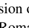

**OCR trong hình (theo thứ tự đọc):**

Rom

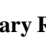

**OCR trong hình (theo thứ tự đọc):**

ary F

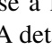

**OCR trong hình (theo thứ tự đọc):**

se a A det

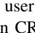

**OCR trong hình (theo thứ tự đọc):**

user n CR

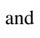

**OCR trong hình (theo thứ tự đọc):**

and

**OCR trong hình (theo thứ tự đọc):**

|  | Distribuzione del villago |
| --- | --- |
|  |  |
|  |  |
|  |  |
|  |  |
|  |  |
|  |  |
|  |  |

**OCR trong hình (theo thứ tự đọc):**

|  |  |
| --- | --- |
|  |  |
|  |  |
|  |  |
|  |  |
|  |  |

**OCR trong hình (theo thứ tự đọc):**

|  |
| --- |
|  |
|  |
|  |
|  |
|  |
|  |
|  |
|  |
|  |
|  |
|  |
|  |
|  |
|  |
|  |
|  |

**OCR trong hình (theo thứ tự đọc):**

Matrix des characteristiques des substanties de différents types possèden un désign de permittants et de permittants de décrétion. Ils possèden de functions et de composition de components différents de celles de la matrix de characteristiques. Elles sont composées de characteristiques de functions et de composition de components différents de celles de la matrix de characteristiques.

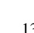

**OCR trong hình (theo thứ tự đọc):**

13

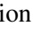

**OCR trong hình (theo thứ tự đọc):**

ion

**OCR trong hình (theo thứ tự đọc):**

ry

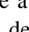

**OCR trong hình (theo thứ tự đọc):**

e a de

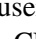

**OCR trong hình (theo thứ tự đọc):**

use

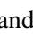

**OCR trong hình (theo thứ tự đọc):**

and

**OCR trong hình (theo thứ tự đọc):**

Contrasting to the present study, the research was conducted in a similar setting and used the same methodology. The same subjects were assigned to the same groups and the same predictive models. The same statistical analyses were conducted and the same results were obtained. The results are shown in Table 1. The results show that the study was similar to the previous study in that the same subjects were assigned to the same groups and the same predictive models. The same statistical analyses were conducted and the same results were obtained.

**OCR trong hình (theo thứ tự đọc):**

Group 1
is the group of companies that have multiple stock holders and have a profitable payoff of a share that is equal to the stock price. The group of companies that have only one stock holder and the group of companies that have two or more stock holders are called
Group 2
and
Group 3
, respectively. In the case of Group 1, the stock price is equal to the share price. In the case of Group 2, the stock price is equal to the share price but the stock holder has two or more stock holders and the stock price is equal to the share price. In the case of Group 3, the stock price is equal to the share price but the stock holder has only one stock holder and the stock price is equal to the share price.

**OCR trong hình (theo thứ tự đọc):**

|  |  |
| --- | --- |
|  |  |
|  |  |
|  |  |
|  |  |
|  |  |

**OCR trong hình (theo thứ tự đọc):**

| سوريا | Eastern Southeast Asia |
| --- | --- |
| — South Asia — |  |
| الإسلام في الإسلام السورية |  |
|  |  |
| الفرنسية السورية |  |
|  |  |
| الإسلام السورية السياسية |  |
|  |  |
| العالم السوري العالمي الإسلامي السورية الشرقية |  |
|  |  |

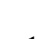

**OCR trong hình (theo thứ tự đọc):**

— 4 —

---

## Trang 16

results13 were mixed. Out of the seven teams who participated in the shared task, our submission (Lin et al.,
2014) ranked first, second and fifth on different languages. In preliminary controlled experiments, we found
that adding unlabeled examples does not improve prediction results over a CRF baseline which uses the
same set of labeled examples and features.
However, it is too soon to conclude these results since a number of obvious improvements need to be
implemented. In particular, we propose to extend this work as follows:
• Tune the weight of the unlabeled data log-likelihood in the objective.
• Use a more realistic experimental setting where the number of different languages is more than two
per task.
• Vary the number of labeled and unlabeled examples.
• Use an “out-of-domain” test set where adaptation to the test set genre is potentially useful.
• Use the empirical Bayes method in §3.2.
• Use the multivariate Gaussian reconstruction model (Eq. 6).
• Use posterior regularization to bias the model towards predictions which have fewer languages per
token sequence.
• Improve the coverage of the word embeddings we use.
4.4 Dependency Parsing [status: 5%]
A dependency parse expresses syntactic relationships among words of a sentence by specifying a set of
directed pair-wise dependencies between tokens. We consider single-rooted non-projective labeled depen￾dency parse trees which span an entire sentence. For example, in Fig. 1, the arc (Jaguar SUBJ −−−→ shocked)
indicates that ‘Jaguar’ is a subject modifier of the head ‘shocked’.
Model Instantiation. We define X to be a sequence of tokens, and Y to be a sequence of tuples Yi =
hy
head
i
, yrel
i
i which specify the head of the corresponding token Xi
, and the modifying relationship. Instead
of regenerating the surface forms, we let Xˆ
i be the POS label of Xi
.
14 We assume an arc-factored CRF
encoding model where the scoring function g(X = x, Y = y) factorizes as Pnx
i=1 `(x, yi
, i). In the recon￾struction model, we condition on the arc leaving the ith token (i.e., hy
head
i
, yrel
i
i) and the generation direction
(i.e., whether i > yhead
i
) and generate xˆi surface form of the modifier using a simple categorical.
We use the matrix tree theorem for efficient inference in training, as proposed by Koo et al. (2007);
McDonald and Satta (2007); Smith and Smith (2007). In decoding, we find the most likely maximum
spanning tree using the Chiu-Liu-Edmonds algorithm (Chu and Liu, 1965; Edmonds, 1967).
Cross-Lingual Transfer Experiments. Recently, McDonald et al. (2013) published a corpus of homoge￾neous syntactic dependency annotations in six languages. Our goal is to use this resource to train a depen￾dency parser for new (target) languages with few dependency annotations, if any, in the target language. For
evaluation purposes, we pick one target language, at a time, out of the six languages in the corpus, and use
the depedency annotations in the remaining five (source) languages as training data. Optionally, we also
use a portion of the annotations in the target language for training. We use McDonald et al. (2013) as our
baseline.
Domain Adaptation Experiments. An orthogonal dimension to cross-lingual transfer of dependency parsers,
is the problem of domain adaptation. Eventually, our goal is to train a multilingual dependency parser that
“just works” on messages in social media such as Twitter and Facebook. As a first step, we propose to
focus on English Tweets, and train a CRF autoencoder model using large English dependency treebanks in
13Twitter genre results can be found at http://emnlp2014.org/workshops/CodeSwitch/results.php. Surprise
genre results can be found at http://emnlp2014.org/workshops/CodeSwitch/surprise-results.php
14When POS tags are not available, we may use syntactically motivated hard clustering of words such as Brown et al. (1993).
14

---

## Trang 17

the news domain, a small number of English tweets with underspecified GFL annotations (Schneider et al.,
2013), and a large number of English tweets with no annotations. We use Kong et al. (2014) as our baseline.
4.5 Frame Semantics [status: 0%]
Frame semantics (Fillmore, 1982) is a major linguistic theory for semantic analysis. Given a sentence,
frame semantic parsing can be broken into three subtasks: (1) target identification, (2) frame identification,
and (3) arguments identification. A frame is a conceptual abstraction of related meanings (e.g., employment
scenario, borrowing, death). FrameNet15 defines 38, 337 such frames (see Fig. 5 for an example frame
description in FrameNet). A target is a lexical unit in a sentence which evokes some frame (e.g., ‘waltz’
in Fig. 1). Finally, an argument is a lexical unit in a sentence which plays a role in a particular frame (e.g.,
‘Australia’ plays the self-mover role and ‘smoothly’ plays the manner role in the self-motion frame).
Each of the three subtasks presents unique difficulties, detailed at length in Das et al. (2014). Here, we
focus on the third task, i.e., identifying role instantiations in a sentence, for a particular target lexical unit
that evoked a particular frame.16
Model Instantiation. We define X to be a sequence of tokens, and define side information V = (t, f)
to represent the surface form of a given target t and an index in the FrameNet lexicon for a given frame
f. Let Lf be the set of roles defined in the lexicon for frame f, including a special NULL role (e.g.,
RAddiction = {Addict, Addictant, Compeller, Degree, NULL}). Let SX be the set of spans in the token
sequence X, which may correspond to an argument. We define Y to be the frame arguments {Yi,j : (i, j) ∈
SX, Yi,j ∈ Rf }. We add the hard constraint: Yi,j 6= NULL =⇒ Yk,l = NULL, ∀k ≥ i, l ≤ j, l−k < j−i.
We define Xˆ
i
to be a vector of word embeddings for Xi
.
We use the following CRF model of frame arguments conditional on observed variables:
p(Y = y | X = x, t, f, SX) =
exp λ ·
P
i,j,k∈{1,...,nx},i≤j≤k
`(i, j, k, yi,j , yj,k, yi,k, x, t, f, SX)
P
y0 exp λ ·
P
i,j,k∈{1,...,nx},i≤j≤k
`(i, j, k, y0
i,j , y0
j,k, y0
i,k, x, t, f, SX)
(18)
The reconstruction model regenerates the word embeddings vector for the tokens which participate in an
argument, conditional on the corresponding role. Word embeddings of the tokens which do not participate in
any arguments are generated conditional on NULL. The multivariate Gaussian reconstruction model (Eq. 6)
is a natural fit for this problem. We use the dynamic programming algorithm outlined by Toutanova et al.
(2005) for efficient inference in this model.
This approach is more favorable than the one proposed in Das et al. (2014) for three reasons:
• All argument spans can be efficiently considered.
• It captures local dependencies.
• Unlabeled examples are directly modeled.
Experiments. Due to the difficulty of annotating sentences with full frame semantic parses, FrameNet only
includes a training set of 3, 256 naturally occuring sentences, each annotated with six frame instantiations, on
average. We plan to augment this training set with unlabeled examples and other supervision cues available
via FrameNet, as well as PropBank.17 We use Das et al. (2014) as our baseline.
15https://framenet.icsi.berkeley.edu/fndrupal/frameIndex
16Despite subtle differences between FrameNet-style and PropBank-style semantic parsing such as uniqueness of roles across
frames and lexicon constraints, the same model for argument identification could be used for both representations.
17http://verbs.colorado.edu/~mpalmer/projects/ace.html
15

---

## Trang 18

A Timeline
The proposed timeline is as follows:
• By Dec. 2014 (NAACL): remaining work in §4.3 on code switching.
• By Feb. 2015 (ACL-IJCNLP): remaining work in §4.2 on word alignment.
• By Jun. 2015 (EMNLP): proposed work in §4.4 on dependency parsing.
• By Dec. 2015 (ICLR): proposed work in §2.3 on contrasting manually-specified features with automatically￾induced features.
• By Jun. 2016 (EMNLP): proposed work in §4.5 on semantic parsing.
• By Dec. 2016 (JMLR): a journal paper on CRF autoencoders.
• By May 2017: thesis oral.
16

---

## Trang 19

………	
  
………	
  
Figure 5: Snippets of the self-motion frame’s description in FrameNet.
17

### Hình ảnh trên trang

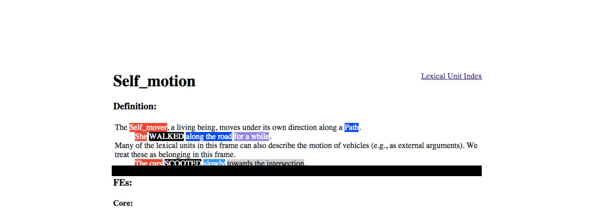

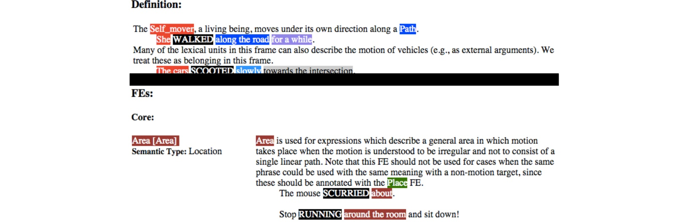

**OCR trong hình (theo thứ tự đọc):**

Definition:
The
Self mover
, a living being, moves under its own direction along a
Path
.
She WALKED along the road for a while.
Many of the lexical units in this frame can also describe the motion of vehicles (e.g., as external arguments). We treat these as belonging in this frame.
The cars SCOOTED slowly towards the intersection.
FEs:
Core:
Area [Area]
Semantic Type: Location
Area
is used for expressions which describe a general area in which motion takes place when the motion is understood to be irregular and not to consist of a single linear path. Note that this FE should not be used for cases when the same phrase could be used with the same meaning with a non-motion target, since these should be annotated with the
Place FE
.
The mouse
SCURRIED
about.
Stop RUNNING around the room
and sit down!

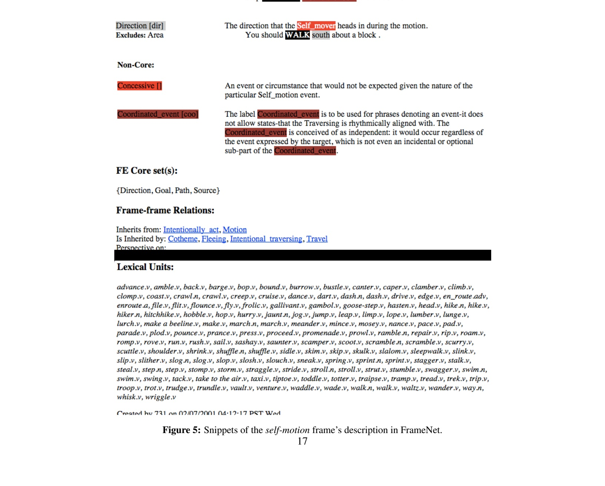

**OCR trong hình (theo thứ tự đọc):**

| Direction [dir] Excludes: Area | The direction that the Self_mover heads in during the motion. You should WALK south about a block . |
| --- | --- |
| Non-Core: |  |
| Concessive [] | An event or circumstance that would not be expected given the nature of the particular Self_motion event. |
| Coordinated_event [coo] | The label Coordinated_event is to be used for phrases denoting an event-it does not allow states-that the Traversing is rhythmically aligned with. The Coordinated_event is conceived of as independent: it would occur regardless of the event expressed by the target, which is not even an incidental or optional sub-part of the Coordinated_event . |
| FE Core set(s): |  |
| {Direction, Goal, Path, Source} |  |
| Frame-frame Relations: |  |
| Inherits from: Intentionally_act , Motion Is Inherited by: Cotheme , Fleeing , Intentional_traversing , Travel Perspective on: [REDACTED] |  |
| Lexical Units: |  |

**OCR trong hình (theo thứ tự đọc):**

| FE Core set(): |
| --- |
|  |
| {Direction, Goal, Path, Source} |

**OCR trong hình (theo thứ tự đọc):**

|  |  |
| --- | --- |
|  |  |
|  |  |
|  |  |
|  |  |
|  |  |

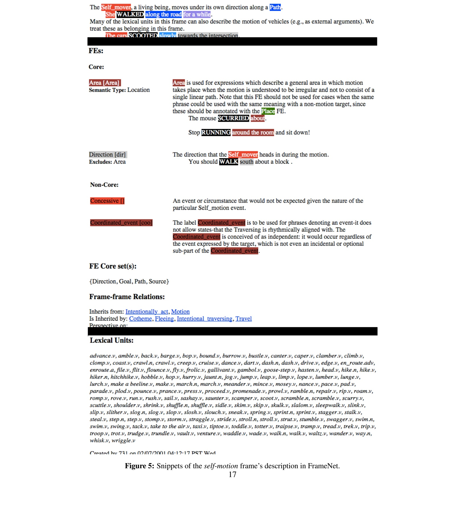

**OCR trong hình (theo thứ tự đọc):**

The
Self_mover
, a living being, moves under its own direction along a
Path
.
She WALKED along the road for a while.
Many of the lexical units in this frame can also describe the motion of vehicles (e.g., as external arguments). We treat these as belonging in this frame.
The cars SCOOTED slowly towards the intersection.
FEs:
Core:
Area [Area]
Semantic Type:
Location
Area
is used for expressions which describe a general area in which motion takes place when the motion is understood to be irregular and not to consist of a single linear path. Note that this FE should not be used for cases when the same phrase could be used with the same meaning with a non-motion target, since these should be annotated with the
Place FE
.
The mouse
SCURRIED about
.
Stop
RUNNING around the room
and sit down!
Direction [dir]
Excludes:
Area
The direction that the
Self_mover
heads in during the motion.
You should
WALK south
about a block .
Non-Core:
Concessive []
An event or circumstance that would not be expected given the nature of the particular
Self_motion
event.
Coordinated_event [coo]
The label
Coordinated_event
is to be used for phrases denoting an event-it does not allow states-that the Traversing is rhythmically aligned w

**OCR trong hình (theo thứ tự đọc):**

| Self motion |  |
| --- | --- |
|  |  |
|  |  |
| Lexical Unit Index |  |

---

## Trang 20

B References
W. Ammar, C. Dyer, and N. A. Smith. Conditional random field autoencoders for unsupervised structured prediction.
In submitted to NIPS, 2014.
Jacob Andreas and Dan Klein. How much do word embeddings encode about syntax. In Proceedings of ACL, 2014.
Taylor Berg-Kirkpatrick, Alexandre Bouchard-Côté, John DeNero, and Dan Klein. Painless unsupervised learning
with features. In Proc. of NAACL, 2010.
Phil Blunsom and Trevor Cohn. Discriminative word alignment with conditional random fields. In Proc. of Proceed￾ings of ACL, 2006.
P F Brown, V J Della Pietra, S A Della Pietra, and R L Mercer. The mathematics of statistical machine translation:
parameter estimation. In Computational Linguistics, 1993.
Peter F. Brown, Peter V. deSouza, Robert L. Mercer, Vincent J. Della Pietra, and Jenifer C. Lai. Class-based n-gram
models of natural language. Computational Linguistics, 1992.
Yejin Choi, Claire Cardie, Ellen Riloff, and Siddharth Patwardhan. Identifying sources of opinions with conditional
random fields and extraction patterns. In Proc. of HLT-EMNLP, 2005.
Yoeng-Jin Chu and Tseng-Hong Liu. On shortest arborescence of a directed graph. In Scientia Sinica, 1965.
Ronan Collobert and Jason Weston. A unified architecture for natural language processing: Deep neural networks
with multitask learning. In Proc. of ICML, 2008.
Ronan Collobert, Jason Weston, Léon Bottou, Michael Karlen, Koray Kavukcuoglu, and Pavel Kuksa. Natural lan￾guage processing (almost) from scratch. In Proc. of JMLR, 2011.
Dipanjan Das, Desai Chen, André FT Martins, Nathan Schneider, and Noah A Smith. Frame-semantic parsing.
Computational Linguistics, 40(1):9–56, 2014.
Hal Daumé III. Unsupervised search-based structured prediction. In Proc. of ICML, 2009.
Arthur P Dempster, Nan M Laird, Donald B Rubin, et al. Maximum likelihood from incomplete data via the em
algorithm. Journal of the Royal statistical Society, 39(1):1–38, 1977.
John Duchi, Elad Hazan, and Yoram Singer. Adaptive subgradient methods for online learning and stochastic opti￾mization. JMLR, 2011.
Chris Dyer, Adam Lopez, Juri Ganitkevitch, Johnathan Weese, Ferhan Ture, Phil Blunsom, Hendra Setiawan, Vladimir
Eidelman, and Philip Resnik. cdec: A decoder, alignment, and learning framework for finite-state and context-free
translation models. In Proc. of ACL, 2010.
Chris Dyer, Jonathan Clark, Alon Lavie, and Noah A. Smith. Unsupervised word alignment with arbitrary features.
In Proc. of ACL-HLT, 2011.
Chris Dyer, Victor Chahuneau, and Noah A. Smith. A simple, fast, and effective reparameterization of IBM Model 2.
In Proc. of NAACL, 2013.
Jack Edmonds. Optimum branchings. Journal of Research of the National Bureau of Standards B, 71(4):233–240,
1967.
Manaal Faruqui and Chris Dyer. Improving vector space word representations using multilingual correlation. Proc. of
EACL. Association for Computational Linguistics, 2014.
Charles Fillmore. Frame semantics. Linguistics in the morning calm, pages 111–137, 1982.
18

---

## Trang 21

Kuzman Ganchev, João Graça, Jennifer Gillenwater, and Ben Taskar. Posterior regularization for structured latent
variable models. Journal of Machine Learning Research, 11:2001–2049, 2010.
Qin Gao and Stephan Vogel. Parallel implementations of word alignment tool. In In Proc. of the ACL workshop, 2008.
Kevin Gimpel, Nathan Schneider, Brendan O’Connor, Dipanjan Das, Daniel Mills, Jacob Eisenstein, Michael Heil￾man, Dani Yogatama, Jeffrey Flanigan, and Noah A Smith. Part-of-speech tagging for twitter: Annotation, features,
and experiments. In Proc. of ACL-HLT, 2011.
Joao Graça, Kuzman Ganchev, and Ben Taskar. Expectation maximization and posterior constraints. In Proc. of NIPS,
2007.
John J. Gumperz. Discourse Strategies. Studies in Interactional Sociolinguistics. Cambridge University Press, 1982.
ISBN 9780521288965. URL http://books.google.com/books?id=aUJNgHWl\_koC.
Jiang Guo, Wanxiang Che, Haifeng Wang, and Ting Liu. Revisiting embedding features for simple semi-supervised
learning. In Proc. of EMNLP, 2014.
Aria Haghighi and Dan Klein. Prototype-driven learning for sequence models. In Proc. of NAACL-HLT, 2006.
Mark Johnson. Why doesn’t EM find good HMM POS-taggers? In Proc. of EMNLP, 2007.
Philipp Koehn. Statistical Machine Translation. Cambridge, 2010.
Lingpeng Kong, Nathan Schneider, Swabha Swayamdipta, Archna Bhatia, Chris Dyer, and Noah A. Smith. A depen￾dency parser for tweets. In Proc. of EMNLP, 2014.
Terry Koo, Amir Globerson, Xavier Carreras, and Michael Collins. Structured prediction models via the matrix-tree
theorem. In Proc. of EMNLP-CoNLL, 2007.
Taku Kudo, Kaoru Yamamoto, and Yuji Matsumoto. Applying conditional random fields to japanese morphological
analysis. In Proc. of EMNLP, 2004.
John Lafferty, Andrew McCallum, and Fernando Pereira. Conditional random fields: Probabilistic models for seg￾menting and labeling sequence data. In Proc. of ICML, 2001.
Tao Lei, Yu Xin, Yuan Zhang, Regina Barzilay, and Tommi Jaakkola. Low-rank tensors for scoring dependency
structures. In Proceedings of the 52nd Annual Meeting of the Association for Computational Linguistics (Volume
1: Long Papers), pages 1381–1391, Baltimore, Maryland, June 2014. Association for Computational Linguistics.
URL http://www.aclweb.org/anthology/P14-1130.
Shen Li, João Graça, and Ben Taskar. Wiki-ly supervised part-of-speech tagging. In Proc. of EMNLP, 2012.
Chu-Cheng Lin, Waleed Ammar, Chris Dyer, and Lori Levin. The cmu submission for the shared task on lan￾guage identification in code-switched data. In First Workshop on Computational Approaches to Code Switching
at EMNLP, 2014.
D. C. Liu, J. Nocedal, and C. Dong. On the limited memory bfgs method for large scale optimization. In Proc. of
Mathematical Programming, 1989.
Marco Lui and Timothy Baldwin. Accurate language identification of twitter messages. In Proc. of LASM, 2014.
Mitchell P Marcus, Mary Ann Marcinkiewicz, and Beatrice Santorini. Building a large annotated corpus of english:
The penn treebank. In Proc. of Computational Linguistics, 1993.
Ryan McDonald. Discriminative Learning and Spanning Tree Algorithms for Dependency Parsing. PhD thesis,
Computer and Information Science, University of Pennsylvania, Philadelphia, PA, December 2006.
Ryan McDonald and Giorgio Satta. On the complexity of non-projective data-driven dependency parsing. In Proc. of
International Conference on Parsing Technologies, 2007.
19

---

## Trang 22

Ryan T McDonald, Joakim Nivre, Yvonne Quirmbach-Brundage, Yoav Goldberg, Dipanjan Das, Kuzman Ganchev,
Keith B Hall, Slav Petrov, Hao Zhang, Oscar Täckström, et al. Universal dependency annotation for multilingual
parsing. In ACL (2), 2013.
B Merialdo. Tagging english text with a probabilistic model. In Proc. of Computational Linguistics, 1994.
Tomas Mikolov, Kai Chen, Greg Corrado, and Jeffrey Dean. Efficient estimation of word representations in vector
space. In Proc. of ICLR, 2013.
Tom Mitchell. The need for biases in learning generalizations, 1980.
F. Och and H. Ney. A systematic comparison of various statistical alignment models. In Proc. of Computational
Linguistics, 2003.
Kishore Papineni, Salim Roukos, Todd Ward, and Wei-Jing Zhu. Bleu: a method for automatic evaluation of machine
translation. In Proc. of ACL, 2002.
Slav Petrov, Dipanjan Das, and Ryan McDonald. A universal part-of-speech tagset. In Proc. of LREC, 2012.
Sujith Ravi and Kevin Knight. Minimized models for unsupervised part-of-speech tagging. In Proc. of ACL, 2009.
Sunita Sarawagi and William W Cohen. Semi-markov conditional random fields for information extraction. In Proc.
of Advances in Neural Information Processing Systems, 2004.
Nathan Schneider, Brendan OâA˘ ZConnor, Naomi Saphra, David Bamman, Manaal Faruqui, Noah A. Smith, Chris ´
Dyer, and Jason Baldridge. A framework for (under)specifying dependency syntax without overloading annotators.
In Linguistic Annotation Workshop, 2013.
Burr Settles. Biomedical named entity recognition using conditional random fields and rich feature sets. In Proceed￾ings of the International Joint Workshop on Natural Language Processing in Biomedicine and Its Applications,
2004.
Fei Sha and Fernando Pereira. Shallow parsing with conditional random fields. In Proc. of NAACL-HLT, 2003.
David A Smith and Noah A Smith. Probabilistic models of nonprojective dependency trees. In Proc. of EMNLP￾CoNLL, 2007.
Noah A. Smith and Jason Eisner. Contrastive estimation: Training log-linear models on unlabeled data. In Proc. of
ACL, 2005.
Noah A. Smith, David A. Smith, and Roy W. Tromble. Context-based morphological disambiguation with random
fields. In Proc. of HLT-EMNLP, 2005.
Richard Socher, Christopher D. Manning, and Andrew Y. Ng. Learning continuous phrase representations and syntac￾tic parsing with recursive neural networks. In NIPS workshop, 2010.
Naftali Tishby, Fernando C Pereira, and William Bialek. The information bottleneck method. arXiv preprint
physics/0004057, 2000.
Kristina Toutanova, Aria Haghighi, and Christopher D Manning. Joint learning improves semantic role labeling. In
Proc. of ACL, 2005.
Joseph Turian, Lev Ratinov, and Yoshua Bengio. Word representations: A simple and general method for semi￾supervised learning. In Proc. of ACL, 2010.
Pascal Vincent, Hugo Larochelle, Yoshua Bengio, and Pierre-Antoine Manzagol. Extracting and composing robust
features with denoising autoencoders. In Proc. of ICML, 2008.
Dani Yogatama and Noah Smith. Making the most of bag of words: Sentence regularization with alternating direction
method of multipliers. In Proceedings of The 31st International Conference on Machine Learning, 2014.
20

---

## Trang 23

Ming Yuan and Yi Lin. Model selection and estimation in regression with grouped variables. In Proc. of Journal of
the Royal Statistical Society: Series B (Statistical Methodology), 2006.
Hui Zhang, Min Zhang, Chew Lim Tan, and Haizhou Li. K-best combination of syntactic parsers. In Proc. of EMNLP,
2009.
Will Y Zou, Richard Socher, Daniel M Cer, and Christopher D Manning. Bilingual word embeddings for phrase-based
machine translation. In Proc. of EMNLP, pages 1393–1398, 2013.
21
