## Trang 1

Mining Large Dynamic Graphs and Tensors:
Thesis Proposal
Kijung Shin
School of Computer Science
Carnegie Mellon University
kijungs@cs.cmu.edu
Abstract
Graphs are everywhere from online social networks to bipartite review graphs. Many of them
are large and dynamic. Moreover, they are with extra information and thus naturally modeled as
tensors. Given large dynamic graphs and tensors, how can we analyze their structure? How can we
detect interesting anomalies? Lastly, how can we model the behavior of the individuals in the data?
My thesis focuses on these closely related questions, all of which are fundamental to under￾stand large growing data on user behavior. For structure analysis, we develop streaming algorithms
that incrementally update several connectivity measures in dynamic graphs. We also improve the
scalability of Tucker Decomposition, which summarizes the structure of tensors. For anomaly de￾tection, we develop several approximation algorithms that detect anomalously dense subgraphs and
subtensors. The algorithms are designed for various settings, including distributed and streaming
settings. Lastly, regarding behavior modeling, we build a stage model for progression of users on
social media, and a game-theoretic model for purchasing behavior of individuals in social networks.
As future work, we will further explore the relation between the structure of social networks
and the behavior of individuals in them by building a model for polarization in social networks.
We will also advance our algorithms for larger and more dynamic data (e.g., fully dynamic graph
streams where edges are not only added but also deleted).
Thesis Committee:
Christos Faloutsos (Chair)
Tom M. Mitchell
Leman Akoglu
Philip S. Yu (University of Illinois at Chicago)
Submitted in partial fulfillment of the requirements
for the degree of Doctor of Philosophy.

---

## Trang 2

Contents
1 Introduction 3
1.1 Impact and Reproducibility . . . . . . . . . . . . . . . . . . . . . . . . . . . . . . . . 4
1.2 Thesis Organization . . . . . . . . . . . . . . . . . . . . . . . . . . . . . . . . . . . . 4
2 Preliminaries: Graphs and Tensors 6
2.1 Graphs . . . . . . . . . . . . . . . . . . . . . . . . . . . . . . . . . . . . . . . . . . . 6
2.2 Tensors . . . . . . . . . . . . . . . . . . . . . . . . . . . . . . . . . . . . . . . . . . 7
3 Structure Analysis 8
3.1 Counting Triangles in Graph Streams . . . . . . . . . . . . . . . . . . . . . . . . . . 8
3.1.1 Counting Triangles in Graph Streams with Temporal Patterns . . . . . . . . . 8
3.1.2 Counting Triangles in Graphs Streams on Distributed-memory Machines . . . 9
3.1.3 [Proposed] Counting Triangles in Graphs Streams with Deletions . . . . . . . 10
3.2 Estimating Degeneracy in Graph Streams . . . . . . . . . . . . . . . . . . . . . . . . 11
3.3 Decomposing High-order Tensors . . . . . . . . . . . . . . . . . . . . . . . . . . . . 12
3.3.1 Decomposing High-order Tensors without Intermediate Data Explosion . . . . 12
3.3.2 [Proposed] Decomposing High-order Tensors with Skewed Distributions . . . 13
4 Anomaly Detection 14
4.1 Detecting Anomalous Subgraphs . . . . . . . . . . . . . . . . . . . . . . . . . . . . . 14
4.2 Detecting Dense Subtensors . . . . . . . . . . . . . . . . . . . . . . . . . . . . . . . 15
4.2.1 Detecting Dense Subtensors in Static Tensors . . . . . . . . . . . . . . . . . . 15
4.2.2 Detecting Dense Subtensors in Web-scale Static Tensors . . . . . . . . . . . . 17
4.2.3 Detecting Dense Subtensors in Dynamic Tensors . . . . . . . . . . . . . . . . 18
5 Behavior Modeling 19
5.1 Modeling Progressive Behavior on Social Media . . . . . . . . . . . . . . . . . . . . 19
5.2 Modeling Purchasing Behavior in Social Networks . . . . . . . . . . . . . . . . . . . 20
5.3 [Proposed] Modeling Polarization in Social Networks . . . . . . . . . . . . . . . . . . 21
6 Timelines 22
7 Conclusions 23
A Related Work 30
B Datasets 31
2

---

## Trang 3

Chapter 1
Introduction
Graphs are everywhere from online social networks to bipartite review graphs. Many of them are
large (e.g., Facebook announced that they had more than two billion monthly active users in 2017) and
dynamic (i.e., nodes and edges can be added or removed). Moreover, they are with extra information
(e.g., each review on Amazon has a timestamp, a rating, and text) and thus naturally modeled as tensors
(i.e., multi-dimensional arrays).
My thesis focuses on the following questions, all of which are fundamental to understand large
growing data on user behavior:
Given large dynamic graphs and tensors,
Q1. Structure Analysis: How can we analyze their structure?
Q2. Anomaly Detection: How can we detect interesting anomalies worthy of further investigation?
Q3. Behavior Modeling: How can we model the behavior of the individuals in the data?
These questions are closely related, and answering one helps answering the others. For example,
the structure of a social network affects the behavior of the people in it and vice versa. In addition,
anomalies show abnormal behavior, not explainable by behavior models, and often form unlikely sub￾structures. Thus, structure analysis and behavior modeling help identifying anomalies.
For structure analysis, we develop streaming algorithms that incrementally update several connec￾tivity measures in dynamic graphs. Specifically, within a limited memory budget, our algorithms esti￾mate the degeneracy [SERF18, SERF16] and the counts of global and local triangles [Shi17, SHL+18,
SLO+18]. For accuracy, our algorithms exploit structural [SERF18, SERF16] and temporal [Shi17]
patterns in real graph streams, or utilize computational and storage resources distributed across mul￾tiple machines [SHL+18, SLO+18]. Moreover, in [OSP+17], we improve the scalability of Tucker
Decomposition, which summarizes the structure of tensors. Specifically, our algorithm avoids the ex￾plosion of intermediate data, which previous algorithms suffer from.
For anomaly detection, we develop several approximation algorithms that detect anomalously dense
subgraphs and subtensors. In [SERF18, SERF16], based on the observation that natural dense sub￾graphs are formed by high-degree nodes, we propose algorithms for identifying dense subgraphs con￾sisting of low-degree nodes, which indicate anomalies such as a ‘follower-boosting’ service on Twitter
and ‘copy-and-paste’ bibliography in a citation graph. In [SHF18, SHF16], we propose algorithms for
detecting dense subtensors (e.g., dense subgraphs formed within a short time), which signal anomalies
such as ‘edit wars’ in Wikipedia and network attacks in computer networks. We extend these algo￾rithms for disk-resident or distributed tensors [SHKF18, SHKF17a] and dynamic tensors [SHKF17b].
Figure 1.1 shows some anomalies detected by our algorithms.
Lastly, regrading behavior modeling, we build a game-theoretic model to examine incentives to pur￾3

---

## Trang 4

(a) Social Networks (b) E-commerce (c) Network Security
Figure 1.1: Applications of our anomaly-detection algorithms in various fields. (a) Social Networks:
CORE-A (§ 4.1) detects a follower-boosting service on Twitter. (b) E-commerce: D-CUBE (§ 4.2.3)
detects spam reviews on an online software market. (c) Network Security: DENSEALERT (§ 4.2.3)
detects various types of network attacks.
chase a good sharable with neighbors in a social network [SLEP17]. Using our models, we analyze the
effects of rental fees and structures of social networks on social inefficiency. In addition, to summarize
progression of users on social media, we devise a stage model with an optimization algorithm that fits
our model to terabyte-scale behavior logs [SSK+18].
As future work, we will further explore the relation between the structure of social networks and the
behavior of individuals in them. To this end, we will build behavior models for influence between the
individuals, which we expect to explain polarization in social networks. In addition, we will advance
our algorithms for larger and more dynamic data. Specifically, we will extend our streaming algorithms
for fully dynamic graphs, where edges are not only added but also deleted, and improve the speed
of Tucker Decomposition by exploiting structural patterns in real-world data, such as skewed degree
distributions.
1.1 Impact and Reproducibility
We made most of the algorithms produced throughout this thesis open source for reproducibility and
the benefit of the community. In Table 1.1, we list the open source algorithms and their impacts in
terms of the number of downloads and the number of institutions and countries where each algorithm
was downloaded. In addition, we achieved the following results:
• Our work [SERF16] was selected as one of the best papers of ICDM 2016 and invited to a special
issue of the Knowledge and Information Systems journal [SERF18].
• Our work [SLEP17] was featured in an article in New Scientist titled “Game theory says you
should charge your friends to borrow things.”
• The model and optimization algorithm proposed in our work [SSK+18] were implemented and
used at LinkedIn Corporation.
1.2 Thesis Organization
The rest of the thesis proposal is organized as follows. In Chapter 2, we give preliminaries on graphs and
tensors. In Chapter 3, we present our completed and proposed work on structure analysis. In Chapter 4,
we present our completed and proposed work on anomaly detection. In Chapter 5, we present our
completed and proposed work on behavior modeling. After discussing the timeline in Chapter 6, we
draw conclusions in Chapter 7. In Appendix A, we review related work. In Appendix B, we describe
4

### Hình ảnh trên trang

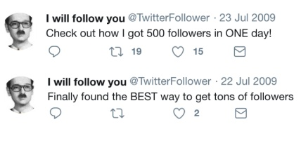

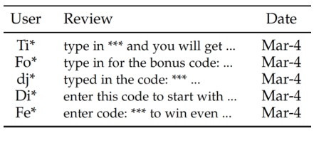

**OCR trong hình (theo thứ tự đọc):**

| United States | Region | Satisfied |
| --- | --- | --- |
| Tiff | type in *** and you will get ... | Mar-4 |
| Fo* | type in for the bonus code: ... | Mar-4 |
| dj* | typed in the code: *** ... | Mar-4 |
| dj* | enter this code to start with ... | Mar-4 |
| Fe* | enter code: *** to win even ... | Mar-4 |

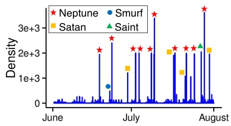

---

## Trang 5

the datasets used throughout the thesis. The detailed organization of completed and proposed work is
provided in Table 1.2.
Table 1.1: Impacts of the open source algorithms produced throughout this thesis. The source code is
available at http://www.cs.cmu.edu/˜kijungs/proposal/. The statistics were collected
from August 2017 to February 2018.
Algorithms Related Number of Number of Number of
Sections Downloads* Institutions Countries
WRS [LINK] § 3.1.1 25 15 4
CORE-D & CORE-A [LINK] § 3.2 & § 4.1 23 16 7
M-ZOOM [LINK] § 4.2.1 23 12 7
D-CUBE [LINK] § 4.2.2 26 12 5
DENSESTREAM [LINK] § 4.2.3 26 17 7
TRI-FLY [LINK] § 3.1.2 0 (new) 0 (new) 0 (new)
S-HOT [LINK] § 3.3.1 unavailable unavailable unavailable
* or the number of clicks on links to the corresponding Github repository.
Table 1.2: Overview of the thesis proposal. For the reader’s convenience, we provide hyperlinks to
published or submitted papers.
Structure
Analysis
(§ 3)
S1: Triangle Counting in Graph Streams (§ 3.1)
S1-1: Exploiting Temporal Patterns (§ 3.1.1) [Shi17][PDF]
S1-2: Utilizing Distributed-memory Machines [SHL+18] (§ 3.1.2)[PDF] [SLO+18][PDF]
S1-3: Handling Deletions (§ 3.1.3) [Proposed]
S2: Degeneracy Estimation in Graph Streams (§ 3.2) [SERF18][PDF] [SERF16][PDF]
S3: Decomposing High-order Tensors (§ 3.3)
S3-1: Avoiding Intermediate Data Explosion (§ 3.3.1) [OSP+17][PDF]
S3-2: Exploiting Skewed Degree Distributions (§ 3.3.2) [Proposed]
Anomaly
Detection
(§ 4)
A1: Anomalous Subgraphs (§ 4.1) [SERF18][PDF] [SERF16][PDF]
A2: Dense Subtensors (§ 4.2)
A2-1: in Static Tensors (§ 4.2.1) [SHF18][PDF] [SHF16][PDF]
A2-2: in Web-scale Static Tensors (§ 4.2.2) [SHKF18][PDF] [SHKF17a][PDF]
A2-3: in Dynamic Tensors (§ 4.2.3) [SHKF17b][PDF]
Behavior
Modeling
(§ 5)
B1: Progressive Behavior on Social Media (§ 5.1) [SSK+18][PDF]
B2: Purchasing Behavior in Social Networks (§ 5.2) [SLEP17][PDF]
B3: Polarization in Social Networks (§ 5.3) [Proposed]
5

---

## Trang 6

Chapter 2
Preliminaries: Graphs and Tensors
In this chapter, we introduce concepts useful for understanding the thesis.
2.1 Graphs
Graph: A graph G = (V, E) is a pair of two sets V and E where every element of E is an unordered
pair of elements of V. Each element of V is called a node, and each element e = {u, v} of E is called
the edge between nodes u and v. A graph naturally represents a set of objects where some pairs of the
objects are related in certain ways. Examples are as follows:
• [Social network]
- The node set V is people.
- The edge set E is the pairs of friends.
• [E-commerce]
- The node set V is people and products.
- The edge set E is the pairs of a user and a product where the user bought the product.
• [Network security]
- The node set V is IPs.
- The edge set E is the pairs of IPs where connections were made between them.
Neighbor and Degree: We say a node u is a neighbor of a node v (or u is adjacent to v) when the edge
between u and v exists. The degree of a node v is defined as the number of neighbors of v.
Subgraph, Clique, and Triangle: We say a graph G
0 = (V
0
, E
0
) is a subgraph of a graph G = (V, E)
when V
0 ⊂ V and E
0 ⊂ E. We say a subset V
0 of V is a clique if every pair of nodes in V
0
is connected
by an edge in E. A clique of three nodes is called a triangle.
k-Core, Coreness, Degeneracy, k-Truss, and Trussness: The k-core of a graph is the maximal sub￾graph where every node has degree at least k within the subgraph. The coreness of a node is the largest
k such that it belongs to the k-core. The degeneracy of a graph is the largest k such that the k-core
exists. The k-truss of a graph is the maximal subgraph where every edge is contained in at least (k − 2)
triangles within the subgraph. The trussness of a node is the largest k such that it belongs to the k-truss.
Graph Stream: A graph stream is an ordered sequence of edges. In the thesis, we assume a streaming
model where the edges in a graph stream can be accessed once in the given order unless they are
explicitly stored in memory.
6

---

## Trang 7

2.2 Tensors
Tensor: A tensor is a multi-dimensional array of entries. The order of a tensor is the number of
dimensions, also known as modes. Consider an N-order tensor T of size I1 × ... × IN . We denote each
(i1, ..., iN )-th entry of T as ti1···iN where each n-th mode index in ranges from 1 to In. For each n-th
mode, we call In the dimensionality of the mode. Figures 2.1(a)-2.1(c) show illustrations of tensors.
Tensors have more expressive power than graphs, as the following examples show:
• [Social network]
- Consider a 3-order tensor T whose modes are people, people, and dates, respectively.
- An entry ti1i2i3
is 1 if the i1-th person and the i2-th person became friends on the i3-th date
Otherwise, ti1i2i3
is 0.
• [E-commerce]
- Consider a 3-order tensor T whose modes are products, users, and dates, respectively.
- An entry ti1i2i3
is the number of the i1-th products bought by the i2-th user on the i3-th date.
• [Network security]
- Consider a 4-order tensor T whose modes are IPs, IPs, protocols, and dates, respectively.
- An entry ti1i2i3i4
is the number of connections made from the i1-th IP to the i2-th IP using
the i3-th protocol on the i4-th date.
Slice and Degree: The slices of an N-order tensor are the (N − 1)-order tensors obtained by fixing an
mode index. Among the slices, the n-mode slices are those obtained by fixing the n-th mode index.
For example, the entries whose n-mode index is in form an n-mode slice. Figures 2.1(d)-2.1(f) show
illustrations of the slices of a 3-order tensor. We define the degree of a slice as the number of non-zero
entries of the slice. We define the weighted degree of a slice as the sum of the entries of the slice.
Subtensor: We say an N-order tensor T
0
is a subtensor of an N-order tensor T when T
0
can be obtained
by removing some slices from T.
(a) 1-order tensor (i.e., vector) (b) 2-order tensor (i.e., matrix)
𝑖
"
=
1, …,𝐼"
𝑖( = 1, … ,𝐼(
(c) 3-order tensor T
(d) 1-mode slices of T (e) 2-mode slices of T (f) 3-mode slices of T
Figure 2.1: Illustration of tensors and slices.
7

---

## Trang 8

Chapter 3
Structure Analysis
We present our completed and proposed work on structure analysis. For each completed task, we
briefly summarize our goal, approach, and results. References for detailed discussions are given at the
beginning of each section. For each proposed task, we give a brief description of our goal and plan.
3.1 Counting Triangles in Graph Streams
“Given a dynamic graph that is too large to fit in memory, how can we estimate the count of triangles
(i.e., cliques of three nodes), which is one of the most basic measures in graph analysis?” To answer
this question, we consider streaming algorithms that incrementally process each edge as it arrives and
maintain only a small summary of the input graph instead of the entire graph. Specifically, we consider
streaming algorithms for three realistic variants of Problem 3.1. Our common goal of the variants is
to accurately estimate the counts of global triangles (i.e., all triangles) and local triangles (i.e., the
triangles incident to each node) in a graph stream.
Problem 3.1 (Triangle Counting in a Graph Stream).
(1) Given: a graph stream and a memory budget
(2) Maintain & Update: estimates of the global triangle count and the local triangle counts
(3) to Minimize: the estimation error
3.1.1 Counting Triangles in Graph Streams with Temporal Patterns
Section based on work that appeared at ICDM17 [Shi17][PDF].
Goal: “If we cannot store all edges in a graph stream, which edges should we store to estimate the
triangle count accurately?” Graph stream algorithms typically assume that the order of the edges in a
graph stream is random or adversarial. However, a more realistic order is the chronological order since
it is natural that new edges in a dynamic graph are streamed as they are created. We consider triangle
counting in a graph stream where edges are in the chronological order, as described in Problem 3.2.
Specifically, we explore a temporal pattern in real-world graphs and show how to exploit the pattern for
accurate triangle counting.
Problem 3.2 (Triangle Counting in a Graph Stream in the Chronological Order).
(1) Given: a graph stream where edges are in the chronological order, and a memory budget
(2) Maintain & Update: estimates of the global triangle count and the local triangle counts
(3) to Minimize: the estimation error.
8

---

## Trang 9

random 
order
chronological 
order
(a) Pattern: Temporal Locality
●
●
● ● better ●
0.004
0.008
0.012
0.016
50K 100K 150K
Memory Budget (k)
Global Error
Triest- IMPR
MASCOT
WRS
better
●
●
● ● ●
0.3
0.6
0.9
50K 100K 150K
Memory Budget (k)
Local Error
WRS
Triest- IMPR
MASCOT
(b) Accuaracy of WRS
●
●
●
●
●
2−5
2−3
2−1
215 217 219
Edge Number
Elapsed Time (sec)
Linear 
scalability
Running time 
of WRS
(c) Scalability of WRS
Figure 3.1: (a) WRS, devised for Problem 3.2, exploits temporal locality, described in the figure. (b)
As a result, WRS is more accurate than its best competitors. (c) Moreover, the time complexity of
WRS is linear to the number of edges in the input stream.
Approach: We observe in real-world graphs that if edges are streamed in the chronological order, new
edges are more likely to form triangles with recent edges than older edges. We call this tendency
temporal locality. Let the time interval of a triangle be the difference between the arrival orders of its
first and last edges. Temporal locality is clearly shown in Figure 3.1(a), where we show how the arrival
orders of the edges in a graph stream affect the time intervals of the triangles.
This temporal locality is exploited by Waiting-Room Sampling (WRS), our streaming algorithm for
global and local triangle counting. WRS prioritizes recent edges, which new edges are more likely to
form triangles with, over older edges when it samples edges to be stored in memory. Specifically, WRS
divides the memory space into the waiting room, where the latest edges are stored with probability one,
and the reservoir, where the remaining edges are uniformly sampled.
Results: As seen in Figure 3.1(b), WRS produces up to 47% smaller estimation error than its best
competitors, which sample edges without prioritization. Moreover, WRS scales linearly with the num￾ber of edges in the input graph stream, as seen in Figure 3.1(c). We also prove that WRS gives unbiased
estimates, whose expected values are equal to the true values, as formalized in Theorem 3.3.
Theorem 3.3 (Unbiasedness of WRS [Shi17][PDF]). Let G
(t) = (V
(t)
, E
(t)
) be the graph composed of
the edges whose arrival order is less than or equal to t. Then, let ∆(t) and {∆
(t)
v }v∈V(t) be the global
and local triangle counts, respectively, in G
(t)
. WRS gives unbiased estimates ∆ˆ (t) and {∆ˆ
(t)
v }v∈V(t) .
That is,
E[∆ˆ (t)
] = ∆(t)
, ∀t ≥ 1 and E[∆ˆ (t)
v
] = ∆(t)
v
, ∀t ≥ 1, ∀v ∈ V(t)
.
3.1.2 Counting Triangles in Graphs Streams on Distributed-memory Machines
Section based on work that will appear at PAKDD18 [SHL+18][PDF] and work under review
[SLO+18][PDF].
Goal: “Given a graph stream, how can we estimate the number of triangles in it using multiple machines
with limited memory?” As formalized in Problem 3.4, we consider counting the global and local
triangles in a graph stream using multiple machines with limited memory. Our goal is to devise a fast
and accurate algorithm for the problem.
Problem 3.4 (Triangle Counting in a Graph Stream on Distributed-memory Machines).
(1) Given: a graph stream and a memory budget for each of multiple machines
(2) Maintain & Update: estimates of the global triangle count and the local triangle counts
(3) to Minimize: the estimation error.
9

### Hình ảnh trên trang

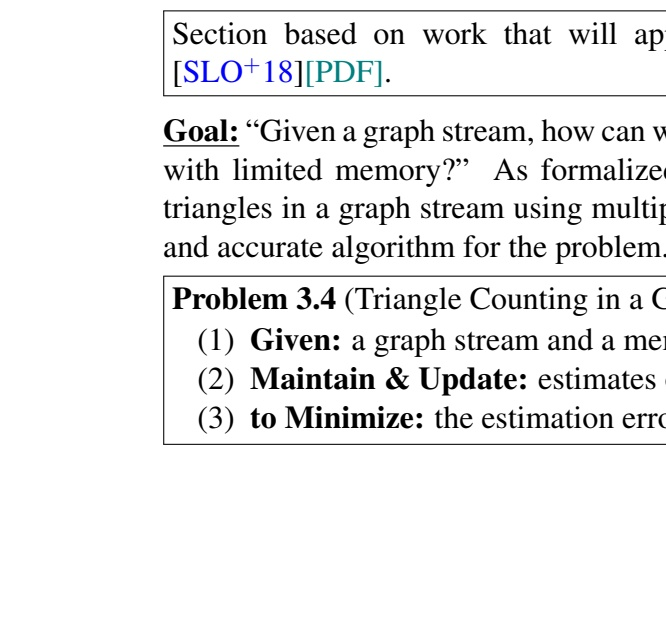

**OCR trong hình (theo thứ tự đọc):**

| Section based on work that will appear in [SLO + 18][PDF]. | Goal: “Given a graph stream, how can we with limited memory?” As formalized triangles in a graph stream using multiple and accurate algorithm for the problem? |
| --- | --- |
| Problem 3.4 (Triangle Counting in a Graph Stream) (1) Given: a graph stream and a memory stream (2) Maintain & Update: estimates the estimation error (3) to Minimize: the estimation error | The problem is to solve the estimation error for a graph stream with limited memory. |

---

## Trang 10

50.5X
31.9X
●●
0.000
0.001
0.002
0.003
0 1000
Elapsed Time (sec)
Global Error
DiSLR
MASCOT
TRIEST
-IMPR
15.9X
20.6X
●●
0.0
0.1
0.2
0.3
0.4
0.5
0 1000
Elapsed Time (sec)
Local Error
MASCOT
TRIEST
-IMPR
DiSLR
(a) Speed & Accuracy of DiSLR
●
●
●
●
●
●
●
●
●
●
●
●
●
●
●
●
●
●
●
●
●
1010
1011
1012
1013
1014
100.5 101 101.5 102
Number of Workers
Variance
Linear drop
Variance drop
in DiSLR
(b) Variance drop in DiSLR
●
●
●
●
●
●
●
●
●
●
104
105
109 1010 1011
Number of Edges
Elapsed Time (sec)
Linear 
scalability
Running time 
of DiSLR
(c) Scalability of DiSLR
Figure 3.2: (a) DiSLR, devised for Problem 3.4, provides a significantly better trade-off between speed
and accuracy than the single-machine baselines. (b) In DiSLR, the variances of estimates decrease
super linearly with the number of machines. (c) Moreover, the time complexity of DiSLR is linear to
the number of edges in the input stream.
Approach: Our distributed streaming algorithm DiSLR (Distributed Sampling with Limited Redundancy)
[SLO+18][PDF], which outperforms our previous algorithm TRI-FLY [SHL+18][PDF], minimizes the
redundant use of distributed resources. Specifically, in DiSLR, nodes are colored by a hash function.
Then, depending on the colors, masters selectively send edges to workers, which also selectively sample
edges. As a result, the following desirable conditions are satisfied:
• Limited redundacy in stroage: Each edge is stored in at most two workers.
• No redundancy in computation: Each triangle is counted by at most one worker.
• No definitely missing triangles: Each triangle is counted with non-zero probability.
The aggregators simply sum the estimates of the workers to give final estimates.
Results: As seen in Figure 3.2(a), DiSLR with 30 workers gives a significantly better trade-off be￾tween speed and accuracy than the best single-machine baselines, without suffering from “distributed￾algorithm paradox.” Specifically, DiSLR is up to 132× more accurate than the baselines with similar
speeds and up to 32× faster than the baselines with similar accuracy. Moreover, DiSLR scales linearly
with the number of edges in the input graph stream, as seen in Figure 3.2(c). We also prove that DiSLR
gives unbiased estimates (as WRS does in Theorem 3.3) whose variance drops inversely proportional
to the number of workers or faster, as described in Theorem 3.5 and Figure 3.2(b).
Theorem 3.5 (Variance Drop in DiSLR [SLO+18][PDF]). Let ∆ˆ (t) and {∆ˆ
(t)
v }v∈V(t) be the estimates
of the global and local triangle counts, respectively, that DiSLR with n workers gives after processing
t edges in the input graph stream. Than, their variances drop inversely proportional to n or faster. That
is,
V ar[∆ˆ (t)
] = O(1/n), ∀t ≥ 1 and V ar[∆ˆ (t)
v
] = O(1/n), ∀t ≥ 1, ∀v ∈ V(t)
.
3.1.3 [Proposed] Counting Triangles in Graphs Streams with Deletions
“Given a fully dynamic graph stream, where edges are both added and deleted, how can we estimate the
number of triangles?” In many real graphs, edges are not only added but also deleted. For cases where
such graphs are also too large to fit in memory, we consider counting the global and local triangles in a
fully dynamic graph stream, as formalized in Problem 3.6. Specifically, we aim to devise a streaming
algorithm that gives unbiased estimates with small variances in such a stream. This goal has not been
achieved by existing algorithms, as summarized in Table 3.1.
10

---

## Trang 11

Table 3.1: Motivation for a new streaming al￾gorithm for Problem 3.6. No existing algorithm
gives unbiased estimates with small variances
in a graph stream with deletions.
Algorithms Variance Unbiased
w/ deletions?
WRS [Shi17] smallest no
TRIEST-IMPR small no [SERU17]
MASCOT [LK15] large no
TRIEST-FD largest yes [SERU17]
● ● ●
● ●
●
● ●
●
●
●
●
●
●
●
101
102
103
105 107 109 1011
Number of Triangles
Degeneracy
3-to-1 
Power law
Empirical 
relation
(a) Triangle-core Pattern
●●
6.2X 0
1
2
3
10 20 30 40
Elapsed Time (sec)
Relative Error
Core-D
LOG-PASS
(b) Performance of CORE-D
Figure 3.3: (a) CORE-D, devised for Problem 3.7, ex￾ploits the triangle-core pattern, shown in the figure. (b)
CORE-D outperforms its semi-streaming competitor.
Problem 3.6 (Triangle Counting in a Graph Stream with Deletions).
(1) Given: a graph stream with edge deletions, and a memory budget
(2) Maintain & Update: estimates of the global triangle count and the local triangle counts
(3) to Minimize: the estimation error.
3.2 Estimating Degeneracy in Graph Streams
Section based on work that appeared at ICDM16 [SERF16][PDF] and KAIS18 [SERF18][PDF].
Goal: “Given a dynamic graph that is too large to fit in memory, how can we estimate the degeneracy,
a widely-used connectivity measure?” The degeneracy of a graph is the largest k such that a subgraph
where every node has degree at least k (within the subgraph) exists. For estimating the degeneracy
of large dynamic graphs, we consider streaming algorithms that incrementally process each edge as it
arrives and maintain only a small summary of the input graph instead of the entire graph. Specifically,
as stated in Problem 3.7, our goal is to devise an accurate streaming algorithm for degeneracy.
Problem 3.7 (Estimating Degeneracy in a Graph Stream).
(1) Given: a graph stream and a memory budget
(2) Maintain & Update: an estimate of the degeneracy
(3) to Minimize: the estimation error
Approach: We observe in real-world graphs that a 3-to-1 power law exists between the degeneracy and
the number of triangles, as shown in Figure 3.3(a). This pattern, which we call triangle-core pattern,
is exploited by CORE-D, our streaming algorithm for degeneracy. Specifically, CORE-D estimates
the number of triangles in a graph stream (as explained in the previous sections) and estimates the
degeneracy from the estimated number of triangles using the triangle-core pattern.
Results: CORE-D estimates the degeneracy accurately by making a single pass over the input graph
stream. Specifically, as shown in Figure 3.3(b), CORE-D is up to 12× faster than its semi-streaming
competitor with similar accuracy.
11

---

## Trang 12

3.3 Decomposing High-order Tensors
“Given a high-order tensor that is too large to fit in memory, how can we summarize it using Tucker De￾composition?” Tucker Decomposition (a.k.a., N-mode factor analysis and N-mode PCA) is a widely￾used summarization technique. It decomposes the input tensor into a small core tensor and low-rank
matrices that describe the original tensor best, as defined in Problem 3.8. We first discuss improving
the scalability of Tucker Decomposition by avoiding intermediate data explosion. Then, we propose
accelerating Tucker Decomposition by exploiting a structural property of real-world tensors.
Problem 3.8 (Tucker Decomposition [KB09]).
(1) Given: an N-order tensor T ∈ R
I1×...×IN and ranks J1, ..., JN
(2) Find: an N-order core tensor G ∈ R
J1×...×JN
and N orthogonal matrices A(1) ∈ R
I1×J1
, ..., A(N) ∈ R
IN ×JN
(3) to Minimize: the reconstruction error
||T − [G; A(1)
, · · · , A(N)
]||2
F
,
where [G; A(1)
, · · · , A(N)
]i1···iN =
PJ1
j1=1 · · ·PJN
jN =1 gj1···jN
a
(1)
i1j1
...a
(N)
iN jN
.
3.3.1 Decomposing High-order Tensors without Intermediate Data Explosion
Section based on work that appeared at WSDM17 [OSP+17][PDF].
Goal: “Given a high-order tensor that is too large to fit in memory, how can we perform Tucker Decom￾position without intermediate data explosion?” Developing a scalable Tucker Decomposition algorithm
has been a challenge due to the intermediate data explosion [KS08]. Briefly speaking, Alternating Least
Square (ALS), the most widely-used Tucker Decomposition algorithm, repeats the following two steps:
1. compute an intermediate tensor, denoted by Y
2. compute the singular-value decomposition (SVD) of Y, which is the matricized Y.
However, as shown in Table 3.2, existing algorithms require substantial space for the intermediate data
generated while computing or materializing (matricized) Y. Our goal is to devise an algorithm that
performs Tucker Decomposition, avoiding the intermediate data explosion. Moreover, we assume that
the input tensor is disk-resident and too large to fit in memory, as described in Problem 3.9.
Problem 3.9 (High-order Tucker Decomposition without Intermediate Data Explosion).
(1) Given: a High-order tensor that is too large to fit in memory
(2) Perform: the Tucker Decomposition of the tensor
(3) to Minimize: the space required for intermediate data.
Approach: Our algorithm S-HOT computes the SVD of Y on-the-fly without materializing Y (or even
Y) by utilizing the reverse communication interface of an eigensolver called Implicitly Restart Arnoldi
Method [LSY98]. While performing the SVD of Y, the interface repeatedly requires the product of Y
and a vector that it gives but does not require Y itself. S-HOT performs this multiplication on-the-fly
by sequentially reading the non-zero entries of the input tensor, which is stored on disk, at most twice.
Results: S-HOT requires significantly smaller space than its best competitors, as shown in Table 3.2.
As a result, as seen in Figure 3.4, S-HOT decomposes larger (e.g., 1000× larger in terms of dimen￾sionality) and higher-order tensors than its best competitors.
12

---

## Trang 13

Table 3.2: S-HOT, which we devise for Prob￾lem 3.9, does not suffer from the explosion of
intermediate data. Below, we assume that a 5-
order input tensor whose dimensionality is 10
million has 1 billion non-zero entries.
Algorithms Space required for
intermediate data
NAIVETUCKER ∼ 40TB
HATEN2 [JPF+16] ∼ 1.4TB
MET(2) [KS08] ∼ 40GB
S-HOT ∼ 4MB
S-HOT+ ∼ 40KB
●● ●● ● ●
●
●● ●● ● ●
●
● ● ● ● ● ●
●
100
101
102
103 104 105 106 107
Dimensionality
Elapsed Time 
 Per Iteration (sec)
S-HOT
S-HOT+
1000X
(a) w.r.t. dimensionality
●
●
●
●
100
101
102
3 4 5 6
Order
Elapsed Time 
 Per Iteration (sec)
Naive
1.5X
(b) w.r.t. order
Figure 3.4: S-HOT, devised for Problem 3.9, decom￾poses larger and higher-order tensors than its best com￾petitors.
3.3.2 [Proposed] Decomposing High-order Tensors with Skewed Distributions
“If the input tensor has realistic skewed degree distributions, how can we exploit this fact to accelerate
Tucker Decomposition?” As an extension of our previous efforts to improve the scalability of Tucker
Decomposition, we aim to devise a faster algorithm for Problem 3.9. To this end, we plan to exploit
skewed degree distributions (e.g., power-law distributions in Figure 3.5(a)) that many real-world tensors
have. Specifically, we plan to selectively materialize a small part of the intermediate tensor Y that
corresponds to high-degree slices (instead of computing entire Y on-the-fly as in the previous section)
to maximize savings in computation. As shown in Figure 3.5(b), it is expected that materializing a
small part of Y saves considerable computation.
101
103
105
107
101 103
Degree
Count of Slices
101
103
101 103 105
Degree
Count of Slices
(a) Power-law Degree Distributions
0
25
50
75
100
0 25 50 75 100
Cumulative % of Slices 
 from Highest Degree 
Cumulative % of 
 Non
−zero Entries
> 50%
10%
0
25
50
75
100
0 25 50 75 100
Cumulative % of Slices 
 from Highest Degree 
Cumulative % of 
 Non
−zero Entries
> 75%
10%
(b) Distributions of Non-zero Entries
Figure 3.5: We propose exploiting skewed degree distributions, which many real-world tensors have,
to devise a faster algorithm for Problem 3.9. (a) We give examples of such skewed degree distributions
in a real-world tensor. (b) We show what percentage (y%) of non-zero entries belong to top x% highest￾degree slices. This implies that materializing intermediate results for a small number of slices can save
considerable computation.
13

---

## Trang 14

Chapter 4
Anomaly Detection
We present our completed on anomaly detection. For each task, we briefly summarize our goal, ap￾proach, and results. References for detailed discussions are given at the beginning of each section.
4.1 Detecting Anomalous Subgraphs
Section based on work that appeared at ICDM16 [SERF16][PDF] and KAIS18 [SERF18][PDF].
Goal: “Given a graph, how can we detect anomalous subgraphs that are distinguished from typical
subgraphs?” Coreness1
roughly measures the maximum connectivity of the subgraphs that each node
belongs to. We observe that a strong positive correlation exists between coreness and degree in real￾world graphs, as shown in Figure 4.1(a). This pattern, which we call the mirror pattern, suggests that
high-degree nodes tend to belong to a subgraph with higher connectivity. As described in Problem 4.1,
our goal is to detect nodes and subgraphs that deviate from the mirror pattern, which turn out to be
interesting anomalies.
Problem 4.1 (Anomalous Subgraph Detection).
(1) Given: a graph
(2) Find: anomalous nodes and subgraphs
(3) to Maximize: deviation from “mirror pattern.”
Approach: Our algorithm CORE-A first computes the anomaly score of each node, which measures
the degree of deviation of the node from the mirror pattern as follows:
anomaly score(v) := | log(rankdegree(v)) − log(rankcoreness(v))|,
where rankdegree(v) is the rank of node v in terms of degree and rankcoreness(v) is that in terms of
coreness. Note that computing the anomaly score of every node takes linear time because each of the
following steps takes linear time:
1. computing the degree and coreness of every node using [BZ03]
2. computing the ranks of each node using a linear-time sorting algorithm (e.g., radix sort).
Then, CORE-A detects a subgraph composed of nodes deviating from the mirror pattern. Specif￾ically, CORE-A aims to find the subgraph that maximizes a weighted sum of (a) the density of the
subgraph (i.e., the number of edges divided by the number of nodes) and (b) the average anomaly score
1 The coreness of a node is the largest k such that it belongs to the k-core, which is the maximal subgraph where every
node has degree at least k within the subgraph.
14

---

## Trang 15

(a) Pattern: Mirror pattern (b) Effectiveness of CORE-A: follower booster in Twitter
●● ● ● ● ● ● ●
26.1X
Smaller Larger
0.0
0.2
0.4
0.6
0.8
1.0
1000 3000 5000
# of Injected Edges
Accuracy (AUCPR)
Core-A+
Core-A
DSM
(c) Accuracy of CORE-A
Figure 4.1: (a) CORE-A, devised for Problem 4.1, detects anomalies deviating from the structural
pattern shown in the figure. (b) CORE-A successfully spots interesting anomalies in real-world graphs,
including a follower booster on Twitter. (c) CORE-A accurately identifies small injected anomalies that
are overlooked by its competitor.
of the nodes in the subgraph. To this end, CORE-A uses a greedy search that gives a 2-approximation
in near-linear time.
CORE-A+ is a slower but more accurate variant of CORE-A. The only difference is that CORE-A+
uses trussness instead of coreness when measuring the anomaly score of nodes.
Results: CORE-A successfully spots interesting anomalies in real-world graphs, including a following
booster on Twitter (shown in Figure 4.1(b)), copy-and-paste bibliographies in patents, and a helicopter￾shape subgraph on the web. Moreover, as shown in Figure 4.1(c), CORE-A accurately identifies up to
26× smaller injected subgraphs than its competitor that aims to find the densest subgraph.
4.2 Detecting Dense Subtensors
“Given behavior logs with rich side information, how can we spot fraudulent lockstep behavior?”
Imagine that we manage a review site (e.g., Yelp) and have the records of which accounts wrote
reviews for which restaurants. How can we find suspicious lockstep behavior: for example, a set of
accounts that give fake reviews to the same set of restaurants? This problem has been extensively
studied from the perspective of dense-subgraph detection. Intuitively, in the above example, highly
synchronized behavior induces dense subgraphs in the review graph of accounts and restaurants.
How can we utilize additional information to identify suspicious lockstep behavior more accurately?
In the above example, the fact that reviews forming a dense subgraph were also written at about the
same time, with the same keywords and number of stars, makes the reviews even more suspicious. A
natural and effective way to incorporate such extra information is to model data as a tensor and find
dense subtensors in it. In the following subsections, we discuss the three algorithms that we have
developed for fast and accurate dense-subtensor detection in large dynamic tensors.
4.2.1 Detecting Dense Subtensors in Static Tensors
Section based on work that appeared at PKDD16 [SHF16][PDF] and TKDD18 [SHF18][PDF].
Goal: “Given a tensor, how can we find dense subtensors in near-linear time with approximation guar￾antees?” From the hardness of densest-subgraph detection, it follows that fining the exact densest sub￾tensors for a general density measure, as described in Problem 4.2, is NP-hard. Our goal is to devise
algorithms for Problem 4.2 that (a) have near-linear scalability, (b) provide approximation guarantees at
least for some reasonable density measures, and (c) empirically outperform state-of-the-art algorithms.
15

### Hình ảnh trên trang

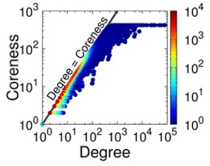

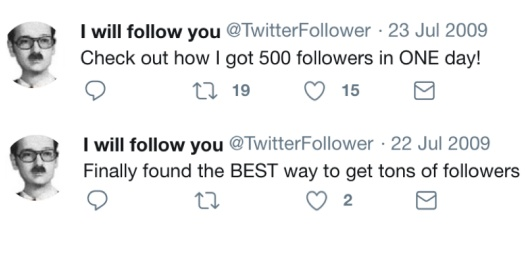

---

## Trang 16

24X
54X
●●
100
101
102
103
101 102 103 104
Elapsed Time (sec)
Density (Accuracy)
M-Zoom
CPD
CrossSpot
(a) Fast & Accurate
●
●
●
●
101
102
103
106 107 108 109
Number of Non−zeros
Elapsed Time (sec)
Running Time 
of M-Zoom
Linear 
scalability
(b) Scalable
|||
||||
||||||||||
|||||||||||
|||||| ||||||||||||
||||| ||||| ||||||||||||||||||||||||||||
||||||||||||||
||||||||||||| ||
||||||||||||||||
|||||||||
5 10 15 20
Time (Hour)
Wikipedia Pages
(c) Effective: Edit Wars (d) Effective: Bots
Figure 4.2: (a) M-ZOOM, devised for Problem 4.2, is faster with similar or better accuracy than its
best competitors. (b) M-ZOOM scales linearly with the size of the input tensor. (c)-(d) M-ZOOM spots
interesting anomalies in real-world tensors, including edit wars and bots in Wikipedia.
Problem 4.2 (Detecting Dense Subtensors in a Static Tensor).
(1) Given:
• a static tensor
• the number of subtensors that we aim to find: k
• a density measure: ρ
(2) Find: k subtensors
(3) to Maximize: the density in terms of ρ
Approach: Our algorithm M-ZOOM (Multi-dimensional Zoom) repeats the following steps k times
for detecting k dense subtensors:
1. Greedy search: Starting from the input tensor, remove the slices one at a time in a greedy manner
so that the density is maximized. Once all the slices are removed, return the densest subtensor
among those encountered during the search.
2. Local search (optional): Starting from the subtensor obtained in the previous step, repeatedly
add or remove a slice in a greedy manner so that the density is maximized. Once a local optimum
is reached, return the current subtensor.
3. Deflation: Remove the entries belonging to the subtensor obtained in the previous step from the
input tensor to prevent the same subtensor from being found again.
Results: As seen in Figure 4.2(a), M-ZOOM is up to 114× faster with similar or better accuracy than
its best competitor in our experiments with four reasonable density measures. As shown in Theorem 4.3
and Figure 4.2(b), M-ZOOM has near-linear scalability with an approximation guarantee. Subtensors
spotted by M-ZOOM in real-world tensors indicate interesting anomalies including edit wars and bot
activity in Wikipedia (see Figure 4.2(c)-(d)) and network intrusion.
Theorem 4.3 (
1
N
-Approximation Guarantee of M-ZOOM [SHF18][PDF]). Assume an N-order input
tensor T ∈ R
I1×···×IN with M non-zero entries. Let T
∗
be its densest subtensor and I = max({In}
N
n=1)
be the largest dimensionality. Then, the greedy search step of M-ZOOM takes O(NM log(I)) returning
a subtensor T
0
satisfying the following condition:
ρavg(T
0
) ≥
1
N
ρavg(T
∗
), (4.1)
where ρavg measures the average weighted degree of the slices of a given subtensor.
16

### Hình ảnh trên trang

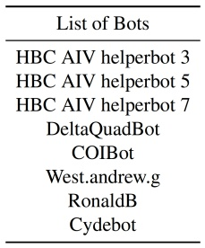

**OCR trong hình (theo thứ tự đọc):**

|  |  |
| --- | --- |
| List of Bots |  |
|  |  |
| HBC AIV helperbot | 3 |
| HBC AIV helperbot | 2 |
| HBC AIV helperbot | 2 |
| DeltaQuadBot |  |
| COIBot |  |
| West.andrew.g |  |
| RonaldB |  |
| Cydebot |  |

---

## Trang 17

2X
47X
●●
106
107
108
109
102 103 104 105
Memory Req. (MB)
Accuracy (Density)
D-Cube
CPD
CrossSpot
M-Zoom
(a) Efficient & Accurate (b) Fast & Scalable (c) Effective: Spam Reviews (d) Effective: Network Attacks
Figure 4.3: (a)-(b) D-CUBE, devised for Problem 4.2 with web-scale input tensors, is more memory￾efficient and scalable with similar or better accuracy than its best competitors. (c)-(d) D-CUBE spots
interesting anomalies in real-world tensors, including spam reviews and network attacks.
4.2.2 Detecting Dense Subtensors in Web-scale Static Tensors
Section based on work that appeared at WSDM17 [SHKF17a][PDF] and its extension [SHKF18][PDF].
Goal: “Given a tensor that is too large to fit in memory or even on a disk, how can we find dense
subtensors without sacrificing speed and accuracy provided by in-memory algorithms?” M-ZOOM,
explained in the previous section, is inefficient for tensors stored on disk or distributed across multiple
machines due to its highly iterative nature. For dense-subtensor detection (described in Problem 4.2) in
web-scale tensors, we devise out-of-core and distributed algorithms. Specifically, our goal is to design
algorithms that require few scans of data while providing the same accuracy guarantee of M-ZOOM.
Approach: Our algorithm D-CUBE (Disk-based Dense-block Detection) repeats the following steps k
times for detecting k dense subtensors:
1. Aggressive greedy search: Starting from the input tensor, repeats the following substeps until
all the slices are removed:
1-1. choose a mode n with largest dimensionality (or choose a mode n greedily)
1-2. remove the n-mode slices whose weighted degree is less than or equal to θ (≥ 1) times the
average weighted degree of the n-mode slices.
Return the densest subtensor among those encountered during the search.
2. Deflation: Remove the entries belonging to the subtensor obtained in the previous step from the
input tensor to prevent the same subtensor from being found again.
Note that the greedy search step of D-CUBE removes slices more aggressively requiring fewer scans of
the input tensor than that of M-ZOOM.
Results: As shown in Figure 4.3(a) and Theorem 4.4, D-CUBE requires up to 1600× less memory and
fewer scans of the input tensor than M-ZOOM, while achieving theoretically and empirically similar
accuracy. As a result, as seen in Figure 4.3(b), D-CUBE, especially its Hadoop implementation, suc￾cessfully handles terabyte-scale tensors. Subtensors spotted by D-CUBE in real-world tensors indicate
interesting anomalies, including spam reviews and network intrusion (see Figures 4.3(c)-(d)).
Theorem 4.4 (
1
θN -Approximation Guarantee of D-CUBE [SHKF18][PDF]). Assume an N-order input
tensor T ∈ R
I1×···×IN with M non-zero entries. Let T
∗
be its densest subtensor and I = max({In}
N
n=1)
be the largest dimensionality. Then, the greedy search step of D-CUBE requires O(N min(logθ
I, I))
scans of the input tensor, returning a subtensor T
0
satisfying the following condition:
ρavg(T
0
) ≥
1
θN ρavg(T
∗
),
where ρavg measures the average weighted degree of the slices of a given subtensor.
17

### Hình ảnh trên trang

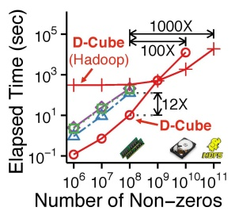

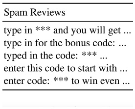

**OCR trong hình (theo thứ tự đọc):**

| Spam Reviews |
| --- |
| type in **** and you will get ... |
| type in for the bonus code: ... |
| typed in the code: **** ... |
| enter this code to start with ... |
| enter code: **** to win even ... |

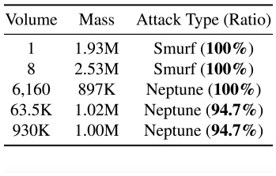

**OCR trong hình (theo thứ tự đọc):**

| Volume | Mass | Attack Type (100%) |
| --- | --- | --- |
| 1 | 1 | Smurf (100%) |
| 8 | 2,934 | Smurf (100%) |
| 6,160 | 897K | Neptune (100%) |
| 63.5K | 1,019 | Neptune (94.7%) |
| 930K | 1,004 | Neptune (94.7%) |

---

## Trang 18

50
100
0 5e+6 1e+7
Number of Non−zeros
Accuracy (density)
DenseStream
CPD
M-Zoom
CrossSpot
(a) ‘Any Time’ & Accurate 6X
1600X
●●
101
102
10−2 100 102
Elapsed Time (sec)
Density (Accuracy)
DenseStream
(an update)
CPD
M-Zoom
CrossSpot
(b) Fast & Accuracy (c) Effective: Rating Attacks (d) Effective: Network Attacks
Figure 4.4: (a)-(b) DENSESTREAM, devised for Problem 4.5, maintains and updates a dense subtensor
rapidly as accurate as the best batch algorithms. (c)-(d) In real-world dynamic tensors, DENSESTREAM
spots interesting anomalies, including rating manipulations and network attacks.
4.2.3 Detecting Dense Subtensors in Dynamic Tensors
Section based on work that appeared at KDD17 [SHKF17b][PDF].
Goal: “Given a dynamic tensor that changes over time, how can we maintain and update a dense
subtensor with approximation guarantees?” For real-time detection of fraudulent lock-step behavior, we
develop an incremental algorithm that detects a dense subtensor in a dynamic tensor whose entries can
both increase and decrease over time. Our goal is to maintain and update a dense subtensor significantly
faster than running batch algorithms while providing the same accuracy guarantee. Different from the
previous task, we use one specific density measure for this task, as described in Problem 4.5.
Problem 4.5 (Detecting a Dense Subtensor in a Dynamic Tensor).
(1) Given: a dynamic tensor that changes over time
(2) Maintain & Update: a subtensor
(3) to Maximize: the density in terms of ρavg (i.e., the average weighted degree of the slices).
Approach: In addition to the maintained subtensor, our algorithm DENSESTREAM maintains a sum￾mary of the N-order input tensor that is sufficient to (a) decide whether the maintained subtensor needs
to be updated and (b) find a dense subtensor with a 1
N
-approximation guarantee. The summary con￾sists of a D-order of the slices, which is an order by which M-ZOOM (explained in Section 4.2.1) may
remove the slices, and two real numbers per slice.
Whenever there is a change in the input tensor, DENSESTREAM performs the following steps:
1. Find Range: Find a range of the maintained D-order that needs to be reordered.
2. Reorder: Reorder the slices in the range from the previous step and update their statistics.
3. Update Subtensor (performed only when necessary): Find a new dense subtensor rapidly using
the D-order from the previous step, and replace the old subtensor with the new one.
Empirically, the region in the first step is usually narrow and the last step is rarely performed.
Results: Our algorithm DENSESTREAM maintains a dense subtensor as accurate as the best batch algo￾rithms, as seen in Figure 4.4(a). Moreover, DENSESTREAM gives a 1
N
-approximation guarantee (i.e.,
Eq. (4.1) in Theorem 4.3). As shown in Figure 4.4(b), an update by DENSESTREAM is up to a mil￾lion times faster than running the batch algorithms. In dynamic tensors where only recent entries are
maintained (while old entries are discarded), DENSESTREAM detects interesting anomalies, including
rating manipulations and network attacks, shown in Figure 4.4(c)-(d).
18

### Hình ảnh trên trang

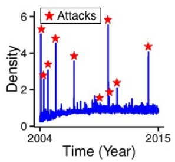

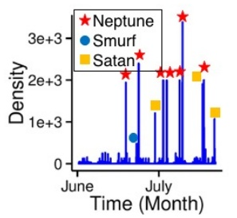

---

## Trang 19

Chapter 5
Behavior Modeling
We present our completed and proposed work on behavior modeling. For each completed task, we
briefly summarize our goal, approach, and results. References for detailed discussions are given at the
beginning of each section. For the proposed task, we give a brief description of our goal and plan.
5.1 Modeling Progressive Behavior on Social Media
Section based on work that will appear at WWW18 [SSK+18][PDF].
Goal: “How do the behaviors of users in a web service progress over time?” Given behavior logs,
which are modeled as a 3-order tensor whose modes are users, features, and timestamps, our goal is
to discover progression stages that many users go through. Specifically, through the stages, we aim to
capture the followings:
• changes in frequently-used features,
• changes in the frequency of use,
• different directions of progression (unless every user follows the same direction).
We also aim to address scalability issues in handling web-scale behavior logs. An informal definition
of progressive behavior modeling is provided in Problem 5.1.
Problem 5.1 (Progressive Behavior Modeling).
(1) Given:
• a behavior log (i.e., a 3-order tensor whose modes are users, features, and timestamps)
• the number of desired stages: k
(2) Segment: the records in the log into k stages
(3) to Best Describe: the progression of the users in the log
Approach: We build a behavior model where types of actions (or types of used features), time gaps
between consecutive actions, and transitions to next stages depend on the current stage that each user
lies in. In our model, to capture progression (instead of cyclic patterns), we assume that there is an order
among the stages, and we allow the users to progress to next stages but not to return to previous stages.
This constraint is exploited also when we devise parallel, out-of-core, and distributed optimization
algorithms to fit our model to log data. Our algorithms repeat the following two steps until convergence:
• Assignment: assign the actions to stages while fixing the probability distributions in the stages,
• Update: update the probability distributions in the stages while fixing the stage assignment.
19

---

## Trang 20

[Profile]
build one’s 
profile
[On-boarding Processes]
connect to 
members in 
the same 
institution
invite non￾members 
from one’s 
address book
connect to 
members 
from one’s 
address book
[Poke]
poke around 
the service
[Grow]
grow one’s 
social network
[Explore]
consume the 
service
(a) Effectiveness: prgressive behavior of members of a social networking service
● ● ● ● ● ●
●
●
●
●
●
● ● ● ● ● ●
●
●
●
●
●
● ● ● ● ● ●
●
●
●
●
●
10−1
101
103
105
107 108 109 1010 1011 1012
Total Number of Actions
Elapsed Time 
 Per Iteration (sec)
distributed
in-memory
out-of- core
o.o.m o.o.d
(b) Speed & Scalability
Figure 5.1: (a) Summary of the latent progression stages that our model discovers in a dataset from a
social networking service. The second, third, and fourth stages correspond to the onboarding steps that
the service provides to new users. (b) Linear scalability of our optimization algorithms (o.o.m: out of
memory & o.o.d: out of disk). The distributed version successfully handles a billion-scale dataset.
Results: Our model discovers meaningful stages in real-world datasets from a social networking ser￾vice, as seen in Figure 5.1(a). We also show that our trained models are useful for downstream tasks
such as prediction of future actions. As seen in Figure 5.1(b), our algorithms scale linearly with the
size of data. Especially, the distributed version successfully handles a dataset with one billion actions.
5.2 Modeling Purchasing Behavior in Social Networks
Section based on work that appeared at IJCAI17 [SLEP17][PDF].
Goal: “How does the underlying social network affect the individuals’ purchase of sharable goods
(e.g., ski gear, hiking equipment, etc.)?” We investigate the incentive to buy a good sharable with
k-hop neighbors (i.e., the nodes within k hops from a buyer) to answer the following questions:
• How does the connectivity of a node relate to its tendency to buy such a sharable good?
• How inefficient can individually optimal choices be compared to socially optimal choices?
• How does the inefficiency depend on the structure of the social network and rental fees?
Approach: We build a game-theoretic model where each node decides whether to (a) buy a good or (b)
rent a good from one of its k-hop neighbors who buy a good. In our model, each node prefers to buy
a good if at least ξ nodes rent its good (ξ = ∞ if no rental fee is charged) or it does not have a k-hop
neighbor who buys a good. Otherwise, each node prefers to rent a good. We define the inefficiency
of a Nash equilibrium (NE) as the the number of buyers in the NE divided by that in socially optimal
Buy Not Buy Rent
1 2
3
4 5
6
(a) NE (cost= 1)
1 2
3
4 5
6
(b) NE (cost= 2)
1 2
3
4 5
6
(c) Not NE
Figure 5.2: Example outcomes of our game-theoretic model when k = 1 and ξ = 2: (a) an efficient
Nash equilibrium (NE) with the minimum number of buyers, (b) an inefficient NE with more buyers,
(c) an outcome that is not an NE (Node 5 prefers renting a good from node 3 to buying a good).
20

### Hình ảnh trên trang

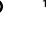

**OCR trong hình (theo thứ tự đọc):**

↑

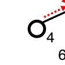

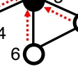

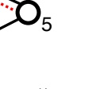

**OCR trong hình (theo thứ tự đọc):**

5

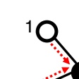

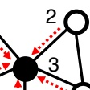

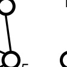

**OCR trong hình (theo thứ tự đọc):**

- - - - -

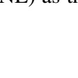

**OCR trong hình (theo thứ tự đọc):**

LEVELS
and
classifications

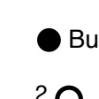

**OCR trong hình (theo thứ tự đọc):**

Bu
20

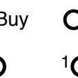

**OCR trong hình (theo thứ tự đọc):**

| Buy | C |
| --- | --- |
| () | 1C |

---

## Trang 21

●
●
●
●
●
●
●
●
●
●
●
●
●
●
●
●
●
●
1000
1500
2000
2500
0.0 0.5 1.0
Social Cost
Theoretically 
optimal 
rental fee
Rental Fee (Relative to Purchase Cost)
ξ = ∞ ξ < ∞
k = 1 PoA Θ(n)
Θ(n)
PoS Θ(ξ) (= 1 if ξ ≤ 2)
k > 1
PoA Θ(n/k)
Θ(max(n/k, n/ξ))
PoS Θ(ξ/k) (= 1 if ξ ≤ 2bk/2c + 1)
(a) Inefficiency of NEs in our simulation (k = 1) (d) Inefficiency of NEs in our analysis
Figure 5.3: Summary of our simulation and theoretical analysis of the inefficiency of Nash Equilibria
(NEs). The inefficiency of NEs tends to decrease as we increase the rental fee (i.e., as we decrease ξ).
outcomes (see Figure 5.2 for examples). We analyze the inefficiency of NEs experimentally using
simulations of best-response dynamics and theoretically in terms of the price of anarchy (PoA) (i.e.,
inefficiency of the worst NE) and the price of stability (PoS) (i.e., inefficiency of the best NE)
Results: As seen in Figure 5.3, both our simulation and theoretical analysis show that the inefficiency
of NEs tends to decrease as we increase the rental fee (i.e., as we decrease ξ). This is because a higher
rental fee gives nodes with high connectivity, who can share their goods with many other nodes, more
incentives to buy a good. Moreover, our simulation shows that the inefficiency tends to be high in social
networks with highly skewed degree distributions (e.g., star graphs).
5.3 [Proposed] Modeling Polarization in Social Networks
“How does individuals’ perspective on controversial issues (e.g., marijuana, abortion, etc.) affect the
dynamics of the underlying social network and vice versa?” Our goal is to study the (a) effects of
individuals’ belief on the dynamics of the underlying social network and (b) the effects of the social
network on the individuals’ belief. For example, one question we have is how each node in a social
network chooses between (a) aligning its belief to that of its current neighbors and (b) changing its
edges towards nodes with the same belief?
To this end, we will build a game-theoretic model where the utility of each node in a social network
depends on factors such as:
• cost of changing one’s belief
• the number of neighbors with the same belief
• the number of triangles that each node forms with its neighbors with the same belief.
We plan to fit our model (e.g., by [Kos04]) to real-world datasets (e.g., datasets collected from the
NetSense project [SLM+13]) to measure how much each factor contributes to the utility. We also plan
to use our model to predict future beliefs of nodes, appearance of edges, and disappearance of edges.
21

---

## Trang 22

Chapter 6
Timelines
My expected timeline is provided in Table 6.1.
Table 6.1: My expected timeline.
Time Tasks Expected outputs
March 2018 thesis proposal
March–May 2018 S1-3: counting triangles in graph a new conference paper
streams with deletions (§ 3.1.3)
June–August 2018 B3: modeling polarization in social a new conference paper
networks (§ 5.3)
September–October 2018 S2-2: decomposing tensors with journal extension of [OSP+17]
skewed degree distributions (§ 3.3.2)
November 2018–February 2019 thesis writing & job applications
March–April 2019 interviewing
May 2019 thesis defense
22

---

## Trang 23

Chapter 7
Conclusions
In this thesis, we address the problem of mining large dynamic graphs and tensors. Specifically, we
develop models and algorithms for structure analysis, anomaly detection, and behavior modeling.
Structure analysis (Chapter 3): We develop streaming algorithms for three important connectivity
measures: global triangle count, local triangle counts, and degeneracy. For accuracy, our algorithms
exploit structural and temporal patterns in real graphs and utilize multiple machines. We also improve
the scalability of Tucker Decomposition, which is widely used to summarize tensors, by reducing in￾termediate data. We propose to extend our streaming algorithms to fully dynamic graphs with deletions
and exploit structural patterns in real tensors to speed up Tucker Decomposition.
Anomaly detection (Chapter 4): We devise an algorithm that seeks subgraphs deviating from a
structural pattern. Such subgraphs signal various anomalies including a follower-booster in Twitter and
copy-and-paste bibliographies. We also develop an algorithm that searches densest subtensors in near￾linear time with approximation guarantees. The algorithm and its extensions to web-scale and dynamic
tensors successfully spot spam reviews, rating manipulations, network attacks, bots, etc.
Behavior modeling (Chapter 5): We model progression of users in a web service as transitions
between stages and develop scalable optimization algorithms that fit our stage model to billion-scale
behavior logs. In addition, we model the purchase of goods sharable with neighbors in a social network
as a game among the nodes. We use our model to analyze the effects of structure of social networks
and rental fees on social inefficiency. Then, we propose to design a game-theoretic model that relates
beliefs of nodes to the dynamics of the underlying social network, which we aim to predict.
For reproducibility and the benefit of the community, we make most of the algorithms and datasets
used throughout this thesis available at http://www.cs.cmu.edu/˜kijungs/proposal/.
23

---

## Trang 24

Bibliography
[ADK+08] Elliot Anshelevich, Anirban Dasgupta, Jon Kleinberg, Eva Tardos, Tom Wexler, and Tim
Roughgarden. The price of stability for network design with fair cost allocation. SIAM
Journal on Computing, 38(4):1602–1623, 2008. A
[AhBV08] Jose Ignacio Alvarez-hamelin, Alain Barrat, and Alessandro Vespignani. k-core decom￾position of internet graphs: hierarchies, self-similarity and measurement biases. In Net￾works and Heterogeneous Media. Citeseer, 2008. A
[AHDBV06] J Ignacio Alvarez-Hamelin, Luca Dall’Asta, Alain Barrat, and Alessandro Vespignani.
Large scale networks fingerprinting and visualization using the k-core decomposition. In
Advances in neural information processing systems, pages 41–50, 2006. A
[All15] N. Allouch. On the private provision of public goods on networks. Journal of Economic
Theory, 157:527–552, 2015. A
[AMF10] Leman Akoglu, Mary McGlohon, and Christos Faloutsos. Oddball: spotting anomalies in
weighted graphs. In Pacific-Asia Conference on Knowledge Discovery and Data Mining,
pages 410–421. Springer, 2010. A
[ATK15] Leman Akoglu, Hanghang Tong, and Danai Koutra. Graph based anomaly detection and
description: a survey. Data Mining and Knowledge Discovery, 29(3):626–688, 2015. A
[BA99] Albert-Laszl ´ o Barab ´ asi and R ´ eka Albert. Emergence of scaling in random networks. ´
science, 286(5439):509–512, 1999. A
[BCAZ06] C. Ballester, A. Calvo-Armengol, and Y. Zenou. Who’s who in networks. Wanted: the ´
key player. Econometrica, 74(5):1403–1417, 2006. A
[BK07] Y. Bramoulle and R. Kranton. Public goods in networks. ´ Journal of Economic Theory,
135(1):478–494, 2007. A
[BKD14] Y. Bramoulle, R. Kranton, and M. D’amours. Strategic interaction and networks. ´ The
American Economic Review, 104(3):898–930, 2014. A
[BKV12] Bahman Bahmani, Ravi Kumar, and Sergei Vassilvitskii. Densest subgraph in streaming
and mapreduce. Proceedings of the VLDB Endowment, 5(5):454–465, 2012. A
[Bro98] Rasmus Bro. Muti-way analysis in the food industry, models, algorithms and applica￾tions. PhD Thesis, University of Amsterdam, 1998. A
[BXG+13] Alex Beutel, Wanhong Xu, Venkatesan Guruswami, Christopher Palow, and Christos
Faloutsos. Copycatch: stopping group attacks by spotting lockstep behavior in social
networks. In Proceedings of the 22nd international conference on World Wide Web,
pages 119–130. ACM, 2013. A
[BZ03] Vladimir Batagelj and Matjaz Zaversnik. An o (m) algorithm for cores decomposition of
24

---

## Trang 25

networks. arXiv preprint cs/0310049, 2003. 1, A
[CHM+00] Igor Cadez, David Heckerman, Christopher Meek, Padhraic Smyth, and Steven White.
Visualization of navigation patterns on a web site using model-based clustering. In Pro￾ceedings of the sixth ACM SIGKDD international conference on Knowledge discovery
and data mining, pages 280–284. ACM, 2000. A
[DFA+15] Nan Du, Mehrdad Farajtabar, Amr Ahmed, Alexander J Smola, and Le Song. Dirichlet￾hawkes processes with applications to clustering continuous-time document streams. In
Proceedings of the 21th ACM SIGKDD International Conference on Knowledge Discov￾ery and Data Mining, pages 219–228. ACM, 2015. A
[DGCW13] Ian Davidson, Sean Gilpin, Owen Carmichael, and Peter Walker. Network discovery via
constrained tensor analysis of fmri data. In Proceedings of the 19th ACM SIGKDD in￾ternational conference on Knowledge discovery and data mining, pages 194–202. ACM,
2013. A
[EG13] Matthew Elliott and Benjamin Golub. A network approach to public goods. In Proceed￾ings of the fourteenth ACM conference on Electronic commerce, pages 377–378. ACM,
2013. A
[EM02] Jean-Pierre Eckmann and Elisha Moses. Curvature of co-links uncovers hidden the￾matic layers in the world wide web. Proceedings of the national academy of sciences,
99(9):5825–5829, 2002. A
[FCT14] Martin Farach-Colton and Meng-Tsung Tsai. Computing the degeneracy of large graphs.
In Latin American Symposium on Theoretical Informatics, volume 8392, pages 250–260,
2014. A
[FTG16] Hadi Fanaee-T and Joao Gama. Tensor-based anomaly detection: An interdisciplinary ˜
survey. Knowledge-Based Systems, 98:130–147, 2016. A
[GGJ+10] Andrea Galeotti, Sanjeev Goyal, Matthew O Jackson, Fernando Vega-Redondo, and
Leeat Yariv. Network games. The review of economic studies, 77(1):218–244, 2010.
A
[GMTV14] Christos Giatsidis, Fragkiskos D Malliaros, Dimitrios M Thilikos, and Michalis Vazir￾giannis. Corecluster: A degeneracy based graph clustering framework. In AAAI, vol￾ume 14, pages 44–50, 2014. A
[GSERF16] Priya Govindan, Sucheta Soundarajan, Tina Eliassi-Rad, and Christos Faloutsos. Nim￾blecore: A space-efficient external memory algorithm for estimating core numbers. In
IEEE/ACM International Conference on Advances in Social Networks Analysis and Min￾ing, pages 207–214. IEEE, 2016. A
[HL71] Paul W Holland and Samuel Leinhardt. Transitivity in structural models of small groups.
Comparative Group Studies, 2(2):107–124, 1971. A
[HSS+17] Bryan Hooi, Kijung Shin, Hyun Ah Song, Alex Beutel, Neil Shah, and Christos Falout￾sos. Graph-based fraud detection in the face of camouflage. ACM Transactions on
Knowledge Discovery from Data (TKDD), 11(4):44, 2017. A
[JBC+16] Meng Jiang, Alex Beutel, Peng Cui, Bryan Hooi, Shiqiang Yang, and Christos Falout￾sos. Spotting suspicious behaviors in multimodal data: A general metric and algorithms.
IEEE Transactions on Knowledge and Data Engineering, 28(8):2187–2200, 2016. A
25

---

## Trang 26

[JCB+14] Meng Jiang, Peng Cui, Alex Beutel, Christos Faloutsos, and Shiqiang Yang. Inferring
strange behavior from connectivity pattern in social networks. In Pacific-Asia Conference
on Knowledge Discovery and Data Mining, pages 126–138. Springer, 2014. A
[JPF+16] Inah Jeon, Evangelos E Papalexakis, Christos Faloutsos, Lee Sael, and U Kang. Mining
billion-scale tensors: algorithms and discoveries. The VLDB Journal, 25(4):519–544,
2016. 3.2, A
[JSP13] Madhav Jha, Comandur Seshadhri, and Ali Pinar. A space efficient streaming algo￾rithm for triangle counting using the birthday paradox. In Proceedings of the 19th ACM
SIGKDD international conference on Knowledge discovery and data mining, pages 589–
597. ACM, 2013. A
[JZ14] M. O Jackson and Y. Zenou. Games on networks. In Handbook of Game Theory, vol￾ume 4. North-Holland, 2014. A
[KB09] Tamara G Kolda and Brett W Bader. Tensor decompositions and applications. SIAM
review, 51(3):455–500, 2009. 3.8, A
[Kos04] Johan Koskinen. Essays on Bayesian inference for social networks. PhD thesis, PhD
Thesis, Statistiska Institutionen, 2004. 5.3
[KP99] Elias Koutsoupias and Christos Papadimitriou. Worst-case equilibria. In Proceedings of
the 16th annual conference on Theoretical aspects of computer science, pages 404–413.
Springer, 1999. A
[KPHF12] U Kang, Evangelos Papalexakis, Abhay Harpale, and Christos Faloutsos. Gigatensor:
scaling tensor analysis up by 100 times-algorithms and discoveries. In Proceedings of the
18th ACM SIGKDD international conference on Knowledge discovery and data mining,
pages 316–324. ACM, 2012. A
[KS08] Tamara G Kolda and Jimeng Sun. Scalable tensor decompositions for multi-aspect data
mining. In IEEE Eighth International Conference on Data Mining, pages 363–372.
IEEE, 2008. 3.3.1, 3.2, A
[KS09] Samir Khuller and Barna Saha. On finding dense subgraphs. In Proceedings of the 36th
International Colloquium on Automata, Languages and Programming, pages 597–608.
Springer-Verlag, 2009. A
[LHS+17] Hemank Lamba, Bryan Hooi, Kijung Shin, Christos Faloutsos, and Jurgen Pfeffer. zoo r ¨
ank: Ranking suspicious entities in time-evolving tensors. In Joint European Conference
on Machine Learning and Knowledge Discovery in Databases, pages 68–84. Springer,
2017. A
[LK15] Yongsub Lim and U Kang. Mascot: Memory-efficient and accurate sampling for count￾ing local triangles in graph streams. In Proceedings of the 21th ACM SIGKDD Inter￾national Conference on Knowledge Discovery and Data Mining, pages 685–694. ACM,
2015. 3.1, A
[LSY98] Richard B Lehoucq, Danny C Sorensen, and Chao Yang. ARPACK users’ guide: solution
of large-scale eigenvalue problems with implicitly restarted Arnoldi methods. SIAM,
1998. 3.3.1
[ML13] Julian John McAuley and Jure Leskovec. From amateurs to connoisseurs: modeling the
evolution of user expertise through online reviews. In Proceedings of the 22nd interna￾tional conference on World Wide Web, pages 897–908. ACM, 2013. A
26

---

## Trang 27

[MS16] Yasuko Matsubara and Yasushi Sakurai. Regime shifts in streams: Real-time forecasting
of co-evolving time sequences. In KDD, pages 1045–1054, 2016. A
[MSLC01] Miller McPherson, Lynn Smith-Lovin, and James M Cook. Birds of a feather: Ho￾mophily in social networks. Annual review of sociology, 27(1):415–444, 2001. A
[New02] Mark EJ Newman. Assortative mixing in networks. Physical review letters,
89(20):208701, 2002. A
[OSP+17] Jinoh Oh, Kijung Shin, Evangelos E Papalexakis, Christos Faloutsos, and Hwanjo Yu.
S-hot: Scalable high-order tucker decomposition. In Proceedings of the Tenth ACM
International Conference on Web Search and Data Mining (WSDM), pages 761–770.
ACM, 2017. 1, 1.2, 3.3.1, 6.1
[PCWF07] Shashank Pandit, Duen Horng Chau, Samuel Wang, and Christos Faloutsos. Netprobe: a
fast and scalable system for fraud detection in online auction networks. In Proceedings
of the 16th international conference on World Wide Web, pages 201–210. ACM, 2007. A
[PFS15] Evangelos E Papalexakis, Christos Faloutsos, and Nicholas D Sidiropoulos. Parcube:
Sparse parallelizable candecomp-parafac tensor decomposition. ACM Transactions on
Knowledge Discovery from Data (TKDD), 10(1):3, 2015. A
[PSS+10] B Aditya Prakash, Ashwin Sridharan, Mukund Seshadri, Sridhar Machiraju, and Christos
Faloutsos. Eigenspokes: Surprising patterns and scalable community chipping in large
graphs. In Pacific-Asia Conference on Knowledge Discovery and Data Mining, pages
435–448. Springer, 2010. A
[PTTW13] Aduri Pavan, Kanat Tangwongsan, Srikanta Tirthapura, and Kun-Lung Wu. Counting
and sampling triangles from a graph stream. Proceedings of the VLDB Endowment,
6(14):1870–1881, 2013. A
[RA15] Shebuti Rayana and Leman Akoglu. Collective opinion spam detection: Bridging re￾view networks and metadata. In Proceedings of the 21th ACM SIGKDD International
Conference on Knowledge Discovery and Data Mining, pages 985–994. ACM, 2015. A
[SBGF14] Neil Shah, Alex Beutel, Brian Gallagher, and Christos Faloutsos. Spotting suspicious
link behavior with fbox: An adversarial perspective. In IEEE 14th International Confer￾ence on Data Mining, pages 959–964. IEEE, 2014. A
[SDLF+17] Nicholas D Sidiropoulos, Lieven De Lathauwer, Xiao Fu, Kejun Huang, Evangelos E
Papalexakis, and Christos Faloutsos. Tensor decomposition for signal processing and
machine learning. IEEE Transactions on Signal Processing, 65(13):3551–3582, 2017.
A
[SERF16] Kijung Shin, Tina Eliassi-Rad, and Christos Faloutsos. Corescope: Graph mining using
k-core analysispatterns, anomalies and algorithms. In IEEE 16th International Confer￾ence on Data Mining, pages 469–478. IEEE, 2016. 1, 1.1, 1.2, 3.2, 4.1
[SERF18] Kijung Shin, Tina Eliassi-Rad, and Christos Faloutsos. Patterns and anomalies in k-cores
of real-world graphs with applications. Knowledge and Information Systems (KAIS),
54(3):677–710, 2018. 1, 1.1, 1.2, 3.2, 4.1
[SERU17] Lorenzo De Stefani, Alessandro Epasto, Matteo Riondato, and Eli Upfal. Triest: count- `
ing local and global triangles in fully dynamic streams with fixed memory size. ACM
Transactions on Knowledge Discovery from Data (TKDD), 11(4):43, 2017. 3.1, A
27

---

## Trang 28

[SHF16] Kijung Shin, Bryan Hooi, and Christos Faloutsos. M-zoom: Fast dense-block detection
in tensors with quality guarantees. In Joint European Conference on Machine Learn￾ing and Knowledge Discovery in Databases (ECML/PKDD), pages 264–280. Springer,
2016. 1, 1.2, 4.2.1
[SHF18] Kijung Shin, Bryan Hooi, and Christos Faloutsos. Fast, accurate and flexible algorithms
for dense subtensor mining. ACM Transactions on Knowledge Discovery from Data
(TKDD), 12(3):28:1–28:30, 2018. 1, 1.2, 4.2.1, 4.3
[Shi17] Kijung Shin. Wrs: Waiting room sampling for accurate triangle counting in real graph
streams. In IEEE 17th International Conference on Data Mining, pages 1087–1092.
IEEE, 2017. 1, 1.2, 3.1.1, 3.3, 3.1
[SHKF17a] Kijung Shin, Bryan Hooi, Jisu Kim, and Christos Faloutsos. D-cube: Dense-block detec￾tion in terabyte-scale tensors. In Proceedings of the Tenth ACM International Conference
on Web Search and Data Mining (WSDM), pages 681–689. ACM, 2017. 1, 1.2, 4.2.2
[SHKF17b] Kijung Shin, Bryan Hooi, Jisu Kim, and Christos Faloutsos. Densealert: Incremental
dense-subtensor detection in tensor streams. In Proceedings of the 23rd ACM SIGKDD
International Conference on Knowledge Discovery and Data Mining, pages 1057–1066,
2017. 1, 1.2, 4.2.3
[SHKF18] Kijung Shin, Bryan Hooi, Jisu Kim, and Christos Faloutsos. Out-of-core and distributed
algorithms for dense subtensor mining. arXiv preprint arXiv:1802.01065, 2018. 1, 1.2,
4.2.2, 4.4
[SHL+18] Kijung Shin, Mohammad Hammoud, Euiwoong Lee, Jinoh Oh, and Christos Faloutsos.
Tri-fly: Distributed estimation of global and local triangle counts in graph streams. In
PAKDD, 2018. 1, 1.2, 3.1.2, 3.1.2
[SLEP17] Kijung Shin, Euiwoong Lee, Dhivya Eswaran, and Ariel D. Procaccia. Why you should
charge your friends for borrowing your stuff. In Proceedings of the Twenty-Sixth Inter￾national Joint Conference on Artificial Intelligence (IJCAI), pages 395–401, 2017. 1,
1.1, 1.2, 5.2
[SLM+13] Aaron Striegel, Shu Liu, Lei Meng, Christian Poellabauer, David Hachen, and Omar
Lizardo. Lessons learned from the netsense smartphone study. ACM SIGCOMM Com￾puter Communication Review, 43(4):51–56, 2013. 5.3
[SLO+18] Kijung Shin, Euiwoong Lee, Jinoh Oh, Mohammad Hammoud, and Christos Falout￾sos. Dislr: Distributed sampling with limited redundancy for triangle counting in graph
streams. arXiv preprint arXiv:1802.04249, 2018. 1, 1.2, 3.1.2, 3.1.2, 3.5
[SSK17] Kijung Shin, Lee Sael, and U Kang. Fully scalable methods for distributed tensor factor￾ization. IEEE Transactions on Knowledge and Data Engineering, 29(1):100–113, 2017.
A
[SSK+18] Kijung Shin, Mahdi Shafiei, Myunghwan Kim, Aastha Jain, and Hema Raghavan. Dis￾covering progression stages in trillion-scale behavior logs. In Proceedings of the 27th
International Conference on World Wide Web (WWW). ACM, Forthcoming 2018. 1, 1.1,
1.2, 5.1
[SVdBS10] Tom AB Snijders, Gerhard G Van de Bunt, and Christian EG Steglich. Introduction
to stochastic actor-based models for network dynamics. Social networks, 32(1):44–60,
2010. A
28

---

## Trang 29

[SYS+13] Dafna Shahaf, Jaewon Yang, Caroline Suen, Jeff Jacobs, Heidi Wang, and Jure Leskovec.
Information cartography: creating zoomable, large-scale maps of information. In Pro￾ceedings of the 19th ACM SIGKDD international conference on Knowledge discovery
and data mining, pages 1097–1105. ACM, 2013. A
[TBG+13] Charalampos Tsourakakis, Francesco Bonchi, Aristides Gionis, Francesco Gullo, and
Maria Tsiarli. Denser than the densest subgraph: extracting optimal quasi-cliques with
quality guarantees. In Proceedings of the 19th ACM SIGKDD international conference
on Knowledge discovery and data mining, pages 104–112. ACM, 2013. A
[TKMF09] Charalampos E Tsourakakis, U Kang, Gary L Miller, and Christos Faloutsos. Doulion:
counting triangles in massive graphs with a coin. In Proceedings of the 15th ACM
SIGKDD international conference on Knowledge discovery and data mining, pages 837–
846. ACM, 2009. A
[WC12] Jia Wang and James Cheng. Truss decomposition in massive networks. Proceedings of
the VLDB Endowment, 5(9):812–823, 2012. A
[WF94] Stanley Wasserman and Katherine Faust. Social network analysis: Methods and appli￾cations, volume 8. Cambridge university press, 1994. A
[WHL13] Cheng Wang, David S Hachen, and Omar Lizardo. The co-evolution of communication
networks and drinking behaviors. In Proceedings of AAAI Fall Symposium Series, 2013.
A
[WZT+16] Gang Wang, Xinyi Zhang, Shiliang Tang, Haitao Zheng, and Ben Y Zhao. Unsuper￾vised clickstream clustering for user behavior analysis. In Proceedings of the 2016 CHI
Conference on Human Factors in Computing Systems, pages 225–236. ACM, 2016. A
[YML+14] Jaewon Yang, Julian McAuley, Jure Leskovec, Paea LePendu, and Nigam Shah. Find￾ing progression stages in time-evolving event sequences. In Proceedings of the 23rd
international conference on World wide web, pages 783–794. ACM, 2014. A
29

---

## Trang 30

Appendix A
Related Work
Analyzing Structure of Graphs and Tensors
Triangle Counting (Section 3.1): Counting triangles is a classical graph problem with numerous ap￾plications. Examples relevant to structure analysis include dense subgraph mining [WC12], and web
analysis [EM02]. Moreover, many important concepts in social network analysis, such as social bal￾ance and the clustering coefficients, are based on the count of triangles [WF94]. Due to this importance,
many algorithms have been proposed for triangle counting in different settings. For streaming settings,
which this thesis focuses on, various sampling techniques have been developed for global triangle
counting [TKMF09, JSP13, PTTW13] and local triangle counting [LK15, SERU17].
k-Cores and Degeneracy (Section 3.2): k-cores and degeneracy, defined in Section 2.1, have been
used extensively in diverse applications. Examples related to structure analysis include hierarchy anal￾ysis [AhBV08], visualization [AHDBV06], and graph clustering [GMTV14]. For the k-cores and
degeneracy in a graph fitting in memory, [BZ03] proposed a linear-time algorithm. For larger graphs,
[FCT14, GSERF16] proposed semi-streaming algorithms, which require multiple passes over data.
Tensor Decomposition (Section 3.3): Decomposing a tensor into a small core tensor and low-rank fac￾tor matrices is a widely-used summarization technique in many fields, including chemometrics [Bro98],
neuroscience [DGCW13], and signal processing [SDLF+17]. Among a variety of decomposition meth￾ods (see a survey [KB09]), the most widely-used methods in data mining are CP Decomposition and
Tucker Decomposition. Numerous techniques, including sampling [PFS15] and distributed computing
[KPHF12, SSK17], have been proposed for scalable CP Decomposition. Regarding scalable Tucker
Decomposition, previous work [KS08, JPF+16] focused on reducing intermediate data.
Detecting Anomalies in Graphs and Tensors
Anomaly Detection in Graphs (Section 4.1): A number of approaches have been proposed for detect￾ing anomalies or fraud in graphs; see a survey [ATK15]. [PCWF07, RA15] proposed semi-supervised
approaches based on belief propagation. [PSS+10, JCB+14, SBGF14] proposed unsupervised ap￾proaches based on the eigendecomposition and SVD of the adjacency matrix. Other unsupervised
approaches use egonet features [AMF10], clustering [BXG+13], or greedy search [HSS+17]. The
aforementioned approaches identify lock-step followers on Weibo [JCB+14], spam reviews on Yelp
[RA15], auction fraud on eBay [PCWF07], ‘Like’ boosting on Facebook [BXG+13], etc.
30

---

## Trang 31

Anomaly Detection in Tensors (Section 4.2): Tensor decomposition and dense-subtensor detection
are two major approaches for identifying anomalies in tensors. See a survey [FTG16] for anomaly
detection based on tensor decomposition. Regarding dense-subtensor detection, [JBC+16] proposed
a density measure and a heuristic local search algorithm for maximizing the measure. For further
analyses of detected dense subtensors, [LHS+17] proposed prioritizing the entities forming the dense
subtensors based on their contributions to the subtensors. Our work on dense-subtensor detection is
also related to theoretical work on densest-subgraph detection, especially [KS09, BKV12, TBG+13].
Modeling Behavior in Social Networks and Web
Modeling Progressive Behavior (Section 5.1): Our work is related to the large body of literature on
clustering event sequences, which has typically been used to obtain the overall view of user behaviors in
certain aspects, such as navigation patterns on websites [CHM+00], clusters of user types [WZT+16],
and topics of event streams [DFA+15]. Notably, grouping events was also used to present each entity’s
progression and thus to account for relationships between groups of events [SYS+13], regime shifts
[MS16], and evolution of users [ML13]. In particular, [YML+14] modeled the progression of entities
as transitions between latent stages to distinguish different patterns of progression.
Modeling Purchasing Behavior (Section 5.2): See [GGJ+10, JZ14] for an introduction to games on
networks in general. [BK07, BKD14, BCAZ06] studied a game on a network where each node decides
its contribution to a public good. In the game, the utility of each node depends on its contribution and
its neighbors’. Extended games with direct edges [EG13] and the combination of public and private
goods [All15] were considered. Our work is also related to the huge body of literature on the price of
anarchy [KP99] and the price of stability [ADK+08].
Modeling Polarization (Section 5.3): See [SVdBS10] for an introduction to actor-based models,
which interpret the dynamics in a network as a stochastic process driven by the nodes. Actor-based
models have considered a variety of effects, including triadic effects [HL71], degree-related effects
[BA99, New02], and exogenous effects [MSLC01]. Especially, our proposed work is closely related
to [WHL13], where it was observed that nodes with similar drinking behaviors are more likely to be
connected and nodes tend to align their drinking behaviors to those of their neighbors.
Appendix B
Datasets
The datasets used throughout the thesis are summarized in Tables B.1 and B.2. Most of the datasets are
available at http://www.cs.cmu.edu/˜kijungs/proposal/.
31

---

## Trang 32

Table B.1: Graphs used throughout thesis thesis. Most of them are available at http://www.cs.
cmu.edu/˜kijungs/proposal/.
Name Description # Nodes # Edges Related Figures
KarateClub Social Network 34 78
Hamster Friendship Network 1.86K 12.6K 3.3(a)
Facebook Friendship Network 63.7K 817K
Catster Friendship Network 150K 5.45M 3.3(a), 4.1(a)
YouTube Friendship Network 1.13M 2.99M 3.3(a), 4.1(c)
Flickr Friendship Network 1.72M 15.6M 3.3(a), 3.3(b)
Flickr(L) Friendship Network 2.30M 22.8M 3.2(a)
Orkut Friendship Network 3.07M 117M 3.3(a)
YouTube(L) Friendship Network 3.22M 9.38M
LiveJournal Friendship Network 4.00M 34.7M 3.3(a)
Friendster Friendship Network 65.6M 1.81B 3.3(a)
Advogato Trust Network 5.16K 51.1K 5.3
Epinion Truest Network 132K 711K
Twitter Subscription Network 41.7M 1.20B 1.1(a), 3.3(a), 4.1(b)
Email Email Network 36.7K 184K 3.3(a)
Email(L) Email Network 87.0K 297K
Stanford Web Graph 282K 1.99M 3.3(a)
NotreDame Web Graph 326K 1.09M 3.3(a)
BerkStan Web Graph 685K 6.65M
Google Web Graph 876K 5.10M 3.2(b)
Caida Internet Topology 26.5K 53.4K 3.3(a)
Skitter Internet Topology 1.70M 11.1M 3.3(a)
HepTh Citation Network 27.8K 352K 3.3(a)
HepPh Citation Network 34.5K 422K 3.1(a), 3.1(b), 3.1(c)
Patent Citation Network 3.77M 16.5M 3.3(a)
32

---

## Trang 33

Table B.2: Tensors used throughout thesis thesis. Most of them are available at http://www.cs.cmu.edu/˜kijungs/proposal/.
Name Modes Entries Dimensionality # Nonzeros Related Figures
Youtube User
× User
× Date 1 (Friend) or 0 3.22M
× 3.22M
× 203 18.7M 4.4(b)
SMS User
× User
× Timestamp # Messages 1.25M
× 7.00M
× 4.39K 103M
StackOver. User
× Post
× Timestamp 1 (Like) or 0 545K
× 96.7K
× 1.15K 1.30M
Wiki (Kor) User
× Page
× Timestamp # Revisions 470K
× 1.18M
× 101K 11.0M 4.2(a), 4.2(c), 4.3(a)
Wiki (Eng) User
× Page
× Timestamp # Revisions 44.1M
× 38.5M
× 129K 483M 4.2(d)
Yelp User
× Business
× Date
× Score # Reviews 552K
× 77.1K
× 3.80K
×
5 2.23M
AppMarket User
× App
× Date
× Score # Reviews 967K
× 15.1K
× 1.38K
×
5 1.13M 1.1(b), 4.3(c)
Android User
× App
× Date
× Score # Reviews 1.32M
× 61.3K
× 1.28K
×
5 2.64M 4.4(c)
Netflix User
× Movie
× Date
× Score # Reviews 480K
× 17.8K
× 2.18K
×
5 99.1M
YahooMusic User
× Item
× Date
× Score
× # Reviews 1.00M
× 625K
× 84.4K
× 101 253M
Academic Author
× Venue # Papers 9.38M
× 18.9K 35.4M 3.5(a), 3.5(b)
× Year
× Keyword
× 2.02K
× 37.0K
DARPA Src IP
× Dst IP
× Timestamp # Connections 9.48K
× 23.4K
× 46.6K 522K 1.1(c), 4.4(a), 4.4(d)
AirForce Protocol
× Service
× Flag # Connections
3
× 70
× 11 648K 4.3(d)
× Src-bytes
× Dst-bytes
× 7.20K
× 21.5K
× Counts
× Srv-counts
× 512
× 512
LinkedIn User
× Feature
× Timestamp # Uses Not Available 5.1(a)
33
