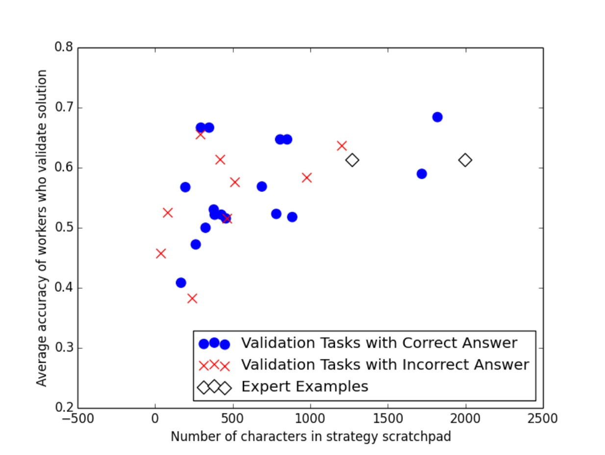

## Trang 1

December 5, 2017
DRAFT
Computation, Constructivism, and
Curriculum Design
Thesis Proposal
Shayan Doroudi
November 16, 2017
School of Computer Science
Carnegie Mellon University
Pittsburgh, PA 15213
Thesis Committee:
Emma Brunskill (Chair)
Vincent Aleven
Ken Koedinger
Chinmay Kulkarni
Eric Horvitz (Microsoft Research)
Submitted in partial fulfillment of the requirements
for the degree of Doctor of Philosophy.
Copyright © 2017 Shayan Doroudi

---

## Trang 2

December 5, 2017
DRAFT
Abstract
From the mechanical teaching machines of the early twentieth century to intelli￾gent tutoring systems and the wave of massive open online courses in recent years,
many have been motivated by the dream of personalized, adaptive instruction for all
students. To achieve this dream, learning scientists and educational technology re￾searchers have largely focused on rule-based systems that rely on extensive domain
expertise and psychology expertise. To do adaptive content selection, these systems
use simple forms of rule-based AI (possibly combined with constrained machine
learning algorithms). While this approach has led to the development of successful
intelligent tutoring systems with high quality content, (1) such systems use a very
limited form of adaptive content selection, and (2) developing such systems can be
very costly. In contrast, some researchers are now starting to apply black box ma￾chine learning algorithms to do adaptive content selection. However, as I will show,
these approaches have had relatively limited impact. Instead, I hope to demonstrate
that combining insights from both approaches can help in automating curriculum
design, from developing new educational content to adaptive content selection. I
propose a number of methods for impactful, cost-effective automated curriculum
design that combine machine learning, human computation, and principles from the
learning sciences. First, I will describe how reasoning about model mismatch (i.e.,
the fact that our statistical models of student learning do not accurately describe
how students learn) can help point out limitations in existing approaches and help in
creating more robust adaptive content selection policies. Second, I will show exper￾iments that demonstrate how we can leverage the work that students naturally do to
create new content in a cost-effective way. In doing so, I will take motivation from
the constructivist philosophy of education, whereby I view learner-generated solu￾tions as being a projection of students’ constructions on the written plane, which can
then be used to inform other students as they construct their own understandings.
Third, I propose to demonstrate how using machine learning can help curate the
best learner-generated content. Finally, I propose to show how we can use learning
science principles to constrain the search for good content selection policies.

---

## Trang 3

December 5, 2017
DRAFT
Introduction
From the mechanical teaching machines of the early twentieth century to intelligent tutoring sys￾tems and the wave of massive open online courses in recent years, many have been motivated by
the dream of personalized, adaptive instruction for all students. To achieve this dream, learning
scientists and educational technology researchers have largely focused on rule-based systems
that rely on extensive domain expertise and psychology expertise. To do adaptive content se￾lection, these systems use simple forms of rule-based AI (possibly combined with constrained
machine learning algorithms). While this approach has led to the development of successful
intelligent tutoring systems with high quality content, (1) such systems use a very limited form
of adaptive content selection, and (2) developing such systems can be very costly. In contrast,
some researchers are now starting to apply black box machine learning algorithms to do adap￾tive content selection. However, as I will show, these approaches have had relatively limited
impact.
Instead, I hope to demonstrate that combining insights from both approaches can help in automat￾ing curriculum design, from developing new educational content to adaptive content selection. In
particular, I focus on three aspects of automated curriculum design: content creation, content
curation, and adaptive content selection. I propose a number of methods for impactful, cost￾effective automated curriculum design that combine machine learning, human computation, and
principles from the learning sciences. First, I will describe how reasoning about model mismatch
(i.e., the fact that our statistical models of student learning do not accurately describe how stu￾dents learn) can help point out limitations in existing approaches and help in creating more robust
adaptive content selection policies. Second, I will show experiments that demonstrate how we
can leverage the work that students naturally do to create new content in a cost-effective way. In
doing so, I will take motivation from the constructivist philosophy of education, whereby I view
learner-generated solutions as being a projection of students’ constructions on the written plane,
which can then be used to inform other students as they construct their own understandings.
Third, I propose to demonstrate how using machine learning can help curate the best learner￾generated content. Finally, I propose to show how we can use learning science principles to
constrain the search for good content selection policies.
My dissertation will be divided into two parts. The first part will consider the problem of adaptive
content selection. In Chapter 2, I hope to show through an extensive literature review, that exist￾ing approaches to this problem (namely cognitive mastery learning and reinforcement learning￾based approaches) have not been very successful. In Chapter 3, I will describe model mismatch,
1

---

## Trang 4

December 5, 2017
DRAFT
a statistical source of concern that could in part explain the lack of empirical success in adaptive
content selection. I will then propose model robustness as a principle by which to overcome
model mismatch. In doing so, I highlight how successful adaptive content selection can benefit
by combining black box machine learning models with a variety of models of student learning
(which could come from both statistics and the learning sciences) as well as human decision
making.
The second part of my dissertation will focus on learnersourced curriculum design motivated by
the constructivist philosophy of education. In Chapter 5, I will describe our approach to content
creation and describe ways in which students can engage with content generated by their peers.
In Chapter 6, I describe how we can combine crowdsourcing with machine learning to curate
the best content. Finally, Chapter 7 will connect the two parts of my dissertation by describing
how we can integrate learner-generated content into existing curricula (i.e., sequencing learner￾generated and expert-generated content). In doing so, I hope to show that constraining adaptive
content selection algorithms with insights from the learning sciences (in particular, the expertise
reversal effect) can help improve upon strictly black box approaches to adaptive content selection
that disregard what we know about student learning.
In what follows, I will first clarify what the three components of the title of my dissertation mean
(and what they do not mean). Then I will describe each of the contributions of my dissertation
in more depth, including my prior work, ongoing work, and proposed work. In Part I, most of
the work I report on is already completed; only the literature review I describe in Chapter 2 is
ongoing work. In Part II, Chapter 5 discusses my completed work and results on one domain
(complex web search) and my proposed work for a second domain (mathematical proofs) and
Chapter 6 and 7 both describe proposed work. At the end of this document, I provide a list
of my relevant publications and a timeline of the steps I need to take in order to complete my
dissertation.
Computation
My dissertation looks at how computational approaches can help automate curriculum design.
I use the term computation in a broad sense, encompassing machine learning, artificial intel￾ligence, and human computation. I discuss ways to use computation to automate curriculum
design, but I also give insights into how computational and statistical principles (such as model
robustness) can potentially help advance education research more broadly.
But at times, I use the term computation in an even broader sense to refer to the information
processing that happens during (human) learning. While this is seemingly unrelated to the com￾putational approaches used to automate curriculum design, there are actually a number of ways
in which they are related. For example, a cognitive model of student learning based on an infor￾mation processing psychology account of learning simultaneously tries to describe learning in
computational terms, while also being able to help specify instructional policies that can be used
2

---

## Trang 5

December 5, 2017
DRAFT
to improve student learning (in an adaptive, automated fashion). I also use the term computation
in this way to contrast it with constructivism, a theory of learning that is often seem to be at odds
with information processing psychology.
Constructivism
It seems apt here to quote Duffy and Cunningham:
An immediate difficulty confronts us...The term constructivism has come to serve as
an umbrella term for a wide diversity of views. It is well beyond our purposes...to
detail these similarities and differences across the many theories claiming some kin￾ship to constructivism. However, they do seem to be committed to the general view
that (1) learning is an active process of constructing rather than acquiring knowl￾edge, and (2) instruction is a process of supporting that construction rather than
communicating knowledge. [Cunningham and Duffy, 1996]
For the purposes of this proposal, the quote above illustrates constructivist instruction should be
focused on supporting students’ knowledge construction. By taking a constructivist stance as
motivation, I look towards ways of using learner-generated resources to help students as they
co-construct their own understandings and solutions. Constructivism is often taken to be at
odds with information-processing psychology, but my dissertation takes ideas from both to guide
computational methods for constructing and sequencing educational content.
Curriculum Design
I use the term curriculum design in a restrictive sense. I foucs on three aspects of automated
curriculum design: content creation, content curation, and adaptive content selection. This
requires considering three components of the curriculum: (1) the content, (2) the form of the
activities that surround the content, and (3) and the (potentially personalized and adaptive) se￾quence of the content and activities. Content creation is naturally about the generation of content,
but the usefulness of content will naturally depend on the activities through which students en￾gage with that content. Moreover, curating good content might result in different content being
chosen depending on the activity. Adaptive content selection is concerned with the sequencing
of the curriculum, but in a way that is adaptive and personalized for each student.
As a concrete example, Figure 1 shows an example of content and activities surrounding that
content that we may use in a proof-based mathematics or number theory course. Concretely,
in my dissertation I consider small pieces of content such as problems, worked examples, and
similar small tasks that learners can engage in (rather than textbooks and lectures). Experiments
can shed light on what pieces of content are effective, what activities are effective, and how to
effectively sequence these content and activities. The three components of curriculum design
are not independent, but it is useful to study them independently as well as considering their
3

---

## Trang 6

December 5, 2017
DRAFT
Question: Prove that √
2 is irrational.
Solution:
1. Assume by way of contradiction
that √
2 is rational.
2. Let √
2 =
p
q
, where p and q
are natural numbers that share no
common factors.
3. Notice that √
2
2 =
p
2
q
2 ⇒ 2q
2 =
p
2
is even, so p
2 must be even.
4. Since p
2
is even, p must be even,
which means that p
2 must be di￾visible by 4.
5. But then q
2 =
p
2
2
must be even,
and so q must be even.
6. This is a contradiction, since we
assumed p and q share no com￾mon factors.
(a)
Review the following example:
Question: Prove that √
2 is irra￾tional.
Solution:
1. Assume by way of contradiction
that √
2 is rational.
2. Let √
2 =
p
q
, where p and q
are natural numbers that share no
common factors.
3. Notice that √
2
2 =
p
2
q
2 ⇒
2q
2 = p
2 is even, so p
2 must
be even.
4. Since p
2 is even, p must be
even, which means that p
2 must
be divisible by 4.
5. But then q
2 =
p
2
2
must be
even, and so q must be even.
6. This is a contradiction, since we
assumed p and q share no com￾mon factors.
(b)
Fill in the missing steps:
Question: Prove that √
2 is irra￾tional.
Solution:
1.
2. Let √
2 =
p
q
, where p and q
are natural numbers that share no
common factors.
3. Notice that √
2
2 =
p
2
q
2 ⇒
2q
2 = p
2 is even, so p
2 must
be even.
4. Since p
2 is even, p must be
even, which means that p
2 must
be divisible by 4.
5. But then q
2 =
p
2
2
must be
even, and so q must be even.
6.
(c)
Answer the following question:
Question: Prove that √
2 is irrational.
(d)
Figure 1: Content: (a) shows two examples of content (a question and a solution). Activities:
(b), (c), and (d) show three examples of activities that can surround the content in (a). In the case
of (b) and (c), the activities make different uses of the solution, whereas in (d) only the question
is used (but perhaps the solution is presented to the student after they attempt to solve it).
interrelationships. For example, the efficacy of different forms of activities might depend on the
content that gives them substance. Similarly, some activities that may seem ineffective in certain
circumstances may be effective when provided at the right time in a sequence. For example, the
worked example effect predicts that studying worked examples (e.g., Figure 1b) is more effective
at teaching how to solve problems than actually doing problem solving activities (e.g., Figure 1d)
[Sweller and Cooper, 1985]. However, the expertise-reversal effect suggests that while worked
examples are more effective for novice students, students who have more expertise may benefit
more from problem-solving activities [Kalyuga et al., 2003]. This effect not only sheds light on
the relative efficacy of different activities, but also the way in which they should be sequenced.
Both effects contribute to cognitive load theory, a rich theory which can help inform curricu￾lum design. To determine principles of effective curriculum design, one can take a bottom-up
approach where experiments validate particular principles (sometimes with limited generaliz￾ability) but can contribute to a larger theory. For example, a study that determines the efficacy of
studying worked examples compared to problem solving in a physics course contributes to our
understanding of the worked example effect as well as cognitive load theory. On the other, by
4

---

## Trang 7

December 5, 2017
DRAFT
taking a top-down approach, theories such as cognitive load theory can make predictions about
how various aspects of curriculum design affect human cognition. These predictions can then
be validated empirically to strengthen or modify the theory. I focus on automated approaches
to curriculum design, but to evaluate the efficacy of my methods, I use randomized experiments
whose findings can help advance the learning sciences (bottom-up approach), and I use princi￾ples inspired by the learning sciences and constructivism to determine how content should be
used and how to guide adaptive content selection (top-down approach).
Designing a curriculum, especially in the context of traditional education, can be much broader
than the aspects of curriculum that I tackle in my dissertation. First of all, the approaches to
automation that I consider here are only concerned with sequencing small scale pedagogical
activities or generating solutions to problem solving tasks. By no means do I consider the au￾tomation of larger scale activities and content such as course projects or textbooks or aspects
of curriculum that span across courses. Moreover, I do not consider automation with respect to
other factors that significantly impact the curriculum, such as learning objectives, assessment,
relationship to state standards, and the broader ecosystem in which the curriculum is positioned.
However, I do look at automated curriculum design in the context of a MOOC. In this case, our
results might suggest how impactful it is to automate various components of the curriculum in the
broader context of a course where students have to engage with a lot content that is preexisting
and not automatically generated.
5

---

## Trang 8

December 5, 2017
DRAFT
Part I
Adaptive Content Selection
6

---

## Trang 9

December 5, 2017
DRAFT
Chapter 1
Background: Adaptive Content
Selection
There have been several attempts to automate various aspects of curriculum design. One promi￾nent approach, which I focus in on my dissertation, is choosing what educational activities to
give students at any given time, typically in order to maximize the students’ learning. Cogni￾tive mastery learning1
[Bloom, 1968, Corbett, 2000] is a standard approach to doing this that
is used in many ITSs. Cognitive mastery learning typically assumes a model of student learn￾ing, such as Bayesian knowledge tracing (BKT), and provides students with practice on each
knowledge component until the student is believed to have reached mastery for that knowledge
component. An assumption made in cognitive mastery learning is the knowledge decomposition
hypothesis—that knowledge can be decomposed into parts that can be learned independently
once all prerequisite knowledge is learned [Corbett, 2000]. More recent approaches to auto￾mated curriculum design use reinforcement learning (RL) to try to find an instructional policy
(a method of sequencing problems that is adaptive to some student state) to maximize some re￾ward signal (such as learning gains from using the tutoring system), often assuming some model
of student learning [Beck et al., 2000, Chi et al., 2011, Koedinger et al., 2013, Rafferty et al.,
2015]. I use the terms instructional policy and (adaptive) content selection policy interchange￾ably. More generally, a policy in RL refers to a mapping of states of the world to actions (or
distributions over actions). An adaptive content selection policy is thus simply a policy where
the actions are different content or activities that we can assign the student and the states are cog￾nitive states of the student2
. I will try to avoid using the term policy by itself, unless referring to
results that go beyond the educational context and are more generally applicable to reinforcement
1While the term cognitive mastery learning and mastery learning are often used interchangeably, I will try to
use cognitive mastery learning to specifically refer to cases where mastery learning involves some cognitive model
of student learning. I can contrast this with other approaches to mastery learning that were used in pen-and-paper
settings [Bloom, 1968] as well as mastery learning approaches that use heuristics such as three-correct-in-a-row
[Kelly et al., 2016].
2The state can be richer, for example by including the students’ affective state or features of the classroom that
the student is currently in, but for the purposes of this proposal, I will generally only consider the student’s cognitive
state, as measured in various ways.
7

---

## Trang 10

December 5, 2017
DRAFT
learning.
1.1 Student Models
Statistical models of student learning are often used in educational data mining and learning
analytics research to make predictions about student learning given some input features. I use
the terms model of student learning and student model interchangeably. The most pervasive kind
of student model and the kind we will be most concerned with are models that track whether
or not a student answered questions correctly over time and make predictions as to whether or
not a student will answer the next question correctly. In this section, we will briefly describe
two of the most commonly used student models: the Bayesian knowledge tracing (BKT) model
and the additive factors model (AFM). These models are often fit to data using standard machine
learning techniques, but sometimes the models are used with parameters that are set arbitrarily
or set by an expert. Student models can be used in a number of ways. One common usage is
to make predictions about student learning in order to make inferences about student learning in
some environment; to this end, AFM is often used to see how well students learn each skill taught
by an ITS, which can then be used to modify our interpretation of which questions correspond
to the same skill and in turn lead to improving the design of the ITS [Stamper and Koedinger,
2011]. Another use of student models, which is of more relevance to us, is using the model to
derive an instructional policy. As such, the BKT model is typically used as the underlying model
behind cognitive mastery learning in ITSs [Corbett, 2000]. Moreover, reinforcement learning
methods use models such as Markov decision processes (MDPs) or partially observable Markov
decision processes (POMDPs). Existing student models such as BKT can be augmented with a
reward model3
so that they can be used to do reinforcement learning. Finally, student models can
be used to simulate students answering questions, under the assumption that students actually
learn according to the model.. Such simulations can be used to evaluate instructional policies
by having the instructional policy assign activities which are then “answered” by the simulated
student. We now briefy describe BKT and AFM.
BKT is a two-state hidden Markov model that keeps track of the probability that a student has
learned a particular skill and the probability that the student will be able to answer a question
on that skill correctly over time. At each practice opportunity i ≥ 1 (i.e., when a student has
to an answer a question corresponding to the skill), the student has a latent knowledge state
Ki ∈ {0, 1}. If the knowledge state is 0, the student has not learned the skill, and if it is 1, then
the student has learned it. The student’s answer can either be correct or incorrect: Ci ∈ {0, 1}
(where 0 corresponds to incorrect and 1 corresponds to correct). After each practice opportunity,
the student is assumed to learn the skill with some probability. The BKT model is parametrized
by the following four parameters:
3A reward model is a model that specifies a reward for the outcome of each action. For example, giving a student
a problem that is answered correctly might have some positive reward. Alternatively, we may assume the only
reward is given after the student is done interacting with an instructional policy, at which point the reward might be
the student’s performance on some exam or posttest.
8

---

## Trang 11

December 5, 2017
DRAFT
• P(L0) = P(K1 = 1): the initial probability of knowing the skill (before the student is
given any practice opportunities)
• P(T) = P(Ki+1 = 1|Ki = 0): the probability of learning a skill at each practice opportu￾nity (if the student has not yet mastered the skill)
• P(G) = P(Ci = 1|Ki = 0): the probability of guessing
• P(S) = P(Ci = 0|Ki = 1): the probability of “slipping” (answering incorrectly despite
having learned the skill)
BKT can be used online as students answer questions (for example in an intelligent tutoring
system). For each skill, one can keep an updated belief about the student’s probability of having
learned the skill (P(Ki = 1)). The standard approach to cognitive mastery learning is to assume
that when P(Ki = 1) > 0.95 for a skill, then the student has mastered that skill (which means
the student is very likely to have learned the skill). Cognitive mastery learning teaches each
skill until we assume the student learns mastery, and then teaches skills that might be considered
more complex or which have mastered skills as prerequisites. Notice that a key assumption of this
approach is that every skill is independent; a student’s practice on skill A has no implications for
the student’s knowledge of skill B and vice versa. The only potential dependency among skills is
that some skills will be prerequisites for others, and cognitive mastery learning typically handles
this by teaching prerequisite skills before postrequisites.
AFM is another popular model of student learning, which unlike BKT does not make any as￾sumptions about whether the student knows the skill or not, but rather only tries to predict the
probability that the student will answer a question correctly [Cen, 2009]. AFM is a logistic re￾gression model that relates the probability of a student answering a question of a particular skill
correctly (the dependent variable) to the number of times the student has had practice on that
skill, the difficulty of the skill, and some general student ability parameter (i.e., an individualized
parameter for each student that is the same regardless of the skill). AFM is slightly more general
in that it allows for a question to target more than one skill. Concretely, the AFM model for some
skill k and student i and question j is governed by the following equation:
log 
pij,T +1
1 − pij,T +1
= θi +
X
k
QjkβkγkTk
pij,T +1 is the probability that student i will answer question j correctly at time T + 1, Q is
a binary matrix that specifies which skills correspond to each questions, Tk is the number of
practice opportunities the student has had on skill k up until time T, βk is the difficulty of skill k,
θi
is student i’s ability, and γk is the learning rate at which practice on a skill leads to improved
performance the skill. The parameters βk, γk, and θi are typically simultaneously fit to data for
all skills k and students i using standard algorithms that fit logistic regression models.
9

---

## Trang 12

December 5, 2017
DRAFT
Chapter 2
Lack of Empirical Success
In this section, I hope to argue that the empirical evidence for cognitive mastery learning and
reinforcement learning-based approaches to adaptive content selection have had limited empir￾ical success. Cognitive mastery learning has gained widespread use in ITSs, given preliminary
results that it can successfully improve student learning [Corbett and Anderson, 1994b]. This
widespread use and the continued demonstration of the success of Cognitive Tutors and other
ITSs that use it [Pane et al., 2014] has led to the general impression that cognitive mastery learn￾ing is beneficial for student learning. However, recent results have presented reason to question
the importance of cognitive mastery learning. For example, a large-scale two year deployment
study of the Cognitive Tutor Algebra I (CTAI) tutoring system across seven states found that in
the second year of the study, high school students in classrooms that used the tutor had signifi￾cantly higher posttest scores [Pane et al., 2014]. However, post-hoc analysis of this data using
an analysis based on principal stratification (a causal inference method) found that the effect of
the tutoring system was less (or at least not greater) for students who were more likely to ad￾here to mastery learning1
than for students who are less likely to master skills [Sales and Pane,
2017]. This result suggests that other factors beyond mastery learning may lead to the efficacy
of the ITS, which could include for example the feedback mechanisms used by the ITS, the
scaffolding it uses, or the way it was adopted in classrooms. But even if we were to assume
that mastery learning is effective in some settings, how necessary is it to use cognitive mas￾tery learning—that is, to use a cognitive model of student learning in order to determine when
the student reaches mastery—as opposed to using simpler heuristics for mastery? Many sys￾tems such as Khan Academy and ASSISTments use mastery learning with a much more simpler
method of detecting when the student has reached mastery: the student has mastered the skill
when they answer the skill correctly N times in a row (where N is typically 3) [Hu, Kelly et al.,
2016]. Researchers have recently compared cognitive mastery learning to this N-correct-in-a￾row heuristic, and have found that the latter can be as good or even better than the former [Kelly
1Students may not adhere to mastery learning for a particular skill even though the tutor uses cognitive mastery
learning, either because they are likely to deplete all of the tutors’ questions on the skill without reaching mastery,
or because for whatever reason their teacher progresses them to the next section before they are able to master the
skill.
10

---

## Trang 13

December 5, 2017
DRAFT
et al., 2016, Pelanek and ´ Rih ˇ ak, 2017]. Furthermore, Pel ´ anek and Rih ´ ak have shown that even if ´
we assume BKT is the true student model (i.e., use it to simulate students), then using the true
BKT model to detect mastery is only slightly better than using the N-correct-in-a-row heuristic
[Pelanek et al., 2016]. ´
Cognitive mastery learning is only one restricted type of content selection policy. Reinforcement
learning algorithms give us the ability to use data from students to try to find more general in￾structional policies. Recently researchers have approached the general problem of adaptive con￾tent selection from a reinforcement learning angle Beck et al. [2000], Chi et al. [2011], Koedinger
et al. [2013], Rafferty et al. [2015]. One might think that cognitive mastery learning, while a sen￾sible and elegant approach to adaptively presenting students content, is overly constrained, and
it might be more impactful if we use data to find a richer content selection policy. For example,
a more sophisticated instructional policy might decide when to return to previously taught con￾tent as the student may have forgotten it or it may reason about the optimal way of sequencing
different skills, which might differ for each student. However, based on my own research and
my understanding of the literature, I believe there has been relatively limited empirical evidence
that reinforcement learning based approaches to adaptive content selection have enjoyed much
empirical success. To examine this more concretely, I will conduct an extensive literature review
of papers that have attempted to use reinforcement learning (or related methods, such as multi￾armed bandits and other algorithmic ways of deriving content selection policies) to identify the
degree to which such attempts have been successful (both in terms of finding a statistically sig￾nificant result and more importantly, in terms of the effect size of the intervention). I will try to
situate each result in the literature based on the educational domain the intervention took place in
as well as the baselines that were compared to. The literature review will also include an in-depth
analysis of two experiments that I helped conduct to test the efficacy of various adaptive content
selection policies in an intelligent tutoring system that teaches fractions to fourth and fifth grade
students (described in the next section). Both of these experiments showed no statistically sig￾nificant difference between six different instructional policies, even though the policies had very
different behaviors (in terms of how they sequenced content for students). My current under￾standing is that many approaches have not been very successful and effects have been meager at
best; doing a thorough, objective literature review will help me develop a more informed opinion
that I believe will be of value to the community of researchers engaged in and interested in adap￾tive content selection. However, it will also be useful to identify cases where RL can successfully
be applied to find good instructional policies. My hope is that such a literature review can help
find generalizable insights on how and when such approaches to adaptive content selection may
be impactful. In line with the rest of my dissertation, my hypothesis is that approaches that have
been relatively successful have tackled the problem of adaptive content selection by constraining
it in some sense, for example by integrating knowledge from cognitive science and the learning
sciences, or by applying it to a domain where we have a more solid grasp of how students learn
(such as concept learning or language learning). In the next section, we examine some of the
reasons that both cognitive mastery learning and reinforcement learning may have had limited
empirical success, and some ways we may be able to mitigate these limitations.
11

---

## Trang 14

December 5, 2017
DRAFT
Chapter 3
Model Mismatch and Robustness
In trying to understand why cognitive mastery learning and reinforcement learning-based ap￾proaches have not been very successful, it is useful to think about arguments from statistical
efficiency. The key point we explore in this chapter is that idea that our statistical models of
student learning are not accurate representations of how students learn. This point is not con￾tentious; psychologists and neuroscientists do not actually believe that students acquire complex
skills according a Bayesian knowledge tracing model (especially when students are assumed to
never forget what they have learned) [MacLellan et al., 2016]. The question that remains is, are
such models accurate enough to be useful? To explore this issue we explicitly consider model
mismatch: what happens if student learning is actually governed by a different (possibly much
more complex) model of learning than the particular statistical student model that we choose to
use to model it? This section is composed of three parts. First, we will look at how model mis￾match can negatively impact cognitive mastery learning. Second, we will examine how model
mismatch can result in black box reinforcement learning approaches finding and choosing sub￾optimal content selection policies. Finally, I will demonstrate one way in which model robust￾ness (being robust to different models of student learning) can improve black box reinforcement
learning. The work in Section 3.1 is adapted from Doroudi and Brunskill [2017] and the work in
Section 3.2 and 3.3 is adapted from Doroudi et al. [2017a].
3.1 Model Mismatch and Mastery Learning
Here I will show a concrete scenario where model mismatch can negatively impact cognitive
mastery learning. In doing so, I will demonstrate how reasoning about model mismatch can help
us realize the limitations of our existing student models, and how we can potentially mitigate
those limitations by making our student models more robust to model mismatch.
As a thought experiment, suppose student learning is actually governed by a 10-state HMM with
ten consecutive states representing different levels of mastery. From each state, the student has
some probability of transitioning to the next state (slightly increasing in mastery), and from each
12

---

## Trang 15

December 5, 2017
DRAFT
State i
Parameter 0 1 2 3 4 5 6 7 8 9
P(K0 = k) 0.1 0.1 0.1 0.2 0.2 0.3 0 0 0 0
P(Ci = 1|Ki = k) 0.0 0.1 0.2 0.3 0.4 0.5 0.6 0.7 0.8 0.9
P(Ki = k + 1|Ki = k) 0.4 0.3 0.2 0.1 0.05 0.05 0.05 0.05 0.05 -
Table 3.1: Alternative model of student learning where there are ten levels of mastery.
10-State HMM AFM
Parameter 20 200 20 200
P(L0) 0.30 0.001 0.09 0.001
P(T) 0.05 0.02 0.05 0.05
P(G) 0.27 0.49 0.14 0.28
P(S) 0.44 0.13 0.46 0.03
Table 3.2: BKT models fit to data generated from the model described in Figure 3.1 and an addi￾tive factors model described in the text. The first column for each model is fit to 500 sequences
of 20 practice opportunities, while the second column is fit to 100 sequences of 200 practice op￾portunities. The models were fit using brute-force grid search over the entire parameter space in
0.01 increments for the parameters using the BKT Brute Force model fitting code [Baker et al.,
2010].
13

---

## Trang 16

December 5, 2017
DRAFT
state, the student has a probability of answering questions correctly, and this probability strictly
increases as the student’s level of mastery increases. Specifically consider the model presented
in Table 3.1. Now suppose we try to use a standard BKT model to fit data generated from this
alternative model of student learning. The first two columns of Table 3.2 show the parameters of
BKT models fit to 500 sequences of 20 practice opportunities or 100 sequences of 200 practice
opportunities, both generated from the the model in Table 3.1. Notice that the model fits very
different parameters in the two cases. When we only have 20 observations per student, the model
estimates a very high slip parameter; this is because it has to somehow aggregate the different
latent states which correspond to different levels of mastery, and since not many students would
have reached the highest levels of mastery in 20 steps, it is going to predict that students who
have “mastered” the skill are often getting it wrong. However, what’s more interesting is that
for the same model, if we simply increase the number of observations per student from 20 to
200, we find that the slip parameter is reasonably small, but now the guess probability is 0.49!
This is because, by this point most students have actually reached the highest level of mastery, so
to compensate for the varying levels of mastery that occurred earlier in student trajectories, the
model will have to estimate a high guess parameter. This is a counterintuitive phenomenon that
we believe is not the result of not having enough data (students) to fit the models well, but rather
the result of the mismatch between the true form of student learning and the model we are using
the fit student learning.
We find similar results if we fit a BKT model to data generated from an AFM model. In particular,
we used the model
P(Ci = 1) = 1
1 + exp(−θ + 2 − 0.1i)
where θ ∼ N (0, 1) is the student’s ability1
. The second two columns of Table 3.2 show the
parameters of BKT models fit to data generated from this model. We again find that when using
only data with 20 practice opportunities, we fit a high slip parameter, but when we using data with
200 practice opportunities, we fit a higher guess parameter and a very small slip parameter.
These observations have important implications for how learned models might be used in auto￾mated sequencing of content, such as cognitive mastery learning. Using such a BKT model to
predict student mastery can lead to problematic inferences. For example, for the first model in
Table 3.2, the BKT model assumes that when a student has reached mastery, they have a 56%
chance of answering a question correctly, whereas a student who has actually mastered the skill
will have a 90% chance of answering correctly (see Table 3.1). Thus, an intelligent tutoring
system that uses such a BKT model to determine when a student has had sufficient practice on
a problem, will likely give far fewer problems to the student than they actually need in order to
reach mastery. To illustrate this, Table 3.3 shows the expected number of practice opportunities
the first model in Table 3.2 will give, when students actually learn according to Table 3.1. In
contrast, the average number of practice opportunities needed to reach mastery according to the
true model is around 100. Thus, cognitive mastery learning could lead to a significant amount of
under-practice, even with a very high mastery threshold (0.9999). This case study provides an
1This model suggests that students who are two standard deviations above the mean initially will answer correctly
half the time, and after 20 practice opportunities the average student will answer correctly half the time.
14

---

## Trang 17

December 5, 2017
DRAFT
Mastery Threshold Exp # Opp. to Mastery % Students with Under-Practice
0.95 28.4 99.4%
0.99 38.3 99%
0.9999 53.4 95%
Table 3.3: The expected number of opportunities needed (averaged over 500 students) for the
model given in the first column of Table 3.2 to reach mastery for various mastery thresholds,
given that the true model is the model from Table 3.1. The third column shows the percentage
of simulated students that received less practice than needed. In contrast, the average number of
opportunities that it took simulated students to reach mastery was around 100.
example of how reasoning about model mismatch can be informative in terms of the instructional
consequences of our models.
3.2 Model Mismatch and Reinforcement Learning
Reinforcement learning assumes that the world can be modeled using a Markov decision pro￾cess or partially observable Markov decision process. Even though these models can be learned
from data, someone must specify the state space inherent to these models. For example, in an
educational context the state of a student could be a latent knowledge state for each knowledge
component (as is used in BKT) or the past N responses that the student gave for each knowledge
component. The Markov assumption inherent to MDPs and POMDPs claims that the next state
of a student only depends on the student’s current state. Therefore, if we choose a state rep￾resentation that cannot accurately capture the complexity of student learning under the Markov
assumption, we again suffer from model mismatch. What are the implications of this model
mismatch on the learned content selection policies? In particular, we will consider the impact
of model mismatch on trying to evaluate different content selection policies or choose a policy
using prior data.
As mentioned in the previous chapter, we ran two experiments comparing six different instruc￾tional policies, and we found no significant difference between any of these policies in terms of
their effect on student learning. We believe this result was due to model mismatch; that is, our
adaptive content selection policies assumed a certain specific model of student learning, and the
adaptive policies were chosen to optimize student learning according to those specific models,
which are likely far from how students actually learn. We will now concretely look at how model
mismatch could lead to overestimating the value of particular instructional policies.
3.2.1 Off-Policy Policy Estimation and Selection
In this section, we investigate the impact of model mismatch on the related problems of off￾policy policy estimation and off-policy policy selection: the setting where we have access to
15

---

## Trang 18

December 5, 2017
DRAFT
prior data collected using some policy, and we want to use that data to make inferences about
one or more other (instructional) policies. Off-policy policy estimation can be used to estimate
the performance of a new instructional policy without (or in advance of) running an experiment.
Such counterfactual reasoning is important not just in education, but in a wide swath of other
areas including economics, healthcare, and consumer modeling [Thomas et al., 2015, Zhou and
Brunskill, 2016]. Off-policy policy estimation is often a critical part of off-policy policy selec￾tion: determining which policy from among a set of candidate policies would have the highest
expected performance if deployed in the future. We are primarily interested in the problem of
off-policy policy selection, as it can have practical implications with respect to what we do in
practice. We consider the problem of off-policy policy estimation in so far as it helps us achieve
the former. While the two have been tightly coupled in the literature, we show that this need not
be the case; in the next section, e will present a method that does not necessarily give us reliable
estimates of the performance of instructional policies but could still be used to compare instruc￾tional policies. We now discuss approaches to doing off-policy policy estimation and selection,
including how this problem has been tackled in education settings.
3.2.2 Model-Based Evaluation
Ideally, we would like to evaluate the efficacy of an instructional policy before committing to
using it on actual students. Running experiments to test the efficacy of various instructional
policies on actual students can be costly and time consuming, and if the policies aren’t helping
students, then we could be wasting student time that could be spent on more valuable learning
experiences. Instead, it would be useful if we could evaluate how good a content selection policy
might be before testing it on students. This problem is called off-policy policy evaluation. A
standard way of doing this is model-based evaluation, i.e. to simulate the instructional policy
on a particular model of student learning to evaluate how good the instructional policy is under
the assumption that that particular student model is correct. Often times, an instructional policy
is derived to optimize student learning assuming a particular model of student learning, and so
we simulate the instructional policy on the model that was used to derive it. We call this direct
model-based evaluation.
This approach has been used to compare and select among different student models and their op￾timal instructional policies. Chi et al. [2011] used this approach to select an instructional policy,
by comparing different student models represented as Markov decision processes with different
student features and the resulting instructional policy that yielded the best expected performance
for a given model. Similarly, Rowe et al. [2014] estimated the predicted performance of instruc￾tional policies that were designed to maximize performance under particular student models and
compared them to some hand designed baseline policies and a random policy by evaluating these
instructional policies under the same student models. Unsurprisingly, the policy that was com￾puted to have the best predicted performance for a given student model was also estimated to to
out-perform the baseline instructional policies under that same model.
This approach is quite appealing, as it is more directly getting at what we often care about: esti￾16

---

## Trang 19

December 5, 2017
DRAFT
mating the performance of instructional policies in order to select an instructional policy with the
best expected performance. Unfortunately, due to model mismatch, evaluating a policy assuming
the student model it was derived under is correct will generally not provide an accurate estimate
of the value of a policy if it were to be used with real students. Comparing the estimated perfor￾mance of instructional policies when each policy is evaluated using a different simulated student
model can therefore yield misleading conclusions. Indeed Mandel et al. [2014] have shown that
even if the real world can be accurately modeled as a complex Markov decision process, it is
possible that the optimal policy for an alternate statistical model that is incorrect might have
a higher estimated performance than the optimal policy of the true MDP, even with an infinite
amount of data.
Indeed, the limitations of evaluating the performance of a policy with the student model used to
derive the policy has been observed previously. In simulation, Rowe et al. [2014] estimated a
new instructional policy would have a performance of 25.4 in contrast to a random policy that
was estimated to have a performance of 3.6, where performance was measured as a function of
students’ normalized learning gains2 beyond the median student and the performance of both
policies was simulated with the student model used to derive the new instructional policy. In
contrast, in an experiment with real students, there was no significant difference between the
performance of students taught by the two policies [Rowe and Lester, 2015]. While there are
many factors in any experiment with real students, estimating performance using the assumed
student model may particularly lead to overly optimistic estimates of the resulting performance.
In the next section, we provide another example of how direct-model based led to over-predicting
the value of policies in our experiment.
3.2.3 Importance Sampling
Using prior data to obtain an estimator of a content selection policy’s performance in advance
of deploying the new policy that is not biased by assuming a particular statistical student model
could seem rather difficult. However, there does exist an elegant solution: importance sampling,
an approach that does not require building a student model, but rather re-weighs past data to
compute an estimate of the performance of a new policy [Precup, 2000]. Importance sampling
is statistically consistent and unbiased. In prior work, Mandel et al. [2014] used importance
sampling to find an instructional policy in an educational game that significantly outperformed
a random policy and even an expert-designed instructional policy. Unfortunately, importance
sampling tends to yield highly variable estimates of a new policy’s performance when evaluating
instructional policies that are used for many sequential decisions, such as students interacting
with a tutoring system across many activities. Intuitively this issue arises when a new policy
is quite different from a previous policy, and so the old data consists of quite different student
trajectories (sequences of pedagogical activities given and student responses) than what would be
expected to be observed under a new policy. Mathematically, this is because importance sampling
2The normalized learning gain for a student is the difference between the posttest score and pretest score of the
student divided by the maximum possible difference.
17

---

## Trang 20

December 5, 2017
DRAFT
yields unbiased but high variance estimates, unlike direct-model based evaluation which can
yield very biased estimates (due to model mismatch) with potentially low variance (when we
have enough data).
It is true that with more data, the variance of the importance sampling estimator will decrease,
so one may assume this should be the method of choice for learning at scale, but this is not the
case when one has to make a large number of sequential decisions. For example, consider some
educational software that presents 20 activities to students and only needs to choose between one
of two options at any given time (for example, whether to give the student a worked example
or a problem-solving exercise). Suppose we have collected existing data from a policy that
randomly chose each option for each of the 20 decisions and want to use this for off-policy
policy estimation. If we want to evaluate a deterministic instructional policy (i.e., a policy with
no randomness), then only one out of every 2
20 (over one million) students would encounter a
trajectory that matches the policy of interest, which means we need millions of students to get
a decent estimate of the policy. If the software were to make 50 decisions, then we would need
over 2
50 ≈ 1015 students!
Finding a statistical estimator that offers the best of both approaches (model-based evaluation
and importance sampling estimators) is an active area of research in the reinforcement learning
community [Dud´ık et al., 2011, Jiang and Li, 2015, Thomas and Brunskill, 2016] but remains a
challenge whenever the (instructional) policies may be used to make a large number of decisions,
as highlighted above.
Moreover, I have recently shown that if we want to evaluate two policies using importance sam￾pling in order to pick the best policy, importance sampling can sometimes favor the worse of the
two policies more often than not [Doroudi et al., 2017b]. (Similarly, if we have a set of candi￾date policies and we want to find out which one is best, importance sampling can tend to favor
a sub-optimal policy.) This problem is essentially due to the fact that the importance sampling
estimator is an asymmetric, high-variance distribution. We have shown that this problem can nat￾urally arise whenever we have trajectories of varying length, such as when students do varying
numbers of problems on an intelligent tutoring system or educational game, which is typically
the case.
3.3 Robust Evaluation Matrix
Ideally we want a method for off-policy policy estimation that combines the statistical efficiency
of (student) model based estimators with the agnosticism of importance sampling techniques
which allows them to be robust to the choice of student model used to derive a particular policy.
As we previously argued, this is important even given an enormous amount of data. One potential
avenue is to focus on designing better student models, a key effort in the educational data mining
and artificial intelligence in education communities. However, since these model classes will
still likely be approximate models of student learning, we propose an alternative approach that
may not enable us to achieve accurate estimates, but can still help inform comparisons among
18

---

## Trang 21

December 5, 2017
DRAFT
different policies: using many models we expect to be wrong, rather than using one model we
hope to be right.
Our robust evaluation matrix (REM) is a tool for more conservatively evaluating the potential
performance of a new policy in relation to other policies during off-policy policy selection. As
shown in Algorithm 1, the simple idea is to estimate the performance of different instructional
policies by simulating them using multiple plausible student models whose model parameters
were fit using previously collected data. The rows of the matrix are different student models and
the columns of the matrix are the various policies one wants to estimate the performance of. An
entry in the matrix represents the expected performance of a particular instructional policy when
simulated under a particular student model. As the student model simulators have parameters
that are fit based on the previously collected data, they will often represent reasonable possible
ways of modeling the dynamics of student learning. If we restrict our comparison to models
with similar predictive accuracy (e.g., as evaluated using cross validation or a test set constructed
from the available data), it is unclear which model is better, but the REM method can be used
to assess trends in performance across policies that are consistent across multiple possible ways
that students may learn in the real environment (e.g., Bayesian Knowledge Tracing, Performance
Factors Analysis, Deep Knowledge Tracing etc.).
Simulating the potential performance of instructional policies under multiple student models to
inform off-policy policy selection has been previously underexplored. There has been some
prior work that analyzes the interaction of student models and instructional policies (that may
have been derived with a particular student model) [Clement et al., 2016, Gonzalez-Brenes and ´
Huang, 2015, Lee and Brunskill, 2012, Rafferty et al., 2015, Rollinson and Brunskill, 2015], but
such work has often been done to understand the general differences between policies run on
various models, rather than as a tool to inform whether a new policy may offer benefits over
previous ones before conducting experiments or embedding a policy in a tutoring system. One
exception is work by Clement et al. [2016], where they investigate the case where the knowledge
graphs (i.e., prerequisite relations between knowledge components) used to learn models used
to compute instructional policies are not the same as the ones underlying student learning. The
authors found that a particular model that does not have parameters fine-tuned to the knowledge
graph performs best when there is a mismatch in the policy’s representation of knowledge graph
and true knowledge graphs of students. Their work differs from our current paper in that the
authors only consider robustness of policy’s of varying complexity in light of the knowledge
graph changing but do not consider student models that differ more wildly and the authors do
not present a general method for off-policy policy estimation or selection. Moreover, they only
presented results from simulations with hand-crafted parameters rather than models and policies
fit to real data. Nonetheless, we can consider this work as an example of REM being used in
the past to inform policy selection. The most closely related work is by Rafferty et al. [2015],
which analyzed the potential performance of various instructional policies derived from different
models of student concept learning under various student concept learning models that were fit
from a previously collected dataset. However, unlike our current paper, they presented this idea
primarily to understand the interaction between the policies and the models of student learning
(e.g. could a policy assuming a very simple model of student learning still do well if the real
student exhibits much more complicated student learning), rather than as a generic tool for off￾19

---

## Trang 22

December 5, 2017
DRAFT
policy policy estimation and selection. In the next section, we reinterpret their results as a positive
use case of REM. Moreover, while Rafferty et al. [2015] consider simulating policies only on
models of student learning that were used to derive some of the policies, REM could simulate
policies on other models of student learning, even if one does not derive any policies from those
student models. We present one example of this in the next section.
Algorithm 1: Pseudocode for algorithm to construct robust evaluation matrix
Input: Set of student models m = 1 . . . M and instructional policies p = 1 . . . P
REM ← m × p matrix
for model m = 1 . . . M do
for policy p = 1. . . P do
if student model m compatible with instructional policy p then
mean, stddev ← Estimate performance of instructional policy p on student model m
// For example by simulating many times
REM[m][p] ← mean, stddev
return REM
REM can be used in several ways. If one or more student models in the matrix suggest that a
new policy is no better or even worse than other (baseline) policies, then it would suggest a new
policy may not yield a significant improvement in learning outcomes. On the other hand, if the
student models agree that one policy appears to be better than others (and these student models
are indeed quite different from each other3
), then it should increase our confidence that the policy
will actually out-perform the other policies. Recall that we are interested in the joint problems of
off-policy policy estimation and off-policy policy selection. We propose that REM can help with
addressing the second problem, even though it does not necessarily help us with the first. That
is, if we find a policy that robustly does better than another policy according to various student
models, then we may decide to choose to implement that policy in practice; however, if different
student models have very different predictions as to how well the new policy will perform, then
we may not have a good estimate of its performance a priori. But having an estimate of a policy
we are confident will do well a priori may not be necessary if we are planning on testing it on
actual students anyways. This makes REM differ from off-policy policy selection techniques in
the existing literature, which aim to use imperfect methods of policy estimation as a way to do
policy selection. Rather, REM aims to help the researcher make decisions about what policy to
select without directly trying to get a good estimate of a policy’s performance. Notice that REM
does not decide for us when to use a particular content selection policy in practice; that is REM is
not a black box reinforcement learning algorithm, it is a human-in-the-loop algorithm that relies
on the user’s understanding of the models and policies to make the decision if there is sufficient
confidence to test an instructional policy on students. Furthermore, REM may give insights to
the designer if there seem to be limitations to the models or policies being used.
3The difference in student models could be based difference in theory, for example a Bayesian Knowledge
Tracing model and a Deep Knowledge Tracing model make rather different assumptions about student learning—
or based on empirically observing that simulating the same instructional policy on two different models results in
reasonably different trajectories quantified in some way.
20

---

## Trang 23

December 5, 2017
DRAFT
3.3.1 Case Study: Fractions Tutor Experiment
To ground the discussion, we now present a case study of an experiment we ran on our fractions
intelligent tutoring system. We will discuss how we used old data to derive two new adaptive
content selection policies we estimated to be better than a standard baseline, but which yielded
equivalent performance in a subsequent student study. We then show how our post hoc analysis
suggests we could have predicted this result by using REM. We then used REM to inform the
choice of a new adaptive content selection policy for a second experiment, and although the
second experiment was also not successful, we discuss additional factors we should consider in
REM and the insights we gained from doing this analysis. In order to show that REM can also
be used to successfully determine when to deploy an adaptive content selection policy, we have
also done a retrospective REM analysis of prior work by Rafferty et al. [2015] to illustrate this.
For brevity, we omit the analysis of prior work from this discussion.
We ran an experiment to test five instructional policies in an intelligent tutoring system (ITS)
designed to teach fractions to elementary school students [Doroudi et al., 2015, Rau et al., 2013].
There were two main goals to the experiment: (1) to test whether adaptive problem selection
based on an individual student’s knowledge state makes a difference (in terms of improving stu￾dent learning), and (2) to test whether supporting a variety of activity types in an ITS leads to
more robust learning. Additionally, we were interested in testing whether we could improve
upon the traditional form of adaptive instruction used in ITSs: cognitive mastery learning using
Bayesian Knowledge Tracing (BKT). Namely, we were interested in testing whether reasoning
about (prerequisite) relationships between skills when deciding what problem to give a student
to solve improves student learning beyond simply giving problems until a student masters each
skill independently. We therefore developed a new student model that treats the correctness on
the last two steps of each skill as the state of a student’s knowledge of that skill, and then predicts
the student’s next state of a skill based on the student’s knowledge of that skill as well as pre￾requisite skills. Prerequisite skills were identified using the G-SCOPE algorithm [Hallak et al.,
2015]. Our models used a skill model that was inferred using the weighted Chinese restaurant
process technique developed by Lindsey et al. [2014], which was seeded with a hand-crafted
skill model. Model parameters were fit given access to data that was previously collected using
a semi-random instructional policy to teach over 1,000 students, who used the tutor for four to
six days, with most students completing between 20 and 100 problems out of a potential set of
156 problems. Student learning was assessed using identical pretests and posttests composed of
16 questions.
We iterated over multiple potential adaptive instructional policies, seeking to identify an instruc￾tional policy that we estimated would yield improved performance over both strong baseline non￾adaptive instructional policies, and equal or better performance to a state-of-the-art policy based
on a mastery learning instructional policy. Since each student completed many problems us￾ing the tutor, typically more than 20, importance sampling techniques for estimating the student
learning outcomes under an alternate instructional policy (that adaptively sequenced activities in
a different way) were infeasible (see example above).
Instead, we relied on simulating a policy’s performance based on a student learning model. We
21

---

## Trang 24

December 5, 2017
DRAFT
Instructional Policies
Baseline 1 Baseline 2 BKT-MP AP-1 AP-2
Direct Model-Based Evaluation Results 5.87 ± 0.90 6.10 ± 0.97 7.03 ± 1.00 7.85 ± 0.98 9.10 ± 0.80
Actual Experimental Results 5.52 ± 2.61 5.14 ± 3.22 5.46 ± 3.0 5.57 ± 3.27 4.93 ± 1.8
Table 3.4: The first row shows the estimated expected performance of a student when taught
under each policy, assuming either the student model used to derive the policy, or, in the case of
the non-adaptive policies, using the estimated G-SCOPE student model. The second row shows
the results of our actual experiment. Note that the posttest was out of sixteen points.
chose adaptive policies that we estimated would yield a significant improvement over the non￾adaptive baselines. This lead us to choose the following adaptive content selection policies for
use in a future experiment, policies that we believed had a good chance of yielding a significant
improvement,
• Adaptive Policy 1 (AP-1): greedily maximize the number of skills that students learn with
each problem assuming the fit G-SCOPE model.
• Adaptive Policy 2 (AP-2): Selects problems to myopically maximize the student’s posttest
score under a fit G-SCOPE student model.
These were to compared to the following baselines
• Baseline 1: Instructional policy that selects standard (induction and refinement) problems,
in a reasonable non-adaptive order, based on spiralling through the curriculum.
• Baseline 2: Instructional policy that selects among a diverse set of problem types, in a
reasonable non-adaptive order, based on spiralling through the curriculum.
• BKT Mastery Policy (BKT-MP): This is a state-of-the-art cognitive mastery learning pol￾icy used with a Bayesian Knowledge Tracing model which has been previously shown to
yield substantial improvements in student learning [Corbett and Anderson, 1994a].
Row 1 of Table 3.4 shows the estimated performance of the above policies, where each adap￾tive policy was simulated using the student model used to derive the policy. Since the first two
policies are non-adaptive, they were not derived using a student model. We used the G-SCOPE
student model to simulate the performance of these baseline non-adaptive policies. All evalu￾ations assumed each (simulated) student completed 40 problems, and we repeated this process
with 1,000 simulated students.
Using these off-policy policy performance estimates, the predicted Cohen’s d effect size of AP-2
vs. Baseline 2 is 3.66 and the predicted effect size of AP-2 vs. Baseline 1 is 4.14, indicating that
the new adaptive policies may yield a large improvement in robust student learning.
However, in our subsequent experiments there was no significant difference in the performance
of students taught in the different policies as shown in Row 2 of Table 3.4.
We now consider the insight we could have obtained by using REM. We apply REM to our
22

---

## Trang 25

December 5, 2017
DRAFT
Instructional Policies
Baseline 1 Baseline 2 BKT-MP AP-1 AP-2
Student
Models
New Student Model 5.87 ± 0.90 6.10 ± 0.97 N/A 7.85 ± 0.98 9.10 ± 0.80
BKT Student Model 6.46 ± 0.78 6.65 ± 0.95 7.03 ± 1.00 6.82 ± 0.94 7.04 ± 0.96
DKT Student Model 9.89 ± 1.45 8.69 ± 1.82 8.55 ± 2.08 8.31 ± 2.22 8.58 ± 2.13
Table 3.5: Robust evaluation matrix showing predictions of the five policies in our experiment
according to the new student model as well as the BKT student model and a DKT student model.
Notice that BKT-MP was not simulated on the new student model since they were not exactly
compatible due to a nuance in the way they represent steps.
policies by evaluating them on three models: (1) the G-SCOPE model (which was used to derive
AP-1 and AP-2), (2) the BKT student model (which was used to derive BKT-MP), and (3) a Deep
Knowledge Tracing (DKT) model [Piech et al., 2015]. The results are shown in Table 3.5.
Using the BKT student model, we see that all the policies appear to have much more similar
expected performance than when using the G-SCOPE student model, though the new adaptive
policies are still expected to be as good or better than the state-of-the-art BKT mastery policy in
either situation, and an improvement over the non-adaptive policies. Therefore, were we only to
simulate policies under the models used to derive the policies, we might still expect that the new
adaptive policies would yield improved performance.
The key distinction comes up when we also simulate under another plausible student model,
which was not used to derive a particular student policy. In contrast to the other student models,
simulating using a Deep Knowledge Tracing student model actually predicts that Baseline 1
will yield the highest expected student learning performance, and be substantially higher than
the predicted performance of the adaptive instructional policies.4 Since three student models
(BKT, G-SCOPE and DKT) are all seemingly reasonable choices of student models with similar
predictive accuracies (RMSE between 0.41 and 0.44), our robust evaluation matrix suggests that
we should not have been confident that new adaptive policies would yield a large effect size
improvement over non-adaptive baselines or even necessarily be better than the non-adaptive
policies (thus consistent with the lack of difference in the true experimental results).
Therefore, in this case REM could have served as a diagnostic tool to identify that our new pro￾posed adaptive policies might not yield the significant improvement we hoped for, by explicitly
considering whether this improvement is robust across many plausible student models.
Using REM to Inform Policy Selection
We just presented a retrospective analysis of how REM could have informed our experiment
had we used it before running the experiment. A natural next step was to see if REM could be
4This Deep Knowledge Tracing model was introduced by Piech et al. [2015] after these experiments were con￾ducted, so interestingly, we could not have done this analysis prior to running our experiment.
23

---

## Trang 26

December 5, 2017
DRAFT
used to actually discover a good instructional policy for our next experiment. Here we discuss
how we used REM to discover a policy that we had confidence would outperform a baseline
(namely, BP-1), and the results of the experiment that followed. Unfortunately, we again found
no significant difference in terms of learning between the policy we chose using REM and the
baseline policy. However, we discuss how this experiment combined with our REM analyses
gave us new insights into the search for adaptive policies and how to do more robust analyses
using REM.
So far we have been discussing how REM can help address the problem of wrong classes of
student models. But notice that REM can also help address other related issues that may arise in
educational contexts and certainly did arise in our first experiment. Recall that in the fractions
tutor case study, the off-policy estimation was based on assuming students would do 40 problems
each (i.e., we simulated trajectories of 40 problems). In reality, trajectories will be of varying
length due to a number of factors: some students work faster than others, some students spend
less time working or may be absent on certain days of our experiment, etc. However, even
if we consider the variance in trajectory lengths that existed in our past data, the evaluation
results would be similar. But one thing we did not consider is that the distribution of trajectory
lengths varies for different instructional policies. For example, students who had the Baseline
1 policy, did around 48 problems on average, whereas for all the other policies, the average
was 28 problems or less. This is, at least in part, because Baseline 1 only gives problems of a
particular activity type (induction and refinement), which tended to be the activity type that took
the least amount of time on average. This could explain why Baseline 1 did as well as the other
policies in our experiment; these students simply had more problems, which could make up for
the lack of diversity or adaptivity of problems. To tackle this problem, we can consider different
generative models of how many problems students will do given a particular instructional policy
(for example by taking into account how long problems took students in our past data); we can
then use these various models as different student models (i.e., different rows in our matrix) and
see if any policies robustly do well with respect to these differences. In what follows, each of our
models assumed that the time per problem was sampled from how long students took in our prior
data (and to increase robustness, we experimented with sampling times from different student
populations that we had data for).
To see how important the time spent per problem might be, we tested a simple policy that se￾quenced problems in increasing order of average time students spent in our previous experiment
(i.e. students would first get the problem that took the least amount of time on average). REM
predicted that this policy would be better than the baseline induction and refinement policy under
a variety of (but not all) student models. To make this policy adaptive, we augmented this pol￾icy with a simple rule to skip any problem where are skills taught in that problem were already
believed to have been mastered (using a Bayesian Knowledge Tracing model with a mastery
threshold of 0.9). We thought this might help avoid over-practice, especially because assigning
problems in order of increasing time often meant giving similar problems multiple times in se￾quence. Indeed, this new adaptive policy was predicted by REM to be considerably better than
the baseline according to many student models, including ones that predicted the non-adaptive
version would be worse than the baseline. Models predicted the improvement of this new policy
over the baseline would be between 0.31 and 2.23 points on the posttest, with most models pre￾24

---

## Trang 27

December 5, 2017
DRAFT
dicting an improvement of at least 1 point on the posttest. Thus we chose to use this policy in
our next experiment.
We ran an experiment with 220 4th and 5th grade students to see if our new data-driven adaptive
policy could outperform the baseline induction and refinement policy. Despite our REM pre￾dictions, when we ran our experiment, we found that students assigned the baseline policy had
a mean posttest score of 8.12 (out of 16) and students assigned the new adaptive policy had a
mean posttest score of 7.97, indicating the new policy was no better than the baseline. In terms
of learning gains (posttest minus pretest score), the baseline had a mean score of 1.32, while the
new adaptive policy had a mean scores of 1.55. While there was a positive difference, it was not
significant. So one might ask, why did the new policy do worse than the induction and refinement
baseline, when REM predicted otherwise?
There are two factors that we did not adequately account for in our REM analyses: (1) the student
population in this experiment was quite different from the population in our past data that we
used to fit the models, and (2) the order in which problems are presented was quite different than
in our prior experiments. To account for the first issue, we had done REM analyses by fitting
models to subpopulations of our prior data, but we had still predicted that the new adaptive
policy would do better. We did more extensive analyses after the experiment, and we found that
the predicted difference between the two policies was much smaller for students from a particular
school district. Developing models and instructional policies that can generalize to new student
populations is a big open question in the literature. While REM can help with this by seeing how
different policies might interact with different populations of students we have collected data
from, it cannot definitively tell us how the policy will effect with new students.
The second issue may have had an even greater effect on our results. All of the models that we
used in REM assumed that the time per problem was sampled according to our prior data. Our
new adaptive policy gave problems that took the least amount of time first, but it ignores the fact
that students in our previous experiments had typically done those problems after having com￾pleted many other problems, which could be why they worked through those problems quickly.
Indeed, in our experiment we found that problems given early on were taking students much
longer than those same problems took for students in our previous experiment or in the base￾line condition of the current experiment. Our experiment highlights the importance of not only
modeling how students answer problems over time, but also how long they spend on problems,
especially when we want to use time spent as a variable to determine how to adaptively assign
problems to students. We believe future researchers can build on this insight in one of two ways:
(1) developing more sophisticated ways of predicting how long students will spend on problems
to use in offline analyses (such as REM analyses), or (2) developing policies that can be robust
to how long students actually spend on problems by taking into account data collected from the
student online. We believe using REM with these insights can lead to the development of more
robust instructional policies.
25

---

## Trang 28

December 5, 2017
DRAFT
3.3.2 Discussion
In some cases, REM might result in one being overly-conservative by not deploying an instruc￾tional policy that is actually worthwhile, but at the end of the day, it is up to each researcher
to decide if they want to try a policy they think might result in improved student learning, even
if they do not have strong evidence that it will, or if they would rather find a policy they are
confident would result in an improvement. One can attain such confidence (although not in any
statistically precise sense) if one finds a policy that does very well under various student models
as we saw an example of in Case Study 2. However, as we have emphasized several times, this
confidence depends on being convinced that our choice of student models to use in the matrix
was good. As we mentioned, we do not expect any of these student models to be correct, so what
does it mean for a model to be “good”? A necessary condition is that such a model should be able
to differentiate between different policies. For example, a model that predicts students are always
in the same state (perhaps determined by their prior knowledge or pretest scores) and never learn
would not be a good model to use in REM, because it would predict all instructional policies
result in equal student outcomes. One way to avoid such “bad” models is to avoid models with
bad predictive accuracy; even if high predictive accuracy is not a good indicator of a model’s
ability to suggest good instructional policies, an especially low predictive accuracy should be a
red flag. Effectively using REM can be thought of as a conversation between (potentially black
box) machine learning algorithms and researchers who have to ultimately interpret what the re￾sults of the matrix say about the models and policies it is composed of and make the decision
about when to use a certain policy.
As discussed in our first case study, effectively using REM involves considering not only different
types of statistical models (such as Bayesian Knowledge Tracing, logistic regression models,
and MDPs), but also models that can predict how long it takes students to solve problems, and
models that are fit to specific sub-populations of students that we have data for. The issue of
fitting models that accurately characterize how studens learn across populations, and relatedly,
finding policies that are robust to different student populations is an important open question
in the learning sciences. To our knowledge, there have only been some investigations in this
direction. For example, Clement et al. [2016] cast their work as training models on different
student populations (characterized by student’s with certain knowledge graphs) and seeing how
that generalizes to other populations of students (with different knowledge graphs); their work
can be viewed as using REM to explore robustness of policies to different student populations in
simulation. As we have shown, REM does not always work, but when it does not, it leads us to
consider what our models are missing, and can thus lead to advancements in student modeling
and the search for content selection polices that are robust to model mismatch.
At this point we do not make any universal recommendations for how to use the robust matrix
method to determine which instructional policy to use in the future. It is possible that one policy
does not consistently do better than all other policies for every row of the matrix, but that it tends
to do better, or that on average it does better. In this case, should we be confident in that policy?
The answer must be determined on a case-by-case basis. The matrix might help reveal trends
that can help the researcher determine whether a policy should be deployed or not. As mentioned
26

---

## Trang 29

December 5, 2017
DRAFT
earlier, it is not a black box algorithm that will tell the researcher what to do; it is a heuristic that
can help inform the researcher to make better decisions.
27

---

## Trang 30

December 5, 2017
DRAFT
Part II
Learnersourced Curriculum Design
28

---

## Trang 31

December 5, 2017
DRAFT
Chapter 4
Background: Learnersourcing
The core of my dissertation will focus on a new approach to automated content selection that fo￾cuses on the creation of new educational content in a cost-effective way. My work builds on the
recently developed concept of learnersourcing [Kim et al., 2015]—using the activity of learners
to improve the learning experience of other learners—by expanding on a formative theory of how
and when to present learner-generated solutions and how algorithms and learning theory can be
used to determine which solutions are best and when they should be presented. The vision of this
approach is that if we start with no educational resources to teach a subject, we can use the crowd
of learners and data-driven algorithms to create new resources—and if we do start with existing
expert resources, using learner-generated resources can still enhance the existing curriculum.
Learnersourcing is a specific instantiation of crowdsourcing or human computationusing people
to do tasks that are difficult or impossible to do with a computer and leveraging the wisdom of
crowds to get reliable solutions to those tasks. Recent work on learnersourcing has given some
insights into how learner-generated explanations can be effectively presented to future learners.
Of most relevance to my work, Williams et al. developed a system for improving the quality
of explanations over time through learnersourcing and the use of multi-armed bandits (MABs).
The researchers demonstrated the efficacy of the system by having crowdworkers write and rate
explanations for a mathematical task, and using their MAB algorithm to try to discover the best
explanations for teaching future learners, and showed that explanations that result from the sys￾tem can be of comparable quality to one generated by an expert teacher [Williams et al., 2016].
Moreover, in recent years, researchers have written vision papers on how human computation
can impact the future of education. In 2012, Weld et al. described how human computation or
crowdsourcing can address new challenges in personalizing online education in the wake of Mas￾sive Open Online Courses (MOOCs) [Weld et al., 2012]. One of the challenges the researchers
discussed was content creation and curation in online courses, and how crowds of students could
be used for that purpose. Their paper could be seen as a call to action for human computation
researchers; this chapter of my dissertation can be seen as an answer to that call. Moreover, in
2016, Heffernan et al. predicted that “in many ways, the next 25 years of adaptive learning tech￾nologies will be driven by the crowd” and described their efforts to begin to use crowdsourcing
for content creation in ASSISTments (a system that teachers use to teach mathematics in the
29

---

## Trang 32

December 5, 2017
DRAFT
classroom) [Heffernan et al., 2016].
The first question in determining how to use learner-generated content is how do we generate it?
In many settings, students will naturally generate solutions to problems. In other settings, where
generating solutions is not natural, students can be asked to give a self-explanation of a concept or
of how they approached a problem. In my dissertation, I will primarily focus on learner-generated
solutions to problems, but I believe the methods could be extended to generating explanations
of concepts, hints, etc. Once we have a way of eliciting learner-generated content, we must
answer several questions in order to discover how to best use this content. While our approach
to automated curriculum design focuses on using human computation to have learners create
new educational content, the creation of this new type of content necessitates us to asks how we
should modify other aspects of curriculum design so that we make the most effective use of this
content.
First, in what ways should students engage with content generated by their peers? In other words,
what kind of activities should surround the content? Once we have identified effective ways of
engaging with the content, we can return to the question of the automated design of content and
ask: how can we curate the best content for students to engage with? Finally, in when generating
this content in settings where there is already an existing curriculum (e.g., in K-12 education or
an online course), we must ask what the place of this new content should be in this curriculum.
That is, how should we integrate the learner-generated content with other educational resources
such as expert solutions? Here we return to the form of automated curriculum design discussed in
Part I: adaptive content selection. The idea is that engaging with learner-generated content may
be useful beyond engaging with expert-generated content. If so, how can we effectively make
use of both by sequencing them appropriately? We will now briefly discuss how we propose
studying each of these questions that target three components of curriculum design: activities,
content, and sequencing. But first, I will describe the domains and settings in which we are
testing these ideas.
4.1 Domains
We are currently running experiments in two online educational settings. The first is a crowd￾sourcing setting where crowdworkers do typically small tasks for small wages. We are interested
in exploring the ability to train crowdworkers to do more complex tasks. To this end, we have
been running experiments to train crowdworkers to do complex web search tasks, where work￾ers have to answer complicated questions by making a series of cleverly crafted search queries.
Complex crowdsourcing tasks are interesting settings to test the efficacy of learner-generated
content because in such settings there may not be existing curricula to train crowdworkers and
as the nature of work can constantly change, it may not be feasible to develop such curricula
using expert knowledge. Our second setting is MOOCs. In particular, we are currently plan￾ning to run some experiments on a MOOC entitled “Introduction to Mathematical Thinking”
taught by Keith Devlin. We are collaborating with the instructor to test the efficacy of having
students engage with different activities and sequences of activities that involve learnersourced
30

---

## Trang 33

December 5, 2017
DRAFT
mathematical proofs. This course is already using peer evaluation to help students obtain better
proof evaluation skills, so it is a natural setting in which to test the learning gains of peer eval￾uation. Any interventions run in this course will only modify certain assignments in the course;
by testing the efficacy of various interventions on long-term course outcomes (e.g., the quality
of students’ proofs at the end of the course) we get to see how effective the ideas developed in
my thesis can actually be when integrated into authentic educational settings. In order to test the
generalizability of my findings, I also hope to run experiments in at least one other MOOC or
crowdsourcing setting.
While these two domains are seemingly quite different, they share something in common. In
both settings engaging with peer solutions, and in particular evaluating peer solutions is an au￾thentic task that the learners will need to engage in if they continue in that field. For example,
in crowdsourcing settings, crowdworkers will often have to evaluate the work of their peers, as
task requesters need third-party confirmation that the work done by a worker was correct and ad￾equate. This is also certainly true in mathematics where peer evaluation of proofs is a necessary
part of developing mathematical knowledge. According to Cobb in his constructivist critique of
information-processing approaches to math education, “a mathematical truth is true because a
community of knowers makes it so...it is the dialectical interplay of many minds that determines
whether a theorem is both interesting and true” [Cobb, 1990]. He then cites De Millo et al.:
After enough internalization, enough transformation, enough generalization, enough
use, and enough connection, the mathematical community eventually decides that
the central concepts of the original theorem, now perhaps greatly changed, have an
ultimate stability. If the various proofs feel right and the results are examined from
enough angles, then the truth of the theorem is eventually established. The theorem
is thought to be true in the classical sense—that is, in the sense that it could be
demonstrated by formal deductive logic, although for almost all theorems no such
deduction ever took place or ever will [De Millo et al., 1980].
From this perspective, having students validate mathematical proofs generated by their peers
simultaneously engages them in an authentic practice that mathematicians engage in while hope￾fully also improve their own proof writing techniques. Thus, in this framework, peer solutions
are not to be thought of as just a poor man’s substitute for expert examples, when we do not have
access to the latter. By having learners generate content, we are creating content that might be
useful in ways that other content is not.
31

---

## Trang 34

December 5, 2017
DRAFT
Chapter 5
Content Creation
By asking students to document their work as they perform a task, we can generate new content
in a cost-effective way. Recent work has looked towards crowdsourcing to see if we can create
cost-effective educaitonal resources for students. Aleahmad et al. [2009] looked into crowd￾sourcing content creation to teachers and amateurs on the web who could create solutions to a
Pythagorean theorem problem. They found that they could generate hundreds of high quality
solutions (as measured via expert ratings) at a low cost and could automatically detect many of
the poor solutions before having experts rate the solutions. However, the authors did not measure
how much students actually learned from these solutions and how they compared to expert ex￾amples. More recently, Whitehill and Seltzer [2017] showed that crowdworkers could generate
videos to teach logarithms at a cost of $5 per video, which had positive learning gains that were
comparable to watching a Khan Academy video on logarithms. However, both of these works
do not learnersource the generation of content, but rather have people outside of a course create
the content. While this may be effective for generating low-cost content, my approach is to have
learners generate the content naturally, using processes (such as self-explanation) that may help
the content generators in constructing their own understandings. By having learners generate the
content as a byproduct of work they would naturally do, we also do not need to pay external
workers or teachers to generate the content for us.
Moreover, in these two cases, the authors were interested in crowdsourcing the creation of ex￾amples that are comparable to expert-generated examples. However, I believe learnersourced
content should not necessarily be used in the same way as expert examples because we do not
know the quality of the content and whether it is even correct. One approach is to find the best
content and only use that content as expert examples, which we will explore in the next section.
But a complementary approach is to realize that all learner-generated content may help students
learn as long as students engage with the content in the right ways. Therefore, it is essential that
we think of new ways that students can engage with this content. In my prior work, I looked at
one way of doing this for the crowdsourcing domain: having crowdworkers validate the work of
their peers [Doroudi et al., 2016]. I found that this is an effective way of training crowdworkers,
as I describe below. I hope to replicate this result in the mathematical thinking MOOC, as well
as looking at other ways of using learnersourced solutions to help future students.
32

---

## Trang 35

December 5, 2017
DRAFT
Reading and validating peer work is related to the literature on peer review in classroom settings
and peer grading in MOOCs. Much of the research in this area has focused on either how to ef￾fectively use peer grading to scale assessment in large-scale online classes [Kulkarni et al., 2015,
Piech et al., 2013] or on how peer review and feedback can benefit the receiver of the feedback
[Dow et al., 2012, Falchikov, 1995, Gielen et al., 2010]. However, there is a growing body of
research on the effects of peer review on the reviewer (or the giver of feedback). Sadler and
Good [2006] studied how grading either one’s own tests or one’s peers’ tests improve subsequent
performance when re-taking the same test (after a week). They found that grading one’s own
test to be beneficial, but grading peer tests did not seem to improve the students’ scores on the
subsequent test. This may be because students can find their own mistakes when grading their
own tests. Their inability to learn from grading peer tests may also be because they were simply
grading and not providing any feedback. Wooley et al. [2008] found evidence for this second
hypothesis by finding that college students did not write better papers after simply grading their
peers’ papers, but that students who were asked to also give feedback wrote better papers than
students who did not review peer work. This suggests the importance of giving feedback or at
least requiring students to engage with peer work in more effortful ways. Consistent with this,
Cho and MacArthur [2011] found that reviewing peer papers led to greater writing quality on
a later writing assignment than simply reading peer papers or not engaging with peer papers at
all. Moreover, Lundstrom and Baker [2009] found that giving feedback in a second language
writing task led to greater improvements than receiving peer feedback in future writing tasks
throughout the course. In the context of creative crowdsourcing tasks, Zhu et al. [2014] found
that reviewing peer crowdworkers’ solutions to tasks improved future work beyond simply doing
more tasks.
While we build on this work, all of this work differs from ours in a number of ways. First of
all, this work does not view peer-generated content as content per se, but rather looks at the
process of peer review as a well-established practice that is used in educational settings. By
viewing peer solutions as content, we are interested in seeing how engaging with such content
compares with reading expert examples, and we are interested in alternative ways of engaging
with peer-generated content beyond just reviewing and grading them. In short, we are not tied to
the process of peer review, although we do analyze its efficacy in teaching learners. We also move
beyond the traditional framework of peer review in that when peer review is used in classrooms,
typically instructors would like to have all work reviewed, and so content curation (which we
study in the next section) is not a concern. We are interested in seeing if there are ideal solutions
to have students review in order to maximize their learning. Second, we are primarily interested
in reviewing solutions to problem solving tasks, whereas much of the prior work is concerned
with reviewing essays or designs (and as such products that are more qualitative). While both
are interesting, and finding how results might generalize across the two domains is something I
hope to discuss, it is important to note this difference in settings.
My work can be seen as combining various aspects of prior work on crowdsourced content
generation and work on peer review, but also exploring new ways of engaging with learner￾generated content. I will now discuss my prior work to show that learner-generated content can
be useful, focusing on validating peer solutions, and will then discuss my proposed work for
future experiments to assess how students should engage with peer-generated work for maximal
33

---

## Trang 36

December 5, 2017
DRAFT
impact.
5.1 Prior Work
We ran two experiments to test the efficacy of various ways of training crowd workers to do web
search tasks where the goal is finding the correct answer to complex web search queries. One
of our key goals was to see whether validating the peer-generated solutions could be an effective
way of training crowd workers. We will present the experimental setup and results from our two
experiments below. Our key finding was that validating the work of peers can be effective for
learning at least in this complex crowdsourcing task. As we discuss below, we hope to also test
this hypothesis in the mathematical thinking online course. The rest of this section is adapted
from Doroudi et al. [2016].
5.1.1 Task Design
We developed a pool of questions that were designed to typically require several searches to find
the right answer. Questions were adapted and influenced from search tasks given in agooglea￾day.com since these questions were found to be at the appropriate level of complexity. Figure 5.1
shows one such question along with an expert solution that we wrote. We ran a pilot study to de￾cide how many questions to show in each training session. We hypothesized that using too many
training questions may decrease worker engagement with the study while using too few ques￾tions may decrease the effectiveness of training. After trying training sessions with one, two, and
three training tasks, we found that some workers found it unreasonable to have to review three
expert examples before being able to start the task. We settled on giving workers two training
tasks. We refer to the two training questions as X and Y, and we refer to the five test questions
that we give workers as A, B, C, D, and E. We note that optimizing the quantity of training is an
interesting question that we do not explore further in this paper.
In the web search tasks, workers were instructed both to provide an answer to the question and to
write down their thought process and record each step they took towards the answer (including
all visited URLs) in a web form that we call the strategy scratchpad. Workers were also asked
to record unsuccessful strategies in what we call the failed attempts box. An example of a
worker’s solution is shown at the top of Figure 5.2. In this particular solution, we see that despite
having many failed attempts, the worker eventually found the correct answer using a strategy that
was drastically different from the expert example (and from other workers).
34

---

## Trang 37

December 5, 2017
DRAFT
5.1.2 Experimental Design
We ran all of our experiments on Amazon Mechanical Turk.1 Workers were assigned to one
of several different training conditions (i.e. five in Experiment I and three in Experiment II) as
soon as they accepted our Mechanical Turk Human Intelligence Task (HIT)2
. The workers were
assigned to the conditions in a round robin fashion to balance the number of workers assigned
to each condition. Workers were first presented with an informed consent form that did not
reveal we were studying worker training. Upon providing consent, workers were presented with
condition specific instructions followed by two training tasks (unless they were in the control
condition), possibly an additional set of instructions depending on the condition, and then five
test tasks. For both training and test questions, we assigned the questions to workers in a random
order. For example, workers were as likely to see training question X and then Y as they were to
see Y and then X. While doing any of the tasks, the worker could choose to stop working on the
HIT by completing an exit survey, which was required for payment. When workers began the
survey, we revealed that the primary purpose of the study was to analyze the efficacy of various
forms of training, and asked them several questions about the tasks in general and about the
efficacy of the training they received in particular.
5.1.3 Experiment I
The first experiment was performed to compare various forms of training inspired by the lit￾erature. We sought to find the most effective method for training as characterized by several
metrics including worker accuracy. We focused on validating Hypotheses 1 and 2 on explor￾ing the relative efficacies of workers reviewing expert examples and validating peer-generated
solutions.
Conditions
The five conditions we ran in the first experiment were as follows:
• Control: Workers receive no training. They are simply given instructions on how to per￾form the web search task and are then given the five test tasks (A, B, C, D, and E) in a
random order.
• Solution: Workers are first presented with training tasks X and Y in a random order as
a form of training. Workers are given the same instructions as in the control condition,
except that it tells them they will have seven tasks instead of five. They are not told that
the first two tasks are for training. (We refer to this as the solution condition as workers
are solving additional tasks for training.)
1We used only workers from the United States who had at least a 98% approval rate.
2Every worker did only one HIT, which was composed of a series of tasks.
35

---

## Trang 38

December 5, 2017
DRAFT
Figure 5.1: Expert example for training Question Y.
• Gold Standard: Workers start by solving two tasks for training as in the solution condi￾tion. However, after submitting the answer to each of these two tasks, workers are shown
the correct answer to the task along with an expert example solution, such as the one shown
in Figure 5.1. Workers are told that the expert solutions are more thorough than what we
expect from them.3
• Example: Workers are given two expert examples for training, which are the same as
the expert solutions given in the gold standard condition. On the instructions given to
workers for reviewing the examples, workers are informed that they cannot move on to the
next task until 30 seconds elapse so that they are encouraged to spend time reading and
understanding the examples. As in the gold standard condition, workers are also told that
the examples will be more thorough than the task solutions we expect from them. Once
they finish reading the examples, workers are given explicit instructions for completing
web search tasks followed by the five test tasks.
• Validation: Workers are first asked to validate two other workers’ solutions for questions
X and Y in a random order. The solutions to be validated are randomly chosen from a pool
of 28 solutions collected in a previous pilot study. In each validation task, a worker sees
the answer, strategy scratchpad, and failed attempts box of the solution they are validat￾ing, and are then asked a series of questions about the solution to be validated, as shown
in Figure 5.2. Once they complete the two validation tasks, workers are given explicit
instructions for completing web search tasks followed by the five test tasks.
3Note that we do not refer to these tasks as gold standard tasks to workers since the term “gold standard” may
have negative associations for workers in terms of disqualification or rejection of work.
36

### Hình ảnh trên trang

**OCR trong hình (theo thứ tự đọc):**

| Question: The Plaster Cramp is the title of a fictional book in the fictional Library of Babel as envisioned by Jorge Luis Borges. There is another book in this library whose name only has a meaning in a fictional language in one of Borges' other short stories. The name of this other book (in the fictional language) has to do with what celestial object? |
| --- |
| Expert Solution Answer: The Moon Strategy Overview: Break the problem into three parts: (1) identify the title of a book other than Plaster Cramp that is in the Library of Babel, (2) find out what other short story by Jorge Luis Borges refers to the title of this mysterious book, and (3) find out what the title of this mysterious book means in a fictional language, and hence what celestial object it is related to. |
| Complete Strategy: Complete Strategy: (1) identify the title of a book other than Plaster Cramp that is in the Library of Babel 1. Since we know the Plaster Cramp and this mysterious book we are looking for are both |

---

## Trang 39

December 5, 2017
DRAFT
Figure 5.2: Validation task for training Question Y with a real worker solution.
37

### Hình ảnh trên trang

**OCR trong hình (theo thứ tự đọc):**

Question:
The Plaster Cramp is the title of a fictional book in the fictional Library of Babel as envisioned by Jorge Luis Borges. There is another book in this library whose name only has a meaning in a fictional language in one of Borges' other short stories. The name of this other book (in the fictional language) has to do with what celestial object?
Answer:
moon
Strategy Scratchpad (with URLs):
Need to find name of book, looking for books in this library
google.com/search?q=Library+of+Babel+as+envisioned+by+Jorge+Luis+Borges.&tie=utf-8&oe=utf-8#q=Library+of+Babel+Jorge+Luis+Borges+titles
Way more titles than I imagined, gonna need to be more specific, adding celestial object to Google search
google.com/search?q=Library+of+Babel+as+envisioned+by+Jorge+Luis+Borges.&tie=utf-8&oe=utf-8#q=L

---

## Trang 40

December 5, 2017
DRAFT
Number of Workers (Percent of Workers that Start HIT)
Start HIT Finish ≥ 1
training task
Finish ≥ 1
test task
Finish all
tasks
Control 397 - 210 (0.53) 150 (0.38)
Solution 372 146 (0.39) 93 (0.25) 71 (0.19)
Gold Standard 372 142 (0.38) 95 (0.26) 72 (0.19)
Example 362 280 (0.77) 188 (0.52) 140 (0.39)
Validation 369 225 (0.61) 162 (0.44) 107 (0.29)
Table 5.1: Number of workers starting each condition and the retention rate at various points in
the HIT.
Per Test Task Per Worker
Accuracy Time (min) Strategy Length (char) Accuracy Total Time (min)
Control 0.48 8.28 ± 7.35 492 ± 385 0.50 ± 0.27 41.2 ± 22.2
Solution 0.54 6.65 ± 6.33 477 ± 396 0.55 ± 0.28 55.2 ± 23.9
Gold Standard 0.51 6.69 ± 4.47 467 ± 297 0.52 ± 0.21 54.7 ± 20.8
Example 0.61 9.58 ± 7.15 625 ± 424 0.61 ± 0.26 49.6 ± 22.0
Validation 0.55 9.47 ± 7.32 539 ± 339 0.56 ± 0.26 57.3 ± 24.6
Table 5.2: Comparison across conditions in Experiment I on metrics of interest. Mean ± standard
deviation is shown. Per task accuracy is a Bernoulli random variable; as accuracies are near 0.5,
standard deviation is nearly 0.5 for every condition. Per worker columns only include workers
who do all five test tasks, except for the training cost column, which is averaged over all workers
who do both training tasks. The training cost column shows how much we paid workers for
training on average. Note that workers in the example and validation conditions were paid a
fixed amount.
We paid workers between $0.50 and $1.50 for completing a web search task (depending on
whether or not they got the correct answer and the completeness of their strategy), $0.50 for each
validation task, and $0.10 for reviewing an expert example. Workers in the gold standard condi￾tion were only paid for solving the tasks and were not paid extra for reviewing examples, because
we do not enforce them to read through the examples. Additionally, we paid workers $0.50 for
completing the survey. Workers who did not submit the survey were not paid at all, since their
data could not be submitted to Mechanical Turk, which we made clear to workers.
Results
Table 5.1 shows how many workers were in each condition (i.e. how many went beyond the
informed consent form) and the retention rates per condition: what percentage of workers did
at least one training task, did at least one test task, and did all of the tasks. We see that the
control and example conditions had the highest retention rates at all points in the HIT, and the
38

---

## Trang 41

December 5, 2017
DRAFT
Question A Question B Question C Question D Question E
Control 0.67 0.43 0.50 0.53 0.29
Solution 0.70 0.49 0.57 0.62 0.35
Gold Standard 0.84 0.26 0.62 0.59 0.25
Example 0.77 0.50 0.72 0.65 0.42
Validation 0.73 0.50 0.54 0.64 0.34
Table 5.3: Comparison across conditions in Experiment I of per task accuracy for each question.
The condition with the highest accuracy for each question is bolded.
solution and gold standard conditions had the least, with the validation condition in between.
This is not surprising as the control condition has no training and the example condition offers
the fastest form of training whereas the gold standard and solution conditions spend the longest
time in the training phases. Workers may be more likely to drop out the longer they are in the
task, and this could be due to either external factors that have nothing to do with the task or due
to a variety of task-related factors such as boredom, annoyance with the task, the difficulty of
the task, and/or the time spent appearing to be not worth the pay. All of these were expressed
as reasons for dropping out in our survey. Nonetheless we find that even in the most time￾consuming conditions (which took near an hour on average, but took up to two hours for some
workers), nearly 20% of workers completed all tasks. Moreover, we find that in all conditions
(except the control) around half of the workers who did at least one training task finished all of
the tasks, suggesting that among workers who are willing to finish the first training task, there is
roughly an equal proportion of highly committed workers in every condition.
Table 5.2 reports non-retention metrics for the various conditions. We are particularly interested
in whether training increases the accuracy of workers on the test tasks, and if so, which forms
of training are most effective at increasing worker accuracy. We report both the average per task
accuracy (averaged over all test tasks) and the average accuracy per worker (among workers who
did all five test questions). The average accuracy per worker is computed by first calculating
the average accuracy for each worker on the five test questions they did, and then averaging this
measure across the workers.4
We find that for both measures of worker accuracy, all training conditions outperformed the con￾trol condition of having no training. The differences in per worker accuracy were significant
based on the non-parametric Kruskal-Wallis test (p = 0.0067 < 0.05). Doing a post hoc analysis
on the per worker accuracy using Mann-Whitney U tests, we find that the example condition
was significantly better than the control after a Bonferroni correction for doing four tests. With
a similar analysis on per task accuracy using two-proportion z-tests5
, we find that the example
4The accuracy per worker for workers who did at least one task yields similar results. However, it is a more
noisy measure since workers who did only one task have a much more noisy accuracy than workers who did all five,
but in the aggregate average across workers, accuracy rates for workers who completed 5 tasks would be weighted
equally with those that completed 1 task.
5Not all of the assumptions of this statistical test are satisfied in our domain as answers for the same worker on
different questions are dependent.
39

---

## Trang 42

December 5, 2017
DRAFT
and validation conditions were significantly better than the control after a Bonferroni correc￾tion.
The example condition had the highest gains in accuracy over the control condition with an
effect size of 0.25 (Cohen’s h) for per task accuracy, which is considered a small effect, and 0.42
(Glass’ ∆) for per worker accuracy, which is closer to a medium effect. While these effect sizes
are not considered large in the educational literature, we note that our form of training is much
shorter than traditional educational interventions, so we do not expect effect sizes to compare to
those of traditional interventions.
As for time spent per test task, we find that the example and validation conditions took longer
than the control by over a minute on average, while the solution and gold standard conditions took
less time than the control by over 1.5 minutes on average. Despite the large difference in time per
task, we find that in total, the example condition took less time on average for workers who did
all of the tasks than the solution and gold standard conditions since the example condition spends
much less time on training. Furthermore, the number of characters in the strategy scratchpad was
greater for the example and validation conditions than the other conditions.
Finally, we do a comparison of the conditions on the per task accuracy for each of the five test
questions, as reported in Table 5.3. We find that the example condition achieved the highest
per task accuracy on all questions except for Question A, where the gold standard condition did
much better than any other condition. On the other hand, we find that the gold standard condition
did much poorer on Question B compared to all the other conditions. In the discussion section,
we present a case study analyzing why the effectiveness of the gold standard condition may vary
between tasks.
5.1.4 Experiment II
The results of Experiment I demonstrating the effectiveness of the example and validation con￾ditions suggest that there might be hope for the validation condition to perform as well as the
example condition if we only present workers with the “best solutions” to validate. This experi￾ment will show how validating peer solutions can possibly be as effective or even more effective
than reading expert examples, and will provide preliminary evidence for the potential impact of
content curation that we will explore more fully in the next chapter.
Filtering Validation Tasks
We seek to answer the question “what properties of a solution makes it beneficial for training
when presented as a validation task?” To help answer this question, we performed linear regres￾sion on a set of features for each of the solutions that was validated in Experiment I6
to see how
6We removed one one of the solutions that was a clear outlier. It had the longest solution, but the workers who
validated it had a lower average accuracy than workers who validated any other solution, which violates the trend
we discuss below. In addition to being a bad solution, it was formatted very strangely (without newline characters)
40

---

## Trang 43

December 5, 2017
DRAFT
Figure 5.3: Average per worker accuracy on tasks done after seeing a particular validation task for
training vs. the number of characters in the strategy scratchpad for that validation task. Each point
represents a particular solution given as a validation task. The blue circles show solutions that
arrived at the correct answer and the red x’s show solutions that arrived at the wrong answer. The
diamonds indicate the two expert solutions provided in the example condition for comparison;
the average accuracy in this case is for all workers in the example condition.
well they predict the per task accuracy of workers who validated that particular solution. The
features for each validated solution include the answers provided for each quantifiable question
asked in the validation task (see Figure 5.2) averaged over workers who validated that solution.
To this set of features we also added the number of characters in the strategy scratchpad for that
task, the number of characters in the failed attempts box for that task, and the amount of time
the worker who authored the solution spent solving that task. We performed regularized linear
regression (LASSO with a regularization parameter that was chosen using Leave-One-Out cross￾validation). The resulting analysis indicated that only the number of characters in the strategy
scratchpad was correlated with accuracy7
.
and its length was due to long URLs; this seems to have had a negative effect on workers.
7That is, the LASSO assigned a coefficient of 0 to all other predictors.
41

### Hình ảnh trên trang

---

## Trang 44

December 5, 2017
DRAFT
Figure 5.3 shows for each solution presented as a validation task, the per worker accuracy (in
the testing phase) of workers who validated that solution vs. the number of characters in the
strategy scratchpad for that solution. The Pearson correlation coefficient is 0.46. We also see
from the plot that whether the solution had a correct or incorrect answer does not seem clearly
correlated with the later accuracy of workers who validated it. This suggests that in this setting,
regardless of solution correctness, longer solutions are generally more effective for training. Thus
a requester could potentially decide whether a solution should be given for training as soon as the
solution is generated, by checking how long it is, without needing to first assess if the solution is
correct.
Since our goal was to mimic the training process followed in Experiment I, in which all training
conditions involved two tasks, our next task was devising a method for automatically identifying
good pairs of validation tasks to present workers. We split the solutions into “short” and “long”
ones by whether the solution length was longer or shorter than a single handset threshold. When
we analyzed the effect of the different orderings of short and long solutions on worker accuracy
on the data collected from Experiment I, we found that presenting a short solution followed
by a long solution appears better than the other combinations for various thresholds. We note
that we had very little data to evaluate presenting two long solutions, so it may have actually
been the best option, but we chose the more conservative option that was supported by our data.
Choosing to present a short solution followed by a long one also has the practical advantage that
all solutions collected from prior workers can be validated, resulting in automated quality control
for all solutions collected from crowdworkers. In our second experiment, we test the efficacy of
this approach for filtering solutions that we present workers.
Experimental Design
Experiment II compared three conditions: example-II, validation-II, and filtered validation.
Example-II and validation-II are the same as the corresponding conditions from the first experi￾ment with a new worker pool. To see how the trends from Experiment I generalize when a new
set of solutions is provided for validation, we refreshed the solution set for validation-II with
solutions collected from Experiment I. The set included 100 solutions to Questions X and Y ran￾domly sampled from those collected from the solution condition of Experiment I as well as the
28 solutions used in the validation condition of the previous study.
The solutions used in the filtered validation condition came from the same randomly sampled
set of 100 solutions generated in Experiment I. As before, the ordering of questions X and Y
was randomized. The first solution each worker validated was chosen from among those that had
fewer than 800 characters, and the second solution they validated was chosen from among those
that had at least 800 characters. This threshold of 800 characters resulted in 76 short and 24 long
solutions used in the filtered validation condition.
42

---

## Trang 45

December 5, 2017
DRAFT
Number of Workers (Percent of Workers that Start HIT)
Start HIT Finish ≥ 1
training task
Finish ≥ 1
test task
Finish all
tasks
Example-II 310 239 (0.77) 150 (0.48) 102 (0.33)
Validation-II 330 189 (0.57) 140 (0.42) 95 (0.29)
Filtered Validation 314 195 (0.62) 142 (0.45) 88 (0.28)
Table 5.4: Number of workers starting each condition in Experiment II and the retention rate at
various points of the HIT.
Per Test Task Per Worker
Accuracy Time (min) Strategy Length (char) Accuracy Total Time
(min)
Example-II 0.59 8.66 ± 7.25 550 ± 379 0.59 ± 0.26 42.6 ± 20.0
Validation-II 0.57 9.02 ± 6.81 561 ± 362 0.58 ± 0.23 53.5 ± 22.1
Filtered Validation 0.59 9.58 ± 7.87 618 ± 415 0.60 ± 0.25 52.4 ± 21.5
Filtered Medium-Long 0.69 10.96 ± 10.50 692 ± 424 0.74 ± 0.17 55.4 ± 21.6
Table 5.5: Comparison across conditions in Experiment II on metrics of interest. Mean ± stan￾dard deviation is shown.
Results
Table 5.4 displays how many workers were in each condition and the retention rates in each
condition. Although our main focus is on how conditions compared within Experiment II, we
note that the example-II condition had a lower retention rate than the earlier example condition,
indicating the worker pool may have slightly changed. The validation-II and filtered validation
conditions have similar retention rates.
Table 5.5 presents non-retention metrics. The example-II and filtered validation conditions had
nearly identical performance on per task and per worker accuracy. These conditions perform
slightly better than the validation-II condition, but the differences are not significant. Interest￾ingly, there may be a regression to the mean effect between the first and second experiment, as
the difference between the standard validation and example conditions in Experiment I was larger
(0.06 for worker accuracy) than the difference between validation-II and example-II (0.02).
In Experiment I, we had a limited number of longer task length solutions provided to workers to
validate, thereby limiting our ability to explore the effects of providing workers with two longer
tasks to validate. However, a number of the solutions presented to workers in Experiment II (i.e.
solutions generated during Experiment I) had a longer length, and so we can now analyze how
well workers who were provided with only medium and long solutions performed. To do so, we
selected the subset of workers in the filtered validation condition whose first task was to validate
a solution between 500 and 800 characters long (since the first task was never longer than 800
43

---

## Trang 46

December 5, 2017
DRAFT
characters by design), and whose second task was to validate a solution that was at least 1000
characters long (n=34 workers). We refer to this subset of workers as the filtered medium-long
group.
We find that workers in the filtered medium-long group have a much higher average per task
accuracy (0.69) than the example-II condition (0.59), validation-II condition (0.57), and filtered
validation condition (0.59). The difference is significant (p < 0.05) between the filtered medium￾long group and validation-II condition after doing a Bonferroni correction for multiple tests.
The effect size of per task accuracy for the filtered medium-long workers as compared to the
example-II condition was 0.19 (Cohen’s h) and the effect size for per worker accuracy between
the two conditions was 0.55 (Glass’ ∆). The average time per test task and average strategy
length were also considerably larger for these workers than for workers in all three of the actual
conditions.
5.2 Proposed and Ongoing Work
While these results are promising, many open questions remain that I hope to address with future
experiments. How does validating a peer solution compare to simply reading it (as one would
read an expert example)? What if we instead present multiple peer-generated examples and
have learners generate their own solutions after comparing and contrasting the peer solutions? I
hypothesize the latter would be an effective way of getting learners to simultaneously learn from
peer content but also providing enough flexibility to construct their own understandings. By
prompting students to construct their own solutions after reviewing peer solutions, we hope to
off-load the task of personalization to the students themselves. We present examples of student
work to inspire the student, but it is up to the student to take the parts of different solutions that
are most meaningful to them to construct their own solution. Good constructivist instruction
must be robust to the variety of ways knowledge is organized in different students’ minds; I
hope to achieve this robustness by having students compare and contrast solutions generated by
their peers and construct their own understanding as a result. Notice that this is a qualitative
re-interpretation of constructivist instruction as an instance of model robustness. However, I do
not think presenting a random set of solutions to the student as inspiration would necessarily
be effective. Instead, I propose using a heuristic way of constructing a set of solutions given
a rubric for grading solutions. For example, we can construct a set of solutions such that no
solution has a perfect score on every rubric item, yet for each rubric item, there exists at least
one solution in the set that has a perfect score. I propose to test these different ways of engaging
with learner-generated content in the mathematical thinking MOOC.
44

---

## Trang 47

December 5, 2017
DRAFT
Chapter 6
Content Curation
Once we have an understanding of the cognitive and motivational benefits of different types of
tasks involving peer examples, we can then try to use computational methods to curate these
tasks. The second type of experiment that I propose running is aimed at identifying and curating
the best learnersourced solutions to present to future learners. Of course, the quality of a solution
will depend on the activity whereby students engage with the learner-generated content. For
example, if students are to simply read a peer example, the best solutions would most likely be
examples that are factually correct and resemble expert examples. However, if students are to
evaluate solutions, we may want to present them with some wrong solutions that are lacking in
many ways for pedagogical purposes. It would be useful to have an automated way of curating
good solutions to present to learners regardless of the activity in which learners engage with the
solutions.
6.1 Proposed and Ongoing Work
I propose to do this by first automatically extracting features of learnersourced solutions (e.g.,
how long the solutions are, how many steps they contain, what kind of language is used, bag of
words representations of the solution etc.) and learning a model that predicts accuracy on future
tasks based on the solutions that are initially presented to the learners. We can then use this model
in a multi-armed bandit algorithm to determine which solution to present learners at any given
time; MAB algorithms try to balance exploration (trying to present new solutions to find good
ones) and exploitation (presenting solutions that the algorithm has so far identified to be the most
effective). The reward signal that we will use for our MAB will be how well learners perform on
future problem solving tasks; but we could incorporate other signals such as learners’ perception
of how effective the example was in teaching them. This relates to recent work by Williams et al.,
which used a MAB algorithm to try to discover the best explanations for teaching future learners
[Williams et al., 2016]; however, there, a standard MAB algorithm was used and not one that
shares information across different solutions. As discussed in the previous section, my own prior
work has also given preliminary evidence that features of solutions can be reasonable proxies
45

---

## Trang 48

December 5, 2017
DRAFT
for their efficacy in helping future learners; in particular, we found that having crowdworkers
validate a peer-generated solution beyond a certain length could be as effective (or possibly
more effective) than reading expert examples [Doroudi et al., 2016]. Related to this, Aleahmad
et al. [2010] fit a decision tree-based model to characterize the quality of crowdsourced solutions
to Pythagorean theorem problems. They found that using features such as word counts, they
were able to accurately predict expert ratings, with higher correlation than the correlation of
ratings ascribed by different human raters. This result makes our approach seem promising;
however, the researchers did not assess if using their model helped students learn better than
presenting arbitrary examples. I seek to expand on this work by using features that are shared
across solutions so that we can evaluate the efficacy of newly generated solutions without actually
needing to test every new solution on students. This can be especially useful in settings such as
MOOCs where we may continually generate more and more solutions over time. We can also
use MAB algorithms to automatically find sets of good solutions in activities where we want
students to engage with such sets, provided that we use a featurized representation of the set of
solutions. Identifying what features are most salient for good solutions or sets of solutions could
be an informative result for the learning sciences community in its own right. Additionally, we
hope to make algorithmic advances on MAB algorithms that could be of interest to the broader
machine learning community.
This is also a first step towards personalized content selection. Depending on the results of our
initial experiment, I hope to work towards this goal further by using using contextual bandits,
where not only the solutions are characterized by features but the learners are also characterized
by a set of features (for example, features characterizing their performance on prior tasks). We
would then use a model that predicts the reward of each content-student pair in order to find the
optimal solution to present to each learner at any given time.
46

---

## Trang 49

December 5, 2017
DRAFT
Chapter 7
Learning Sciences Informed Adaptive
Content Selection
The third type of experiment that I propose is to discover how to best sequence tasks involving
expert and learner-generated resources. This is especially useful in settings where we already
have expert resources, but we want to use learner-generated resources to augment the existing
curriculum.
7.1 Proposed Work
In hypothesizing effective ways of integrating expert and peer examples together, we turn to the
learning sciences literature. The expertise-reversal effect claims that novice students benefit more
from studying worked examples but expert students benefit more from problem solving [Kalyuga
et al., 2003]. This effect has been justified in terms of cognitive load theory, which claims the
cognitive load of problem solving is too high for novices, but is reduced when a novice obtains
expertise. I propose to build on this literature by extending cognitive load theory to the setting
where novices can also interact with the work of their peers. I hypothesize it would be advanta￾geous to have students initially read expert examples, followed by validating or improving peer
solutions, followed by problem solving, due to the perceived cognitive load of each task. I pre￾dict that validating or improving peer solutions has higher cognitive load than simply reading
an expert example, as the validation process requires the student to engage in more effortful in￾formation processing. At the same time, the cognitive load should be less than that of problem
solving, because the student does not need to solve the problem from scratch. I will attempt to
verify this experimentally by comparing several ways of sequencing these different tasks.
If we experimentally identify the appropriate ordering of tasks, we can then try to adaptively
personalize the sequence of tasks. There have been several successful attempts to adapt the
sequence of tasks based on cognitive load theory. Researchers have identified various ways
of identifying the cognitive efficiency of a student working on a particular task and using that
47

---

## Trang 50

December 5, 2017
DRAFT
cognitive efficiency to determine whether to provide a task with more or less scaffolding (i.e.,
worked example, partially worked example, or complete problem solving task) at the next time
step [Kalyuga and Sweller, 2005, Najar et al., 2016]. Additionally, Salden et al. developed a
BKT-based algorithm that determined what level of scaffolding to give to a student based on
how the belief of them mastering the skill compared to various thresholds [Salden et al., 2010]. I
propose taking a similar approach whereby we use a proxy for the cognitive load on each student
to determine if they are ready to move on to the next task type. Notice that this form of adaptive
sequencing is much more constrained than finding open-ended instructional policies.
48

---

## Trang 51

December 5, 2017
DRAFT
Relevant Publications and Timeline
Relevant Publications
Below are a list of some of my relevant publications that inform the completed parts of my
dissertation.
• Shayan Doroudi, Philip S. Thomas, & Emma Brunskill (2017, August). Importance Sam￾pling for Fair Policy Selection. In Proceedings of the Thirty-Third Conference on Uncer￾tainty in Artificial Intelligence. AUAI Press.
Best Paper
• Shayan Doroudi & Emma Brunskill (2017, June). The Misidentified Identifiability Prob￾lem of Bayesian Knowledge Tracing. In Proceedings of the 10th International Conference
on Educational Data Mining (pp. 143-149). International Educational Data Mining Soci￾ety.
Nominated for Best Paper
• Shayan Doroudi, Vincent Aleven, & Emma Brunskill (2017, April). Robust Evaluation
Matrix: Towards a More Principled Offline Exploration of Instructional Policies. In Pro￾ceedings of the Fourth (2017) ACM Conference on Learning@Scale (pp. 3-12). ACM.
• Shayan Doroudi, Kenneth Holstein, Vincent Aleven, & Emma Brunskill. (2016, June).
Sequence Matters, But How Exactly? A Method for Evaluating Activity Sequences from
Data. In Proceedings of the 9th International Conference on Educational Data Mining
(pp. 70-77). International Educational Data Mining Society.
• Shayan Doroudi, Ece Kamar, Emma Brunskill, & Eric Horvitz. (2016, May). Toward
a Learning Science for Complex Crowdsourcing Tasks. In Proceedings of the 2016 CHI
Conference on Human Factors in Computing Systems (pp. 2623-2634). ACM.
Timeline of Proposed Work
Below is a proposed timeline towards completing my thesis.
• By January 2018:
49

---

## Trang 52

December 5, 2017
DRAFT
Complete content curation experiments for web search tasks and submit to Interna￾tional Joint Conference on Artificial Intelligence.
• By March 2018:
Complete review of reinforcement learning approaches to adaptive content selection
and submit paper to Journal of Educational Data Mining.
Complete experiment testing different learnersourcing activities on MOOC and sub￾mit as Work-in-Progress to Learning @ Scale.
• By May 2018:
Complete initial activity sequencing experiment on MOOC.
• By August 2018:
Complete adaptive sequencing experiment on MOOC.
Start writing dissertation.
• By December 2018:
Attempt to replicate any interesting findings (for example, run bandit experiment per￾formed on web search domain on the mathematical thinking domain) as time permits.
Complete dissertation.
50

---

## Trang 53

December 5, 2017
DRAFT
Conclusion
In my dissertation, I have proposed a number of methods for scalable automated adaptive content
selection that combine machine learning, human computation, and principles from the learning
sciences. I hope to demonstrate both how insights from computer science and statistics can in￾form the learning sciences and how insights from the learning sciences can guide computational
approaches with the goal of helping students learn. Moreover, my work takes insights from both
the expertise-driven approach to educational technology as well as the black box machine learn￾ing approach to provide a more feasible alternative. The expertise-driven approach is situated in
rule-based AI and its historical development at CMU is tied to the early history of AI at CMU
through the works of Herbert Simon and Alan Newell, who were interested not only interested
in how machines learn, but also in how people learn. On the other hand the use of black box ma￾chine learning algorithms for adaptive content selection are gaining popularity at a time where
black box machine learning approaches, such as deep learning, have almost become synonymous
with artificial intelligence itself. However, perhaps there is benefit to combining both rule-based
and data-driven AI to create more powerful systems. My dissertation gives some insights on
how to take insights from both approaches in developing impactful advances in automated cur￾riculum design. My hope is that some of these insights will also be of use to researchers in
the broader AI community who are looking for ways to combine these two strands of artificial
intelligence.
Acknowledgements
The research reported here was supported, in whole or in part, by the Institute of Education
Sciences, U.S. Department of Education, through Grants R305A130215 and R305B150008 to
Carnegie Mellon University. The opinions expressed are those of the authors and do not represent
views of the Institute or the U.S. Dept. of Education. I am fortunate to have worked on (and
continue to work on) much of the research presented here with a number of collaborators. My
advisor Emma Brunskill was a close collaborator on much of the work presented throughout the
51

---

## Trang 54

December 5, 2017
DRAFT
dissertation. The work in Chapter 1 and 2 was done and is being done in collaboration with Ken
Holstein, Vincent Aleven, and Phil Thomas. The work in Chapters 3, 4, 5, and 6 was done and is
being done in collaboration with Ece Kamar, Eric Horvitz, Minsuk Chang, Juho Kim, and Keith
Devlin.
52

---

## Trang 55

December 5, 2017
DRAFT
Bibliography
Turadg Aleahmad, Vincent Aleven, and Robert Kraut. Creating a corpus of targeted learning re￾sources with a web-based open authoring tool. IEEE Transactions on Learning Technologies,
2(1):3–9, 2009. 5
Turadg Aleahmad, Vincent Aleven, and Robert Kraut. Automatic rating of user-generated math
solutions. In Educational Data Mining. International Educational Data Mining Society, 2010.
6.1
Ryan SJd Baker, Albert T Corbett, Sujith M Gowda, Angela Z Wagner, Benjamin A MacLaren,
Linda R Kauffman, Aaron P Mitchell, and Stephen Giguere. Contextual slip and prediction
of student performance after use of an intelligent tutor. In International Conference on User
Modeling, Adaptation, and Personalization, pages 52–63. Springer, 2010. 3.2
Joseph Beck, Beverly Park Woolf, and Carole R Beal. Advisor: A machine learning architecture
for intelligent tutor construction. AAAI/IAAI, 2000:552–557, 2000. 1, 2
Benjamin S Bloom. Learning for mastery. instruction and curriculum. regional education labora￾tory for the carolinas and virginia, topical papers and reprints, number 1. Evaluation comment,
1(2):n2, 1968. 1, 1
Hao Cen. Generalized learning factors analysis: improving cognitive models with machine
learning. Carnegie Mellon University, 2009. 1.1
Min Chi, Kurt VanLehn, Diane Litman, and Pamela Jordan. Empirically evaluating the applica￾tion of reinforcement learning to the induction of effective and adaptive pedagogical strategies.
User Modeling and User-Adapted Interaction, 21(1-2):137–180, 2011. 1, 2, 3.2.2
Kwangsu Cho and Charles MacArthur. Learning by reviewing. Journal of Educational Psychol￾ogy, 103(1):73, 2011. 5
Benjamin Clement, Pierre-Yves Oudeyer, and Manuel Lopes. A comparison of automatic teach￾ing strategies for heterogeneous student populations. In Educational Data Mining. Interna￾tional Educational Data Mining Society, 2016. 3.3, 3.3.2
Paul Cobb. A constructivist perspective on information-processing theories of mathematical
activity. International Journal of Educational Research, 14(1):67–92, 1990. 4.1
Albert Corbett. Cognitive mastery learning in the act programming tutor. Technical report, AAAI
Technical Report SS-00-01, 2000. 1, 1.1
Albert T Corbett and John R Anderson. Knowledge tracing: Modeling the acquisition of proce￾53

---

## Trang 56

December 5, 2017
DRAFT
dural knowledge. User modeling and user-adapted interaction, 4(4):253–278, 1994a. 3.3.1
Albert T Corbett and John R Anderson. Knowledge tracing: Modeling the acquisition of proce￾dural knowledge. User modeling and user-adapted interaction, 4(4):253–278, 1994b. 2
Donald J Cunningham and Thomas M Duffy. Constructivism: Implications for the design and
delivery of instruction. Handbook of research for educational communications and technol￾ogy, 51:170–198, 1996. (document)
Richard A De Millo, Richard J Upton, and Alan J Perlis. Social processes and proofs of theorems
and programs. The mathematical intelligencer, 3(1):31–40, 1980. 4.1
Shayan Doroudi and Emma Brunskill. The misidentified identifiability problem of bayesian
knowledge tracing. In Educational Data Mining, pages 143–149. International Educational
Data Mining Society, 2017. 3
Shayan Doroudi, Kenneth Holstein, Vincent Aleven, and Emma Brunskill. Towards understand￾ing how to leverage sense-making, induction and refinement, and fluency to improve robust
learning. In Educational Data Mining. International Educational Data Mining Society, 2015.
3.3.1
Shayan Doroudi, Ece Kamar, Emma Brunskill, and Eric Horvitz. Toward a learning science for
complex crowdsourcing tasks. In Proceedings of the 2016 CHI Conference on Human Factors
in Computing Systems, pages 2623–2634. ACM, 2016. 5, 5.1, 6.1
Shayan Doroudi, Vincent Aleven, and Emma Brunskill. Robust evaluation matrix: Towards a
more principled offline exploration of instructional policies. In Proceedings of the Fourth
(2017) ACM Conference on Learning@ Scale, pages 3–12. ACM, 2017a. 3
Shayan Doroudi, Philip S Thomas, and Emma Brunskill. Importance sampling for fair policy
selection. In Uncertainity in Artificial Intelligence. Association of Uncertainty in Artificial
Intelligence, 2017b. 3.2.3
Steven Dow, Anand Kulkarni, Scott Klemmer, and Bjorn Hartmann. Shepherding the crowd ¨
yields better work. In Proceedings of the ACM 2012 conference on Computer Supported
Cooperative Work, pages 1013–1022. ACM, 2012. 5
Miroslav Dud´ık, John Langford, and Lihong Li. Doubly robust policy evaluation and learning.
arXiv preprint arXiv:1103.4601, 2011. 3.2.3
Nancy Falchikov. Peer feedback marking: Developing peer assessment. Programmed Learning,
32(2):175–187, 1995. 5
Sarah Gielen, Elien Peeters, Filip Dochy, Patrick Onghena, and Katrien Struyven. Improving the
effectiveness of peer feedback for learning. Learning and instruction, 20(4):304–315, 2010. 5
Jose P Gonz ´ alez-Brenes and Yun Huang. ” your model is predictive–but is it useful?” theoretical ´
and empirical considerations of a new paradigm for adaptive tutoring evaluation. International
Educational Data Mining Society, 2015. 3.3
Assaf Hallak, COM Franc¸ois Schnitzler, Timothy Mann, and Shie Mannor. Off-policy model￾based learning under unknown factored dynamics. In Proceedings of the 32nd International
Conference on Machine Learning (ICML-15), pages 711–719, 2015. 3.3.1
54

---

## Trang 57

December 5, 2017
DRAFT
Neil T Heffernan, Korinn S Ostrow, Kim Kelly, Douglas Selent, Eric G Van Inwegen, Xiaolu
Xiong, and Joseph Jay Williams. The future of adaptive learning: Does the crowd hold the
key? International Journal of Artificial Intelligence in Education, 26(2):615–644, 2016. 4
David Hu. How khan academy is using machine learning to as￾sess student mastery. URL http://david-hu.com/2011/11/02/
how-khan-academy-is-using-machine-learning-to-assess-student-mastery.
html. 2
Nan Jiang and Lihong Li. Doubly robust off-policy evaluation for reinforcement learning. arXiv
preprint arXiv:1511.03722, 2015. 3.2.3
Slava Kalyuga and John Sweller. Rapid dynamic assessment of expertise to improve the ef￾ficiency of adaptive e-learning. Educational Technology Research and Development, 53(3):
83–93, 2005. 7.1
Slava Kalyuga, Paul Ayres, Paul Chandler, and John Sweller. The expertise reversal effect.
Educational psychologist, 38(1):23–31, 2003. (document), 7.1
Kim Kelly, Yan Wang, Tamisha Thompson, and Neil Heffernan. Defining mastery: Knowledge
tracing versus n-consecutive correct responses. STUDENT MODELING FROM DIFFERENT
ASPECTS, page 39, 2016. 1, 2
Juho Kim et al. Learnersourcing: improving learning with collective learner activity. PhD thesis,
Massachusetts Institute of Technology, 2015. 4
Kenneth R Koedinger, Emma Brunskill, Ryan SJd Baker, Elizabeth A McLaughlin, and John
Stamper. New potentials for data-driven intelligent tutoring system development and opti￾mization. AI Magazine, 34(3):27–41, 2013. 1, 2
Chinmay Kulkarni, Koh Pang Wei, Huy Le, Daniel Chia, Kathryn Papadopoulos, Justin Cheng,
Daphne Koller, and Scott R Klemmer. Peer and self assessment in massive online classes. In
Design thinking research, pages 131–168. Springer, 2015. 5
Jung In Lee and Emma Brunskill. The impact on individualizing student models on necessary
practice opportunities. International Educational Data Mining Society, 2012. 3.3
Robert V Lindsey, Mohammad Khajah, and Michael C Mozer. Automatic discovery of cogni￾tive skills to improve the prediction of student learning. In Advances in Neural Information
Processing Systems, pages 1386–1394, 2014. 3.3.1
Kristi Lundstrom and Wendy Baker. To give is better than to receive: The benefits of peer review
to the reviewer’s own writing. Journal of second language writing, 18(1):30–43, 2009. 5
Christopher J MacLellan, Erik Harpstead, Rony Patel, and Kenneth R Koedinger. The appren￾tice learner architecture: Closing the loop between learning theory and educational data. In
Educational Data Mining. International Educational Data Mining Society, 2016. 3
Travis Mandel, Yun-En Liu, Sergey Levine, Emma Brunskill, and Zoran Popovic. Offline policy
evaluation across representations with applications to educational games. In Proceedings of the
2014 international conference on Autonomous agents and multi-agent systems, pages 1077–
1084. International Foundation for Autonomous Agents and Multiagent Systems, 2014. 3.2.2,
3.2.3
55

---

## Trang 58

December 5, 2017
DRAFT
Amir Shareghi Najar, Antonija Mitrovic, and Bruce M McLaren. Learning with intelligent tutors
and worked examples: selecting learning activities adaptively leads to better learning outcomes
than a fixed curriculum. User Modeling and User-Adapted Interaction, 26(5):459–491, 2016.
7.1
John F Pane, Beth Ann Griffin, Daniel F McCaffrey, and Rita Karam. Effectiveness of cognitive
tutor algebra i at scale. Educational Evaluation and Policy Analysis, 36(2):127–144, 2014. 2
Radek Pelanek and Ji ´ ˇr´ı Rih ˇ ak. Experimental analysis of mastery learning criteria. In ´ Proceedings
of the 25th Conference on User Modeling, Adaptation and Personalization, pages 156–163.
ACM, 2017. 2
Radek Pelanek, Jir ´ ´ı Rihak, and Jan Papou ´ sek. Impact of data collection on interpretation and ˇ
evaluation of student models. In Proceedings of the Sixth International Conference on Learn￾ing Analytics & Knowledge, pages 40–47. ACM, 2016. 2
Chris Piech, Jonathan Huang, Zhenghao Chen, Chuong Do, Andrew Ng, and Daphne Koller.
Tuned models of peer assessment in moocs. arXiv preprint arXiv:1307.2579, 2013. 5
Chris Piech, Jonathan Bassen, Jonathan Huang, Surya Ganguli, Mehran Sahami, Leonidas J
Guibas, and Jascha Sohl-Dickstein. Deep knowledge tracing. In Advances in Neural Informa￾tion Processing Systems, pages 505–513, 2015. 3.3.1, 4
Doina Precup. Eligibility traces for off-policy policy evaluation. Computer Science Department
Faculty Publication Series, page 80, 2000. 3.2.3
Anna N Rafferty, Emma Brunskill, Thomas L Griffiths, and Patrick Shafto. Faster teaching via
POMDP planning. In Cognitive Science, pages 280–287. Springer, 2015. 1, 2, 3.3, 3.3.1
Martina A Rau, Vincent Aleven, and Nikol Rummel. Complementary effects of sense-making
and fluency-building support for connection making: A matter of sequence? In Artificial
Intelligence in Education, pages 329–338. Springer, 2013. 3.3.1
Joseph Rollinson and Emma Brunskill. From predictive models to instructional policies. In
Educational Data Mining. International Educational Data Mining Society, 2015. 3.3
Jonathan P Rowe and James C Lester. Improving student problem solving in narrative-centered
learning environments: A modular reinforcement learning framework. In International Con￾ference on Artificial Intelligence in Education, pages 419–428. Springer, 2015. 3.2.2
Jonathan P Rowe, Bradford W Mott, and James C Lester. Optimizing player experience in
interactive narrative planning: A modular reinforcement learning approach. In AIIDE, 2014.
3.2.2
Philip M Sadler and Eddie Good. The impact of self-and peer-grading on student learning.
Educational assessment, 11(1):1–31, 2006. 5
Ron JCM Salden, Kenneth R Koedinger, Alexander Renkl, Vincent Aleven, and Bruce M
McLaren. Accounting for beneficial effects of worked examples in tutored problem solving.
Educational Psychology Review, 22(4):379–392, 2010. 7.1
Adam C Sales and John F Pane. The role of mastery learning in intelligent tutoring systems:
Principal stratification on a latent variable. arXiv preprint arXiv:1707.09308, 2017. 2
56

---

## Trang 59

December 5, 2017
DRAFT
John Stamper and Kenneth Koedinger. Human-machine student model discovery and improve￾ment using datashop. In Artificial intelligence in Education, pages 353–360. Springer, 2011.
1.1
John Sweller and Graham A Cooper. The use of worked examples as a substitute for problem
solving in learning algebra. Cognition and Instruction, 2(1):59–89, 1985. (document)
Philip S Thomas and Emma Brunskill. Data-efficient off-policy policy evaluation for reinforce￾ment learning. arXiv preprint arXiv:1604.00923, 2016. 3.2.3
Philip S Thomas, Georgios Theocharous, and Mohammad Ghavamzadeh. High-confidence off￾policy evaluation. In AAAI, pages 3000–3006, 2015. 3.2.1
Daniel S Weld, Eytan Adar, Lydia Chilton, Raphael Hoffmann, Eric Horvitz, Mitchell Koch,
James Landay, Christopher H Lin, and Mausam Mausam. Personalized online educationa
crowdsourcing challenge. In Workshops at the Twenty-Sixth AAAI Conference on Artificial
Intelligence, pages 1–31, 2012. 4
Jacob Whitehill and Margo Seltzer. A crowdsourcing approach to collecting tutorial videos–
toward personalized learning-at-scale. In Proceedings of the Fourth (2017) ACM Conference
on Learning@ Scale, pages 157–160. ACM, 2017. 5
Joseph Jay Williams, Juho Kim, Anna Rafferty, Samuel Maldonado, Krzysztof Z Gajos, Walter S
Lasecki, and Neil Heffernan. Axis: Generating explanations at scale with learnersourcing and
machine learning. In Proceedings of the Third (2016) ACM Conference on Learning@ Scale,
pages 379–388. ACM, 2016. 4, 6.1
R Wooley, C Was, Christian D Schunn, and D Dalton. The effects of feedback elaboration on the
giver of feedback. In 30th Annual Meeting of the Cognitive Science Society, 2008. 5
Li Zhou and Emma Brunskill. Latent contextual bandits and their application to personalized
recommendations for new users. arXiv preprint arXiv:1604.06743, 2016. 3.2.1
Haiyi Zhu, Steven P Dow, Robert E Kraut, and Aniket Kittur. Reviewing versus doing: Learn￾ing and performance in crowd assessment. In Proceedings of the 17th ACM conference on
Computer supported cooperative work & social computing, pages 1445–1455. ACM, 2014. 5
57
