## Trang 1

September 14, 2025
DRAFT
Thesis Proposal
On Holistic Database Optimization via
Leveraging Similarity Across Actions,
Workloads, Configurations, and Scenarios
William Zhang
September 2025
Computer Science Department
School of Computer Science
Carnegie Mellon University
Pittsburgh, PA 15213
Thesis Committee:
Andrew Pavlo, Chair
Jignesh Patel
Vincent Conitzer
Immanuel Trummer (Cornell)
Submitted in partial fulfillment of the requirements
for the degree of Doctor of Philosophy.
Copyright © 2025 William Zhang

---

## Trang 2

September 14, 2025
DRAFT

---

## Trang 3

September 14, 2025
DRAFT
Abstract
Modern database management systems (DBMSs) have evolved to support in￾creasingly sophisticated data-intensive applications, at the cost of substantial com￾plexity to configure them for two reasons. First, DBMSs expose a vast configuration
space with trillions of possibilities that encompass system knobs, physical design
(e.g., indexes), and query options, amongst others. Second, these applications are
constantly evolving with changes in data access patterns, query types, load intensi￾ties, hardware, and data distributions that necessitate continuous re-optimization.
To address these challenges, decades of autonomous DBMS optimization re￾search have produced specialized tuning tools to assist human operators. Deploy￾ing these tools involves a complex multi-step workflow where an operator (1) ob￾serves the DBMS’s behavior, (2) selects tools based on the objectives and their ex￾pertise, (3) configures them with an isolated environment, (4) orchestrates their
execution to obtain recommendations, and (5) reviews those recommendations be￾fore deployment. This cumbersome process results in suboptimal configurations
and slow adaptation to evolving applications’ workloads due to isolated specialized
tools, inefficient reuse of prior tuning knowledge, and the fallible human factor.
This proposal presents techniques for addressing those limitations with similar￾ity to enable holistic database optimization. First, we present a holistic tuning tool
that optimizes multiple DBMS aspects simultaneously by using action similarity to
organize actions into neighborhoods conducive to exploration. We then present a
framework that assists tuners in adapting to environment changes by leveraging
workload and configuration similarity to re-mix historical knowledge.
We propose to extend our preliminary work by transforming the human-centric
tuning workflow into an agentic process through scenario similarity. We will first
investigate contextualizing deployments and creating semantic tool interfaces. We
will then design an orchestrator that learns to select and deploy relevant tuning
tools to obtain validated recommendations. With these efforts, the agentic process
will enable holistic DBMS optimization throughout its lifetime.

---

## Trang 4

iv

September 14, 2025

DRAFT

---

## Trang 5

September 14, 2025
DRAFT
Contents
1 Introduction 1
2 Background 3
2.1 Self-Driving DBMSs . . . . . . . . . . . . . . . . . . . . . . . . . . . . . . . . . . 3
2.2 Automated Database Tuning . . . . . . . . . . . . . . . . . . . . . . . . . . . . . 4
2.3 Adaptive Automated Tuning . . . . . . . . . . . . . . . . . . . . . . . . . . . . . 4
3 Action Similarity 7
3.1 Holistic Optimization and Action Similarity . . . . . . . . . . . . . . . . . . . . 7
3.2 Proto-Actions and Neighborhoods . . . . . . . . . . . . . . . . . . . . . . . . . . 8
3.3 Proto-X Architecture . . . . . . . . . . . . . . . . . . . . . . . . . . . . . . . . . 8
3.3.1 Phase I: Latent Space Creation . . . . . . . . . . . . . . . . . . . . . . . . 9
3.3.2 Phase II: Holon Recommendation . . . . . . . . . . . . . . . . . . . . . . 10
3.4 Experimental Evaluation . . . . . . . . . . . . . . . . . . . . . . . . . . . . . . . 10
3.4.1 Proto-X Configuration . . . . . . . . . . . . . . . . . . . . . . . . . . . . 11
3.4.2 Other Tuning Tools . . . . . . . . . . . . . . . . . . . . . . . . . . . . . . 12
3.4.3 OLAP Performance Comparison . . . . . . . . . . . . . . . . . . . . . . 13
3.4.4 OLTP Performance Comparison . . . . . . . . . . . . . . . . . . . . . . . 15
4 Workloads-Configurations Similarity 17
4.1 LLM-based Query Adaptation . . . . . . . . . . . . . . . . . . . . . . . . . . . . 17
4.2 Booster Architecture . . . . . . . . . . . . . . . . . . . . . . . . . . . . . . . . . 19
4.2.1 Phase I: Experience Analysis . . . . . . . . . . . . . . . . . . . . . . . . . 20
4.2.2 Phase II: Guided Recommendation . . . . . . . . . . . . . . . . . . . . . 20
4.2.3 Phase III: Constrained Composition . . . . . . . . . . . . . . . . . . . . . 21
4.3 Evaluation . . . . . . . . . . . . . . . . . . . . . . . . . . . . . . . . . . . . . . . 21
4.3.1 Experiment Setup . . . . . . . . . . . . . . . . . . . . . . . . . . . . . . . 21
4.3.2 Parameter Drift . . . . . . . . . . . . . . . . . . . . . . . . . . . . . . . . 22
4.3.3 Template Drift . . . . . . . . . . . . . . . . . . . . . . . . . . . . . . . . 23
5 Proposed Work: Scenario Similarity 25
5.1 Crisis Benchmark . . . . . . . . . . . . . . . . . . . . . . . . . . . . . . . . . . . 26
5.2 Situational Contexts . . . . . . . . . . . . . . . . . . . . . . . . . . . . . . . . . . 26
5.3 Semantic Tool Definitions . . . . . . . . . . . . . . . . . . . . . . . . . . . . . . . 26
v

---

## Trang 6

September 14, 2025
DRAFT
5.4 Orchestration . . . . . . . . . . . . . . . . . . . . . . . . . . . . . . . . . . . . . 27
6 Thesis Timeline 29
Bibliography 31
vi

---

## Trang 7

September 14, 2025
DRAFT
Chapter 1
Introduction
Five decades after the first database management system (DBMS) was developed, DBMSs now
form the backbone of modern data-intensive applications. To support the growing demands
of these applications’ workloads, DBMS vendors continue to release new features and expose
more opportunities for end-users to optimize the system for their specific deployment. We refer
to optimizing a DBMS system’s configuration for a given deployment as database tuning.
Database tuning involves reasoning over the DBMS’s configurable options that include hun￾dreds of system knobs [56] (e.g., parallelism, query optimizer), physical design (e.g., indexes,
partitioning), and query tuning (e.g., query rewriting, query hints). Furthermore, these DBMS
options have complex and subtle interactions with each other, creating trillions of possible can￾didate configurations [35] that make discovering performant configurations challenging.
To manage this complexity, much of the prior work in automated tuning has focused on
specialized tools that target specific aspects of the DBMS. Ranging from simple rule-based tools
to more sophisticated machine learning (ML)-based tools, they can optimize system knobs [28,
56], indexes [5, 10], query tuning [40], and across multiple aspects [58, 65]. However, these tools
make simplifying assumptions or require operator guidance that precludes them from finding
the most performant configurations. For instance, some tools use heuristics to prune the search
space [65] while others require an operator to curate their actions [58] manually. Moreover,
these tools operate in isolation and cannot compose together effectively to holistically optimize
a given instance.
However, despite these tools’ limitations, human operators still utilize them due to their
efficacy [3]. Based on their observations of the DBMS, these operators decide the tools to use, set
up their inputs, deploy them, and apply their recommendations. Often, an operator creates an
isolated environment [37] and provides a workload trace [36] for the tool. However, relying on
this cumbersome and time-consuming process limits holistic optimization opportunities over a
DBMS’s lifetime for two reasons. First, these tools lack principled mechanisms for incorporating
prior tuning knowledge. Instead, they rely on an operator’s judgement to correctly bootstrap
the tool with prior experience. When the DBMS’s environment changes, this operator reliance
leads tools to take longer to converge and often converge to suboptimal configurations. Second,
relying on an operator to identify, set up, and deploy tools results in delayed responses to crises
that are inadequate.
1

---

## Trang 8

September 14, 2025
DRAFT
This thesis aims to address the challenge of lifetime holistic DBMS optimization. We pro￾pose combining machine learning with distinct similarity notions to relate and enable efficient
reasoning over (1) actions for holistic tuning, (2) workloads and configurations for re-mixing
prior knowledge, and (3) scenarios for automated tool orchestration in response to situations.
This thesis aims to provide evidence to support the following statement:
Thesis Statement: Identifying and leveraging similarities among tuning actions, workloads,
configurations, and operational scenarios enables holistic optimization of a database management
system throughout its lifetime that improves performance and reduces adaptation time.
First, we provide an overview of autonomous DBMS research and automated tuning in
Chapter 2. Next, we present a tuning tool that leverages similarity between tuning actions for
holistic database optimization in Chapter 3. We continue with a framework that exploits work￾load and configuration similarity to improve existing tools’ adaptivity with historical knowl￾edge in Chapter 4. Then, we present our proposed work that leverages scenario similarity to
transform the human-centric workflow into an agentic process in Chapter 5. Finally, we present
the thesis timeline in Chapter 6.
2

---

## Trang 9

September 14, 2025
DRAFT
Chapter 2
Background
In this chapter, we provide background on automated DBMS optimization. We primarily ap￾proach this discussion within the broader context of self-driving [42] DBMSs that are designed
to manage themselves autonomously without human intervention (i.e., holistic optimization
across time). We then discuss automated tuning tools and their challenges from both efficacy
and deployment perspectives. Finally, we conclude by discussing these tools’ efficacy in adapt￾ing to environment changes.
2.1 Self-Driving DBMSs
A self-driving [42, 43] DBMS aims for completely autonomous operation that is proactive and
efficient. To achieve this, a self-driving DBMS relies on three core architectural components:
(1) a forecaster, (2) behavior models, and (3) a planner.
Forecaster: This component is responsible for predicting workloads that the DBMS might
have to execute in the future at various horizons (e.g., next hour, next day). Forecasting relies
on various techniques such as clustering [36] and Long Short-Term Memory networks [21] to
predict workload characteristics such as query templates, arrival patterns, and query parame￾ters. A self-driving DBMS relies on its forecaster to guide the planning process, preparing it for
upcoming scenarios. For instance, if the forecaster predicts a workload spike in the next hour,
the DBMS can proactively scale up to prepare.
Behavior Models: The simplest method for a self-driving DBMS to evaluate an action’s im￾pact is to change the DBMS’s configuration and run the workload. However, this approach is
infeasible due to computational overhead. As such, a self-driving DBMS relies on its behavior
models [38] to predict the costs and benefits of all possible actions. The self-driving DBMS’s
design and the behavior modeling framework must be carefully co-designed to ensure that all
actions’ effects can be modeled accurately. For instance, if the DBMS were to change a configu￾ration parameter (e.g., background task resources), the behavior model must be able to predict
how that change may impact both immediate and future queries.
3

---

## Trang 10

September 14, 2025
DRAFT
Planner: Even though existing DBMSs may suggest configuration changes, they rely on a hu￾man operator to evaluate and apply them. The self-driving DBMS’s planner uses the forecasted
workload and its behavior models to identify promising configuration changes (e.g., knobs to
set, indexes to build). The planner then uses authorized time windows (e.g., maintenance win￾dow, under-utilized instance) to deploy those changes autonomously.
The tightly coupled forecaster, behavior modeling, and planner components form the bedrock
of a self-driving DBMS design that facilitates holistic DBMS optimization over its lifetime. How￾ever, existing DBMSs often lack many of these autonomous capabilities. Instead, existing sys￾tems resort to a human operator augmented with tuning tools to approximate the planner. We
center our discussion on these tuning tools next.
2.2 Automated Database Tuning
As Section 2.1 describes, existing DBMSs resort to a human operator augmented with tuning
tools to approximate the planner. These bespoke tools are designed to specialize in optimiz￾ing specific facets of the DBMS. For instance, a tool may focus on tuning system knobs [56],
selecting indexes [10], picking views [62], and picking hints on a per-query basis [40].
The human operator first identifies a tool that they want to use. Next, the operator sets
up an offline environment, containing a snapshot of the database and a workload trace to op￾timize. This offline environment allows the tool to freely explore configurations, restart the
DBMS, and take potentially destructive actions (e.g., dropping indexes) without affecting the
production environment [37]. The operator then deploys the tool in the environment, starts
it with its required inputs (e.g., actions list [58, 65]), sets its objective function (e.g., workload
runtime), and then waits for it to complete. Once the tool finishes, the operator reviews and
applies the tool’s recommendations to the production environment. Although this process of￾floads reasoning about DBMS configurations to the tool, the operator is still responsible for
understanding each tool’s idiosyncrasies and utilizing it correctly during the tuning process.
Furthermore, existing tools often only target a specific facet of the DBMS (e.g., only knobs,
only indexes) in isolation for tractability, as considering all DBMS facets simultaneously results
in trillions of possibilities that are computationally difficult to reason and explore over [35].
To find more performant configurations, the operator must manually reason about the various
tools at their disposal and interleave them during the tuning process to derive an optimal con￾figuration (e.g., first tune knobs, then indexes, and finally queries). This is known as sequential
tuning [65]. However, sequential tuning struggles to coordinate its pool of tuners, as each tuner
assumes it is optimizing the DBMS in isolation. Even though sequential tuning improves over
individual tools, it is not a complete solution that enables holistic DBMS optimization over all
its facets.
2.3 Adaptive Automated Tuning
Beyond the aforementioned challenges around their efficacy, existing tools are also unable to
adapt to environment changes. As tools optimize deployments, they acquire experience that in￾4

---

## Trang 11

September 14, 2025
DRAFT
cludes the tool’s reasoning, explored configurations, and observed DBMS behavior. Adaptivity
captures a tool’s ability to reuse prior experience when tuning new scenarios. These scenarios
encompass changes in the workload (e.g., parameters, templates, volume), underlying data (e.g.,
BULK INSERT), hardware (e.g., instance upgrades), and schema (e.g., new column) [32, 57]. These
environment changes are common in practice, with Redshift observing 50% of their produc￾tion clusters have 50% of queries repeating exactly (i.e., same query template and parameters)
daily [57]. Despite the prevalence of these changes, existing tuning tools are unable to effi￾ciently adapt to environment changes due to two core design issues: (1) rigidity and brittleness,
and (2) workload granularity.
Rigidity and Brittleness: This issue is present in tuning tools that rely on cost-based search
or machine learning (ML) techniques. For both tool types, identifying only relevant experi￾ences is critical to discovering beneficial configurations [56, 64, 66]. However, even if relevant
experience is accurately identified, problems remain.
Cost-based search tools lack a mechanism to apply prior insights to guide the search. For
instance, if prior experience reveals an adverse interaction between two indexes, the tuner
should prioritize exploring configurations that exclude those two indexes.
ML-based tools rely on an internal model to identify beneficial configurations through trial
and error. The model’s representation directly captures elements of the deployment, such as
the schema and workload. Consequently, these tools must re-optimize whenever the represen￾tations change due to the environment (e.g., new query, new indexable column). Researchers
have proposed using relevant experience to pre-train the internal model [33]. However, pre￾training remains infeasible due to differences with the target environment and the overhead of
re-evaluating prior configurations to obtain performance values for the current environment.
Workload Granularity: Rather than tuning from scratch each time, tuning tools use workload￾level telemetry (e.g., DBMS metrics) to continue tuning from some historical configuration (i.e.,
workload mapping [56]). However, this mapping prevents combining individual query insights
across configurations. For instance, configurations C1 and C2 may optimize different workload
queries more effectively. Without a query-level adaptation method based on query semantics
(e.g., plan) [7, 33], tools cannot compose the best aspects of C1 and C2 together.
Specific to large language model (LLM)-based tools, they overlook opportunities to augment
the prompt with targeted experience to guide the LLM’s suggestions on a per-query basis. For
instance, if a query was tuned before, the tool could augment the prompt with past attempts
(e.g., query hints, indexes) as additional context to assist the LLM in generating more effective
configurations [11, 31].
5

---

## Trang 12

6

September 14, 2025
DRAFT

---

## Trang 13

September 14, 2025
DRAFT
Chapter 3
Action Similarity
Existing machine learning (ML) approaches to automatically optimize database management
systems (DBMSs) only target a single configuration space at a time (e.g., knobs, query hints,
indexes). Simultaneously tuning multiple configuration spaces is challenging due to the com￾bined space’s complexity. Previous tuning methods work around this by sequentially tuning
individual spaces with a pool of tuners. However, these approaches struggle to coordinate their
tuners and get stuck in local optima.
In this chapter, we present the Proto-X tuning tool that holistically optimizes a DBMS’s con￾figuration across multiple configuration spaces. The key idea of Proto-X is to identify similar￾ities between actions across multiple spaces. Proto-X then uses those similarities to structure
the high-dimensional action space into related neighborhoods. Finally, Proto-X synthesizes
“proto-actions” to actively explore the resulting space for beneficial configurations.
The rest of the chapter is organized as follows. We provide the key ideas behind Proto-X
and action similarity in Sections 3.1 and 3.2, followed by its architecture in Section 3.3. We
then provide an evaluation of Proto-X against state-of-the-art DBMS tuning tools on tuning
PostgreSQL for analytical and transactional workloads in Section 3.4. By holistically optimizing
across spaces that are more complex in terms of quantity and variety than prior tuning tools,
Proto-X discovers configurations that improve PostgreSQL’s performance by up to 53% over
the next best approach.
3.1 Holistic Optimization and Action Similarity
To our knowledge, no prior approach optimizes the entire configuration space simultaneously
due to the resulting holistic space’s complexity [35, 65]. For instance, there are at least 2
46
candidate indexes from TPC-DS [53]. This complexity further compounds when considering
other spaces in conjunction, such as query knobs.
Although the number of unique actions in a space is large, many share properties that it
may not be necessary to consider each one individually. Two actions are similar if they target
the same database objects and have roughly the same effect on the agent’s objective function.
Consider two candidate actions that add indexes to the TPC-H LINEITEM table [54]: (1) Cand-A
builds an index on (l partkey), and (2)Cand-B builds an index on (l partkey,l commitdate).
7

---

## Trang 14

September 14, 2025
DRAFT
Latent Space
Holon (Holistic Action)
I: LINEITEM (l_partkey,l_suppkey)
K: shared_buffers = 512
Q-c: Q1_enable_nestloop = OFF
Encoder
Agent
Similar
Holons
Decoder
Decoded Proto-Action
LINEITEM (l_partkey,?)
shared_buffers = 519.94 LINEITEM (l_partkey, l_suppkey)
shared_buffers = 512
LINEITEM (l_partkey)
shared_buffers = 1024
Neighboring Holons
(Holistic Actions) Holon
Picker
Q-e: Q2_parallel_scan = region
Figure 3.1: Proto-Actions and Neighborhoods – A holon passes through an encoder (e.g., neural
network) to obtain a point (filled-in circle) in latent space where holons of similar performance or struc￾ture are nearby. A proto-action is a point (X) in latent space chosen by a tuning agent. Decoding the
proto-action does not necessarily result in a valid holon. Instead, the agent searches the proto-action’s
neighborhood for a valid holon and selects the most promising one.
Both actions have similar expected changes to the DBMS’s performance and are structurally
similar (i.e., the indexes target the same table and share the first key).
Such similarity allows a tuning agent to infer the performance of one action from a similar
action. Rather than running the workload once each for Cand-A and Cand-B, the agent can
estimate Cand-B’s benefit by only evaluating the workload with Cand-A and vice versa. This
similarity suggests that agents should not consider actions alone. Instead, an agent should
consider an action and its neighborhood of similar actions together.
3.2 Proto-Actions and Neighborhoods
We combine actions that modify the DBMS’s configuration into a holon comprised of multiple
fields [27]. Each holon field is an independent action corresponding to a configuration space
under tuning. We illustrate an example holon in Fig. 3.1 1 . K sets a system knob that sets the
buffer pool size (shared_buffers); Q-c sets a query knob that disables nested loop joins on Q1
of the workload; Q-e sets a query hint that forces Q2 to scan region in parallel; I builds an
index on LINEITEM (l_partkey,l_suppkey).
An encoder (e.g., neural network) maps the holon to a point in a multidimensional contin￾uous latent space. We shape the latent space by training the encoder to place holons of similar
structure or expected performance in nearby points (i.e., close to each other) [39]. The latent
space’s dimensionality captures a trade-off between the accuracy of holon representations and
ease of exploration.
Unlike other tuners that directly suggest deployable actions, Proto-X’s agent suggests a
latent space point (i.e., a proto-action). A proto-action represents a neighborhood of holons
with similar structure or performance. Directly decoding the proto-action may not yield a
valid holon (e.g., 2 the proto-action sets a integer knob shared_buffers to 519.9). Instead, the
agent decodes and 3 searches the proto-action’s neighborhood to obtain a candidate set, from
which it selects the most promising holon to evaluate [16].
3.3 Proto-X Architecture
We present the architecture of the Proto-X automated tuning tool in Fig. 3.2. Like other offline
tuning tools [38, 56, 58, 65], Proto-X assumes access to a representative or historical workload
sample [13, 59], an isolated environment for tuning [35], and infrastructure (e.g., proxy) for ap￾8

### Hình ảnh trên trang

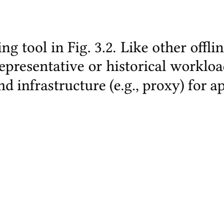

**OCR trong hình (theo thứ tự đọc):**

ling tool in Fig. 3.2. Like other offlin prepresentative or historical workload infrastructure (e.g., proxy) for ap-

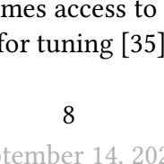

**OCR trong hình (theo thứ tự đọc):**

mes access to for tuning [35]

**OCR trong hình (theo thứ tự đọc):**

The study was conducted in the absence of any previous agricultural activities with the exception of a single study conducted in 2011 where the study was conducted in an agricultural activity setting. The study was conducted between June 2012 and July 2013 at the Molle House in The Hampshire Department, University of Warwick, UK. The study was conducted in the absence of any previous agricultural activities with the exception of a single study conducted in 2011 where the study was conducted in an agricultural activity setting. The study was conducted between June 2012 and July 2013 at the Molle House in The Hampshire Department, University of Warwick, UK.

**OCR trong hình (theo thứ tự đọc):**

|  |  |
| --- | --- |
|  |  |
|  |  |
|  |  |
|  |  |
|  |  |

**OCR trong hình (theo thứ tự đọc):**

|  |  |
| --- | --- |
|  |  |
|  |  |
|  |  |
|  |  |
|  |  |
|  |  |
|  |  |
|  |  |
|  |  |

---

## Trang 15

September 14, 2025
DRAFT
DBMS Batch of <Holons, Performance> Sample
Phase I: Latent Space Creation
Deploy and Execute Workload Coordinator
Proto-Action
Phase II: Action Recommendation
Actor
Holon Set
Current DBMS
Representation
Decoder Neighbor
Search
Critic
DBMS
Workload Result (Reward)
Update with reward
Agent Selected Holon
,
Latent Space
Encoder Decoder
Exploration Bias
Figure 3.2: Architecture – An overview of the two phases of Proto-X. In Phase I, Proto-X creates the
necessary latent space. In Phase II, Proto-X recommends holons to optimize the DBMS.
plying query options, such as those exposed by PostgreSQL’s pg hint plan [1]. Proto-X operates
in two phases. First, it creates the latent space based on the DBMS schema, sample workload,
and target configuration spaces. Then, in the second phase, Proto-X exploits the created latent
space to tune the DBMS. We now describe each phase in more detail.
3.3.1 Phase I: Latent Space Creation
Proto-X begins by collecting each configuration space’s metadata: (1) system knobs, (2) table
knobs, (3) indexes and per-index knobs, (4) query knobs, and (5) query hints. A query knob alters
the DBMS’s behavior by changing a system knob for a specific query (e.g., hash join memory
allocation). A query hint injects commands to control how the DBMS generates a plan (e.g.,
index scan for a table).
Proto-X obtains the tunable system knobs either from the user, through a DBMS-specific
method, or from externally derived knob constraints [66]. For each system knob, Proto-X ob￾tains the min/max values and whether the knob should be restricted to a limited value range [43]
(e.g., quantization). Next, it connects to the DBMS to obtain the database schema to identify
candidate table knobs. Proto-X defines its candidate index domain by extracting all referenced
attributes from the predicates of the user’s workload [47] and obtains tunable per-index knobs
from the user’s specification.
Lastly, Proto-X parses the workload to identify query knobs and hints. For each query,
9

### Hình ảnh trên trang

**OCR trong hình (theo thứ tự đọc):**

|  |  |
| --- | --- |
|  |  |
|  |  |
|  |  |
|  |  |
|  |  |

**OCR trong hình (theo thứ tự đọc):**

The proposed theory of the architecture of the monument is a simple one that is possible to apply to many situations. The concept of architecture is constructed as a sum of several parts. Architecture is the sum of the following parts: interiors and exteriors, structure of the monument, architecture of the monument and the structure of the monument. The architecture of the monument is the sum of the following parts: construction of the monument, construction of the monument and the structure of the monument. Architecture of the monument is the sum of the following parts: construction of the monument and the structure of the monument. This is a simple concept that is possible to apply to many situations.

**OCR trong hình (theo thứ tự đọc):**

|  |  |  |  |  |  |
| --- | --- | --- | --- | --- | --- |
|  |  |  |  |  |  |
|  |  |  |  |  |  |
|  |  |  |  |  |  |
|  |  |  |  |  |  |
|  |  |  |  |  |  |
|  |  |  |  |  |  |
|  |  |  |  |  |  |

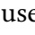

**OCR trong hình (theo thứ tự đọc):**

use

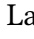

**OCR trong hình (theo thứ tự đọc):**

La

**OCR trong hình (theo thứ tự đọc):**

A complete and accurate logging of the evolution of the micro-biology of the field is most presented in this work. The main aim of the work is to give a framework for the analysis of the organisms of the field and to highlight the current concepts of the term micro-biology. This is carried out by a theoretical method with the idea of complete logging and a statistical approach to the analysis of the organisms of the field. The organisms of the field are assessed in terms of their evolutionary and dynamic properties, such as their evolutionary and dynamic structure, their evolutionary and dynamic potential, their evolutionary and dynamic properties and their potentials. The analysis of these organisms is consistent with the idea of complete logging and the assessment of their evolutionary and dynamic properties. The analysis is also consistent with the idea of independent analysis and the assessment of the theoretical and data properties of the organisms of the field. The theoretical and data properties of the organisms of the field are computed and the evolutionary and dynamic properties of the organisms of the field are assessed using the probabilistic procedure. The analysis of the organisms of the field is consistent with the idea of independent analysis and the assessment of

**OCR trong hình (theo thứ tự đọc):**

|  |  |
| --- | --- |
|  |  |
|  |  |
|  |  |
|  |  |
|  |  |

**OCR trong hình (theo thứ tự đọc):**

Boltzmann Papper

**OCR trong hình (theo thứ tự đọc):**

|  |  |
| --- | --- |
|  |  |
|  |  |
|  |  |
|  |  |
|  |  |

**OCR trong hình (theo thứ tự đọc):**

| جمهوری اسلامی ایران | بابا ابوالعزیز |
| --- | --- |
| استان اسلامی ایران |  |
| دیگر نام‌ها: | بابا ابوالعزیز |
| کلان نام: | ایرانی-اسلامی ایرانی |
| نام استان: | اسلام‌ستان |
| نام دیگر: | بابا ابوالعزیز |

**OCR trong hình (theo thứ tự đọc):**

State of Massachusetts provides a list of the counties and cities of the state that are not included in the state list of counties and cities of the state of Massachusetts. The list includes all counties and cities that are not included in the state list of counties and cities of the state of Massachusetts. The list includes all counties and cities that are not included in the state list of counties and cities of the state of Massachusetts.

**OCR trong hình (theo thứ tự đọc):**

At the contrary time, a control group in the early study of the prevention of symptoms of severe diarrhoea in children at age 6 months was supposed to have a higher rate of diarrhoea than a control group of children at age 7 months. This problem is not surprising, as the study was performed in a simple pooled cohort of children at age 6 months and the rate of diarrhoea in the group of children at age 7 months was estimated to be similar to that of the group of children at age 6 months. The problem is also surprising in the case of the study of diarrhoea in children at age 7 months where the rate of diarrhoea in the group of children at age 7 months was estimated to be similar to that of the group of children at age 6 months. This problem is surprising in the case of the study of diarrhoea in children at age 8 months where the rate of diarrhoea in the group of children at age 8 months was estimated to be similar to that of the group of children at age 6 months. The problem is surprising in the case of the study of diarrhoea in children at age 9 months where the rate of diarrhoea in the group of children at age 9 months was estimated to be similar to that of the group of children at age 6 months. This problem is surprising in the case of the study of diarrhoea in children at age 10

**OCR trong hình (theo thứ tự đọc):**

w

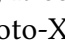

**OCR trong hình (theo thứ tự đọc):**

oto-X

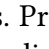

**OCR trong hình (theo thứ tự đọc):**

3. Pr 1

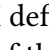

**OCR trong hình (theo thứ tự đọc):**

def cul

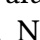

**OCR trong hình (theo thứ tự đọc):**

N

**OCR trong hình (theo thứ tự đọc):**

Murray Palmer
(
)

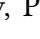

**OCR trong hình (theo thứ tự đọc):**

r
, P

---

## Trang 16

September 14, 2025
DRAFT
Proto-X identifies (1) query knobs based on a user-supplied list or by mining the system knobs
for applicable knobs, (2) a query hint for each referenced table that forces a specific access
method, and (3) a query hint specified once per-query that forces a parallel scan on a selected
table. For example, TPC-H [54]’s Q14 accesses the LINEITEM and PART tables, and thus Proto-X
generates the Q14_lineitem_scan and Q14_part_scan hints that control whether the DBMS
should use an index scan for those tables. Proto-X also identifies a Q14_Parallel hint. Setting
this hint forces the DBMS to scan the referenced table in parallel.
After obtaining metadata, in Fig. 3.2, Proto-X 1 samples a batch of holons and their esti￾mated benefits for the target workload. 2 Using the batch, Proto-X trains the latent space to
place holons of similar benefit at nearby locations. For example, if an index t (a,b,c) has ap￾proximately the same benefit as an index t (a,c,b), their corresponding actions will be close
to each other in the latent space. Proto-X repeats this process several times to refine the space.
3.3.2 Phase II: Holon Recommendation
Proto-X then instantiates an agent to tune the user’s DBMS. The coordinator handles interfac￾ing with the DBMS, from deploying holons to evaluating the user’s objective function on the
sample workload. The agent is based on the Wolpertinger Architecture [16], which uses an actor
network to emit a proto-action, refines the proto-action to obtain a neighborhood of candidate
holons, and employs a critic network to select the most promising holon.
In Fig. 3.2 3 , Phase II starts with the agent passing the current DBMS representation through
its actor network to obtain a proto-action. The representation is either the deployed configura￾tion (e.g., knobs, indexes) or internal metrics data (e.g., tuples processed, pages read) [56]. The
agent then augments the proto-action with an exploration bias that Proto-X tweaks with small
adjustments over time to encourage the exploration and coverage of less promising regions.
The agent then decodes the augmented proto-action, searches its neighborhood to obtain
a holon set, and 5 uses its critic network to select the most promising candidate. 6 The co￾ordinator deploys the selected holon, runs the sample workload, and 7 evaluates the user’s
objective function to obtain a reward. 8 The coordinator updates the actor and critic networks
with the reward and advances the agent to the next tuning step. The agent and coordinator
repeat this process until the agent reaches an illegal state (e.g., an invalid configuration) or a
fixed number of steps has elapsed. At this point, the coordinator resets the environment to the
initial or a previously discovered configuration before resuming.
The coordinator always creates a candidate index. Existing tuning tools [13, 58, 65] could
drop indexes by treating them as discrete actions, with a bit vector entry that indicates existence,
or by using workload statistics. Even though Proto-X could use these patches, an agent should
instead discern an index’s value across all explored configurations and leverage configuration
neighborhoods to find opportunities to drop. We defer this as future work.
3.4 Experimental Evaluation
We evaluate Proto-X’s ability to optimize a DBMS’s configuration for analytical and transac￾tional workloads. We target PostgreSQL v15.1 running on a server with two Intel Xeon Gold
10

---

## Trang 17

September 14, 2025
DRAFT
JOB TPC-H
Knob Index Q.Knobs Q.Hints Knob Index Q.Knobs Q.Hints
P+DTA-S+A N/A 73 1356 N/A N/A 76 264 N/A
P+DTA-F+A N/A 201 1356 N/A N/A 183 264 N/A
UDO 24 181 N/A N/A 24 65 N/A N/A
UniTune 61 59 N/A N/A 61 53 N/A N/A
Proto-X 45 2740 1356 1090 45 2
28 264 108
DSB TPC-C
Knob Index Q.Knobs Q.Hints Knob Index Table Knobs
P+DTA-S+A N/A 183 588 N/A N/A 9 N/A
P+DTA-F+A N/A 542 588 N/A N/A 36 N/A
UDO 24 4561 N/A N/A 33 80 N/A
UniTune 61 263 N/A N/A 47 91 9
Proto-X 45 2
47 588 426 47 217 9
Table 3.1: Configuration Space Size – Number of choices considered by each tuning method in our
evaluation. “N/A” indicates that the method does not support those options. “Q.Knobs” refers to query
knobs, and “Q.Hints” refers to query hints.
5218R CPUs (20 cores) and a 960 GB Samsung NVMe SSD. We restrict the DBMS to 32 GB of
RAM and 20 worker processes. To support tuning indexes and query options in PostgreSQL,
we install the HypoPG [24] v1.4 and a patched version of pg hint plan [1] v1.6 extensions.
We evaluate three OLAP workloads and configure all agents to minimize the overall work￾load runtime. JOB [30] is a benchmark that stresses the query optimizer with 21 tables and
113 queries. TPC-H SF10 [54] models a business analytics workload with eight tables and
22 queries. DSB SF10 [15] is Microsoft’s extension of TPC-DS [53] that introduces additional
challenges (e.g., data distributions, join patterns) with 25 tables and 53 queries. We omit four
queries (Q18, Q32, Q81, Q92) due to PostgreSQL’s query optimizer’s limited ability to unnest
subqueries [17]. We unsuccessfully attempted to rewrite those queries with Apache Calcite so
that PostgreSQL could complete them in a reasonable time.
We also evaluate TPC-C [51] SF100 with 40 terminals but modify it to remove all secondary
indexes and the unique index on the OORDER table. We sample 1m runs through BenchBase [14]
and configure agents to maximize throughput.
We first discuss the configurations for Proto-X (Section 3.4.1) and other baselines (Sec￾tion 3.4.2). We then present our results in Sections 3.4.3 and 3.4.4.
3.4.1 Proto-X Configuration
We configure Proto-X to tune indexes and global knobs for all the workloads. We allow Proto-X
to extract indexable attributes from workload predicates [47] and to generate arbitrary index
candidates. We discuss OLAP- and OLTP-specific workload settings below:
OLAP Proto-X tunes 45 system-wide knobs and tunes indexes using all structural rules. We
allow Proto-X to build hash, B+Tree, and block range indexes. For B+Tree indexes, it tunes
how full the DBMS packs each page by setting fillfactor to 90 (default) or 100 (full). For
block range indexes, it tunes the summarization granularity (pages_per_range) by setting it
11

---

## Trang 18

September 14, 2025
DRAFT
to 64, 128 (default), or 256 pages. Proto-X tunes for each query 12 optimizer-related knobs1
,
per-table access methods2
, and a query hint instructing which table to scan in parallel3
. For
our maximal query optimization, the coordinator runs supplemental query option sets in the
following order: (1) the prior step’s, (2) the optimizer’s, (3) the agent’s, and (4) optional domain
knowledge-based sets (e.g., index nested loop join, table scans into hash joins).
OLTP Proto-X tunes 47 system-wide knobs in PostgreSQL and a fillfactor table knob that
controls how much space the DBMS leaves in a page for updates. Proto-X does not enable
the index type or include rules for two reasons: (1) PostgreSQL cannot build multi-column
hash indexes, and (2) attaching INCLUDE columns to an index orchanging its type to prevent
point-lookups (e.g., block range index) degrades OLTP performance. Proto-X tunes how full
the DBMS packs each B+Tree index page by setting fillfactor to 90 (default) or 100 (full).
Some PostgreSQL knobs have externalities that agents cannot capture [43, 56]. For instance,
increasing max_wal_size will improve throughput but also increase recovery time. As such,
we set commit_delay to 0 to make transactions immediately durable, restrict max_wal_size to
16 GB, and do not tune autovacuum knobs due to sampling constraints.
Before tuning, Proto-X creates the latent space for discrete indexes. We sample B+tree in￾dexes without INCLUDE columns and aim for reasonable coverage of the space. Using 40 parallel
instances and the target workload, we sample each benchmark with the following counts:
• JOB: 2048 per-table.
• TPC-H: 2048 per-table, except 2
(16−1) for LINEITEM.
• DSB: 1024 on small (less than seven indexable attributes) tables. Otherwise, we generate 8192
per (table, attribute).
• TPC-C: 1024 per-table using behavior models [38] to account for maintenance costs from
index updates.
We build latent spaces that balance reconstruction loss and similarity to the benefit score
distribution. The reconstruction loss measures how accurately the decoder reconstructs actions
from latent space points. Proto-X estimates distribution similarity by sampling 8192 points from
each latent space band, decoding them, and measuring the (table,key) distribution. We set
all agent parameters (e.g., networks, learning rate) based on prior techniques and existing ML
literature [4].
3.4.2 Other Tuning Tools
Next, we describe the other state-of-the-art automated tuning tools we use in our comparison
with Proto-X.
1Query Knobs: enable_sort ,enable_memoize ,enable_hashjoin ,enable_nestloop ,
enable_mergejoin ,enable_gathermerge ,enable_hashagg ,enable_material ,
enable_parallel_hash ,random_page_cost ,seq_page_cost ,hash_mem_multiplier
2Query Hint: NoSeqScan(t),SeqScan(t)
3Query Hint: Parallel(t)
12

---

## Trang 19

September 14, 2025
DRAFT
PGTune+Dexter (P+D) This baseline first runs PGTune [28], a heuristics-based knob tuner.
We then run Dexter [5] to recommend indexes based on HypoPG [24] and PostgreSQL opti￾mizer’s workload costs. For TPC-C, we provide a representative query trace to Dexter.
PGTune+DTA-S+AutoSteer (P+DTA-S+A) This runs PGTune, followed by Microsoft’s Any￾time Database Tuning Advisor (DTA) algorithm [10]. DTA-S uses Hyrise’s implementation with
their settings [26]: (1) no storage budget, (2) 30m tuning budget, and (3) only two-column in￾dexes. After DTA-S finishes, we run AutoSteer [6], which tunes query knobs by greedily tog￾gling and merging boolean knobs. We configure AutoSteer to tune the same knobs as Proto-X
and add toggles to infuse the prior domain knowledge utilized by our maximal query optimiza￾tion.
PGTune+DTA-F+AutoSteer (P+DTA-F+A) We replace DTA-S in P+DTA-S+A with DTA-F.
In DTA-F, we allow DTA to consider more indexes without a time limit. Due to OOM issues
and PostgreSQL’s inability to optimize queries with 1000s of hypothetical indexes, we limit
DTA-F to indexes with three, five, three, and four columns for TPC-H, JOB, DSB, and TPC-C,
respectively.
UDO This is a holistic tool that supports tuning both system knobs and indexes [58]. We use
UDO’s open-source implementation to construct each benchmark’s candidate index list and
configure the agent with their default parameters. To ensure a fair comparison, we extended
UDO’s PostgreSQL knob list to include (1) 24 knobs related to query optimization and resource
management and (2) fillfactor table knobs for TPC-C. We alter UDO to obtain TPC-C sam￾ples through BenchBase [14] and employ 30s, 30s, and 60s query timeouts for JOB, DSB, and
TPC-H, respectively. We poll UDO every 15m for the best configuration.
UniTune Lastly, we compare against Alibaba’s UniTune tool [65]. We modified it to support
PostgreSQL and obtain samples through BenchBase. We use the same parameters released by
the authors. UniTune optimizes the same system knobs as Proto-X, and UniTune+QOpts uses
the same query options as Proto-X with the same prior domain knowledge. We also enable Uni￾Tune’s query rewriting via Calcite to match their paper. UniTune only constructs single-column
indexes because complex indexes lead to a combinatorial explosion in its one-hot representa￾tion. We made two improvements to UniTune. First, we run queries serially and set the target
objective to minimize workload runtime. We set UniTune’s space budget to a high value (2 TB)
for comparative fairness and to allow it to more consistently find promising configurations.
3.4.3 OLAP Performance Comparison
We start by comparing Proto-X to the other tools regarding their ability to optimize OLAP
workloads. We run the tools on the same hardware for multiple trials (i.e., independent tuning
period) with different random seeds. At the start of each trial, we initialize PostgreSQL with its
default configuration and load the database. We then run each agent for 30h to tune the DBMS.
13

---

## Trang 20

September 14, 2025
DRAFT
PGTune+Dexter P+DTA-S+AS P+DTA-F+AS UDO UniTune UniTune+QOpts Proto-X
30
100
200
300
400
0 2 4 6 8 10 20 30
Time (hr)
0
Runtime (s)
(a) JOB
50
100
150
200
250
0 2 4 6 8 10 20 30
Time (hr)
0
Runtime (s)
(b) TPC-H
30
45
90
135
180
0 2 4 6 8 10 20 30
Time (hr)
0
Runtime (s)
(c) DSB
Figure 3.3: OLAP Performance Comparison – The DBMS’s performance achieved using the tools’
configurations over time on JOB, TPC-H, and DSB. We plot the mean performance obtained by four trials
of each agent. The shaded region for Proto-X is the time spent constructing the latent space.
JOB TPC-H DSB
Min Max Min Max Min Max
PGTune+Dexter 162s 162s 154s 154s 116s 116s
P+DTA-S+AS 77s 79s 81s 93s 43s 46s
P+DTA-F+AS 78s 80s 72s 87s 40s 40s
UDO 189s 400s 144s 250s 188s 200s
UniTune 132s 146s 176s 200s 117s 125s
UniTune+QOpts 126s 237s 250s 250s 98s 100s
Proto-X 36s 41s 66s 69s 31s 35s
Table 3.2: OLAP Performance Spread –The best and worst performance achieved by a tool’s four
trials in Fig. 3.3 on JOB, TPC-H, and DSB.
As agents utilize timeouts during exploration, we evaluate each discovered configuration with￾out timeouts to obtain their actual performance. After deploying each configuration, we empty
the OS page cache, run the workload three times, and report the min [29].
We run four trials of each agent and report results for all trials. In Fig. 3.3, we plot the mean
performance of each agent’s best configuration. We also report the best and worst performance
achieved by any agent’s trial in Table 3.2. The baseline for all trials is PGTune+Dexter (P+D),
as this represents the easiest and fastest method for tuning a DBMS since there is no learning.
Our analysis focuses on whether a method generates better configurations than P+D.
JOB In Fig. 3.3a, all methods start with the same performance. UDO flattens after 5h and fails
to improve over P+D because it does not pick the correct indexes. Although UDO considers 181
index candidates, only 3–5 indexes improve the workload by a measurable amount. Whereas
Proto-X’s latent space considers the expected benefit of indexes, UDO initially considers all
indexes equally. Thus, UDO is unable to reliably pick the correct indexes.
UniTune builds an average of 29 out of 59 index candidates. In Fig. 3.3a, UniTune surpasses
P+D after 12h and flattens after 15h due to the limited tuning options available. UniTune+QOpts
has more potential as it tunes query options, but it does not manage the additional complexity
and fails to surpass P+D.
Proto-X builds its latent space and surpasses P+D within 2h. After 5h, Proto-X matches
14

---

## Trang 21

September 14, 2025
DRAFT
P+DTA-S+A and P+DTA-F+A and finds better configurations. Proto-X quickly identifies a high￾value set of 2–5 indexes and continues to improve it with additional indexes and query options.
We attribute the descent smoothness in part to Proto-X’s maximal query optimization: the agent
exploits prior knowledge about promising query option sets while simultaneously exploring
unevaluated query option sets, indexes, and global knobs. From Table 3.2, both Proto-X’s worst
(41s) and best (36s) trials yield a 46–53% speedup over the next best P+DTA-S+A.
TPC-H Unlike the previous workload, the results in Fig. 3.3b show that only Proto-X, P+DTA￾S+A, and P+DTA-F+A surpass the baseline P+D for TPC-H. One of this workload’s most impor￾tant actions is to find the high-value LINEITEM (l_partkey) index that all tools find. However,
both UDO and UniTune do not find system knobs better than PGTune. UDO does not correctly
tune the number of parallel workers. UniTune dedicates more time to query rewriting and
indexes when it should tune system knobs.
P+DTA-S+A and P+DTA-F+A find their best configuration after 2h and 6h, respectively.
Proto-X mostly plateaus after 10h, but Proto-X still outperforms P+DTA-S+A and P+DTA-F+A
by tuning a query hint that selects a table to scan in parallel. From Table 3.2, the worst (69s)
and best (66s) trial of Proto-X yields a 4–8% speedup over P+DTA-F+A’s best run (72s).
DSB From Fig. 3.3c, UDO and UniTune do not surpass P+D. Similar to prior workloads, UDO
struggles to pick an adequate index set from 4561 candidates, and UniTune does not find promis￾ing knob configurations due to misallocating time to index tuning and query rewriting. How￾ever, in this case, UniTune+QOpts finds better configurations than P+D by building indexes on
STORE_SALES and utilizing Proto-X’s prior domain knowledge.
P+DTA-S+A and P+DTA-F+A find better configurations after 3h and 14h, respectively, before
plateauing. Proto-X spends the first 2h constructing its latent space, surpasses P+DTA-S+A
within 6h, maintains its lead over P+DTA-F+A, and continues to find better configurations by
building more indexes and tweaking query options. Table 3.2 shows that Proto-X’s worst (35s)
and best (31s) trial has a 13–23% speedup over P+DTA-F+A’s best run (40s).
3.4.4 OLTP Performance Comparison
We next compare Proto-X to the other tools on their ability to improve TPC-C. Each agent tunes
the DBMS for 8h. We report the average of three 1m BenchBase [14] runs for each discovered
configuration. We plot the mean performance of the best configuration across the four trials of
each agent. We also present each agent’s worst, median, and best performance in Table 3.3.
The results in Fig. 3.4 show that UDO does not exceed P+D because it does not identify the
correct indexes or knob configurations. For OLTP, picking indexes on tables with data actively
modified negatively impacts throughput due to additional index maintenance operations. UDO
picks indexes that hinder performance, such as indexes on OORDER or ORDER_LINE.
In comparison, UniTune and Proto-X exceed the performance of P+D by tuning table knobs
and avoiding a bad index on OORDER that Dexter suggests. From Table 3.3, Proto-X’s best run
(13.8k) is better than UniTune’s (12.9k) by 7%. Proto-X picks an index on CUSTOMER that in￾cludes c_last. This index improves performance in 47% of TPC-C’s transactions (i.e., Payment,
15

---

## Trang 22

September 14, 2025
DRAFT
PGTune+Dexter P+DTA-S+AS P+DTA-F+AS UDO UniTune Proto-X
0 2 4 6 8
Time (hr)
3000
8500
14000
Throughput (tps)
Figure 3.4: OLTP Performance Comparison – The DBMS’s performance achieved using the tools’
configurations over time on TPC-C. We plot the mean performance obtained by four trials of each agent.
The shaded region for Proto-X is the time spent constructing the latent space.
TPC-C
Min Median Max
PGTune+Dexter 11.3k 11.3k 11.3k
P+DTA-S+A 12.9k 12.9k 12.9k
P+DTA-F+A 9.1k 9.1k 9.1k
UDO 5.7k 6.3k 7.6k
UniTune 12.7k 12.8k 12.9k
Proto-X 13.1k 13.4k 13.8k
Table 3.3: OLTP Performance Spread of Tools – The worst, median, and best performance achieved
by a tool’s four trials in Fig. 3.4.
OrderStatus). Proto-X maintains this 7% improvement over P+DTA-S+A (12.9k tps). P+DTA￾S+A picks the correct CUSTOMER index but also picks bad indexes on OORDER. This behavior
worsens for P+DTA-F+A (9.1k tps), as DTA considers more (13) but mostly bad indexes.
16

---

## Trang 23

September 14, 2025
DRAFT
Chapter 4
Workloads-Configurations Similarity
Another key aspect to enable lifetime holistic DBMS optimization is efficiently adapting the
DBMS’s configuration in response to deployment changes. These changes include the work￾load’s queries, the database size, or the application’s schema. Existing automated tuners strug￾gle to adapt and re-optimize database management systems (DBMSs) based on these changes
due to their brittle design and reliance on workload-level observations.
In this chapter, we present the Booster framework that assists existing tuners in adapting
to environment changes. Booster first structures historical artifacts into query-configuration
contexts. On a per-query basis, Booster then identifies the most relevant contexts as references
and then prompts a large language model (LLM) to suggest configurations. Booster then com￾poses the query-level suggestions into a holistic configuration [63] with beam search. Finally,
Booster provides its findings to the assisted tuner for further refinement.
The rest of the chapter is organized as follows. We provide the key ideas behind Booster in
Section 4.1 and its architecture in Section 4.2. We then provide an evaluation of Booster’s ability
to assist different state-of-the-art tuners in adapting to environment changes in Section 4.3.
By composing recommendations derived from query-level insights, Booster assists tuners in
discovering configurations that are up to 74% better and in up to 4.7× less time than continuing
to tune from historical configurations.
4.1 LLM-based Query Adaptation
Recent research in LLMs has shown their capabilities in optimization [19, 50] and schema under￾standing [49, 67]. However, providing curated information to the LLM remains unsolved [18].
We provide an exposition into incorporating tuning knowledge into LLMs through four tech￾niques: (1) workload-level prompts, (2) workload-level fine-tune, (3) query fine-tune, and (4)
combining enriched query-level prompts with a composition mechanism.
Workload-Level Prompts This technique (WL-Prompt) invokes an off-the-shelf LLM with
a workload-level prompt that describes the tuning task, the workload, and additional informa￾tion (e.g., DBMS telemetry, workload summary) as context [31]. This technique utilizes the
17

---

## Trang 24

September 14, 2025
DRAFT
WL-Prompt WL-FT Q-FT Enrich Q+Compose
0
50
Runtime (s)
79 71 69
31
Figure 4.1: LLM-basedQuery Adaptation – DSB workload runtime achieved by prompting an off-the￾shelf LLM (WL-Prompt), fine-tuning a LLM with historical knowledge at workload (WL-FT) and query
(Q-FT) granularities, and Enrich Q+Compose that combines query prompts enriched with historical
attempts and a composition mechanism. All techniques utilize experience generated over 12hrs by a
holistic tuner tuning a DSB workload where 50% of queries have different parameters.
LLM’s innate abilities and pre-trained knowledge to generate configurations rather than his￾torical knowledge.
Workload-Level Fine-Tune This technique (WL-FT) fine-tunes a LLM by using historical
experiences to alter the LLM’s weights [23]. Similarly to WL-Prompt, this technique then
invokes the fine-tuned LLM to obtain candidate configurations. By fine-tuning, this technique
improves the LLM’s ability to generate more effective configurations for the target workload.
Query Fine-Tune In comparison to WL-FT, this technique (Q-FT) fine-tunes a LLM on
queries. Although this enables the LLM to relate queries to configurations, it requires prompt￾ing the LLM with a query prompt. As such, rather than generating configurations for the entire
workload, the LLM generates configurations for each query that are then combined into a holis￾tic configuration [63].
EnrichedQuery-Level Prompts and Composition This technique (Enrich Q+Compose)
is agnostic to whether the LLM is fine-tuned or not. On a per-query basis, this technique en￾riches the query prompt with prior tuning attempts based on the query (e.g., SQL text, plan)
and then instructs the LLM to generate configurations with those historical references [11, 31].
The technique then uses a composition mechanism to combine the query-level configurations
into a holistic configuration while resolving conflicts (e.g., different knob values, conflicting
indexes). In doing so, this technique achieves Total Knowledge Remix by reasoning over all
available historical knowledge (e.g., past configurations, Internet).
To understand their efficacy, we first obtain historical experience by using a holistic tuner to
optimize a DSB workload for 12hrs. We then evaluate the previous techniques on using this ex￾perience to adapt to a drifted workload where 50% of the queries have different parameters. As
shown in Fig. 4.1, WL-Prompt performs the worst as it does not use prior experience. WL-FT
and Q-FT have limited improvement over WL-Prompt due to issues around granularity and
combining query configurations, respectively. In contrast, Enrich Q+Compose finds drasti￾cally better configurations by exploiting relevant knowledge on a per-query basis and resolving
conflicts with a composition mechanism. Enrich Q+Compose forms the basis of our method
to assist existing tuners in adapting to environment changes by remixing historical knowledge
with LLMs.
18

---

## Trang 25

September 14, 2025
DRAFT
Repository
Workload
Booster Tuner Config
Artifacts
DBMS
Findings
Figure 4.2: Booster Overview – The framework integrates with an existing tuner to improve its adap￾tivity to environment changes. Booster analyzes the artifact repository and injects its findings (e.g., start
configuration) into the tuner. The “injected” tuner then refines the configuration and stores its artifacts
into the repository for further analysis.
Phase I: Experience Analysis
Tuning Repository
Identity Vectors (IVs)
Phase II: Guided Recommendation
Workload
DBMS
Query i
…
Vector DB
IVs
Phase III: Constrained Composition
Seeds
Findings (e.g., config)
QConfig
QConfig
Embedder
Sanitizer
Ranker Compose
Embedder
Query 1
Prompter
Query 1 Seeds
Query i Seeds
…
Tuner
Figure 4.3: Booster Architecture – An overview of the framework’s three phases. In Phase I, Booster
analyzes historical tuning artifacts. In Phase II, Booster generates candidate configurations (i.e., seeds)
for each query with a LLM. In Phase III, Booster then composes each query’s seeds into a holistic con￾figuration that it then provides to the tuner being assisted.
4.2 Booster Architecture
We present how the Booster framework integrates with an existing tuner to improve its ability
to adapt to environment changes in Fig. 4.2. Based on the workload and DBMS, Booster ana￾lyzes the repository of artifacts and injects its findings (e.g., start configuration) into the tuner.
The injected tuner then further refines the configuration and updates the repository with new
19

### Hình ảnh trên trang

**OCR trong hình (theo thứ tự đọc):**

March 2
- The first complete season of the New York Times continues with the second show of the year coming together in the afternoon at the New York Times station.

**OCR trong hình (theo thứ tự đọc):**

|  |  |
| --- | --- |
|  |  |
|  |  |
|  |  |
|  |  |
|  |  |

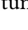

**OCR trong hình (theo thứ tự đọc):**

tur

---

## Trang 26

September 14, 2025
DRAFT
artifacts.
We next describe how Booster utilizes this repository to derive a holistic configuration [63]
(i.e., its findings) for injecting into the tuner. As shown in Fig. 4.3, Booster’s operation is divided
into three phases. In the first phase, it monitors the repository for new artifacts generated by
the tuner and analyzes them for insights (Section 4.2.1). When the DBMS environment changes,
Booster uses these insights to optimize the DBMS. In the second phase, Booster receives the
user’s target workload and the target DBMS (Section 4.2.2). For each query in the workload,
Booster identifies relevant experiences and utilizes them to generate candidate configurations
with a LLM. Then in the third phase, Booster combines these query-level candidate configura￾tions with a constrained composition mechanism (Section 4.2.3). Lastly, Booster provides its
findings to the tuner for further refinement. We next discuss each phase in more detail.
4.2.1 Phase I: Experience Analysis
In this phase, 1 Booster monitors a repository of tuning experiences. This repository accumu￾lates artifacts generated by a tuner as it optimizes a deployment. Although these artifacts con￾tain substantial information about the DBMS (e.g., workloads, configurations’ efficacy), they are
not readily searchable and differ across tuners. To standardize these artifacts into a searchable
format, Booster first 2 parses them into query-configuration (QConfig) objects that represent
how a query behaves under a specific configuration. Each QConfig includes but is not lim￾ited to the relevant schema, the query’s execution plan, the configuration (e.g., knobs, indexes),
and links to other related QConfigs for structural organization. For instance, Booster can link
QConfigs together in chronological order if the QConfigs refer to the same query.
With these QConfigs, Booster next makes them searchable by leveraging recent advances
in LLMs’ ability to understand tabular data, schemas, and SQL queries [34, 49, 67]. For each
QConfig, 3 Booster utilizes an embedder (e.g., Voyage 3 Large [2]) to generate fixed-length
identity vectors (i.e., embeddings [45]) based on text documents derived from the QConfig. For
instance, it can derive them by combining the schema and query plan or by combining the
anonymized schema and SQL text. Booster combines these identity vectors with the QConfig
and 4 loads them into a vector database for querying in Phase II.
4.2.2 Phase II: Guided Recommendation
At the start of this phase, Booster is now optimizing the DBMS. Booster receives the target
workload and a connection to an offline environment for safe exploration [35, 37]. For each
query in the workload, 5 Booster obtains relevant information from the DBMS (e.g., schema,
plan) and uses an embedder to generate identity vectors in the same manner as Phase I. With
each query’s identity vectors, Booster 6 retrieves relevant historical QConfigs from the vector
database, combines them with the target query into the prompt, and 7 invokes the LLM to
recommend configurations based on the QConfigs [11, 31]. As the LLM may suggest invalid
configurations (e.g., illegal knob value, invalid index), Booster passes these suggested configu￾rations and the relevant QConfigs through the Sanitizer to obtain configurations for each query
that can be deployed. As these configurations target a single query, we refer to them as query
seeds.
20

---

## Trang 27

September 14, 2025
DRAFT
4.2.3 Phase III: Constrained Composition
After obtaining the seeds for each query, Booster then combines them into a holistic config￾uration [63]. However, seed configurations may specify different parameters (e.g., number of
parallel workers, indexes) that conflict when combined. To mitigate this, Booster adopts a two￾step process to generate holistic configurations from multiple query seeds. 8 Booster first
ranks all the query seeds and then 9 runs a beam search algorithm, a variant of best-first
search [12, 44], to identify performant holistic configurations. This algorithm terminates when
a terminal condition (e.g., elapsed time) is reached. Finally, Booster injects its discoveries into
the tuner being assisted.
4.3 Evaluation
We evaluate Booster’s ability to accelerate the convergence of existing tuners when confronted
by different drifts and transfer scenarios. We target PostgreSQL v15.1 running on a server with
two Intel Xeon Gold 5218R CPUs (20 cores) and a 960 GB Samsung NVMe SSD. We restrict the
DBMS to 32 GB of RAM and 20 worker processes. To support Booster’s operations in Post￾greSQL, we install HypoPG [24] for what-if mechanism [9], pg hint plan [1] for query tuning,
and a custom HypoExec extension for re-costing query plans and swapping indexes during ex￾ecution.
We primarily evaluate with three OLAP workloads. JOB [30] is a benchmark that stresses
the query optimizer with 21 tables and 113 queries. TPC-H SF10 [54] models a business an￾alytics workload with eight tables and 22 queries. DSB SF10 [15] is Microsoft’s extension of
TPC-DS [53] that introduces additional challenges (e.g., data distributions, join patterns) with
25 tables and 53 queries. We omit four queries (Q18, Q32, Q81, Q92) due to PostgreSQL’s query
optimizer’s limited ability to unnest subqueries [17].
4.3.1 Experiment Setup
We deploy four state-of-the-art DBMS tuners:
PGTune+DTA+AutoSteer (P+DTA+AS) This first runs PGTune [28], a heuristics-based knob
tuner, followed by Microsoft’s Anytime Database Tuning Advisor (DTA) algorithm [10]. We use
Hyrise’s implementation of DTA [26] with an unlimited tuning budget. After DTA finishes, we
run AutoSteer [6] to tune query knobs by greedily toggling and merging boolean knobs.
UniTune Alibaba’s coordinating tuning framework that targets system knobs, indexes, and
limited query rewriting through Calcite [63]. We adopt the same settings as their paper, but
modify it to run queries serially and to minimize the workload runtime.
Proto-X CMU’s holistic tuner that targets system knobs, indexes, and query options sup￾ported by pg hint plan [63]. We adopt the same parameters from their paper and extend it to
suggest index or bitmap scans and common table expressions (CTEs) inlining.
21

---

## Trang 28

September 14, 2025
DRAFT
Proto-X: Continue From History Booster
20
70
120
0 6 12
Tuner Runtime (hr)
25% Drift
0 6 12
Tuner Runtime (hr)
50% Drift
0 6 12
Tuner Runtime (hr)
75% Drift
0 6 12
Tuner Runtime (hr)
100% Drift
Runtime (s)
(a) Proto-X
P+DTA+AS: Continue From History Booster
20
70
120
0 6 12
Tuner Runtime (hr)
25% Drift
0 6 12
Tuner Runtime (hr)
50% Drift
0 6 12
Tuner Runtime (hr)
75% Drift
0 6 12
Tuner Runtime (hr)
100% Drift
Runtime (s)
(b) P+DTA+AS
UniTune: Continue From History Booster
20
70
120
0 6 12
Tuner Runtime (hr)
25% Drift
0 6 12
Tuner Runtime (hr)
50% Drift
0 6 12
Tuner Runtime (hr)
75% Drift
0 6 12
Tuner Runtime (hr)
100% Drift
Runtime (s)
(c) UniTune
-Tune+AS: Continue From History Booster
20
70
120
0 6 12
Tuner Runtime (hr)
25% Drift
0 6 12
Tuner Runtime (hr)
50% Drift
0 6 12
Tuner Runtime (hr)
75% Drift
0 6 12
Tuner Runtime (hr)
100% Drift
Runtime (s)
(d) λ-Tune+AS
Figure 4.4: Parameter Drift – The DBMS’s performance achieved by each framework in response to
workload parameter drift. We plot the mean performance with a 95% confidence interval obtained by
four trials of each tuner. The X represents the starting point when continuing from history. For Booster,
the ⋆ illustrates when it finishes composing a holistic configuration.
LambdaTune+AutoSteer (λ-Tune+AS) This first runs Cornell’s LLM-based tuning agent
(LambdaTune [19]) that analyzes the workload, constructs a tuning prompt based on the anal￾ysis, and obtains configurations from GPT-4o [41]. After obtaining a configuration, it then runs
AutoSteer [6] to tune query knobs.
We next briefly discuss Booster’s standard configuration for all experiments. For local LLM
inference, Booster uses an RTX3080 GPU with 10GB of RAM, an Intel Xeon W1350 CPU (12
cores) and 32GB of RAM. Booster uses Voyage 3 Large [2] for its embedding model to generate
identity vectors (i.e., embeddings) and Llama 3.1-8B-Instruct Q4-K-M [20] to suggest config￾urations. For consistency, we invoke the LLM with a temperature of 0, a context window of
16384 tokens, and maximum output of 4096 tokens.
In Phase I, we configure Booster to reason over configurations that span Proto-X’s options:
system knobs, indexes, and query options for each query that cover optimizer switches, access
method selection (e.g., sequential, index, bitmap), and whether to materialize or inline CTEs. In
Phase II, Booster uses all permutation strategies to generate query seeds. In Phase III, Booster
runs its constrained composition for 1.5hr.
We populate a tuning repository for each tuner by running four trials with random seeds
on the same hardware. At the start of each trial, we initialize PostgreSQL with its default
configuration. We then run each tuner for 12hr to tune the DBMS. While these tuners run,
Booster in Phase I analyzes their artifacts and generates QConfigs that are available once the
tuners finish.
For tuners continuing from history, we start each tuner from one of the best configurations
in the repository and allow it 12hr to optimize the DBMS further. When accelerating a tuner
with Booster, each Booster invocation runs Phase II and III with access to all artifacts from that
tuner’s repository (e.g., four trials of Proto-X). After each tuner’s trial, we re-evaluate discovered
configurations without timeouts in a warm cache to obtain their actual performance [29, 63].
4.3.2 Parameter Drift
We next evaluate Booster’s ability when the workload undergoes a parameter drift, whereby
only the parameters of the queries change. We generate a set of DSB queries with a different
22

---

## Trang 29

September 14, 2025
DRAFT
Proto-X: Continue From History Booster
15
100
200
0 6 12
Tuner Runtime (hr)
25% Drift
0 6 12
Tuner Runtime (hr)
50% Drift
0 6 12
Tuner Runtime (hr)
75% Drift
0 6 12
Tuner Runtime (hr)
100% Drift
Runtime (s)
(a) Proto-X
P+DTA+AS: Continue From History Booster
15
100
200
0 6 12
Tuner Runtime (hr)
25% Drift
0 6 12
Tuner Runtime (hr)
50% Drift
0 6 12
Tuner Runtime (hr)
75% Drift
0 6 12
Tuner Runtime (hr)
100% Drift
Runtime (s)
(b) P+DTA+AS
UniTune: Continue From History Booster
50
175
300
0 6 12
Tuner Runtime (hr)
25% Drift
0 6 12
Tuner Runtime (hr)
50% Drift
0 6 12
Tuner Runtime (hr)
75% Drift
0 6 12
Tuner Runtime (hr)
100% Drift
Runtime (s)
(c) UniTune
-Tune+AS: Continue From History Booster
15
100
200
0 6 12
Tuner Runtime (hr)
25% Drift
0 6 12
Tuner Runtime (hr)
50% Drift
0 6 12
Tuner Runtime (hr)
75% Drift
0 6 12
Tuner Runtime (hr)
100% Drift
Runtime (s)
(d) λ-Tune+AS
Figure 4.5: Template Drift – The DBMS’s performance achieved by each framework in response to
workload template drift. We plot the mean performance with a 95% confidence interval obtained by four
trials of each tuner. The X represents the starting point when continuing from history. For Booster, the
⋆ illustrates when it finishes composing a holistic configuration.
seed and replace portions of the historical workload: 25%, 50%, 75%, and 100%. We run four
12hr trials for each drift percentage and plot the mean performance along with 95% confidence
interval in Fig. 4.4.
As shown in Fig. 4.4 with the ⋆ marker, Booster consistently outputs a holistic configuration
in under 3hr. With Booster, all frameworks find configurations with mean improvements of 23–
27% (Proto-X), 31% (P+DTA+AS), 42–64% (UniTune), and 24–31% (λ-Tune+AS) over those found
by continuing to tune from historical configurations. Booster re-mixes query seeds based on
query semantics, rather than the entire workload. For repeated queries, Booster extracts ben￾eficial seeds “as-is”. For queries with changed parameters, Booster generalizes from historical
seeds with the same query template. Thus, it exploits the observation that queries with the
same templates may benefit from similar optimizations. Booster assists in finding these con￾figurations up to 3.6× (Proto-X), 1.9× (DTA), and 3.6× (UniTune) faster. λ-Tune+AS finds con￾figurations 10–30min faster than when using Booster. Booster spends ∼10min longer on LLM
inference, as it prompts the LLM on a query rather than workload granularity. Nevertheless,
λ-Tune+AS with Booster still finds configurations that are 24–31% better than without.
4.3.3 Template Drift
We now assess how Booster manages workloads that experience template drifts. We generate
TPC-DS [53] queries that are not also DSB templates and replace portions of the historical
workload by 25%, 50%, 75%, and 100%. We run four 12hr trials per percentage and plot the
mean performance along with 95% confidence interval.
Similar to the previous experiment, Fig. 4.5 shows that Booster outputs a holistic config￾uration in under three hours (⋆ marker). Booster enables the tuners to find configurations
with mean improvements of 12–30% (Proto-X), 24% (P+DTA+AS), 52–63% (UniTune), and 26–
39% (λ-Tune+AS) over those found by tuning from historical configurations. Booster assists
in finding these configurations up to 4.7× (Proto-X), 3.4× (P+DTA+AS), 2.7× (UniTune), and
1.2× (λ-Tune+AS) faster. Booster handles unseen queries through two strategies. It first gen￾eralizes from similar historical queries. In cases where the LLM generates a locally suboptimal
configuration, Booster then relies on its constrained exploration mechanism to derive similar
23

---

## Trang 30

September 14, 2025
DRAFT
configurations that are more performant.
24

---

## Trang 31

September 14, 2025
DRAFT
Chapter 5
Proposed Work: Scenario Similarity
Diagnostics
Simulation Optimizations
Toolbox
Alerts
Knowledge Base
Playbooks
Figure 5.1: Agent Architecture – An overview of the proposed agentic process. The agent actively
observes the deployments or is notified by rule-based alerts. The agent then uses its various capabilities
to understand the situation (e.g., diagnostics, knowledge base), orchestrates its tools, and then deploys
their recommendations.
We presented the Proto-X tuning tool that leverages action similarity to holistically op￾timize a DBMS’s configuration for a fixed deployment in Chapter 3. We then described the
Booster framework that exploits workload and configuration similarity to assist existing tuners
in adapting to environment changes (e.g., workload drift, schema changes) in Chapter 4.
As a last step towards autonomous, holistic DBMS optimization, we propose replacing the
operator-centric tool workflow with an agentic process that is capable of routine maintenance
and crisis response. To achieve this, the agentic process must be able to understand deploy￾ment contexts, reason about the tools’ capabilities, and orchestrate selected tools to achieve the
desired outcomes. For example, assume the Agent has access to a throttler tool and observes
that the DBMS is overloaded. Based on knowledge of similar situations or inferring from the
tool’s semantics, Agent may choose to throttle low-priority queries to improve p99 latency for
high-priority ones.
25

### Hình ảnh trên trang

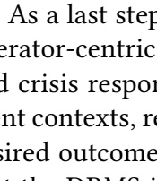

**OCR trong hình (theo thứ tự đọc):**

As a last step to erator-centric crisis response contexts, resided outcome and DPLGs

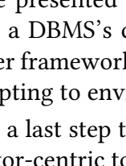

**OCR trong hình (theo thứ tự đọc):**

a DBMS's or framework pitting to environmental cor-centric to

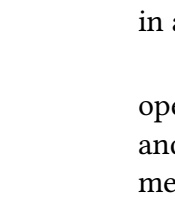

**OCR trong hình (theo thứ tự đọc):**

| in | in |
| --- | --- |
|  |  |
| op | op |
| and | and |
| me | me |

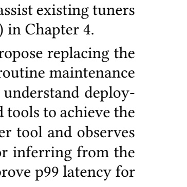

**OCR trong hình (theo thứ tự đọc):**

assist existing tuners () in Chapter 4. The repose replacing the routine maintenance understand deploy- al tools to achieve the real tool and observes inferring from the repove p99 latency for

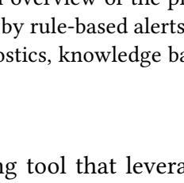

**OCR trong hình (theo thứ tự đọc):**

A review of the problems by rule-based alerts and positics, knowledge based alerts

---

## Trang 32

September 14, 2025
DRAFT
5.1 Crisis Benchmark
To properly evaluate the Agent, we first propose developing a crisis benchmark. Related work
in root cause analysis tends towards answering user questions [11] or only covers a small sub￾set of crises [22, 68, 69] (e.g., missing index, long running query). To facilitate reproducible
scenarios, we plan first to create a crisis benchmark built on top of TPC-C [51] and TPC-E [52]
for transactional scenarios and DSB [15] for an analytical scenario. We will model the crisis
scenarios based on existing work and focus on the following:
• Traffic Surge
• Read Traffic Spike
• Missing/Redundant Index or Partition
• Incorrectly Configured DBMS instance
• Query Regression
• Long Running Query
• DDL Query Hangs
• No Crisis, Routine Maintenance
5.2 Situational Contexts
For the Agent to identify the appropriate tools to use, it must first understand the deployment
context. We will first investigate techniques for textually describing the salient aspects of the
DBMS state and the current workload. In order for the Agent to suggest appropriate tuning
tools, the Agent must be able to explicitly or implicitly identify potential root causes. There
is already rich literature on identifying anomalous metrics based on rules or trends and, by
extension, root cause diagnosis [11, 61, 69]. We will assume the existence of rule-based triggers
(i.e., alerts) which are common in production deployments.
Inspired by prior work [11, 55], we will also consider augmenting the DBMS state with
relevant information from the manual and the PostgreSQL mailing lists. Depending on the
LLM’s context limitations [25], we may also consider adopting a tree-of-thought [60] (ToT)
approach. Under a ToT approach and taking advantage of test-time compute [48], we envision
segmenting the complete DBMS (state, metrics) into smaller pieces based on subsystem (e.g.,
logging, table changes, buffer usage) and then generating multiple candidate hypotheses with
an LLM. By assembling the relevant slice of the DBMS’s state and metrics, alerts, documentation
(e.g., manual, mailing lists), and a hypothesis, we obtain a succinct context for the Agent to use
to identify appropriate tools. We are inclined to believe that including a hypothesis will benefit,
but we will also investigate approaches that side-step generating an explicit hypothesis.
5.3 Semantic Tool Definitions
Based on the context, the Agent must then identify the correct tools to use. However, exist￾ing tools were designed primarily for a human operator. We will investigate techniques for
26

---

## Trang 33

September 14, 2025
DRAFT
exposing each tool’s semantics (e.g., capabilities, inputs, time-to-suggestion), tool descriptors,
and situational hints to the LLM. For instance, if the situational context suggests a query is run￾ning slowly, the Agentshould select single-query optimization or traffic control (e.g., kill query)
tools. By clearly defining a tool definition template, we envision a design where operators can
freely plug in new tools for the Agent to use.
5.4 Orchestration
Once the Agent has identified the appropriate tools, we must then orchestrate their execution.
We assume the existence of a read replica that can be safely detached from the primary instance
without impacting high availability, along with a proxy middleware for traffic control [8, 37].
The Agent uses the read replica’s instance to isolate the impacts of its tools. After the Agent
finishes running tools, the read replica can be re-synchronized with the primary instance.
We will first invoke tools in serial on the read replica. We will then investigate techniques
for communicating the tools’ outputs to the Agent for reflection [46] as each tool completes. For
instance, if a tool identifies slow queries, we may not want to pollute the LLM’s context with
the raw SQL of each query. Another example is that if a tool indiscriminately builds multiple
indexes, we may want to expose the index definitions so the Agent can consider removing
some. With this approach, the Agent will be able to dynamically adjust its tool selection as
previous tools’ outputs are made available. If we adopt a ToT approach, we will also investigate
a mechanism that balances investigation across multiple hypothesis branches.
A potential challenge is whether these semantic definitions are sufficient to implicitly link
different situational contexts and appropriate tools. For example, if the contexts are related to
problematic indexes, then the LLM should naturally bias towards picking tools that mention
indexes in their definitions. In the case that this linkage is not robust enough, we will consider
an offline synthesis step where we synthetically generate (scenario, tool) examples. These ex￾amples can then be conditionally loaded into the LLM’s context based on context similarity to
further steer the LLM’s reasoning and tool selection.
27

---

## Trang 34

28

September 14, 2025
DRAFT

---

## Trang 35

September 14, 2025
DRAFT
Chapter 6
Thesis Timeline
Project Aug Sep Oct Nov Dec Jan Feb Mar
Crisis Generation Benchmark
Situational Context
Semantic Tool Definitions
Orchestration
Submission
Thesis Writing Defense
Table 6.1: Thesis Timeline and Milestones
29

---

## Trang 36

30

September 14, 2025
DRAFT

---

## Trang 37

September 14, 2025
DRAFT
Bibliography
[1] pg hint plan. https://github.com/17zhangw/pg hint plan/tree/parallel patch,
2023. 3.3, 3.4, 4.3
[2] voyage-3-large. https://blog.voyageai.com/2025/01/07/voyage-3-large/, 2025.
4.2.1, 4.3.1
[3] Dana Van Aken, Dongsheng Yang, Sebastien Brillard, Ari Fiorino, Bohan Zhang, Christian
Billian, and Andrew Pavlo. An inquiry into machine learning-based automatic configura￾tion tuning services on real-world database management systems. Proc. VLDB Endow., 14
(7):1241–1253, 2021. URL https://db.cs.cmu.edu/papers/2021/p1241-aken.pdf. 1
[4] Marcin Andrychowicz, Anton Raichuk, Piotr Stanczyk, Manu Orsini, Sertan Girgin,
Raphael Marinier, L ¨ eonard Hussenot, Matthieu Geist, Olivier Pietquin, Marcin Michal- ´
ski, Sylvain Gelly, and Olivier Bachem. What matters for on-policy deep actor-critic
methods? A large-scale study. In 9th International Conference on Learning Represen￾tations, ICLR 2021, Virtual Event, Austria, May 3-7, 2021. OpenReview.net, 2021. URL
https://openreview.net/forum?id=nIAxjsniDzg. 3.4.1
[5] ankane. Dexter: The automatic indexer for postgres, 2025. URL https://github.com/
ankane/dexter. 1, 3.4.2
[6] Christoph Anneser, Nesime Tatbul, David Cohen, Zhenggang Xu, Prithviraj Pandian,
Nikolay Laptev, and Ryan Marcus. Autosteer: Learned query optimization for any
sql database. Proc. VLDB Endow., 16(12):3515–3527, sep 2023. ISSN 2150-8097. doi:
10.14778/3611540.3611544. URL https://doi.org/10.14778/3611540.3611544. 3.4.2,
4.3.1, 4.3.1
[7] Alexander Bianchi, Andrew Chai, Vincent Corvinelli, Parke Godfrey, Jarek Szlichta, and
Calisto Zuzarte. Db2une: Tuning under pressure via deep learning. Proc. VLDB Endow.,
17(12):3855–3868, August 2024. ISSN 2150-8097. doi: 10.14778/3685800.3685811. URL
https://doi.org/10.14778/3685800.3685811. 2.3
[8] Matthew Butrovich, Karthik Ramanathan, John Rollinson, Wan Shen Lim, William Zhang,
Justine Sherry, and Andrew Pavlo. Tigger: A database proxy that bounces with user￾bypass. Proc. VLDB Endow., 16(11):3335–3348, 2023. 5.4
[9] Surajit Chaudhuri and Vivek Narasayya. Autoadmin “what-if” index analysis utility. In
Proceedings of the 1998 ACM SIGMOD International Conference on Management of Data,
SIGMOD ’98, page 367–378, New York, NY, USA, 1998. Association for Computing Ma￾chinery. ISBN 0897919955. doi: 10.1145/276304.276337. URL https://doi.org/10.1145/
31

---

## Trang 38

September 14, 2025
DRAFT
276304.276337. 4.3
[10] Surajit Chaudhuri and Vivek Narasayya. Anytime algorithm of
database tuning advisor for microsoft sql server. June 2020.
URL https://www.microsoft.com/en-us/research/publication/
anytime-algorithm-of-database-tuning-advisor-for-microsoft-sql-server/.
1, 2.2, 3.4.2, 4.3.1
[11] Sibei Chen, Ju Fan, Bin Wu, Nan Tang, Chao Deng, Pengyi Wang, Ye Li, Jian Tan, Feifei
Li, Jingren Zhou, and Xiaoyong Du. Automatic database configuration debugging using
retrieval-augmented language models. Proc. ACM Manag. Data, 3(1), February 2025. doi:
10.1145/3709663. URL https://doi.org/10.1145/3709663. 2.3, 4.1, 4.2.2, 5.1, 5.2
[12] Tianyi Chen, Jun Gao, Hedui Chen, and Yaofeng Tu. Loger: A learned optimizer towards
generating efficient and robust query execution plans. Proc. VLDB Endow., 16(7):1777–1789,
March 2023. ISSN 2150-8097. doi: 10.14778/3587136.3587150. URL https://doi.org/10.
14778/3587136.3587150. 4.2.3
[13] Sudipto Das, Miroslav Grbic, Igor Ilic, Isidora Jovandic, Andrija Jovanovic, Vivek R.
Narasayya, Miodrag Radulovic, Maja Stikic, Gaoxiang Xu, and Surajit Chaudhuri. Au￾tomatically indexing millions of databases in microsoft azure sql database. In Proceedings
of the 2019 International Conference on Management of Data, SIGMOD ’19, page 666–679,
New York, NY, USA, 2019. Association for Computing Machinery. ISBN 9781450356435.
doi: 10.1145/3299869.3314035. URL https://doi.org/10.1145/3299869.3314035. 3.3,
3.3.2
[14] Djellel Eddine Difallah, Andrew Pavlo, Carlo Curino, and Philippe Cudre-Mauroux. Oltp- ´
bench: An extensible testbed for benchmarking relational databases. PVLDB, 7(4):277–288,
2013. 3.4, 3.4.2, 3.4.4
[15] Bailu Ding, Surajit Chaudhuri, Johannes Gehrke, and Vivek Narasayya. Dsb: a decision
support benchmark for workload-driven and traditional database systems. Proc. VLDB
Endow., 14(13):3376–3388, sep 2021. ISSN 2150-8097. doi: 10.14778/3484224.3484234. URL
https://doi.org/10.14778/3484224.3484234. 3.4, 4.3, 5.1
[16] Gabriel Dulac-Arnold, Richard Evans, Hado van Hasselt, Peter Sunehag, Timothy Lillicrap,
Jonathan Hunt, Timothy Mann, Theophane Weber, Thomas Degris, and Ben Coppin. Deep
reinforcement learning in large discrete action spaces, 2016. 3.2, 3.3.2
[17] Kai Franz, Samuel I Arch, Denis Hirn, Torsten Grust, Todd Mowry, and Andrew Pavlo.
Dear User-Defined Functions, Inlining isn’t working out so great for us. Let’s try batching
to make our relationship work. Sincerely, SQL. In CIDR 2024, Conference on Innovative
Data Systems Research, 2024. 3.4, 4.3
[18] Yunfan Gao, Yun Xiong, Xinyu Gao, Kangxiang Jia, Jinliu Pan, Yuxi Bi, Yi Dai, Jiawei
Sun, Meng Wang, and Haofen Wang. Retrieval-augmented generation for large language
models: A survey, 2024. URL https://arxiv.org/abs/2312.10997. 4.1
[19] Victor Giannakouris and Immanuel Trummer. λ-tune: Harnessing large language models
for automated database system tuning. Proc. ACM Manag. Data, 3(1), February 2025. doi:
10.1145/3709652. URL https://doi.org/10.1145/3709652. 4.1, 4.3.1
32

---

## Trang 39

September 14, 2025
DRAFT
[20] Aaron Grattafiori et al. The llama 3 herd of models, 2024. URL https://arxiv.org/abs/
2407.21783. 4.3.1
[21] Hanxian Huang, Tarique Siddiqui, Rana Alotaibi, Carlo Curino, Jyoti Leeka,
Alekh Jindal, Jishen Zhao, Jesus Camacho-Rodr ´ ´ıguez, and Yuanyuan Tian.
Sibyl: Forecasting time-evolving query workloads. In SIGMOD, June
2024. URL https://www.microsoft.com/en-us/research/publication/
sibyl-forecasting-time-evolving-query-workloads/. 2.1
[22] Shiyue Huang, Ziwei Wang, Xinyi Zhang, Yaofeng Tu, Zhongliang Li, and Bin Cui. Dbpa:
A benchmark for transactional database performance anomalies. Proc. ACM Manag. Data,
1(1), May 2023. doi: 10.1145/3588926. URL https://doi.org/10.1145/3588926. 5.1
[23] Xinmei Huang, Haoyang Li, Jing Zhang, Xinxin Zhao, Zhiming Yao, Yiyan Li, Tieying
Zhang, Jianjun Chen, Hong Chen, and Cuiping Li. E2etune: End-to-end knob tuning via
fine-tuned generative language model, 2025. URL https://arxiv.org/abs/2404.11581.
4.1
[24] HypoPG. hypopg: Hypothetical indexes for postgresql, 2025. URL https://github.com/
HypoPG/hypopg. 3.4, 3.4.2, 4.3
[25] Bowen Jin, Jinsung Yoon, Jiawei Han, and Sercan O. Arik. Long-context llms meet rag:
Overcoming challenges for long inputs in rag, 2024. URL https://arxiv.org/abs/2410.
05983. 5.2
[26] Jan Kossmann, Stefan Halfpap, Marcel Jankrift, and Rainer Schlosser. Magic mirror in
my hand, which is the best in the land? an experimental evaluation of index selection
algorithms. Proc. VLDB Endow., 13(12):2382–2395, jul 2020. ISSN 2150-8097. doi: 10.14778/
3407790.3407832. URL https://doi.org/10.14778/3407790.3407832. 3.4.2, 4.3.1
[27] A. Lawrence. The ghost in the machine, 2002. 3.2
[28] le0pard. pgtune, 2025. URL https://github.com/le0pard/pgtune. 1, 3.4.2, 4.3.1
[29] Claude Lehmann, Pavel Sulimov, and Kurt Stockinger. Is your learned query optimizer
behaving as you expect? a machine learning perspective. Proc. VLDB Endow., 17(7):
1565–1577, March 2024. ISSN 2150-8097. doi: 10.14778/3654621.3654625. URL https:
//doi.org/10.14778/3654621.3654625. 3.4.3, 4.3.1
[30] Viktor Leis, Andrey Gubichev, Atanas Mirchev, Peter Boncz, Alfons Kemper, and Thomas
Neumann. How good are query optimizers, really? Proc. VLDB Endow., 9(3):204–215, nov
2015. ISSN 2150-8097. doi: 10.14778/2850583.2850594. URL https://doi.org/10.14778/
2850583.2850594. 3.4, 4.3
[31] Patrick Lewis, Ethan Perez, Aleksandra Piktus, Fabio Petroni, Vladimir Karpukhin, Naman
Goyal, Heinrich Kuttler, Mike Lewis, Wen-tau Yih, Tim Rockt ¨ aschel, Sebastian Riedel, ¨
and Douwe Kiela. Retrieval-augmented generation for knowledge-intensive nlp tasks.
In H. Larochelle, M. Ranzato, R. Hadsell, M.F. Balcan, and H. Lin, editors, Advances in
Neural Information Processing Systems, volume 33, pages 9459–9474. Curran Associates,
Inc., 2020. URL https://proceedings.neurips.cc/paper files/paper/2020/file/
6b493230205f780e1bc26945df7481e5-Paper.pdf. 2.3, 4.1, 4.1, 4.2.2
33

---

## Trang 40

September 14, 2025
DRAFT
[32] Beibin Li, Yao Lu, and Srikanth Kandula. Warper: Efficiently adapting learned cardinality
estimators to data and workload drifts. In Proceedings of the 2022 International Conference
on Management of Data, SIGMOD ’22, page 1920–1933, New York, NY, USA, 2022. Asso￾ciation for Computing Machinery. ISBN 9781450392495. doi: 10.1145/3514221.3526179.
URL https://doi.org/10.1145/3514221.3526179. 2.3
[33] Guoliang Li, Xuanhe Zhou, Shifu Li, and Bo Gao. Qtune: A query-aware database tun￾ing system with deep reinforcement learning. Proc. VLDB Endow., 12(12):2118–2130, aug
2019. ISSN 2150-8097. doi: 10.14778/3352063.3352129. URL https://doi.org/10.14778/
3352063.3352129. 2.3, 2.3
[34] Zhaodonghui Li, Haitao Yuan, Huiming Wang, Gao Cong, and Lidong Bing. Llm-r2: A
large language model enhanced rule-based rewrite system for boosting query efficiency.
Proc. VLDB Endow., 18(1):53–65, September 2024. ISSN 2150-8097. doi: 10.14778/3696435.
3696440. URL https://doi.org/10.14778/3696435.3696440. 4.2.1
[35] Wan Shen Lim, Matthew Butrovich, William Zhang, Andrew Crotty, Lin Ma, Peijing Xu,
Johannes Gehrke, and Andrew Pavlo. Database gyms. In CIDR 2023, Conference on Innova￾tive Data Systems Research, 2023. URL https://db.cs.cmu.edu/papers/2023/p27-lim.
pdf. 1, 2.2, 3.1, 3.3, 4.2.2
[36] Lin Ma, Dana Van Aken, Ahmed Hefny, Gustavo Mezerhane, Andrew Pavlo, and Ge￾offrey J. Gordon. Query-based workload forecasting for self-driving database manage￾ment systems. In Proceedings of the 2018 International Conference on Management of
Data, SIGMOD ’18, pages 631–645, 2018. doi: 10.1145/3183713.3196908. URL https:
//db.cs.cmu.edu/papers/2018/mod435-maA.pdf. 1, 2.1
[37] Lin Ma, Bailu Ding, Sudipto Das, and Adith Swaminathan. Active learning for ml enhanced
database systems. In Proceedings of the 2020 ACM SIGMOD International Conference on
Management of Data, SIGMOD ’20, page 175–191, New York, NY, USA, 2020. Association
for Computing Machinery. ISBN 9781450367356. doi: 10.1145/3318464.3389768. URL
https://doi.org/10.1145/3318464.3389768. 1, 2.2, 4.2.2, 5.4
[38] Lin Ma, William Zhang, Jie Jiao, Wuwen Wang, Matthew Butrovich, Wan Shen Lim,
Prashanth Menon, and Andrew Pavlo. Mb2: Decomposed behavior modeling for self￾driving database management systems. In Proceedings of the 2021 International Confer￾ence on Management of Data, SIGMOD ’21, pages 1248–1261, 2021. doi: 10.1145/3448016.
3457276. URL https://db.cs.cmu.edu/papers/2021/ma-sigmod2021.pdf. 2.1, 3.3,
3.4.1
[39] Ryan Marcus. Learned query superoptimization, 2023. 3.2
[40] Ryan Marcus, Parimarjan Negi, Hongzi Mao, Nesime Tatbul, Mohammad Alizadeh, and
Tim Kraska. Bao: Making learned query optimization practical. In Proceedings of the
2021 International Conference on Management of Data, SIGMOD ’21, page 1275–1288, New
York, NY, USA, 2021. Association for Computing Machinery. ISBN 9781450383431. doi:
10.1145/3448016.3452838. URL https://doi.org/10.1145/3448016.3452838. 1, 2.2
[41] OpenAI. Gpt-4o system card, 2024. URL https://arxiv.org/abs/2410.21276. 4.3.1
[42] Andrew Pavlo, Gustavo Angulo, Joy Arulraj, Haibin Lin, Jiexi Lin, Lin Ma, Prashanth
34

---

## Trang 41

September 14, 2025
DRAFT
Menon, Todd Mowry, Matthew Perron, Ian Quah, Siddharth Santurkar, Anthony Tomasic,
Skye Toor, Dana Van Aken, Ziqi Wang, Yingjun Wu, Ran Xian, and Tieying Zhang. Self￾driving database management systems. In CIDR 2017, Conference on Innovative Data Sys￾tems Research, 2017. URL https://db.cs.cmu.edu/papers/2017/p42-pavlo-cidr17.
pdf. 2, 2.1
[43] Andrew Pavlo, Matthew Butrovich, Lin Ma, Wan Shen Lim, Prashanth Menon, Dana
Van Aken, and William Zhang. Make your database system dream of electric sheep: To￾wards self-driving operation. Proc. VLDB Endow., 14(12):3211–3221, 2021. URL https:
//db.cs.cmu.edu/papers/2021/p3211-pavlo.pdf. 2.1, 3.3.1, 3.4.1
[44] Judea Pearl. Heuristics: intelligent search strategies for computer problem solving. Addison￾Wesley Longman Publishing Co., Inc., USA, 1984. ISBN 0201055945. 4.2.3
[45] Aniket Rege, Aditya Kusupati, Sharan Ranjit S, Alan Fan, Qingqing Cao, Sham Kakade,
Prateek Jain, and Ali Farhadi. Adanns: A framework for adaptive semantic search. In
A. Oh, T. Naumann, A. Globerson, K. Saenko, M. Hardt, and S. Levine, editors, Advances in
Neural Information Processing Systems, volume 36, pages 76311–76335. Curran Associates,
Inc., 2023. URL https://proceedings.neurips.cc/paper files/paper/2023/file/
f062da1973ac9ac61fc6d44dd7fa309f-Paper-Conference.pdf. 4.2.1
[46] Matthew Renze and Erhan Guven. The benefits of a concise chain of thought on
problem-solving in large language models. In 2024 2nd International Conference on Foun￾dation and Large Language Models (FLLM), page 476–483. IEEE, November 2024. doi:
10.1109/fllm63129.2024.10852493. URL http://dx.doi.org/10.1109/FLLM63129.2024.
10852493. 5.4
[47] Tarique Siddiqui, Wentao Wu, Vivek Narasayya, and Surajit Chaudhuri. Distill: Low￾overhead data-driven techniques for filtering and costing indexes for scalable index tun￾ing. Proc. VLDB Endow., 15(10):2019–2031, jun 2022. ISSN 2150-8097. doi: 10.14778/
3547305.3547309. URL https://doi.org/10.14778/3547305.3547309. 3.3.1, 3.4.1
[48] Charlie Snell, Jaehoon Lee, Kelvin Xu, and Aviral Kumar. Scaling llm test-time compute
optimally can be more effective than scaling model parameters, 2024. URL https://
arxiv.org/abs/2408.03314. 5.2
[49] Xiu Tang, Wenhao Liu, Sai Wu, Chang Yao, Gongsheng Yuan, Shanshan Ying, and Gang
Chen. Queryartisan: Generating data manipulation codes for ad-hoc analysis in data
lakes. Proc. VLDB Endow., 18(2):108–116, 2024. URL https://www.vldb.org/pvldb/
vol18/p108-yao.pdf. 4.1, 4.2.1
[50] Jeffrey Tao, Natalie Maus, Haydn Jones, Yimeng Zeng, Jacob R. Gardner, and Ryan Marcus.
Learned offline query planning via bayesian optimization, 2025. URL https://arxiv.
org/abs/2502.05256. 4.1
[51] The Transaction Processing Council. TPC-C Benchmark (Revision 5.11.0), February
2010. URL https://www.tpc.org/TPC Documents Current Versions/pdf/tpc-c v5.
11.0.pdf. 3.4, 5.1
[52] The Transaction Processing Council. TPC-E Benchmark, April 2015. URL https://www.
tpc.org/tpc documents current versions/pdf/tpc-e v1.14.0.pdf. 5.1
35

---

## Trang 42

September 14, 2025
DRAFT
[53] The Transaction Processing Council. TPC-DS Benchmark (Revision 3.2.0), June 2021.
URL https://www.tpc.org/TPC Documents Current Versions/pdf/TPC-DS v3.2.0.
pdf. 3.1, 3.4, 4.3, 4.3.3
[54] The Transaction Processing Council. TPC-H Benchmark (Revision 3.0.1), April
2022. URL https://www.tpc.org/TPC Documents Current Versions/pdf/TPC-H v3.
0.1.pdf. 3.1, 3.3.1, 3.4, 4.3
[55] Immanuel Trummer. Db-bert: A database tuning tool that ”reads the manual”. In
Proceedings of the 2022 International Conference on Management of Data, SIGMOD
’22, page 190–203, New York, NY, USA, 2022. Association for Computing Machinery.
ISBN 9781450392495. doi: 10.1145/3514221.3517843. URL https://doi.org/10.1145/
3514221.3517843. 5.2
[56] Dana Van Aken, Andrew Pavlo, Geoffrey J. Gordon, and Bohan Zhang. Automatic database
management system tuning through large-scale machine learning. In Proceedings of the
2017 ACM International Conference on Management of Data, SIGMOD ’17, pages 1009–
1024, 2017. URL https://db.cs.cmu.edu/papers/2017/p1009-van-aken.pdf. 1, 2.2,
2.3, 2.3, 3.3, 3.3.2, 3.4.1
[57] Alexander van Renen, Dominik Horn, Pascal Pfeil, Kapil Vaidya, Wenjian Dong, Murali
Narayanaswamy, Zhengchun Liu, Gaurav Saxena, Andreas Kipf, and Tim Kraska. Why
tpc is not enough: An analysis of the amazon redshift fleet. Proc. VLDB Endow., 17(11):
3694–3706, July 2024. ISSN 2150-8097. doi: 10.14778/3681954.3682031. URL https://
doi.org/10.14778/3681954.3682031. 2.3
[58] Junxiong Wang, Immanuel Trummer, and Debabrota Basu. Udo: Universal database opti￾mization using reinforcement learning. Proc. VLDB Endow., 14(13):3402–3414, September
2021. ISSN 2150-8097. doi: 10.14778/3484224.3484236. URL https://doi.org/10.14778/
3484224.3484236. 1, 2.2, 3.3, 3.3.2, 3.4.2
[59] Ziniu Wu, Ryan Marcus, Zhengchun Liu, Parimarjan Negi, Vikram Nathan, Pascal Pfeil,
Gaurav Saxena, Mohammad Rahman, Balakrishnan Narayanaswamy, and Tim Kraska.
Stage: Query execution time prediction in amazon redshift. In Companion of the 2024
International Conference on Management of Data, SIGMOD/PODS ’24, page 280–294, New
York, NY, USA, 2024. Association for Computing Machinery. ISBN 9798400704222. doi:
10.1145/3626246.3653391. URL https://doi.org/10.1145/3626246.3653391. 3.3
[60] Shunyu Yao, Dian Yu, Jeffrey Zhao, Izhak Shafran, Tom Griffiths, Yuan Cao, and Karthik
Narasimhan. Tree of thoughts: Deliberate problem solving with large language models. In
A. Oh, T. Naumann, A. Globerson, K. Saenko, M. Hardt, and S. Levine, editors, Advances in
Neural Information Processing Systems, volume 36, pages 11809–11822. Curran Associates,
Inc., 2023. URL https://proceedings.neurips.cc/paper files/paper/2023/file/
271db9922b8d1f4dd7aaef84ed5ac703-Paper-Conference.pdf. 5.2
[61] Dong Young Yoon, Ning Niu, and Barzan Mozafari. DBSherlock: a performance diagnostic
tool for transactional databases. In SIGMOD, pages 1599–1614, 2016. ISBN 978-1-4503-
3531-7. 5.2
[62] Haitao Yuan, Guoliang Li, Ling Feng, Ji Sun, and Yue Han. Automatic view generation
36

---

## Trang 43

September 14, 2025
DRAFT
with deep learning and reinforcement learning. In 2020 IEEE 36th International Conference
on Data Engineering (ICDE), pages 1501–1512, 2020. doi: 10.1109/ICDE48307.2020.00133.
2.2
[63] William Zhang, Wan Shen Lim, Matthew Butrovich, and Andrew Pavlo. The holon ap￾proach for simultaneously tuning multiple components in a self-driving database man￾agement system with machine learning via synthesized proto-actions. Proc. VLDB Endow.,
17(11):3373–3387, 2024. URL https://www.vldb.org/pvldb/vol17/p3373-zhang.pdf.
4, 4.1, 4.2, 4.2.3, 4.3.1, 4.3.1, 4.3.1
[64] Xinyi Zhang, Zhuo Chang, Yang Li, Hong Wu, Jian Tan, Feifei Li, and Bin Cui. Facili￾tating database tuning with hyper-parameter optimization: A comprehensive experimen￾tal evaluation. Proc. VLDB Endow., 15(9):1808–1821, may 2022. ISSN 2150-8097. doi:
10.14778/3538598.3538604. URL https://doi.org/10.14778/3538598.3538604. 2.3
[65] Xinyi Zhang, Zhuo Chang, Hong Wu, Yang Li, Jia Chen, Jian Tan, Feifei Li, and Bin Cui.
A unified and efficient coordinating framework for autonomous dbms tuning. Proc. ACM
Manag. Data, 1(2), jun 2023. doi: 10.1145/3589331. URL https://doi.org/10.1145/
3589331. 1, 2.2, 3.1, 3.3, 3.3.2, 3.4.2
[66] Xinyi Zhang, Hong Wu, Yang Li, Zhengju Tang, Jian Tan, Feifei Li, and Bin Cui. An
efficient transfer learning based configuration adviser for database tuning. Proc. VLDB
Endow., 17(3):539–552, nov 2023. ISSN 2150-8097. doi: 10.14778/3632093.3632114. URL
https://doi.org/10.14778/3632093.3632114. 2.3, 3.3.1
[67] Yunjia Zhang, Jordan Henkel, Avrilia Floratou, Joyce Cahoon, Shaleen Deep, and Jig￾nesh M. Patel. Reactable: Enhancing react for table question answering. Proc. VLDB
Endow., 17(8):1981–1994, April 2024. ISSN 2150-8097. doi: 10.14778/3659437.3659452. URL
https://doi.org/10.14778/3659437.3659452. 4.1, 4.2.1
[68] Wei Zhou, Peng Sun, Xuanhe Zhou, Qianglei Zang, Ji Xu, Tieying Zhang, Guoliang Li,
and Fan Wu. Dbaiops: A reasoning llm-enhanced database operation and maintenance
system using knowledge graphs, 2025. URL https://arxiv.org/abs/2508.01136. 5.1
[69] Xuanhe Zhou, Guoliang Li, Zhaoyan Sun, Zhiyuan Liu, Weize Chen, Jianming Wu, Jiesi
Liu, Ruohang Feng, and Guoyang Zeng. D-bot: Database diagnosis system using large
language models. Proc. VLDB Endow., 17(10):2514–2527, June 2024. ISSN 2150-8097. doi:
10.14778/3675034.3675043. URL https://doi.org/10.14778/3675034.3675043. 5.1, 5.2
37
