## Trang 1

Teaching Robots to Drive: Scalable
Policy Improvement via Human Feedback
Brian Yang
CMU-RI-TR-??-??
September 6, 2024
The Robotics Institute
School of Computer Science
Carnegie Mellon University
Pittsburgh, PA
Thesis Committee:
Katerina Fragkiadaki, co-chair
Jeff Schneider, co-chair
Maxim Likhachev
Philipp Kr¨ahenb¨uhl (UT Austin)
Submitted in partial fulfillment of the requirements
for the degree of Doctor of Philosophy in Robotics.
Copyright © 2024 Brian Yang. All rights reserved.

---

## Trang 2

**OCR trong hình (theo thứ tự đọc):**

|  |  |
| --- | --- |
|  |  |
|  |  |
|  |  |
|  |  |
|  |  |

---

## Trang 3

Abstract
A long-standing problem in autonomous driving is grappling with the
long-tail of rare scenarios for which little or no data is available. Although
learning-based methods scale with data, it is unclear that simply ramping
up data collection will eventually make this problem go away. Approaches
which rely on simulation or world modeling offer some relief, but building
such models is very challenging and in itself an active area of research.
On the other hand, humans can learn to drive without millions of logged
driving miles or the ability to precisely predict the trajectories of all
dynamic actors in the scene. This suggests a potential alternative path to
learning robust driving policies which does not rely on highly accurate
world models or enormous driving datasets – one which leans into human
preferences and expertise as an untapped source of supervision for training
driving policies.
This thesis aims to make the case for human feedback as a rich signal for
improving driving policies in a sample efficient manner without requiring
high fidelity simulation. First, we propose a method for guiding driving
policies at test-time using unseen black-box reward functions. We can
then synthesize reward functions using natural language and optimize
them online, allowing us to solve novel tasks zero-shot using only language
supervision. Next, we show how driving policies can be fine-tuned offline
using human preference data. By eliciting preferences over high-level
intents, we can use human feedback to effectively relabel sub-optimal
driving demonstrations and improve on-road driving performance. As
future work, we aim to combine these two methods to finetune driving
policies offline using natural language corrections, which should enable
richer feedback over longer horizons and chain-of-thought distillation.
iii

---

## Trang 4

iv

---

## Trang 5

Contents
1 Introduction 1
2 Diffusion-ES: Gradient-free Planning with Diffusion for Autonomous
Driving and Zero-Shot Instruction Following 5
2.1 Introduction . . . . . . . . . . . . . . . . . . . . . . . . . . . . . . . . 5
2.2 Related work . . . . . . . . . . . . . . . . . . . . . . . . . . . . . . . 8
2.3 Method . . . . . . . . . . . . . . . . . . . . . . . . . . . . . . . . . . 9
2.3.1 Background . . . . . . . . . . . . . . . . . . . . . . . . . . . . 9
2.3.2 Diffusion-ES . . . . . . . . . . . . . . . . . . . . . . . . . . . 11
2.3.3 Mapping language instructions to reward functions with LLM
prompting . . . . . . . . . . . . . . . . . . . . . . . . . . . . . 12
2.4 Experiments . . . . . . . . . . . . . . . . . . . . . . . . . . . . . . . . 13
2.4.1 Closed-loop driving . . . . . . . . . . . . . . . . . . . . . . . . 14
2.4.2 Language instruction following . . . . . . . . . . . . . . . . . . 16
2.4.3 Lane following . . . . . . . . . . . . . . . . . . . . . . . . . . . 18
2.4.4 Runtime analysis . . . . . . . . . . . . . . . . . . . . . . . . . 19
2.4.5 Discussion - Limitations - Future work . . . . . . . . . . . . . 20
2.5 Conclusion . . . . . . . . . . . . . . . . . . . . . . . . . . . . . . . . . 20
3 Latent Preference Finetuning for Driving Policies 21
3.1 Introduction . . . . . . . . . . . . . . . . . . . . . . . . . . . . . . . . 21
3.2 Related Work . . . . . . . . . . . . . . . . . . . . . . . . . . . . . . . 22
3.3 Method . . . . . . . . . . . . . . . . . . . . . . . . . . . . . . . . . . 23
3.3.1 Model Architecture . . . . . . . . . . . . . . . . . . . . . . . . 23
3.3.2 Intent Policy Finetuning . . . . . . . . . . . . . . . . . . . . . 24
3.4 Results . . . . . . . . . . . . . . . . . . . . . . . . . . . . . . . . . . . 24
4 Future Work 25
4.1 Finetuning Driving Policies with Natural Language . . . . . . . . . . 25
4.1.1 Motivation . . . . . . . . . . . . . . . . . . . . . . . . . . . . . 25
4.1.2 Method . . . . . . . . . . . . . . . . . . . . . . . . . . . . . . 26
4.2 Preference Finetuning via Chain-of-Thought Distillation . . . . . . . 27
4.2.1 Motivation . . . . . . . . . . . . . . . . . . . . . . . . . . . . . 27
4.2.2 Method . . . . . . . . . . . . . . . . . . . . . . . . . . . . . . 27
v

---

## Trang 6

Bibliography

31

vi

---

## Trang 7

List of Figures
2.1 Overview for Diffusion-ES . Left: Generative evolutionary search
with Diffusion-ES . Trajectories are colored by rewards (blue is low,
green is high). Right: We visualize the mutations for varying noise
levels. Color denotes timestep along trajectory. While noise perturba￾tions alone can lead to unrealistic trajectories, denoising helps project
samples back onto the trajectory data manifold. . . . . . . . . . . . 10
2.2 Shaping reward functions with language instructions using
LLM prompting and optimizing them with Diffusion-ES . For
the same initial scene, we show two distinct language instructions, along
with their generated reward shaping code and generated trajectories
from Diffusion-ES . . . . . . . . . . . . . . . . . . . . . . . . . . . . 13
2.3 Following driving instructions. Diffusion-ES outperforms all base￾lines in optimizing complex language-shaped reward functions. . . . 18
3.1 Architecture diagram for end-to-end two-stage driving policy. . . . . . 23
vii

---

## Trang 8

List of Tables
2.1 Closed-loop driving results in the val14 split of [15]. Our model
matches the performance of previous non-learning based planners and
significantly outperforms all other models. . . . . . . . . . . . . . . . 16
2.2 Lane following in nuPlan. . . . . . . . . . . . . . . . . . . . . . . 19
2.3 Diffusion-ES runtime comparison. . . . . . . . . . . . . . . . . 19
viii

---

## Trang 9

Chapter 1
Introduction
A long-standing problem in autonomous driving is grappling with the long-tail of
rare scenarios. While modern AV approaches have seen major advances in recent
years for everyday driving, the real challenge lies in tackling edge cases for which
samples are risky to collect or non-existent. Especially in safety-critical situations,
gracefully handling these scenarios is crucial for reliable autonomy. While these issue
is pervasive across the AV stack, in this work we will primarily focus on planning and
policy learning, i.e., how should we learn to act when confronted with the long-tail of
driving scenarios?
Conventional autonomy systems rely on rule-based planning and heuristics in
lieu of end-to-end learning [15]. One major advantage of these approaches is that
since they do not rely on learning from data, and do not have the same issues with
generalization that learning-based methods do. However, these systems are still
susceptible to the long-tail as these heuristics are not perfect, and carefully tuning
these methods to improve performance on edge cases without hurting performance in
other areas is a laborious task.
In recent years, we have seen the rise of learning-based planning approaches which
alleviate the need for manually adapting heuristics and rules by learning directly from
expert driving logs [2, 3, 9, 10, 12, 13, 37, 89]. Although learning-based methods scale
with data, it is unclear that simply scaling up data collection will solve the long-tail.
Given the complexity of real open-world urban driving scenes, there is enormous
potential for encountering novel situations and a vanishingly small chance that the
1

---

## Trang 10

1. Introduction
same situation will occur twice. As driving agents improve, safety-critical encounters
will also become increasingly rare. Even for scenarios for which a limited number of
samples are available, merely fine-tuning on these samples with imitation learning
may rely on heuristically inferring corrective actions and/or data re-balancing.
One potential solution is to rely on simulators [6, 17, 44] or learned world models
[8, 14, 22, 47]. This allows for training on potentially dangerous scenarios by simulating
counterfactuals without real-world risk. However, building high-fidelity world models
for driving is challenging and remains an active area of research. In general, human
driving behaviors are highly stochastic and involve coordination with other drivers in
nontrivial ways. Additionally, reactive simulation is even harder since we are unable
to collect data on counterfactual trajectories, i.e., what would have happened if a
specific vehicle had behaved differently. Even evaluating learned world models is
difficult for this reason [44]. Training policies using learned models also requires
special attention since policies may learn to exploit learned models in an adversarial
manner [31]. In many ways, learning an optimal driving policy directly is an easier
proposition than learning a high-fidelity world model for driving.
On the other hand, humans can learn to drive without millions of logged driving
miles or the ability to precisely predict the trajectories of all dynamic actors in the
scene. This can be partially attributed to our ability to leverage feedback from
experts without relying on firsthand experience. Additionally, humans generally rely
on heuristics and intuition while driving, and explicit planning can be done efficiently
because it utilizes the right abstractions. This suggests a potential alternative path to
learning robust driving policies which does not rely on highly accurate world models
or enormous driving datasets – one which leans into human preferences and intuitions
as a rich source of supervision for training driving policies.
Human feedback can provide a much richer training signal for agents on a per￾sample basis when compared to imitation learning and reinforcement learning. Given
a rare scenario, behavior cloning would require many expert demonstrations for the
policy to adapt. Reinforcement learning can theoretically obviate the need for expert
demonstrations, but generally has even worse sample complexity than imitation
learning. However, natural language corrections (e.g. ”change lanes here because the
car in front is slowing”) can supervise not only what should be done at a high-level,
but also why this is the case. Supervising the intermediate thought process and
2

---

## Trang 11

1. Introduction
abstractions used during planning is just one way that learning from human feedback
can enable much more general driving agents.
This thesis aims to make the case for human feedback as a rich signal for improving
driving policies in a sample efficient manner without requiring high fidelity simulation.
The rest of this document is structured as follows:
Chapter 2 discusses work which shows how language feedback can be used to
guide driving policies at test-time to accomplish novel tasks. Specifically, we propose
a method for guiding driving policies at test-time using unseen black-box reward
functions. We can then synthesize reward functions using natural language and
optimize them online, allowing us to solve novel tasks zero-shot using only language
supervision.
Chapter 3 is about ongoing work which shows how how driving policies can be
fine-tuned offline using human preference data. By eliciting preferences over high￾level intents, we can use human feedback to effectively relabel sub-optimal driving
demonstrations and improve on-road driving performance.
Chapter 4 outlines plans for future work. We aim to combine these two methods
to finetune driving policies offline using natural language corrections, enabling much
richer feedback than from using preference labels. Moreover, this will discuss planned
work on chain-of-thought distillation, i.e. using human feedback to supervise the
reasoning process rather than just the final output action.
3

---

## Trang 12

1. Introduction

4

---

## Trang 13

Chapter 2
Diffusion-ES: Gradient-free
Planning with Diffusion for
Autonomous Driving and Zero-Shot
Instruction Following
2.1 Introduction
Diffusion models have shown to excel at modeling highly complex and multimodal
trajectory distributions for decision-making and control [1, 32]. Reward-gradient
guidance [32, 39, 74] has been used to test-time optimize differentiable reward functions
by alternating between denoising diffusion steps and backpropagating reward gradients
to the noised trajectory. In this way, sampled trajectories are pushed towards the
trajectory data manifold while also maximizing the reward function at hand [32].
This decoupling of the reward function from trajectory diffusion permits a single
trajectory diffusion model to be used for maximizing a variety of reward functions at
test time. Reward-gradient guidance requires the reward function to be differentiable
and fitted in both noisy and clean trajectories, which usually requires re-training.
This limits its applicability as a general solver for trajectory optimization.
We propose Diffusion-ES , a reward-guided denoising method for optimization of
5

---

## Trang 14

2. Diffusion-ES: Gradient-free Planning with Diffusion for Autonomous Driving and
Zero-Shot Instruction Following
non-differentiable, black-box objectives that samples and mutates trajectories using a
diffusion model, guided by a reward function that operates only on the clean, final,
denoised samples. Naively combining diffusion with sampling-based optimization does
not work: sampling-based optimizers, like CEM [60] or MPPI [80], typically require a
large population of samples across multiple iterations of selection and mutation to
converge to good solutions, which, when combined with the computational cost of
denoising inference, results in a prohibitively slow search process. In Diffusion-ES ,
high-scoring trajectories are mutated using a truncated diffusion-denoising process,
by adding a small amount of noise and denoising them back, as shown in Figure 2.1
right. The amount of added noise is progressively decreased across search iterations
making Diffusion-ES computationally viable.
The trajectory diffusion model used for test-time optimization in Diffusion-ES
can in principle condition on any scene-relevant information to narrow the sampling
to a distribution of scene-relevant trajectories. In fact, the amount of conditioning
information controls a continuum between train-then-test learning and test-time plan￾ning, and a corresponding trade-off between inference speed and out-of-distribution
(OOD) generalization: 1. The more conditioning information, the narrower the
distribution to draw trajectory samples from, the faster the search. In the extreme, no
test-time reward optimization is used and our diffusion model operates as a reactive
policy at test time. Indeed, many methods train diffusion policies [11] as conditional
diffusion trajectory prediction models using rewards as conditioning information to
the trajectory diffusion model [1] or finetune a diffusion policy with reinforcement
learning [42, 76] or imitation learning [50]. While these methods can handle black-box
reward functions or good behaviours to imitate, we show that using them as is or
with reward-guidance at test time often under-performs reward-guided denoising of
an unconditional diffusion model, which completely decouples trajectory and reward
modelling. 2. The less conditioning information, the wider the distribution to draw
trajectory samples from, the slower the search, but the better the generalization to
OOD tasks and scenarios that require novel pairings of trajectories and scene contexts,
not present in the training data. Indeed, this is the premise of test-time planning over
train-then-test learning: test-time optimization of a composition of energy functions
[18, 23], here, the energy of the trajectory data distribution and the energy of arbitrary
reward functions, should be able to synthesize novel behaviours not seen at training
6

---

## Trang 15

2. Diffusion-ES: Gradient-free Planning with Diffusion for Autonomous Driving and
Zero-Shot Instruction Following
time.
We show how Diffusion-ES , when combined with an unconditional diffusion
model over trajectories, can achieve state-of-the-art planning performance purely
through diffusion-guided black-box reward maximization. Our approach is evaluated
on nuPlan [6], an established driving benchmark built on real-driving logs and
estimated ground-truth perception. We achieve state-of-the-art performance for
closed-loop driving, matching the performance of the previous SOTA, PDM-Closed,
a sampling-based planner tailored to the nuPlan benchmark [15], as well as reactive
driving policies [56, 63], deterministic or diffusion-based. Moreover, we illustrate the
flexibility of Diffusion-ES by test-time optimizing language-shaped reward functions
generated using few-shot LLM prompting. Using language instructions, we can solve
the most challenging nuPlan scenarios, as well as synthesize entirely novel driving
behaviors. We then test our model and baselines in their ability to optimize the
generated reward functions to elicit the desired behaviours. Qualitative examples
of behaviors generated by instruction following using our method can be found in
Figure ??. We show Diffusion-ES dramatically outperforms PDM-Closed , other
sampling-based planners, as well as ablative versions of Diffusion-ES that either
condition the diffusion model on the surrounding scene, or do not use any guidance
at all.
In summary, our contributions are as follows:
1. We introduce Diffusion-ES , a trajectory optimization method for optimiz￾ing black-box objectives that uses a trajectory diffusion model for sampling
and mutating trajectory proposals during sampling-based search. We show
Diffusion-ES matches the SOTA performance of engineered planners in closed￾loop driving in nuPlan, and much outperforms them when optimizing more
complex reward functions that require flexible driving behaviour, beyond lane
following. To the best of our knowledge this is the first work to combine
evolutionary search with diffusion models.
2. We show that Diffusion-ES can be used to follow language instructions and steer
the closed-loop driving behaviour of an autonomous vehicle by optimizing the
LLM-shaped reward functions, without any training data of language and actions.
We showed that such instruction following can solve the most challenging driving
7

---

## Trang 16

2. Diffusion-ES: Gradient-free Planning with Diffusion for Autonomous Driving and
Zero-Shot Instruction Following
scenarios in nuPlan.
3. We show extensive ablations of our model with varying amount of conditioning
information which clearly reveals the trade off between inference speed and
out-of-distribution (OOD) generalization in driving.
2.2 Related work
Diffusion models for decision-making and trajectory optimization Diffusion
models [26, 48, 68, 69] learn to approximate the data distribution through an iterative
denoising process and have shown impressive results on image generation [16, 55, 59,
61]. They have been used for imitation learning for manipulation tasks [11, 50, 57, 81],
for controllable vehicle motion generation [7, 34, 91] and for video generation of
manipulation tasks [19, 85]. Works of [35, 92] use diffusion models to forecast offline
vehicle trajectories. To the best of our knowledge, this is the first work to use diffusion
models in closed-loop driving.
Learning versus planning for autonomous driving Learning to drive from
imitating driving demonstrations is prevalent in the research and development of
autonomous vehicles [2, 3, 9, 10, 13, 37, 52, 53, 56, 90]. Many preeminent imitation
methods assume the underlying action distribution is unimodal, which is problematic
when training from multimodal expert demonstrations. Objectives and architectures
that can better handle multimodal trajectory prediction have been proposed [14, 21,
46, 65, 71? ]. We show that diffusion models are well-suited for driving and can be
used to synthesize rich complex behaviors from multimodal demonstrations.
On the other hand, conventional autonomy stacks do not rely on learning at
all for decision making, and rather rely on optimizing manually engineered cost
functions online [20, 45, 94]. Recently, PDM-Closed [15] achieved state-of-the-art
performance on the nuPlan driving benchmark by purely relying on test-time planning
and heuristics for selecting trajectory proposals. Other prior works aim to incorporate
the benefits of offline learning for test-time planning by performing sampling-based
planning over learned cost maps [88] or doing gradient-based optimization over learned
dynamics models [58]. We extend this line of work by showing how diffusion-based
generative models can be combined with sampling-based planning.
8

---

## Trang 17

2. Diffusion-ES: Gradient-free Planning with Diffusion for Autonomous Driving and
Zero-Shot Instruction Following
Language-conditioned policies for autonomous driving Recently there
has been significant progress made towards language-conditioned policies for driving.
GAIA-1 [27] is a generative world model capable of multimodal video generation
that leverages video, language and actions to synthesize driving scenarios which can
comply with given language instructions. However, GAIA-1 does not execute any
actual control inputs.
LLMs trained from Internet-scale text have shown impressive zero-shot reasoning
capabilities for a variety of downstream language tasks when prompted appropriately,
without any weight fine-tuning [5, 41, 77]. Recent works have shown that LLMs can
be prompted to map language instructions to language subgoals [28, 29, 82, 93] action
programs [24, 38, 70] or cost maps [30] with appropriate plan-like or program-like
prompts. Our work follows few-shot prompting of LLMs to shape driving reward
functions. We extend previous methods by using Python generators to produce
reward functions which maintain internal state across calls. Works of [43, 79, 83]
use LLMs to predict low-level control signals given high-level scene descriptions and
language instructions. However, none of these approaches evaluate their performance
on closed-loop driving, which is significantly more difficult than open-loop trajectory
forecasting [15]. [64] is similar to us, but only considers a highly simplified driving
setup and does not report results on a standardized benchmark with strong baselines.
2.3 Method
2.3.1 Background
Diffusion models A diffusion model captures the probability distribution p(x)
through the inversion of a forward diffusion process, that gradually adds Gaussian
noise to the intermediate distribution of a initial sample x. The amounts of added
noise depend on a predefined variance schedule βt ∈ (0, 1)T
t=1, where T denotes the
total number of diffusion timesteps. At diffusion timestep t, the forward diffusion
process adds noise into x using the formula xt =
√
α¯tx +
√
1 − α¯tϵ, where ϵ ∼ N (0, 1)
is a sample from a Gaussian distribution with the same dimensionality as x. Here,
αt = 1 − βt
, and αt ¯ =
Q
i = 1tαi
. For denoising, a neural network ϵˆ = ϵθ(xt
;t) takes
input as the noisy sample xt and the diffusion timestep t, and learns to predict the
9

---

## Trang 18

2. Diffusion-ES: Gradient-free Planning with Diffusion for Autonomous Driving and
Zero-Shot Instruction Following
Noised samples
Initial proposals 𝑋
଴
Final trajectory 𝑥 Denoised samples
Trajectory scoring
Denoised mutation 𝑋
௞ Noised elite proposals 𝐸
௞
Elite proposals 𝐸
௞ small Noise level large Original sample
Figure 2.1: Overview for Diffusion-ES . Left: Generative evolutionary search
with Diffusion-ES . Trajectories are colored by rewards (blue is low, green is high).
Right: We visualize the mutations for varying noise levels. Color denotes timestep
along trajectory. While noise perturbations alone can lead to unrealistic trajectories,
denoising helps project samples back onto the trajectory data manifold.
added noise ϵ. To generate a sample from the learned distribution pθ(x), we start by
drawing a sample from the prior distribution xT ∼ N (0, 1) and iteratively denoise
this sample T times with ϵθ. The application of ϵθ depends on a specified sampling
schedule [26, 69], which terminates with x0 sampled from pθ(x). Diffusion models
can be easily extended to model p(x|c), where c is some conditioning signal, such as
the expected future rewards , by adding an additional input to the denoising neural
network ϵθ.
Evolutionary strategies Evolutionary strategies (ES) are a family of population￾based gradient-free optimization algorithms which can maximize arbitrary black-box
reward functions R(x) : R
d → R without any training, where x is the variable
we optimize over. ES iteratively update a search distribution q(x) to maximize
expected rewards Ex∼pθ(x)
[R(x)]. While distribution-based ES approaches such as
CEM and CMA-ES represent q(x) explicitly (often as a unimodal Gaussian), we can
also represent q(x) non-parametrically as a set of high-performing solutions without
making strong assumptions about the functional form of q.
10

### Hình ảnh trên trang

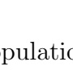

**OCR trong hình (theo thứ tự đọc):**

pulatic

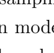

**OCR trong hình (theo thứ tự đọc):**

scanprints

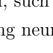

**OCR trong hình (theo thứ tự đọc):**

, such als neurosynthese

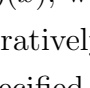

**OCR trong hình (theo thứ tự đọc):**

ratively assigned

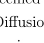

**OCR trong hình (theo thứ tự đọc):**

central Diffusion .

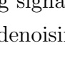

**OCR trong hình (theo thứ tự đọc):**

g signalizzazioni denoisi

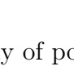

**OCR trong hình (theo thứ tự đọc):**

y of pc

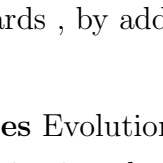

**OCR trong hình (theo thứ tự đọc):**

ards , by addition and multiplication

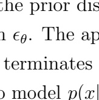

**OCR trong hình (theo thứ tự đọc):**

the prior distribution
\epsilon_\theta
. The approximation terminates in the model
p(x)
.

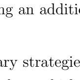

**OCR trong hình (theo thứ tự đọc):**

an additional strategies.

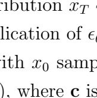

**OCR trong hình (theo thứ tự đọc):**

abution
x_T
lication of
\epsilon
with
x_0
sample (), where
c
is

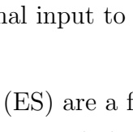

**OCR trong hình (theo thứ tự đọc):**

an input to (ES) are a f

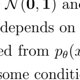

**OCR trong hình (theo thứ tự đọc):**

N(\mathbf{0}, \mathbf{1})
and
p_\theta(a)
depends on
a
from
p_\theta(a)
some condition

---

## Trang 19

2. Diffusion-ES: Gradient-free Planning with Diffusion for Autonomous Driving and
Zero-Shot Instruction Following
2.3.2 Diffusion-ES
Diffusion-ES is a trajectory optimization method that leverages gradient-free evolu￾tionary search to perform reward-guided sampling from trained diffusion models, for
any black-box reward function R(x). Specifically, we use a trained diffusion model ϵθ
to initialize the sample population and we use a truncated diffuse-denoise process to
mutate samples while staying in the data manifold. The control flow of Diffusion-ES
is shown in Figure 2.1 (left).
Initializing the population with diffusion sampling We begin by sampling an
initial population X0 of M trajectory samples using our diffusion model:
X
0 = {xi}
M
i=1 ∼ pθ(x), (2.1)
where Xk
is the population at iteration k. This involves a complete pass through
the reverse diffusion process. Given we use an unconditional diffusion model, these
samples are scene agnostic and can always be used without re-sampling them at each
timestep. We can also modify the initial population by including samples generated
by other approaches or mixing in solutions from the previous timestep to warm-start
our optimization.
Sample scoring At each iteration k, we score the samples in our population
{R(xi)|xi ∈ Xk}
M
i=1. Note that our population consists of “clean” samples so we
do not need a reward function which can handle ”noisy” samples, which gives us
significant flexibility compared to guidance methods that perform classifier-based
guidance.
Selection We use rewards to decide which samples we should select to propagate to
the next iteration. Similar to MPPI [80], we resample Xk+1 as follows:
q(x) = exp(τR(x))
PM
i=1 exp(τR(xi))
(2.2)
E
k+1 = {xi
iid∼ q(x)}
M
i=1, (2.3)
where E
k+1 represents our elite set which is kept from iteration k, and τ is a tunable
temperature parameter controlling the sharpness of q.
Mutation using truncated diffusion-denoising We apply randomized mutations
11

---

## Trang 20

2. Diffusion-ES: Gradient-free Planning with Diffusion for Autonomous Driving and
Zero-Shot Instruction Following
to E
k+1 for exploration. Prior evolutionary search methods resort to naive Gaussian
perturbations which do not exploit any prior knowledge about the data manifold.
Our key insight is to leverage a truncated diffusion-denoising process to
mutate trajectories in a way the resulting mutations are part of the data
manifold. We can run the first t steps of the forward diffusion process to get noised
elite samples E¯k+1:
E¯k+1 = {
√
α¯N x +
√
1 − α¯N ϵ|x ∈ E
k+1}, (2.4)
where ϵ ∼ N (0, 1). Then we can run the last t steps of the reverse diffusion process
to denoise the samples again, giving us clean samples Xk+1:
X
k+1 = {x ∼ pθ(x|x¯)|x¯ ∈ E¯k+1}. (2.5)
In practice, the number of timesteps t of the truncated diffusion process is a tunable
time-dependent hyperparameter tk which controls the mutation strength at each
iteration k. This is visualized in Figure 2.1 (right). We find that linearly decaying
the number of mutation diffusion steps tk from 5 to 1 over 20 search steps works best
in our experiments.
2.3.3 Mapping language instructions to reward functions
with LLM prompting
To follow driving instructions given in natural language, we map them to black￾box reward functions which we optimize with Diffusion-ES . We adopt a similar
approach to [36, 87] which uses LLMs to synthesize reward functions from language
instructions. Reward functions are composable and allow us to seamlessly combine
language guidance with other constraints. This is crucial in driving where we
constantly optimize many different objectives at once (e.g., safety, driver comfort,
route adherence).
Similar to prior work, we expose a Python API which can be used to extract
information about entities in the road scene. Since many of the basic reward signals
in driving do not change from scenario to scenario (e.g., collision avoidance or drivable
area compliance), we allow the LLM to write reward shaping code which modifies
12

---

## Trang 21

2. Diffusion-ES: Gradient-free Planning with Diffusion for Autonomous Driving and
Zero-Shot Instruction Following
Instruction code generation
“Car 3 will slow for you. Change to 
the right lane now.” vehicle = get_vehicle(3)
adjust_velocity(vehicle, 0.5)
lane = get_right_lane()
add_lane_follow_reward(lane)
while not reach_lane(vehicle, lane):
yield
vehicle.is_ahead_of(ego_vehicle)
vehicle_ahead = get_vehicle(3)
while not vehicle_ahead():
yield
lane = get_right_lane()
add_lane_follow_reward(lane)
while not reach_lane(vehicle, lane):
yield
“Wait until car 3 is ahead of you, 
then change lanes to the right.”
:
:
Initial scene Guided trajectories…
…
t 3 3
3
3
3
Figure 2.2: Shaping reward functions with language instructions using LLM
prompting and optimizing them with Diffusion-ES . For the same initial
scene, we show two distinct language instructions, along with their generated reward
shaping code and generated trajectories from Diffusion-ES .
the behavior of the base reward function, as opposed to generating everything from
scratch. Reward shaping can add auxiliary reward terms (e.g., a dense lane-reaching
reward) or re-weight existing reward terms. We show generated code examples in
Figure 2.2.
Our goal is to handle general and complex language instructions with temporal
dependencies, such as “Change lanes to the left, then pass the car on the right, then
take the exit”. Previous works [30, 87] produce a stationary reward function, i.e., one
which is fixed during planning. This can make it challenging to express sequential
plans solely through rewards. We find that a much more natural and succinct way of
capturing these plans in code is through the use of generator functions which retain
internal state between calls. All our prompts and code examples can be found in the
supplementary file. In Section 2.4, we show how optimizing these language-shaped
reward functions can synthesize rich and complex driving behaviors that comply with
the language instructions.
2.4 Experiments
We first evaluate Diffusion-ES on closed-loop driving in nuPlan [6], an established
benchmark that uses estimated perception for vehicles, pedestrians, lanes and traffic
13

### Hình ảnh trên trang

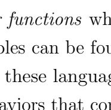

**OCR trong hình (theo thứ tự đọc):**

functions
while these languages can be found in the aviors that construct them.

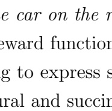

**OCR trong hình (theo thứ tự đọc):**

e car on the reward function
g to express s ral and succin

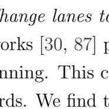

**OCR trong hình (theo thứ tự đọc):**

hange lanes to works [30, 87] panning. This cords. We find the cords.

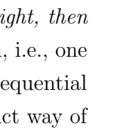

**OCR trong hình (theo thứ tự đọc):**

right, then
, i.e., one equential ct way of

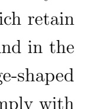

**OCR trong hình (theo thứ tự đọc):**

which retain and in the se-shaped comply with

---

## Trang 22

2. Diffusion-ES: Gradient-free Planning with Diffusion for Autonomous Driving and
Zero-Shot Instruction Following
signs. Our model and baselines are evaluated on their ability to drive safely and
efficiently while having access to close-to-ground-truth perception output provided
by the dataset. We also consider a suite of driving instruction following tasks. We
map instructions to shaped reward functions with LLM prompting, and evaluate
Diffusion-ES and baselines in their ability to optimize the generated reward functions
and accurately follow the instructions. Our experiments aim to answer the following
questions:
1. How does Diffusion-ES compare to existing sampling-based planners and
reward-gradient guidance for trajectory optimization?
2. How does Diffusion-ES compare to SOTA reactive driving policies that directly
map environments’ state to vehicle trajectories?
3. Can the hardest nuPlan driving scenarios be solved by assuming access to a
human teacher giving instructions in natural language, without any additional
training data?
4. Does scene conditioning for the diffusion model benefit Diffusion-ES ?
2.4.1 Closed-loop driving
We evaluate our model on the nuPlan Val14 planning benchmark [15]. We specifically
consider the reactive agent track of the nuPlan benchmark since it is the most difficult
and realistic of the evaluation settings in nuPlan.
Model setup and hyperparameters For Diffusion-ES , we train a diffusion
model over ego-vehicle trajectories consisting of 2D poses (x, y, θ) predicted 8 seconds
into the future at 2Hz, leading to an overall action dimension of 48. Unlike prior
work [32], we model the distribution over actions only rather than modeling states
and actions. We use a population size of M = 128 in our experiments. Our diffusion
model is trained with T = 100 denoising steps.
Reward function We adopt a modified version of the scoring function used in
PDM-Closed [15] as our reward function. To compute rewards, we convert our
predicted trajectory to low-level control inputs using an LQR tracker. These control
inputs are fed into a kinematic bicycle model [51] which propagates the dynamics of
14

---

## Trang 23

2. Diffusion-ES: Gradient-free Planning with Diffusion for Autonomous Driving and
Zero-Shot Instruction Following
the ego-vehicle. We follow [15] and forecast the motion of other agents by assuming
constant velocity. These simulated rollouts are then scored following the nuPlan
benchmark evaluation metrics. We also add auxiliary reward terms to penalize
proximity to the leading agent and enforce speed limits.
Note that this reward function is not differentiable due to the tracker and the use
of non-differentiable heuristics for assessing traffic violations. Additionally, training a
model to regress rewards is challenging since the nuPlan dataset contains no instances
of serious traffic infractions.
Evaluation metric We report our results using driving score, which aggregates
multiple planning metrics related to traffic rule compliance, safety, route progress,
and rider comfort. This is the standard evaluation metric used in nuPlan.
Baselines We consider the following baselines:
• UrbanDriverOL [62], a deterministic transformer policy trained with behaviour
cloning and augmentations. Unlike in [62], the nuPlan implementation does not
perform closed-loop training.
• PlanCNN [56] a deterministic imitation policy which encodes a rasterized BEV
map using a CNN backbone.
• IDM [25]: a heuristic rule-based planner which adjusts its speed to maintain a
safe distance to the leading vehicle. It is also used to control the behaviour of
agents in nuPlan.
• PDM-Closed [15]: an MPC-based planner which generates path proposals using
lane centerlines, and rolls out trajectories similarly to us. Instead of iteratively
optimizing rewards, PDM-Closed simply executes the highest-performing pro￾posal after one round of scoring. It is the current state-of-the-art on the nuPlan
Val14 benchmark.
• Diffusion Policy: a diffusion model we consider that conditions on scene features
to predict a vehicle trajectory directly. We encode scene features using the
transformer feature backbone from Urban Driver [63]. We train it with imitation
learning and augmentations. This is similar to the unconditional trajectory
model in Diffusion-ES with additional conditioning on scene features.
15

---

## Trang 24

2. Diffusion-ES: Gradient-free Planning with Diffusion for Autonomous Driving and
Zero-Shot Instruction Following
Method Driving Score (↑)
Train￾then￾test
UrbanDriverOL [63] 65
PlanCNN [56] 72
Diffusion policy 50
Test￾time
plan
IDM [60] 77
PDM-Closed [15] 92
Diffusion-ES (ours) 92
Table 2.1: Closed-loop driving results in the val14 split of [15]. Our model
matches the performance of previous non-learning based planners and significantly
outperforms all other models.
We show quantitative results in Table 2.1. We draw the following conclusions:
1. Diffusion-ES matches the prior state-of-the-art, PDM-Closed and
substantially outperforms all other baselines. PDM-Closed is a sampling-based
planner that relies on domain-specific heuristics to generate trajectory proposals
whereas Diffusion-ES learns these proposals from data. Both use a similar reward
function and dynamics model for the agents in the scene.
2. There is a large gap in performance between reactive neural policies
and test-time planners, also pointed out in recent work [15]. We hypothesize that
this is because compared to other control benchmarks, nuPlan has a much richer
observation space as scenes are densely populated by dynamic actors, many of which
are irrelevant to the ego-agent. This can make it challenging for learning-based
methods to generalize, which motivates the need of test-time optimization.
3. Diffusion-ES substantially outperforms diffusion policy. Qualitatively,
our diffusion policy has a tendency to randomly change lanes, which causes the
ego-vehicle to reach out-of-distribution scenarios faster. Diffusion-ES leverages the
expressiveness of generative modeling while using test-time optimization to improve
generalization.
2.4.2 Language instruction following
One drawback of the nuPlan driving benchmark is that encourages highly conservative
driving behaviors. For example, PDM-Closed [15] holds the state-of-the-art in the
16

---

## Trang 25

2. Diffusion-ES: Gradient-free Planning with Diffusion for Autonomous Driving and
Zero-Shot Instruction Following
nuPlan Val14 benchmark while being unable to change lanes, since its path proposals
only consider the lane the ego-vehicle is currently on. However, lane changing is not
necessary for good driving performance in the current nuPlan benchmark.
To evaluate Diffusion-ES and baselines in their ability to optimize arbitrary
reward functions, we consider eight language instruction following tasks, each taken
from an existing driving log in the nuPlan benchmark. In each task, the language
instruction requires the ego-vehicle to perform a specific driving maneuver that
solves a challenging driving scenario. In most scenarios there will be no examples
of the instructed behavior anywhere in nuPlan. For instance, the lane weaving task
requires the ego-vehicle to aggressively change multiple lanes in dense urban traffic.
Task descriptions, language instructions, and prompts are provided in the appendix.
We use the method described in 2.3.3 to generate executable Python code given a
language instruction that adapts the initial reward function of Section 2.4.1, giving
us a language-shaped reward function for each scenario. Our model and baselines
will optimize the same language-shaped reward function.
Evaluation metric We evaluate our model and baselines using task success
rate, which measures how frequently the agent was able to successfully complete the
designated task. To increase the difficulty of the tasks, we randomize the behavior of
other vehicle agents by adding noise to their IDM parameters at sporadic intervals
during each episode. All scores reported are averaged across ten random seeds.
Baselines We compare to the following baselines:
• PDM-Closed: this is adapted to this setting by using our language-shaped
reward function in place of the original reward function.
• PDM-Closed-Multilane: a modified variant of PDM-Closed which considers a
wider range of laterally offset paths, allowing for lane changes.
• Conditional Diffusion-ES : Diffusion-ES that uses a conditional diffusion model
instead of an unconditional one.
Figure 2.3 shows the success rates on the controllability tasks. We draw the following
conclusions:
1. Diffusion-ES outperforms all baselines. Although PDM-Closed-Multilane
has substantially improved performance compared to PDM-Closed due to more
17

---

## Trang 26

2. Diffusion-ES: Gradient-free Planning with Diffusion for Autonomous Driving and
Zero-Shot Instruction Following
Figure 2.3: Following driving instructions. Diffusion-ES outperforms all baselines
in optimizing complex language-shaped reward functions.
diverse trajectory proposals, it is still weaker than Diffusion-ES on 4 out of 8 tasks.
This highlights the weakness of relying on handcrafted rules for proposal generation.
2. Diffusion-ES performs significantly worse with a conditional diffusion
model. The conditional diffusion model is much harder to guide since the scene
context causes fewer samples to be in-distribution.
2.4.3 Lane following
To compare Diffusion-ES against reward-gradient guidance, we consider a simplified
lane following task with a differentiable reward function, which consists of two terms:
one penalizing lateral deviation from the lane (lane error), and one penalizing
deviation from a target speed (speed error). We sample 14 scenarios, one of each
scenario type in nuPlan, and report average planning costs across all scenarios.
Baselines We consider the following baselines:
• CEM [60]: a widely used ES method which parameterizes the search distribution
q as a Gaussian. CEM iterates between sampling from q and fitting q to the
best samples.
• MPPI [80]: similar to CEM but rather than keep a fixed number of elites, MPPI
samples proportional to rewards.
18

### Hình ảnh trên trang

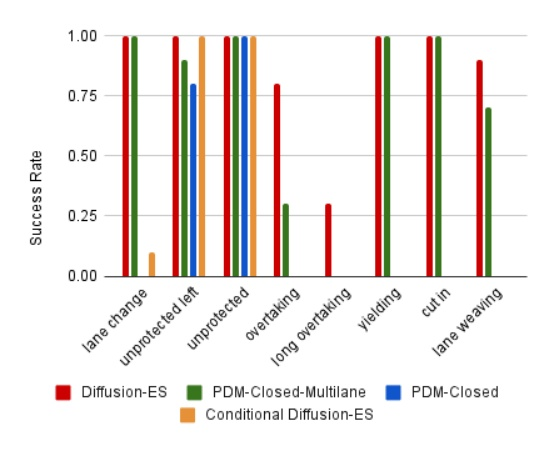

**OCR trong hình (theo thứ tự đọc):**

The chart compares success rates for three components of Diffusion-ES and Conditional Diffusion-ES across three lane weaving types: PDM-Closed-Multilane, PDM-Closed, and PDM-Closed lane. The y-axis represents 'Success Rate' from 0.00 to 1.00. The x-axis lists the three categories of Diffusion-ES and Conditional Diffusion-ES. For each category, there are three bars representing the success rates for PDM-Closed-Multilane, PDM-Closed, and PDM-Closed lane weaving. The bars are shaded in different colors: PDM-Closed-Multilane (green), PDM-Closed (orange), and PDM-Closed lane (blue). The comparison is between the PDM-Closed-Multilane and PDM-Closed lane weaving categories for the PDM-Closed-Multilane and PDM-Closed lane weaving compared to the PDM-Closed-Multilane and PDM-Closed lane weaving categories for the PDM-Closed lane weaving compared to the PDM-Closed-Multilane and PDM-Closed lane weaving categories for the PDM-Closed lane weaving compared to the PDM-Closed-Multilane and PDM-Closed lane weaving categories for the PDM-Closed lane weaving compared to the PDM-Closed-Multilane and PDM-Closed lane weaving categories for the PDM-Closed lan

---

## Trang 27

2. Diffusion-ES: Gradient-free Planning with Diffusion for Autonomous Driving and
Zero-Shot Instruction Following
Method Lane Error Speed Error
CEM 2.34 2.05
MPPI 3.29 2.74
Reward-gradient guidance 1.22 0.96
Diffusion-ES (ours) 0.61 0.79
Table 2.2: Lane following in nuPlan.
Method Wallclock time (s)
Diffusion 1.11 ± 0.02
Diffusion-ES 5.85 ± 0.11
Diffusion-ES (optimized) 0.50 ± 0.01
Table 2.3: Diffusion-ES runtime comparison.
• Reward-gradient guidance [32]: we directly optimize the ground-truth planning
objective with gradient descent during the denoising process.
We show quantitative results in Table 2.2. We draw the following conclusions:
1.Diffusion-ES outperforms the differentiable reward-gradient guidance
baseline even though the objective is differentiable. We hypothesize that this
is because although the ground truth reward function is available, it may not provide
suitable guidance for intermediate noisy trajectories. This highlights a key advantage
of our method over prior work, which is that we can optimize novel objectives without
needing to train a reward regressor on noisy samples. 2. Both diffusion-based
methods significantly outperform sampling-based planners that do not
leverage diffusion. This is consistent with our hypothesis that diffusion guidance
can optimize trajectories much more efficiently than conventional ES methods. Videos
of our method driving in all experimental settings can be found in our project page
diffusion-es.github.io.
2.4.4 Runtime analysis
Diffusion-ES can be used in real-time with some minor optimizations. By using fewer
diffusion steps T = 10, smaller population size M = 32 and less iterations K = 2,
our method can be run at the same frequency as the simulator (2 Hz) at a small cost
to performance (nuPlan driving score drops from 92 to 91). We report the average
19

---

## Trang 28

2. Diffusion-ES: Gradient-free Planning with Diffusion for Autonomous Driving and
Zero-Shot Instruction Following
wallclock time for inference at every timestep over 100 trials in Table 2.3.
2.4.5 Discussion - Limitations - Future work
As seen in Section 2.4.4, our approach does introduce computational overhead. We
believe that these issues can be mitigated by incorporating recent advances in diffusion
modeling such as faster samplers. Our reward function assumes other agents will travel
at constant velocity, which could clearly be improved. This also assumes that other
agents cannot react to the ego-vehicle, which has been shown to be a major limitation
for planners in self-driving [58]. However, our instruction following experiments
suggest that even if we cannot ever forecast perfectly, we can use language-shaped
rewards to solve the hardest driving scenarios.
2.5 Conclusion
We presented Diffusion-ES , a method for black-box reward guided diffusion sampling.
We showed that Diffusion-ES can effectively optimize reward functions in nuPlan
for driving and instruction following, and outperforms engineered sampling-based
planners, reactive deterministic or diffusion policies, as well as differentiable reward￾gradient guidance. We showed how our method can be used to follow language
instructions without any language-action trajectory data, simply using LLM prompt￾ing to generate shaped reward maps for test-time optimization. Our future work
will explore retrieving the right reward shaping to optimize to handle long-tailed
driving scenarios in the absence of human teachers. Our experiments show the
trade-off between inference speed and OOD generalization during scene conditioning
in diffusion policies.
20

---

## Trang 29

Chapter 3
Latent Preference Finetuning for
Driving Policies
3.1 Introduction
In the previous work, we showed how online natural language instructions can be
used to guide driving agents. However, we are interested in how human feedback can
be used to improve policies over time. In this work, we propose initial work towards
improving driving policies from offline human preference feedback.
Rather than learn directly from open-ended natural language feedback, we focus
on learning from preferences over discrete high-level intentions (e.g., ”change lanes to
the left”, ”slow down”, ”accelerate”) for a few reasons. First, it is significantly faster
and easier for human labelers to select the most desirable high-level intent versus
asking for a natural language correction. In special cases, it may even be possible
to extract such labels programmatically without relying on manual human labeling.
Next, since the intent-space is discrete and enumerable, learning models over these
preferences is much easier than modeling preferences over unstructured text. We can
also assume that the human can identify the global ”best” intent, as opposed to in
conventional RLHF settings where preference labels are only locally relevant and
require more complex methods for extracting usable reward models.
We propose a novel technique for fine-tuning driving policies using human latent
21

---

## Trang 30

3. Latent Preference Finetuning for Driving Policies
preferences (i.e., preferences over high-level intents). Given a two-stage policy which
consists of a high-level latent policy and a low-level policy conditioned on a high-level
latent, we use preference labels to supervise the high-level policy using intent-specific
high-level policies. This allows us to refine driving policies using only high-level
feedback. We find that these procedure leads to improved driving performance when
tested on real-world driving tasks. Since this work is going, we will omit discussion
of current experimental results.
3.2 Related Work
There has been substantial work in aligning language models with human preferences
[49, 54]. In the conventional RLHF setting, preference data is generated by sampling
completions from a pretrained model and asking a human labeler to rank them. This is
usually done after pretraining on large amounts of internet-scale data and supervised
fine-tuning on task-specific data. Since preference labels provide less training signal
than imitating ”ground-truth” samples, these methods rely on theoretical preference
models such as Bradley-Terry [4] to extract reward models [49] or policy gradients
[54]. As mentioned earlier, we choose to focus on categorical intent preferences in
this work due to ease of optimization and data collection.
Separately, there is recent work in building interactive robotic agents which can
improve from human feedback [40, 67, 75]. Most closely related to our approach
is YAY Robot [67], which uses human language supervision to guide a low-level
language-conditioned policy for manipulation. While the motivation is similar, we
opt for categorical intent latents due to the difficulty of collecting large amounts
of high-quality language corrections in our setting. Training language-conditioned
driving policies is highly non-trivial and we leave this to future work. Another related
work is SkiP [75], which uses human feedback both for skill extraction and policy
improvement. However, SkiP focuses on a preference learning setup which is more
reminiscent of prior work in RLHF as the human not asked to uniquely identify the
best skill to execute. One major difference which differentiates our work from the
above is also that whereas they mostly consider smaller datasets on the order of
thousands of samples, we scale up our approach to handle several orders of magnitude
more data.
22

---

## Trang 31

3. Latent Preference Finetuning for Driving Policies
Figure 3.1: Architecture diagram for end-to-end two-stage driving policy.
3.3 Method
3.3.1 Model Architecture
The architecture for our driving policy is outlined in Figure 3.1. Our observation o
consists of driving inputs (e.g., camera images, route map), with two past frames
included for temporal context. Additionally, we include frames from three front-facing
cameras to cover a wider field of view. Our policy processes the observation with a
learned state encoder backbone and uses these state features for both the high-level
latent policy and the low-level policy. This two-stage policy uses discretized 2-second
waypoint goals zwp as intermediate latent actions (i.e., the (x, y) position of the
ego-vehicle after 2 seconds). We assume an 11 × 11 binning of waypoint goals in
log-polar coordinates. Our low-level actions a are 2D waypoint trajectories sampled
at 5 Hz with a horizon of 2 seconds, so we can extract our high-level latent zwp by
taking the last waypoint in the low-level action and applying binning. The high-level
policy πwp(zwp|o) is trained to predict the ground-truth waypoint goal bin, which
amounts to cross-entropy minimization. The low-level policy πout(a|o, zwp) takes the
ground-truth latent action as input is trained to predict a Gaussian which maximizes
the likelihood of the ground-truth trajectory action.
We train the above model using behavior cloning and measure the performance of
our proposed finetuning method with respect to this base policy. During preference
finetuning, we freeze the state encoder and low-level policy and only finetune the
high-level policy.
23

### Hình ảnh trên trang

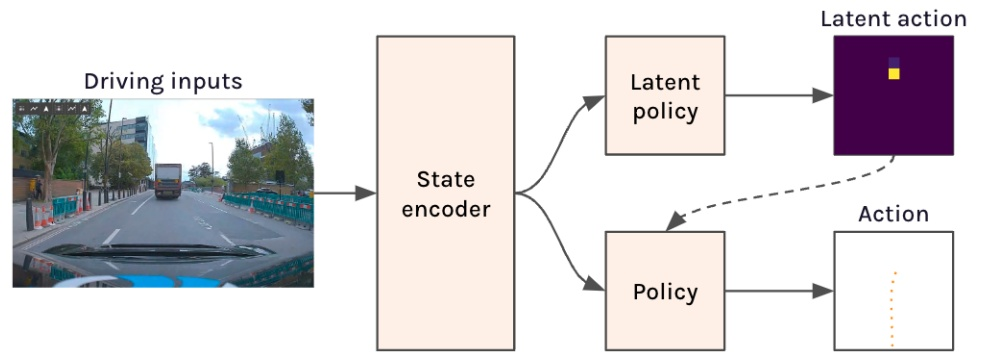

---

## Trang 32

3. Latent Preference Finetuning for Driving Policies
3.3.2 Intent Policy Finetuning
In this section we discuss how we train intent-specific latent policies, as well as how
those policies are used for latent preference finetuning. We introduce an intent latent:
zint ∼ Categorical(K)
where there are K total possible mutually exclusive intents, each representing a
high-level behavior such (e.g., ”overtaking”, ”slowing”, ”accelerating”). While we
could theoretically perform preference finetuning using the spatial waypoint latents
introduced previously, we found that it was challenging for human annotators to
provide high-quality labels for spatial waypoints. On the other hand, high-level
intents are easier to interpret and label due to their semantic nature.
Using the above, we construct an intent-conditioned high-level policy. In practice,
this can be implemented by training a mixture of K high-level policies, one for each
intent:
π(zwp|o, zint) = X
i
1(zint = i)π(zwp|o, zint = i)
We find that using a single shared policy can lead to the intent-conditioning not being
used, whereas training separate policies avoids collapse.
This suggests a natural scheme for finetuning using preference labels over intents.
For a given intent label zint = i, we can use our intent-conditioned high-level policy
to generate a new target zˆwp ∼ π(zwp|o, zint = i) for supervising the high-level policy
in our original model. Note that this allows us to generate labels for trajectories
where the demonstrations are not expert as well.
3.4 Results
This work is still ongoing, so results will be added at a later date.
24

---

## Trang 33

Chapter 4
Future Work
4.1 Finetuning Driving Policies with Natural
Language
4.1.1 Motivation
While categorical intent preferences are conceptually simpler, there are substantial
advantages to eliciting human feedback in the form of natural language. Natural
language has the potential to be a much richer training signal than preferences over
discrete intentions. Many of the intents used in chapter 3 correspond to behaviors
which are meaningful over the planning horizon (2 seconds), but this restricts us to
fairly myopic policy feedback. For instance, situations such as four-way stops require
slightly longer temporal contexts, and handling such scenarios is very clunky when
using the current approach. Language corrections are more open-ended and allow
for planning over multiple timescales. Additionally, simply selecting the right intent
does not necessarily dictate why that choice is correct, and this kind of supervision is
not easy to do with the current latent preference finetuning approach.
There has been some work towards training language-conditioned policies [66], and
such policies could be used to synthesize corrective actions from offline language feed￾back. However, training such policies is challenging as they generally do not perform
better than equivalent policies without language conditioning. The question remains:
25

---

## Trang 34

4. Future Work
how can we leverage language feedback without compromising on performance?
4.1.2 Method
Drawing from Diffusion-ES [84] and Code-as-Policies [38], we can use few-shot LLM
prompting to map language instructions to corrective actions. As was demonstrated
in chapter 2, leveraging the coding abilities of LLMs allows us to handle a much richer
set of language commands which can be flexibly composed in ways unseen at training
time. Specifically, we can replace the reward shaping API from Diffusion-ES with
an action API which uses the intent-specific policies as callable functions. Therefore,
while each language instruction is mapped to a specific intent at each timestep,
language instructions can control the conditions under which each intent ought to be
used. Since much of the difficulty in driving is not in low-level control (e.g., ”how to
move into the right lane”) but in high-level decisionmaking (e.g., ”when is it safe to
change lanes”), this should not be a significant restriction on the expressiveness of
these code policies.
In Diffusion-ES, the perception API was hard-coded because we assumed ground￾truth perception (i.e., perfect bounding-boxes, HD maps, etc.). However, in the
experimental setting from chapter 3 we do not have access to these perception outputs.
One proposed fix could be to use pretrained vision-language models (VLMs) to handle
perception. This also allows us to garner the benefits of large-scale foundation models
which can handle open-world perception queries without task-specific finetuning.
There have been several works which propose to use LLMs / VLMs in a similar
fashion [72, 73].
In total, this approach would work as follows. Human annotators would be asked
to provide natural language instructions when presented with a driving video. Natural
language instructions can be mapped to a code policy (similar to chapter 2) which
produces the corrected intent at each timestep of the video. These intents can be
used to finetune the driving policy via latent preference finetuning (as described in
chapter 3). One difference between the current latent preference finetuning procedure
and the proposed method is that these language programs can be executed across
multiple timesteps, so a single natural language instruction can be used to label
multiple samples in sequence.
26

---

## Trang 35

4. Future Work
In terms of potential limitations of this approach, we are bottlenecked by the
reasoning capabilities of the VLM. VLMs are notoriously not very strong at spatial
reasoning, so this suggests that they might be put to better use if only used for more
semantic reasoning queries (”is there a pedestrian on the zebra crossing”) rather than
geometric ones (”how far away is the pedestrian in front?”).
4.2 Preference Finetuning via Chain-of-Thought
Distillation
4.2.1 Motivation
As mentioned in the previous section, one of the advantages of using language feedback
is process supervision – human annotators can supervise not only the output action,
but the process for reaching that action. This line of work is directly inspired by
procedure cloning [86], which showed that training agents to imitate intermediate
computations (e.g. BFS visitations) leads to much stronger test set performance
compared to imitating only the final output. Chain-of-thought prompting is a closely
related technique which has become ubiquitous for LLM prompting [78]. This suggests
that effectively incorporating this intermediate supervision via language feedback
may considerably boost generalization.
Our current latent preference finetuning procedure only uses the final outputs
of the intent-conditioned latent policy for supervision, and this holds true for re￾lated approaches which learn from human feedback [67, 75]. One work which uses
chain-of-thought supervision is CoTPC [33], which treats detected change-points as
intermediate computations for auxiliary decoding, but does not incorporate language
supervision.
4.2.2 Method
Unlike maze solving or graph traversal, there is no fixed decisionmaking algorithm
which humans follow when driving. Additionally, given the open-ended nature of
this process, there are potentially many different ways of arriving at the same intent
which gives us a lot of flexibility in how this approach could be designed.
27

---

## Trang 36

4. Future Work
One possibility is to simply decompose the current high-level latent policy into a
language policy and a language-conditioned latent policy similar to YAY Robot [67]:
π(zwp|o) = π(zlang|o)π(zwp|o, zlang)
where zlang is a language embedding. At training time, the language instruction is
encoded to obtain a language embedding zwp. This is used to supervise the language
policy π(zlang|o) and is provided as input to the language-conditioned latent policy
π(zwp|o, zlang). Note that none of this affects the training of the intent-specific policies
themselves, only the base policy.
This approach is conceptually straightforward but potentially suffers from some of
the same issues as training language-conditioned policies in the first place. Training a
language policy π(zlang|o) could be quite challenging since there are potentially many
valid language instructions for each observation o. This would potentially require a
much higher capacity model to adequately handle natural language. Additionally,
we already encounter issues now in latent preference finetuning where conditioning
on intents and observations leads to the intent variable being ignored – this may
be exacerbated when conditioning on language embeddings since they are harder to
parse compared to categorical intents.
Another approach would be to identify intermediate computations by decomposing
the language programs themselves. For instance, each language program may consist
of multiple calls to a VLM. We can associate each VLM query with an MLP which
takes as input state encodings and is trained to predict the VLM response, and this
MLP can be trained during preference finetuning. In other words, we use natural
language to generate a program, and use that program to extract intermediate
auxiliary tasks for guiding the policy. As a concrete example, if the instruction was
”wait until the pedestrian has crossed, then accelerate”, our policy would have to
predict whether the pedestrian has crossed as an auxiliary task, which should serve as
a form of process supervision. This is one example of how we could extract auxiliary
tasks from these language programs, but there are likely others worth exploring.
A shortcoming of this approach is that we would have separate MLPs for each
VLM query. However, if these language programs are re-used across many samples,
then this would not be a major issue. This method also only uses these auxiliary
28

---

## Trang 37

4. Future Work
tasks for co-training and not auto-regressively as is done in [86], which may reduce
the alignment of the auxiliary task with the final output.
29

---

## Trang 38

4. Future Work

30

---

## Trang 39

Bibliography
[1] Anurag Ajay, Yilun Du, Abhi Gupta, Joshua B. Tenenbaum, T. Jaakkola, and
Pulkit Agrawal. Is conditional generative modeling all you need for decision￾making? ArXiv, abs/2211.15657, 2022. 2.1
[2] Mayank Bansal, Alex Krizhevsky, and Abhijit S. Ogale. Chauffeurnet: Learning
to drive by imitating the best and synthesizing the worst. CoRR, abs/1812.03079,
2018. URL http://arxiv.org/abs/1812.03079. 1, 2.2
[3] Mariusz Bojarski, Davide Del Testa, Daniel Dworakowski, Bernhard Firner,
Beat Flepp, Prasoon Goyal, Lawrence D. Jackel, Mathew Monfort, Urs Muller,
Jiakai Zhang, Xin Zhang, Jake Zhao, and Karol Zieba. End to end learning for
self-driving cars, 2016. URL https://arxiv.org/abs/1604.07316. 1, 2.2
[4] Ralph Allan Bradley and Milton E Terry. Rank analysis of incomplete block
designs: I. the method of paired comparisons. Biometrika, 39(3/4):324–345, 1952.
3.2
[5] Tom B. Brown, Benjamin Mann, Nick Ryder, Melanie Subbiah, Jared Kaplan,
Prafulla Dhariwal, Arvind Neelakantan, Pranav Shyam, Girish Sastry, Amanda
Askell, Sandhini Agarwal, Ariel Herbert-Voss, Gretchen Krueger, Tom Henighan,
Rewon Child, Aditya Ramesh, Daniel M. Ziegler, Jeffrey Wu, Clemens Winter,
Christopher Hesse, Mark Chen, Eric Sigler, Mateusz Litwin, Scott Gray, Benjamin
Chess, Jack Clark, Christopher Berner, Sam McCandlish, Alec Radford, Ilya
Sutskever, and Dario Amodei. Language models are few-shot learners, 2020. 2.2
[6] Holger Caesar, Juraj Kabzan, Kok Seang Tan, Whye Kit Fong, Eric Wolff, Alex
Lang, Luke Fletcher, Oscar Beijbom, and Sammy Omari. Nuplan: A closed-loop
ml-based planning benchmark for autonomous vehicles, 2022. 1, 2.1, 2.4
[7] Jo˜ao Carvalho, An T. Le, Mark Baierl, Dorothea Koert, and Jan Peters. Motion
planning diffusion: Learning and planning of robot motions with diffusion models.
ArXiv, abs/2308.01557, 2023. 2.2
[8] Yuning Chai, Benjamin Sapp, Mayank Bansal, and Dragomir Anguelov. Multi￾path: Multiple probabilistic anchor trajectory hypotheses for behavior prediction.
CoRR, abs/1910.05449, 2019. URL http://arxiv.org/abs/1910.05449. 1
31

---

## Trang 40

Bibliography
[9] Dian Chen and Philipp Kr¨ahenb¨uhl. Learning from all vehicles, 2022. URL
https://arxiv.org/abs/2203.11934. 1, 2.2
[10] Dian Chen, Brady Zhou, Vladlen Koltun, and Philipp Kr¨ahenb¨uhl. Learning by
cheating. ArXiv, abs/1912.12294, 2019. 1, 2.2
[11] Cheng Chi, Siyuan Feng, Yilun Du, Zhenjia Xu, Eric Cousineau, Benjamin
Burchfiel, and Shuran Song. Diffusion policy: Visuomotor policy learning via
action diffusion. RSS, 2023. 2.1, 2.2
[12] Kashyap Chitta, Aditya Prakash, and Andreas Geiger. NEAT: neural attention
fields for end-to-end autonomous driving. CoRR, abs/2109.04456, 2021. URL
https://arxiv.org/abs/2109.04456. 1
[13] Felipe Codevilla, Matthias M¨uller, Alexey Dosovitskiy, Antonio M. L´opez, and
Vladlen Koltun. End-to-end driving via conditional imitation learning. CoRR,
abs/1710.02410, 2017. URL http://arxiv.org/abs/1710.02410. 1, 2.2
[14] Alexander Cui, Abbas Sadat, Sergio Casas, Renjie Liao, and Raquel Urtasun.
Lookout: Diverse multi-future prediction and planning for self-driving. CoRR,
abs/2101.06547, 2021. URL https://arxiv.org/abs/2101.06547. 1, 2.2
[15] Daniel Dauner, Marcel Hallgarten, Andreas Geiger, and Kashyap Chitta. Part￾ing with misconceptions about learning-based vehicle motion planning, 2023.
(document), 1, 2.1, 2.2, 2.4.1, 2.4.1, 2.4.1, ??, 2.1, 2.4.1, 2.4.2
[16] Prafulla Dhariwal and Alex Nichol. Diffusion models beat gans on image synthesis.
ArXiv, abs/2105.05233, 2021. 2.2
[17] Alexey Dosovitskiy, Germ´an Ros, Felipe Codevilla, Antonio M. L´opez,
and Vladlen Koltun. Carla: An open urban driving simulator. In
CoRL, volume 78 of Proceedings of Machine Learning Research, pages 1–
16. PMLR, 2017. URL http://dblp.uni-trier.de/db/conf/corl/corl2017.
html#DosovitskiyRCLK17. 1
[18] Yilun Du, Conor Durkan, Robin Strudel, Joshua B. Tenenbaum, Sander Dieleman,
Rob Fergus, Jascha Sohl-Dickstein, Arnaud Doucet, and Will Grathwohl. Reduce,
reuse, recycle: Compositional generation with energy-based diffusion models and
mcmc, 2023. 2.1
[19] Yilun Du, Mengjiao Yang, Bo Dai, Hanjun Dai, Ofir Nachum, Joshua B. Tenen￾baum, Dale Schuurmans, and P. Abbeel. Learning universal policies via text￾guided video generation. ArXiv, abs/2302.00111, 2023. 2.2
[20] Haoyang Fan, Fan Zhu, Changchun Liu, Liangliang Zhang, Li Zhuang, Dong Li,
Weicheng Zhu, Jiangtao Hu, Hongye Li, and Qi Kong. Baidu apollo em motion
planner. arXiv preprint arXiv:1807.08048, 2018. 2.2
[21] Katerina Fragkiadaki, Jonathan Huang, Alex Alemi, Sudheendra Vijaya￾32

---

## Trang 41

Bibliography
narasimhan, Susanna Ricco, and Rahul Sukthankar. Motion prediction under
multimodality with conditional stochastic networks, 2017. 2.2
[22] Roger Girgis, Florian Golemo, Felipe Codevilla, Jim Aldon D’Souza,
Samira Ebrahimi Kahou, Felix Heide, and Christopher J. Pal. Latent vari￾able nested set transformers & autobots. CoRR, abs/2104.00563, 2021. URL
https://arxiv.org/abs/2104.00563. 1
[23] Nikolaos Gkanatsios, Ayush Jain, Zhou Xian, Yunchu Zhang, Christopher Atke￾son, and Katerina Fragkiadaki. Energy-based Models are Zero-Shot Planners for
Compositional Scene Rearrangement. In Robotics: Science and Systems, 2023.
2.1
[24] Tanmay Gupta and Aniruddha Kembhavi. Visual programming: Compositional
visual reasoning without training. In Proceedings of the IEEE/CVF Conference
on Computer Vision and Pattern Recognition (CVPR), pages 14953–14962, June
2023. 2.2
[25] Dirk Helbing and Benno Tilch. Generalized force model of traffic dynamics.
Physical review E, 58(1):133, 1998. 2.4.1
[26] Jonathan Ho, Ajay Jain, and Pieter Abbeel. Denoising diffusion probabilistic
models. Advances in Neural Information Processing Systems, 33:6840–6851, 2020.
2.2, 2.3.1
[27] Anthony Hu, Lloyd Russell, Hudson Yeo, Zak Murez, George Fedoseev, Alex
Kendall, Jamie Shotton, and Gianluca Corrado. Gaia-1: A generative world
model for autonomous driving. arXiv preprint arXiv:2309.17080, 2023. 2.2
[28] Wenlong Huang, Pieter Abbeel, Deepak Pathak, and Igor Mordatch. Language
models as zero-shot planners: Extracting actionable knowledge for embodied
agents. arXiv preprint arXiv:2201.07207, 2022. 2.2
[29] Wenlong Huang, Fei Xia, Ted Xiao, Harris Chan, Jacky Liang, Pete Florence,
Andy Zeng, Jonathan Tompson, Igor Mordatch, Yevgen Chebotar, Pierre Ser￾manet, Noah Brown, Tomas Jackson, Linda Luu, Sergey Levine, Karol Hausman,
and Brian Ichter. Inner monologue: Embodied reasoning through planning with
language models, 2022. URL https://arxiv.org/abs/2207.05608. 2.2
[30] Wenlong Huang, Chen Wang, Ruohan Zhang, Yunzhu Li, Jiajun Wu, and
Li Fei-Fei. Voxposer: Composable 3d value maps for robotic manipulation with
language models. arXiv preprint arXiv:2307.05973, 2023. 2.2, 2.3.3
[31] Michael Janner, Justin Fu, Marvin Zhang, and Sergey Levine. When to trust
your model: Model-based policy optimization. Advances in neural information
processing systems, 32, 2019. 1
[32] Michael Janner, Yilun Du, Joshua Tenenbaum, and Sergey Levine. Planning
33

---

## Trang 42

Bibliography
with diffusion for flexible behavior synthesis. In International Conference on
Machine Learning, 2022. 2.1, 2.4.1, 2.4.3
[33] Zhiwei Jia, Fangchen Liu, Vineet Thumuluri, Linghao Chen, Zhiao Huang, and
Hao Su. Chain-of-thought predictive control. arXiv preprint arXiv:2304.00776,
2023. 4.2.1
[34] Chiyu Jiang, Andre Cornman, Cheolho Park, Benjamin Sapp, Yin Zhou, and
Dragomir Anguelov. Motiondiffuser: Controllable multi-agent motion prediction
using diffusion. In Proceedings of the IEEE/CVF Conference on Computer
Vision and Pattern Recognition (CVPR), pages 9644–9653, June 2023. 2.2
[35] Chiyu “Max” Jiang, Andre Cornman, Cheolho Park, Benjamin Sapp, Yin
Zhou, and Dragomir Anguelov. Motiondiffuser: Controllable multi-agent motion
prediction using diffusion, 2023. 2.2
[36] Pushkal Katara, Zhou Xian, and Katerina Fragkiadaki. Gen2sim: Scaling up
robot learning in simulation with generative models, 2023. 2.3.3
[37] Alex Kuefler, Jeremy Morton, Tim Allan Wheeler, and Mykel John Kochen￾derfer. Imitating driver behavior with generative adversarial networks. CoRR,
abs/1701.06699, 2017. URL http://arxiv.org/abs/1701.06699. 1, 2.2
[38] Jacky Liang, Wenlong Huang, Fei Xia, Peng Xu, Karol Hausman, Brian Ichter,
Pete Florence, and Andy Zeng. Code as policies: Language model programs for
embodied control. arXiv preprint arXiv:2209.07753, 2022. 2.2, 4.1.2
[39] Zhixuan Liang, Yao Mu, Mingyu Ding, Fei Ni, Masayoshi Tomizuka, and Ping
Luo. Adaptdiffuser: Diffusion models as adaptive self-evolving planners. In
ICML, 2023. 2.1
[40] Huihan Liu, Alice Chen, Yuke Zhu, Adith Swaminathan, Andrey Kolobov, and
Ching-An Cheng. Interactive robot learning from verbal correction. arXiv
preprint arXiv:2310.17555, 2023. 3.2
[41] Pengfei Liu, Weizhe Yuan, Jinlan Fu, Zhengbao Jiang, Hiroaki Hayashi, and
Graham Neubig. Pre-train, prompt, and predict: A systematic survey of prompt￾ing methods in natural language processing. CoRR, abs/2107.13586, 2021. URL
https://arxiv.org/abs/2107.13586. 2.2
[42] Cheng Lu, Huayu Chen, Jianfei Chen, Hang Su, Chongxuan Li, and Jun Zhu.
Contrastive energy prediction for exact energy-guided diffusion sampling in offline
reinforcement learning. arXiv preprint arXiv:2304.12824, 2023. 2.1
[43] Jiageng Mao, Yuxi Qian, Hang Zhao, and Yue Wang. Gpt-driver: Learning to
drive with gpt. arXiv preprint arXiv:2310.01415, 2023. 2.2
[44] Nico Montali, John Lambert, Paul Mougin, Alex Kuefler, Nicholas Rhinehart,
Michelle Li, Cole Gulino, Tristan Emrich, Zoey Yang, Shimon Whiteson, et al.
34

---

## Trang 43

Bibliography
The waymo open sim agents challenge. Advances in Neural Information Process￾ing Systems, 36, 2024. 1
[45] M Montremerlo, J Beeker, S Bhat, and H Dahlkamp. The stanford entry in the
urban challenge. Journal of Field Robotics, 7(9):468–492, 2008. 2.2
[46] Nigamaa Nayakanti, Rami Al-Rfou, Aurick Zhou, Kratarth Goel, Khaled S.
Refaat, and Benjamin Sapp. Wayformer: Motion forecasting via simple amp;
efficient attention networks, 2022. URL https://arxiv.org/abs/2207.05844.
2.2
[47] Jiquan Ngiam, Benjamin Caine, Vijay Vasudevan, Zhengdong Zhang, Hao￾Tien Lewis Chiang, Jeffrey Ling, Rebecca Roelofs, Alex Bewley, Chenxi Liu,
Ashish Venugopal, David Weiss, Ben Sapp, Zhifeng Chen, and Jonathon Shlens.
Scene transformer: A unified architecture for predicting multiple agent trajecto￾ries. ICLR, 2022. 1
[48] Alexander Quinn Nichol and Prafulla Dhariwal. Improved denoising diffusion
probabilistic models. In International Conference on Machine Learning, pages
8162–8171. PMLR, 2021. 2.2
[49] Long Ouyang, Jeffrey Wu, Xu Jiang, Diogo Almeida, Carroll Wainwright, Pamela
Mishkin, Chong Zhang, Sandhini Agarwal, Katarina Slama, Alex Ray, et al.
Training language models to follow instructions with human feedback. Advances
in neural information processing systems, 35:27730–27744, 2022. 3.2
[50] Tim Pearce, Tabish Rashid, Anssi Kanervisto, Dave Bignell, Mingfei Sun, Raluca
Georgescu, Sergio Valcarcel Macua, Shan Zheng Tan, Ida Momennejad, Katja
Hofmann, and Sam Devlin. Imitating human behaviour with diffusion models,
2023. 2.1, 2.2
[51] Philip Polack, Florent Altch´e, Brigitte d’Andr´ea Novel, and Arnaud de La Fortelle.
The kinematic bicycle model: A consistent model for planning feasible trajectories
for autonomous vehicles? In 2017 IEEE intelligent vehicles symposium (IV),
pages 812–818. IEEE, 2017. 2.4.1
[52] Dean A. Pomerleau. ALVINN: an autonomous land vehicle in a neural network. In
David S. Touretzky, editor, Advances in Neural Information Processing Systems
1, pages 305–313. San Francisco, CA: Morgan Kaufmann, 1989. 2.2
[53] Aditya Prakash, Kashyap Chitta, and Andreas Geiger. Multi-modal fusion
transformer for end-to-end autonomous driving. CoRR, abs/2104.09224, 2021.
URL https://arxiv.org/abs/2104.09224. 2.2
[54] Rafael Rafailov, Archit Sharma, Eric Mitchell, Christopher D Manning, Stefano
Ermon, and Chelsea Finn. Direct preference optimization: Your language model
is secretly a reward model. Advances in Neural Information Processing Systems,
36, 2024. 3.2
35

---

## Trang 44

Bibliography
[55] Aditya Ramesh, Prafulla Dhariwal, Alex Nichol, Casey Chu, and Mark
Chen. Hierarchical text-conditional image generation with clip latents. ArXiv,
abs/2204.06125, 2022. 2.2
[56] Katrin Renz, Kashyap Chitta, Otniel-Bogdan Mercea, A. Sophia Koepke, Zeynep
Akata, and Andreas Geiger. Plant: Explainable planning transformers via object￾level representations. In 6th Annual Conference on Robot Learning, 2022. URL
https://openreview.net/forum?id=80vpxjt3vq. 2.1, 2.2, 2.4.1, ??
[57] Moritz Reuss, Maximilian Li, Xiaogang Jia, and Rudolf Lioutikov. Goal￾conditioned imitation learning using score-based diffusion policies. arXiv preprint
arXiv:2304.02532, 2023. 2.2
[58] Nicholas Rhinehart, Jeff He, Charles Packer, Matthew A Wright, Rowan McAl￾lister, Joseph E Gonzalez, and Sergey Levine. Contingencies from observations:
Tractable contingency planning with learned behavior models. In 2021 IEEE In￾ternational Conference on Robotics and Automation (ICRA), pages 13663–13669.
IEEE, 2021. 2.2, 2.4.5
[59] Robin Rombach, A. Blattmann, Dominik Lorenz, Patrick Esser, and Bj¨orn
Ommer. High-resolution image synthesis with latent diffusion models. 2022
IEEE/CVF Conference on Computer Vision and Pattern Recognition (CVPR),
pages 10674–10685, 2022. 2.2
[60] Reuven Y Rubinstein. Optimization of computer simulation models with rare
events. European Journal of Operational Research, 99(1):89–112, 1997. 2.1, ??,
2.4.3
[61] Chitwan Saharia, William Chan, Saurabh Saxena, Lala Li, Jay Whang, Emily L.
Denton, Seyed Kamyar Seyed Ghasemipour, Burcu Karagol Ayan, Seyedeh Sara
Mahdavi, Raphael Gontijo Lopes, Tim Salimans, Jonathan Ho, David J. Fleet,
and Mohammad Norouzi. Photorealistic text-to-image diffusion models with
deep language understanding. ArXiv, abs/2205.11487, 2022. 2.2
[62] Oliver Scheel, Luca Bergamini, Maciej Wo lczyk, Bla.zej Osi’nski, and Peter
Ondruska. Urban driver: Learning to drive from real-world demonstrations using
policy gradients. In Conference on Robot Learning, 2021. 2.4.1
[63] Oliver Scheel, Luca Bergamini, Maciej Wolczyk, B la˙zej Osi´nski, and Peter
Ondruska. Urban driver: Learning to drive from real-world demonstrations using
policy gradients. In Conference on Robot Learning, pages 718–728. PMLR, 2022.
2.1, 2.4.1, ??
[64] Hao Sha, Yao Mu, Yuxuan Jiang, Li Chen, Chenfeng Xu, Ping Luo, Shengbo Eben
Li, Masayoshi Tomizuka, Wei Zhan, and Mingyu Ding. Languagempc: Large
language models as decision makers for autonomous driving. arXiv preprint
arXiv:2310.03026, 2023. 2.2
36

---

## Trang 45

Bibliography
[65] Nur Muhammad Shafiullah, Zichen Cui, Ariuntuya Arty Altanzaya, and Lerrel
Pinto. Behavior transformers: Cloning k modes with one stone. Advances in
neural information processing systems, 35:22955–22968, 2022. 2.2
[66] Hao Shao, Yuxuan Hu, Letian Wang, Guanglu Song, Steven L Waslander, Yu Liu,
and Hongsheng Li. Lmdrive: Closed-loop end-to-end driving with large language
models. In Proceedings of the IEEE/CVF Conference on Computer Vision and
Pattern Recognition, pages 15120–15130, 2024. 4.1.1
[67] Lucy Xiaoyang Shi, Zheyuan Hu, Tony Z Zhao, Archit Sharma, Karl Pertsch,
Jianlan Luo, Sergey Levine, and Chelsea Finn. Yell at your robot: Improving
on-the-fly from language corrections. arXiv preprint arXiv:2403.12910, 2024.
3.2, 4.2.1, 4.2.2
[68] Jascha Narain Sohl-Dickstein, Eric A. Weiss, Niru Maheswaranathan, and Surya
Ganguli. Deep unsupervised learning using nonequilibrium thermodynamics.
ArXiv, abs/1503.03585, 2015. 2.2
[69] Jiaming Song, Chenlin Meng, and Stefano Ermon. Denoising diffusion implicit
models. arXiv preprint arXiv:2010.02502, 2020. 2.2, 2.3.1
[70] D´ıdac Sur´ıs, Sachit Menon, and Carl Vondrick. Vipergpt: Visual inference via
python execution for reasoning, 2023. 2.2
[71] Yichuan Charlie Tang and Ruslan Salakhutdinov. Multiple futures prediction.
CoRR, abs/1911.00997, 2019. URL http://arxiv.org/abs/1911.00997. 2.2
[72] Ran Tian, Boyi Li, Xinshuo Weng, Yuxiao Chen, Edward Schmerling, Yue
Wang, Boris Ivanovic, and Marco Pavone. Tokenize the world into object-level
knowledge to address long-tail events in autonomous driving. arXiv preprint
arXiv:2407.00959, 2024. 4.1.2
[73] Xiaoyu Tian, Junru Gu, Bailin Li, Yicheng Liu, Chenxu Hu, Yang Wang,
Kun Zhan, Peng Jia, Xianpeng Lang, and Hang Zhao. Drivevlm: The conver￾gence of autonomous driving and large vision-language models. arXiv preprint
arXiv:2402.12289, 2024. 4.1.2
[74] Julen Urain, Niklas Funk, Georgia Chalvatzaki, and Jan Peters. Se (3)-
diffusionfields: Learning cost functions for joint grasp and motion optimization
through diffusion. ICRA, 2023. 2.1
[75] Xiaofei Wang, Kimin Lee, Kourosh Hakhamaneshi, Pieter Abbeel, and Michael
Laskin. Skill preferences: Learning to extract and execute robotic skills from
human feedback. In Conference on Robot Learning, pages 1259–1268. PMLR,
2022. 3.2, 4.2.1
[76] Zhendong Wang, Jonathan J Hunt, and Mingyuan Zhou. Diffusion policies
as an expressive policy class for offline reinforcement learning. arXiv preprint
37

---

## Trang 46

Bibliography
arXiv:2208.06193, 2022. 2.1
[77] Jason Wei, Xuezhi Wang, Dale Schuurmans, Maarten Bosma, Ed H. Chi, Quoc
Le, and Denny Zhou. Chain of thought prompting elicits reasoning in large
language models. CoRR, abs/2201.11903, 2022. URL https://arxiv.org/abs/
2201.11903. 2.2
[78] Jason Wei, Xuezhi Wang, Dale Schuurmans, Maarten Bosma, Fei Xia, Ed Chi,
Quoc V Le, Denny Zhou, et al. Chain-of-thought prompting elicits reasoning in
large language models. Advances in neural information processing systems, 35:
24824–24837, 2022. 4.2.1
[79] Licheng Wen, Xuemeng Yang, Daocheng Fu, Xiaofeng Wang, Pinlong Cai, Xin Li,
Tao Ma, Yingxuan Li, Linran Xu, Dengke Shang, et al. On the road with gpt-4v
(ision): Early explorations of visual-language model on autonomous driving.
arXiv preprint arXiv:2311.05332, 2023. 2.2
[80] Grady Williams, Andrew Aldrich, and Evangelos Theodorou. Model predictive
path integral control using covariance variable importance sampling. arXiv
preprint arXiv:1509.01149, 2015. 2.1, 2.3.2, 2.4.3
[81] Zhou Xian, Nikolaos Gkanatsios, Th´eophile Gervet, Tsung-Wei Ke, and Kate￾rina Fragkiadaki. Chaineddiffuser: Unifying trajectory diffusion and keypose
prediction for robotic manipulation. In CoRL 2023. 2.2
[82] Danfei Xu, Roberto Mart´ın-Mart´ın, De-An Huang, Yuke Zhu, Silvio Savarese,
and Li Fei-Fei. Regression planning networks. CoRR, abs/1909.13072, 2019.
URL http://arxiv.org/abs/1909.13072. 2.2
[83] Zhenhua Xu, Yujia Zhang, Enze Xie, Zhen Zhao, Yong Guo, Kenneth KY
Wong, Zhenguo Li, and Hengshuang Zhao. Drivegpt4: Interpretable end-to-end
autonomous driving via large language model. arXiv preprint arXiv:2310.01412,
2023. 2.2
[84] Brian Yang, Huangyuan Su, Nikolaos Gkanatsios, Tsung-Wei Ke, Ayush Jain,
Jeff Schneider, and Katerina Fragkiadaki. Diffusion-es: Gradient-free planning
with diffusion for autonomous driving and zero-shot instruction following. arXiv
preprint arXiv:2402.06559, 2024. 4.1.2
[85] Mengjiao Yang, Yilun Du, Kamyar Ghasemipour, Jonathan Tompson, Dale
Schuurmans, and Pieter Abbeel. Learning interactive real-world simulators.
ArXiv, abs/2310.06114, 2023. 2.2
[86] Mengjiao Sherry Yang, Dale Schuurmans, Pieter Abbeel, and Ofir Nachum. Chain
of thought imitation with procedure cloning. Advances in Neural Information
Processing Systems, 35:36366–36381, 2022. 4.2.1, 4.2.2
[87] Wenhao Yu, Nimrod Gileadi, Chuyuan Fu, Sean Kirmani, Kuang-Huei Lee,
38

---

## Trang 47

Bibliography
Montse Gonzalez Arenas, Hao-Tien Lewis Chiang, Tom Erez, Leonard Hasen￾clever, Jan Humplik, et al. Language to rewards for robotic skill synthesis. arXiv
preprint arXiv:2306.08647, 2023. 2.3.3
[88] Wenyuan Zeng, Wenjie Luo, Simon Suo, Abbas Sadat, Bin Yang, Sergio Casas,
and Raquel Urtasun. End-to-end interpretable neural motion planner. In
Proceedings of the IEEE/CVF Conference on Computer Vision and Pattern
Recognition, pages 8660–8669, 2019. 2.2
[89] Wenyuan Zeng, Wenjie Luo, Simon Suo, Abbas Sadat, Bin Yang, Sergio Casas,
and Raquel Urtasun. End-to-end interpretable neural motion planner. CoRR,
abs/2101.06679, 2021. URL https://arxiv.org/abs/2101.06679. 1
[90] Zhejun Zhang, Alexander Liniger, Dengxin Dai, Fisher Yu, and Luc Van Gool.
End-to-end urban driving by imitating a reinforcement learning coach. In
Proceedings of the IEEE/CVF International Conference on Computer Vision
(ICCV), 2021. 2.2
[91] Ziyuan Zhong, Davis Rempe, Danfei Xu, Yuxiao Chen, Sushant Veer, Tong Che,
Baishakhi Ray, and Marco Pavone. Guided conditional diffusion for controllable
traffic simulation. ArXiv, abs/2210.17366, 2022. 2.2
[92] Ziyuan Zhong, Davis Rempe, Danfei Xu, Yuxiao Chen, Sushant Veer, Tong Che,
Baishakhi Ray, and Marco Pavone. Guided conditional diffusion for controllable
traffic simulation. ArXiv, abs/2210.17366, 2022. 2.2
[93] Yifeng Zhu, Jonathan Tremblay, Stan Birchfield, and Yuke Zhu. Hierarchical
planning for long-horizon manipulation with geometric and symbolic scene graphs.
CoRR, abs/2012.07277, 2020. URL https://arxiv.org/abs/2012.07277. 2.2
[94] Julius Ziegler, Philipp Bender, Thao Dang, and Christoph Stiller. Trajectory
planning for bertha—a local, continuous method. In 2014 IEEE intelligent
vehicles symposium proceedings, pages 450–457. IEEE, 2014. 2.2
39
