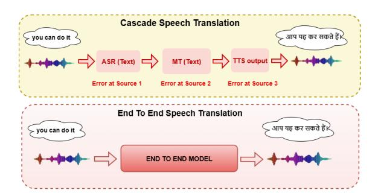
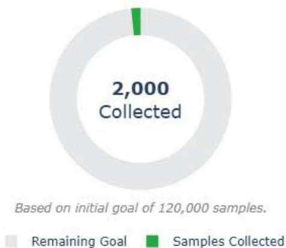

# Thesis Proposal: Development of End-to-End Speech Translation Models for Indian Languages

Jamaluddin

Department of Computer Science Aligarh Muslim University Aligarh, India gi3860@myamu.ac.in

## Abstract

Indian languages represent a highly multilingual and low-resource speech ecosystem, where the scarcity of high-quality parallel speech corpora significantly limits the development of speech-to-speech translation systems. Most existing approaches rely on cascaded pipelines that combine automatic speech recognition (ASR), machine translation (MT), and text-to-speech synthesis (TTS). While effective, these cascaded systems often suffer from cumulative error propagation, increased latency, and higher computational complexity, particularly in low-resource Indian languages. To address these challenges, my doctoral work proposes a novel sequence-to-sequence direct speech translation framework capable of translating speech from one Indian language to another without relying on intermediate text representations. Recent advances in deep learning, however, indicate that direct speech translation architectures can surpass conventional cascaded systems in both efficiency and translation quality, motivating the design of our fully end-to-end solution. We aim to release an initial dataset comprising at least 120,000 real speech samples within a 6–12 month timeframe.

## 1 Introduction

Speech-to-Speech Translation (S2ST) is a crucial research domain, as it bridges linguistic gaps and facilitates clear and effective communication among speakers of diverse languages worldwide. In a world rich with voice, tone, and emotion, converting speech from one language directly into speech of another without detouring through text is not merely an innovation; it is a revolution. The current state of S2ST is marked by significant advancements driven by deep learning technologies [\(Kano](#page-7-0) [et al.,](#page-7-0) [2021;](#page-7-0) [Fang et al.,](#page-6-0) [2023\)](#page-6-0). Presently, cascaded (or indirect) speech-to-speech translation, as shown in Figure [1,](#page-0-0) which involves converting speech to text, translating the text, and then synthe-

Figure 1: Cascade and Direct Speech Translation.

sizing it back into speech, is a common approach [\(Bentivogli et al.,](#page-6-1) [2021\)](#page-6-1).

We need models that can speak the languages of India. For much of the country, technology does not begin with text it begins with voice. It begins in local dialects: a compounder at a rural clinic, a farmer seeking crop-related information, or a student trying to understand a government form in their native language. AI4Bharat, a research laboratory at IIT Madras, has made significant contributions toward advancing technologies for Indian languages. It has released several high quality Indic datasets, including SRUTI [\(Joshi et al.,](#page-7-1) [2025\)](#page-7-1) for ASR, Lahasa [\(Javed et al.,](#page-7-2) [2024a\)](#page-7-2) for Hindi ASR, Kathbath [\(Javed et al.,](#page-6-2) [2023a\)](#page-6-2), Shrutilipi, Aksharantar, and IndicVoices [\(Javed et al.,](#page-7-3) [2024b\)](#page-7-3). In addition, AI4Bharat has developed state-of-theart models such as IndicWav2Vec and IndicWhisper [\(Bhogale et al.,](#page-6-3) [2023b\)](#page-6-3) for Automatic Speech Recognition (ASR), IndicTransv2 [\(Gala et al.,](#page-6-4) [2023a\)](#page-6-4) for Machine Translation, and AI4BTTS for Text-to-Speech synthesis. Collectively, these resources enable cutting-edge research in speech translation through robust cascaded speech translation systems.

The cascaded approach achieves strong performance because it benefits from the maturity of textbased translation technologies and the availability of large-scale training datasets [\(Dabre and Song,](#page-6-5)

[2024\)](#page-6-5). However, it also suffers from several limitations. The multi-step pipeline struggles to preserve speech-specific nuances such as tone, emotion, and cultural context, which are often lost when translation is mediated through intermediate textual representations [\(Sperber and Paulik,](#page-7-4) [2020\)](#page-7-4). Moreover, errors can propagate across stages, compounding inaccuracies in the final output. Consequently, recent research has increasingly focused on end-toend models that translate speech directly from one language to another without relying on intermediate text representations [\(Zhu et al.,](#page-8-0) [2023\)](#page-8-0). Despite their promise, direct speech-to-speech translation methods face significant challenges, primarily due to the scarcity of parallel speech datasets across language pairs. Additionally, these models continue to struggle with faithfully preserving the emotional and prosodic characteristics of the source speech [\(Smith et al.,](#page-7-5) [2022\)](#page-7-5). However, ongoing research and improvements in neural network architectures and training datasets continue to push the boundaries of what S2ST systems can achieve.

## 2 Related Works

Recently, there have been significant advances in direct S2ST models. [\(Jia et al.,](#page-7-6) [2022\)](#page-7-6) introduced Translatotron 2, a neural direct speech-to-speech translation model that can be trained end-to-end and demonstrates substantial improvements over its predecessor, Translatotron. The model integrates a speech encoder, a linguistic decoder, an acoustic synthesizer, and a unified attention mechanism to achieve high translation accuracy and speech generation quality. Notably, Translatotron 2 attains performance comparable to cascaded systems while improving speech naturalness. [\(Lee et al.,](#page-7-7) [2021\)](#page-7-7) presented a novel direct S2ST approach based on discrete speech units. Their method employs a self-supervised discrete speech encoder along with a sequence-to-sequence speech-to-unit translation model, enabling effective translation without reliance on text transcripts. Several other recent studies have also reported promising results in direct S2ST research [\(Nachmani et al.,](#page-7-8) [2024\)](#page-7-8). More recently, [\(Pu et al.,](#page-7-9) [2025\)](#page-7-9) introduced SLAM-TR, an end-to-end speech translation framework that incorporates large language models into the speech translation pipeline. The system is trained primarily using synthetically generated data. Similarly, [\(Nguyen et al.,](#page-7-10) [2023\)](#page-7-10) proposed an effective method for generating large-scale synthetic S2ST data from

unlabeled text corpora, offering a practical way to leverage the vast amounts of multilingual unlabeled text currently available. Building on these advances, our thesis proposal aims to bridge the gap between end-to-end speech translation technologies and Indian languages.

#### 2.1 Indic ASR-ST-TTS

India has made significant strides in cascade based speech translation system, both in terms of model and dataset. Many State of the art ASR models have been developed with reference to Indian languages. IndicConformer [\(Bhogale et al.,](#page-6-6) [2025\)](#page-6-6) is built to deliver accurate speech-to-text conversion in all 22 official Indian languages. IndicWhisper[\(Bhogale et al.,](#page-6-3) [2023b\)](#page-6-3) is a fine-tuned Whisper model supporting only 12 Indian Languages.IndicWav2Vec [\(Javed et al.,](#page-7-11) [2022\)](#page-7-11) has been trained on 40 languages for over 17000 hours of speech data and represents the largest diversity of Indian languages in any such multilingual model.

IndicTrans [\(Ramesh et al.,](#page-7-12) [2022\)](#page-7-12) is a multilingual NMT system built on the Transformer architecture and trained using the large-scale Samanantar parallel corpus. IndicTrans2 [\(Gala et al.,](#page-6-4) [2023a\)](#page-6-4) is the first open-source, transformer-based multilingual NMT system capable of delivering highquality translation across all 22 scheduled Indian languages, including support for multiple scripts in low-resource languages such as Kashmiri, Manipuri, and Sindhi. CTQ Scorer [\(Puduppully et al.,](#page-7-13) [2023\)](#page-7-13) is a regression-based model that ranks and selects examples using a combination of contextual features to optimize overall translation quality.

Indic Parler-TTS [\(Sankar et al.,](#page-7-14) [2025\)](#page-7-14) is a stateof-the-art TTS system, that brings voices to life in 23 Indian languages and English, delivering realistic, expressive, and highly controllable speech synthesis. IndicF5 [\(V et al.,](#page-7-15) [2025\)](#page-7-15)is a near-human polyglot Text-to-Speech (TTS) model trained on 1417 hours of high-quality speech from Rasa, IndicTTS, LIMMITS, and IndicVoices-R. IndicTTS [\(Kumar et al.,](#page-7-16) [2023\)](#page-7-16) is a multilingual text-to-speech synthesis model designed specifically for Indian languages, covering a wide range of linguistic families and phonetic structures. It provides highquality acoustic modeling, grapheme-to-phoneme conversion, and prosody control tailored to Indian speech patterns.

A number of large-scale Indic speech corpora have recently been introduced like Nirantar [\(Javed](#page-6-7) [et al.,](#page-6-7) [2025\)](#page-6-7), MahaDhwani [\(Bhogale et al.,](#page-6-6) [2025\)](#page-6-6), Svarah [\(Javed et al.,](#page-7-17) [2023b\)](#page-7-17), Shrutilipi [\(Bhogale](#page-6-8) [et al.,](#page-6-8) [2023a\)](#page-6-8), and Dhwani [\(Javed et al.,](#page-7-11) [2022\)](#page-7-11). These datasets collectively cover a broad range of Indian languages and vary in both linguistic diversity and recording hours. However, none of them provide parallel speech pairs between any two Indian languages. Our thesis proposal aims to address this critical gap by constructing a large-scale English–Hindi parallel speech corpus, establishing the first indigenous resource of its kind for direct speech-to-speech translation research towards Indian languages.

#### 3 Key Challenges

In existing cascaded speech translation systems, speech is first converted into text in the source language using Automatic Speech Recognition (ASR), then translated into the target language through Machine Translation (MT), and finally synthesized back into speech via Text-to-Speech (TTS) models. While this pipeline has been widely adopted, it introduces multiple sources of error at each stage, including misrecognitions in ASR, mistranslations in MT, and unnatural or distorted speech generation in TTS.

Moreover, cascaded systems fail to preserve essential communicative aspects of speech such as emotional tone, rhythm, prosody, and speaker intent, often resulting in robotic and contextually inadequate translations. The reliance on intermediate text representations limits the system's ability to capture these speech-specific characteristics. Eliminating the text-based intermediate step has the potential to improve translation accuracy and better preserve prosodic and expressive nuances; however, this requires advanced end-to-end models and high-quality parallel speech datasets.

The primary challenges in developing end-toend speech-to-speech translation models for Indian languages lie in the creation of diverse parallel speech corpora and the development of robust pretrained models capable of handling direct speech translation, particularly for low-resource Indic languages. Many Indian languages suffer from limited labeled data, and the scarcity of parallel speech datasets significantly hinders the development of accurate and effective speech translation systems.

Addressing these challenges is essential for building robust, inclusive, and scalable S2ST models. As an initial step, we propose focusing on Indian languages native to the authors specifically

Hindi and Urdu, which will facilitate data collection, annotation, and detailed linguistic analysis

#### 4 Motivation

In recent years, numerous end-to-end speech translation models have been developed for non-Indic language pairs, most notably Spanish–English [\(Nachmani et al.,](#page-7-8) [2024\)](#page-7-8) and Tibetan–Chinese [\(Liu](#page-7-18) [et al.,](#page-7-18) [2023\)](#page-7-18). However, to the best of our knowledge, no end-to-end speech-to-speech translation model has yet been developed specifically for Indian languages within India.

India is one of the most linguistically diverse countries in the world, with 22 languages officially recognized in the Eighth Schedule of the Indian Constitution. These languages belong to four major language families and together account for a speaker base of approximately 1.2 billion people, distributed across 742 districts [\(Javed et al.,](#page-7-3) [2024b\)](#page-7-3). This linguistic diversity strongly motivates the pursuit of research in direct speech-to-speech translation for Indian languages, with the goal of bridging communication gaps across diverse linguistic communities.

India's rich multilingual landscape demands efficient and inclusive translation technologies that preserve cultural identity while enhancing access to information and services. Advances in direct speech translation have the potential to transform education, governance, and social interaction, thereby fostering national cohesion and strengthening India's engagement on a global scale.

### 5 Research Questions

Among the many challenges to build a direct S2ST model, one is the compilation of vast and diverse datasets to train models effectively across various languages, accents, and dialects. The scope of the problem is even bigger in a country like India, which is home to a vast array of languages and dialects, with over 20 officially recognized languages and hundreds of dialects. The diversity makes it difficult to gather sufficient training data for each language, which is essential for developing robust direct S2ST models. The major research questions are as follows:

RQ 1: How can existing speech-to-speech translation (S2ST) models be extended to support additional language pairs, particularly those involving Indian languages?

RQ 2: To what extent can established standards

and best practices for speech dataset collection be effectively adapted to the linguistically diverse Indian context?

RQ 3: Can pre-trained S2ST models developed for other language pairs (e.g., English–Spanish) be effectively adapted for Indian languages, or is it more advantageous to develop new models from scratch?

RQ 4: Is it feasible to train S2ST models primarily on synthetic data and evaluate them on realworld speech, using a limited real dataset exclusively for testing?

RQ 5: How can gender bias be identified and mitigated in end-to-end speech-to-speech translation models designed for Indian languages, particularly gender-sensitive languages such as Hindi and Urdu?

#### 6 Methodology

Aligarh Muslim University (AMU), one of India's largest and most prestigious residential universities, accommodates nearly 25,000 students in its on-campus hostels. This academic environment is enriched by the linguistic and cultural diversity of its student body. While English is widely used for academic communication, the majority of students come from Hindi and Urdu-speaking regions, particularly from states such as Uttar Pradesh, Bihar, Jharkhand, Madhya Pradesh, and Uttarakhand. In addition, AMU hosts a significant number of students from linguistically diverse states like Jammu & Kashmir, West Bengal, Assam, and Kerala. This confluence of regional languages, cultures, and dialects makes AMU a microcosm of India's multilingual society—often referred to as a "mini-India." Recognizing this unique setting, our research team was inspired to curate a rich and diverse speech dataset aimed at building and evaluating direct speech-to-speech translation (S2ST) models, with a particular focus on addressing the challenges of Indian language translation.

Recent work currently reviewed existing literature related to S2ST [\(Sarim et al.,](#page-7-19) [2025\)](#page-7-19). We have written a review paper on direct speech translation that critically evaluates various approaches, highlights their trade-offs, and discusses future directions for enhancing real-time multilingual communication.

#### 6.1 Dataset

### 6.1.1 Real Parallel Speech Dataset

We have developed a website https://drrecorder.onrender.com/ to collect speech samples for English-Hindi language pair from bilingual speakers of Hindi-speaking regions. Initially we are planning to train end-to-end model for English to Hindi language direction though the data collected can be used in Hindi-English language direction. We have already identified around 50 speakers and have collected more than 2000 samples (sample rate is 44.1 kHz and file type is .wav), which includes ≈ 4 hours of real speech data. The duration of each sample ranges from as short as ≈ 1 second to as long as ≈ 69 seconds, with an average of ≈ 9 seconds. The Hindi-English text pairs which the speakers record are taken from Bharat Parallel Corpus Collection (BPCC)[\(Gala et al.,](#page-6-9) [2023b\)](#page-6-9).

#### 6.1.2 Synthetic Parallel Speech Dataset

In addition to real speech data collection, we curated a substantial synthetic English–Hindi parallel speech corpus. The underlying text pairs were sourced from the Anuvaad corpus, a component of the Samanantar dataset [\(Ramesh et al.,](#page-7-12) [2022\)](#page-7-12). Speech was synthesized using the Google Cloud Text-to-Speech API for both English and Hindi text pairs [\(Limbu,](#page-7-20) [2020\)](#page-7-20). To simulate speaker variability, we selected multiple available voice profiles, including two male and two female speakers. All audio files were generated in 16 kHz, mono WAV format. The resulting synthetic corpus consists of approximately 72k English–Hindi parallel sentence pairs covering a wide range of domains, including Automobile, Education, Healthcare, Entertainment, Finance, General, News, Tourism, and Technology. Corresponding speech was generated for each text pair, yielding a total of roughly 251 hours of bilingual audio, with an average utterance duration of 6.3 seconds.

## 6.2 Model Development

After collecting a sufficient amount of data for the English–Hindi language pair, we will attempt to implement direct speech-to-speech translation models that have been pre-trained on non-Indic (foreign) languages. We will first evaluate existing pre-trained direct S2ST models, such as SLAM-TR [\(Pu et al.,](#page-7-9) [2025\)](#page-7-9) and Translatotron [\(Nachmani et al.,](#page-7-8) [2024\)](#page-7-8), and compare their performance against cascaded speech translation systems.

Figure 2: Real human speech data collection

As a baseline, we will construct a cascaded speech translation pipeline using IndicWhisper [\(Bhogale et al.,](#page-6-3) [2023b\)](#page-6-3) for Automatic Speech Recognition (ASR), IndicTrans2 [\(Gala et al.,](#page-6-4) [2023a\)](#page-6-4) for Machine Translation (MT), and IndicTTS [\(Kumar et al.,](#page-7-16) [2023\)](#page-7-16) for Text-to-Speech (TTS) synthesis.

It will be particularly interesting to analyze how pre-trained direct S2ST models, such as those trained on Spanish–English language pairs [\(Nach](#page-7-8)[mani et al.,](#page-7-8) [2024\)](#page-7-8), perform in the Hindi–English scenario, given the substantial phonetic and prosodic differences between Hindi and Spanish. If the performance of pre-trained models proves unsatisfactory, we also plan to develop a direct S2ST model from scratch.

### 6.3 Evaluation

Various evaluation matrices have been shown for evaluating parallel speeches and direct speech translation models, few of them have been discuss below.

## 6.3.1 Human Validation of Synthetic data

We conducted a stratified random human validation on 2% of the synthetic dataset. Specifically, 188 samples were selected from the Automobile domain, 172 from Education, 44 from Healthcare, 235 from Entertainment, 156 from Finance, 190 from the General domain, 164 from News, 140 from Tourism, and 156 from Technology, resulting in a total of 1,445 validated samples. The evaluation was carried out by graduate and postgraduate students aged 18–25 who demonstrated proficiency in both Hindi and English. We plan to extend the human validation coverage to approximately 5% of the synthetic corpus within the next three months.

#### 6.3.2 MOS

Mean Opinion Score (MOS) [\(Jia et al.,](#page-7-6) [2022\)](#page-7-6) is a widely used subjective evaluation metric for assessing speech quality. It is computed by asking human listeners to rate audio samples on a fixed scale, typically from 1 (poor) to 5 (excellent). The final MOS value is calculated as the average of all listener scores, yielding a single quantitative measure that captures perceived naturalness, intelligibility, and overall listening comfort. Since MOS relies on human judgments rather than automatic evaluation metrics, it provides a more faithful assessment of real-world speech quality.

## 6.3.3 ASR-BLEU

The ASR-BLEU score is computed by first transcribing the generated speech output using a pre-trained Automatic Speech Recognition (ASR) model, and then calculating the BLEU score between the resulting transcript and the reference text. This metric provides a text-based approximation of translation accuracy.

To evaluate translation quality, prior studies [\(Lee](#page-7-7) [et al.,](#page-7-7) [2021;](#page-7-7) [Zheng et al.,](#page-8-1) [2025\)](#page-8-1) adopt ASR-BLEU by transcribing the synthesized speech with an ASR system and computing BLEU scores between the ASR-generated text and the corresponding reference translations.Direct speech-to-speech translation models such as SLAM-TR [\(Pu et al.,](#page-7-9) [2025\)](#page-7-9) and Translatotron [\(Nachmani et al.,](#page-7-8) [2024\)](#page-7-8) have demonstrated promising performance when evaluated using the ASR-BLEU metric.

## 6.3.4 BLASER

BLASER [\(Chen et al.,](#page-6-10) [2023\)](#page-6-10) is a text-independent, speech-native evaluation metric designed for assessing the quality of speech-to-speech translation (S2ST). It employs a multilingual, multimodal encoder to map both the hypothesis speech and the reference speech into a shared latent embedding

space that captures semantic and acoustic information. BLASER estimates translation quality by computing the cosine similarity between these embeddings, where higher similarity scores indicate better preservation of meaning, prosody, and overall speech characteristics.

By eliminating reliance on ASR transcripts or text-based comparisons, BLASER offers a robust, direct, and model-agnostic measure of S2ST performance. Accordingly, [\(Zhao et al.,](#page-7-21) [2025\)](#page-7-21) use the BLASER score to evaluate semantic alignment between source speech and translated speech.

## 7 Thesis Contribution

The primary objective of our work is to create a high-quality corpus of Indian languages for direct speech-to-speech translation (S2ST) systems. In addition, the proposed dataset will add value to existing speech-to-text and text-to-speech pipelines and can serve as a benchmark for evaluating both cascaded and end-to-end S2ST models.

In the long term, our goal is to establish a comprehensive speech data hub for direct S2ST systems covering multiple Indian language pairs, particularly those for which native speakers are readily available within the university community. Overall, our research aims to advance multilingual speech translation for Indian languages, enabling more effective communication across diverse linguistic communities in India and beyond.

The outcomes of our proposal will support the development of localized voice assistants, language learning applications, and accessibility tools, while also enriching the broader research landscape of speech translation for Indian languages. The major contributions of this thesis are summarized as follows:

- Addressing the core challenges involved in developing direct speech-to-speech translation (S2ST) systems for Indian languages.
- Constructing a high-quality multilingual speech corpus specifically designed for direct S2ST research across Indian languages.
- Designing, developing, and training end-toend direct S2ST models using parallel speech corpora to improve translation accuracy and robustness.
- Advancing multilingual speech translation research for Indian languages by enabling

scalable, cross-lingual, and domain-adaptive model development.

- Supporting the development of localized voice assistants, accessibility technologies, and speech-driven applications tailored to India's linguistic diversity.

#### 8 Future work

Following prior work [\(Gupta et al.,](#page-6-11) [2025\)](#page-6-11), we aim to release an initial dataset comprising at least 120,000 real speech samples within a 6–12 month timeframe, as illustrated in Figure [2.](#page-4-0) To evaluate translation quality and the preservation of prosodic features, we will employ established performance metrics such as ASR-BLEU and Mean Opinion Score (MOS) [\(Jia et al.,](#page-7-6) [2022\)](#page-7-6).

In addition, we plan to extend this effort to include Urdu, given that a large proportion of students and faculty at our institute originate from the Hindi–Urdu heartland and are proficient in Hindi, English, and Urdu. In the longer term, we also intend to expand the dataset to cover additional Indian languages.

## 9 Conclusion

Our thesis proposal presents a systematic investigation into end-to-end speech-to-speech translation for Indian languages, addressing the inherent limitations of cascaded ASR–MT–TTS pipelines. The work is structured around the creation of highquality parallel speech corpora, comprising both real and large-scale synthetic bilingual data, to mitigate the data scarcity that currently constrains direct S2ST research in the Indian context. Leveraging these resources, the proposed research will first evaluate existing pre-trained direct S2ST models on Indian language pairs. Based on the outcomes, our study will further explore the design and training of direct speech-to-speech translation models from scratch, optimized specifically for Indian languages. The expected deliverables include publicly valuable parallel speech datasets, rigorous empirical benchmarks against cascaded baselines, and scalable end-to-end S2ST models for Indian languages.

## Limitations

Although our work is a major improvement in speech translation, it is by no means exhaustive. To start with, translation requires vast amounts of

parallel speeches that do not exist. Here, we considered just 2 Indian languages that is English to Hindi.We could have included more languages like Eng to Urdu, kashmiri, Tamil etc in our study to make the results more comprehensive. It would be interesting and also quite challenging to develop direct speech translation models tailored to Indian languages. We believe that our effort provides a firm foundation for future study in this direction and has the potential to radically contribute to the field of direct speech translation. Ethical considerations In the development of the parallel speech corpus, we strictly adhered to established ethical guidelines to ensure responsible and compliant data collection and usage. All speech data were collected in accordance with recognized ethical research standards. Participants were provided with informed consent, including clear information regarding the objectives of the study, the type of data being collected, and their right to withdraw participation at any stage without any adverse consequences. No personally identifiable information was collected at any point during the data acquisition process, and all speech recordings were anonymized prior to storage and analysis to safeguard participant privacy. The dataset is utilized exclusively for academic research and language resource development purposes. Furthermore, all data are stored in secure, access-controlled environments to prevent unauthorized use or disclosure. References Luisa Bentivogli, Mauro Cettolo, Marco Gaido, Alina Karakanta, Alberto Martinelli, Matteo Negri, and Marco Turchi. 2021. Cascade versus direct speech translation: Do the differences still make a difference? *arXiv preprint arXiv:2106.01045*. Kaushal Bhogale, Abhigyan Raman, Tahir Javed, Sumanth Doddapaneni, Anoop Kunchukuttan, Pratyush Kumar, and Mitesh M Khapra. 2023a. Effectiveness of mining audio and text pairs from public data for improving asr systems for low-resource languages. In *ICASSP 2023-2023 IEEE International Conference on Acoustics, Speech and Signal Processing (ICASSP)*, pages 1–5. IEEE. Kaushal Santosh Bhogale, Deovrat Mehendale, Tahir Javed, Devbrat Anuragi, Sakshi Joshi, Sai Sundaresan, Aparna Ananthanarayanan, Sharmistha Dey, Anusha Srinivasan, Abhigyan Raman, and 1 others. 2025. Towards bringing parity in pretraining datasets for low-resource indian languages. In *ICASSP 2025- 2025 IEEE International Conference on Acoustics, Speech and Signal Processing (ICASSP)*, pages 1–5. IEEE. Kaushal Santosh Bhogale, Sai Sundaresan, Abhigyan Raman, Tahir Javed, Mitesh M Khapra, and Pratyush Kumar. 2023b. Vistaar: Diverse benchmarks and training sets for indian language asr. *arXiv preprint arXiv:2305.15386*. Mingda Chen, Paul-Ambroise Duquenne, Pierre Andrews, Justine Kao, Alexandre Mourachko, Holger Schwenk, and Marta R Costa-jussà. 2023. Blaser: A text-free speech-to-speech translation evaluation metric. In *Proceedings of the 61st Annual Meeting of the Association for Computational Linguistics (Volume 1: Long Papers)*, pages 9064–9079. Raj Dabre and Haiyue Song. 2024. Nict's cascaded and end-to-end speech translation systems using whisper and indictrans2 for the indic task. In *Proceedings of the 21st International Conference on Spoken Language Translation (IWSLT 2024)*, pages 17–22. Qingkai Fang, Yan Zhou, and Yang Feng. 2023. Daspeech: Directed acyclic transformer for fast and high-quality speech-to-speech translation. *Advances in Neural Information Processing Systems*, 36:72604– 72623. Jay Gala, Pranjal A Chitale, Raghavan AK, Varun Gumma, Sumanth Doddapaneni, Aswanth Kumar, Janki Nawale, Anupama Sujatha, Ratish Puduppully, Vivek Raghavan, and 1 others. 2023a. Indictrans2: Towards high-quality and accessible machine translation models for all 22 scheduled indian languages. *arXiv preprint arXiv:2305.16307*. Jay Gala, Pranjal A Chitale, A K Raghavan, Varun Gumma, Sumanth Doddapaneni, Aswanth Kumar M, Janki Atul Nawale, Anupama Sujatha, Ratish Puduppully, Vivek Raghavan, Pratyush Kumar, Mitesh M Khapra, Raj Dabre, and Anoop Kunchukuttan. 2023b. [Indictrans2: Towards high-quality and accessible ma](https://openreview.net/forum?id=vfT4YuzAYA)[chine translation models for all 22 scheduled indian](https://openreview.net/forum?id=vfT4YuzAYA) [languages.](https://openreview.net/forum?id=vfT4YuzAYA) *Transactions on Machine Learning Research*. Mahendra Gupta, Maitreyee Dutta, and Chandresh Kumar Maurya. 2025. Benchmarking hindi-to-english direct speech-to-speech translation with synthetic data. *Language Resources and Evaluation*, pages 1–39. Tahir Javed, Kaushal Bhogale, and Mitesh M Khapra. 2025. Nirantar: Continual learning with new languages and domains on real-world speech data. *arXiv preprint arXiv:2507.00534*. Tahir Javed, Kaushal Bhogale, Abhigyan Raman, Pratyush Kumar, Anoop Kunchukuttan, and Mitesh M Khapra. 2023a. Indicsuperb: A speech processing universal performance benchmark for indian languages. In *Proceedings of the AAAI Conference on Artificial Intelligence*, volume 37, pages 12942–12950.

- Tahir Javed, Sumanth Doddapaneni, Abhigyan Raman, Kaushal Santosh Bhogale, Gowtham Ramesh, Anoop Kunchukuttan, Pratyush Kumar, and Mitesh M Khapra. 2022. Towards building asr systems for the next billion users. In *Proceedings of the aaai conference on artificial intelligence*, volume 36, pages 10813–10821. Tahir Javed, Sakshi Joshi, Vignesh Nagarajan, Sai Sundaresan, Janki Nawale, Abhigyan Raman, Kaushal Bhogale, Pratyush Kumar, and Mitesh M Khapra. 2023b. Svarah: Evaluating english asr systems on indian accents. *arXiv preprint arXiv:2305.15760*. Tahir Javed, Janki Nawale, Sakshi Joshi, Eldho George, Kaushal Bhogale, Deovrat Mehendale, and Mitesh M Khapra. 2024a. Lahaja: A robust multi-accent benchmark for evaluating hindi asr systems. *arXiv preprint arXiv:2408.11440*. Tahir Javed, Janki Atul Nawale, Eldho Ittan George, Sakshi Joshi, Kaushal Santosh Bhogale, Deovrat Mehendale, Ishvinder Virender Sethi, Aparna Ananthanarayanan, Hafsah Faquih, Pratiti Palit, and 1 others. 2024b. Indicvoices: Towards building an inclusive multilingual speech dataset for indian languages. *arXiv preprint arXiv:2403.01926*. Ye Jia, Michelle Tadmor Ramanovich, Tal Remez, and Roi Pomerantz. 2022. Translatotron 2: High-quality direct speech-to-speech translation with voice preservation. In *International Conference on Machine Learning*, pages 10120–10134. PMLR. Sakshi Joshi, Eldho Ittan George, Tahir Javed, Kaushal Bhogale, Nikhil Narasimhan, and Mitesh M Khapra. 2025. Recognizing every voice: Towards inclusive asr for rural bhojpuri women. *arXiv preprint arXiv:2506.09653*. Takatomo Kano, Sakriani Sakti, and Satoshi Nakamura. 2021. Transformer-based direct speech-to-speech translation with transcoder. In *2021 IEEE spoken language technology workshop (SLT)*, pages 958–
- 965. IEEE. Gokul Karthik Kumar, SV Praveen, Pratyush Kumar, Mitesh M Khapra, and Karthik Nandakumar. 2023. Towards building text-to-speech systems for the next billion users. In *Icassp 2023-2023 ieee international conference on acoustics, speech and signal processing (icassp)*, pages 1–5. IEEE. Ann Lee, Peng-Jen Chen, Changhan Wang, Jiatao Gu, Sravya Popuri, Xutai Ma, Adam Polyak, Yossi Adi, Qing He, Yun Tang, and 1 others. 2021. Direct speech-to-speech translation with discrete units. *arXiv preprint arXiv:2107.05604*. Sireesh Haang Limbu. 2020. Direct speech to speech translation using machine learning. Rouhe Liu, Yue Zhao, and Xiaona Xu. 2023. Multitask self-supervised learning based tibetan-chinese speech-to-speech translation. In *2023 International Conference on Asian Language Processing (IALP)*, pages 45–49. IEEE. Eliya Nachmani, Alon Levkovitch, Yifan Ding, Chulayuth Asawaroengchai, Heiga Zen, and Michelle Tadmor Ramanovich. 2024. Translatotron 3: Speech to speech translation with monolingual data. In *ICASSP 2024-2024 IEEE International Conference on Acoustics, Speech and Signal Processing (ICASSP)*, pages 10686–10690. IEEE. Xuan-Phi Nguyen, Sravya Popuri, Changhan Wang, Yun Tang, Ilia Kulikov, and Hongyu Gong. 2023. Improving speech-to-speech translation through unlabeled text. In *ICASSP 2023-2023 IEEE International Conference on Acoustics, Speech and Signal Processing (ICASSP)*, pages 1–5. IEEE. Yu Pu, Xiaoqian Liu, Guangyu Zhang, Zheng Yan, Wei-Qiang Zhang, and Xie Chen. 2025. Empowering large language models for end-to-end speech translation leveraging synthetic data. In *Proc. Interspeech 2025*, pages 26–30. Ratish Puduppully, Raj Dabre, Anoop Kunchukuttan, and 1 others. 2023. Ctqscorer: Combining multiple features for in-context example selection for machine translation. In *The 2023 Conference on Empirical Methods in Natural Language Processing*. Gowtham Ramesh, Sumanth Doddapaneni, Aravinth Bheemaraj, Mayank Jobanputra, Raghavan Ak, Ajitesh Sharma, Sujit Sahoo, Harshita Diddee, Divyanshu Kakwani, Navneet Kumar, and 1 others. 2022. Samanantar: The largest publicly available parallel corpora collection for 11 indic languages. *Transactions of the Association for Computational Linguistics*, 10:145–162. Ashwin Sankar, Yoach Lacombe, Sherry Thomas, Praveen Srinivasa Varadhan, Sanchit Gandhi, and Mitesh M Khapra. 2025. Rasmalai: Resources for adaptive speech modeling in indian languages with accents and intonations. *arXiv preprint arXiv:2505.18609*. Mohammad Sarim, Saim Shakeel, Laeeba Javed, Mohammad Nadeem, and 1 others. 2025. Direct speech to speech translation: A review. *arXiv preprint arXiv:2503.04799*. Jane Smith, Firstname2 Lastname2, and Firstname3 Lastname3. 2022. A really good paper about Dynamic Time Warping. In *Proc. INTERSPEECH 2022 – 23rd Annual Conference of the International Speech Communication Association*, pages 100–104, Incheon, Korea. Matthias Sperber and Matthias Paulik. 2020. Speech translation and the end-to-end promise: Taking stock of where we are. *arXiv preprint arXiv:2004.06358*. Praveen S V, Srija Anand, Soma Siddhartha, and Mitesh M. Khapra. 2025. [Indicf5: High-quality text](https://github.com/AI4Bharat/IndicF5)[to-speech for indian languages.](https://github.com/AI4Bharat/IndicF5) Jinzheng Zhao, Niko Moritz, Egor Lakomkin, Ruiming Xie, Zhiping Xiu, Katerina Zmolikova, Zeeshan Ahmed, Yashesh Gaur, Duc Le, and Christian Fuegen.

2025. Textless streaming speech-to-speech translation using semantic speech tokens. In *ICASSP 2025- 2025 IEEE International Conference on Acoustics, Speech and Signal Processing (ICASSP)*, pages 1–5. IEEE. Zhisheng Zheng, Xiaohang Sun, Tuan Dinh, Abhishek Yanamandra, Abhinav Jain, Zhu Liu, Sunil Hadap, Vimal Bhat, Manoj Aggarwal, Gerard Medioni, and 1 others. 2025. Rosettaspeech: Zero-shot speechto-speech translation from monolingual data. *arXiv preprint arXiv:2511.20974*. Yongxin Zhu, Zhujin Gao, Xinyuan Zhou, Zhongyi Ye, and Linli Xu. 2023. Diffs2ut: A semantic preserving diffusion model for textless direct speech-to-speech translation. *arXiv preprint arXiv:2310.17570*.

