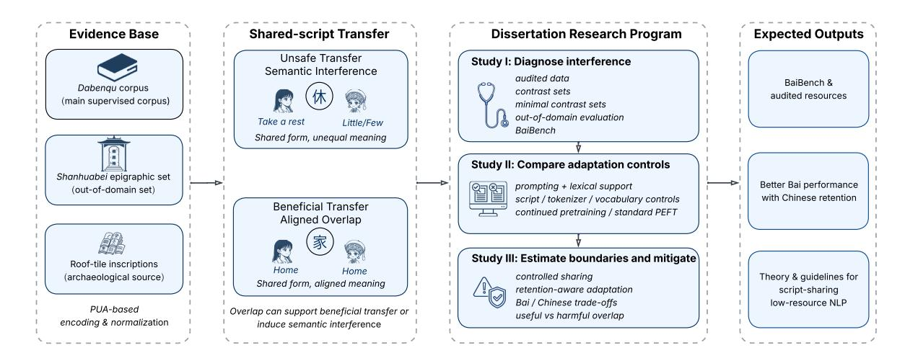

# Thesis Proposal: Diagnosing and Mitigating Semantic Interference in Script-Sharing Low-Resource Language Models: A Case Study on Square Bai Script

Jingting Zheng, Deyi Xiong

TJUNLP Lab, School of Computer Science and Technology, Tianjin University, China {zhengjingting, dyxiong}@tju.edu.cn

# Abstract

Multilingual language models now cover more languages than ever, yet script-sharing lowresource languages remain vulnerable to failures driven by script and dominant-language priors. This dissertation studies one such failure mode, *semantic interference*, in Square Bai Script, where many forms resemble Chinese characters but often differ in meaning. We argue that current adaptation pipelines underperform not only because Bai is low-resource, but because they treat visible overlap as safe transfer by default. Building on an expert-validated corpus of 28,382 Bai–Chinese sentence pairs, an out-of-domain epigraphic set and a reproducible encoding pipeline, the dissertation will (1) diagnose semantic interference, (2) compare adaptation strategies under realistic compute constraints, and (3) estimate when sharedscript transfer helps or harms adaptation. The long-term goal is Bai-capable understanding and generation. The dissertation addresses the prerequisite problem of safe and effective adaptation in a script-sharing low-resource setting.

## 1 Introduction

Multilingual NLP is at a contradictory moment. Open multilingual models now cover more languages and are easier to adapt than even a few years ago. Aya was instruction-tuned for 101 languages, more than half lower-resourced, while Qwen3 supports 119 languages and dialects and offers a 0.6B model suitable for careful experimentation [\(Üstün](#page-9-0) [et al.,](#page-9-0) [2024;](#page-9-0) [Yang et al.,](#page-9-1) [2025\)](#page-9-1). Yet broader coverage has not solved the long tail. Large multilingual models still underperform simple baselines on basic generation for many languages, and recent evidence suggests that cross-lingual interference relates more strongly to script than to language family [\(Chang et al.,](#page-8-0) [2024;](#page-8-0) [Alastruey et al.,](#page-8-1) [2025\)](#page-8-1). Script representation and tokenization therefore remain

first-order modeling decisions rather than superficial preprocessing choices [\(Husain et al.,](#page-8-2) [2024;](#page-8-2) [Ebing et al.,](#page-8-3) [2026;](#page-8-3) [Xue et al.,](#page-9-2) [2022;](#page-9-2) [Pagnoni et al.,](#page-9-3) [2025;](#page-9-3) [Nag et al.,](#page-9-4) [2025;](#page-9-4) [Zheng,](#page-10-0) [2026\)](#page-10-0).

This dissertation focuses on one especially difficult setting within that broader landscape: *scriptsharing languages*. In such settings, a minority language reuses the graphic inventory of a dominant language, but the mapping from surface form to meaning is only partially shared. Square Bai Script (*Fangkuai Baiwen*) exemplifies this challenge. It is a Chinese-character-derived writing system with its own internal writing principles, formed through both borrowed Chinese characters and Chinese-like created characters [\(Wang,](#page-9-5) [2004\)](#page-9-5). Many forms are graphically close to or identical with Chinese characters, yet their meanings often differ, creating a risk that a Chinese-strong model will anchor on the wrong sense during understanding or generation. We call that failure mode *semantic interference*. Its practical signature is not just lower aggregate accuracy, but structured errors such as sense substitution, Chinese leakage and unstable disambiguation.

Square Bai is theoretically informative because script overlap with Chinese is neither trivial borrowing nor full equivalence. Some shared forms are semantically aligned and may provide useful crosslingual anchors; others are divergent, polysemous or context-sensitive, and therefore invite misinterpretation. In particular, many borrowed forms are used for Bai sound value rather than straightforward semantic equivalence, which helps explain why visible overlap with Chinese can be deceptive [\(Wang,](#page-9-5) [2004\)](#page-9-5). This mixed regime makes Bai a sharper test case than generic low-resource adaptation. The central question is not whether overlap is beneficial in the abstract, but which visible overlaps should be trusted, which should be controlled, and which require stronger Bai-specific evidence.

Figure 1: Dissertation logic. The dissertation treats script overlap as a variable that can support beneficial transfer or induce semantic interference, rather than as automatically helpful transfer, and must therefore be diagnosed, controlled, and evaluated explicitly.

Direct NLP work on Bai remains sparse. Recent ACL-style work treats Bai primarily as a spokenonly translation benchmark via IPA transcription rather than as a script-sharing written language, underscoring the novelty of focusing on Square Bai script and Bai–Chinese written adaptation [\(Chen](#page-8-4) [et al.,](#page-8-4) [2025\)](#page-8-4). Figure [1](#page-1-0) summarizes the dissertation logic and the relationship between the core studies.

Instead of attempting to pretrain a Bai foundation model from scratch, this dissertation treats Square Bai as a high-value case study for understanding when script-sharing transfer is beneficial and when it becomes unsafe. The long-term goal is Bai-capable understanding and generation. The dissertation addresses a prerequisite problem: how to adapt strong existing open-weight models to Bai without allowing visible overlap with Chinese to dominate interpretation. Its main contributions are therefore explanatory as well as empirical: a rigorous formulation of semantic interference, an interference-aware benchmark and diagnostic layer, and a controlled comparison of adaptation strategies that clarifies when shared overlap should be preserved, controlled or overridden.

*Core scope.* The dissertation studies adaptation of strong existing open-weight models rather than pretraining from scratch. Translation is the primary task because it most directly exposes semantic anchoring errors. Synthetic data is treated as a quality-gated late-stage extension rather than a built-in assumption.

# 2 Theoretical Framing and Related Work

This section situates the dissertation within recent work on multilingual low-resource NLP, scriptsensitive modeling, and related Chinese-characterderived writing traditions.

Multilingual coverage versus the long tail. Recent multilingual models have moved the baseline for low-resource NLP upward. Aya broadens multilingual instruction following, and Aya Expanse reports strong multilingual performance among openweight models [\(Üstün et al.,](#page-9-0) [2024;](#page-9-0) [Dang et al.,](#page-8-5) [2024\)](#page-8-5). Yet the long-tail gap remains substantial. [Chang et al.](#page-8-0) [\(2024\)](#page-8-0) argue that multilingual scale can mask weak language-specific modeling, especially on basic generation. Work on massively multilingual NMT further shows that shared multilingual parameters and language tags do not by themselves guarantee correct translation directions, especially in zero-shot settings, motivating more informative language representations [\(Jin and Xiong,](#page-8-6) [2022\)](#page-8-6). We therefore treat large multilingual models as powerful starting points, not sufficient solutions.

Script and tokenization as modeling decisions. A central lesson from recent work is that script handling is not merely front-end engineering. Romanization can reduce token fertility and improve crossscript transfer in some settings [\(Husain et al.,](#page-8-2) [2024\)](#page-8-2). At the same time, newer evidence shows that such gains are not universal: for morphosyllabic scripts such as Chinese and Japanese, romanization can degrade performance and may not fully preserve useful script-specific information [\(Ebing et al.,](#page-8-3) [2026\)](#page-8-3). Byte-level and tokenization-free work such as CA-NINE, ByT5, and BLT shows that character- or byte-oriented modeling is increasingly plausible as a control or alternative to fixed subword vocabularies [\(Clark et al.,](#page-8-7) [2022;](#page-8-7) [Xue et al.,](#page-9-2) [2022;](#page-9-2) [Pagnoni](#page-9-3) [et al.,](#page-9-3) [2025\)](#page-9-3). For this dissertation, these findings imply that transliteration, shared tokenization, controlled vocabulary expansion, and character- or byte-like modeling should all be treated as meaningful experimental controls.

Low-resource adaptation and vocabulary expansion. Continued pretraining and parameterefficient fine-tuning remain standard tools for lowresource adaptation, but their effects depend heavily on data quality, tokenization and forgetting [\(Gu](#page-8-8)[rurangan et al.,](#page-8-8) [2020;](#page-8-8) [Hu et al.,](#page-8-9) [2022;](#page-8-9) [Dettmers](#page-8-10) [et al.,](#page-8-10) [2023\)](#page-8-10). Recent work on efficient continual pretraining for low-resource languages suggests that a compact but informative continuedpretraining corpus can be effective, especially when tokenizer support is poor [\(Nag et al.,](#page-9-4) [2025\)](#page-9-4). Other recent work shows that vocabulary expansion can help extremely low-resource languages when the inherited vocabulary is biased toward a source language, and that carefully initialized new embeddings need not degrade the source language [\(Zheng,](#page-10-0) [2026\)](#page-10-0). This caution matters for Square Bai, where the problem is not only missing units but also harmful semantic reuse of shared forms.

Prompting, lexical support, and synthetic augmentation. Work on Manchu in-context translation offers an important methodological lesson: good dictionaries and parallel examples help strongly, while grammar descriptions contribute much less [\(Pei et al.,](#page-9-6) [2025\)](#page-9-6). Prompt baselines therefore need to be treated seriously rather than as weak straw-man comparisons. At the same time, MT work on LLM-based in-context learning shows that demonstration noise can substantially degrade translation quality, and that demonstration selection should consider fine-grained sentence- and wordlevel information [\(Zhu et al.,](#page-10-1) [2024a\)](#page-10-1). A similar lesson now appears in Zhuang: recent work shows that grammar-rule retrieval is itself a major bottleneck in extremely low-resource translation, and that making grammar knowledge more explicit can substantially improve performance [\(Zhang et al.,](#page-10-2) [2025\)](#page-10-2). Synthetic augmentation is also increasingly promising for low-resource MT, but it carries risks of hidden teacher bias and evaluation inflation

[\(de Gibert et al.,](#page-8-11) [2025;](#page-8-11) [Devine et al.,](#page-8-12) [2026\)](#page-8-12). For that reason, we treat it as an optional extension.

A conditional theory of shared-script transfer. This dissertation treats shared-script transfer as conditionally beneficial rather than uniformly helpful or harmful. We assume three interacting mechanisms. First, *orthographic anchoring*: shared forms encourage multilingual models to reuse lexical and contextual structure across languages. This can help, and recent work shows that vocabulary overlap often improves cross-lingual transfer when shared units are semantically aligned [\(Limisiewicz](#page-8-13) [et al.,](#page-8-13) [2023;](#page-8-13) [Kallini et al.,](#page-8-14) [2025\)](#page-8-14). Second, *evidence imbalance*: when target-language evidence is sparse and dominant-language priors are strong, the model may over-weight the dominant language even when surface overlap is misleading. Third, *adaptation pressure*: fine-tuning can either correct or amplify this imbalance depending on tokenization, vocabulary sharing and parameter allocation. Interference patterns are also strongly associated with script [\(Alastruey et al.,](#page-8-1) [2025\)](#page-8-1). Related work on East Asian historical documents reinforces this conditional view. HUE and Kanbun-LM show that useful NLP resources and models can be built for Hanja and Kanbun under severe resource constraints [\(Yoo et al.,](#page-9-7) [2022;](#page-9-7) [Wang et al.,](#page-9-8) [2023\)](#page-9-8), but recent findings show that gains from Classical Chinese are concentrated in extremely low-resource scenarios and diminish rapidly as local data increases [\(Song et al.,](#page-9-9) [2025\)](#page-9-9). The dissertation therefore asks when overlap acts as a useful cross-lingual anchor and when it becomes a source of semantic error, rather than whether overlap is good or bad in the abstract.

What semantic interference is—and is not. In this dissertation, *semantic interference* is the failure mode in which a model assigns dominantlanguage semantics to graphically shared forms despite target-language evidence. This definition distinguishes the phenomenon from several neighboring explanations. It is not merely *data scarcity*: scarcity may amplify the problem, but the signature of semantic interference is concentrated failure on shared-form items rather than uniformly weak Bai performance. It is not merely *tokenizer fragmentation*: poor segmentation can reduce efficiency, but interference can persist even after segmentation improves if shared units remain misleadingly anchored. It is not merely *domain shift*: out-of-domain degradation may affect many items,

| Resource                  | Scale                   | Role in dissertation                                           |
|---------------------------|-------------------------|----------------------------------------------------------------|
| Dabenqu parallel corpus   | 28,382 sentence pairs   | Main supervised resource for Bai–Chinese adaptation, baseline  |
|                           |                         | training, and in-domain evaluation.                            |
| Shanhuabei epigraphic set | ∼ 80 items              | Strict out-of-domain stress test for generalization beyond the |
|                           |                         | main corpus.                                                   |
| PUA-based encoding map    | Versioned glyph mapping | Reproducible handling of non-standard and variant Square Bai   |
|                           |                         | glyphs; tracked as experimental metadata for preprocessing and |
|                           |                         | tokenizer comparisons.                                         |
| Lexicons / expert         |                         |                                                                |
|                           | Small but high-value    | Identification of high-risk shared-form items, minimal         |
|                           |                         | contrast-set construction, and manual error analysis.          |
| Chinese retention suite   | Held-out probes         | Measurement of source-language retention during Bai            |

Table 1: Core resources already available or directly derivable for the dissertation. The dissertation is feasible because the main dataset, an out-of-domain stress set and a reproducible encoding layer already exist.

whereas semantic interference predicts structured errors on graphically shared forms. Nor is it equivalent to *catastrophic forgetting*: retention loss in Chinese is an important risk during adaptation, but the central object of study here is incorrect Bai interpretation under cross-lingual overlap. The phenomenon is related to lexical "false friends" in other language pairs, but differs in that the misleading cue is not only lexical resemblance but also shared glyph form, tokenizer behavior and dominant-language priors. The dissertation therefore treats semantic interference as a specific, testable failure mode of transfer rather than as a catch-all label for low-resource underperformance.

This theory yields three falsifiable expectations: semantically aligned shared forms should help more than disjoint controls; semantically divergent shared forms should produce disproportionately more errors than matched non-shared controls; and adaptation methods that selectively reduce harmful sharing or strengthen Bai-specific evidence should improve Bai without requiring overlap to be removed altogether. Taken together, these claims define three dissertation outputs: a diagnostic account of semantic interference, an empirical map of adaptation strategies under shared-script conditions, and a boundary estimate for when overlap functions as useful transfer versus semantic interference.

## 3 Research Questions, Current Progress, and Resources

The dissertation is feasible because its core resources already exist. The project includes an expert-validated Bai–Chinese parallel corpus of 28,382 sentence pairs (Dabenqu) and an approximately 80-item epigraphic set (Shanhuabei) reserved for strict out-of-domain evaluation. In the

Dali area, Dabenqu libretto manuscripts are not just a convenient source of supervision but one of the major living documentary forms of Square Bai, and they have played a central role in the creation, performance and transmission of Dabenqu [\(Wang,](#page-9-10) [2020\)](#page-9-10). Together with document-level splitting and leakage auditing, these resources keep the dissertation from depending entirely on in-distribution test performance. Table [1](#page-3-0) summarizes the core resources already available or directly derivable for the dissertation.

Current progress. The project has already moved beyond problem formulation in three important ways. First, the data backbone is in place: an expert-validated in-domain Bai–Chinese corpus has been assembled and a separate epigraphic set has been reserved for out-of-domain testing. Second, the preprocessing layer is reproducible: the project maintains a versioned PUA-based encoding map for non-standard glyphs, allowing later tokenizer and vocabulary experiments to be interpreted as modeling choices rather than artifacts of unstable text normalization. Third, initial prompt-based translation baselines have already exposed the shape of the problem. They improve format compliance and local adequacy, but highrisk shared-form disambiguation remains unstable. This is a useful negative result because it narrows the dissertation claim: the bottleneck is not generic generation quality alone, but the interaction among shared-form anchoring, sparse Bai evidence and adaptation design.

The dissertation is organized around three research questions.

RQ1. How can semantic interference in a scriptsharing low-resource language be identified and measured reliably? *H1.* Interference will clus-

| Study Main                    |                      | comparisons | Primary outputs                         |
|-------------------------------|----------------------|-------------|-----------------------------------------|
| I: Diagnosis & benchmark Data | auditing,            |             | leakage control, high-risk item         |
|                               | discovery,           | minimal     | contrast sets, and out-of-domain        |
| set                           | construction         |             |                                         |
|                               |                      |             | BaiBench, interference diagnostics,     |
|                               |                      |             | documented splits                       |
| II: Strong baselines &        |                      |             |                                         |
|                               | Prompting            | + lexical   | support, script controls,               |
|                               | tokenizer/vocabulary |             | controls, continued pretraining,        |
| and                           | standard             | PEFT        |                                         |
|                               |                      |             | Honest baseline frontier; identify      |
|                               |                      |             | which simple controls already           |
|                               |                      |             | reduce interference                     |
| III: Boundary estimation &    |                      |             |                                         |
| targeted adaptation           |                      |             |                                         |
|                               | Shared-form          | strata,     | vocabulary sharing, adaptation          |
| strength,                     | and                  | retention   | pressure                                |
|                               |                      |             | Bai/Chinese trade-off curves;           |
|                               |                      |             | boundary estimates for useful vs.       |
|                               |                      |             | harmful overlap                         |
| Optional extension            | Quality-gated        |             | synthetic data augmentation after fixed |
| splits                        | and                  | audit       | procedures                              |
|                               |                      |             | Test whether remaining gains are        |
|                               |                      |             | data-limited rather than                |

Table 2: Planned studies and the role of each in the dissertation. The sequencing is deliberate: diagnose first, establish strong baselines second, and test targeted interventions only after simpler explanations have been ruled out.

ter around shared forms that are both frequent and semantically divergent from Chinese. A reliable diagnostic framework must therefore combine corpus statistics, controlled contrast sets and targeted manual validation, rather than relying on aggregate translation scores alone.

RQ2. Which adaptation strategies best reduce semantic interference under realistic data and compute constraints? *H2.* Prompt-only methods and standard PEFT will improve format compliance and local adequacy, but will not fully solve semantic interference. More selective strategies, especially controlled vocabulary sharing and retentionaware parameter updates, will offer a better tradeoff between Bai gains and Chinese retention than indiscriminate adaptation.

RQ3. Under what conditions does shared-script transfer help adaptation, and under what conditions does it become harmful? *H3.* Transfer will help when shared forms are semantically aligned, adequately supported by Bai evidence, and represented by stable tokenization. It will become harmful when visible overlap masks divergent meanings, Bai evidence is sparse, or adaptation amplifies Chinese priors. The dissertation therefore aims to estimate the boundary conditions of useful versus unsafe transfer rather than treating overlap as uniformly good or uniformly bad.

These questions are cumulative rather than parallel. Study I defines the object of explanation, Study II establishes the strongest feasible controls, and Study III answers the central explanatory question by estimating when shared overlap is beneficial and when it becomes unsafe.

## 4 Dissertation Plan

The dissertation proceeds through three core studies and one optional extension. The sequencing is deliberate: first diagnose the problem, then establish strong baselines and controls, and only then test targeted interventions. In low-resource NLP it is easy to mistake a weak baseline for a novel discovery; the experimental order is designed to prevent that. Table [2](#page-4-0) condenses the study sequence, main comparisons and expected outputs.

#### 4.1 Study I: Build an Interference-Aware Resource and Diagnostic Layer

The first study turns the current data assets into a rigorous experimental substrate. This includes document-level de-duplication, source and dialect stratification, auditable datasheets, and a shared-script language identification procedure that uses alignment information and lexical constraints rather than simple character statistics. These choices follow current best practice for contamination-aware evaluation in low-resource NLP [\(Lee et al.,](#page-8-15) [2022;](#page-8-15) [Sainz et al.,](#page-9-11) [2023\)](#page-9-11).

On top of this resource layer, we will construct BaiBench, an evaluation suite centered on three components: in-domain Bai–Chinese translation, a strict out-of-domain epigraphic set, and a diagnostic subset targeting high-risk shared-form items and minimal contrast sets. To test whether harmful overlap is specific to semantically divergent shared forms, the diagnostic subset will be organized into matched strata: shared-form/same-meaning, shared-form/different-meaning, non-shared/samemeaning, and transliterated or no-overlap controls. High-risk shared-form items will be identified by combining linguistic review with contextual divergence signals from a frozen base model. The diagnostic strata will be constructed from a small expert-reviewed seed set and then expanded through corpus statistics and model-based contextual divergence, so that expert effort is concentrated on ambiguous or high-risk cases. The outputs of Study I will therefore be more than a benchmark alone: fixed splits, a diagnostic taxonomy, and an initial descriptive analysis of where semantic interference concentrates.

#### 4.2 Study II: Establish Strong Baselines and Experimental Controls

Study II asks a narrower question than the current draft suggests: how much of the problem can already be solved by disciplined baselines and representation controls? Rather than comparing an open-ended inventory of methods, we will evaluate four baseline families. First, prompt-only and prompt-plus-lexicon baselines will test how far strong lexical support can go without parameter updates, following recent evidence that dictionaries and retrieved examples are especially valuable for low-resource in-context translation [\(Pei](#page-9-6) [et al.,](#page-9-6) [2025\)](#page-9-6). Second, script controls will compare the original script with transliterated or dualscript variants, to test whether gains come from improved segmentation or from sacrificing scriptspecific information [\(Husain et al.,](#page-8-2) [2024;](#page-8-2) [Ebing](#page-8-3) [et al.,](#page-8-3) [2026\)](#page-8-3). Third, tokenizer and vocabulary controls will compare inherited tokenization against modest Bai-specific vocabulary expansion [\(Zheng,](#page-10-0) [2026\)](#page-10-0). Fourth, lightweight adaptation baselines will include continued pretraining and standard LoRA/QLoRA-style adaptation [\(Nag et al.,](#page-9-4) [2025;](#page-9-4) [Hu et al.,](#page-8-9) [2022;](#page-8-9) [Dettmers et al.,](#page-8-10) [2023\)](#page-8-10). Characteror byte-like modeling will be treated as a control condition rather than as the main methodological bet.

The output of Study II is not a leaderboard but an honest baseline frontier: which simpler interventions already reduce interference, which merely improve surface fluency, and which fail on the diagnostic strata from Study I. If a comparatively simple control solves a substantial part of the problem, the dissertation should report that directly rather than forcing a more elaborate method.

#### 4.3 Study III: Controlled Sharing, Retention-Aware Adaptation, and Boundary Estimation

formance, but to estimate when shared-script transfer changes from beneficial anchoring to semantic interference. Using the diagnostics from Study I and the baseline frontier from Study II, we will run a controlled comparison over four factors: (i) semantic alignment stratum, especially the contrast between aligned and divergent shared forms; (ii) representation regime, including inherited versus expanded vocabulary and the presence or absence of script controls; (iii) adaptation strength, ranging from prompting and lightweight continued pretraining to PEFT-based adaptation; and (iv) retention pressure, implemented through Chinese stress sets and, where useful, regularization against the base model. Within feasible limits, we will also vary the amount and composition of Bai evidence through controlled subsampling and item-level evidencedensity analyses, so that the boundary between useful and unsafe transfer can be related to data quantity and content as well as to model design. This design is motivated by recent language-aware adaptation work showing that separating languagegeneral and language-specific parameters or neurons can mitigate parameter interference and catastrophic forgetting in multilingual MT [\(Zhu et al.,](#page-10-3) [2024b;](#page-10-3) [Dong et al.,](#page-8-16) [2025\)](#page-8-16).

The main experimental backbone will be Qwen3- 0.6B, which is strong enough to matter and small enough for careful ablation under realistic doctoral compute constraints [\(Yang et al.,](#page-9-1) [2025\)](#page-9-1). Larger models may appear only as prompt-only or inference-time comparison points. The goal is not simply to identify one best checkpoint, but to estimate the boundary conditions under which sharedscript transfer remains beneficial rather than harmful. Beneficial transfer is expected when shared forms are semantically aligned, tokenization is stable, and Bai evidence is sufficient; unsafe transfer is expected when surface overlap masks divergent meanings and adaptation over-amplifies Chinese priors. The principal outputs of Study III are therefore (a) Bai-versus-Chinese trade-off curves, (b) boundary estimates for useful versus harmful sharing, and (c) concrete adaptation guidelines for script-sharing low-resource languages under realistic compute limits.

### 4.4 Optional Extension: Quality-Gated Data Expansion

If the main studies show that data scarcity remains the dominant bottleneck after interference is controlled, we will add a synthetic-augmentation extension using back-translation, teacher-generated parallel examples or lexicon-guided data expansion. This phase will begin only after fixed benchmark splits, leakage controls and manual spot-check procedures are in place, and all synthetic data will be versioned and evaluated through explicit ablations. The aim is to benefit from recent progress in low-resource data generation without making the dissertation depend on opaque teacher behavior [\(de Gibert et al.,](#page-8-11) [2025;](#page-8-11) [Devine et al.,](#page-8-12) [2026\)](#page-8-12).

## 5 Evaluation Plan

Evaluation will be organized around reliability, interpretability and feasibility, rather than around one aggregate score. The evaluation protocol is designed not only to rank systems, but to estimate the boundary conditions under which script overlap functions as useful transfer versus semantic interference.

Tasks. The primary task will be translation, but the two directions will serve different roles. Bai→Chinese will be the main diagnostic direction because it most directly reveals whether shared forms are interpreted correctly. Chinese→Bai will serve as a secondary generation test, where lexical choice and output sparsity are more demanding. BaiBench will additionally include a strict out-ofdomain epigraphic set and a diagnostic suite of minimal contrast sets and high-risk shared-form items. If enough high-quality supervision is available, we will add one small secondary task, but the dissertation does not depend on a broad multi-task setup.

Metrics. Standard translation metrics such as chrF++, BLEU, and COMET will be reported for comparability [\(Papineni et al.,](#page-9-12) [2002;](#page-9-12) [Popovic´,](#page-9-13) [2017;](#page-9-13) [Rei et al.,](#page-9-14) [2020;](#page-9-14) [Post,](#page-9-15) [2018\)](#page-9-15). They will not be treated as sufficient. We will also report diagnostic measures tied to the actual dissertation claim: sense error rate on high-risk items, Chinese leakage rate, code-switch rate, contrast-set accuracy, and performance stratified by source, genre and dialect. Efficiency metrics such as token fertility, sequence length, vocabulary growth and training or inference cost will be included whenever tokenizer or vocabulary choices are varied.

Retention and statistical reporting. Because the proposal studies adaptation from Chinesestrong backbones, Chinese retention must be a

first-class target rather than an afterthought. Related work on multilingual MT robustness shows that robustness can transfer across translation directions but depends on perturbation type, motivating direction-specific stress tests rather than a single aggregate retention score [\(Pan et al.,](#page-9-16) [2023\)](#page-9-16). We will therefore maintain a small Chinese retention suite consisting of held-out language modeling or generation probes, at least one Chinese downstream task where feasible, and a shared-glyph stress set. Core comparisons will be run with multiple random seeds, and we will report bootstrap confidence intervals for the main translation and diagnostic metrics. Where the comparison structure is fixed in advance, we will pre-specify primary comparisons to reduce selective reporting. Operationally, an adaptation will count as successful only if it yields a Pareto improvement over strong baselines: better Bai translation and diagnostic performance without a statistically meaningful loss on the Chinese retention suite.

Competing explanations and falsification. A central aim of the dissertation is to distinguish semantic interference from neighboring explanations. Evidence for the dissertation would include three patterns: higher error rates on semantically divergent shared forms than on matched non-shared controls; improvement from interventions that selectively reduce harmful sharing without uniformly removing overlap; and stable Chinese retention under methods that improve Bai. By contrast, the dissertation would be weakened if gains came only from generic data or compute increases, if tokenization fixes eliminated the problem entirely without any role for semantic alignment, or if all sharedform strata behaved similarly. This logic matters because the dissertation does not claim that all overlap is harmful; it claims that overlap is conditionally useful and becomes unsafe under identifiable conditions.

Feasibility constraints. The main experimental matrix is built around trainable sub-1B or low-B models with parameter-efficient updates, not around full pretraining from scratch. Larger models may appear as prompt-only or inference-time comparison points, but the dissertation stands or falls on experiments that are computationally realistic for an individual PhD project.

### 6 Expected Contributions, Ethics, and Feasibility

Expected contributions. The dissertation is expected to make four integrated contributions. First, it offers a theoretical account of semantic interference as a specific failure mode of script-sharing transfer. Second, it provides an audited Square Bai resource and evaluation suite, including fixed splits, diagnostic strata and an out-of-domain stress test. Third, it establishes an honest empirical frontier for script-sharing low-resource adaptation by comparing strong but feasible baselines under shared evaluation conditions. Fourth, it estimates boundary conditions for useful versus harmful overlap and translates them into concrete adaptation guidelines for Bai and related script-sharing settings.

Ethical considerations. This work concerns a minority language and cultural-heritage materials, so that technical ambition must be matched by responsible handling. Data provenance, permissions and redistribution boundaries will be documented from the start. When raw materials cannot be shared, the project will release derived artifacts such as tokenizer builds, benchmark metadata, evaluation scripts, and aggregate statistics instead of forcing full-text release. The resulting systems will not be positioned as authoritative translators for educational, legal, medical or heritagecritical settings. Manual review by qualified language experts will remain essential, especially for dialect-sensitive or historically specialized materials. More broadly, the project is designed to support rather than extract from the language community; reusable infrastructure and careful documentation matter at least as much as a leaderboard model.

Feasibility and timeline. As of March 2026, the project already has the minimum ingredients needed for a serious dissertation program: the main parallel corpus, a reserved out-of-domain set, a PUA-based encoding layer, and preliminary baseline analysis. The remaining work is substantial but well-bounded. In 2026 Q2–Q3, we will finalize data auditing, reproducible splits, the first version of BaiBench, and the first round of Study II baselines. In 2026 Q4 through 2027 Q1, we will run the main controlled-sharing and retention-aware experiments in Study III on the primary 0.6B backbone, together with ablations on tokenizer and vocabulary choices. In 2027 Q2–Q3, we will run the

optional synthetic-data extension only if the earlier studies justify it, then consolidate the results into a dissertation-level narrative.

# 7 Conclusion

This dissertation argues that the main obstacle to Bai-capable language modeling is not low-resource status alone, but unsafe transfer in a script-sharing regime where visible overlap with Chinese can mislead interpretation. The long-term goal is Baicapable understanding and generation. The dissertation addresses the prerequisite problem: how to diagnose, control and exploit shared-script transfer without allowing dominant-language semantics to override Bai evidence. By combining theory, audited resources, strong baselines and retentionaware adaptation, the dissertation aims to contribute both a practical route toward better Square Bai models and a broader account of when sharedscript transfer is beneficial and when it becomes unsafe.

## Limitations

This proposal is centered on one language and one script-sharing regime, so that its claims will be strongest as a case study and only cautiously generalized to other settings. Even if the framing travels, the quantitative effects may not. The currently available Bai–Chinese data is substantial for a lowresource language but still limited. Strong gains on the benchmark will not justify claims about open-domain Bai competence, and the reserved epigraphic set is valuable for stress testing but too small to stand alone as a full generalization benchmark. Causal interpretation also requires caution: if a contextual divergence signal correlates with downstream errors, that does not by itself prove a unique mechanism. The dissertation therefore treats representation analysis as one part of an evidence chain rather than as final causal proof. Finally, some of the newest low-resource methods, especially synthetic data generation and script transformation, may help only in specific regimes. They are therefore treated as controlled comparisons or optional extensions rather than assumptions built into the dissertation claim.

# Acknowledgement

The present research was supported by the National Key Research and Development Program of China (Grant No. 2023YFE0116400). We would like to thank the anonymous reviewers for their insightful

comments. References Belen Alastruey, João Maria Janeiro, Alexandre Allauzen, Maha Elbayad, Loïc Barrault, and Marta R. Costa-jussà. 2025. [Interference matrix: Quantifying](https://doi.org/10.48550/arXiv.2508.02256) [cross-lingual interference in transformer encoders.](https://doi.org/10.48550/arXiv.2508.02256) *arXiv preprint arXiv:2508.02256*. Tyler A. Chang, Catherine Arnett, Zhuowen Tu, and Benjamin K. Bergen. 2024. [Goldfish: Monolingual](https://arxiv.org/abs/2408.10441) [language models for 350 languages.](https://arxiv.org/abs/2408.10441) *arXiv preprint arXiv:2408.10441*. Jiale Chen, Xuelian Dong, Qihao Yang, Wenxiu Xie, and Tianyong Hao. 2025. [Can large language mod](https://doi.org/10.18653/v1/2025.emnlp-main.1195)[els translate spoken-only languages through interna](https://doi.org/10.18653/v1/2025.emnlp-main.1195)[tional phonetic transcription?](https://doi.org/10.18653/v1/2025.emnlp-main.1195) In *Proceedings of the 2025 Conference on Empirical Methods in Natural Language Processing*, pages 23420–23435, Suzhou, China. Association for Computational Linguistics. Jonathan H. Clark, Dan Garrette, Iulia Turc, and John Wieting. 2022. [Canine: Pre-training an efficient](https://doi.org/10.1162/tacl_a_00448) [tokenization-free encoder for language representa](https://doi.org/10.1162/tacl_a_00448)[tion.](https://doi.org/10.1162/tacl_a_00448) *Transactions of the Association for Computational Linguistics*, 10:73–91. John Dang, Shivalika Singh, Daniel D'souza, Arash Ahmadian, Alejandro Salamanca, Madeline Smith, Aidan Peppin, Sungjin Hong, Manoj Govindassamy, Terrence Zhao, Sandra Kublik, Meor Amer, Viraat Aryabumi, Jon Ander Campos, Yi-Chern Tan, Tom Kocmi, Florian Strub, Nathan Grinsztajn, Yannis Flet-Berliac, and 26 others. 2024. [Aya Expanse: Com](https://doi.org/10.48550/arXiv.2412.04261)[bining research breakthroughs for a new multilingual](https://doi.org/10.48550/arXiv.2412.04261) [frontier.](https://doi.org/10.48550/arXiv.2412.04261) *arXiv preprint arXiv:2412.04261*. Ona de Gibert, Joseph Attieh, Teemu Vahtola, Mikko Aulamo, Zihao Li, Raúl Vázquez, Tiancheng Hu, and Jörg Tiedemann. 2025. [Scaling low-resource MT via](https://doi.org/10.18653/v1/2025.emnlp-main.1408) [synthetic data generation with LLMs.](https://doi.org/10.18653/v1/2025.emnlp-main.1408) In *Proceedings of the 2025 Conference on Empirical Methods in Natural Language Processing*, pages 27674–27692, Suzhou, China. Association for Computational Linguistics. Tim Dettmers, Artidoro Pagnoni, Ari Holtzman, and Luke Zettlemoyer. 2023. [QLoRA: Efficient finetun](https://arxiv.org/abs/2305.14314)[ing of quantized LLMs.](https://arxiv.org/abs/2305.14314) In *Advances in Neural Information Processing Systems*. Peter Devine, Mardhiyah Sanni, Farid Adilazuarda, Julieta Gil Loizaga, and Barry Haddow. 2026. [Kakugo:](https://doi.org/10.48550/arXiv.2601.14051) [Distillation of low-resource languages into small lan](https://doi.org/10.48550/arXiv.2601.14051)[guage models.](https://doi.org/10.48550/arXiv.2601.14051) *arXiv preprint arXiv:2601.14051*. Tianyu Dong, Bo Li, Jinsong Liu, Shaolin Zhu, and Deyi Xiong. 2025. [MLAS-LoRA: Language-aware param](https://doi.org/10.18653/v1/2025.acl-long.762)[eters detection and LoRA-based knowledge transfer](https://doi.org/10.18653/v1/2025.acl-long.762) [for multilingual machine translation.](https://doi.org/10.18653/v1/2025.acl-long.762) In *Proceedings of the 63rd Annual Meeting of the Association for* for Computational Linguistics. Benedikt Ebing, Lennart Keller, and Goran Glavaš. 2026. [One script instead of hundreds? on pretraining](https://doi.org/10.48550/arXiv.2601.05776) [romanized encoder language models.](https://doi.org/10.48550/arXiv.2601.05776) *arXiv preprint arXiv:2601.05776*. Suchin Gururangan, Ana Marasovic, Swabha ´ Swayamdipta, Kyle Lo, Iz Beltagy, Doug Downey, and Noah A. Smith. 2020. [Don't stop pretraining:](https://doi.org/10.18653/v1/2020.acl-main.740) [Adapt language models to domains and tasks.](https://doi.org/10.18653/v1/2020.acl-main.740) In *Proceedings of the 58th Annual Meeting of the Association for Computational Linguistics*, pages 8342–8360, Online. Association for Computational Linguistics. Edward J Hu, yelong shen, Phillip Wallis, Zeyuan Allen-Zhu, Yuanzhi Li, Shean Wang, Lu Wang, and Weizhu Chen. 2022. [LoRA: Low-rank adaptation of large](https://openreview.net/forum?id=nZeVKeeFYf9) [language models.](https://openreview.net/forum?id=nZeVKeeFYf9) In *International Conference on Learning Representations*. Jaavid Aktar Husain, Raj Dabre, Aswanth Kumar, Jay Gala, Thanmay Jayakumar, Ratish Puduppully, and Anoop Kunchukuttan. 2024. [RomanSetu: Efficiently](https://doi.org/10.18653/v1/2024.acl-long.833) [unlocking multilingual capabilities of large language](https://doi.org/10.18653/v1/2024.acl-long.833) [models via romanization.](https://doi.org/10.18653/v1/2024.acl-long.833) In *Proceedings of the 62nd Annual Meeting of the Association for Computational Linguistics (Volume 1: Long Papers)*, pages 15593– 15615, Bangkok, Thailand. Association for Computational Linguistics. Renren Jin and Deyi Xiong. 2022. [Informative language](https://aclanthology.org/2022.coling-1.458/) [representation learning for massively multilingual](https://aclanthology.org/2022.coling-1.458/) [neural machine translation.](https://aclanthology.org/2022.coling-1.458/) In *Proceedings of the 29th International Conference on Computational Linguistics*, pages 5158–5174, Gyeongju, Republic of Korea. International Committee on Computational Linguistics. Julie Kallini, Dan Jurafsky, Christopher Potts, and Martijn Bartelds. 2025. [False friends are not foes: In](https://doi.org/10.18653/v1/2025.findings-emnlp.1153)[vestigating vocabulary overlap in multilingual lan](https://doi.org/10.18653/v1/2025.findings-emnlp.1153)[guage models.](https://doi.org/10.18653/v1/2025.findings-emnlp.1153) In *Findings of the Association for Computational Linguistics: EMNLP 2025*, pages 21138–21154, Suzhou, China. Association for Computational Linguistics. Katherine Lee, Daphne Ippolito, Andrew Nystrom, Chiyuan Zhang, Douglas Eck, Chris Callison-Burch, and Nicholas Carlini. 2022. [Deduplicating training](https://doi.org/10.18653/v1/2022.acl-long.577) [data makes language models better.](https://doi.org/10.18653/v1/2022.acl-long.577) In *Proceedings of the 60th Annual Meeting of the Association for Computational Linguistics (Volume 1: Long Papers)*, pages 8424–8445, Dublin, Ireland. Association for Computational Linguistics. Tomasz Limisiewicz, Jiˇrí Balhar, and David Marecek. ˇ 2023. [Tokenization impacts multilingual language](https://doi.org/10.18653/v1/2023.findings-acl.350) [modeling: Assessing vocabulary allocation and over](https://doi.org/10.18653/v1/2023.findings-acl.350)[lap across languages.](https://doi.org/10.18653/v1/2023.findings-acl.350) In *Findings of the Association for Computational Linguistics: ACL 2023*, pages 5661–5681, Toronto, Canada. Association for Computational Linguistics.

*Computational Linguistics (Volume 1: Long Papers)*, pages 15645–15660, Vienna, Austria. Association

Arijit Nag, Soumen Chakrabarti, Animesh Mukherjee, and Niloy Ganguly. 2025. [Efficient continual pre](https://doi.org/10.18653/v1/2025.naacl-industry.25)[training of LLMs for low-resource languages.](https://doi.org/10.18653/v1/2025.naacl-industry.25) In *Proceedings of the 2025 Conference of the Nations of the Americas Chapter of the Association for Computational Linguistics: Human Language Technologies (Volume 3: Industry Track)*, pages 304–317, Albuquerque, New Mexico. Association for Computational Linguistics. Artidoro Pagnoni, Ramakanth Pasunuru, Pedro Rodriguez, John Nguyen, Benjamin Muller, Margaret Li, Chunting Zhou, Lili Yu, Jason E. Weston, Luke Zettlemoyer, Gargi Ghosh, Mike Lewis, Ari Holtzman, and Srini Iyer. 2025. [Byte latent transformer:](https://doi.org/10.18653/v1/2025.acl-long.453) [Patches scale better than tokens.](https://doi.org/10.18653/v1/2025.acl-long.453) In *Proceedings of the 63rd Annual Meeting of the Association for Computational Linguistics (Volume 1: Long Papers)*, pages 9238–9258, Vienna, Austria. Association for Computational Linguistics. Leiyu Pan, Supryadi, and Deyi Xiong. 2023. [Is robust](https://doi.org/10.18653/v1/2023.findings-emnlp.940)[ness transferable across languages in multilingual](https://doi.org/10.18653/v1/2023.findings-emnlp.940) [neural machine translation?](https://doi.org/10.18653/v1/2023.findings-emnlp.940) In *Findings of the Association for Computational Linguistics: EMNLP 2023*, pages 14114–14125, Singapore. Association for Computational Linguistics. Kishore Papineni, Salim Roukos, Todd Ward, and Wei-Jing Zhu. 2002. [Bleu: a method for automatic evalu](https://doi.org/10.3115/1073083.1073135)[ation of machine translation.](https://doi.org/10.3115/1073083.1073135) In *Proceedings of the 40th Annual Meeting of the Association for Computational Linguistics*, pages 311–318, Philadelphia, Pennsylvania, USA. Association for Computational Linguistics. Renhao Pei, Yihong Liu, Peiqin Lin, François Yvon, and Hinrich Schuetze. 2025. [Understanding in-context](https://doi.org/10.18653/v1/2025.acl-long.429) [machine translation for low-resource languages: A](https://doi.org/10.18653/v1/2025.acl-long.429) [case study on Manchu.](https://doi.org/10.18653/v1/2025.acl-long.429) In *Proceedings of the 63rd Annual Meeting of the Association for Computational Linguistics (Volume 1: Long Papers)*, pages 8767– 8788, Vienna, Austria. Association for Computational Linguistics. Maja Popovic. 2017. ´ [chrF++: words helping charac](https://doi.org/10.18653/v1/W17-4770)[ter n-grams.](https://doi.org/10.18653/v1/W17-4770) In *Proceedings of the Second Conference on Machine Translation*, pages 612–618, Copenhagen, Denmark. Association for Computational Linguistics. Matt Post. 2018. [A call for clarity in reporting BLEU](https://doi.org/10.18653/v1/W18-6319) [scores.](https://doi.org/10.18653/v1/W18-6319) In *Proceedings of the Third Conference on Machine Translation: Research Papers*, pages 186– 191, Brussels, Belgium. Association for Computational Linguistics. Ricardo Rei, Craig Stewart, Ana C. Farinha, and Alon Lavie. 2020. [COMET: A neural framework for MT](https://doi.org/10.18653/v1/2020.emnlp-main.213) [evaluation.](https://doi.org/10.18653/v1/2020.emnlp-main.213) In *Proceedings of the 2020 Conference on Empirical Methods in Natural Language Processing (EMNLP)*, pages 2685–2702, Online. Association for Computational Linguistics. Oscar Sainz, Jon Campos, Iker García-Ferrero, Julen Etxaniz, Oier Lopez de Lacalle, and Eneko Agirre. 2023. [NLP evaluation in trouble: On the need to mea](https://doi.org/10.18653/v1/2023.findings-emnlp.722)[sure LLM data contamination for each benchmark.](https://doi.org/10.18653/v1/2023.findings-emnlp.722) In *Findings of the Association for Computational Linguistics: EMNLP 2023*, pages 10776–10787, Singapore. Association for Computational Linguistics. Seyoung Song, Haneul Yoo, Jiho Jin, Kyunghyun Cho, and Alice Oh. 2025. [Shared heritage, distinct writing:](https://aclanthology.org/2025.findings-ijcnlp.98/) [Rethinking resource selection for east asian historical](https://aclanthology.org/2025.findings-ijcnlp.98/) [documents.](https://aclanthology.org/2025.findings-ijcnlp.98/) In *Proceedings of the 14th International Joint Conference on Natural Language Processing and the 4th Conference of the Asia-Pacific Chapter of the Association for Computational Linguistics*, pages 1591–1610, Mumbai, India. The Asian Federation of Natural Language Processing and The Association for Computational Linguistics. Ahmet Üstün, Viraat Aryabumi, Zheng-Xin Yong, Wei-Yin Ko, Daniel D'souza, Gbemileke Onilude, Neel Bhandari, Shivalika Singh, Hui-Lee Ooi, Amr Kayid, Freddie Vargus, Phil Blunsom, Shayne Longpre, Niklas Muennighoff, Marzieh Fadaee, Julia Kreutzer, and Sara Hooker. 2024. [Aya model: An instruction](https://doi.org/10.18653/v1/2024.acl-long.845) [finetuned open-access multilingual language model.](https://doi.org/10.18653/v1/2024.acl-long.845) In *Proceedings of the 62nd Annual Meeting of the Association for Computational Linguistics (Volume 1: Long Papers)*, pages 15894–15939, Bangkok, Thailand. Association for Computational Linguistics. Feng Wang. 2004. On the features of the ancient Bai script. *Journal of Dali College*, 3(4):9–12. In Chinese. Feng Wang. 2020. Types and transmission characteristics of Dabenqu libretto manuscripts in square Bai script. *Studies of Ethnic Literature*, 38(6):112–120. In Chinese. Hao Wang, Hirofumi Shimizu, and Daisuke Kawahara. 2023. [Kanbun-lm: Reading and translating classical](https://doi.org/10.18653/v1/2023.findings-acl.545) [chinese in japanese methods by language models.](https://doi.org/10.18653/v1/2023.findings-acl.545) In *Findings of the Association for Computational Linguistics: ACL 2023*, pages 8589–8601, Toronto, Canada. Association for Computational Linguistics. Linting Xue, Aditya Barua, Noah Constant, Rami Al-Rfou, Sharan Narang, Mihir Kale, Adam Roberts, and Colin Raffel. 2022. [ByT5: Towards a token-free](https://doi.org/10.1162/tacl_a_00461) [future with pre-trained byte-to-byte models.](https://doi.org/10.1162/tacl_a_00461) *Transactions of the Association for Computational Linguistics*, 10:291–306. An Yang, Anfeng Li, Baosong Yang, Beichen Zhang, Binyuan Hui, Bo Zheng, Bowen Yu, Chang Gao, Chengen Huang, Chenxu Lv, Chujie Zheng, Dayiheng Liu, Fan Zhou, Fei Huang, Feng Hu, Hao Ge, Haoran Wei, Huan Lin, Jialong Tang, and 41 others. 2025. [Qwen3 technical report.](https://doi.org/10.48550/arXiv.2505.09388) *arXiv preprint arXiv:2505.09388*. Haneul Yoo, Jiho Jin, Juhee Son, JinYeong Bak, Kyunghyun Cho, and Alice Oh. 2022. [HUE: Pre](https://doi.org/10.18653/v1/2022.findings-naacl.140)[trained model and dataset for understanding hanja](https://doi.org/10.18653/v1/2022.findings-naacl.140) [documents of ancient korea.](https://doi.org/10.18653/v1/2022.findings-naacl.140) In *Findings of the Association for Computational Linguistics: NAACL 2022*,

pages 1832–1844, Seattle, United States. Association

for Computational Linguistics. Chen Zhang, Jiuheng Lin, Xiao Liu, Zekai Zhang, and Yansong Feng. 2025. [Read it in two steps: Trans](https://doi.org/10.18653/v1/2025.acl-long.202)[lating extremely low-resource languages with code](https://doi.org/10.18653/v1/2025.acl-long.202)[augmented grammar books.](https://doi.org/10.18653/v1/2025.acl-long.202) In *Proceedings of the 63rd Annual Meeting of the Association for Computational Linguistics (Volume 1: Long Papers)*, pages 3977–3997, Vienna, Austria. Association for Computational Linguistics. Jianyu Zheng. 2026. [Effective vocabulary ex](https://doi.org/10.48550/arXiv.2602.09388)[panding of multilingual language models for ex](https://doi.org/10.48550/arXiv.2602.09388)[tremely low-resource languages.](https://doi.org/10.48550/arXiv.2602.09388) *arXiv preprint arXiv:2602.09388*. Shaolin Zhu, Menglong Cui, and Deyi Xiong. 2024a. [Towards robust in-context learning for machine trans](https://aclanthology.org/2024.lrec-main.1444/)[lation with large language models.](https://aclanthology.org/2024.lrec-main.1444/) In *Proceedings of the 2024 Joint International Conference on Computational Linguistics, Language Resources and Evaluation (LREC-COLING 2024)*, pages 16619–16629, Torino, Italia. ELRA and ICCL. Shaolin Zhu, Leiyu Pan, Bo Li, and Deyi Xiong. 2024b. [LANDeRMT: Dectecting and routing language](https://doi.org/10.18653/v1/2024.acl-long.656)[aware neurons for selectively finetuning LLMs to](https://doi.org/10.18653/v1/2024.acl-long.656) [machine translation.](https://doi.org/10.18653/v1/2024.acl-long.656) In *Proceedings of the 62nd Annual Meeting of the Association for Computational Linguistics (Volume 1: Long Papers)*, pages 12135– 12148, Bangkok, Thailand. Association for Computational Linguistics.