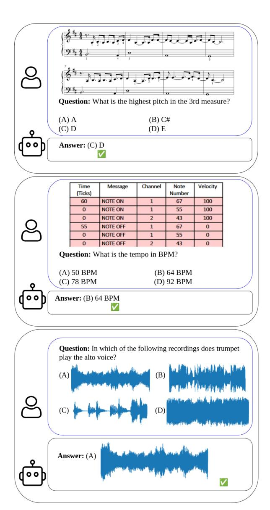
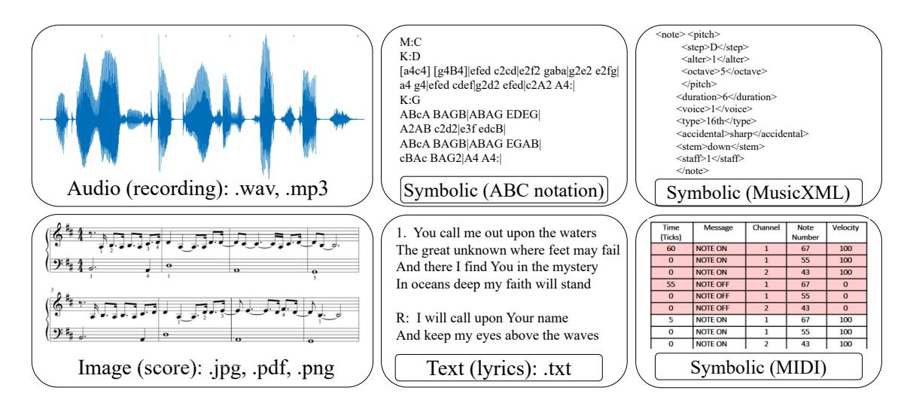

# Thesis Proposal: Multimodal Benchmark for Music Understanding in Large Language Models

Tomáš Sourada

Charles University, Faculty of Mathematics and Physics Institute of Formal and Applied Linguistics Prague, Czech Republic sourada@ufal.mff.cuni.cz

# Abstract

Music is a universal cultural practice that influences emotion, ritual and creativity, and it is now represented in many digital modalities: audio recordings, symbolic encodings (MIDI, MusicXML, ABC), visual scores and lyrics. Multimodal Large Language Models (MLLMs) have the ambition to process "everything", including music, and therefore promise to support musical analysis, creation and education. Despite this promise, systematic methods for evaluating whether a MLLM understands music are missing. Existing music-focused benchmarks are fragmented, largely single-modality, Western-centric, and often do not require actual perception of the musical content; methodological details such as prompt design and answer-extraction are frequently omitted or not discussed, and some evaluations rely on proprietary LLMs, hindering reproducibility and raising concerns about test-data leakage. To fill this gap, this dissertation proposes to design a musically multimodal benchmark built on a transparent, fully open evaluation pipeline. The benchmark will present closed-question-answer items across four musical modalities, employ carefully engineered distractor options to enforce genuine perceptual engagement, and follow rigorously documented prompt-selection and answer-extraction procedures. It will further incorporate culturally diverse musical material beyond the dominant Western canon. Guided by three research questions: (1) how to devise robust, reproducible evaluation procedures, (2) how current MLLMs perform across modalities, and (3) how model scores relate to human musical abilities; the benchmark will enable precise diagnosis of model limitations, inform the development of more musically aware AI systems, and provide a principled basis for assessing practical usefulness to musicians and other stakeholders in the creative industry.

Figure 1: Examples of potential benchmark questions, with different modalities of music to percept to: image of notation (top), symbolic MIDI (middle), audio recording (bottom). In the QA-pair in the bottom, multimodality is enhanced: both the correct and distractor options may take different modalities (here, audio). (Figure adapted from [Weck et al.](#page-11-0) [\(2024,](#page-11-0) fig. 1).)

## 1 Introduction

Language-modeling at scale is reshaping the creative landscape. Large language models (LLMs) already transform literature [\(Ivanova et al.,](#page-10-0) [2025\)](#page-10-0), visual arts [\(Fanelli et al.,](#page-10-1) [2025\)](#page-10-1), theatre [\(Horváth,](#page-10-2) [2025\)](#page-10-2), and music [\(Ma et al.,](#page-10-3) [2024\)](#page-10-3). Music pervades every culture [\(Mehr et al.,](#page-11-1) [2019\)](#page-11-1), influencing emotion, ritual [\(Small,](#page-11-2) [1999\)](#page-11-2) and creativity. Multimodal Large Language Models (MLLMs) now handle text, images, audio and other modalities in a shared representation [\(OpenAI et al.,](#page-11-3) [2024\)](#page-11-3). Their ambition to process "everything", including music [\(Liu et al.,](#page-10-4) [2024a,](#page-10-4)[b\)](#page-10-5), makes them promising for musical analysis, creation and education, yet systematic methods for assessing musical understanding are lacking [\(Ma et al.,](#page-10-3) [2024\)](#page-10-3).

Music can be represented in four digital modalities (see fig. [2\)](#page-2-0): (i) the audio modality stores the acoustic signal of a performance (e.g., .mp3, .wav); (ii) the image/visual modality captures the notated score as pictures conveying compositional intent (e.g., PDF, JPG, PNG; can be a scan of a handwritten/printed notation score, or just a rendered PDF of a score); (iii) the symbolic modality encodes abstract musical semantics, such as pitches, durations, and onsets of notes, in machine-readable formats (MIDI, MusicXML, ABC); (iv) the text modality (lyrics) adds semantics (.txt). True understanding requires accurate perception of each modality, grounding in musical knowledge, and cross-modal reasoning.

Current MLLMs are trained mainly on mainstream Western material and under-perform on other genres [\(Papaioannou et al.,](#page-11-4) [2025\)](#page-11-4). A number of music-focused benchmarks have appeared recently, but they are fragmented, largely audio-centric [\(Weck et al.,](#page-11-0) [2024;](#page-11-0) [Zang et al.,](#page-11-5) [2025;](#page-11-5) [Koh et al.,](#page-10-6) [2025\)](#page-10-6), Western-biased, and often allow models to succeed without genuine perception [\(Zang et al.,](#page-11-5) [2025\)](#page-11-5). Crucial details such as prompt selection and answer extraction are frequently omitted or hidden [\(Weck et al.,](#page-11-0) [2024;](#page-11-0) [Mundada et al.,](#page-11-6) [2025;](#page-11-6) [Yuan et al.,](#page-11-7) [2024\)](#page-11-7), and some rely on proprietary LLMs, raising reproducibility and fairness concerns [\(Lin et al.,](#page-10-7) [2025;](#page-10-7) [Dai et al.,](#page-9-0) [2025\)](#page-9-0). Thus, no open-source, musically cross-modal benchmark currently offers a robust, reproducible assessment of music understanding in MLLMs.

This dissertation aims to design a systematic, multimodal music benchmark by (i) posing questions across the four modalities, (ii) enforcing gen-

uine perception with difficult distractors [\(Zang](#page-11-5) [et al.,](#page-11-5) [2025\)](#page-11-5), (iii) providing an open, reproducible evaluation protocol free of proprietary components [\(Yue et al.,](#page-11-8) [2024\)](#page-11-8), and (iv) incorporating diverse, non-Western material. The work is guided by three research questions: (1) robust evaluation procedures, (2) capabilities and limits of state-of-the-art MLLMs across modalities, and (3) the link between model performance and human musical abilities.

Stakeholders, including researchers, developers, industry, and musicians, will gain a tool for systematic capability analysis, task feasibility assessment, and realistic expectation setting, advancing transparent and fair AI research.

The proposal proceeds as follows: Section [2](#page-1-0) reviews definitions and benchmarks; Section [3](#page-3-0) outlines shortcomings in current benchmarks; Section [4](#page-5-0) presents research questions and goals; Section [5](#page-5-1) details the proposed approach; Section [6](#page-7-0) summarizes contributions.

# 2 Background and Related Work

## 2.1 Definitions

We use the term *music understanding* to denote the ability to answer questions and solve tasks that require perceiving musical information from one or more modalities (e.g., audio, symbolic notation, text, or visual cues), leveraging musical facts and conventions (knowledge), and drawing structural or relational inferences (reasoning) across one or more modalities.

Music perception refers to extracting salient musical features from the input modality, such as pitch, timbre, rhythm, melody, and texture. Music knowledge denotes the accumulated understanding of musical commonsense, including music theory, historical and cultural context, stylistic conventions, and instrument characteristics. Music reasoning is the capacity to infer latent and relational musical elements, such as harmony, key, meter, form, and stylistic progression, that are not explicitly annotated but are essential for understanding a piece's structure, themes, and expressive intent [\(Yuan et al.,](#page-11-7) [2024\)](#page-11-7). Together, these components enable coherent analysis, interpretation, and explanation of music, such as is necessary for communication among musicians to rehearse and perform together.

# 2.2 Existing MLLMs

Figure 2: Different modalities of music: audio, image, text, and symbolic (with three example sub-modalities, ABC, MusicXML, and MIDI).

[Anthropic,](#page-9-1) [2025;](#page-9-1) [Comanici et al.,](#page-9-2) [2025\)](#page-9-2), yet the authors usually do not measure the musical abilities of the models. Even in the musical domain specifically, there is a trend towards models that are more general and more multimodal (see table [1\)](#page-8-0). However, even those claiming to be modality-agnostic [\(Liu et al.,](#page-10-4) [2024a](#page-10-4)[,b\)](#page-10-5) are not evaluated in all the modalities of music — the evaluation mostly focuses on the audio representation. Focusing only on audio neglects the particular needs and use-cases of musicians that AI is supposed to help, undermining the claim that these models truly support human creative expression.

# 2.3 Existing benchmarks

Until recently, most benchmarks for music understanding were created ad-hoc, along with papers introducing new (M)LLMs, to show the superiority of their performance [\(Liu et al.,](#page-10-8) [2023;](#page-10-8) [Yuan](#page-11-7) [et al.,](#page-11-7) [2024;](#page-11-7) [Deng et al.,](#page-9-3) [2024\)](#page-9-3), leading to inconsistent comparisons between models, since every new model was evaluated on a different benchmark.

In recent years (2024-2025), dedicated benchmarks for evaluating music understanding have begun to appear, with the vast majority testing (M)LLMs via question answering (QA) [\(Weck](#page-11-0) [et al.,](#page-11-0) [2024;](#page-11-0) [Zang et al.,](#page-11-5) [2025;](#page-11-5) [Koh et al.,](#page-10-6) [2025;](#page-10-6) [Dai et al.,](#page-9-0) [2025;](#page-9-0) [Mundada et al.,](#page-11-6) [2025;](#page-11-6) [Chen et al.,](#page-9-4) [2025;](#page-9-4) [Wang et al.,](#page-11-9) [2025;](#page-11-9) [Zhao et al.,](#page-12-0) [2025\)](#page-12-0), with closed QA (also called multiple-choice) being dominant. In closed QA [\(Weck et al.,](#page-11-0) [2024;](#page-11-0) [Zang et al.,](#page-11-5) [2025;](#page-11-5) [Mundada et al.,](#page-11-6) [2025;](#page-11-6) [Wang et al.,](#page-11-9) [2025;](#page-11-9) [Zhao et al.,](#page-12-0) [2025\)](#page-12-0), the model is provided with a

question and set of options (one correct options along with distractor answers), and is tasked to select the correct one.[1](#page-2-1) On the other hand, in openended QA [\(Chen et al.,](#page-9-4) [2025;](#page-9-4) [Dai et al.,](#page-9-0) [2025\)](#page-9-0), the model is prompted with a question. Its response is then evaluated against the ground truth either based on a string-matching metric [\(Chen et al.,](#page-9-4) [2025\)](#page-9-4), which may prefer incorrect yet semantically similar answer [\(Lin et al.,](#page-10-7) [2025\)](#page-10-7), or using an external LLM-as-a-Judge [\(Zheng et al.,](#page-12-1) [2023\)](#page-12-1), used e.g. by [Dai et al.](#page-9-0) [\(2025\)](#page-9-0). Music is also included as one of the tested subjects in more general benchmarks [\(Yue et al.,](#page-11-8) [2024,](#page-11-8) [2025;](#page-11-10) [Li et al.,](#page-10-9) [2025b\)](#page-10-9).

Most of the benchmarks assess music understanding in a single modality of music: audio [\(Weck et al.,](#page-11-0) [2024;](#page-11-0) [Zang et al.,](#page-11-5) [2025;](#page-11-5) [Koh et al.,](#page-10-6) [2025;](#page-10-6) [Lin et al.,](#page-10-7) [2025\)](#page-10-7), visual notation (PDF/JPG of a score) [\(Mundada et al.,](#page-11-6) [2025;](#page-11-6) [Chen et al.,](#page-9-4) [2025;](#page-9-4) [Yue et al.,](#page-11-8) [2024,](#page-11-8) [2025\)](#page-11-10),[2](#page-2-2) or symbolic representation: specifically ABC notation [\(Yuan et al.,](#page-11-7) [2024;](#page-11-7) [Zhao et al.,](#page-12-0) [2025\)](#page-12-0) or across multiple symbolic formats (ABC, Humdrum, MEI, MusicXML) [\(Pond](#page-11-11) [and Fujinaga,](#page-11-11) [2025\)](#page-11-11).

Most recently, there have been a few evaluations covering two modalities: [Wang et al.](#page-11-9) [\(2025\)](#page-11-9); [Dai](#page-9-0) [et al.](#page-9-0) [\(2025\)](#page-9-0) benchmark jointly understanding in the symbolic representation (ABC notation) and the visual notation scores; [Carone et al.](#page-9-5) [\(2025\)](#page-9-5)

1This allows simple and explainable comparisons using accuracy.

2We include [Chen et al.](#page-9-4) [\(2025\)](#page-9-4) as a single-modality benchmark, although they release both visual and MIDI data, because in their evaluation of LLMs they report only performance on the visual notation data.

attempts to evaluate jointly across audio and symbolic (MIDI).[3](#page-3-1)

To the best of our knowledge, there is currently no open-source benchmark that would evaluate MLLMs on more than two musical modalities.

We discuss the benchmarks (and specifically their issues) in section [3.](#page-3-0)

## 3 Issues in Existing Benchmarks

As we discuss in section [2.3,](#page-2-3) recently, various benchmarks and evaluations of music understanding in MLLMs have been released.

However, there are several issues that make comparative evaluation difficult. Most of the issues are not music specific and apply to any closed-QA benchmark evaluating LLMs. Therefore, the potential techniques to mitigate the issues sometimes come from general (not music-specific) benchmarks.

## 3.1 Prompt Selection

Benchmarks rarely discuss or release prompts [\(Weck et al.,](#page-11-0) [2024;](#page-11-0) [Mundada et al.,](#page-11-6) [2025;](#page-11-6) [Chen](#page-9-4) [et al.,](#page-9-4) [2025;](#page-9-4) [Yuan et al.,](#page-11-7) [2024;](#page-11-7) [Dai et al.,](#page-9-0) [2025\)](#page-9-0); when provided, they often appear only in code without paper or README references (e.g., [\(Mundada](#page-11-6) [et al.,](#page-11-6) [2025\)](#page-11-6)), forcing guesswork, especially when each model uses a distinct prompt [\(Mundada et al.,](#page-11-6) [2025;](#page-11-6) [Chen et al.,](#page-9-4) [2025\)](#page-9-4). Outside of the field of music-specific benchmarks, [Agrawal et al.](#page-9-6) [\(2024,](#page-9-6) Table 4) show that naive prompting can markedly degrade performance, making careful prompt selection essential.

### 3.2 Extraction of the Actual Answer from Model Response

In closed-QA (e.g., options A–D) one must map the model's full response (the string returned, possibly with prefatory text) to the intended answer (the chosen option). Prompting the model to output a fixed format (e.g., "Final answer: <answer>" or "Respond only with the option letter (<valid\_letters>)") often fails; [Agrawal et al.](#page-9-6) [\(2024,](#page-9-6) Sec. 4.2, App. D) show that models may ignore even highly specific instructions.

Benchmarks frequently omit or do not release their extraction procedures [\(Weck et al.,](#page-11-0) [2024;](#page-11-0) [Mundada et al.,](#page-11-6) [2025\)](#page-11-6) and, when described, employ heterogeneous methods: [Wang et al.](#page-11-9) [\(2025\)](#page-11-9) uses

the external tool MathVerify,[4](#page-3-2) [Weck et al.](#page-11-0) [\(2024\)](#page-11-0) relies on a custom script[5](#page-3-3) without discussing its quality, [Mundada et al.](#page-11-6) [\(2025\)](#page-11-6) uses custom parsers, different for each model[6](#page-3-4) (e.g., searching for a solitary A–F surrounded by spaces), and [Lin et al.](#page-10-7) [\(2025\)](#page-10-7) extracts answers with a proprietary LLM (GPT-4o-mini), compromising reproducibility (see section [3.4\)](#page-4-0).

These inconsistent pipelines risk mis-labeling correct answers as incorrect (and vice-versa). In contrast, MMMU [\(Yue et al.,](#page-11-8) [2024\)](#page-11-8), a general benchmark with 3.2% of QA pairs on music, provide a concrete, reproducible approach: they "*construct robust regular expressions and develop response-processing workflows (...) to extract key phrases, such as numbers and conclusion phrases, from the long responses for accurate answer matching*" [\(Yue et al.,](#page-11-8) [2024,](#page-11-8) pp. 6). Their method has been adopted by subsequent general benchmarks: MMMU-Pro [\(Yue et al.,](#page-11-10) [2025\)](#page-11-10) and OmniBench [\(Li](#page-10-9) [et al.,](#page-10-9) [2025b\)](#page-10-9), both with a portion of music-specific questions.

### 3.3 Perception of Musical Content Not Required

As noted by [Zang et al.](#page-11-5) [\(2025\)](#page-11-5) and [Yue et al.](#page-11-10) [\(2025\)](#page-11-10), some closed QA benchmarks (e.g., MuChoMusic [\(Weck et al.,](#page-11-0) [2024\)](#page-11-0)) and benchmark questions (MMMU [\(Yue et al.,](#page-11-8) [2024\)](#page-11-8)) can be answered without perceiving the musical content (audio, image of notation), relying only on reasoning about the answer and options (see [Zang et al.](#page-11-5) [\(2025,](#page-11-5) appendix A)). [Zang et al.](#page-11-5) [\(2025,](#page-11-5) Figure 1) showed that a text-only LLM attains 56% accuracy on Mu-ChoMusic, far above the 25% random baseline, highlighting a serious issue. We anticipate a similar problem in OmniBench [\(Li et al.,](#page-10-9) [2025b\)](#page-10-9), where annotators were instructed merely to add at least one misleading wrong answer, which may be insufficient. To address this, [Yue et al.](#page-11-10) [\(2025\)](#page-11-10) propose filtering out questions solvable by text-only LLMs, while [Zang et al.](#page-11-5) [\(2025\)](#page-11-5) introduce a systematic method for generating distractors that are as likely as the correct answer. Conversely, [Mundada et al.](#page-11-6) [\(2025,](#page-11-6) Section 4.2) argue that "*synthetically difficult benchmarks that force multi-modal perception to succeed [\(Zang et al.,](#page-11-5) [2025\)](#page-11-5) (...) may not reflect the real distribution of questions, where perception may not always be necessary*." Nevertheless,

3 yet they do not release the evaluation data at all, which makes the contribution rather poor

4 <https://github.com/huggingface/Math-Verify> 5 see [MuChoMusic GitHub](https://github.com/mulab-mir/muchomusic/blob/d3c9a423d006c545b86472c0c1cfacce7058cfc5/muchomusic_eval/scoring.py#L6)

6E.g., for [Phi,](https://github.com/GaganVM/WildScore/blob/24025c4a5876faa1ccae0b706606462abb50b24a/phi.py#L45) [Qwen,](https://github.com/GaganVM/WildScore/blob/24025c4a5876faa1ccae0b706606462abb50b24a/qwen.py#L96) [InternVLM](https://github.com/GaganVM/WildScore/blob/24025c4a5876faa1ccae0b706606462abb50b24a/internvlm.py#L100)

we maintain that benchmarks must test genuine musical-content understanding, not merely reasoning without perception, even if they diverge from real-world question distributions.

In the field of benchmarking general vision-LLMs, several techniques have been suggested to mitigate the issue of not perceiving the image: [Li](#page-10-10) [et al.](#page-10-10) [\(2025a\)](#page-10-10) adopt a vision-centric approach by linking every question with two contrasting images that yield different gold answers, [Chen et al.](#page-9-7) [\(2024\)](#page-9-7) manually select vision-indispensable questions, [Huang et al.](#page-10-11) [\(2025\)](#page-10-11) manually augment each original question with a corresponding perception question and a knowledge anchor question, in order to distinguish true perception and reasoning from guess-work. Although these methods could be transferred to music-related benchmarks, they usually require a substantial amount of manual labor.

## 3.4 Using Proprietary LLM in Evaluation

Several benchmarks employ proprietary (closed-source) LLMs either to extract answers [\(Lin et al.,](#page-10-7) [2025\)](#page-10-7) (see section [3.2\)](#page-3-5) or as evaluators [\(Dai et al.,](#page-9-0) [2025;](#page-9-0) [Chen et al.,](#page-9-4) [2025\)](#page-9-4) via LLM-as-a-Judge [\(Zheng et al.,](#page-12-1) [2023\)](#page-12-1). This raises four concerns:

- Irreproducibility: the model is closed-source and future versions may differ.
- Costly evaluation: no matter how much computational time/power/money is needed to run the evaluated model itself.
- Fairness: using the same model as both system and evaluator [\(Dai et al.,](#page-9-0) [2025;](#page-9-0) [Chen et al.,](#page-9-4) [2025\)](#page-9-4) can bias results.
- Test-data leakage: gold labels supplied to a closed evaluator may be incorporated into future models [\(Balloccu et al.,](#page-9-8) [2024\)](#page-9-8).

The MMMU benchmark [\(Yue et al.,](#page-11-8) [2024\)](#page-11-8) illustrates a mitigation strategy for the problem of test data leakage: it provides a few-shot development set, a fully labeled validation set, and a test set without gold labels. Test submissions are evaluated by uploading predictions to a dedicated web platform.[7](#page-4-1)

## 3.5 Other Issues/Troubles

In addition to the concerns above, the benchmarks exhibit several further problems:

Missing explainable baselines Random guessing is a relevant baseline for closed-QA, yet many works omit it [\(Wang et al.,](#page-11-9) [2025;](#page-11-9) [Carone et al.,](#page-9-5) [2025;](#page-9-5) [Mundada et al.,](#page-11-6) [2025\)](#page-11-6). It can be computed from the number of answer options, which varies across benchmarks (e.g., MMMU has 4 options, MMMU-Pro 10 [\(Yue et al.,](#page-11-8) [2024,](#page-11-8) [2025\)](#page-11-10)) and sometimes within a single benchmark [\(Mundada et al.,](#page-11-6) [2025,](#page-11-6) cf. Fig. 1 and Appendix B). The omission is especially problematic when the number of options per question is not reported, as in [\(Mundada et al.,](#page-11-6) [2025\)](#page-11-6).

Missing statistical significance tests Most benchmarks do not report statistical tests to measure whether performance differences are significant [\(Yuan et al.,](#page-11-7) [2024;](#page-11-7) [Yue et al.,](#page-11-8) [2024;](#page-11-8) [Wang et al.,](#page-11-9) [2025;](#page-11-9) [Mundada et al.,](#page-11-6) [2025;](#page-11-6) [Pond and Fujinaga,](#page-11-11) [2025\)](#page-11-11).[8](#page-4-2) This is especially an issue in benchmarks that are rather small [\(Yuan et al.,](#page-11-7) [2024;](#page-11-7) [Pond and](#page-11-11) [Fujinaga,](#page-11-11) [2025\)](#page-11-11).

Trade-off between quantity and quality Benchmarks differ markedly in quality versus quantity. Curated, human-written QA sets are small (e.g., [Pond and Fujinaga](#page-11-11) [\(2025\)](#page-11-11) with 9 questions, MusicTheoryBench with 372 QAs [\(Yuan et al.,](#page-11-7) [2024\)](#page-11-7)), while automatically generated sets are larger (MuChoMusic 1,187 QAs [\(Weck et al.,](#page-11-0) [2024\)](#page-11-0), SSMR-Bench 1,600 QAs [\(Wang et al.,](#page-11-9) [2025\)](#page-11-9)) and synthetic musical data can yield very large benchmarks (MusiXQA 130k QAs [\(Chen](#page-9-4) [et al.,](#page-9-4) [2025\)](#page-9-4)). Manual creation ensures validity and relevance; synthetic approaches enable scalability but require validation to confirm the benchmark measures the intended abilities.

Missing comparison to human performance As benchmarks serve primarily comparing different models, reporting human performance cannot be required. However, some benchmarks include it [\(Yue et al.,](#page-11-8) [2024;](#page-11-8) [Li et al.,](#page-10-9) [2025b\)](#page-10-9), making the actual numbers more informative.

7 [https://eval.ai/web/challenges/challenge-pag](https://eval.ai/web/challenges/challenge-page/2179/overview) [e/2179/overview](https://eval.ai/web/challenges/challenge-page/2179/overview)

8We cannot confirm statistical tests were used; the authors say "significant" but never "statistically significant" and provide no test settings.

## 4 Aims and Research Questions

The objective of the dissertation thesis is to design and develop a systematic benchmark for evaluating Multimodal Large Language Models (MLLMs) in the domain of music understanding.[9](#page-5-2)

This inherently involves different modalities of music: audio (recording), machine readable symbolic encodings (MIDI, MusicXML, ABC notation), visual notation (scan of a handwritten/printed notation score, or just a rendered PDF of a score), and text (lyrics) (see fig. [2\)](#page-2-0). [10](#page-5-3)

The project aims to address the following research questions:

## RQ1 - evaluation procedures:

- RQ1.1 How to evaluate MLLMs in a challenging, robust, fully open, reproducible, fair, methodologically sound, broadly applicable, and leak-free manner?
- RQ1.2 How to evaluate models consistently across different modalities of music? (visual, audio, symbolic, text)

In terms of deliverables, it means designing and creating a benchmark that would be cross-modal, robust and challenging (requiring genuine musical perception), musically diverse, broadly applicable to prompting-based MLLMs, reproducible and fair (standardised prompts and answer-extraction; see sections [3.1](#page-3-6) and [3.2\)](#page-3-5), fully open, and free of test-data leakage. The full checklist of ideal properties formulated based on the identified issues (section [3\)](#page-3-0) is in appendix [A.](#page-12-2)

## RQ2 - musical understanding:

- RQ2.1 How well do current MLLMs understand music in different modalities?
- RQ2.2 Are performance gaps due primarily to modality-specific processing or to deeper conceptual limitations that affect understanding across all modalities?

As we define in section [2.1,](#page-1-1) we use *music understanding* to denote the ability to solve tasks that require perception to musical material across one or more modalities, applying musical facts

and conventions (knowledge), and making structural or relational inferences (reasoning). The suggested benchmark is explicitly behavioral: it should measure task performance and failure modes from observable outputs, without attributing those outcomes to any particular internal representation.

Corresponding research output is an assessment of current state-of-the-art MLLMs (both opensource and proprietary) on the benchmark to measure performance across modalities, providing the first fully cross-modal comparison of existing models in the domain of music understanding. The completed benchmark should enable investigations such as "Does model A understand a piece better in modality X or Y?", "In modality X, which model (A, B, C) performs best?", "Can model A generalize across cultural contexts, and does this vary by modality?"

## RQ3 - actual usefulness for humans:

- RQ3.1 What is the relationship between quantitative model scores and human music-understanding abilities?
- RQ3.2 How do objective measures relate (or fail to relate) to practical usefulness for different users?

Deliverables include validation of the benchmark with musicians from varied cultural backgrounds, measurement of human accuracy on the tasks, and assessment of user satisfaction with the best-performing models.

# 5 Proposed Methodology

Benchmark methodology In order to be broadly useful for various MLLMs with prompting interfaces, support reproducible evaluation with an explainable metric (accuracy), and enable controlled experimental design, the benchmark will adopt the standard closed-question answering paradigm [\(Weck et al.,](#page-11-0) [2024\)](#page-11-0) (see fig. [1\)](#page-0-0).

We acknowledge that closed QA has drawbacks: models may rely on easy-to-detect spectral cues rather than true musical understanding [\(Carone](#page-9-5) [et al.,](#page-9-5) [2025\)](#page-9-5). Nevertheless it remains a common, fully automatic, and interpretable evaluation method, whereas open-ended QA suffers from unreliable metrics [\(Lin et al.,](#page-10-7) [2025\)](#page-10-7). Accordingly, closed QA is preferable, despite mainly testing answer selection over deep comprehension. To partially mitigate this issue, we plan to include a "none of the above" option [\(Raman et al.,](#page-11-12) [2025\)](#page-11-12).

9We delimit the scope intentionally to music understanding only, completely omitting music generation.

10Images of instruments or video are not considered, although extensions are possible [\(Liu et al.,](#page-10-5) [2024b\)](#page-10-5).

If, in subsequent research, the community establishes standardized and reliable metrics for the open-ended assessment of LLMs, the benchmark may incorporate an additional, expert-annotated open-ended test set. The inclusion of such a subset should serve to alleviate the inherent limitations of exclusively closed QA evaluation protocols, thereby providing a more comprehensive picture of model performance.

## 5.1 Benchmark Design and Development

Data preparation and multimodal alignment. Data will be collected from existing open-source multimodal musical datasets such as OpenScore [\(Gotham and Jonas,](#page-10-12) [2025\)](#page-10-12) (MIDI scores, MusicXML, synthetic MP3, lyrics, rendered PDFs), MAESTRO [\(Hawthorne et al.,](#page-10-13) [2018\)](#page-10-13) (audio, MIDI performance), ASAP [\(Foscarin et al.,](#page-10-14) [2020\)](#page-10-14) (audio, MIDI score and performance, MusicXML), and others to be added in later stages. The data will be harmonized and aligned across modalities [\(Jung et al.,](#page-10-15) [2025\)](#page-10-15), including automatic conversion of missing modalities. For example, MusicXML can be rendered to PDF/image or synthesized with Smashcima [\(Mayer et al.,](#page-11-13) [2025\)](#page-11-13) for realistic handwritten notation.

QA creation methodology. To generate QA pairs we will combine existing approaches: Mu-ChoMusic [\(Weck et al.,](#page-11-0) [2024\)](#page-11-0) (LLM-based generation for metadata/caption datasets) and the template-driven methods of SSMR-Bench [\(Wang](#page-11-9) [et al.,](#page-11-9) [2025\)](#page-11-9) and MusiXQA [\(Chen et al.,](#page-9-4) [2025\)](#page-9-4), which cover broader data types. To ensure the questions require true musical perception and are challenging, we will use RUListening methodology [\(Zang et al.,](#page-11-5) [2025\)](#page-11-5) to create hard distractors. The pipeline will be extended to a multimodal setting (where the same musical piece is represented across different modalities, thus enabling crossmodal comparability of model performance), permitting multimodal answer options (correct and distractors may be in different modalities; see fig. [1,](#page-0-0) bottom), similarly to some MMMU questions[11](#page-6-0) [\(Yue et al.,](#page-11-8) [2024\)](#page-11-8).

Evaluation methodology. We are going to further inspect existing techniques of designing prompts for closed QA benchmarks (see section [3.1\)](#page-3-6) and the extraction methods for extracting

the answer from model response (see section [3.2\)](#page-3-5), in order to select/design a standardized, methodologically correct procedure. (A plausible candidate is the method introduced in MMMU [\(Yue](#page-11-8) [et al.,](#page-11-8) [2024\)](#page-11-8), as discussed in section [3.2.](#page-3-5))

Diversity of Questions In order to make the benchmark robust, we will include questions of different difficulty and divide them into corresponding levels (e.g. very easy, easy, medium, and hard), similarly to MMMU [\(Yue et al.,](#page-11-8) [2024\)](#page-11-8). We will also include a wider range of questions in terms of coverage of music understanding abilites, from symbolic questions ("What is the lowest pitch in the 4th measure?") to musically more interesting questions ("Select the most suitable key for the following musical score.", "What chords would be appropriate to harmonize the melody shown in the provided image?"), and provide a systematic taxonomy integrating high-level and highly specific musicological ontologies [\(Weck et al.,](#page-11-0) [2024,](#page-11-0) fig. 2), so that the benchmark can be used in various evaluation scenarios.

Diversity of Musical Data To avoid cultural bias and improve generalizability, later stages of the benchmark will include data from diverse musical practices (e.g., folk music, improvised music (jazz, *basso continuo*[12](#page-6-1)), Gregorian chant, brass orchestra, symphonic orchestra), using datasets such as ChoraleBricks [\(Balke et al.,](#page-9-9) [2025\)](#page-9-9) (multitrack audio, sheets, time-aligned symbolic), Polyphony Project [\(Both et al.,](#page-9-10) [2025\)](#page-9-10) (Ukrainian folk music, multitrack audio, lyrics), PiJAMA [\(Edwards et al.,](#page-10-16) [2023\)](#page-10-16) (jazz audio + MIDI), and ACoRD [\(Štefunko](#page-12-3) [et al.,](#page-12-3) [2025\)](#page-12-3) (basso continuo MIDI + MusicXML).

This will enable evaluation of MLLMs on culturally diverse material, assessing how well models generalize beyond the dominant Western classical and popular music datasets.

Benchmark release. The above components will be connected into a reproducible, open-source workflow. The benchmark will be released in stages, beginning with Western classical datasets and later expanding to musically diverse material. Along with the benchmark, all details, design decisions, and evaluation protocol will be released. In order to prevent from data leakage and from over-evaluating on the test set, we plan to divide the benchmark into validation part (fully open) and test part (gold labels not released, with evaluation

11e.g., questions with IDs 6, 25, 34, 48, 50, 52, accessible here: [https://huggingface.co/datasets/MMMU/MMMU/vi](https://huggingface.co/datasets/MMMU/MMMU/viewer/Music/test?views%5B%5D=music_test) [ewer/Music/test?views%5B%5D=music\\_test](https://huggingface.co/datasets/MMMU/MMMU/viewer/Music/test?views%5B%5D=music_test)

12[https://en.wikipedia.org/wiki/Basso\\_continuo](https://en.wikipedia.org/wiki/Basso_continuo)

performed by uploading the predictions to a designated page[13](#page-7-1)), similarly to MMMU [\(Yue et al.,](#page-11-8) [2024\)](#page-11-8).

## 5.2 Model Evaluation

Selected MLLMs (see table [1](#page-8-0) for examples) will be evaluated on the benchmark, compared to random baseline and ideally to other reasonable baselines, and to human performance (see section [5.4\)](#page-7-2). The focus will be on models that can process at least two musical modalities (from audio, symbolic, image, and text) and support the QA interface, specifically to models claiming musical capabilities, or the most general models (GPT). Model performance will be compared across modalities and statistical significance tests will be computed.

### 5.3 Synthetic Methods and On-Demand Benchmark Generation

In order to allow higher scalability of the benchmark, we will try to integrate existing methods for generating synthetic musical data (e.g., MusiXQA [\(Chen et al.,](#page-9-4) [2025\)](#page-9-4) for generating musically realistic yet random notation sheets, Smashcima framework [\(Mayer et al.,](#page-11-14) [2024\)](#page-11-14) for automatic rendering handwritten-like score images from MusicXML; [\(Kim et al.,](#page-10-17) [2025\)](#page-10-17) for producing realistic audio from MusicXML, into a pipeline that would produce a fully synthetic component of our multimodal benchmark.

While performance on synthetic data is generally not directly comparable to that on real data, these approaches may allow controlled experiments on learning and interpretability without the confounds of real-world data leakage [\(Balloccu et al.,](#page-9-8) [2024\)](#page-9-8).

Synthetic data generation methods could be further extended into an automated process for on-demand benchmark creation, tailored to userprovided data. Such an approach would enable rapid adaptation of the benchmark to align with the particular domain of interest for each user.

### 5.4 Benchmark Validation with Human Musicians

A crucial component is manual assessment of the benchmark difficulty with real musicians. Participants from the same cultural contexts as the datasets will answer a representative subset of benchmark questions and interact with the

best-performing models. This study will address the RQ3 as stated in section [4.](#page-5-4)

The study will include both a quantitative part (structured survey) and a qualitative part (controlled experiments and interviews), with focus on the qualitative part.[14](#page-7-3)

### 5.5 Towards Modality-Agnostic Music Representations

Analyses will test whether differences in model performance arise from modality-specific processing issues or from deeper conceptual limitations in musical understanding. Insights from these analyses will inform exploratory work on pan-modal representations capable of bridging symbolic, visual, and audio modalities of music, which as been recently identified as a "grand challenge" [\(Chin](#page-9-11) [and Xia,](#page-9-11) [2025\)](#page-9-11). This could enable data-efficient in-context learning and fine-tuning strategies. The methodology for this stage remains exploratory and will adapt based on empirical findings.

## 5.6 Open for Collaboration

We invite scholars to collaborate, whether by sharing their expertise, contributing private datasets, or helping validate the benchmark as human musicians. Incorporating additional datasets (potentially from different musical traditions) would enable more robust evaluation.

## 6 Conclusion

The rapid emergence of multimodal large language models (MLLMs) has outstripped systematic assessment of their musical abilities. Existing work often ignores music-specific tests or evaluates only a single modality (typically audio), overlooking how musicians engage with audio, notation, symbolic formats, and lyrics. Current benchmarks also suffer from undocumented methodology, perception-free questions, and reliance on proprietary LLMs that hinder reproducibility and risk data leakage. This dissertation proposes an open, fully cross-modal benchmark covering audio, symbolic (MIDI, MusicXML, ABC), visual notation, and lyrics. It will enforce genuine musical perception, employ robust prompting and extraction pipelines, and culturally diverse data, and will be validated with human musicians to link quantitative scores to real-world usefulness

13see [https://eval.ai/web/challenges/challenge-p](https://eval.ai/web/challenges/challenge-page/2179/overview) [age/2179/overview](https://eval.ai/web/challenges/challenge-page/2179/overview) for an example

14The research will be conducted in collaboration with scholars from the humanities and social sciences.

| Model            |               |                |            |               | symbolic | image | audio | music | o-s | ready |
|------------------|---------------|----------------|------------|---------------|----------|-------|-------|-------|-----|-------|
| M 2 UGen         | (Liu          | et al., 2024a) |            |               | ✓        | * ✓   | * ✓   | ✓     | ✓   | ✗     |
| Llark            | (Gardner      | et al.,        | 2024)      |               | ✓        | * ✓   | * ✓   | ✓     | ✓   | ✗     |
| MuMuLlama        |               | (Liu et al.,   | 2024b)     |               | ✓        | * ✓   | * ✓   | ✓     | ✓   | ✗     |
| MusiLingo        | (Deng         | et al.,        | 2024)      |               | ✓        | * ✗   | ✓     | ✓     | ✓   | ✗     |
| ChatMusician     |               | (Yuan et       | al.,       | 2024)         | ABC      | ✗     | ✗     | ✓     | ✓   | ✓     |
| NotaGPT          | (Tang         | et al.,        | 2025)      |               | ABC      | ✓     | ✗     | ✓     | ✗ * | ✓     |
| Qwen3-omni       |               | (Xu et al.,    | 2025)      |               | ✓        | * ✓   | * ✓   | ✓     | o-w | ✓     |
| Qwen2-audio      |               | (Chu et        | al., 2024) |               | ✓        | * ✗   | ✓     | ✓     | o-w | ✓     |
| Music            | Flamingo      | (Ghosh         | et         | al., 2025)    | ✓        | * ✗   | ✓     | ✓     | ✗ * | ✓     |
| Audio            | Flamingo      | 3 (Goel        | et         | al., 2025)    | ✓        | * ✗   | ✓     | ✓     | ✓   | ✓     |
| Phi-4-Multimodal |               | (Microsoft     |            | et al., 2025) | ✓        | * ✓   | * ✓   | ✓     | ✗ * | ✓     |
| GPT-4o           | (OpenAI       | et al.,        | 2024)      |               | ✓        | * ✓   | * ✓   | * ✗   | ✗   | API   |
| Gemini2.5        | (Comanici     |                | et al.,    | 2025)         | ✓        | * ✓   | * ✓   | * ✗   | ✗   | API   |
| Claude           | 4 (Anthropic, |                | 2025)      |               | ✓        | * ✓   | * ✗   | ✗     | ✗   | API   |

Table 1: Multimodal LLMs that can process music (various modalities) and support QA. Text modality is omitted (all models handle text). The "music" column shows whether the authors claim music capability; ✓\* marks models that are technically able to process a given modality (e.g., MusicXML) but not explicitly claimed. o-s = open-source (✗\* means open-source expected but code not found, o-w (open-weight) = weights are released, training scripts not); ready = downloadable for direct use (API = usable only via API). ABC = symbolic-notation format.

(RQ3). The resulting resource will provide the first comprehensive, modality-spanning comparison of state-of-the-art MLLMs, enabling identification of modality-specific versus conceptual shortcomings and offering a reproducible assessment tool to guide more musically aware systems for education, analysis, and composition.

- Limitations The proposed study is bounded by several methodological constraints that may influence the scope and interpretability of its findings.
  - Human-validation pool The validity of the human-validation component (section [5.4\)](#page-7-2) rests on recruiting a sufficiently diverse group of musicians. Limited participation, especially from under-represented cultural and stylistic backgrounds, could restrict the generalizability of the comparative analysis between human judgments and model outputs.
  - Benchmark construction Assembling the benchmark requires integrating multiple multimodal music datasets that differ in annotation quality, format, and alignment across audio, symbolic, visual, and textual modalities. Such inconsistencies can introduce alignment errors, weakening internal validity and impeding precise cross-modal comparisons. More-
- Distractor generation and MLLM evaluation
  - Producing musically plausible yet incorrect distractors is a non-trivial engineering challenge; inadequately designed alternatives could diminish diagnostic precision or inadvertently inflate model scores. In addition, the absence of standardized or documented prompting interfaces for many state-of-the-art MLLMs hampers the deployment of a uniform evaluation pipeline. In some cases, essential models may be inaccessible because their APIs are undocumented or their computational demands exceed available resources, limiting the set of comparators and potentially biasing performance assessments.
- Closed-QA format Designing the benchmark as a closed-QA (multiple-choice) task constitutes a substantive limitation: correctly selecting the most probable option does not necessarily demonstrate true music understanding.

over, the ambition to cover a wide spectrum of musical traditions is tempered by the scarcity of openly available, high-quality datasets for non-Western or under-documented repertoires, which may limit the benchmark's representativeness.

- Narrow initial coverage The first releases will rely mainly on Western-centric datasets, which could reduce the benchmark's immediate relevance for a truly global understanding of music. These interrelated limitations should be kept in mind when interpreting the results and drawing broader conclusions from the benchmark. Ethical considerations The project will gather responses from human musicians. Prior to each data-collection session we will provide participants with an information sheet outlining the experiment's purpose, the data-collection procedures, how the data will be stored and used, and the compensation offered for their time. Participants will be asked to read this briefing and sign a consent form confirming their agreement. Signed consent will be obtained from every participant. The study poses no foreseeable risks beyond the normal opportunity cost of participants' time, which will be compensated accordingly. No personal identifying information will be collected or published. All experiments with human participants will be carried out with Institutional Review Board approval. Acknowledgments This work was supported by the project "Humancentred AI for a Sustainable and Adaptive Society" (reg. no.: CZ.02.01.01/00/23\_025/0008691), cofunded by the European Union, and partially by the SVV project number 260 821. References Pravesh Agrawal, Szymon Antoniak, Emma Bou Hanna, Baptiste Bout, Devendra Chaplot, Jessica Chudnovsky, Diogo Costa, Baudouin De Monicault, Saurabh Garg, Theophile Gervet, Soham Ghosh, Amélie Héliou, Paul Jacob, Albert Q. Jiang, Kartik Khandelwal, Timothée Lacroix, Guillaume Lample, Diego Las Casas, Thibaut Lavril, and 23 others. 2024. [Pixtral 12B.](https://doi.org/10.48550/arXiv.2410.07073) *arXiv preprint*. ArXiv:2410.07073 [cs]. Anthropic. 2025. [Introducing Claude 4 \ Anthropic.](https://www.anthropic.com/news/claude-4) Stefan Balke, Axel Berndt, and Meinard Müller. 2025. [ChoraleBricks: A Modular Multitrack Dataset for](https://doi.org/10.5334/tismir.252) [Wind Music Research.](https://doi.org/10.5334/tismir.252) *Transactions of the International Society for Music Information Retrieval (TISMIR)*. Simone Balloccu, Patrícia Schmidtová, Mateusz Lango, and Ondrej Dusek. 2024. [Leak, Cheat, Repeat:](https://doi.org/10.18653/v1/2024.eacl-long.5) tion for Computational Linguistics. Miklós Both, Myroslava Vertiuk, and Yurii Rybak. 2025. [Polyphony Project.](https://www.polyphonyproject.com/en/about) Brandon James Carone, Iran R. Roman, and Pablo Ripollés. 2025. [Evaluating Multimodal Large Lan](https://doi.org/10.48550/arXiv.2510.22455)[guage Models on Core Music Perception Tasks.](https://doi.org/10.48550/arXiv.2510.22455) *arXiv preprint*. ArXiv:2510.22455 [cs]. Jian Chen, Wenye Ma, Penghang Liu, Wei Wang, Tengwei Song, Ming Li, Chenguang Wang, Jiayu Qin, Ruiyi Zhang, and Changyou Chen. 2025. [MusiXQA:](https://doi.org/10.48550/arXiv.2506.23009) [Advancing Visual Music Understanding in Multi](https://doi.org/10.48550/arXiv.2506.23009)[modal Large Language Models.](https://doi.org/10.48550/arXiv.2506.23009) *arXiv preprint*. ArXiv:2506.23009 [cs]. Lin Chen, Jinsong Li, Xiaoyi Dong, Pan Zhang, Yuhang Zang, Zehui Chen, Haodong Duan, Jiaqi Wang, Yu Qiao, Dahua Lin, and Feng Zhao. 2024. [Are We on the Right Way for Evaluating](https://doi.org/10.48550/arXiv.2403.20330) [Large Vision-Language Models?](https://doi.org/10.48550/arXiv.2403.20330) *arXiv preprint*. ArXiv:2403.20330 [cs]. Daniel Chin and Gus Xia. 2025. [Language Model Map](https://doi.org/10.48550/arXiv.2503.00427)[ping in Multimodal Music Learning: A Grand Chal](https://doi.org/10.48550/arXiv.2503.00427)[lenge Proposal.](https://doi.org/10.48550/arXiv.2503.00427) ArXiv:2503.00427 [cs]. Yunfei Chu, Jin Xu, Qian Yang, Haojie Wei, Xipin Wei, Zhifang Guo, Yichong Leng, Yuanjun Lv, Jinzheng He, Junyang Lin, Chang Zhou, and Jingren Zhou. 2024. [Qwen2-Audio Technical Report.](https://doi.org/10.48550/arXiv.2407.10759) *arXiv preprint*. ArXiv:2407.10759 [eess]. Gheorghe Comanici, Eric Bieber, Mike Schaekermann, Ice Pasupat, Noveen Sachdeva, Inderjit Dhillon, Marcel Blistein, Ori Ram, Dan Zhang, Evan Rosen, Luke Marris, Sam Petulla, Colin Gaffney, Asaf Aharoni, Nathan Lintz, Tiago Cardal Pais, Henrik Jacobsson, Idan Szpektor, Nan-Jiang Jiang, and 3416 others. 2025. [Gemini 2.5: Pushing the Frontier with Ad](https://doi.org/10.48550/arXiv.2507.06261)[vanced Reasoning, Multimodality, Long Context,](https://doi.org/10.48550/arXiv.2507.06261) [and Next Generation Agentic Capabilities.](https://doi.org/10.48550/arXiv.2507.06261) *arXiv preprint*. ArXiv:2507.06261 [cs]. Congren Dai, Yue Yang, Krinos Li, Huichi Zhou, Shijie Liang, Zhang Bo, Enyang Liu, Ge Jin, Hongran An, Haosen Zhang, Peiyuan Jing, KinHei Lee, Zhenxuan Zhang, Xiaobing Li, and Maosong Sun. 2025. [Musical Score Understanding Benchmark:](https://doi.org/10.48550/arXiv.2511.20697) [Evaluating Large Language Models' Comprehen](https://doi.org/10.48550/arXiv.2511.20697)[sion of Complete Musical Scores.](https://doi.org/10.48550/arXiv.2511.20697) *arXiv preprint*. ArXiv:2511.20697 [cs]. Zihao Deng, Yinghao Ma, Yudong Liu, Rongchen Guo, Ge Zhang, Wenhu Chen, Wenhao Huang, and Emmanouil Benetos. 2024. [MusiLingo: Bridging Music](https://doi.org/10.48550/arXiv.2309.08730) [and Text with Pre-trained Language Models for Mu](https://doi.org/10.48550/arXiv.2309.08730)[sic Captioning and Query Response.](https://doi.org/10.48550/arXiv.2309.08730) *arXiv preprint*. ArXiv:2309.08730 [eess].

[Data Contamination and Evaluation Malpractices in](https://doi.org/10.18653/v1/2024.eacl-long.5) [Closed-Source LLMs.](https://doi.org/10.18653/v1/2024.eacl-long.5) In *Proceedings of the 18th Conference of the European Chapter of the Association for Computational Linguistics (Volume 1: Long Papers)*, pages 67–93, St. Julian's, Malta. AssociaDrew Edwards, Simon Dixon, and Emmanouil Benetos. 2023. [PiJAMA: Piano Jazz with Automatic MIDI](https://doi.org/10.5334/tismir.162) [Annotations.](https://doi.org/10.5334/tismir.162) *Transactions of the International Society for Music Information Retrieval*, 6(1). Nicola Fanelli, Gennaro Vessio, and Giovanna Castellano. 2025. [ArtSeek: Deep artwork understanding](https://doi.org/10.48550/arXiv.2507.21917) [via multimodal in-context reasoning and late inter](https://doi.org/10.48550/arXiv.2507.21917)[action retrieval.](https://doi.org/10.48550/arXiv.2507.21917) *arXiv preprint*. ArXiv:2507.21917 [cs]. Francesco Foscarin, Andrew McLeod, Philippe Rigaux, Florent Jacquemard, and Masahiko Sakai. 2020. [ASAP: A dataset of aligned scores and performances](https://doi.org/10.5281/zenodo.4245490) [for piano transcription.](https://doi.org/10.5281/zenodo.4245490) *International Society for Music Information Retrieval Conference (ISMIR 2020)*, pages 534–541. Josh Gardner, Simon Durand, Daniel Stoller, and Rachel M. Bittner. 2024. [LLark: A Multimodal](https://doi.org/10.48550/arXiv.2310.07160) [Instruction-Following Language Model for Music.](https://doi.org/10.48550/arXiv.2310.07160) *arXiv preprint*. ArXiv:2310.07160 [cs]. Sreyan Ghosh, Arushi Goel, Lasha Koroshinadze, Sang-gil Lee, Zhifeng Kong, Joao Felipe Santos, Ramani Duraiswami, Dinesh Manocha, Wei Ping, Mohammad Shoeybi, and Bryan Catanzaro. 2025. [Music Flamingo: Scaling Music Understand](https://doi.org/10.48550/arXiv.2511.10289)[ing in Audio Language Models.](https://doi.org/10.48550/arXiv.2511.10289) *arXiv preprint*. ArXiv:2511.10289 [eess]. Arushi Goel, Sreyan Ghosh, Jaehyeon Kim, Sonal Kumar, Zhifeng Kong, Sang-gil Lee, Chao-Han Huck Yang, Ramani Duraiswami, Dinesh Manocha, Rafael Valle, and Bryan Catanzaro. 2025. [Audio Flamingo](https://doi.org/10.48550/arXiv.2507.08128) [3: Advancing Audio Intelligence with Fully Open](https://doi.org/10.48550/arXiv.2507.08128) [Large Audio Language Models.](https://doi.org/10.48550/arXiv.2507.08128) *arXiv preprint*. ArXiv:2507.08128 [cs]. Mark Gotham and Peter Jonas. 2025. [Open-](https://doi.org/10.5281/zenodo.15450144)[Score/Lieder: OpenScore lieder corpus v3.](https://doi.org/10.5281/zenodo.15450144) Curtis Hawthorne, Andriy Stasyuk, Adam Roberts, Ian Simon, Cheng-Zhi Anna Huang, Sander Dieleman, Erich Elsen, Jesse Engel, and Douglas Eck. 2018. [Enabling Factorized Piano Music Modeling and Gen](https://openreview.net/forum?id=r1lYRjC9F7)[eration with the MAESTRO Dataset.](https://openreview.net/forum?id=r1lYRjC9F7) *International Conference on Learning Representations*. Dóra Horváth. 2025. [Curtain call for AI: Transform](https://doi.org/10.1016/j.sftr.2025.100747)[ing theatre through technology.](https://doi.org/10.1016/j.sftr.2025.100747) *Sustainable Futures*, 9:100747. Jinsheng Huang, Liang Chen, Taian Guo, Fu Zeng, Yusheng Zhao, Bohan Wu, Ye Yuan, Haozhe Zhao, Zhihui Guo, Yichi Zhang, Jingyang Yuan, Wei Ju, Luchen Liu, Tianyu Liu, Baobao Chang, and Ming Zhang. 2025. [MMEvalPro: Calibrating Multimodal](https://doi.org/10.48550/arXiv.2407.00468) [Benchmarks Towards Trustworthy and Efficient Eval](https://doi.org/10.48550/arXiv.2407.00468)[uation.](https://doi.org/10.48550/arXiv.2407.00468) *arXiv preprint*. ArXiv:2407.00468 [cs]. Anastasiia Ivanova, Natalia Fedorova, Sergei Tilga, and Ekaterina Artemova. 2025. [Voices of Freelance Pro](https://doi.org/10.48550/arXiv.2504.05008)[fessional Writers on AI: Limitations, Expectations,](https://doi.org/10.48550/arXiv.2504.05008) [and Fears.](https://doi.org/10.48550/arXiv.2504.05008) *arXiv preprint*. ArXiv:2504.05008 [cs]. Jongmin Jung, Dongmin Kim, Sihun Lee, Seola Cho, Hyungjoon Soh, Irmak Bukey, Chris Donahue, and Dasaem Jeong. 2025. [Unified Cross-modal Transla](https://doi.org/10.48550/arXiv.2505.12863)[tion of Score Images, Symbolic Music, and Perfor](https://doi.org/10.48550/arXiv.2505.12863)[mance Audio.](https://doi.org/10.48550/arXiv.2505.12863) *arXiv preprint*. ArXiv:2505.12863 [cs]. Minju Kim, Joonhyeon Bae, Eunsik Shin, and Kyogu Lee. 2025. [Synthetic Dataset Generation for String](https://doi.org/10.1109/ICASSP49660.2025.10887603) [Ensemble Separation.](https://doi.org/10.1109/ICASSP49660.2025.10887603) In *ICASSP 2025 - 2025 IEEE International Conference on Acoustics, Speech and Signal Processing (ICASSP)*, pages 1–5. Junyoung Koh, Soo Yong Kim, Yongwon Choi, and Gyu Hyeong Choi. 2025. [Jamendo-QA: A Large-](https://doi.org/10.48550/arXiv.2509.15662)[Scale Music Question Answering Dataset.](https://doi.org/10.48550/arXiv.2509.15662) *arXiv preprint*. ArXiv:2509.15662 [cs]. Baiqi Li, Zhiqiu Lin, Wenxuan Peng, Jean de Dieu Nyandwi, Daniel Jiang, Zixian Ma, Simran Khanuja, Ranjay Krishna, Graham Neubig, and Deva Ramanan. 2025a. [NaturalBench: Evaluating Vision-Language](https://doi.org/10.48550/arXiv.2410.14669) [Models on Natural Adversarial Samples.](https://doi.org/10.48550/arXiv.2410.14669) *arXiv preprint*. ArXiv:2410.14669 [cs]. Yizhi Li, Ge Zhang, Yinghao Ma, Ruibin Yuan, Kang Zhu, Hangyu Guo, Yiming Liang, Jiaheng Liu, Zekun Wang, Jian Yang, Siwei Wu, Xingwei Qu, Jinjie Shi, Xinyue Zhang, Zhenzhu Yang, Xiangzhou Wang, Zhaoxiang Zhang, Zachary Liu, Emmanouil Benetos, and 2 others. 2025b. [OmniBench: Towards The](https://doi.org/10.48550/arXiv.2409.15272) [Future of Universal Omni-Language Models.](https://doi.org/10.48550/arXiv.2409.15272) *arXiv preprint*. ArXiv:2409.15272 [cs]. Daniel Chenyu Lin, Michael Freeman, and John Thickstun. 2025. [Factual and Musical Evaluation Met](https://doi.org/10.48550/arXiv.2511.05550)[rics for Music Language Models.](https://doi.org/10.48550/arXiv.2511.05550) *arXiv preprint*. ArXiv:2511.05550 [cs]. Shansong Liu, Atin Sakkeer Hussain, Chenshuo Sun, and Ying Shan. 2023. [Music Understanding LLaMA:](https://doi.org/10.48550/arXiv.2308.11276) [Advancing Text-to-Music Generation with Ques](https://doi.org/10.48550/arXiv.2308.11276)[tion Answering and Captioning.](https://doi.org/10.48550/arXiv.2308.11276) *arXiv preprint*. ArXiv:2308.11276 [cs]. Shansong Liu, Atin Sakkeer Hussain, Qilong Wu, Chenshuo Sun, and Ying Shan. 2024a. [M\\$^{2}\\$UGen:](https://doi.org/10.48550/arXiv.2311.11255) [Multi-modal Music Understanding and Generation](https://doi.org/10.48550/arXiv.2311.11255) [with the Power of Large Language Models.](https://doi.org/10.48550/arXiv.2311.11255) *arXiv preprint*. ArXiv:2311.11255 [cs]. Shansong Liu, Atin Sakkeer Hussain, Qilong Wu, Chenshuo Sun, and Ying Shan. 2024b. [MuMu-](https://doi.org/10.48550/arXiv.2412.06660)[LLaMA: Multi-modal Music Understanding and](https://doi.org/10.48550/arXiv.2412.06660) [Generation via Large Language Models.](https://doi.org/10.48550/arXiv.2412.06660) *arXiv preprint*. ArXiv:2412.06660 [cs]. Yinghao Ma, Anders Øland, Anton Ragni, Bleiz Mac-Sen Del Sette, Charalampos Saitis, Chris Donahue, Chenghua Lin, Christos Plachouras, Emmanouil Benetos, Elona Shatri, Fabio Morreale, Ge Zhang, György Fazekas, Gus Xia, Huan Zhang, Ilaria Manco, Jiawen Huang, Julien Guinot, Liwei Lin, and 23 others. 2024. [Foundation Models for Music: A Survey.](https://doi.org/10.48550/arXiv.2408.14340) ArXiv:2408.14340 [cs].

Jiˇrí Mayer, Pavel Pecina, and Jan Hajic jr. 2024. ˇ [Smashcima \(2025-03-28\).](http://hdl.handle.net/11234/1-5878) LINDAT/CLARIAH-CZ digital library at the Institute of Formal and Applied Linguistics (ÚFAL). Jiˇrí Mayer, Pavel Pecina, and Jan Hajic. 2025. ˇ [Smashcima: Full-Page Handwritten Music Docu](https://doi.org/10.1145/3748336.3748380)[ment Synthesizer.](https://doi.org/10.1145/3748336.3748380) In *Proceedings of the 12th International Conference on Digital Libraries for Musicology*, DLfM '25, pages 119–123, New York, NY, USA. Association for Computing Machinery. Samuel A. Mehr, Manvir Singh, Dean Knox, Daniel M. Ketter, Daniel Pickens-Jones, S. Atwood, Christopher Lucas, Nori Jacoby, Alena A. Egner, Erin J. Hopkins, Rhea M. Howard, Joshua K. Hartshorne, Mariela V. Jennings, Jan Simson, Constance M. Bainbridge, Steven Pinker, Timothy J. O'Donnell, Max M. Krasnow, and Luke Glowacki. 2019. [Uni](https://doi.org/10.1126/science.aax0868)[versality and diversity in human song.](https://doi.org/10.1126/science.aax0868) *Science*, 366(6468):eaax0868. Microsoft, Abdelrahman Abouelenin, Atabak Ashfaq, Adam Atkinson, Hany Awadalla, Nguyen Bach, Jianmin Bao, Alon Benhaim, Martin Cai, Vishrav Chaudhary, Congcong Chen, Dong Chen, Dongdong Chen, Junkun Chen, Weizhu Chen, Yen-Chun Chen, Yiling Chen, Qi Dai, Xiyang Dai, and 56 others. 2025. [Phi-4-Mini Technical Report: Compact yet Power](https://doi.org/10.48550/arXiv.2503.01743)[ful Multimodal Language Models via Mixture-of-](https://doi.org/10.48550/arXiv.2503.01743)[LoRAs.](https://doi.org/10.48550/arXiv.2503.01743) *arXiv preprint*. ArXiv:2503.01743 [cs]. Gagan Mundada, Yash Vishe, Amit Namburi, Xin Xu, Zachary Novack, Julian McAuley, and Junda Wu. 2025. [WildScore: Benchmarking MLLMs in-the-](https://doi.org/10.48550/arXiv.2509.04744)[Wild Symbolic Music Reasoning.](https://doi.org/10.48550/arXiv.2509.04744) *arXiv preprint*. ArXiv:2509.04744 [cs]. OpenAI, Aaron Hurst, Adam Lerer, Adam P. Goucher, Adam Perelman, Aditya Ramesh, Aidan Clark, A. J. Ostrow, Akila Welihinda, Alan Hayes, Alec Radford, Aleksander M ˛adry, Alex Baker-Whitcomb, Alex Beutel, Alex Borzunov, Alex Carney, Alex Chow, Alex Kirillov, Alex Nichol, and 400 others. 2024. [GPT-4o](https://doi.org/10.48550/arXiv.2410.21276) [System Card.](https://doi.org/10.48550/arXiv.2410.21276) *arXiv preprint*. ArXiv:2410.21276 [cs]. Charilaos Papaioannou, Emmanouil Benetos, and Alexandros Potamianos. 2025. [Universal Music](https://ismir2025program.ismir.net/poster_213.html) [Representations? Evaluating Foundation Models on](https://ismir2025program.ismir.net/poster_213.html) [World Music Corpora.](https://ismir2025program.ismir.net/poster_213.html) *International Society for Music Information Retrieval Conference (ISMIR 2025)*. Conference Name: Ismir 2025 Hybrid Conference. Liam Pond and Ichiro Fujinaga. 2025. [Teaching LLMs](https://doi.org/10.48550/arXiv.2503.22853) [Music Theory with In-Context Learning and Chain](https://doi.org/10.48550/arXiv.2503.22853)[of-Thought Prompting: Pedagogical Strategies for](https://doi.org/10.48550/arXiv.2503.22853) [Machines.](https://doi.org/10.48550/arXiv.2503.22853) *arXiv preprint*. ArXiv:2503.22853 [cs]. Narun Raman, Taylor Lundy, and Kevin Leyton-Brown. 2025. [Reasoning Models are Test Ex](https://doi.org/10.48550/arXiv.2507.15337)[ploiters: Rethinking Multiple-Choice.](https://doi.org/10.48550/arXiv.2507.15337) *arXiv preprint*. ArXiv:2507.15337 [cs] version: 1. Christopher Small. 1999. [Musicking — the mean](https://doi.org/10.1080/1461380990010102)[ings of performing and listening. A lecture.](https://doi.org/10.1080/1461380990010102) *Music Education Research*, 1(1):9–22. \_eprint: https://doi.org/10.1080/1461380990010102. Mingni Tang, Jiajia Li, Lu Yang, Zhiqiang Zhang, Jinghao Tian, Zuchao Li, Lefei Zhang, and Ping Wang. 2025. [NOTA: Multimodal Music Notation Under](https://doi.org/10.48550/arXiv.2502.14893)[standing for Visual Large Language Model.](https://doi.org/10.48550/arXiv.2502.14893) *arXiv preprint*. ArXiv:2502.14893 [cs]. Zhilin Wang, Zhe Yang, Yun Luo, Yafu Li, Xiaoye Qu, Ziqian Qiao, Haoran Zhang, Runzhe Zhan, Derek F. Wong, Jizhe Zhou, and Yu Cheng. 2025. [Towards an AI Musician: Synthesizing Sheet Mu](https://doi.org/10.48550/arXiv.2509.04059)[sic Problems for Musical Reasoning.](https://doi.org/10.48550/arXiv.2509.04059) *arXiv preprint*. ArXiv:2509.04059 [cs]. Benno Weck, Ilaria Manco, Emmanouil Benetos, Elio Quinton, George Fazekas, and Dmitry Bogdanov. 2024. [MuChoMusic: Evaluating Music Understand](https://doi.org/10.48550/arXiv.2408.01337)[ing in Multimodal Audio-Language Models.](https://doi.org/10.48550/arXiv.2408.01337) *arXiv preprint*. ArXiv:2408.01337 [cs]. Jin Xu, Zhifang Guo, Hangrui Hu, Yunfei Chu, Xiong Wang, Jinzheng He, Yuxuan Wang, Xian Shi, Ting He, Xinfa Zhu, Yuanjun Lv, Yongqi Wang, Dake Guo, He Wang, Linhan Ma, Pei Zhang, Xinyu Zhang, Hongkun Hao, Zishan Guo, and 19 others. 2025. [Qwen3-Omni Technical Report.](https://doi.org/10.48550/arXiv.2509.17765) *arXiv preprint*. ArXiv:2509.17765 [cs]. Ruibin Yuan, Hanfeng Lin, Yi Wang, Zeyue Tian, Shangda Wu, Tianhao Shen, Ge Zhang, Yuhang Wu, Cong Liu, Ziya Zhou, Ziyang Ma, Liumeng Xue, Ziyu Wang, Qin Liu, Tianyu Zheng, Yizhi Li, Yinghao Ma, Yiming Liang, Xiaowei Chi, and 16 others. 2024. [ChatMusician: Understanding and Generating](https://doi.org/10.48550/arXiv.2402.16153) [Music Intrinsically with LLM.](https://doi.org/10.48550/arXiv.2402.16153) ArXiv:2402.16153 [cs]. Xiang Yue, Yuansheng Ni, Kai Zhang, Tianyu Zheng, Ruoqi Liu, Ge Zhang, Samuel Stevens, Dongfu Jiang, Weiming Ren, Yuxuan Sun, Cong Wei, Botao Yu, Ruibin Yuan, Renliang Sun, Ming Yin, Boyuan Zheng, Zhenzhu Yang, Yibo Liu, Wenhao Huang, and 3 others. 2024. [MMMU: A Massive Multi](https://doi.org/10.48550/arXiv.2311.16502)[discipline Multimodal Understanding and Reason](https://doi.org/10.48550/arXiv.2311.16502)[ing Benchmark for Expert AGI.](https://doi.org/10.48550/arXiv.2311.16502) *arXiv preprint*. ArXiv:2311.16502 [cs]. Xiang Yue, Tianyu Zheng, Yuansheng Ni, Yubo Wang, Kai Zhang, Shengbang Tong, Yuxuan Sun, Botao Yu, Ge Zhang, Huan Sun, Yu Su, Wenhu Chen, and Graham Neubig. 2025. [MMMU-Pro: A More Robust](https://doi.org/10.48550/arXiv.2409.02813) [Multi-discipline Multimodal Understanding Bench](https://doi.org/10.48550/arXiv.2409.02813)[mark.](https://doi.org/10.48550/arXiv.2409.02813) *arXiv preprint*. ArXiv:2409.02813 [cs]. Yongyi Zang, Sean O'Brien, Taylor Berg-Kirkpatrick, Julian McAuley, and Zachary Novack. 2025. [Are](https://ismir2025program.ismir.net/poster_308.html) [you really listening? Boosting Perceptual Awareness](https://ismir2025program.ismir.net/poster_308.html) [in Music-QA Benchmarks.](https://ismir2025program.ismir.net/poster_308.html) *Proceedings of the 26th International Society for Music Information Retrieval Conference (ISMIR 2025)*.

- Jiahao Zhao, Yunjia Li, Wei Li, and Kazuyoshi Yoshii. 2025. [ABC-Eval: Benchmarking Large](https://doi.org/10.48550/arXiv.2509.23350) [Language Models on Symbolic Music Understand](https://doi.org/10.48550/arXiv.2509.23350)[ing and Instruction Following.](https://doi.org/10.48550/arXiv.2509.23350) *arXiv preprint*. ArXiv:2509.23350 [cs]. Lianmin Zheng, Wei-Lin Chiang, Ying Sheng, Siyuan Zhuang, Zhanghao Wu, Yonghao Zhuang, Zi Lin, Zhuohan Li, Dacheng Li, Eric Xing, Hao Zhang, Joseph E. Gonzalez, and Ion Stoica. 2023. [Judging](https://proceedings.neurips.cc/paper_files/paper/2023/hash/91f18a1287b398d378ef22505bf41832-Abstract-Datasets_and_Benchmarks.html) [LLM-as-a-Judge with MT-Bench and Chatbot Arena.](https://proceedings.neurips.cc/paper_files/paper/2023/hash/91f18a1287b398d378ef22505bf41832-Abstract-Datasets_and_Benchmarks.html) *Advances in Neural Information Processing Systems*, 36:46595–46623. Adam Štefunko, Suhit Chiruthapudi, Carlos Eduardo Cancino-Chacón, and jr. Jan Hajic. 2025. Basso con- ˇ tinuo goes digital: Collecting and aligning a symbolic dataset of continuo performance. In *The AI Music Creativity Conference (AIMC)*, pages 1–16, Brussels, Belgium. Vrije Universiteit Brussel. A Appendix: Benchmark Checklist The designed benchmark should (ideally) have the following properties/qualities:
  - be musically multimodal: visual (score image/PDF), audio (recording), lyrics (text), symbolic (MIDI, musicxml, abc notation)
  - allow comparison of performance between modalities (may be difficult to achieve between some modalities) on the same musical content
  - require perception [\(Zang et al.,](#page-11-5) [2025\)](#page-11-5): the questions cannot be answered without perception to the musical material above chance level (compare to [\(Weck et al.,](#page-11-0) [2024\)](#page-11-0))
  - be broadly applicable to MLLMs with prompting interfaces,
  - specify clearly how to evaluate the models: which prompt(s) to use (see section [3.1\)](#page-3-6), how to evaluate the model's response (see section [3.2\)](#page-3-5)
  - have reproducible, long-lasting and computationally cheap evaluation: not include LLMas-a-Judge, especially not closed-source LLM provide different levels of difficulty, such that neither (1) all/most models would have ~0% accuracy (then the benchmark says nothing about the models) nor (2) all/most models would have ~100% accuracy: ideally, the benchmark could be divided into very easy, easy, medium, and hard parts (similarly to MMMU [\(Yue et al.,](#page-11-8) [2024\)](#page-11-8))
- report baseline performance, at least random choice baseline
- be released openly, and all details must be released: all decisions, evaluation protocol, etc.
- be prevented from leakage to training data of LLMs [\(Balloccu et al.,](#page-9-8) [2024\)](#page-9-8) and from overevaluating on the test set (which is problematic as it may goe directly against the fullyopen benchmarks)
- contain wide range of questions: from symbolic questions ("What is the lowest pitch in the 4th measure?") to musically interesting questions ("Select the most suitable key for the following musical score.", "What chords would be appropriate to harmonize the melody shown in the provided image?"), and ideally provide a systematic taxonomy integrating high-level and highly specific musicological ontologies
- be musically diverse (go beyond mainstream practices)
- have a reasonable trade-off between very small, carefully curated benchmark and very large, synthetic, not-validated benchmark We acknowledge that achieving all (or most of) these properties in a single benchmark is very difficult or even impossible (as some of them are contradictory: full openness vs. prevention of test data leakage). Our aim is to continuously try to find balance between fully fulfilling each of the the best-practice requirements and completely ignoring them.

