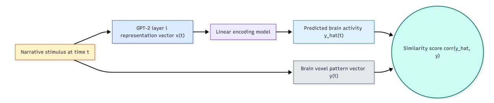
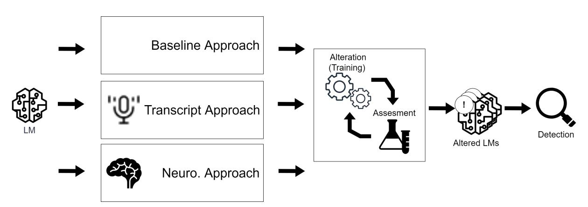
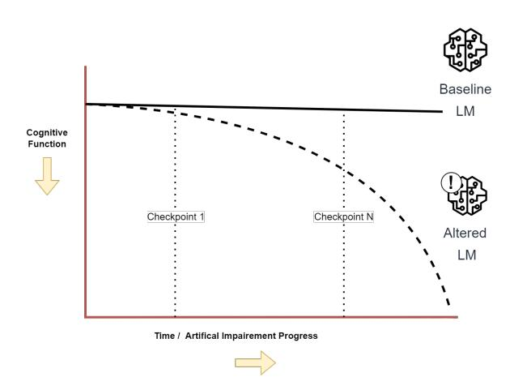
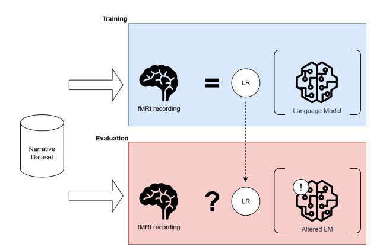
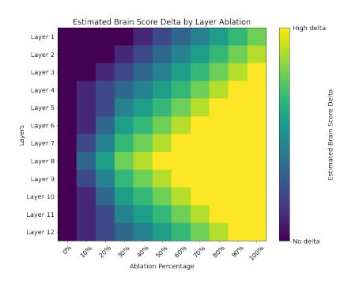
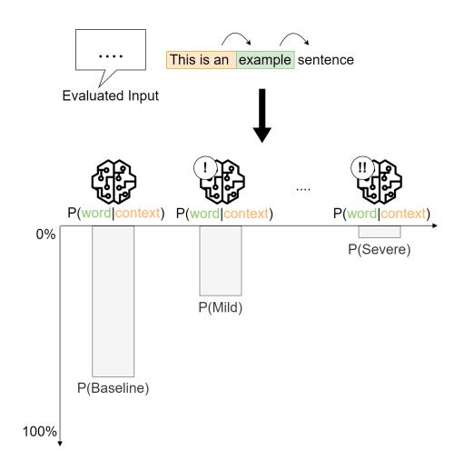

# Thesis proposal: COGNILENS: Analyzing Cognitive Decline in Language Models for Alzheimer's Monitoring

Jonathan Guerne1,2 ,

1 University of Neuchâtel, Switzerland

2Haute Ecole Arc Ingénierie,

University of Applied Sciences and Arts Western Switzerland (HES-SO)

## Abstract

This research proposal describes a crossdisciplinary project aimed at developing Digital Twins (DTs) of Alzheimer's Disease (AD) using Language Models (LMs). By mimicking the functional deficits observed in individuals with AD, these DTs will serve as tools for early detection and understanding of disease progression. Several approaches to altering the LM will be explored, and the resulting effects on brain score — an evaluation of the correlation between brain activity and the LM's internal activations — will be studied. Detection models will be trained based on each approach; these models will be compared against themselves and the state-of-the-art. Two converging lines of evidence motivate this work: LMs achieve high accuracy in classifying AD from speech transcripts, and their internal representations correlate significantly with human brain activity during language processing. If successful, this project could lead to significant advancements in the early detection and monitoring of AD, ultimately improving patient outcomes.

# 1 Introduction

Alzheimer's Disease (AD) is a neurodegenerative disorder primarily affecting the elderly, characterized by memory loss and cognitive decline [\(Man](#page-10-0)[dell and Green,](#page-10-0) [2011\)](#page-10-0). Despite decades of research, AD and, by extension, Mild Cognitive Impairment (MCI) remain difficult to detect before late stages, hindering treatment efficacy. Developing detection methods and monitoring tools is key to improving patient outcomes [\(Frisoni et al.,](#page-9-0) [2021\)](#page-9-0). Numerous solutions spanning different fields have already been explored. Neurobiologically informed approaches focus on the analysis of brain activity to distinguish notable effects of the disease [\(Alar](#page-8-0)[jani and Almarri,](#page-8-0) [2024\)](#page-8-0). Natural Language Processing (NLP) approaches focus on the study of language impairment, which has been shown to be relevant even at an early stage [\(Verma and Howard,](#page-11-0)

[2012\)](#page-11-0). In addition, screening techniques meant to rapidly obtain an assessment of cognitive function have been developed, such as Mini-Mental State Examination (MMSE) [\(Arevalo-Rodriguez et al.,](#page-8-1) [2021\)](#page-8-1) or Montreal Cognitive Assessment (MoCA) [\(Nasreddine et al.,](#page-10-1) [2005\)](#page-10-1).

NLP approaches using transformer techniques reach accuracy as high as 85% on transcript (purely text-based) classification between healthy controls and individuals with AD. [Huth et al.](#page-10-2) [\(2016\)](#page-10-2); [Schrimpf et al.](#page-11-1) [\(2020\)](#page-11-1); [Caucheteux](#page-9-1) [\(2023\)](#page-9-1) recently established that for a given language task, activations inside Artificial Neural Networks (ANNs) of Transformers resemble the neural activity in the human brain. However, it remains unclear whether the internal representations of Transformer-based detection models bear any meaningful resemblance to the neurocognitive alterations observed in individuals with AD. This gap is significant: if LMs trained on AD data encode changes that are aligned with human neural activity, they could serve not only as classifiers but as interpretable models of cognitive degradation, potentially contributing to our understanding of the disease. On the other hand, if their success is purely statistical, relying on textual patterns without deeper cognitive alignment, it opens new opportunities to refine these models for better interpretability and clinical relevance.

Yet, at present, there is no empirical evidence connecting the internal state changes of highperforming AD detection models to the known functional alterations of the human brain activity seen in AD [\(Greicius et al.,](#page-9-2) [2004;](#page-9-2) [Verma and](#page-11-0) [Howard,](#page-11-0) [2012\)](#page-11-0). This disconnect raises a fundamental question: do current LMs that succeed in AD detection actually simulate the disease in any cognitively meaningful way?

This study proposes a novel method for early detection and progression monitoring of AD by using altered LMs. We hypothesize that if we alter LMs such that their activation patterns mimic

the neural activity patterns of individuals with AD, they will also share similar language deficits and vice versa. From this perspective, our goal is therefore to create Digital Twins (DTs) that accurately model the activation function of the individual's brain and could be used to detect, monitor, and open opportunity windows to treat AD. The LM's cognitive degradation will be monitored via the MoCA screening test. Brain score [\(Schrimpf et al.,](#page-11-2) [2021\)](#page-11-2) will be used to monitor the similarity between brain and ANN.

We expect to achieve competitive performance in the detection of AD while offering new monitoring capabilities. We aim to match and potentially outperform the current state-of-the-art. Partially altered models (see Figure [3\)](#page-4-0) will be leveraged to improve the detection pipeline.

#### 1.1 Research Questions

- RQ1: To what extent can a LM's cognitive and linguistic performance be evaluated to characterize model degradation during alteration?
- RQ2: To what extent does simulating cognitive decline through network alterations affect LM performance, and how does this relate to AD detection capability?
- RQ3: Can altered LM help monitor the progression of AD for specific individuals?

## 2 Related Work

## 2.1 AD and MCI screening

To provide quantifiable targets for automatically detecting AD and MCI, researchers notably rely on cognitive screening techniques, such as MMSE or MoCA. MMSE is designed to assess the overall mental function of the patient [\(Arevalo-Rodriguez](#page-8-1) [et al.,](#page-8-1) [2021\)](#page-8-1); it is used to screen for cognitive impairment and track changes over time. It consists of a questionnaire evaluating key cognitive domains, including orientation, attention, memory, language, and visual-spatial skills. It is a widely used approach yet it has known limitations: it cannot be trusted to detect MCI; in other words, it cannot be trusted for early AD detection. MoCA was proposed as a response to this limitation as it is better suited to screen patients with mild cognitive complaints [\(Nasreddine et al.,](#page-10-1) [2005\)](#page-10-1). It follows the same format as MMSE with a total of 30 questions and as many available points. Nevertheless, neither of these tests is sufficient to establish a diagnosis

of AD or MCI on their own; they are meant to be used as part of a comprehensive assessment that includes clinical evaluation, medical history, and other diagnostic tests.

#### 2.2 Language-based detection of AD

DementiaBank[1](#page-1-0) is one of the most widely used collections of datasets for AD detection from linguistic data. One of its most notable entries, the ADReSS [\(Luz et al.,](#page-10-3) [2020\)](#page-10-3) challenge, provides a standardized benchmark for evaluating detection models. The ADReSS dataset contains 156 audio recordings of picture descriptions from both individuals with AD and healthy controls, along with their corresponding transcripts, demographic information, and cognitive scores (MMSE). The challenge has attracted significant attention from the research community, leading to the development of various models; it is now widely used across studies as a shared benchmark [\(Luz et al.,](#page-10-4) [2021\)](#page-10-4).

Various studies have explored the use of NLP techniques to analyze speech and text data from individuals with AD [\(Qi et al.,](#page-11-3) [2023;](#page-11-3) [Yang et al.,](#page-11-4) [2022\)](#page-11-4). They have shown that certain linguistic features, such as semantic impairment, acoustic abnormality, syntactic impairment, and information impairment, can be used to distinguish between individuals with AD and healthy controls [\(Fraser](#page-9-3) [et al.,](#page-9-3) [2016;](#page-9-3) [Thomas et al.,](#page-11-5) [2005\)](#page-11-5). Researchers have also highlighted the potential of using verbal utterances to detect MCI [\(Padhee et al.,](#page-10-5) [2020;](#page-10-5) [König](#page-10-6) [et al.,](#page-10-6) [2015;](#page-10-6) [Hernández-Domínguez et al.,](#page-9-4) [2018\)](#page-9-4).

Deep Learning (DL) models are becoming the new standard for most NLP tasks. More specifically, the Transformer architecture proposed by [Vaswani et al.](#page-11-6) [\(2023\)](#page-11-6) introduced new capabilities for processing sequential data that led to significant improvements in virtually all NLP benchmarks. These models are based on the attention mechanism, which allows them to capture the context and meaning of words in a sentence more effectively compared to previous recurrent architectures such as LSTM [\(Hochreiter and Schmidhuber,](#page-10-7) [1997\)](#page-10-7) or GRU [\(Cho et al.,](#page-9-5) [2014\)](#page-9-5). The Transformer architecture has been used to develop a variety of LMs such as BERT [\(Devlin et al.,](#page-9-6) [2019\)](#page-9-6) or GPT-2 [\(Radford](#page-11-7) [et al.,](#page-11-7) [2019\)](#page-11-7) and is still the basis of most recent models.

To avoid the need to train LMs from scratch, researchers relied on fine-tuning, a strategy that

1 <https://dementia.talkbank.org/>

limits the scale of the required training set by relying on a pretrained model. Fine-tuning has been leveraged to specialize existing models in learning features relevant to speech in individuals with AD [\(Balagopalan et al.,](#page-9-7) [2020,](#page-9-7) [2021;](#page-8-2) [Pan et al.,](#page-10-8) [2021;](#page-10-8) [Ding et al.,](#page-9-8) [2024;](#page-9-8) [Chi et al.,](#page-9-9) [2025\)](#page-9-9). [Balagopalan](#page-9-7) [et al.](#page-9-7) [\(2020\)](#page-9-7) demonstrated that a fine-tuned BERT model outperformed traditional Machine Learning (ML) models on the ADReSS test set, achieving accuracies of 83.3% and 81.3%, respectively. [Li et al.](#page-10-9) [\(2022a\)](#page-10-9) proposed GPT-D, a GPT-2-based model that improved the state-of-the-art accuracy to 85% — our target to match.

## 2.3 Neuroimaging-based detection of AD

Researchers aim to identify biomarkers that can aid in the diagnosis and monitoring of disease progression. functional Magnetic Resonance Imaging (fMRI) is an imaging technique that measures brain activity by detecting changes in blood flow. It is based on the principle that when a brain region is more active, it consumes more oxygen, leading to an increase in blood flow to that region. This change can be detected, allowing the mapping of brain activity in response to various tasks or stimuli [\(Logothetis et al.,](#page-10-10) [2001\)](#page-10-10). Compared to other neuroimaging techniques, fMRI is (I) functional, implying that it can be used to monitor changes in activity in the brain, not its structure, and (II) time-based, meaning that it captures 4-dimensional data (3D space + time), allowing the capture of the dynamic aspect of brain activity. In the context of AD, functional changes are expected to appear before structural changes, making fMRI more relevant for early detection of the disease [\(Dennis and](#page-9-10) [Thompson,](#page-9-10) [2014\)](#page-9-10).

The use of Magnetic Resonance Imaging (MRI) (including fMRI) to study the brain activity of individuals with AD has been explored for a couple of decades [\(Grossman et al.,](#page-9-11) [2003;](#page-9-11) [Domoto-Reilly](#page-9-12) [et al.,](#page-9-12) [2012;](#page-9-12) [Alarjani and Almarri,](#page-8-0) [2024\)](#page-8-0). Some regions of the brain are of particular interest when studying AD. As an example, the Default Mode Network (DMN) [\(Greicius et al.,](#page-9-2) [2004\)](#page-9-2) is a network of brain regions that are active when the brain is at rest and not focused on the outside world. It includes the medial prefrontal cortex, posterior cingulate cortex, and angular gyrus. Its disruption has been linked to cognitive decline in AD. The anterior temporal lobe (ATL) [\(Verma and Howard,](#page-11-0) [2012\)](#page-11-0) is involved in semantic memory and language processing; its dysfunction is associated with language

impairments observed in individuals with AD.

[Cha et al.](#page-9-13) [\(2013\)](#page-9-13) studied the functional alteration patterns of the DMN in normal aging, amnestic Mild Cognitive Impairment (aMCI), and AD. They found that the DMN showed significant functional alterations in both aMCI and individuals with AD compared to individuals with normal aging, yet these alterations were more pronounced, and sometimes unique to, individuals with AD compared to individuals with aMCI. This implies that the functional alterations in the DMN could serve as potential biomarkers for distinguishing between normal aging, aMCI, and AD.

#### 2.4 LMs as Cognitive Models

[Huth et al.](#page-10-2) [\(2016\)](#page-10-2); [Schrimpf et al.](#page-11-1) [\(2020\)](#page-11-1); [Caucheteux](#page-9-1) [\(2023\)](#page-9-1) investigated the use of LMs as cognitive models, suggesting that transformerbased architectures can capture aspects of human cognition. [Schrimpf et al.](#page-11-2) [\(2021\)](#page-11-2) demonstrated that leading transformer models can account for nearly all explainable variance in neural responses to sentences, generalizing across multiple datasets and neuroimaging modalities such as fMRI and electroencephalography (EEG). In other words, the patterns of activity observed in human brains can be almost perfectly predicted by the activations within transformer-based models. This means that the model's internal representations of words, syntax, and meaning align with the neural representations observed in human language areas. The fact that this generalizes across different datasets and measurement techniques indicates that these models capture, to some degree, biologically relevant principles of language. Nevertheless, it is important to note that while these models can predict neural responses, they do not replicate the full complexity of human brain function. Thus, there are some limitations to their use as cognitive models that still need to be explored and documented [\(Gauthier and](#page-9-14) [Levy,](#page-9-14) [2019;](#page-9-14) [Caucheteux and King,](#page-9-15) [2021\)](#page-9-15).

To measure the similarity between LM and brain activity, researchers introduced the concept of "brain score", which quantifies the correlation between the activations of an ANN and the neural activity recorded from the brain when processing the same sentences [\(Schrimpf et al.,](#page-11-8) [2018\)](#page-11-8). It is computed by fitting a linear model to predict the brain activity of one Region of Interest (ROI) — defined as a set of voxels which are the smallest units of analysis in MRI — given the activations of an ANN as input (see Figure [1\)](#page-4-1). This

approach allows researchers to identify which layers of the LM are most similar to brain activity and to explore how different architectural choices affect this similarity. Brain score tests how well a simple linear mapping from these layer representations can predict neural activity recorded during the same language input. Empirically, predictivity tends to improve from early to middle layers and then plateaus or declines [\(Schrimpf et al.,](#page-11-2) [2021;](#page-11-2) [Caucheteux et al.,](#page-9-16) [2022\)](#page-9-16). Moreover, different layers emphasize distinct linguistic functions: syntaxdominant information aligns more with superior temporal regions, whereas semantic/compositional information aligns with inferior-frontal and parietal areas and extends toward the ATL. To obtain such results, [Caucheteux et al.](#page-9-17) [\(2021\)](#page-9-17) had to demonstrate that the semantic and syntactic components of GPT-2 activations could be isolated and that their brain scores could be computed separately.

#### 2.5 Digital Twins in Biomedical Research

[Laubenbacher et al.](#page-10-11) [\(2024\)](#page-10-11) provides a comprehensive overview of the concept of DTs in biomedical research. They define a DT as a virtual representation of a physical entity that can be used for simulation, analysis, and optimization. DTs can be used to model complex biological systems, such as organs or diseases, and to simulate their behavior under different conditions. DTs have the potential to improve our understanding of biological systems and to develop new treatments and therapies. [Wu](#page-11-9) [and Koelzer](#page-11-9) [\(2024\)](#page-11-9); [Ashraf et al.](#page-8-3) [\(2024\)](#page-8-3) explore the use of generative models, such as GPT-2, as DTs in biomedical research, yet the specific use of LMs as brain activity models is still to be explored, especially in the context of AD.

GPT-2 has been shown to yield its highest brain predictivity within the bilateral superior and middle temporal cortices, extending into the ATL [\(Caucheteux et al.,](#page-9-17) [2021,](#page-9-17) [2022\)](#page-9-16). Thus, this region is simultaneously a clinically relevant target for monitoring emerging semantic impairment and a locus where modern predictive language models achieve strong brain-model correspondence, highlighting the potential of LMs as DTs of brain activity in the context of AD.

LM could also be used to pass screening tests designed for human patients, as demonstrated by [Dayan et al.](#page-9-18) [\(2024\)](#page-9-18) when they highlighted the potential of such tests to showcase the relative cognitive performance of different LMs.

#### 3 Proposed Methodology

#### 3.1 Research Design

The research will follow a structured framework repeated for each alteration experiment (see Figure [2\)](#page-4-2). An alteration approach will be implemented with the goal of altering the LM in ways that lead to cognitive decline. The cognitive decline will be monitored with the assessment module by quantifying the model's cognitive performance at different stages of the alteration. The analysis will focus more on the relative degradation of cognitive performance rather than the absolute performance. This allows us to compare different models while limiting the impact of the model's initial performance or lack thereof. It is crucial that this alteration is gradual; otherwise the cognitive decline would be too great and would render the study meaningless.

A detection pipeline will be implemented to leverage the altered models. This pipeline will serve to compare the different alteration approaches against each other and the state-of-the-art. Each model will be saved at different stages, or checkpoints, of their alteration (see Figure [3\)](#page-4-0).

We will conclude the study with a preliminary study of a DT for AD using a longitudinal dataset. The goal will be to monitor the progression of AD for specific individuals.

#### 3.2 Data and Tools

Data The *Narratives* dataset [\(Nastase et al.,](#page-10-12) [2021\)](#page-10-12), containing fMRI recordings of 345 subjects listening to 27 stories, will be used primarily for brain-score mapping and normative modeling from healthy subjects. This will be supplemented by the *Petit Prince fMRI collections* [\(Li et al.,](#page-10-13) [2022b;](#page-10-13) [Momenian et al.,](#page-10-14) [2024\)](#page-10-14), providing story-listening fMRI from young and elderly healthy adults for aging-related analyses and neurobiologically informed alteration. For transcriptbased alteration and evaluation, we will use the *ADReSS* dataset [\(Luz et al.,](#page-10-3) [2020\)](#page-10-3), which contains picture-description transcripts with a benchmark split. The *Delaware corpus* [\(Lanzi et al.,](#page-10-15) [2023\)](#page-10-15) provides multi-task discourse transcripts, audio, and cognitive scores to augment *ADReSS*. For longitudinal studies, we will use *ADReSSo* [\(Luz et al.,](#page-10-4) [2021\)](#page-10-4) and *Pitt Corpus* [\(Becker et al.,](#page-9-19) [1994\)](#page-9-19), which contain speech/transcript datasets with MMSE as cognitive assessments. The *Baycrest corpus* [\(Kielar](#page-10-16) [et al.,](#page-10-16) [2016\)](#page-10-16) provides narratives from individuals with MCI/AD with MoCA and resting-state fMRI.

Figure 1: Illustration inspired from [\(Caucheteux et al.,](#page-9-16) [2022\)](#page-9-16), measures the mapping between the subject's brain activations and the activations of GPT-2, both elicited by the same narrative. To this end, a linear model is fitted to predict the brain activity of one voxel Y, given GPT-2 activations X as input. The degree of mapping is called "brain score". Brain scores can be averaged across fMRI voxels, and different layers of GPT-2.

Figure 2: The research is designed as an iterated framework. An alteration approach is implemented with the goal of altering the LM in ways that lead to cognitive decline. The effect of the alteration is monitored with the assessment module and brain score computation. A detection pipeline is implemented to leverage the altered models.

Figure 3: An altered LM is expected to lose its cognitive performance over the alteration process. This degradation is expected to be gradual, allowing us to monitor the evolution of brain score and cognitive performance at different stages or "checkpoints".

Finally, the *VAS corpora* [\(Liang et al.,](#page-10-17) [2022\)](#page-10-17) and *Connected-speech benchmark* [\(Luz et al.,](#page-10-18) [2024\)](#page-10-18) provide speech datasets with MoCA/MMSE for optional acoustic/hybrid detection experiments.

Tools The primary tools for our research include *MoCA* [\(Nasreddine et al.,](#page-10-1) [2005\)](#page-10-1) as the basis for the assessment module; *brain score/neural alignment* tools implementing the linear-mapping brain score following [Schrimpf et al.](#page-11-2) [\(2021\)](#page-11-2) (considering existing brain-score toolkits where compatible[2](#page-4-3) ); and *Hugging Face*[3](#page-4-4) for access to pre-trained LMs and the Transformers library for model loading and fine-tuning.

## 3.3 Implementation Plan

#### 3.3.1 Cognitive and Linguistic Assessment Module

We will develop a dual-perspective assessment module to quantify cognitive and linguistic changes in LMs during alteration, enhancing measurement

2 [https://brain-score-language.readthedocs.io/](https://brain-score-language.readthedocs.io/en/latest/) [en/latest/](https://brain-score-language.readthedocs.io/en/latest/)

3 <https://huggingface.co/>

sensitivity and providing redundancy if one perspective fails to capture meaningful changes.

Cognitive Performance Assessment We will adapt the MoCA to evaluate model responses across cognitive domains. This approach builds on [Dayan et al.](#page-9-18) [\(2024\)](#page-9-18), who compared Large Language Models (LLMs) using MoCA, and [Binz and](#page-9-20) [Schulz,](#page-9-20) who showed LLMs can solve cognitive tasks comparably to humans. The remote administration paradigm [\(Wong et al.,](#page-11-10) [2015\)](#page-11-10) simplifies adaptation for text-based LMs.

Some questions will require adaptation or exclusion due to modality restrictions, with reference models (e.g., ChatGPT) used to validate task feasibility before inclusion. Model selection will balance practical advantages of smaller models and their extensive brain alignment literature [\(Caucheteux et al.,](#page-9-16) [2022\)](#page-9-16) against the need for adequate baseline performance[4](#page-5-0) .

Linguistic Performance Assessment We will monitor three complementary linguistic metrics to capture different facets of language degradation. Perplexity [\(Goodman,](#page-9-21) [2001\)](#page-9-21) quantifies predictive uncertainty, with increases signaling degraded linguistic capability. N-gram diversity [\(Li et al.,](#page-10-19) [2016\)](#page-10-19) measures lexical richness, relevant as reduced diversity characterizes AD language production [\(Williams et al.,](#page-11-11) [2021\)](#page-11-11). Bert-score [\(Zhang](#page-11-12) [et al.,](#page-11-12) [2020\)](#page-11-12) captures semantic preservation using contextual embeddings, addressing the semantic impairments central to AD.

Integrated Framework This dual assessment investigates whether cognitive and linguistic deterioration follow parallel trajectories during alteration — key to determining if altered models genuinely simulate AD-like decline. Cognitive scores provide interpretable, domain-specific measures aligned with clinical paradigms, while linguistic metrics offer continuous indicators that may reveal subtle changes not captured by discrete tasks. Importantly, this dual-perspective approach provides methodological redundancy: if one assessment dimension proves insufficiently sensitive to capture model degradation, the other may still provide meaningful indicators. Together, they strengthen the robustness of our evaluation framework.

Figure 4: We use the brain score framework described in Section [2.4.](#page-2-0) The trained linear model is applied to the altered model to compute the brain score delta (the difference between the brain score of the altered model and the original model).

#### 3.3.2 Brain score computation and normative modeling

Our goal is to study the LM activation and explore the correlation between the LM's loss of cognitive performance and the deviation from healthy brain activity. To do this, we will rely on [Schrimpf et al.](#page-11-2) [\(2021\)](#page-11-2) to compute the linear model required for brain score computation. We will follow the training strategy proposed by [Schrimpf et al.](#page-11-2) [\(2021\)](#page-11-2) which involves a hold-out validation set of 20% of the dataset and a normalization of the predictivity scores per ROI. Inspired by the work of [Rutherford](#page-11-13) [et al.](#page-11-13) [\(2022\)](#page-11-13), we will implement a normative model. The idea of normative modeling is to monitor the behaviors of a single entity or observation against the expected norm represented by the normative model. In the case of this proposal, the model will be used to monitor the change in brain activity after the alteration process. We will use the "Narratives" dataset [\(Nastase et al.,](#page-10-12) [2021\)](#page-10-12) to fit the normative model. Once trained, the model will be used to compute the brain score of the altered model, enabling us to compute the delta of brain score (see Figure [4\)](#page-5-1).

## 3.3.3 Model alteration approaches

We designed an empirical framework where different alteration approaches will be compared against each other: a baseline approach based on neuron dropout, an approach leveraging transcripts from individuals with AD to fine-tune LMs, and a neurobiologically inspired approach. All alteration approaches will share a similar implementation structure; crucially, they will all output *multiple*

4The brain score language leaderboard could be a useful resource for this comparison (see [https://www.brain-score.](https://www.brain-score.org/language/leaderboard/) [org/language/leaderboard/](https://www.brain-score.org/language/leaderboard/))

Figure 5: We expect the brain score to degrade as the model is altered; this degradation might vary depending on the layer. This illustration assumes a GPT-2 model with 12 layers will be used.

versions of the altered model (see Figure [3\)](#page-4-0). The multiplication of outputs allows us to study the nuances in the evolution of cognitive performance and brain score, ultimately leading to a better detection pipeline. The comparative nature of this framework ensures that even if individual approaches yield weaker-than-expected effects, the differential patterns across methods will provide insights into which types of changes in LMs are more or less effective at simulating cognitive decline, and which evaluation methods are most sensitive to these changes. Overall, the alteration process will share strong similarities with the common training stage of ML, the difference being that the alteration process aims to degrade the model's performance (in a specific way) rather than improve it. There is a risk that the capabilities of the selected LM will drop so significantly that it will render all tasks impossible to complete. Our aim will be to limit this risk with small, gradual, alterations.

Baseline Alteration Approach This alteration approach will serve as a baseline for the approaches described in the following sections.

The inner connections of neurons within the LM will be randomly and gradually removed. This is inspired by a common training regularization technique called dropout [\(Srivastava et al.,](#page-11-14) [2014\)](#page-11-14). We hypothesize that the introduced lesion could lead to a degradation of the model's linguistic capabilities similar to those observed in individuals with AD. Dropout could also be seen as a biomimetic simulation of known synaptic degradation in certain areas of the brain [\(Terry et al.,](#page-11-15) [1991\)](#page-11-15). The viability of this approach is also strengthened by the work of [Li et al.](#page-10-9) [\(2022a\)](#page-10-9), who followed a similar methodology to create GPT-D, an altered version of GPT-2

used to reach state-of-the-art performance in AD classification from textual input. We will monitor the brain score of the model at different stages of the alteration process; we expect to observe a brain score delta that varies depending on the layer being altered and the degree of ablation (see Figure [5\)](#page-6-0).

Transcript-Based Alteration Approach This approach fine-tunes the LM on ADReSS transcripts [\(Luz et al.,](#page-10-3) [2020\)](#page-10-3) to shift its output toward language patterns associated with AD (lexical restriction, simplified structure, repetition). Unlike common AD detection pipelines that attach or finetune a classifier over the LM [\(Balagopalan et al.,](#page-9-7) [2020,](#page-9-7) [2021;](#page-8-2) [Pan et al.,](#page-10-8) [2021;](#page-10-8) [Ding et al.,](#page-9-8) [2024\)](#page-9-8), we keep the original next-token objective. We will use mixed batches of healthy and AD transcripts with a controlled increase in the AD weighting over time. This gradual fine-tuning aims to slowly shift the model's linguistic capabilities toward those observed in AD while preserving some of its original functionality. Fine-tuning will stop once significant cognitive degradation is observed via the assessment module.

This transcript-driven adaptation improves on the random ablation baseline by providing a more structured and data-informed approach to model alteration, potentially leading to more realistic and clinically relevant cognitive decline patterns. It also offers a complementary perspective to the neurobiologically inspired approach, which directly targets model internals based on brain activity patterns rather than behavioral output.

Neurobiologically Inspired Alteration Approach We propose a neurobiologically informed alteration of LMs that is rooted in disease-related brain dysfunction patterns rather than behavioral output. AD-specific effects and ROIs in the brain will be derived from the literature and (if available) fMRI. As a first assessment, the following could serve as a starting ground for our research: ATL semantic hub degeneration [\(Grossman et al.,](#page-9-11) [2003;](#page-9-11) [Domoto-](#page-9-12)[Reilly et al.,](#page-9-12) [2012;](#page-9-12) [Ralph et al.,](#page-11-16) [2017\)](#page-11-16); disrupted DMN connectivity [\(Cha et al.,](#page-9-13) [2013\)](#page-9-13); synapse loss and dysfunction [\(Terry et al.,](#page-11-15) [1991;](#page-11-15) [Pelucchi et al.,](#page-11-17) [2022\)](#page-11-17). Once we have identified the relevant ROIs, we will use brain score to compute layer similarity between LM internal states and region-specific activity. The designated layer could then be targeted for alteration; for instance, synaptic lesion could be simulated.

This approach will share similarities with the

Figure 6: To detect AD, a text input will be used to compute the perplexity of both the baseline and altered model. This approach provides a certainty rating.

baseline approach, but the alteration will be more targeted and informed by neurobiological data. The goal is to create a model that not only exhibits cognitive decline but does so in a manner that reflects known patterns of brain dysfunction in AD.

#### 3.3.4 Detection pipeline

Developed models will be compared in a classification task with the goal of properly identifying the presence (or absence) of the disease from textual input.

Perplexity-based detection Perplexity is an evaluation metric used with LMs [\(Goodman,](#page-9-21) [2001\)](#page-9-21). It computes the likelihood that a LM would have to generate a certain series of words. The smaller the perplexity, the more likely it is that the model would have produced this exact sentence, and vice versa. In this scenario, we will compute the perplexity of multiple models, each representing a specific point in the alteration process. The benefit of using multiple models at once is that we will be able to determine for which model the perplexity is smallest and, by extension, which step in the alteration process it represents. We will aggregate the perplexity per token of the input text for each model. To determine the most likely stage of the disease, we will convert these values into a probability distribution using a softmax function (see Figure [6\)](#page-7-0). This approach enables us to address whether effective detection requires different model characteristics than those that emerge from simulating cognitive decline; in that sense, null or weak relationships between alteration degree and detection performance would still provide valuable

insights into the limitations of the proposed framework and could guide future research toward other alteration or detection strategies.

Inner network activation-based detection While perplexity measures output-level surprise, this approach examines internal processing stability by analyzing the coherence of hidden state activations across altered model checkpoints. This method aligns directly with our brain score framework by operating on the same layer activations used for neural alignment analysis. The hypothesis underlying this method is that text from an individual with AD will produce more coherent activation patterns in an appropriately altered model than in either the baseline or more severely altered models, creating an "internal resonance" between input characteristics and model state.

#### 3.3.5 Personalized AD monitoring

To evaluate the potential of altered LMs as DTs, we will implement a preliminary study using longitudinal data — ADReSSo [\(Luz et al.,](#page-10-4) [2021\)](#page-10-4) and Pitt Corpus [\(Becker et al.,](#page-9-19) [1994\)](#page-9-19) are good fits. The dataset will provide speech recordings and cognitive assessments from subjects tracked over multiple time points, enabling us to model cognitive changes longitudinally. Our approach includes three key steps: (I) selecting the initial reference model that best matches each individual's baseline cognitive state using our detection pipeline; (II) performing personalized fine-tuning with the individual's transcripts to create an individual-specific model; and (III) tracking temporal progression by updating and comparing the personalized model against reference models at each time point to map the trajectory of cognitive decline. This personalized approach allows us to create cognitive DTs that capture individual-specific language patterns rather than only population-level features, potentially enabling more sensitive detection of subtle changes in cognitive function before they become apparent through traditional assessment methods.

## 4 Conclusion

The solution offers two key advantages: (I) A noninvasive detection framework that could be integrated into existing clinical workflows or remote screening tools. (II) An interpretable model architecture whose behavior approximates the cognitive degradation associated with AD. This alignment could enable researchers to simulate brain-like language processing and use the model as a reference for low-cost, virtual experiments.

# Limitations

This work will have several limitations that will frame the interpretation of its results. We will not use task-matched fMRI from AD patients; normative brain models will be trained on healthy listeners. Consequently, brain-score deltas will quantify deviation from a healthy reference rather than disease-specific effects, and generalization across cohorts, languages, and tasks will remain uncertain. Additionally, inter-individual variability in fMRI responses presents a challenge; we will leverage datasets providing both spatially smoothed and nonsmoothed outputs [\(Nastase et al.,](#page-10-12) [2021\)](#page-10-12), as smoothing can improve cross-subject alignment at the expense of spatial specificity. Moreover, brain-model alignment will be correlational: brain score will rely on linear mappings, so high predictivity will not imply mechanistic equivalence, and layer-ROI associations will be interpreted cautiously. The MoCA-inspired protocol will be adapted to textonly interaction and will omit visiospatial items; scores will therefore reflect task performance under this interface rather than a clinical diagnosis and may depend on model size, prompting, and calibration.

The alteration strategies will approximate aspects of language decline and cognitive impairment, but their capacity to act as faithful disease models remains to be established. If alterations do not adequately reflect the neurobiological changes associated with AD, or if brain alignment metrics prove insufficiently sensitive to capture cognitive decline nuances, this would reveal fundamental constraints in current approaches. Similarly, while alterations may measurably impact cognitive performance, they may not necessarily enhance classification performance, potentially indicating that effective detection requires balancing simulation realism with practical utility. For personalized monitoring, the amount of available individual data may be insufficient to capture meaningful longitudinal changes, and inter-individual variability in language patterns may limit the effectiveness of few-shot adaptation for progression tracking.

Nevertheless, even if primary hypotheses are not fully supported, the study will yield valuable insights. The comparative nature of our framework ensures that differential patterns—such as

linguistic metrics showing stronger correlations with brain alignment than cognitive tasks, or certain alteration methods proving more effective than others—would provide actionable guidance for future research. The analysis across multiple alteration approaches and assessment dimensions will identify which methods are more biologically plausible and which evaluation strategies are most sensitive to cognitive changes. Even uniformly weak relationships would be informative: they would suggest that the neural alignment observed in prior studies for healthy language processing does not extend straightforwardly to pathological conditions, revealing fundamental limitations in current LM architectures for modeling disease states. Such findings would establish boundaries of LM capabilities in simulating human cognitive processes, guide future research toward more biologically plausible methods, inform which evaluation strategies are most appropriate for cognitive decline assessment, and help design next-generation models that balance simulation fidelity with practical detection performance.

# Acknowledgments

The author(s) would like to thank the anonymous colleagues and mentors whose feedback and discussions contributed to improving this proposal.

# References

Maitha Alarjani and Badar Almarri. 2024. [fMRI-based](https://doi.org/10.7717/peerj-cs.2302) [Alzheimer's disease detection via functional connec](https://doi.org/10.7717/peerj-cs.2302)[tivity analysis: A systematic review.](https://doi.org/10.7717/peerj-cs.2302) *PeerJ Computer Science*, 10:e2302. Ingrid Arevalo-Rodriguez, Nadja Smailagic, Marta Roqué-Figuls, Agustín Ciapponi, Erick Sanchez-Perez, Antri Giannakou, Olga L Pedraza, Xavier Bonfill Cosp, and Sarah Cullum. 2021. [Mini-Mental](https://doi.org/10.1002/14651858.CD010783.pub3) [State Examination \(MMSE\) for the early detection](https://doi.org/10.1002/14651858.CD010783.pub3) [of dementia in people with mild cognitive impair](https://doi.org/10.1002/14651858.CD010783.pub3)[ment \(MCI\).](https://doi.org/10.1002/14651858.CD010783.pub3) *The Cochrane Database of Systematic Reviews*, 2021(7):CD010783. Taniya Ashraf, Mohammad Ahsan Chisti, and Mohamed Mahees Raheem. 2024. [Digital Twin for](https://doi.org/10.1109/LT60077.2024.10469438) [Neurology: An Introduction to a New Frontier in](https://doi.org/10.1109/LT60077.2024.10469438) [Healthcare.](https://doi.org/10.1109/LT60077.2024.10469438) In *2024 21st Learning and Technology Conference (L&T)*, pages 284–289. Aparna Balagopalan, Benjamin Eyre, Jessica Robin, Frank Rudzicz, and Jekaterina Novikova. 2021. [Com](https://doi.org/10.3389/fnagi.2021.635945)[paring Pre-trained and Feature-Based Models for](https://doi.org/10.3389/fnagi.2021.635945) [Prediction of Alzheimer's Disease Based on Speech.](https://doi.org/10.3389/fnagi.2021.635945) *Frontiers in Aging Neuroscience*, 13.

- Aparna Balagopalan, Benjamin Eyre, Frank Rudzicz, and Jekaterina Novikova. 2020. [To bert or not to bert:](https://doi.org/10.21437/Interspeech.2020-2557) [Comparing speech and language-based approaches](https://doi.org/10.21437/Interspeech.2020-2557) [for alzheimer's disease detection.](https://doi.org/10.21437/Interspeech.2020-2557) In *Interspeech 2020*, pages 2167–2171. James T. Becker, François Boiler, Oscar L. Lopez, Judith Saxton, and Karen L. McGonigle. 1994. [The](https://doi.org/10.1001/archneur.1994.00540180063015) [natural history of alzheimer's disease: Description of](https://doi.org/10.1001/archneur.1994.00540180063015) [study cohort and accuracy of diagnosis.](https://doi.org/10.1001/archneur.1994.00540180063015) *Archives of Neurology*, 51(6):585–594. Marcel Binz and Eric Schulz. [Using cognitive psychol](https://doi.org/10.1073/pnas.2218523120)[ogy to understand GPT-3.](https://doi.org/10.1073/pnas.2218523120) 120(6):e2218523120. Charlotte Caucheteux. 2023. *Language Representations in Deep Learning Algorithms and the Brain*. Theses, Université Paris-Saclay. Charlotte Caucheteux, Alexandre Gramfort, and Jean-Remi King. 2021. Disentangling syntax and semantics in the brain with deep networks. In *Proceedings of the 38th International Conference on Machine Learning*, pages 1336–1348. PMLR. Charlotte Caucheteux, Alexandre Gramfort, and Jean-Rémi King. 2022. [Deep language algorithms predict](https://doi.org/10.1038/s41598-022-20460-9) [semantic comprehension from brain activity.](https://doi.org/10.1038/s41598-022-20460-9) *Scientific Reports*, 12(1):16327. Charlotte Caucheteux and Jean-Rémi King. 2021. [Lan](https://doi.org/10.1101/2020.07.03.186288)[guage processing in brains and deep neural networks:](https://doi.org/10.1101/2020.07.03.186288) [Computational convergence and its limits.](https://doi.org/10.1101/2020.07.03.186288) Jungho Cha, Hang Joon Jo, Hee Jin Kim, Sang Won Seo, Han-Soo Kim, Uicheul Yoon, Hyunjin Park, Duk L. Na, and Jong-Min Lee. 2013. [Functional alteration](https://doi.org/10.1111/ejn.12177) [patterns of default mode networks: Comparisons of](https://doi.org/10.1111/ejn.12177) [normal aging, amnestic mild cognitive impairment](https://doi.org/10.1111/ejn.12177) [and Alzheimer's disease.](https://doi.org/10.1111/ejn.12177) *The European Journal of Neuroscience*, 37(12):1916–1924. Lei Chi, Arav Sharma, Ari Gebhardt, and Joseph T. Colonel. 2025. [Predicting Cognitive Decline: A Mul](https://doi.org/10.48550/arXiv.2502.08862)[timodal AI Approach to Dementia Screening from](https://doi.org/10.48550/arXiv.2502.08862) [Speech.](https://doi.org/10.48550/arXiv.2502.08862) *Preprint*, arXiv:2502.08862. Kyunghyun Cho, Bart van Merriënboer, Caglar Gulcehre, Dzmitry Bahdanau, Fethi Bougares, Holger Schwenk, and Yoshua Bengio. 2014. [Learning](https://doi.org/10.3115/v1/D14-1179) [phrase representations using RNN encoder–decoder](https://doi.org/10.3115/v1/D14-1179) [for statistical machine translation.](https://doi.org/10.3115/v1/D14-1179) In *Proceedings of the 2014 Conference on Empirical Methods in Natural Language Processing (EMNLP)*, pages 1724– 1734, Doha, Qatar. Association for Computational Linguistics. Roy Dayan, Benjamin Uliel, and Gal Koplewitz. 2024. [Age against the machine—susceptibility of large lan](https://doi.org/10.1136/bmj-2024-081948)[guage models to cognitive impairment: Cross sec](https://doi.org/10.1136/bmj-2024-081948)[tional analysis.](https://doi.org/10.1136/bmj-2024-081948) *BMJ*, 387:e081948. Emily L. Dennis and Paul M. Thompson. 2014. [Func](https://doi.org/10.1007/s11065-014-9249-6)[tional Brain Connectivity using fMRI in Aging](https://doi.org/10.1007/s11065-014-9249-6) [and Alzheimer's Disease.](https://doi.org/10.1007/s11065-014-9249-6) *Neuropsychology review*, 24(1):49–62. Jacob Devlin, Ming-Wei Chang, Kenton Lee, and Kristina Toutanova. 2019. [BERT: Pre-training of](https://doi.org/10.48550/arXiv.1810.04805) [Deep Bidirectional Transformers for Language Un](https://doi.org/10.48550/arXiv.1810.04805)[derstanding.](https://doi.org/10.48550/arXiv.1810.04805) *Preprint*, arXiv:1810.04805. Kewen Ding, Madhu Chetty, Azadeh Noori Hoshyar, Tanusri Bhattacharya, and Britt Klein. 2024. [Speech](https://doi.org/10.1007/s10462-024-10961-6) [based detection of Alzheimer's disease: A survey](https://doi.org/10.1007/s10462-024-10961-6) [of AI techniques, datasets and challenges.](https://doi.org/10.1007/s10462-024-10961-6) *Artificial Intelligence Review*, 57(12):325. Kimiko Domoto-Reilly, Daisy Sapolsky, Michael Brickhouse, and Bradford C. Dickerson. 2012. [Naming](https://doi.org/10.1016/j.neuroimage.2012.06.018) [impairment in Alzheimer's disease is associated with](https://doi.org/10.1016/j.neuroimage.2012.06.018) [left anterior temporal lobe atrophy.](https://doi.org/10.1016/j.neuroimage.2012.06.018) *NeuroImage*, 63(1):348–355. Kathleen C. Fraser, Jed A. Meltzer, and Frank Rudzicz. 2016. [Linguistic Features Identify Alzheimer's](https://doi.org/10.3233/JAD-150520) [Disease in Narrative Speech.](https://doi.org/10.3233/JAD-150520) *Journal of Alzheimer's disease: JAD*, 49(2):407–422. Giovanni B. Frisoni, Jean-Marie Annoni, Stefanie Becker, Tim Brockmann, Markus Buerge, Jean-François Démonet, Dan Georgescu, Anton Gietl, Ulrich Hemmeter, Stefan Klöppel, Thomas Leyhe, Andreas U. Monsch, Franco Rogantini, Delphine Roulet Schwab, Egemen Savaskan, Karl Schaller, Armin von Gunten, and Gabriel Gold. 2021. [Po](https://doi.org/10.3390/ctn5020014)[sition Statement on Anti-Dementia Medication for](https://doi.org/10.3390/ctn5020014) [Alzheimer's Disease by Swiss Stakeholders.](https://doi.org/10.3390/ctn5020014) *Clinical and Translational Neuroscience*, 5(2):14. Jon Gauthier and Roger Levy. 2019. [Linking artificial](https://doi.org/10.18653/v1/D19-1050) [and human neural representations of language.](https://doi.org/10.18653/v1/D19-1050) In *Proceedings of the 2019 Conference on Empirical Methods in Natural Language Processing and the 9th International Joint Conference on Natural Language Processing (EMNLP-IJCNLP)*, pages 529–539, Hong Kong, China. Association for Computational Linguistics. Joshua T. Goodman. 2001. [A bit of progress in language](https://doi.org/10.1006/csla.2001.0174) [modeling.](https://doi.org/10.1006/csla.2001.0174) *Computer Speech & Language*, 15(4):403–
  - 434. Michael D. Greicius, Gaurav Srivastava, Allan L. Reiss, and Vinod Menon. 2004. [Default-mode network ac](https://doi.org/10.1073/pnas.0308627101)[tivity distinguishes Alzheimer's disease from healthy](https://doi.org/10.1073/pnas.0308627101) [aging: Evidence from functional MRI.](https://doi.org/10.1073/pnas.0308627101) *Proceedings of the National Academy of Sciences of the United States of America*, 101(13):4637–4642. Murray Grossman, Phyllis Koenig, Guila Glosser, Chris DeVita, Peachie Moore, Jina Rhee, John Detre, David Alsop, Jim Gee, and fMRI study. Functional magnetic resonance imaging. 2003. [Neural basis for se](https://doi.org/10.1093/brain/awg027)[mantic memory difficulty in Alzheimer's disease: An](https://doi.org/10.1093/brain/awg027) [fMRI study.](https://doi.org/10.1093/brain/awg027) *Brain: A Journal of Neurology*, 126(Pt 2):292–311. Laura Hernández-Domínguez, Sylvie Ratté, Gerardo Sierra-Martínez, and Andrés Roche-Bergua. 2018. [Computer-based evaluation of Alzheimer's disease](https://doi.org/10.1016/j.dadm.2018.02.004) [and mild cognitive impairment patients during a pic](https://doi.org/10.1016/j.dadm.2018.02.004)[ture description task.](https://doi.org/10.1016/j.dadm.2018.02.004) *Alzheimer's & Dementia (Amsterdam, Netherlands)*, 10:260–268.

- Sepp Hochreiter and Jürgen Schmidhuber. 1997. [Long](https://doi.org/10.1162/neco.1997.9.8.1735) [Short-Term Memory.](https://doi.org/10.1162/neco.1997.9.8.1735) *Neural Computation*, 9:1735– 1780. Alexander G. Huth, Tyler Lee, Shinji Nishimoto, Natalia Y. Bilenko, An T. Vu, and Jack L. Gallant. 2016. [Decoding the Semantic Content of Natural Movies](https://doi.org/10.3389/fnsys.2016.00081) [from Human Brain Activity.](https://doi.org/10.3389/fnsys.2016.00081) *Frontiers in Systems Neuroscience*, 10:81. Aneta Kielar, Tiffany Deschamps, Ron K. O. Chu, Regina Jokel, Yasha B. Khatamian, Jean J. Chen, and Jed A. Meltzer. 2016. [Identifying Dysfunctional](https://doi.org/10.3389/fnagi.2016.00040) [Cortex: Dissociable Effects of Stroke and Aging on](https://doi.org/10.3389/fnagi.2016.00040) [Resting State Dynamics in MEG and fMRI.](https://doi.org/10.3389/fnagi.2016.00040) *Frontiers in Aging Neuroscience*, 8. Alexandra König, Aharon Satt, Alexander Sorin, Ron Hoory, Orith Toledo-Ronen, Alexandre Derreumaux, Valeria Manera, Frans Verhey, Pauline Aalten, Phillipe H. Robert, and Renaud David. 2015. [Au](https://doi.org/10.1016/j.dadm.2014.11.012)[tomatic speech analysis for the assessment of pa](https://doi.org/10.1016/j.dadm.2014.11.012)[tients with predementia and Alzheimer's disease.](https://doi.org/10.1016/j.dadm.2014.11.012) *Alzheimer's & Dementia (Amsterdam, Netherlands)*, 1(1):112–124. Alyssa M. Lanzi, Anna K. Saylor, Davida Fromm, Houjun Liu, Brian MacWhinney, and Matthew L. Cohen. 2023. [DementiaBank: Theoretical Rationale, Proto](https://doi.org/10.1044/2022_AJSLP-22-00281)[col, and Illustrative Analyses.](https://doi.org/10.1044/2022_AJSLP-22-00281) *American Journal of Speech-Language Pathology*, 32(2):426–438. Publisher: American Speech-Language-Hearing Association.
- R. Laubenbacher, B. Mehrad, I. Shmulevich, and
- N. Trayanova. 2024. [Digial Twins in Medicine.](https://doi.org/10.1038/s43588-024-00607-6) *Nature computational science*, 4(3):184–191. Changye Li, David Knopman, Weizhe Xu, Trevor Cohen, and Serguei Pakhomov. 2022a. [GPT-D: Induc](https://doi.org/10.18653/v1/2022.acl-long.131)[ing Dementia-related Linguistic Anomalies by De](https://doi.org/10.18653/v1/2022.acl-long.131)[liberate Degradation of Artificial Neural Language](https://doi.org/10.18653/v1/2022.acl-long.131) [Models.](https://doi.org/10.18653/v1/2022.acl-long.131) In *Proceedings of the 60th Annual Meeting of the Association for Computational Linguistics (Volume 1: Long Papers)*, pages 1866–1877, Dublin, Ireland. Association for Computational Linguistics. Jiwei Li, Michel Galley, Chris Brockett, Jianfeng Gao, and Bill Dolan. 2016. [A diversity-promoting ob](https://doi.org/10.18653/v1/N16-1014)[jective function for neural conversation models.](https://doi.org/10.18653/v1/N16-1014) In *Proceedings of the 2016 Conference of the North American Chapter of the Association for Computational Linguistics: Human Language Technologies*, pages 110–119, San Diego, California. Association for Computational Linguistics. Jixing Li, Shohini Bhattasali, Shulin Zhang, Berta Franzluebbers, Wen-Ming Luh, R. Nathan Spreng, Jonathan R. Brennan, Yiming Yang, Christophe Pallier, and John Hale. 2022b. [Le Petit Prince multi](https://doi.org/10.1038/s41597-022-01625-7)[lingual naturalistic fMRI corpus.](https://doi.org/10.1038/s41597-022-01625-7) *Scientific Data*, 9(1):530. Xiaohui Liang, John A. Batsis, Youxiang Zhu, Tiffany M. Driesse, Robert M. Roth, David Kotz, and Brian MacWhinney. 2022. [Evaluating voice-assistant](https://doi.org/10.1016/j.csl.2021.101297) [commands for dementia detection.](https://doi.org/10.1016/j.csl.2021.101297) *Computer Speech & Language*, 72:101297. Nikos K. Logothetis, Jon Pauls, Mark Augath, Torsten Trinath, and Axel Oeltermann. 2001. [Neurophysio](https://doi.org/10.1038/35084005)[logical investigation of the basis of the fMRI signal.](https://doi.org/10.1038/35084005) *Nature*, 412(6843):150–157. Saturnino Luz, Sofia De La Fuente Garcia, Fasih Haider, Davida Fromm, Brian MacWhinney, Alyssa Lanzi, Ya-Ning Chang, Chia-Ju Chou, and Yi-Chien Liu. 2024. [Connected Speech-Based Cognitive Assess](https://doi.org/10.21437/Interspeech.2024-1807)[ment in Chinese and English.](https://doi.org/10.21437/Interspeech.2024-1807) pages 947–951. Saturnino Luz, Fasih Haider, Sofia de la Fuente, Davida Fromm, and Brian MacWhinney. 2020. [Alzheimer's Dementia Recognition through Spon](https://doi.org/10.48550/arXiv.2004.06833)[taneous Speech: The ADReSS Challenge.](https://doi.org/10.48550/arXiv.2004.06833) *Preprint*, arXiv:2004.06833. Saturnino Luz, Fasih Haider, Sofia de la Fuente, Davida Fromm, and Brian MacWhinney. 2021. [Detecting](https://arxiv.org/abs/2104.09356) [cognitive decline using speech only: The ADReSSo](https://arxiv.org/abs/2104.09356) [Challenge.](https://arxiv.org/abs/2104.09356) *Preprint*, arXiv:2104.09356. Alan M. Mandell and Robert C. Green. 2011. [Alzheimer's Disease.](https://doi.org/10.1002/9781444344110.ch1) In *The Handbook of Alzheimer's Disease and Other Dementias*, chapter 1, pages 1–91. John Wiley & Sons, Ltd. Mohammad Momenian, Zhengwu Ma, Shuyi Wu, Chengcheng Wang, Jonathan Brennan, John Hale, Lars Meyer, and Jixing Li. 2024. [Le Petit Prince](https://doi.org/10.1038/s41597-024-03745-8) [Hong Kong \(LPPHK\): Naturalistic fMRI and EEG](https://doi.org/10.1038/s41597-024-03745-8) [data from older Cantonese speakers.](https://doi.org/10.1038/s41597-024-03745-8) *Scientific Data*, 11(1):992. Ziad S. Nasreddine, Natalie A. Phillips, Valérie Bédirian, Simon Charbonneau, Victor Whitehead, Isabelle Collin, Jeffrey L. Cummings, and Howard Chertkow. 2005. [The Montreal Cognitive Assess](https://doi.org/10.1111/j.1532-5415.2005.53221.x)[ment, MoCA: A Brief Screening Tool For Mild Cog](https://doi.org/10.1111/j.1532-5415.2005.53221.x)[nitive Impairment.](https://doi.org/10.1111/j.1532-5415.2005.53221.x) *Journal of the American Geriatrics Society*, 53(4):695–699. Samuel A. Nastase, Yun-Fei Liu, Hanna Hillman, Asieh Zadbood, Liat Hasenfratz, Neggin Keshavarzian, Janice Chen, Christopher J. Honey, Yaara Yeshurun, Mor Regev, Mai Nguyen, Claire H. C. Chang, Christopher Baldassano, Olga Lositsky, Erez Simony, Michael A. Chow, Yuan Chang Leong, Paula P. Brooks, Emily Micciche, and 6 others. 2021. [The "Narratives" fMRI](https://doi.org/10.1038/s41597-021-01033-3) [dataset for evaluating models of naturalistic language](https://doi.org/10.1038/s41597-021-01033-3) [comprehension.](https://doi.org/10.1038/s41597-021-01033-3) *Scientific Data*, 8(1):250. Swati Padhee, Anurag Illendula, Megan Sadler, Valerie L. Shalin, Tanvi Banerjee, Krishnaprasad Thirunarayan, and William L. Romine. 2020. [Predict](https://doi.org/10.1109/BIBM49941.2020.9313106)[ing early indicators of cognitive decline from verbal](https://doi.org/10.1109/BIBM49941.2020.9313106) [utterances.](https://doi.org/10.1109/BIBM49941.2020.9313106) In *2020 IEEE International Conference on Bioinformatics and Biomedicine (BIBM)*, pages 477–480. Yilin Pan, Bahman Mirheidari, Jennifer M. Harris, Jennifer C. Thompson, Matthew Jones, Julie S. Snowden, Daniel Blackburn, and Heidi Christensen. 2021.

- [Using the Outputs of Different Automatic Speech](https://doi.org/10.21437/Interspeech.2021-1519) [Recognition Paradigms for Acoustic- and BERT-](https://doi.org/10.21437/Interspeech.2021-1519)[Based Alzheimer's Dementia Detection Through](https://doi.org/10.21437/Interspeech.2021-1519) [Spontaneous Speech.](https://doi.org/10.21437/Interspeech.2021-1519) In *Proc. Interspeech 2021*, pages 3810–3814. Silvia Pelucchi, Fabrizio Gardoni, Monica Di Luca, and Elena Marcello. 2022. [Synaptic dysfunction in](https://doi.org/10.1016/B978-0-12-819410-2.00022-9) [early phases of Alzheimer's Disease.](https://doi.org/10.1016/B978-0-12-819410-2.00022-9) *Handbook of Clinical Neurology*, 184:417–438. Xiaoke Qi, Qing Zhou, Jian Dong, and Wei Bao. 2023. [Noninvasive automatic detection of Alzheimer's dis](https://doi.org/10.3389/fnagi.2023.1224723)[ease from spontaneous speech: A review.](https://doi.org/10.3389/fnagi.2023.1224723) *Frontiers in Aging Neuroscience*, 15:1224723. Alec Radford, Jeff Wu, R. Child, D. Luan, Dario Amodei, and I. Sutskever. 2019. Language Models are Unsupervised Multitask Learners. Matthew A. Lambon Ralph, Elizabeth Jefferies, Karalyn Patterson, and Timothy T. Rogers. 2017. [The neu](https://doi.org/10.1038/nrn.2016.150)[ral and computational bases of semantic cognition.](https://doi.org/10.1038/nrn.2016.150) *Nature Reviews Neuroscience*, 18(1):42–55. Saige Rutherford, Seyed Mostafa Kia, Thomas Wolfers, Charlotte Fraza, Mariam Zabihi, Richard Dinga, Pierre Berthet, Amanda Worker, Serena Verdi, Henricus G. Ruhe, Christian F. Beckmann, and Andre F. Marquand. 2022. [The normative modeling frame](https://doi.org/10.1038/s41596-022-00696-5)[work for computational psychiatry.](https://doi.org/10.1038/s41596-022-00696-5) *Nature Protocols*, 17(7):1711–1734. Martin Schrimpf, Idan Blank, Greta Tuckute, Carina Kauf, Eghbal A. Hosseini, Nancy Kanwisher, Joshua Tenenbaum, and Evelina Fedorenko. 2020. [Artifi](https://doi.org/10.1101/2020.06.26.174482)[cial Neural Networks Accurately Predict Language](https://doi.org/10.1101/2020.06.26.174482) [Processing in the Brain.](https://doi.org/10.1101/2020.06.26.174482) Martin Schrimpf, Idan Asher Blank, Greta Tuckute, Carina Kauf, Eghbal A. Hosseini, Nancy Kanwisher, Joshua B. Tenenbaum, and Evelina Fedorenko. 2021. [The neural architecture of language: Integrative](https://doi.org/10.1073/pnas.2105646118) [modeling converges on predictive processing.](https://doi.org/10.1073/pnas.2105646118) *Proceedings of the National Academy of Sciences*, 118(45):e2105646118. Martin Schrimpf, Jonas Kubilius, Ha Hong, Najib J. Majaj, Rishi Rajalingham, Elias B. Issa, Kohitij Kar, Pouya Bashivan, Jonathan Prescott-Roy, Kailyn Schmidt, Daniel L. K. Yamins, and James J. DiCarlo. 2018. [Brain-score: Which artificial neural network](https://doi.org/10.1101/407007) [for object recognition is most brain-like?](https://doi.org/10.1101/407007) *bioRxiv : the preprint server for biology*. Nitish Srivastava, Geoffrey Hinton, Alex Krizhevsky, Ilya Sutskever, and Ruslan Salakhutdinov. 2014. Dropout: A Simple Way to Prevent Neural Networks from Overfitting. *Journal of Machine Learning Research*, 15(56):1929–1958. Robert D. Terry, Eliezer Masliah, David P. Salmon, Nelson Butters, Richard DeTeresa, Robert Hill, Lawrence A. Hansen, and Robert Katzman. 1991. [Physical basis of cognitive alterations in alzheimer's](https://doi.org/10.1002/ana.410300410) [disease: Synapse loss is the major correlate of cog](https://doi.org/10.1002/ana.410300410)[nitive impairment.](https://doi.org/10.1002/ana.410300410) *Annals of Neurology*, 30(4):572–
  - 580.
  - C. Thomas, V. Keselj, N. Cercone, K. Rockwood, and
  - E. Asp. 2005. [Automatic detection and rating of de](https://doi.org/10.1109/ICMA.2005.1626789)[mentia of Alzheimer type through lexical analysis of](https://doi.org/10.1109/ICMA.2005.1626789) [spontaneous speech.](https://doi.org/10.1109/ICMA.2005.1626789) In *IEEE International Conference Mechatronics and Automation, 2005*, volume 3, pages 1569–1574 Vol. 3. Ashish Vaswani, Noam Shazeer, Niki Parmar, Jakob Uszkoreit, Llion Jones, Aidan N. Gomez, Lukasz Kaiser, and Illia Polosukhin. 2023. [Attention Is All](https://doi.org/10.48550/arXiv.1706.03762) [You Need.](https://doi.org/10.48550/arXiv.1706.03762) *Preprint*, arXiv:1706.03762.
  - M. Verma and R. J. Howard. 2012. [Semantic memory](https://doi.org/10.1002/gps.3766) [and language dysfunction in early Alzheimer's dis](https://doi.org/10.1002/gps.3766)[ease: A review.](https://doi.org/10.1002/gps.3766) *International Journal of Geriatric Psychiatry*, 27(12):1209–1217. Eric Williams, Megan McAuliffe, and Catherine Theys. 2021. [Language changes in Alzheimer's disease: A](https://doi.org/10.1016/j.bandl.2021.105041) [systematic review of verb processing.](https://doi.org/10.1016/j.bandl.2021.105041) *Brain and Language*, 223:105041. Adrian Wong, David Nyenhuis, Sandra E. Black, Lorraine S. N. Law, Eugene S. K. Lo, Pauline W. L. Kwan, Lisa Au, Anne Y. Y. Chan, Lawrence K. S. Wong, Ziad Nasreddine, and Vincent Mok. 2015. [Montreal Cognitive Assessment 5-minute protocol is](https://doi.org/10.1161/STROKEAHA.114.007253) [a brief, valid, reliable, and feasible cognitive screen](https://doi.org/10.1161/STROKEAHA.114.007253) [for telephone administration.](https://doi.org/10.1161/STROKEAHA.114.007253) 46(4):1059–1064. Jiqing Wu and Viktor H. Koelzer. 2024. [Towards gen](https://doi.org/10.1016/j.csbj.2024.09.030)[erative digital twins in biomedical research.](https://doi.org/10.1016/j.csbj.2024.09.030) *Computational and Structural Biotechnology Journal*, 23:3481–3488. Qin Yang, Xin Li, Xinyun Ding, Feiyang Xu, and Zhenhua Ling. 2022. [Deep learning-based speech analysis](https://doi.org/10.1186/s13195-022-01131-3) [for Alzheimer's disease detection: A literature review.](https://doi.org/10.1186/s13195-022-01131-3) *Alzheimer's Research & Therapy*, 14(1):186. Tianyi Zhang, Varsha Kishore, Felix Wu, Kilian Q. Weinberger, and Yoav Artzi. 2020. [Bertscore:](https://arxiv.org/abs/1904.09675) [Evaluating text generation with bert.](https://arxiv.org/abs/1904.09675) *Preprint*, arXiv:1904.09675.